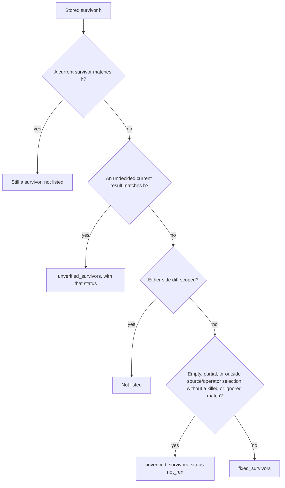

# Baseline unverified survivors and completeness gate - Plan

## Goal Capsule

- **Issues:** #283 (`--baseline` has no completeness gate: errored survivors read as fixed) and #286 (`ran_at_load` hides survivors on lines that tests also cover).
- **Goal:** `--baseline` counts a stored survivor as fixed only when this run killed it, ignored it, or no longer has it in a complete run, and it fails a broken run without `--threshold`. The reports also count the `ran_at_load` mutants whose covering tests ran and passed, so those hidden survivors are visible.
- **Authority:** this plan, then `AGENTS.md`, then the `**Claude:**` comments on #283 and #286. Where this plan differs from a comment, this plan wins (see "Corrections to the issue comments").
- **Stop and ask when:** a change would alter the score, the `--threshold` exit code, or the `no_verdict` set; or PR #244 (the 2.0 contract flip) merges first, because it changes the exit code for an incomplete run to 3.
- **Size:** M. About 20 files across `lib/`, `test/`, `action.yml` and the docs. U4 has no dependency on U1 to U3 and can ship as its own pull request.
- **Status:** the diff passed 600 changed lines, so U4 (R9, R10: `tested_at_load`, `summary.ran_at_load_tested`, `ran_at_load[].tested`) ships in a draft pull request stacked on the one for U1 to U3. The first pull request ships U1 to U3 and the U5 docs for #283; for #286 it ships only AE3 (a `ran_at_load` baseline survivor is not fixed). The Definition of Done applies to the two pull requests together. Both add keys under the unreleased schema `2.0`; if the first ships in a release before the second merges, the second takes the next minor version. Review changed some output wording (the INCOMPLETE verdict, for example); where this plan and the code differ on wording, the code and its tests are the source.

---

## Product Contract

### Summary

`Baseline#diff` gets one rule for "fixed" and two new delta facts: `unverified_survivors` (stored survivors that this run did not decide) and `incomplete` (the run fails the completeness rule from #78). An incomplete run makes `--baseline` alone exit 1, while `regressed` keeps its meaning (new survivors or a score drop). The completeness helpers move from `Reporter` to `AggregateResult`, so `Baseline` and `Reporter` use one rule. For #286, a `ran_at_load` result made from a tested survivor gets a boolean field, and the JSON and human reports count it.

### Problem Frame

`Baseline#diff` reads only `aggregate.surviving_mutants`. Any stored survivor that is not a survivor now goes into `fixed_survivors`. That includes a survivor that errored, timed out, became `uncapturable`, became `ran_at_load`, or lost coverage. The CLI exit for `--baseline` reads only `delta.regressed`, which ignores the no-verdict counts. A broken run (a daemon crash, a harness failure) therefore errors the old survivors, lists them as fixed, and exits 0 without `--threshold`.

The same path hides #286. `JobPlan.load_verdict` turns a survivor into `ran_at_load` after its covering tests ran and passed. That result looks the same as a `ran_at_load` mutant that no test ran. Under `--baseline` it reads as fixed, and no report can count it.

Checked on main (`18ef483`) in this clone:

- Baseline survivors `a`, `b`. Current run: `a` and `b` errored, two kills. Result: `fixed = ["a", "b"]`, `regressed = false`, `score_after = 100.0`.
- Baseline survivors `a`, `b`. Current run: `a` is `ran_at_load`, `b` is `no_coverage`. Result: `fixed = ["a", "b"]`, `regressed = false`.

### Terms

- **No verdict:** `error`, `timeout` or `uncapturable`, as today (`summary.no_verdict`, `no_verdict[]`). This plan does not change it.
- **Undecided:** any status other than `killed`, `survived` or `ignored`. This is the no-verdict set plus `ran_at_load`, `no_coverage`, `unplaceable` and `skipped`.
- **Unverified survivor:** a stored survivor whose current result is undecided, or whose id was omitted by partial selection or an empty unscoped run (labelled `not_run` only in the baseline delta).

### Requirements

**Completeness gate (#283)**

- R1. `AggregateResult` owns the completeness rule: `no_verdict_count`, `attempted_count`, `broken_nil_score?`, `broken_share_exceeded?`, and a new `incomplete?`. `Reporter` calls them and keeps its exit codes and messages for `--threshold`.
- R2. `Baseline#diff` sets `Delta#incomplete` from `aggregate.incomplete?`. `regressed` keeps its meaning. The CLI baseline exit is 1 when `regressed` or `incomplete` is true.
- R3. When a gate fails on completeness, stderr names the gate that fails. When no gate fails, the existing errored-count note still prints for a run without a positive `--threshold`, with or without `--baseline`.

**Fixed versus unverified (#283, #286)**

- R4. A stored survivor is fixed only when its current result is `killed` or `ignored`, or when no current result has its id in a full run within the selected source/operator scope. Existing unselected files and omitted operators are not verified; a source actually removed from the project is a genuine removal. With `--only` or `--fail-fast`, known kills and ignores remain fixed but absent ids do not. A run with no results reports no stored survivor as fixed. The scoped rule stays: under a diff-scoped side, `fixed_survivors` is empty.
- R5. Each unverified survivor goes into `Delta#unverified_survivors` with its current status. Stored ids omitted by `--only`, `--fail-fast`, selected sources/operators, or an empty unscoped run use `not_run`, a baseline-only label that does not create a Result status or alter aggregate counts. Omitted ids under `--since` stay absent, as before. This list is informational. It does not set `regressed` or the exit code. It is filled under a diff-scoped side too.
- R6. The old-format id matching from #126 applies to unverified survivors exactly as it applies to survivors.
- R7. The JSON `baseline` block adds `incomplete` and `unverified_survivors[]`. The human "Baseline comparison" section names the unverified survivors and gives the completeness ratio when the run is incomplete.
- R8. The GitHub Action job summary says when the baseline run is incomplete and how many survivors are unverified.

**Ran-at-load survivors (#286)**

- R9. `JobPlan.load_verdict` sets `tested_at_load: true` on the `ran_at_load` results it makes from a survivor. `coverage_selection` results keep the default `false`.
- R10. The JSON report adds `summary.ran_at_load_tested` and a `tested` boolean on each `ran_at_load[]` entry. The human report and the HTML counts show the same number.

**Contract and docs**

- R11. `Reporter::SCHEMA_VERSION` moves from `1.8` to `2.0`. `docs/json-schema.md`, `STABILITY.md`, `README.md`, `action.yml`, the `--baseline` help text and `CHANGELOG.md` describe the new behaviour.

### Acceptance Examples

- AE1. Baseline survivors `a`, `b`. Current: `a` error, `b` error, two kills. Then `incomplete = true`, `regressed = false`, `fixed_survivors = []`, `unverified_survivors` holds `a` and `b` with status `error`, and `mutineer run --baseline` exits 1 without `--threshold`.
- AE2. Baseline survivors `a`, `b`. Current: `a` error, `b` killed, 20 more kills. Then `incomplete = false`, `regressed = false`, `fixed_survivors = [b]`, `unverified_survivors = [a]`.
- AE3. Baseline survivor `a`. Current: `a` is `ran_at_load`. Then `fixed_survivors = []` and `unverified_survivors = [a]` with status `ran_at_load`.
- AE4. One error among 50 kills, `--baseline`, no `--threshold`. Then `incomplete = false`, the exit is 0, and stderr still prints the errored-count note.

### Scope Boundaries

- The score, the score denominator, the `no_verdict` set and the `--threshold` exit code do not change.
- `unverified_survivors` does not gate. A stored survivor that errors in a complete run is a known survivor, not a new one. In that case the human report lists it above "OK: no regression vs baseline". That mixed message is intended.
- The issue text proposes "no fixed survivors while `no_verdict` is non-zero". This plan uses the per-id rule from the comment instead, because a kill this run is a real fix even when another mutant errored.

### Deferred to Follow-Up Work

- A flag that re-runs only `ran_at_load` mutants in a fresh process (#286 "How", third point). This is a new feature. File it as its own issue.
- Measuring the hidden-survivor rate on the dogfood runs and one real app (#286 "How"). After this plan, any JSON report gives that count as `summary.ran_at_load_tested`.

---

## Planning Contract

### Key Technical Decisions

- KTD1. **"Fixed" means killed, ignored, or absent within a full run's selected source/operator scope.** This is the root-cause fix. The comments list error, timeout, uncapturable and `ran_at_load`. A stored survivor that is now `no_coverage` lost its covering test, and one that is now `unplaceable` or `skipped` was not run. None of them is a fix. One rule covers them all, so a later status cannot reopen the hole. `ignored` stays fixed because the user decided that mutant is equivalent; the schema row says so. `CLI.execute` passes `partial: true` to `Baseline#diff` when `--only` or `--fail-fast` is enabled. In that mode, only matched killed or ignored results count as fixed; absent ids go to `unverified_survivors` with the baseline-only status `not_run`. An empty unscoped run uses the same label. No Result status or aggregate count changes. `CLI.execute` also passes the expanded selected source paths and active operator names into optional `Baseline#diff` parameters. Only absent ids consult those selections; known matching kills and ignores remain fixed despite old stored metadata. An existing unselected source or an omitted operator is `not_run`. A removed project file remains a fix; a foreign stored path whose removal cannot be checked is unverified. `ProjectPath` supplies path normalization. Default nil selections preserve direct callers. This reporting rule does not change score, regression, completeness, or exit-code math. `--since` still reports no fixed survivors.
- KTD2. **Add the nil-score guard inside `broken_nil_score?`.** Today `Reporter#broken_nil_score?` (`lib/mutineer/reporter.rb:795-798`) is true whenever any mutant has no verdict, also when the run has a score. Every current caller (lines 82, 783, 962) checks `mutation_score.nil?` first. On `AggregateResult` the guard moves into the method, so `incomplete?` is `broken_nil_score? || broken_share_exceeded?` and is safe to call alone.
- KTD3. **Move the constants with the helpers.** `BROKEN_SHARE_LIMIT` and `BROKEN_FLOOR` move from `Reporter` to `AggregateResult`. Nothing outside `lib/mutineer/reporter.rb` reads them, and the Ruby API is not in `STABILITY.md`.
- KTD4. **Mark tested `ran_at_load` results with a new `Result` field.** Add `tested_at_load` to `Result = Data.define(...)` (`lib/mutineer/result.rb:63`) with default `false` in `initialize` (line 74), plus a predicate `tested_at_load?`. The factory builders (lines 81-128) do not change, because every field is a keyword with a default; `reason` was added the same way. The `details` field stays free text, as `result.rb:42-44` requires. The #286 comment suggested a `details` marker; this plan does not use it.
- KTD5. **Use JSON schema `2.0`, and keep `regressed` narrow.** The new keys are additive, but `baseline.fixed_survivors` changes meaning by excluding undecided survivors. The schema contract requires a major bump for that change. David approved fixing the review findings now; JSON schema `2.0` carries the meaning change, independently of the gem version. Consumers must accept the new schema major, and saved full-run `1.x` reports remain valid baseline inputs. Reports written with `--since` remain invalid baselines and exit 2. `baseline.regressed` still means new survivors or a score drop; consumers read `baseline.incomplete` for a broken run. The CLI ORs the two as it already ORs `--threshold` and `--baseline`. Q4 is resolved by this decision.
- KTD6. **Keep the `Delta` defaults.** `Baseline#diff` (`lib/mutineer/baseline.rb:167`) is the only `Delta.new` call. The new fields still get defaults, to match the existing `legacy_matches: 0` and keep one style in `Delta`.

### High-Level Technical Design

How `Baseline#diff` sorts each stored survivor after this change:

"Matches" uses the same three keys as today (`lib/mutineer/baseline.rb:144-155`): the id, the `[old id, file]` pair, and the old id alone for a foreign file. `regressed` stays `new survivors OR score_drop`. The baseline exit is `regressed OR incomplete`.

Which stderr note prints (U3):

| `--threshold` positive | `--baseline` | Run incomplete | stderr |
|---|---|---|---|
| no | no | any | errored-count note (as today) |
| no | yes | no | errored-count note (AE4) |
| no | yes | yes | completeness note: "the --baseline gate fails" |
| yes | no | yes | completeness note: "the --threshold gate fails" (as today) |
| yes | yes | yes | completeness note: "the --threshold and --baseline gates fail" |
| yes | any | no | nothing (as today) |

### Corrections to the issue comments

- The #283 comment says `incomplete?` "ORs" `broken_nil_score?` and `broken_share_exceeded?`. Taken literally that is wrong: `broken_nil_score?` alone is true for 1 error among 50 kills (checked in this clone), so `--baseline` would fail a healthy run. KTD2 fixes this.
- The #283 comment step 2 sets `regressed` when the run is incomplete. That breaks the triage recipe in `docs/json-schema.md:216-222`, which reads `regressed` to tell a regression from an unfinished run. KTD5 keeps `regressed` narrow and ORs `incomplete` into the exit.
- The #283 comment collects only error, timeout and uncapturable ids. A stored survivor that is now `no_coverage`, `unplaceable` or `skipped` still reads as fixed under that rule. KTD1 covers them.
- The #283 comment step 4 keeps the stderr note text. That text says "the --threshold gate fails", which is wrong under `--baseline` alone. U3 names the gate.
- `Reporter#warn_errors_without_gate` (`lib/mutineer/reporter.rb:98-106`) says errors "do not fail a run without a positive --threshold". After this change that is false under `--baseline`. U3 rewrites it.
- The #286 comment proposes a `details: "survived"` marker. `result.rb:42-44` forbids classifying through `details`. KTD4 uses a field.
- All line numbers in both comments match main at `18ef483`.

### Assumptions

- PR #244 (2.0 contract) is not merged first. If it is, an incomplete `--baseline` run must exit 3, not 1, and #244 removes the old-format id matching that U2 extends.
- `Result` ids are unique within one run. The lookup takes the first match.

---

## Implementation Units

### U1. Completeness rule on AggregateResult

**Goal:** one completeness rule that `Baseline` and `Reporter` both call. No behaviour change.

**Requirements:** R1.

**Dependencies:** none.

**Files:**
- `lib/mutineer/result.rb`: `AggregateResult` (lines 175-248). Add `BROKEN_SHARE_LIMIT = 0.10`, `BROKEN_FLOOR = 1`, and public `no_verdict_count`, `attempted_count`, `broken_nil_score?`, `broken_share_exceeded?`, `incomplete?`. Each gets a YARD docstring.
- `lib/mutineer/reporter.rb`: delete the constants (lines 17-26) and the private helpers `broken_nil_score?`, `broken_share_exceeded?`, `no_verdict_count`, `attempted_count` (lines 791-834). Call `@agg.*` in `report` (82, 85), `warn_errors_without_gate` (105), `exit_code` (140-150), `json_report` (189), `score_line` (783), `no_verdict_ratio` (841-845) and `verdict` (962, 971). `no_verdict_ratio` and `broken_counts_detail` stay in `Reporter`: they are text.
- `test/result_test.rb`.

**Approach:**
- `broken_nil_score?` is `mutation_score.nil? && total.positive? && no_verdict_count.positive?` (KTD2).
- `exit_code` drops its inline copy at lines 141-142 and uses `@agg.broken_nil_score?`. Its return values do not change.
- Copy the existing comments on the helpers (lines 800-830) to the new methods. They explain why `attempted` is not `total`.

**Patterns to follow:** the one-line counters in `AggregateResult` (lines 186-205).

**Test scenarios (`test/result_test.rb`):**
- `test_incomplete_when_nothing_scored_and_one_mutant_errored`: one `error`, nothing else. `incomplete?` is true.
- `test_not_incomplete_with_one_error_among_scored_mutants`: one `error` and 50 `killed`. `broken_nil_score?` and `incomplete?` are false. This guards KTD2.
- `test_incomplete_when_the_no_verdict_share_exceeds_the_limit`: two `error`, two `killed`. `incomplete?` is true and `attempted_count` is 4.
- `test_unplaceable_and_ran_at_load_are_not_no_verdict`: one each, plus one `killed`. `no_verdict_count` is 0.
- Each new test fails before the change with `NoMethodError`.
- The existing `--threshold` tests in `test/reporter_test.rb` (lines 82-180, 367-380) stay green unchanged. They prove no behaviour moved.

**Verification:** `bundle exec rake test` is green and `yard:strict` reports 100%.

### U2. Unverified survivors and incomplete in Baseline#diff

**Goal:** apply KTD1 and report an incomplete run on the delta.

**Requirements:** R2, R4, R5, R6. Covers AE1, AE2, AE3, AE4.

**Dependencies:** U1.

**Files:**
- `lib/mutineer/baseline.rb`: `Delta` (lines 16-42), `Baseline#diff` (lines 92-171).
- `test/baseline_test.rb`.

**Approach:**
- `Delta` gets `unverified_survivors` and `incomplete`, with defaults `[]` and `false` in the existing `initialize` (KTD6). Document both fields in the `Delta` comment block, and update the existing `fixed_survivors` line (killed, ignored or absent; undecided survivors go to `unverified_survivors`).
- Replace the three sets at lines 144-146 with one way to index a list of results by the three match keys, and one way to find the result for a stored survivor hash. A private method or a local lambda both fit; pick one and use it for both lists. Index the current survivors and, separately, the undecided current results.
- `unverified` is each stored survivor with no survivor match but an undecided match, as the stored hash plus `"status" => result.status.to_s`. Compute it on every side, scoped or not.
- `fixed` (lines 149-156) keeps the scoped rule and rejects a stored survivor that matches either index.
- `incomplete = aggregate.incomplete?`. `regressed` does not change (line 170).
- Update the `diff` docstring: name the fixed rule and why an incomplete run regresses.

**Patterns to follow:** the local lambdas `file_key` and `legacy_pair` in the same method, and the `baseline_doc` and `survivor` helpers in `test/baseline_test.rb`.

**Test scenarios (`test/baseline_test.rb`):**
- `test_errored_baseline_survivors_are_unverified_not_fixed` (AE1): survivors `a`, `b`; current `error` `a`, `error` `b`, two kills. Expect `fixed_survivors` empty, unverified ids `[a, b]` with status `error`, `incomplete` true and `regressed` false. Before the fix: `fixed = [a, b]` and there is no `incomplete`.
- `test_one_errored_survivor_in_a_complete_run_is_unverified_and_does_not_regress` (AE2): expect fixed `[b]`, unverified `[a]`, `regressed` false. Before: fixed `[a, b]`.
- `test_ran_at_load_baseline_survivor_is_unverified_not_fixed` (AE3, #286): before: fixed `[a]`.
- `test_no_coverage_baseline_survivor_is_unverified_not_fixed`: KTD1. Before: fixed `[a]`.
- `test_ignored_baseline_survivor_still_counts_as_fixed`: KTD1. Passes before and after; it pins the decision.
- `test_scoped_diff_lists_unverified_survivors_but_no_fixed_ones`: `scoped: true`, `a` errored. Expect fixed empty and unverified `[a]`. Before: the field does not exist.
- `test_old_format_baseline_errored_survivor_is_unverified` (R6): baseline `old1`, current `error` `new1`, `id_map: { "new1" => "old1" }`. Expect unverified `[old1]`, fixed empty. Before: fixed `[old1]`.
- `test_single_error_among_many_kills_does_not_regress` (AE4): 1 error, 50 kills. Expect `incomplete` false.
- `test_empty_run_does_not_report_stored_survivors_as_fixed` prevents an empty result list from claiming that every stored survivor is fixed, without changing the shared completeness rule.
- `test_partial_run_reports_only_verified_fixed_survivors` retains killed and ignored fixes, keeps undecided results unverified, lists omitted partial-run ids with baseline-only status `not_run`, and keeps the `--since` rule. `test_partial_run_matches_verified_fixes_in_an_old_format_baseline` applies the same rule through legacy ids.
- `test_selected_sources_and_operators_only_limit_absent_survivors` keeps existing omitted files/operators and unknown foreign removals unverified, preserves actual removed ids/files, and gives matched kills/ignores precedence over stale metadata.
- The existing `test_subset_does_not_regress` keeps "absent means fixed" when an unscoped full run has results.

**Verification:** every existing test in `test/baseline_test.rb` passes unchanged, including the #126 old-format tests (lines 256-350).

### U3. Baseline output, the stderr notes and the Action summary

**Goal:** every output that reports a baseline run shows the new delta facts, and stderr explains which gate failed.

**Requirements:** R2 (the exit), R3, R7, R8, R11 (help text only).

**Dependencies:** U2.

**Files:**
- `lib/mutineer/reporter.rb`: `report` (lines 55-90), `warn_errors_without_gate` (98-106), `baseline_json` (570-587), `baseline_section` (884-902).
- `lib/mutineer/cli.rb`: `--baseline` help text (lines 54-55), and the baseline exit at line 708, which becomes 1 when `delta.regressed` or `delta.incomplete` is true. Update the comment at lines 706-707.
- `action.yml`: the job-summary `Baseline:` line (lines 414-421).
- `test/baseline_test.rb`, `test/reporter_test.rb`, `test/cli_test.rb`, `test/action_harness_test.rb`, `test/fixtures/action_harness.sh`.

**Approach:**
- `report`: a run is gated when `--threshold` is positive or when a delta is given and `@agg.incomplete?`. Without a gate, call `warn_errors_without_gate` as today. With a gate, print the existing two notes with the gate phrase from the stderr table in the High-Level Technical Design.
- `warn_errors_without_gate`: change the first sentence to "Errors are not in the score, so they do not fail a run on their own. With a positive --threshold, or with --baseline, the run fails when nothing can be scored, or when more than one mutant has no verdict and they exceed 10% of those attempted (no_verdict[] in --format json)."
- `baseline_json`: add `incomplete:` and `unverified_survivors:` with `{ subject, file, line, operator, id, status }`, sorted by `[file.to_s, line.to_i, operator.to_s, id.to_s]`.
- `baseline_section`, after the new-survivor lines:
  - When the list is not empty: `"<n> baseline survivor(s) not decided this run (not killed, survived or ignored), so not counted as fixed:"`, with "survivor" or "survivors" by count. Then one line per entry, `"  ? <subject> (<file>:<line>) <operator> [<status>]"`, through `printable` (#163), with `.to_s` on each stored field first, because a hand-edited baseline can lack one. Show at most `MATRIX_LIST_LIMIT` entries, then `"  and <k> more (see baseline.unverified_survivors in --format json)"`.
  - When `delta.incomplete`: `"incomplete run: <no_verdict_ratio>"` when the run has a score, and `"incomplete run: nothing could be scored (<broken_counts_detail>)"` when it has none. This matches the stderr note.
  - The verdict line: `REGRESSION vs baseline` when `regressed`, else `INCOMPLETE vs baseline (the run did not finish)` when `incomplete`, else `OK: no regression vs baseline`.
- `CLI.execute` passes `partial: config.fail_fast || !config.only.nil?`, `sources: config.sources`, and the active operator names (including the default set) into `Baseline#diff`. No new CLI option or summary field is added.
- Help text: "Fail (exit 1) on NEW survivors or a score drop vs a prior --format json run, or when the run is incomplete (CI delta gate)".
- `action.yml`: append `"; <n> unverified survivor(s)"` when `.baseline.unverified_survivors` is not empty. End the line with `: REGRESSED.` when `regressed`, else `: INCOMPLETE (the run did not finish; see no_verdict[]).` when `incomplete`, else `.`. When both are true, append `"; incomplete run"` before `: REGRESSED.`. Use `// []` for an absent unverified list. A JSON baseline report must contain a boolean `incomplete`; otherwise the Action exits 2 with an upgrade message, preserves the report, and labels completeness unavailable in the summary. Older reports without a baseline block remain supported.

**Test scenarios:**
- `test_human_report_names_unverified_survivors_and_an_incomplete_run` (`test/baseline_test.rb`, AE1 data): output includes `2 baseline survivors not decided this run`, `[error]`, `incomplete run: 2 of 4 attempted mutants produced no verdict`, and `INCOMPLETE vs baseline (the run did not finish)`.
- `test_human_report_uses_the_singular_for_one_unverified_survivor` (`test/baseline_test.rb`, AE2 data): output includes `1 baseline survivor not decided this run` and `OK: no regression vs baseline`.
- `test_human_report_caps_the_unverified_list` (`test/baseline_test.rb`): 21 errored stored survivors. Output has 20 entry lines and `and 1 more`.
- `test_json_baseline_block_carries_unverified_survivors_and_incomplete` (`test/baseline_test.rb`): `doc["baseline"]["incomplete"]` is true; `unverified_survivors` ids are `[a, b]` with `status` `"error"`; `fixed_survivors` is empty.
- `test_baseline_without_threshold_explains_an_incomplete_run` (`test/reporter_test.rb`): 2 errors and 2 kills, `threshold: 0`, an incomplete delta. Stderr includes "the --baseline gate fails" and not "do not fail a run on their own".
- `test_threshold_and_baseline_name_both_gates` (`test/reporter_test.rb`): same data with `threshold: 80`. Stderr includes "the --threshold and --baseline gates fail".
- `test_baseline_on_a_complete_run_keeps_the_errored_count_note` (`test/reporter_test.rb`, AE4): 1 error, 50 kills, a complete delta, `threshold: 0`. Stderr includes "1 mutant errored." and "With a positive --threshold, or with --baseline".
- Update `test_errors_without_a_threshold_point_at_the_threshold_flag` (`test/reporter_test.rb:190`) to the new first sentence. Its second assertion stays.
- `test_baseline_exits_one_when_every_baseline_survivor_errors` (`test/cli_test.rb`, AE1 end to end): write a JSON baseline from the weak run (`calculator_weak_test.rb`). Run again with `--test-command` set to a shell-only command that exits 0 when `calculator.rb` equals a saved copy and 127 otherwise (for example `sh -c 'cmp -s calculator.rb calculator.rb.orig || exit 127' sh %{files}`). Shell avoids the Ruby that `ExternalBackend.child_env` picks from version-manager shims. Every mutant then errors (exit 127 is scored `error`). Expect exit 1, `baseline.incomplete` true, `baseline.regressed` false, `fixed_survivors` empty, and the unverified ids equal to the baseline survivor ids. Before the fix the run exits 0.
- `test_only_reports_the_killed_baseline_survivor_as_fixed` writes a real weak-suite baseline, kills only `Calculator#add`, and verifies that the untested `Calculator#subtract` survivor is unverified with status `not_run`. `test_fail_fast_keeps_absent_baseline_survivors_out_of_fixed` writes a baseline with three survivors, kills add, stops on subtract, and verifies that unrun multiply is unverified with status `not_run`. Both use the real CLI.
- `test_narrower_sources_keep_existing_file_survivors_unverified_but_removed_files_fixed` verifies both source omission and genuine file removal through the real CLI. `test_narrower_operators_keep_absent_baseline_survivors_unverified` verifies omitted operators selected by flag, config file, and default selection.
- Action harness: in `test/fixtures/action_harness.sh`, add a report fixture with `baseline.incomplete: true`, `regressed: false` and one unverified survivor, run the step, and echo its baseline line (`grep -o 'Baseline: .*'` on that case's `summary.md`, as the existing case3 line does). In `test/action_harness_test.rb`, assert the echoed line contains `1 unverified survivor(s)` and `INCOMPLETE`, and add the case to the exit-code map.

**Verification:** with `--baseline` and no `--threshold`, an incomplete run exits 1 and stdout, stderr and the Action summary all say why; a complete run exits as before.

### U4. Count tested ran_at_load mutants

**Goal:** tell a `ran_at_load` mutant whose tests ran and passed from one that no test ran.

**Requirements:** R9, R10.

**Dependencies:** none. It can land before or after U2.

**Files:**
- `lib/mutineer/result.rb`: add `tested_at_load` to `Result` (line 63) with default `false` in `initialize` (line 74), a `@param` line, and `tested_at_load?` next to the predicates (lines 130-149). Add `AggregateResult#ran_at_load_tested_count`. Extend the `ran_at_load` note in the class comment (lines 29-35).
- `lib/mutineer/job_plan.rb`: `JobPlan.load_verdict` (lines 259-273) returns `result.with(status: :ran_at_load, tested_at_load: true)`. Both callers get it: `lib/mutineer/runner.rb:352` and `lib/mutineer/daemon_backend.rb:393`.
- `lib/mutineer/reporter.rb`: `json_report` summary (line 184) and the `ran_at_load` list (216-217); `summary` (760-761); `summary_html` (313).
- `test/load_time_test.rb`, `test/json_reporter_test.rb`, `test/reporter_test.rb`, `test/result_test.rb`.

**Approach:**
- JSON: `summary.ran_at_load_tested` after `ran_at_load`. Each `ran_at_load[]` entry is `mutant_json(r).merge(tested: r.tested_at_load?)`. `mutant_json` itself does not change, because other lists share it.
- Human: keep the existing "Ran at load" line. When the count is positive, add the next line `"              of which <n> ran in their covering tests and passed (may hide a test gap; not in the score)"`, aligned under the counts.
- HTML: add a `"ran_at_load_tested"` count to the `counts` hash, the same shape as its neighbours.

**Test scenarios:**
- `test_tested_at_load_defaults_to_false` (`test/result_test.rb`): `Result.ran_at_load.tested_at_load?` is false; `Result.survived.with(status: :ran_at_load, tested_at_load: true).tested_at_load?` is true.
- `test/load_time_test.rb`: make `run_load_time` also return the names of results where `tested_at_load?` is true, as a third value, so existing callers do not change. In `test_standalone_redefine_reports_ran_at_load_not_survived` (line 53) assert `["Catalog.price"]`. In `test_boot_reports_ran_at_load_not_no_coverage` (line 59) assert an empty list, because no test covers the line there (`coverage_selection` path; checked with an instrumented run during review). Fails before the fix: the field does not exist.
- `test_ran_at_load_entries_say_which_ran_in_their_tests` (`test/json_reporter_test.rb`): one tested and one plain `ran_at_load` result. Expect `summary.ran_at_load_tested` 1 and `tested` values `[true, false]` in sorted order.
- `test_ran_at_load_tested_count_prints_only_when_positive` (`test/reporter_test.rb`): one tested result prints `of which 1 ran in their covering tests and passed`; a plain one prints no such line. The existing regex at `test/reporter_test.rb:354` still matches.

**Verification:** a JSON report lets a reader count hidden survivors without a re-run.

### U5. Schema version, docs and CHANGELOG

**Goal:** publish the contract change.

**Requirements:** R11.

**Dependencies:** U3, U4.

**Files:**
- `lib/mutineer/reporter.rb`: `SCHEMA_VERSION = "2.0"` (line 29).
- Tests that pin `"1.8"`: `test/baseline_test.rb:240`, `test/cli_test.rb:738`, `test/cli_test.rb:877`, `test/equivalent_mutant_test.rb:308`, `test/json_reporter_test.rb:61`. Update the comments beside them (`2.0 = ran_at_load_tested and baseline unverified_survivors`).
- `docs/json-schema.md`:
  - version examples (lines 14, 36);
  - a `ran_at_load_tested` summary row after line 61, and the `tested` field in the `ran_at_load` paragraph (line 101);
  - the baseline table (lines 187-197): `fixed_survivors` says "Changed in 2.0" and gives the new meaning (fixed includes survivors the user now ignores); `regressed` adds "an incomplete run also exits 1; read `incomplete`"; new rows `incomplete` (only the #78 no-verdict rule; partial selection alone does not set it; drives exit 1) and `unverified_survivors[]`;
  - the completeness paragraph (line 209) starts "Under a positive `--threshold`, or under `--baseline`, a run is gated on being complete";
  - the exit-code paragraph (lines 216-222) adds `baseline.incomplete` to the list of fields that tell the exit-1 causes apart.
- `STABILITY.md:16`: `schema_version` `2.0`.
- `README.md`: the `--baseline` flag row (line 285) and the CI comment (line 692) add "or an incomplete run"; one sentence after line 355 says the JSON report marks each `ran_at_load` mutant whose tests ran (`tested`).
- `action.yml`: the top `description` (lines 2-4) and the `baseline` input description (lines 41-44) add "or an incomplete run".
- `CHANGELOG.md` under `## [Unreleased]`.
- The `--baseline` help text (`lib/mutineer/cli.rb`) is changed in U3.

**Approach:** draft CHANGELOG lines (edit for length, keep the facts):

- Fixed: "**`--baseline` fails an incomplete run, and a survivor without a verdict is not fixed (#283).** A run where nothing could be scored and something broke, or where more than one mutant has no verdict and they exceed 10% of those attempted, now sets the new `baseline.incomplete`, and `--baseline` exits 1 without `--threshold`. A baseline survivor counts as fixed only when this run killed it, ignored it, or no longer has it. Other baseline survivors go into the new `baseline.unverified_survivors[]` with their status. If CI turns red after the upgrade, read `no_verdict[]` in the JSON report: the run did not finish, and the tests did not get weaker."
- Fixed: "**A baseline survivor that is now `ran_at_load` is not listed as fixed (#286).** 1.7.0 listed it as fixed. It is now in `baseline.unverified_survivors[]`."
- Added: "**`summary.ran_at_load_tested` and `ran_at_load[].tested` (#286).** They count the `ran_at_load` mutants whose covering tests ran and passed, which can hide a test gap. Schema `2.0`."

**Test scenarios:** `test/docs_contract_test.rb` already checks that `docs/json-schema.md`, the built schema page and `STABILITY.md` name `SCHEMA_VERSION`. Test expectation for the prose: none, it is documentation.

**Verification:** the docs contract tests pass and the site build shows `2.0`.

---

## Verification Contract

Run from the clone root. Prefix each command with `LANG=en_US.UTF-8 LC_ALL=en_US.UTF-8` in a shell where they are unset.

- `bundle exec rake test`: the zero-dependency suite, green. It includes `test/action_harness_test.rb` (needs bash, git, jq and ruby; it skips when one is missing, so check it ran).
- `BUNDLE_GEMFILE=gemfiles/minitest6.gemfile bundle exec rake test`: the Minitest 6 suite, green. U4 touches the load verdict that the Minitest runs feed.
- Run the full CI mutation slice with `bundle exec mutineer run lib/mutineer/config.rb lib/mutineer/mutant_id.rb lib/mutineer/baseline.rb --test test/config_test.rb --test test/mutant_id_test.rb --test test/baseline_test.rb --no-since --format json`. Compare it with a full baseline for the same source and test scope from the target base. This follows `docs/agentic-coding.md`, which requires a full scan when tests change. A missing comparable baseline must be reported as a validation limit, not a completed comparison.
- `ruby -Ilib -e 'require "mutineer"'`: the load smoke.
- `bundle exec rake yard:strict`: 100% documented, including private methods and constants. Every new method, field and constant in U1, U2 and U4 needs a docstring.
- `bundle exec rake site:build` then `node --test test/site_test.js`: U5 changes `docs/json-schema.md`, which the site publishes.
- `bundle exec rake test:daemon` in the rails-integration job: U4 changes a function the daemon backend calls (`lib/mutineer/daemon_backend.rb:393`). CI runs it; run it locally when the Rails fixture bundle is installed.

`AGENTS.md` rules that apply: zero runtime dependencies (stdlib `set` is already required in `baseline.rb`), no `eval`, 100% YARD docs, CHANGELOG under `## [Unreleased]`, and the score-model discipline (the score and its denominator do not change).

---

## Definition of Done

- AE1 to AE4 hold, each proved by a named test that fails before the change. Only `test_ignored_baseline_survivor_still_counts_as_fixed` passes before; it pins KTD1.
- `--threshold` exit codes and messages are unchanged for runs without `--baseline`, except the wording of the errored-count note (U3).
- `schema_version` is `2.0` in the reporter, the docs and `STABILITY.md`.
- The CHANGELOG has the three lines under `## [Unreleased]`.
- Every command in the Verification Contract passes.
- No leftover debug code or unused helper remains in the diff.

---

## Risks and Overlaps

| Item | Overlap | What to do |
|---|---|---|
| PR #306 (#280, exact score against `--threshold`) | Adds `AggregateResult#meets_threshold?` in `lib/mutineer/result.rb` after `mutation_score`, and edits `Reporter#exit_code` and `Reporter#verdict`. U1 adds methods in the same class and edits the same two methods. | Text conflict only. Rebase on whichever lands first. Keep `meets_threshold?` and the U1 helpers side by side. |
| PR #244 (2.0 contract flip) | Removes the old-format id matching in `Baseline#diff`, removes `Delta#legacy_matches`, sets `schema_version` `2.0`, and makes an incomplete run exit 3. | If #244 lands first, the U2 index needs only ids, and an incomplete `--baseline` run must exit 3. Stop and ask. |
| PR #307 (#270, #281) | Edits `lib/mutineer/cli.rb` near the baseline preflight. | Text conflict at most. U3 touches only the help text. |
| PR #308 (#295, #287) | Edits `lib/mutineer/job_plan.rb`. | Text conflict at most. U4 touches only `load_verdict`. |
| Issue #303 (non-ASCII baseline under unset `LANG`) | Changes `Baseline.load`. | Different method. No logic overlap. |
| Issue #291 (count excluded mutants) | May add summary keys and bump `schema_version`. | Whichever lands second takes the next minor version. |
| Contract changes (KTD5) | `--baseline` without `--threshold` can now exit 1, `fixed_survivors` gets shorter, and the Action rejects JSON baseline reports that omit completeness. | David approved fixing these now. JSON schema `2.0` names the meaning change. The CHANGELOG gives consumer and old-gem migration steps. |
| A `:maybe` survivor (#254) that also ran at load | `load_verdict` runs before `selection_verdict` (`lib/mutineer/runner.rb:352-353`), so such a mutant is `ran_at_load` with `tested_at_load: true`. Its tests ran and passed, but may not have reached the mutated code. | Not a regression: today it is already `ran_at_load`. The implementer confirms the order in U4 and keeps it; the field stays literally true. |
| A small `--since` pull-request run under `--baseline` | The Action passes `--since` on pull requests. When every changed-line mutant is `no_coverage` or `ran_at_load` and one times out, the score is nil and the nil-score rule has no floor, so `--baseline` now exits 1 where it exits 0 today. | This matches `--threshold` today and the #78 rule. The CHANGELOG line names `no_verdict[]` as the place to look. |
| PRs #304, #305, #202, #245, #301, #302 | No shared lines found. #302 is already on main (`18ef483`). | None. |

---

## Open Questions

Q4 is resolved. The other questions are deferred and do not block implementation.

- Q1. Should an `ignored` baseline survivor count as fixed? Default here: yes (KTD1), documented in the schema row. The alternative lists it under `unverified_survivors` with status `ignored`.
- Q2. Should `unverified_survivors` gate when the run is complete? Default here: no (R5). One errored old survivor is noise at the same level the 10% share already tolerates.
- Q3. The issue text asks to hide all fixed survivors while `no_verdict` is non-zero. Default here: the per-id rule from the comment.
- Q4. Resolved by David: fix the review findings now. `baseline.fixed_survivors` uses its corrected meaning under JSON schema `2.0` (KTD5), independently of the gem version or PR #244.
- Q5. Should an incomplete run set `baseline.regressed`, as the #283 comment proposes? Default here: no (KTD5); `incomplete` is its own field and the CLI ORs them. The alternative is one line in `Baseline#diff`, but it breaks the documented way to tell an incomplete run from a regression.
- Q6. A stored survivor that is now `skipped` (its mutation no longer re-parses) stays in `unverified_survivors` on every run until the baseline is regenerated. Default here: keep it there, because it was never decided. The alternative counts it as absent (fixed).
