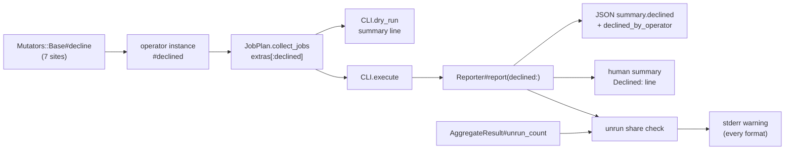

# Count and budget the silently excluded mutants - Plan

## Goal Capsule

- **Issue:** #291 (count and budget the silently excluded mutants: unplaceable share, declined candidates, skipped_invalid).
- **Goal:** operators count the candidates they decline. The dry run, the human report and the JSON report show that count. Stderr warns on every format when unplaceable plus skipped-invalid mutants are more than 10% of the mutants the run tried to score.
- **Authority:** this plan, then `AGENTS.md`, then the `**Claude:**` comment on #291. Where this plan differs from the comment, this plan wins (see "Corrections to the issue comment").
- **Stop and ask when:** a change would alter the score, any exit code, the `no_verdict` set or the mutants that run; or PR #244 (the 2.0 contract flip) merges first, because it sets `schema_version` to `2.0`.
- **Size:** M. About 33 files: 13 under `lib/`, 14 under `test/`, and 6 docs and contract files. Most test and docs edits are a few lines. No new runtime dependency.

---

## Product Contract

### Summary

Each operator counts the candidates it declines: a heredoc it cannot mutate safely, or an equivalent skip from `docs/equivalent-skips.md` (an endless range, a skipped chain-link name). `JobPlan.collect_jobs` sums the counts per operator into its extras hash. The dry run and the human summary print them, and the JSON report adds `summary.declined` and `summary.declined_by_operator`. A new stderr warning fires on every format when unplaceable plus skipped-invalid mutants are more than 10% of the mutants the run tried to score (R7). The warning never changes an exit code.

### Problem Frame

Some mutants leave the score and every gate with no signal that compares them to the run size. `unplaceable` and `skipped_invalid` have raw counts in the summary (`lib/mutineer/reporter.rb:183-185`, `:751-758`), but nothing compares them to the run, so a run that scores a small slice looks like a normal run. Declined candidates have no count anywhere: each decline is an early `return`, a `next` or a `reject!` with no counter. A redefine run on concern-heavy or heredoc-heavy Rails code is the likely worst case.

### Terms

- **Declined candidate:** an edit an operator found at one site and chose not to make, so it never became a mutant. It is not in `total`. Two causes count: the edit would split a heredoc from its body, or the edit is an equivalent skip listed on `docs/equivalent-skips.md`. An edit the operator cannot make at all (no valid replacement, or outside the operator's scope) is not a decline.
- **Unrun mutant:** a mutant that exists but did not run: `unplaceable` or `skipped_invalid`. This plan does not use "excluded" for it, because `AGENTS.md` "Score-model discipline" already uses "excluded" for every status outside the score denominator.

### Requirements

**Declined candidates**

- R1. Each operator counts the candidates it declines at these sites: `drop_dangling_heredocs` (`lib/mutineer/mutators/base.rb:66-68`, also called by `ReturnNil`), the heredoc skips in `condition_forcing.rb:62`, `operand_removal.rb:46` and `array_literal.rb:33`, and the equivalent skips in `range_literal.rb:25` (endless range), `chain_link.rb:103` and `call_to_receiver.rb:115` (`ChainLink::SKIPPED` names).
- R2. A skip that is not a decline stays uncounted: a literal condition (`condition_forcing.rb:62`), a kept jump (`operand_removal.rb:46`), an implicit or empty array (`array_literal.rb:33`), an operator call or a setter (`call_to_receiver.rb:113-114`), and a string that is not a plain quoted literal (`string_literal.rb:21`, a scope rule of that operator, not a heredoc decline).
- R3. `JobPlan.collect_jobs` returns `extras[:declined]`: operator name => count, only operators with a count above zero, keys in sorted order.
- R4. The dry run summary line always adds `N declined`, also `0 declined`. When N is above zero it adds a breakdown, `N declined (name: n, name: n)`.
- R5. The JSON summary adds `declined` (int, the total) and `declined_by_operator` (object, operator name => int, `{}` when none). Both are additive keys.
- R6. The human summary block adds one `Declined:` line beside `Unplaceable:` and `Ran at load:`.

**Unrun share**

- R7. The unrun share is `unplaceable + skipped_invalid` over `attempted + unrun`, where `attempted` is today's `killed + survived + no_verdict`.
- R8. When unrun is more than 1 and more than 10% of `attempted + unrun`, the reporter writes one warning to stderr, on every format, with or without `--threshold`.
- R9. The warning changes no exit code. `test/singleton_redefine_test.rb:92` (more than a tenth unplaceable still exits 0 at `--threshold 80`) stays green unchanged.

**Contract**

- R10. `schema_version` follows the coordination rule in KTD6. `docs/json-schema.md`, `docs/equivalent-skips.md`, `STABILITY.md` and `CHANGELOG.md` describe the new keys and the warning.
- R11. `AGENTS.md` "Score-model discipline" gains the review rule from the issue: a new status for a mutant that exists but could not run ships with a count in the report and a place in the unrun share, and a new decline site ships with a count in `summary.declined_by_operator`.

### Acceptance Examples

- AE1. A source with `if foo(<<~X) ... end`, run with `--operators condition_true --dry-run`, prints `1 declined (condition_true: 1)` on the summary line.
- AE2. A run with 2 killed and 3 unplaceable mutants prints the unrun warning (3 of 5, 60.0%) and exits 0 at `--threshold 0`.
- AE3. A run with 20 killed and 2 unplaceable (2 of 22, 9.1%) prints no warning. A run with 1 killed and 1 unplaceable prints no warning (floor of 1).
- AE4. A run with 2 killed, 3 unplaceable and 10 no_coverage mutants still reports 3 of 5. No-coverage mutants are not in the denominator.

### Scope Boundaries

- No new gate. The issue's "Gate" paragraph (budgets in the exact-verdict oracle and the self-dogfood job) is deferred; see Q3.
- `ran_at_load`, `no_coverage`, `ignored`, `errored`, `timeout` and `uncapturable` stay out of the unrun share. The first three are verdicts the report already explains, and the last three are the completeness gate's set.
- The HTML report does not show `declined`; see Q4.
- `--since` does not narrow `declined` (KTD9). The dry run line and the JSON schema row say so.
- Released CHANGELOG sections are not edited. Measured rates go in the new Unreleased entry (KTD8).

### Corrections to the issue comment

- The comment says "the five sites above". `drop_dangling_heredocs` runs from two places: `Base#mutations_for` (`base.rb:25`) and `ReturnNil#mutations_for` (`return_nil.rb:24`), which overrides it. The counter reset must happen in both.
- Three of the four mutator skip lines mix a decline with a non-decline (R2). The line must split, or the count includes literal conditions, jumps and empty arrays.
- The comment names the share `excluded_share`. `AGENTS.md` already uses "excluded" for every status outside the denominator, so this plan names it the unrun share.
- The share needs `attempted_count`, which today is a private `Reporter` method (`reporter.rb:832-834`). The #283/#286 plan moves it to `AggregateResult`. KTD5 handles both orders.

---

## Planning Contract

### Key Technical Decisions

- KTD1. **One counter per operator instance, no reason key.** `Mutators::Base` gets a public reader `declined` that returns an Integer (0 before the first call), and a private `decline` helper that adds 1 and returns nil, so a skip line reads `return decline if heredoc?(predicate)`. Rationale: no consumer reads a reason yet. Most operators have one decline cause, but not all: `Base#mutations_for` runs `drop_dangling_heredocs` for every operator, so the `range`, `chain_link` and `call_to_receiver` counts can mix a heredoc drop with an equivalent skip, and `literal_mutation` and `statement_removal` decline only through that drop. A per-reason split stays additive later (Q1).
- KTD2. **Reset at the start of each `mutations_for`.** `Base#mutations_for` and `ReturnNil#mutations_for` set the counter to 0 beside `@mutations = []`. `ChainLink` and `CallToReceiver` call `super`, so they inherit it. Rationale: the reader then means "declined in the last call", which holds when a test reuses an instance.
- KTD3. **`drop_dangling_heredocs` counts what `reject!` removes.** It adds the size difference to the counter. Rationale: one change covers every operator that inherits it.
- KTD4. **`collect_jobs` keys counts by the registry name.** It keeps each operator instance for one call, reads `declined`, and adds it under `MutatorRegistry::ALL.key(klass) || klass.name`. Rationale: the registry name is the name a user types in `--operators` and in `disable-line`, and every registry name equals its mutator's `Mutation#operator`. The fallback covers a `Mutators::Base` subclass a Ruby API caller passes that is not in the registry, so a key is never nil.
- KTD5. **`unrun_count` lives on `AggregateResult`; the share rule lives on `Reporter`.** Add `unrun_count` (unplaceable plus skipped invalid) to `AggregateResult` beside `skipped_invalid_count` (`result.rb:199`). Add `UNRUN_SHARE_LIMIT = 0.10` beside `BROKEN_SHARE_LIMIT` (`reporter.rb:21`) and a private `Reporter#unrun_share_exceeded?` beside `attempted_count` (`reporter.rb:832-834`). It calls `attempted_count` and `BROKEN_FLOOR` wherever they live at implementation time: in `Reporter` today, on `AggregateResult` after the #283/#286 fix. Rationale: one code shape and one test shape in either merge order; the warning is report logic, and the #283/#286 fix needs only a rename at the call site.
- KTD6. **Schema version: one bump per release.** Read `SCHEMA_VERSION` on the base branch and in the latest tag (`git show <latest tag>:lib/mutineer/reporter.rb`). If both are `1.8`, set `1.9`. If the branch already says `1.9` and the tag says `1.8`, `1.9` is unreleased: keep it and add the new keys to the `1.9` docs. If a tag already reports `1.9`, set `1.10`. Rationale: `docs/json-schema.md:14-20` asks for a minor bump per additive change, and two unreleased additive changes ship as one version.
- KTD7. **Warn before the threshold branch.** In `Reporter#report`, call the new warning right after the output block and before the gate block (today `return warn_errors_without_gate(err) unless threshold&.positive?`, `reporter.rb:77`; PR #314 replaces it with a `gates` array). Rationale: R8 needs it with and without `--threshold`, and stderr keeps JSON and HTML output clean.
- KTD8. **Measure after the code lands, record in the new entry.** The implementer records two kinds of numbers in the Unreleased CHANGELOG entry. Declined: the dry run with every operator on `lib/` and on `test/fixtures/rails_app/app`, giving declined and mutation totals. Unrun share: a full `--strategy redefine` run on `test/fixtures/rails_app`, as the rails dogfood CI job runs it (`.github/workflows/ci.yml:70-83`), giving unplaceable, skipped-invalid and attempted counts and whether the warning fired. The dry run cannot give the unrun share, because unplaceable is decided at run time. The fixture app has no concerns and no heredocs, so its share is likely 0: record that it cannot tune the limit for Q3, and add a run on a concern-heavy app if one is available. Rationale: the issue asks for measured rates, and Q3 needs the real share to tune the limit; editing released sections would surprise a reader.
- KTD9. **`--since` does not narrow `declined`, and says so.** A decline has no mutation, so `JobPlan.scope_since` cannot place it on a line. The count covers the discovered subjects (`--only` still narrows it). Under `--since`, the dry run prints `N declined in the scanned files (not narrowed by --since)`, because that line sits next to narrowed counts. The JSON row documents it beside `summary.scoped`. The human `Declined:` line adds `not narrowed by --since` too: `report` already takes `scoped:`, so it passes it on to `human_report`. Rationale: narrowing needs a line per decline and a new `scope_since` input in three backends; Q5 holds that option.
- KTD10. **One word for the 10% value: "limit".** The warning prints `limit 10%`, as `no_verdict_ratio` does (`reporter.rb:844`). The constant is `UNRUN_SHARE_LIMIT`. Rationale: the issue's "budget" is the concept; the existing message uses "limit" for the same kind of value.

### High-Level Technical Design

`Runner.execute`, `Runner.execute_external` and `DaemonBackend` already return the `collect_jobs` extras unchanged (`runner.rb:174`, `:223`, `:247`; `daemon_backend.rb:60`, `:95`), so they need no change.

### Warning text

The tests pin the quoted parts.

`[mutineer] 3 of the 5 mutants mutineer tried to score were not run (3 unplaceable; 60.0%, limit 10%). The score leaves them out. This warning does not change the exit code.`

- The parenthesis lists only the non-zero parts: `N unplaceable`, `N skipped (invalid)`. `skipped (invalid)` is the dry run's term (`cli.rb:840`).
- When unplaceable is above zero, add: `See unplaceable[] in --format json; --test-command runs them.`
- When skipped invalid is above zero, add: `A mutant skipped (invalid) did not re-parse after mutation. If its source file parses on its own, that is a mutineer bug: please report it at https://github.com/davidteren/mutineer/issues.` (`runner.rb:321` also skips when the original file does not parse.)
- The percentage uses the same rounding as `no_verdict_ratio` (`reporter.rb:841-845`).

---

## Implementation Units

### U1. Count declined candidates in the mutators

**Goal:** every decline site adds to a per-instance counter.

**Requirements:** R1, R2.

**Dependencies:** none.

**Files:**

- `lib/mutineer/mutators/base.rb`: `mutations_for` (lines 20-27) resets the counter; add the public `declined` reader and the private `decline` helper with YARD docs; `drop_dangling_heredocs` (lines 66-68) counts what `reject!` removes.
- `lib/mutineer/mutators/return_nil.rb`: `mutations_for` (lines 16-26) resets the counter.
- `lib/mutineer/mutators/condition_forcing.rb`: `force` (line 62) splits into the literal skip and `return decline if heredoc?(predicate)`.
- `lib/mutineer/mutators/operand_removal.rb`: `emit` (line 46) splits into the jump skip and a `decline` on `heredoc?(removed)`.
- `lib/mutineer/mutators/array_literal.rb`: `emit` (line 33) splits into the bracket and empty skip and a `decline` on `heredoc?(node)`.
- `lib/mutineer/mutators/range_literal.rb`: `visit_range_node` (line 25) calls `decline` for an endless range and `emit` otherwise. Update the class comment (lines 13-15) to say the skip is counted.
- `lib/mutineer/mutators/chain_link.rb`: `chain` (line 103) calls `decline` for a `SKIPPED` name and `drop(link)` otherwise. Update the class comment (line 19).
- `lib/mutineer/mutators/call_to_receiver.rb`: `replace` (line 115) becomes `return decline if ChainLink::SKIPPED.include?(node.name)`. Lines 113-114 stay uncounted (R2). Update the class comment (line 26).
- Tests: `test/mutators/condition_forcing_test.rb`, `test/mutators/operand_removal_test.rb`, `test/mutators/array_literal_test.rb`, `test/mutators/return_nil_test.rb`, `test/mutators/range_literal_test.rb`, `test/mutators/chain_link_test.rb`, `test/mutators/call_to_receiver_test.rb`.

**Approach:** keep each split as two guard lines, in today's order, so the emitted mutants do not change. Update the comments above each site to say the skip is counted.

**Patterns to follow:** the guard-clause style already at each site; the `mutations_for` override in `ChainLink` (`chain_link.rb:40-43`).

**Test scenarios** (each fails before the fix with NoMethodError on `declined`):

- `test_heredoc_condition_counts_as_declined` (condition_forcing): the `if foo(<<~X)` body from `test_condition_with_a_heredoc_is_skipped` (line 89). Each of `ConditionTrue` and `ConditionFalse` gives no mutant and `declined == 1`.
- `test_literal_condition_is_not_declined` (condition_forcing): `if true ... end` gives no mutant and `declined == 0`.
- `test_heredoc_operand_counts_as_declined` (operand_removal): `foo(<<~EOS) ||\n    text\n  EOS\n    bar` (line 74) gives no mutant and `declined == 2`: one `heredoc?(removed)` skip and one dangling-heredoc drop.
- `test_jump_operand_is_not_declined` (operand_removal): `x = (a or return)` gives `declined == 0`.
- `test_array_with_heredoc_counts_as_declined` (array_literal): `[<<~A, b]` (line 48) gives `declined == 1`; `x = 1, 2` gives `declined == 0`.
- `test_dangling_heredoc_drop_counts_as_declined` (return_nil): the `return <<~X` source (line 54) gives `declined == 1`.
- `test_endless_range_counts_as_declined` (range_literal): each body in `test_endless_ranges_yield_none` (line 45) gives `declined == 1`; `(1..10)` gives `declined == 0`.
- `test_skipped_link_counts_as_declined` (chain_link): the body of `test_skipped_links_are_kept` (line 66) gives `declined` equal to the number of `SKIPPED` links in it; `a.b.c` gives `declined == 0`.
- `test_skipped_name_counts_as_declined` (call_to_receiver): each body of `test_skipped_names_yield_none` (line 97) gives `declined == 1`; `a.+(1)` and `a.b = 1` give `declined == 0` (`a + b` never reaches `replace`, because it has no dot).
- `test_declined_resets_on_each_call` (condition_forcing): one `ConditionTrue` instance runs on the heredoc subject, then on `if a ... end`; the second call gives `declined == 0`.
- Every existing mutator test stays green unchanged. That proves no mutant moved.

**Verification:** the mutator tests pass, and `bundle exec rake yard:strict` stays at 100%.

### U2. Sum declined counts in the job plan and the dry run

**Goal:** `collect_jobs` returns per-operator counts, and the dry run prints them.

**Requirements:** R3, R4, AE1.

**Dependencies:** U1.

**Files:**

- `lib/mutineer/job_plan.rb`: `collect_jobs` (lines 50-100). Line 67 keeps each instance, reads `declined`, and adds it to a per-name hash (KTD4). Line 99 adds `declined:` to the extras, filtered to counts above zero and sorted by name. Update the doc comment (lines 24-49) and the `@return` line.
- `lib/mutineer/runner.rb`: the extras list in the `execute` doc comment (line 35) names `:declined` and `:unscoped_mutants`.
- `lib/mutineer/cli.rb`: `dry_run` (lines 811-842). The summary line (lines 839-840) appends `; N declined` per R4, and the `--since` note per KTD9 when `config.since` is set.
- Tests: `test/runner_test.rb`, `test/cli_test.rb`.

**Approach:** the dry run reads `extras[:declined]` directly; `scope_since` does not touch it (KTD9).

**Patterns to follow:** the `per_operator` breakdown in `dry_run` (lines 820 and 836-837).

**Test scenarios:**

- `test_collect_jobs_reports_declined_counts_per_operator` (runner_test): a temp file with `def m; if foo(<<~X)` and `a + b`, operators `condition_true` and `arithmetic`. `extras[:declined] == { "condition_true" => 1 }`. Fails before: the key is absent.
- `test_collect_jobs_reports_no_declined_when_none` (runner_test): the calculator fixture gives `extras[:declined] == {}`. Fails before: the key is absent (nil).
- `test_dry_run_prints_declined_counts` (cli_test): in `with_project`, write the heredoc source and run `--dry-run --operators condition_true`. Output includes `1 declined (condition_true: 1)`. Covers AE1. Fails before: no such text.
- `test_dry_run_labels_declined_under_since` (cli_test): in a git-initialized `with_project` copy, change one line, run `--dry-run --since HEAD`; output includes `not narrowed by --since`. Fails before: no such text.
- `test_dry_run_prints_breakdown` (line 585) gains `assert_includes out, "0 declined"`.

**Verification:** runner and CLI tests pass; a manual dry run on `lib/` prints a declined count.

### U3. Report declined counts in the JSON and human reports

**Goal:** `summary.declined` and `summary.declined_by_operator` are in every JSON report, and the human summary has a `Declined:` line.

**Requirements:** R5, R6.

**Dependencies:** U2.

**Files:**

- `lib/mutineer/reporter.rb`: `report` (lines 55-56) takes `declined: {}`, and passes it to `json_report` (line 169) and `human_report` (line 114). The summary hash (lines 179-203) adds `declined:` (the sum) and `declined_by_operator:` with an `Additive (1.9, #291)` comment. `summary` (lines 746-764) adds `Declined: N (candidates an operator did not mutate; --dry-run shows the count per operator)` after the `Ran at load:` line. Update the `report` doc comment (lines 48-54).
- `lib/mutineer/cli.rb`: `execute` (lines 682-686) passes `declined: extras.fetch(:declined, {})` to `reporter.report`. `warn_empty_run` (lines 722-731): when the declined sum is above zero, the "no mutants were generated" message adds `1 candidate was declined` or `N candidates were declined`, then `(--dry-run shows the count per operator).`, and drops the advice to check that the sources contain mutable code. The human report returns early on an empty run (`reporter.rb:116`), so this is the only human surface for that case.
- Tests: `test/json_reporter_test.rb`, `test/reporter_test.rb`, `test/cli_test.rb`.

**Patterns to follow:** the `legacy_id_matches:` keyword on `report` and `json_report`; the `format` lines in `summary`.

**Test scenarios:**

- `test_summary_reports_declined_per_operator` (json_reporter_test): render with `declined: { "range" => 2, "array_literal" => 1 }`; `summary["declined"] == 3` and `summary["declined_by_operator"] == { "array_literal" => 1, "range" => 2 }`. Fails before: unknown keyword.
- `test_summary_declined_defaults_to_zero` (json_reporter_test): render without the keyword; `summary["declined"] == 0` and `summary["declined_by_operator"] == {}`. Fails before: the keys are absent.
- `test_human_summary_has_a_declined_line` (reporter_test): `report` with `declined: { "range" => 2 }` prints a line matching `/Declined:\s+2/` (the padded format of its sibling rows). With `scoped: true`, the line adds `not narrowed by --since`. Fails before: unknown keyword.
- `test_empty_run_names_declined_candidates` (cli_test): in `with_project`, write a source whose only candidate is a heredoc condition (`if x == <<~S`) and run it with `--operators condition_true` and a test file (not `(1..)`, which the #299 fix turns into a real mutant); stderr includes `1 candidate was declined`. Fails before: the message says only that no mutants were generated.
- `test_json_report_carries_declined_counts` (cli_test): in `with_project`, add a method with `if x == <<~S` to a copy of `calculator.rb` that the strong test covers, run `--format json --operators condition_true,arithmetic`; `summary.declined_by_operator == { "condition_true" => 1 }`. Fails before: the key is absent.

**Verification:** JSON output stays byte-stable across two runs of the same project (the existing stability tests pass).

### U4. Warn when the unrun share is over the limit

**Goal:** stderr names the share of mutants that were not run when it is above 10%.

**Requirements:** R7, R8, R9, AE2, AE3, AE4.

**Dependencies:** none. Read KTD5 first.

**Files:**

- `lib/mutineer/result.rb` (`AggregateResult`, lines 175-248): `unrun_count`.
- `lib/mutineer/reporter.rb`: `UNRUN_SHARE_LIMIT` and `unrun_share_exceeded?` (KTD5). New private `warn_unrun_share(err)`, called in `report` before line 77 (KTD7), with the text in "Warning text". Rewrite the comment at lines 825-828: skipped-invalid now has its own signal.
- Tests: `test/reporter_test.rb`, `test/result_test.rb`.

**Patterns to follow:** `warn_errors_without_gate` (lines 98-106) and `no_verdict_ratio` (lines 841-845).

**Test scenarios:**

- `test_warns_when_the_unplaceable_share_is_over_the_limit` (reporter_test): 2 killed, 3 unplaceable, `report` with no threshold. `err` includes `3 of the 5 mutants mutineer tried to score were not run`, `3 unplaceable`, `60.0%, limit 10%`, `does not change the exit code` and `unplaceable[]`. Covers AE2. Fails before: no such text.
- `test_unrun_share_leaves_no_coverage_out_of_the_denominator` (reporter_test): 2 killed, 3 unplaceable, 10 no_coverage; `err` includes `3 of the 5 mutants`. Covers AE4. Fails before: no such text.
- `test_unrun_warning_names_skipped_invalid` (reporter_test): 2 killed, 2 skipped. `err` includes `2 skipped (invalid)`, `did not re-parse` and the issues URL, and does not include `unplaceable`.
- `test_unrun_warning_prints_on_json_and_under_threshold` (reporter_test): the AE2 results with `format: "json", threshold: 80.0`; the warning is on `err`, and `out` parses as JSON.
- `test_no_unrun_warning_under_the_limit_or_the_floor` (reporter_test): 20 killed plus 2 unplaceable, and 1 killed plus 1 unplaceable; `err` has no `were not run`. Covers AE3. Passes before and after; it guards the threshold.
- `test_unrun_warning_keeps_the_exit_code` (reporter_test): the AE2 results give `exit_code(threshold: 80.0) == 0`. Covers R9.
- `test_unrun_count` (result_test): 2 killed, 1 unplaceable, 2 skipped gives `unrun_count == 3`. Fails before: NoMethodError.

**Verification:** `test/singleton_redefine_test.rb:92` passes unchanged; the existing `reporter_test.rb` stream tests pass.

### U5. Schema version, docs, CHANGELOG and the review rule

**Goal:** the contract documents the new keys and the warning.

**Requirements:** R10, R11.

**Dependencies:** U3, U4.

**Files:**

- `lib/mutineer/reporter.rb`: `SCHEMA_VERSION` (line 29), per KTD6. Every `1.9` below means the version KTD6 resolves to; `1.9` is the expected case.
- Tests that pin `"1.8"` (only when KTD6 bumps): `test/baseline_test.rb:240`, `test/cli_test.rb:738`, `test/cli_test.rb:877`, `test/equivalent_mutant_test.rb:308`, `test/json_reporter_test.rb:61`, with the comment beside each.
- `docs/json-schema.md`: the version example (line 14) and the top-level example (line 36). Two `summary` rows after `skipped_invalid` (line 62). `declined` (int): "Candidates the operators found and did not mutate, so they are not in `total`: a heredoc the edit would split, or an equivalent skip listed on the equivalent-skips page. Counted before `# mutineer:disable-line` and `ignore:` apply, and not narrowed by `--since`. Additive key (schema `1.9`, #291)." `declined_by_operator` (object): "The same count per operator name, only operators above zero. Additive key (schema `1.9`, #291)." Extend the `unplaceable` and `skipped_invalid` rows (lines 60, 62) with "Counted in the unrun-share warning on stderr above 10% of the mutants the run tried to score."
- `docs/equivalent-skips.md` and its committed twin `docs/equivalent-skips.html` (read by `test/site_docs_test.rb:81`): one sentence in the intro says every skip on the page is counted in `summary.declined_by_operator` and in the dry run. The #299 fix rewrites the "Endless range" section, so keep this edit out of that section.
- `STABILITY.md:16`: the schema version, per KTD6.
- `CHANGELOG.md` under `## [Unreleased]`, `### Added`: "**Counts of mutants that were not scored (#291).** Operators count the candidates they decline (a heredoc they cannot mutate safely, or an equivalent skip such as an endless range or a skipped chain-link name). The dry run and the human report print the count, and the JSON report adds `summary.declined` and `summary.declined_by_operator` (schema `1.9`). A new stderr warning fires when unplaceable and skipped-invalid mutants are more than 10% of the mutants a run tried to score; it does not change the exit code. Measured: <lib/ totals>; <fixture app totals>." Fill the measured values per KTD8.
- `AGENTS.md`, "Score-model discipline": add "A new status for a mutant that exists but could not run ships with a count in the report and a place in the unrun share. A new place where an operator declines a candidate ships with a count in `summary.declined_by_operator`."

**Test scenarios:** `test/docs_contract_test.rb` (lines 107, 153) already checks that the docs and `STABILITY.md` name `SCHEMA_VERSION`. Test expectation for the prose: none, it is documentation.

**Verification:** the docs contract tests pass, and `bundle exec rake site:build` shows the new rows.

---

## Verification Contract

Prefix every ruby, rake and bundle command with `LANG=en_US.UTF-8 LC_ALL=en_US.UTF-8` in a shell where they are unset.

- `bundle exec rake test`: the zero-dependency suite, including every new test above.
- `ruby -Ilib -e 'require "mutineer"'`: the load smoke.
- `bundle exec rake yard:strict`: 100% documented. `declined`, `decline`, `unrun_count`, `unrun_share_exceeded?`, `warn_unrun_share` and `UNRUN_SHARE_LIMIT` each need a docstring.
- `BUNDLE_GEMFILE=gemfiles/minitest6.gemfile bundle exec rake test`: not required (no Minitest integration change), but cheap.
- `bundle exec rake site:build`, then `node --test test/site_test.js`: U5 changes `docs/json-schema.md` and `docs/equivalent-skips.md`, which the site publishes.
- Measurement (KTD8): `bin/mutineer run <every file under lib/mutineer> --dry-run --operators <every name in MutatorRegistry::ALL>`, and the same on the files under `test/fixtures/rails_app/app`. Then one full `--strategy redefine` run on `test/fixtures/rails_app` with its own bundle, as the rails dogfood CI job does. Record the numbers KTD8 lists.
- `AGENTS.md` rules: zero runtime dependencies (stdlib and Prism only), no `eval`, 100% YARD docs, CHANGELOG under Unreleased.

## Definition of Done

- Every test named in U1 to U4 exists, failed before its unit (except the guard marked "passes before"), and passes after.
- The score, every exit code and the set of mutants that run are unchanged: every existing test passes without edits, except the `"1.8"` pins that KTD6 moves and `test_dry_run_prints_breakdown`, which only gains an assertion.
- `summary.declined` and `summary.declined_by_operator` are in every JSON report; the dry run prints `N declined`; the human summary has a `Declined:` line.
- The unrun-share warning prints on stderr for every format and never on stdout.
- `schema_version` follows KTD6 in the reporter, `docs/json-schema.md` and `STABILITY.md`.
- The CHANGELOG entry carries the measured values.
- No dead code or abandoned attempts remain in the diff.

---

## Risks and Overlaps

| Item | Overlap | Handling |
|---|---|---|
| Draft PR #314 (#283/#286, branch `fix/283-286-baseline-unverified-survivors`) and its plan | Moves `attempted_count`, `no_verdict_count`, `BROKEN_SHARE_LIMIT` and `BROKEN_FLOOR` to `AggregateResult`, rewrites `warn_errors_without_gate`, edits `report`, and bumps `schema_version` to `1.9`. | KTD5 picks the home of the share rule; KTD6 shares one unreleased `1.9`. Text conflicts in `reporter.rb` and the `"1.8"` test pins only. Rebase on whichever lands first. |
| Plan for #299 (endless-range skip, `docs/plans/2026-10-24-299-fix-endless-range-skip-plan.md`) | Changes `range_literal.rb:25` to skip only an endless range that is a slice argument, adds `RangeLiteral#mutations_for` (which calls `super`, so the KTD2 reset still runs), and rewrites the "Endless range" section of `docs/equivalent-skips.md`. | Whichever lands second puts `decline` on the new skip and keeps both resets. After #299, `test_endless_range_counts_as_declined` uses the slice bodies (`list[1..]`), and `(1..)` gives `declined == 0`. |
| #286 (`ran_at_load`) | Could add `ran_at_load` to the unrun share. | Out of scope (Scope Boundaries). Q6. |
| #297 (included-block methods) | Owns the decision on concern `included` blocks, which feed `unplaceable`. | The warning makes that rate visible. No code overlap. |
| PR #306 (#280, exact score against `--threshold`) | Edits `Reporter#exit_code`, `#verdict` and `AggregateResult`. | Text conflict only. |
| PR #244 (2.0 contract flip) | Sets `schema_version` `2.0`. | Stop and ask (Goal Capsule). |
| PRs #304, #305, #307, #308, #202, #245, #301, #302 | None touch the mutators, `job_plan.rb`, `Reporter#report`, `#summary` or `json_report`. #304 and #308 edit `lib/mutineer/isolation.rb`, which can move the measured `lib/` totals. | Measure on the final base and name the commit in the CHANGELOG line. |
| Noise | The warning fires on every redefine run on concern-heavy code. | That is the intent of #291. The limit is a constant, so Q3 can tune it from the unrun share KTD8 records. |
| Plan for #274 (call-to-receiver skip list, branch `plan/274-call-to-receiver-skip-list`) | Gives `CallToReceiver` its own skip list at `call_to_receiver.rb:115`, and edits the same comments and `docs/equivalent-skips.md` lines. | Whichever lands second keeps `return decline if` on the skip line with the new list. Text conflict only. |
| Double count | `condition_true` and `condition_false` each decline the same heredoc condition, so one site counts 2. | Intended: the count is per operator, as `declined_by_operator` shows. The schema row says so. |
| Suppressed lines | A declined candidate on a `disable-line` line still counts, because the operator declines it before suppression applies. | Documented in the schema row. It is a count only. |

## Open Questions

All deferred; none blocks implementation.

- Q1. Should the JSON split declines by reason (`{ "range" => { "endless" => 2 } }`)? Default: no, a count per operator (KTD1). A `declined_by_reason` key can be added later without a breaking change.
- Q2. Should the CHANGELOG measurement split declines by cause (heredoc against equivalent skip), to give Q1 data? Default: no. Per-operator counts separate most causes; for `range`, `chain_link` and `call_to_receiver` they mix with heredoc drops (KTD1).
- Q3. Should the limit gate CI (exit 1 under `--threshold`, or a budget in the exact-verdict oracle and the self-dogfood job)? Default: warning only, as the issue comment recommends. A gate breaks the deliberate pin at `test/singleton_redefine_test.rb:92`, so it is a product decision after the measurement.
- Q4. Should the HTML report show `declined`? Default: no; the dry run, the human report and JSON carry it. The alternative adds it to `summary_html`.
- Q5. Should `--since` narrow `declined` to changed lines? Default: no, labelled instead (KTD9). The alternative records a line per decline and filters it in `JobPlan.scope_since`.
- Q6. Should `unplaceable` and `skipped_invalid` have separate limits, or should `ran_at_load` join the share (#286)? Default: one combined share of the two unrun classes.
