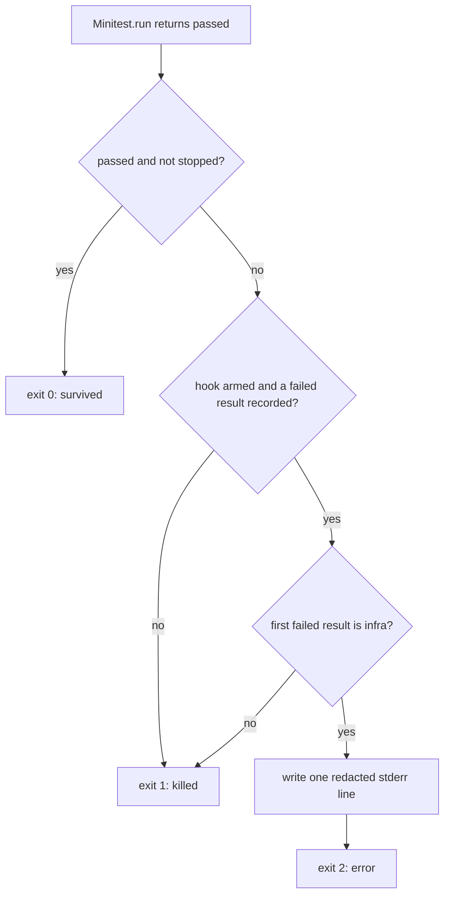

# Score an in-test database error as error, not killed - Plan

## Goal Capsule

- Issue: #296. On `--daemon`, a database connection or lock error inside a test scores the mutant `killed`. The serial in-process Minitest path has the same gap.
- Goal: when the first failing test of a Minitest mutant run failed because of an Active Record connection or lock error, the child exits 2 and the mutant scores `error`, not `killed`.
- Authority: this plan, then `AGENTS.md`, then the issue comment. Where the plan and the issue comment disagree, the plan wins (see "Corrections to the issue comment").
- Prerequisite: the #282 fix (shared Minitest seed, branch `fix/282-shared-seed`). Start from `main` when #282 is merged. If it is not merged, base this branch on the #282 branch and open a stacked PR. See "Sequencing and the #282 overlap".
- Stop conditions: stop and ask if a change needs a new runtime gem, `eval`, a new exit code, or a change to the daemon JSON protocol. None of these is expected. Also stop and ask if #282 no longer routes `DaemonServer.run_tests` through `MinitestIntegration.run`.
- Size: M. One new file of about 50 lines with docs, one call site, comment edits, one test fixture, about nine test cases.

## Product Contract

### Summary

Both Minitest child paths reduce a run to pass (exit 0) or fail (exit 1). They never look at why a test failed. So a lost connection, a pool timeout, or a deadlock inside a test reads as a strong test and raises the score. The fix adds one small stdlib-only hook that keeps the first failed test result of the run. After the run, the child exits 2 when that result failed first with an unexpected error that wraps a known Active Record connection or lock error. Exit 2 already means `error` on both paths, so no parent-side code changes.

### Problem Frame

- `lib/mutineer/daemon_server.rb` `DaemonServer.run_tests` (lines 449 to 456) returns `Minitest.run([]) ? 0 : 1` (line 455) on `main`. After #282 it returns `MinitestIntegration.run(...)`.
- `lib/mutineer/daemon_server.rb` `DaemonServer.wait_verdict` (line 396) maps exit 1 to `killed`. Only an exception outside the test run gives exit 2 (the rescue at line 331 in `run_mutant`).
- The class comment at lines 46 to 51 says the in-test case "is not yet implemented".
- `lib/mutineer/minitest_integration.rb` `MinitestIntegration.run` (line 41) returns `passed && !StopAtFirstFailure.stopped_here? ? 0 : 1` (line 90). `Isolation.decode` (`lib/mutineer/isolation.rb` line 324) maps that 1 to `killed`.
- Minitest catches an exception in a test and records it as `Minitest::UnexpectedError`. `Minitest::Test#run` (5.27.0 `lib/minitest/test.rb` lines 88 to 99) wraps setup and the body in one `capture_exceptions`, then each teardown hook in its own. So the first entry in `result.failures` is the error that ended the test. Its `error` reader holds the exception, or a copy of the same class when the original cannot be marshalled (`sanitize_exception`, `neuter_exception`). Only when the copy also fails does Minitest use a `RuntimeError`.
- Sources that remain inside a test. Worker connection exhaustion at fork start is already `error`: on the daemon, `RailsWorkerDb.after_fork` connects and runs `verify_connection!` (`SELECT 1`, `lib/mutineer/rails_worker_db.rb` lines 384 to 399 and 482) before any test loads. The cases this plan fixes are a connection that drops during the run (a server restart or failover, a killed backend), a pool timeout when a test or the app opens more connections (threads, a second database the worker routing does not cover), and a deadlock or lock wait from such extra connections.

### Requirements

Verdict rule

- R1. A Minitest run exits 2 (`error`) when the first entry of its first failed test result is a `Minitest::UnexpectedError` whose wrapped exception is an instance of one of these Active Record classes: `ConnectionNotEstablished`, `ConnectionFailed`, `Deadlocked`, `LockWaitTimeout`. "First failed result" means the first one the outer reporter records. Subclasses count, so `ConnectionTimeoutError` (pool timeout) and `DatabaseConnectionError` are included.
- R2. All other failing runs keep exit 1 (`killed`). This includes a run whose first failed result starts with an assertion failure, an exception of another class, or any other `ActiveRecord::StatementInvalid` (a mutant can cause bad SQL). A later infra error does not change a 1.
- R3. A run with no failed test result keeps its current code. For example, `Minitest.run` can return false with no failed result (a plugin or an `after_run` problem). That stays 1.
- R4. A passing run stays 0. A skipped test is not a failure.

Paths

- R5. The rule applies on the daemon path and the in-process path, in a plain run, a stop-at-first-failure run, and a `--matrix` run. Because the first failure decides, a `--matrix` run gives the same verdict as the stop run of the same mutant, as `Isolation.finish` promises.
- R6. The child writes one stderr line, for example `[mutineer-child] in-test database error, not a test failure: ActiveRecord::ConnectionNotEstablished: <message>. Check the database server and its connection limit.` The child passes the full message through `Mutineer::Redaction.text` first, then keeps only the first line of the result. A connection error can contain a database URL with a password, and cutting first could split a secret past the redaction pattern.

Contract text

- R7. CHANGELOG `## [Unreleased]` gets a `### Fixed` entry (see U3 for the text).
- R8. These comments describe the new 0, 1, 2 contract: the `DaemonServer` class comment (`lib/mutineer/daemon_server.rb` lines 46 to 51) and the `run_tests` comment (lines 447 and 448); the `MinitestIntegration` class comment (`lib/mutineer/minitest_integration.rb` lines 7 to 18) and its `@return` (line 39); the `TestRunners` contract comment (`lib/mutineer/test_runners.rb` lines 8 to 12); the `@return` in `lib/mutineer/test_runners/minitest.rb` (line 16); the `error` line in the `Result` status comment (`lib/mutineer/result.rb` line 7). Line numbers are for `main`; #282 moves some of them.
- R9. User docs stay as they are. `README.md` line 189 ("The test run crashed, so there is no verdict") and `docs/json-schema.md` line 63 ("Mutants whose run raised") still hold, because the test raised. `no_verdict[].details` stays generic (`child exited with status 2` in process, `daemon verdict: error` on the daemon). The cause is in the R6 stderr line. See Deferred.

### Acceptance Examples

- AE1. A mutant makes `Order#subtotal_cents` raise `ActiveRecord::ConnectionNotEstablished`. Every covering test errors with it. Verdict: `error` on `--daemon` and in-process.
- AE2. The first failing test fails an assertion and a later test errors with `ConnectionNotEstablished` (a run that does not stop at the first failure). Verdict: `killed`.
- AE3. A mutant makes a method raise `ActiveRecord::StatementInvalid`. Verdict: `killed`.
- AE4. The first failing test errors with `Deadlocked` and a later test fails an assertion. Verdict: `error` with stop at the first failure, with `--matrix`, and with a plain full run in the same test order.
- AE5. A test's `setup` raises a pool timeout (`ConnectionTimeoutError`) and its `teardown` then raises a `RuntimeError` (Active Record 7.2 raises "There isn't a pinned connection" when it unpins after a failed pin). Verdict: `error`, because the first entry decides.

### Scope Boundaries

- No change to `--test-command` (`ExternalBackend`). That is #292.
- No change to RSpec (`TestRunners::RSpec`). It has the same class of gap, but RSpec has its own result model. See Deferred.
- No change to how coverage capture and the clean check read the code. They call `TestRunners.for(...).run(...).zero?` (`lib/mutineer/coverage_map.rb` lines 643 and 968), so a 2 is still "not passed", the same as 1.
- No new verdict name, exit code, or JSON field. `error` already exists and is out of the score.

### Deferred to Follow-Up Work

- RSpec in-process path: the same rule for an RSpec example that fails with a connection error. File an issue when this plan lands.
- Carry the cause into `no_verdict[].details`. Today every in-process error has the generic detail `child exited with status 2`. A cause there needs a channel from the child (in process) or a new verdict field (daemon protocol), so it is a separate change. File an issue.
- SQLite "database is locked" (`SQLite3::BusyException`). Active Record 7.2 translates it to plain `StatementInvalid`, so it stays `killed` under R2. Worker databases are separate files, so a lock is unlikely. See Open Questions.

## Planning Contract

### Key Technical Decisions

- KTD1. Decide in the child, not the parent. The child has the Minitest results. The parent sees only an exit code. Exit 2 already maps to `error` in `Isolation.decode` and `DaemonServer.wait_verdict`, so no parent code, protocol, or exit code changes.
- KTD2. One new module, `Mutineer::MinitestIntegration::InTestDatabaseError`, in `lib/mutineer/minitest_integration/in_test_database_error.rb`. The name uses the issue's own term. It must load with stdlib only, because the daemon runs under the app's Ruby and bundle without Prism (hard constraint in the `DaemonServer` class comment, lines 22 to 27). It may require only `outer_reporter.rb` and `../redaction.rb`, which are stdlib-only today.
- KTD3. Reuse the existing reporter hook pattern. `StopAtFirstFailure::RecordFailure` (`lib/mutineer/minitest_integration/stop_at_first_failure.rb`) already prepends `Minitest::CompositeReporter#record` and counts only the outer reporter through `OuterReporter::Client`. The new module does the same: it extends `OuterReporter::Client`, registers with `OuterReporter.register`, and uses `OuterReporter.prepend_once` for its `record` hook and for the outer-reporter hook from `OuterReporter.hook_for_loaded_minitest`. On an unknown Minitest shape it arms nothing, and the run keeps the old 0 or 1 result. Do not read `Minitest::StatisticsReporter#results` after the run instead: a plugin (Rails among them) can replace the summary reporter (see the comment at `minitest_integration.rb` line 89).
- KTD4. The first failed result decides (R1, R2). This is the stop run's rule by construction: the stop run ends at its first failing serial test. The same rule on `--matrix` keeps its verdict equal to the stop run's, which `Isolation.finish` promises. With #282, every Minitest run uses the pinned seed, so the daemon's full run is also deterministic. The daemon does not call `keep_file_order` (no stop hook is armed there), so its test order can differ from the in-process order, and a mixed mutant can then score differently on the two paths. That is accepted (see Risks). The hook keeps one value: the first failed result's infra exception, or a marker that the first failure was not infra. It ignores every later result. No lock is needed: Minitest's parallel executor already records through `reporter.synchronize` (`minitest/parallel.rb` line 36 in 5.27.0 and 6.0.6).
- KTD5. Look up the four class names at record time, by name. Use `Object.const_defined?` then `Object.const_get` on each `"ActiveRecord::..."` name. `const_defined?` returns false when `ActiveRecord` is not loaded (checked on Ruby 3.4), so a non-Rails project gets no match and no error. Checking at record time also covers an app that loads Active Record late. Names checked against activerecord 7.2.4 (the fixture app's version, `lib/active_record/errors.rb`): `ConnectionNotEstablished < AdapterError`, `ConnectionTimeoutError < ConnectionNotEstablished`, `DatabaseConnectionError < ConnectionNotEstablished`, `ConnectionFailed < QueryAborted < StatementInvalid`, `Deadlocked < TransactionRollbackError < StatementInvalid`, `LockWaitTimeout < StatementInvalid`. `ConnectionFailed` exists from Rails 7.1. On older Rails the lookup finds nothing for that name, which is safe.
- KTD6. A result is infra when the first entry of `result.failures` is a `Minitest::UnexpectedError` and its `error` is an instance of a listed class. Minitest records the setup or body error before any teardown error (Problem Frame), so a teardown that fails after an infra error does not change the verdict (AE5). A body assertion failure followed by a teardown connection error stays `killed`. Do not walk the exception `cause` chain. Active Record already translates driver errors such as `PG::ConnectionBad` into the listed classes.
- KTD7. One public decision method owns the mapping and the message. For example `InTestDatabaseError.exit_code(code)`: it returns `code` unless `code` is 1 and the armed run's first failure was infra. In that case it writes the R6 line to `STDERR` and returns 2. `STDERR`, not `warn`, because a test can leave `$stderr` as a `StringIO` (see `Isolation.run`). The daemon gets the same `[mutineer-child]` prefix, because after #282 it runs `MinitestIntegration.run`.
- KTD8. Arm the new module on every Minitest run, not only on mutant runs. Coverage capture and the clean check use `.zero?`, so an exit 2 there is the same as 1. No keyword argument is needed. Side effect: an infra failure during coverage capture or the clean check also prints the R6 line. That is useful, not noise.
- KTD9. Arm it on its own line. Do not fold its return value into the `armed` local at `minitest_integration.rb` line 72. That flag decides the stop and matrix hooks and calls `keep_file_order`; folding it in would change the order of plain runs.
- KTD10. Under `--matrix`, an exit 2 makes `Isolation.finish` keep the `error` verdict, and the kill row is marked incomplete, because an `error` verdict does not agree with named kills (`lib/mutineer/isolation.rb` `finish`). That is acceptable and needs no code change.

### High-Level Technical Design

The decision the child makes after `Minitest.run` returns:

A failed result is "infra" when the first entry in its `failures` list is a `Minitest::UnexpectedError` that wraps an instance of a listed Active Record class.

### Sequencing and the #282 overlap

The fix for #282 (Minitest seed alignment, branch `fix/282-shared-seed`, PR not yet open at planning time) also edits `DaemonServer.run_tests` and `MinitestIntegration.run`. Its draft replaces the body of `run_tests` with a call to `MinitestIntegration.run`, and it makes every `Minitest.run` use the pinned seed (`seed_args`).

- This plan depends on #282. Then the daemon gets the fix through U1 with no daemon code change, and its order is deterministic (KTD4).
- If #282 is merged, branch from `main`. If not, branch from `fix/282-shared-seed` and open a stacked PR on top of the #282 PR. Rebase when #282 changes.
- Read `DaemonServer.run_tests` on the base first. If it does not call `MinitestIntegration.run`, stop and ask (Goal Capsule).

## Implementation Units

### U1. Hook module and the in-process path

**Goal:** `MinitestIntegration.run` returns 2 for a run whose first failure is infra (R1 to R6).

**Requirements:** R1, R2, R3, R4, R5, R6, R8.

**Dependencies:** #282 on the base.

**Files:**

- Create `lib/mutineer/minitest_integration/in_test_database_error.rb`.
- Modify `lib/mutineer/minitest_integration.rb`: add the `require_relative` next to lines 3 and 4; arm after the hook block at lines 72 to 80 (KTD9); pass the line 90 result through the KTD7 method; disarm in the `ensure` at lines 91 to 93; update the class comment (lines 7 to 18) and the `@return` (line 39).
- Modify the comments named in R8 in `lib/mutineer/test_runners.rb`, `lib/mutineer/test_runners/minitest.rb` and `lib/mutineer/result.rb`.
- Create `test/fixtures/in_test_db_error_test.rb`.
- Modify `test/test_runners/minitest_test.rb`.

**Approach:**

- The module follows the `StopAtFirstFailure` shape: a `record` hook module prepended on `Minitest::CompositeReporter`, `arm!` returns false on an unknown shape, `disarm!` clears the state, and the decision is made only when armed in this process (`armed_here?`). Exact method names are the implementer's choice.
- Rewrite the last sentences of the `MinitestIntegration` class comment. It now says there is no rescue around the suite run and that a second exit-2 path would break the 0 or 1 contract. The first part stays true: this method still rescues nothing. Add that it returns 2 on purpose when Minitest itself recorded an infra error as the run's first failure (#296).
- Every new constant and method needs a YARD comment (`yard:strict`).

**Patterns to follow:** `lib/mutineer/minitest_integration/stop_at_first_failure.rb` (prepend, arm, disarm, outer reporter); `test/fixtures/stop_at_first_failure_test.rb` (environment-driven fixture).

**Test fixture:** `test/fixtures/in_test_db_error_test.rb` requires `minitest/autorun`. It defines stand-in classes under `module ActiveRecord` with the 7.2 hierarchy from KTD5 (`StatementInvalid`, `ConnectionNotEstablished`, `ConnectionTimeoutError`, `QueryAborted`, `ConnectionFailed`, `TransactionRollbackError`, `Deadlocked`, `LockWaitTimeout`). `ConnectionNotEstablished` can keep a `Mutex` in an instance variable, like the real class keeps `@connection_pool`, so Minitest must rebuild it (Problem Frame). The file is only ever loaded in a forked child, so the stand-ins never reach the parent suite. `test/fixtures/**` is already outside `rake test` (Rakefile line 23). The class uses `i_suck_and_my_tests_are_order_dependent!` with two tests, `test_a_first` and `test_b_second`. Each reads an environment variable (`MUTINEER_FIXTURE_FIRST`, `MUTINEER_FIXTURE_SECOND`, default `pass`) and does one of: `pass`, `fail` (flunk), or raise the named stand-in (`connection`, `connection_unmarshalable`, `pool_timeout`, `connection_failed`, `deadlock`, `lock_wait`, `statement_invalid`). An optional `MUTINEER_FIXTURE_MESSAGE` sets the raised message. Two more variables drive `setup` and `teardown` for the first test only: `MUTINEER_FIXTURE_SETUP` (raise the named stand-in) and `MUTINEER_FIXTURE_TEARDOWN` (`runtime` raises a `RuntimeError`, `connection` raises the stand-in).

**Test scenarios** (in `test/test_runners/minitest_test.rb`, each through the existing `fork_status` helper):

- Set the variables inside the `fork_status` block. `with_fixture_env` sets only `MUTINEER_FIXTURE_FIRST` and the marker today, so add keywords to it or set the other variables directly in the block.
- Every test that expects 2 also asserts the R6 line. `fork_status` turns any escaped exception into 2, so the code alone cannot tell the new rule from a crash. Capture the child's stderr by reopening `STDERR` to a temp file inside the fork.
- `test_each_listed_database_error_returns_two`: one fork for each of `connection`, `pool_timeout`, `connection_failed`, `deadlock`, `lock_wait`, as FIRST, SECOND `pass`, no stop. Each expects 2 and the R6 line with the class name. Covers AE1. Fails before the fix (returns 1).
- `test_unmarshalable_database_error_returns_two`: FIRST `connection_unmarshalable`. Expects 2. Proves the rule survives Minitest's rebuilt copy. Fails before the fix.
- `test_first_database_error_decides_on_every_path`: FIRST `deadlock`, SECOND `fail`. Expects 2 with `stop_at_first_failure: true`, with no option, and with `record_to:` (reuse the `record_fixture` pipe pattern). Covers AE4 and R5. Fails before the fix.
- `test_setup_database_error_with_failing_teardown_returns_two`: SETUP `pool_timeout`, TEARDOWN `runtime`. Expects 2. Covers AE5. Fails before the fix.
- `test_assertion_then_teardown_database_error_returns_one`: FIRST `fail`, TEARDOWN `connection`. Expects 1 (KTD6). Passes before and after (guard).
- `test_first_assertion_failure_decides`: FIRST `fail`, SECOND `connection`, no stop. Expects 1. Covers AE2. Passes before and after (guard).
- `test_statement_invalid_in_test_returns_one`: FIRST `statement_invalid`. Expects 1. Covers AE3. Passes before and after (guard).
- `test_database_error_line_is_redacted`: FIRST `connection`, MESSAGE `could not connect to postgres://user:secret@db/app`. Expects the line to name `ActiveRecord::ConnectionNotEstablished` and not to contain `secret`. Fails before the fix (no line).
- Existing guards stay green: `test_failing_suite_returns_one` (no Active Record loaded, assertion failure) and `test_stop_at_first_failure_skips_the_tests_after_an_error` (a `RuntimeError` stays 1).

**Verification:** the new tests pass on Minitest 5 and Minitest 6. The tests marked "fails before the fix" fail when the line 90 change is reverted.

### U2. Daemon path

**Goal:** prove `--daemon` scores an infra first failure as `error` (R5), and update its comments (R8).

**Requirements:** R1, R5, R8.

**Dependencies:** U1.

**Files:**

- Modify `lib/mutineer/daemon_server.rb`: the class comment at lines 46 to 51 and the `run_tests` comment at lines 447 and 448 only. No code change: after #282, `run_tests` calls `MinitestIntegration.run`.
- Modify `test/daemon_client_test.rb`.

**Approach:**

- Class comment: replace "Tagging an in-test DB error ... is not yet implemented" with one or two sentences. Exit 2 also covers a run whose first failing test failed with an Active Record connection or lock error (#296). Name the module that decides.
- `wait_verdict` and `run_mutant` do not change. Exit 2 already maps to `error`. A fork that seeds its worker database (first use of the slot, `daemon_server.rb` line 314) and then ends in `error` leaves the slot unready, so the next fork seeds again (line 341). A slot that is already ready is not re-seeded.

**Test scenarios** (add `test_in_test_database_error_is_error_not_killed` to `test/daemon_client_test.rb`, which runs under `rake test:daemon`; use the existing `with_client` and `run_payload` helpers with `ORIGINAL` from `app/models/order.rb`):

- Payload where `quantity * unit_price_cents` is replaced by a raise of `ActiveRecord::ConnectionNotEstablished`. Every test that calls `subtotal_cents` errors. Expects `"error"`. Covers AE1. Fails before the fix (`"killed"`).
- Payload where the same line raises `ActiveRecord::StatementInvalid`. Expects `"killed"`. Covers AE3.
- Real lost connection: a payload where `subtotal_cents` calls `ActiveRecord::Base.remove_connection` and then runs a query (for example `Order.count`). Active Record itself then raises in this test, and the transactional-fixture teardown runs against the lost connection. Expects `"error"`. Execution note: run this scenario first. If it scores `"killed"`, print the failed results' `failures` classes and report them before changing KTD6.
- Then `ORIGINAL` again. Expects `"survived"`, so the daemon is not wedged.
- No mixed case here. U1 covers the mixed cases with a fixed order.
- Use payload mutations, not a new fixture test file. A fixture test that always raises would make the fixture app's own suite red and break `bin/dogfood` and the exact-survivor oracle.

**Verification:** `rake test:daemon` passes on SQLite locally. CI runs the same tests on Postgres 16 and MySQL 8.

### U3. CHANGELOG

**Goal:** record the contract change (R7).

**Requirements:** R7.

**Dependencies:** U1, U2.

**Files:** `CHANGELOG.md`.

**Approach:** add a `### Fixed` group under `## [Unreleased]`, after `### Changed` (the order in 1.7.0). Suggested text:

- **In-test database errors score `error` (#296).** When the first failing test of a Minitest mutant run failed with an Active Record connection or lock error (`ConnectionNotEstablished`, including pool timeouts, `ConnectionFailed`, `Deadlocked`, `LockWaitTimeout`), the mutant now scores `error`, not `killed`, on `--daemon` and in-process. This includes an error in `setup`. Errors are out of the score, so a lost database connection during a run no longer raises it. A stderr line names the error. More `error` verdicts can fail a `--threshold` run through the existing no-verdict gate. A mutant that really causes a deadlock, or that breaks connection-handling code, now also scores `error`. Other database errors, such as a bad SQL statement, still score `killed`.

**Test expectation:** none. Text only.

## Verification Contract

Run from the repo root. Prefix each command with `LANG=en_US.UTF-8 LC_ALL=en_US.UTF-8` in a shell where the locale is unset.

- `bundle exec rake test` (the zero-dependency suite; U1 tests).
- `ruby -Ilib -e 'require "mutineer"'` (load smoke).
- `bundle exec rake yard:strict` (100% documentation, private methods and constants included).
- `BUNDLE_GEMFILE=gemfiles/minitest6.gemfile bundle install` then `BUNDLE_GEMFILE=gemfiles/minitest6.gemfile bundle exec rake test`. Required, because this changes the Minitest integration.
- `bundle exec rake test:daemon` after the fixture bundle in `test/fixtures/rails_app` is installed (U2 tests).
- `cd test/fixtures/rails_app && bin/dogfood` (exact-survivor oracle; must stay green).
- Check that the daemon still loads without Prism: `lib/mutineer/minitest_integration/in_test_database_error.rb` requires only stdlib and other stdlib-only files.
- AGENTS.md rules: no runtime gem, no `eval`, score model unchanged (`error` stays out of the denominator). No site check is needed, because no file under `docs/` changes.

## Definition of Done

- U1, U2 and U3 are complete, and every test scenario above exists and passes.
- Each test marked "fails before the fix" was seen to fail without the change.
- All Verification Contract commands pass.
- The comments named in R8 match the code.
- The PR description names the #282 dependency (merged base or stacked PR).
- The fix PR does not add this plan file: `docs/plans/` was removed from `main` in #193 as maintainer-only notes.
- No dead or trial code is left in the diff.

## Risks and Overlaps

| Item | Effect | Action |
|---|---|---|
| #282 (seed alignment, branch `fix/282-shared-seed`, PR not open yet) | Prerequisite. Edits the same lines of `MinitestIntegration.run`. | Base on it (Sequencing). |
| #244 (2.0 contract flip) | Rewrites the same `DaemonServer` class comment (lines 46 to 51) and adds exit 3 `provision_failed`. Keeps the "not yet implemented" sentence. | Whoever lands second removes that sentence and keeps exit 3. |
| #308 (temp file sweeps) | Edits other parts of `daemon_server.rb`. | Rebase only. |
| #283 (`--baseline` has no completeness gate) | More `error` verdicts mean more errored survivors that a baseline can read as fixed. | Note it in the PR. Not a blocker. |
| A mutant that causes a deadlock, or breaks connection or locking code (`connects_to`, `with_connection`, `lock!`) | Now scores `error`, not `killed`. The score drops, which is the safe direction, and the mutant counts toward the no-verdict gate. | Named in the CHANGELOG. See Q4. |
| An infra error first, then a real assertion failure | Scores `error` (KTD4). A real kill is lost for that mutant. | Accept; safe direction. See Q1. |
| Daemon and in-process test order differ (KTD4) | A mutant with both an infra error and an assertion failure can score `error` on one path and `killed` on the other. Each path is deterministic. | Accept. |
| A test that rescues a connection error and re-raises another class | Stays `killed`, because the cause chain is not read (KTD6). | Accept. |
| Unknown Minitest shape | The hook does not arm. The run keeps the old 0 or 1. | Accept; same fallback as `StopAtFirstFailure`. |
| Many errored mutants during a database outage | One stderr line per mutant. | Accept; matches the existing exception line. |

No shared lines with #245, #284, #292, #301, #304, #305, #306, #307 or #202. #302 is already merged. #245 and #284 make the daemon the common path, which raises the value of this fix.

## Open Questions

- Q1 (deferred, not blocking). Which rule decides a mixed run? The plan uses the first failure. Option B, the issue comment's rule: exit 2 only when every failed result is infra. It keeps a kill when a later test fails an assertion, but a `--matrix` run would then give `killed` where the stop run gives `error`. Option C: the stop hook does not stop on an infra result, so the run goes on to the next failure, and every path then uses "any non-infra failure means killed". That rule does not depend on order. Its cost: during an outage the stop run goes through every covering test, each can wait for a connection timeout, and more mutants can end as `timeout`. It also couples the new module to `StopAtFirstFailure`. The plan keeps the first-failure rule as the smallest change that keeps the existing promises.
- Q2 (deferred, not blocking). Should SQLite "database is locked" also count? It arrives as plain `StatementInvalid`, so it needs a message match. Default: no, until a report shows it.
- Q3 (deferred, not blocking). Should `ActiveRecord::StatementTimeout` or `QueryCanceled` count? A mutant can make a query slow, so the default is no.
- Q4 (deferred, not blocking). Should `Deadlocked` and `LockWaitTimeout` be dropped? Each worker has its own database, so two workers cannot lock each other. A lock error then comes from the code under test or from a test that uses threads or a second connection. The default keeps them, as the issue and its comment ask, because a lock between such connections is usually a flaky test, not proof that a test caught the mutant.

## Corrections to the issue comment

- The fixture app runs activerecord 7.2.4, not 8.1.4. All four class names exist in 7.2.4 too.
- The comment's likely source (Postgres `max_connections` under `--jobs N`) mostly fails at fork start, where `RailsWorkerDb.verify_connection!` already scores `error`. The in-test sources are narrower (Problem Frame).
- The comment suggests a new fixture test in `test/fixtures/rails_app` that raises in its body. That would make the fixture suite red and break `bin/dogfood`. U2 uses mutated payloads instead, which raise inside the tests in the same way.
- The comment's rule (every failure is infra) breaks `--matrix` parity, because the in-process mutant run stops at its first failure and the matrix run does not. It also misses a setup error followed by a teardown error (AE5). The plan uses the first failure and its first entry (KTD4, KTD6, Q1).
- The comment says to register a reporter. The repo already has the hook pattern for this (`OuterReporter`), and reading the summary reporter after the run is unsafe with plugins (KTD3).
- `DaemonServer.run_tests` needs no code change once #282 routes it through `MinitestIntegration.run`.

## Sources

- `lib/mutineer/daemon_server.rb`: class comment lines 22 to 51, `run_mutant` line 310, `wait_verdict` line 396, `run_tests` lines 447 to 456.
- `lib/mutineer/minitest_integration.rb`: `run` lines 41 to 94.
- `lib/mutineer/minitest_integration/stop_at_first_failure.rb` and `outer_reporter.rb`: the hook pattern to copy.
- `lib/mutineer/isolation.rb`: `decode` line 324, `finish` (matrix rows).
- `lib/mutineer/rails_worker_db.rb`: `after_fork` lines 384 to 399, `verify_connection!` line 482.
- `lib/mutineer/test_runners.rb` lines 8 to 12, `lib/mutineer/result.rb` line 7: contract comments.
- `lib/mutineer/redaction.rb`: `Redaction.text`.
- Minitest 5.27.0 `lib/minitest/test.rb` (`run`, `capture_exceptions`, `sanitize_exception`, `neuter_exception`) and `lib/minitest/parallel.rb`; Minitest 6.0.6 has the same `UnexpectedError#error` and record lock.
- activerecord 7.2.4 `lib/active_record/errors.rb`: the class hierarchy in KTD5.
- #282 draft (branch `fix/282-shared-seed`): `run_tests` calls `MinitestIntegration.run`; every run uses `seed_args`.
