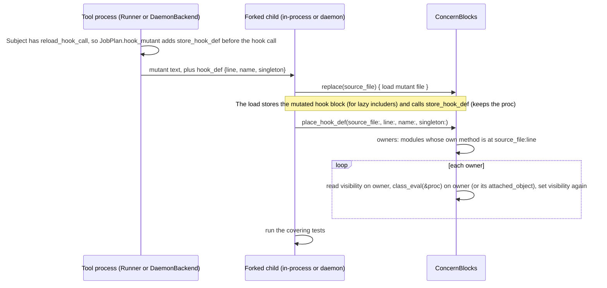

# Run included and prepended block methods under reload - Plan

## Decision

**Take option 3, under `--strategy reload` only. Redefine keeps these methods `unplaceable`.**

| Option | What it does | Verdict |
|---|---|---|
| 1. Keep `unplaceable` | Nothing runs. #291 counts the share. | Rejected. 2.0 makes the daemon with reload the `--rails` default (#284). Concern-heavy Rails code would lose these methods from the score for every user. |
| 2. Run the stored block again in each includer | Runs every statement in the block a second time. | Rejected. With ActiveModel 8.1, a second `validates :name, presence: true` gave two validators and "Name can't be blank" twice. That is a false kill. |
| 3. Load only the mutated def into each class that has the original def | One def changes. The rest of the block does not run again. | **Chosen.** A prototype kills every real mutant and lets every equivalent mutant survive, with real ActiveModel 8.1 too. |

Why option 3 is safe: it does what ActiveSupport does (`base.class_eval(&block)`), but for one def only. A validator, a callback or a registration in the block runs once, as before. A class that includes the concern during the tests runs the stored block, and reload already stores the mutated block for it (`ConcernBlocks.replace`).

Why redefine stays `unplaceable`: redefine does not load the file again. The stored block stays original, so a class that includes the concern during the tests runs the original method. The mutant could falsely survive.

The plan below changes the issue comment's option 3 in two places. It finds each target by where its method was defined, not by `ancestors`. It loads one stored proc into each target, not one `Name.class_eval` file per target. See "Corrections to the issue comment".

---

## Goal Capsule

- **Issue:** #297 (methods inside a concern's `included` or `prepended` block are `unplaceable` under redefine and reload).
- **Goal:** under `--strategy reload`, in-process and on the daemon, a mutant of a method in an `included` or `prepended` block reaches every class that already has the method and every class that includes the concern later. It is killed or survives like any other mutant.
- **Authority:** this plan, then `AGENTS.md`, then the `**Claude:**` comment on #297. Where this plan differs from the comment, this plan wins.
- **Stop and ask when:** an equivalent mutant of a hook-block def is killed in any test (that is a false kill); a change would run any statement of the block a second time; or a change needs `eval` or a new runtime dependency.
- **Size:** M (the comment said L). About 23 files: 10 under `lib/`, 11 under `test/` (fixtures included), 2 docs. About 150 lines of library code. The prototype took 85 lines in 7 library files.

---

## Product Contract

### Summary

Discovery marks each hook-block def that reload can place. For that def, the tool adds one statement to the mutant file, just before the `included` or `prepended` call: `::Mutineer::ConcernBlocks.store_hook_def do <mutated def> end`. The statement sits in the same class or module body as the call, so the stored proc has the same constant scope as the block. After the child loads the mutant file, `ConcernBlocks.place_hook_def` finds each module whose own method has the original def's file and line. It runs the stored proc in each one with `class_eval` and puts back the method's visibility. The daemon does the same step in `DaemonServer#apply_payload`.

### Problem Frame

ActiveSupport runs an `included` or `prepended` block once in each class, when that class first includes or prepends the concern. A reload loads the file again, which stores the new block but does not run it in a class that already has the concern. So today `Subject#unplaceable?` (`lib/mutineer/subject.rb:45-47`) marks every def in the block `unplaceable` under reload (`hook_block`) and under redefine (`owner_unknown`). `Runner.run` (`lib/mutineer/runner.rb:330`) and `DaemonBackend.job_result` (`lib/mutineer/daemon_backend.rb:383-385`) return that verdict before any fork. These methods leave the score, so a `--threshold` gate can pass when they were never tested.

### Requirements

- R1. Under reload, in-process and on the daemon, a mutant of a placeable hook-block def runs. `unplaceable?("reload")` is false for it.
- R2. The mutant reaches each module whose own method came from the original def: a named class, an anonymous class, a plain module that includes the concern (a class that includes that module then gets it by inheritance), a singleton class that includes the concern, and a class that got the method through another concern that depends on this one. A prepended wrapper must not hide the original owner from this match. For a singleton def, it reaches each class whose singleton class has the method.
- R3. A class that includes the concern after the load (a lazy includer) gets the mutated method from the stored block, as today.
- R4. No statement of the block runs a second time. An equivalent mutant survives.
- R5. A subclass that overrides the method keeps its override. A plain module or class that only inherits the method gets no copy.
- R6. Each target keeps the visibility the original method had (`private`, `protected`, `public`).
- R7. `def x`, `def self.x` and `def x` inside `class << self` in the block are all placeable.
- R8. These defs stay `unplaceable` under reload, as today:
  - a def with an explicit receiver other than `self`, whose binding the extracted def does not retain;
  - a def in a class, module, `Struct.new`, `Class.new` or `Data.define` block inside the hook block;
  - a def inside another method, or inside a block that does not build a class (`[1].each do`);
  - every def in a hook block that contains any `alias` or `alias_method`;
  - a def whose name the hook block uses outside any def body: a bare call, `self.<name>`, `method(:<name>)` or `instance_method(:<name>)` (the block computed a value from the original def once, and nothing computes it again). The walk goes into every nested block and lambda of the hook block (such as `%i[a].each { register(compute) }` or `before_save { normalize }`), but not into def bodies, because discovery cannot tell a block that runs at once from one that runs later. A symbol argument such as `before_save :<name>` stays placeable, because it calls by name;
  - every def in a hook call that is not on a plain path from the top of the file: each node between the file and the call must be a statement list, a `module` or a `class`. This excludes `x = included do`, `foo(included do ... end)`, any `if`, `unless`, `case`, `&&`, `||`, `rescue` or loop around the call or around its module (this covers `module X ... end unless defined?(X)`), and a call inside a def or a block;
  - every def in a file that has a top-level `return` statement;
  - every def in a hook call inside `class << self`;
  - a def that `module_function` makes a module function (either form);
  - a hook-block def whose name and first line match another definition in the same file, including an instance/singleton collision. The inventory reads every raw DefNode, even those not selected as subjects. It also counts explicit `define_method`, `define_singleton_method`, `attr_reader`, `attr_writer`, `attr_accessor` and `attr` calls. A literal positional lambda uses its own arrow line, and a direct block uses its opening line. For stored callable bodies or block passes with an indirect source, the inventory conservatively includes all block and lambda source lines in that file, including a stored hook block that can itself be installed as a method. An ordinary one-line hook remains placeable without a matching-name or unknown-name indirect creator. With such a creator, conservative exclusion is intentional because the body could come from the hook block itself. Attribute methods use the message-token line. Literal symbol/string names are exact; an unknown method name blocks only possible body lines, while an unknown attribute name or dynamic attr writer flag blocks the attribute creation line. Source location cannot identify which original definition an existing host has.

  A def that R8 excludes reports `unplaceable` with no per-entry cause (see Scope Boundaries).
- R9. Redefine is unchanged. Every hook-block def that is `unplaceable` under redefine today stays so.
- R10. If the child loads the mutant file but no stored def arrives, the mutant scores `error`, never `survived`. The error text names the method, the file and the line. R8 keeps the known causes of this (a guarded concern, an early `return`) out of reach, so the error marks a defect.
- R11. `--test-command` is unchanged. Its mutant file has no added statement.
- R12. If a module that owns the original def, or a module that has such an owner among its ancestors (a subclass), has an own method with another name at the same file and line (an alias the host made outside the block), the mutant scores `error`, never `survived`. The alias keeps the original body.

### Acceptance Examples

- AE1. `ConcernPricing#doubled` (`test/fixtures/singleton/concern_class_methods.rb:20`) under reload: killed, 100% score, 0 unplaceable.
- AE2. `ConcernWrapping#decremented` (same file, line 34) under reload: killed.
- AE3. The same two mutants under redefine: `unplaceable`, as today.
- AE4. In the new `hook_edges` fixture, a mutant of `HookEdges#bumped` under reload with `--matrix` is killed by the tests for the named host, the anonymous host, the mixin host and the lazy host.
- AE5. An equivalent mutant (the body replaced by its own text) of each hook-block def survives every fixture test, including the test that the block registered its host only once and the test that the subclass override still adds 100.

### Scope Boundaries

- In scope: reload in-process (`Runner.run`) and on the daemon (`DaemonBackend.job_result`, `DaemonServer#apply_payload`).
- Not in scope: redefine (R9), `--test-command` (R11), the #291 unplaceable share and budget, and a per-entry cause in `unplaceable[]`. Today an entry has no cause field (`Reporter#mutant_json`, `lib/mutineer/reporter.rb:689-701`), and this plan adds none. The R8 list lives in `docs/json-schema.md`.

### Deferred to Follow-Up Work

- The R8 cases. Each needs its own placement rule. File one issue for them if a reference app shows they matter.
- Redefine support (see Open Questions, Q1).

### Corrections to the issue comment

1. **"Each class whose ancestors include the concern" is the wrong target set.** A subclass of the includer has the concern in its ancestors. If it overrides the method, loading the mutant there removes the override: a false kill. A plain module that includes the concern ran the block itself, but a class that includes that module has the concern in its ancestors and never ran the block. The plan targets each module whose own method table has the method with the original def's file and line (KTD2). The prototype checked the subclass case.
2. **The `block_owner` wrapper (`Name.class_eval do ... end`) cannot do this job.** An anonymous includer has no name. The daemon builds its payload in the tool process, which has not loaded the app, so it cannot pick `class` or `module` for each part of the nesting (`Isolation.nesting_keywords`). The plan stores one proc at the hook call's own position and runs it with `class_eval(&proc)` in each target (KTD1). This answers both open questions in the comment.
3. **Size is M, not L.** See the Goal Capsule.
4. **Line drift.** The `--test-command` advice for these methods is at `CHANGELOG.md:152-157` (in the 1.7.0 #256 entry), not line 149.

---

## Planning Contract

### Key Technical Decisions

- KTD1. **Store the mutated def as a proc written at the hook call's position.** The tool inserts `::Mutineer::ConcernBlocks.store_hook_def do`, a newline, the mutated def, a newline and `end; ` at the start offset of the hook call. A block written there has the same constant scope (`Module.nesting`) as the hook block, because both sit in the same body. `class_eval` with a block makes `def` define on the receiver and keeps the block's constant scope, which is how ActiveSupport runs the hook block. Rationale: the scope is exact by construction, an anonymous target needs no name, the daemon needs no app-side nesting logic, and nothing uses `eval`.
- KTD2. **Find targets by source location.** `ConcernBlocks.owners` walks `ObjectSpace.each_object(Module)` and returns the module that owns the method. For an instance def this includes singleton-class hosts. For a singleton def inspect each module's singleton class. Follow `UnboundMethod#super_method` until its owner is the target module, so a prepended wrapper does not hide the target's own definition. A module counts when its own method (`method_defined?(name, false)` or `private_method_defined?(name, false)`) has a `source_location` whose line is the def's start line and whose file has the same real path as the source file (`ConcernBlocks.real_path`). Rationale: this is exactly the set of places the original block defined the method. It skips overrides and inherited copies.
- KTD3. **Capture and restore visibility on the owner.** For each receiver from KTD2, use the receiver itself for an instance def or its singleton class for a singleton def. Read the method visibility there (`private`, `protected`, else public). Run `class_eval(&proc)` on the receiver, then restore non-public visibility on the method owner. A `def` in a `class_eval` block is public. This mirrors `Isolation.method_visibility` (`lib/mutineer/isolation.rb:311-317`), but `ConcernBlocks` stays stdlib-only because the daemon loads it.
- KTD4. **Discovery decides placement, not the child.** Add a `reload_hook_call` member to `Subject`: the `Prism::CallNode` of the hook block when reload can place the def, else nil. `hook_block` keeps its meaning (the def is inside a hook block). `unplaceable?("reload")` becomes `hook_block == true && reload_hook_call.nil?`. Rationale: an R8 def is reported `unplaceable` before any fork, as today, so it never scores `error`.
- KTD5. **Insert only before a hook call on a plain path.** Before the walk, `Project.discover` makes one pass over the file. It descends only through `ProgramNode`, `StatementsNode`, `ModuleNode` and `ClassNode` bodies, and it collects each call statement it finds there (by object identity). A hook call counts only when it is in that set and the file has no top-level `ReturnNode`. Rationale: a plain path is the only shape where the added statement changes no other statement and always runs when the hook call runs. A positive list is shorter than a list of every conditional form (`if`, `case ... in`, `&&`, `rescue`, `while`), and it also excludes a hook call inside a def or a block.
- KTD6. **One shared tool-side builder.** `JobPlan.hook_mutant(mutated, mutation, subject, source)` returns the mutant text with the stored def, plus a hook-def hash with the keys `line`, `name` and `singleton`. `ConcernBlocks.place_hook_def` takes `source_file:` plus the same three names as keyword arguments. Each caller passes `source_file:` itself, because it already has it (`source_file` in `Runner.run`, `payload["source_file"]` on the daemon). The daemon payload carries the hash under `"hook_def"`. `Runner.run` and `DaemonBackend.job_result` both call it, as both call `JobPlan.coverage_selection` today. It does not raise. A bad insert makes the child's `load` raise `SyntaxError` before any test runs, in-process and on the daemon, so the mutant scores `error`; a raise in the tool process would end a daemon run. It builds the def with a new `Isolation.mutated_def(mutation, subject, source)` (pure text building with no live-module lookup, so it is safe in the tool process), extracted from `Isolation.apply_surgical` (`lib/mutineer/isolation.rb:221-226` and `:243-248`), so redefine and reload build the same text.
- KTD7. **A missing stored def raises.** `place_hook_def` raises when no proc was stored. The message reads `mutineer: could not place the mutant of <name> (<file>:<line>): the mutant file did not reach its included or prepended call. This is a mutineer bug; please report it.` In-process the child prints it to stderr as `[mutineer-child] RuntimeError: ...` (`lib/mutineer/isolation.rb:67-70`); on the daemon it goes to the daemon's error log as `[daemon-child] ...` (`lib/mutineer/daemon_server.rb:331-333`). The child aborts before tests run, so the mutant scores `error` (exit 2 in-process, `"error"` on the daemon). The report then says `child exited with status 2` (or `daemon verdict: error`), as for every child error today (`Isolation.decode`); the cause is on stderr. Carrying the child's cause into the report is a separate, pre-existing gap and stays out of scope. `place_hook_def` returns the number of owners it changed. Zero owners is not an error: lazy includers get the mutant from the stored block.
- KTD7a. **An alias outside the block raises too.** A separate helper, `ConcernBlocks.aliases`, checks every module for an own method with another name and the same file and line, independently of the current-name owners. A host can replace the current name with a wrapper while an alias keeps the original, leaving no current-name owner to find. `place_hook_def` walks `ObjectSpace.each_object(Module)` once into a list and passes that list to both `owners` and `aliases`, so there is no second walk. Measure the cost of both together on the fixture app. If one exists, `place_hook_def` raises before it changes anything, with the message `mutineer: could not place the mutant of <name> (<file>:<line>): <module>#<alias> is an alias of it and keeps the original method, so the mutant scores error.` (R12). A wrapper that replaces the original name and calls a saved alias also scores `error`, even when no current-name owner remains or an unrelated ordinary host still has the original method. Alias matching also requires `UnboundMethod#original_name` to match, so two different definitions on one line are not aliases. Before owner or alias introspection creates temporary method handles, placement checks `ObjectSpace` for a `Method` or `UnboundMethod` that retains the original file, line and original name. A live handle makes the mutant score `error`, because a wrapper can call it after a redefinition. If an initial match exists, GC runs and the check repeats so an unreachable reflection result does not block placement. No matching handle means no explicit GC.
- KTD8. **Any alias keeps the whole block unplaceable.** If the hook block contains any `Prism::AliasMethodNode` or any `alias_method` call, no def in it is placeable (R8). An alias holds the original body, and nothing reloads it. Rationale: a false survivor is a wrong verdict too, and one block-wide rule needs no name tracking. The same reasoning makes a def that the block itself uses outside a def body unplaceable (R8); that check is per name, because a block often calls an unrelated macro.
- KTD9. **Semver: minor (`feat`), by default.** No JSON field, exit code, option or default changes. Verdicts change: some `unplaceable` mutants become killed or survived. So a reload score can go down, a `--threshold` gate can start to fail, and a `--baseline` run against an older report lists the new survivors as regressions. Earlier verdict fixes (#252, #254, #256) shipped in minor releases. The CHANGELOG entry tells users to expect this and to write a new baseline after the upgrade. Q4 records the major-bump alternative for David.

### High-Level Technical Design



The mutant file for `ConcernPricing#doubled` then reads, around the hook call (directional, the def is mutated):

```ruby
module ConcernPricing
  # ...
  ::Mutineer::ConcernBlocks.store_hook_def do
def doubled(x)
      x - 2
    end
end; included do
    def doubled(x)
      x - 2
    end
  end
end
```

### Prototype record

The prototype lived in a scratch copy of the clone, not in any committed file. Results:

- `test/singleton_redefine_test.rb` with the two reload tests changed to `assert_killed`: both fail on `main` ("expected the mutant to be killed") and pass with the prototype.
- The full zero-dependency suite passed with the prototype: 1409 runs, 0 failures, 1 skip.
- A scratch `hook_edges` fixture (named host, subclass override, anonymous host in a constant array, lazy host built in a test, `def self.x`, `class << self`, `private` def, a once-only registration): every real mutant was killed in every host that uses it; every equivalent mutant passed every test.
- The daemon path: the payload went through JSON, `DaemonServer#apply_payload` ran it in a fork, the real mutant exited 1 and the equivalent mutant exited 0, for both fixture mutants.
- Real ActiveSupport and ActiveModel 8.1.4, with `validates :name, presence: true` in the block: the equivalent mutant kept one error ("Name can't be blank" once); the real mutant reached the existing class and a lazy class.
- A first fixture put the hosts in the concern's own file. A reload runs that file again, so its anonymous host was rebuilt and got the mutant as a lazy includer; that run did not prove the anonymous case. A second run moved the hosts to `hook_edges_hosts.rb`: the real mutant of `HookEdges#bumped` was killed in the named host, the subclass, the anonymous host, a class that includes a plain module that includes the concern, and a lazy host. Every equivalent mutant still passed. That run loaded the hosts from the test file, after the mutant, so it also exercised only lazy includers; U3 loads the hosts in the parent.
- The prototype used a simpler placement test (the hook call starts its line) and a per-name alias rule. The plan replaces both with the stricter rules in KTD5 and KTD8, and adds KTD7a and the self-use rule in R8. The prototype did not exercise those. They only take defs away or turn a survivor into an error, so they cannot add a false kill.
- Cost: `owners` took about 11 ms per call with Active Record and Action Controller loaded (2715 modules).

---

## Implementation Units

### U1. Mark the placeable hook-block defs in discovery

**Goal:** each `Subject` for a def that reload can place carries its hook call in `reload_hook_call`.

**Requirements:** R1, R7, R8, R9, R10.

**Dependencies:** none.

**Files:**
- `lib/mutineer/subject.rb` (struct at lines 20-21, docs at 16-19, `unplaceable?` at 37-47)
- `lib/mutineer/project.rb` (`initialize` at 64-87, hook branch of `visit_call_node` at 154-161, `visit_def_node` at 246-266, `with_namespace` at 336-359, `SCOPE_STATE` at 362-364, `hook_block?` at 511-523; a new plain-path pre-pass helper that `Project.discover` calls, per KTD5)
- `test/subject_test.rb`, `test/project_test.rb`

**Approach:**
- Add `:reload_hook_call` to the `Subject` struct after `:hook_block`. Change `unplaceable?` per KTD4. In the struct doc, say that nil means "reload cannot place it", even when `hook_block` is true.
- In `Project.discover`, before the visitor walks a file, run the KTD5 pre-pass and give the visitor the set of plain-path call nodes (empty when the file has a top-level `return`).
- In `SubjectVisitor`, add `@hook_call` (nil in `initialize`, listed in `SCOPE_STATE`). In the hook branch of `visit_call_node`, set it to the call node when `hook` is true, the call is in the plain-path set, and a walk of the block finds no `Prism::AliasMethodNode` and no `alias_method` call (KTD8). The same walk collects the names the block calls outside def bodies (bare calls, `self.` calls, and the symbol argument of `method` and `instance_method`). It goes into every nested block and lambda, but not into def bodies.
- Set `@hook_call` to nil in `with_namespace`, so a def in a class or module inside the hook block is not placeable. A builder block already sets `@self_scope` to its own block (`lib/mutineer/project.rb:171-173`), so the def-site check below excludes it with no extra reset.
- In `visit_def_node`, pass `reload_hook_call: @hook_call` only when `@self_scope` is the hook call's block node (this excludes nested defs, non-builder blocks and builder blocks), `@module_function_active` is false, the receiver is absent or `self`, the singleton depth is 0, or 1 with no receiver, and the def name is not in the block's self-use names. Put this test in one documented private method.

**Patterns to follow:** `hook_block?` and `concern_block` in `lib/mutineer/project.rb`; the `preserving_scope` discipline.

**Test scenarios:**
- `test_unplaceable_depends_on_the_strategy` (subject_test, extend): a subject with `owner_unknown: true, hook_block: true, reload_hook_call: <a call node>` is unplaceable under redefine and placeable under reload. The existing four cases stay as they are. Fails before: `reload_hook_call` is not a member (ArgumentError).
- `test_discover_sets_the_hook_call_for_placeable_hook_defs` (project_test, new): a concern with `included do` holding `def a`, `def self.b`, `class << self; def c; end; end`, `private def d`, and `self.prepended do` holding `def e`. Each subject's `reload_hook_call` is the call node (compare by `location.start_line`). Fails before: NoMethodError.
- `test_discover_leaves_nested_hook_defs_unplaceable` (project_test, new): in an `included` block, a def in `class Inner`, a def in `Kind = Struct.new(:a) do`, a def inside a def, and a def in `[1].each do`. Each has `reload_hook_call` nil and `hook_block` true. Fails before on `reload_hook_call` (NoMethodError).
- `test_an_alias_in_the_hook_block_makes_every_def_unplaceable` (project_test, new): one block with `def tag`, `def other` and `alias_method :copy, :tag`; a second concern's block with `alias twin tag`. Every def in both blocks has `reload_hook_call` nil. Fails before (NoMethodError).
- `test_discover_requires_a_hook_call_on_a_plain_path` (project_test, new): `x = included do ... end`, `x =\n  included do ... end`, `foo(included do ... end)`, `included do ... end if true`, `module G ... end unless defined?(G)` around a plain `included do`, `defined?(H) || module H ... end`, `case x in Integer then included do ... end end`, an `included do` inside `def self.setup`, an `included do` inside `class << self`, a def in a `Class.new do` block in the hook block, and a def named by `module_function :name` in the hook block. Each def has `reload_hook_call` nil. `extend ActiveSupport::Concern; included do` on one line is placeable (the prototype did not place this shape). A plain `included do` in a second module of the same file gets the call node. Fails before (NoMethodError).
- `test_a_top_level_return_makes_the_file_unplaceable` (project_test, new): `return if defined?(R)` before the module. Every hook def has `reload_hook_call` nil. Fails before (NoMethodError).
- `test_a_def_the_block_uses_stays_unplaceable` (project_test, new): an `included` block with `def self.columns = %i[a]` then `searchable columns`, and `def cb` with `register method(:cb)`, and `def saved` with `before_save :saved`. Also `def compute` with `%i[a].each { register(compute) }`, and `def normalize` with `before_save { normalize }`. `columns`, `cb`, `compute` and `normalize` have `reload_hook_call` nil; `saved` gets the call node. Fails before (NoMethodError).
- `test_discover_marks_included_and_prepended_block_defs_owner_unknown` (project_test:310) keeps its `owner_unknown` and `hook_block` asserts unchanged (R9).

**Verification:** discovery assigns `reload_hook_call` only to the R7 forms. The existing project and subject tests pass unchanged.

### U2. Store, find and place the mutated def in the child

**Goal:** `ConcernBlocks` holds the stored proc and loads it into each owner.

**Requirements:** R2, R4, R5, R6, R10, R12.

**Dependencies:** none (U3 and U4 call it).

**Files:**
- `lib/mutineer/concern_blocks.rb` (module doc at lines 4-21, new methods after `forget` at 49-67)
- `test/concern_blocks_test.rb`

**Approach:**
- `store_hook_def(&block)`: keeps the block in a module instance variable. The mutant file calls it.
- `owners(modules, source_file:, line:, name:, singleton:)`: returns only the owners per KTD2, from the module list `place_hook_def` collects once.
- `aliases(modules, owners, ...)`: returns each KTD7a alias (module and name) on an owner or on a module with an owner among its ancestors.
- `place_hook_def(source_file:, line:, name:, singleton:)`: takes and clears the stored proc (say so in its YARD summary), raises with the KTD7 message when there is none, raises with the KTD7a message when `aliases` finds one, and for each owner reads visibility, runs the proc and restores visibility (KTD3). It returns the number of owners it changed.
- Document each method and the module behaviour for `yard:strict`. In the module doc, say that a class that already includes the concern now gets the mutated def from `place_hook_def`, and remove the sentence that says it keeps the original. Limit "Without ActiveSupport it does nothing" to `replace` and `forget`; say that `store_hook_def` and `place_hook_def` work without ActiveSupport.

**Patterns to follow:** `ConcernBlocks.forget` (ObjectSpace walk, `real_path` match).

**Test scenarios:** (each fails before: NoMethodError)
- `test_place_hook_def_reaches_named_and_anonymous_owners`: a concern (stub) with `included do def tag = :original end`, a named class, an anonymous class and a plain module that include it, and a class that includes that module. Store `proc { def tag = :mutant }` and place it with the def's file and line. `place_hook_def` returns 3. The two classes and the module own `tag` and return `:mutant`; the class through the module returns `:mutant` with no own `tag`.
- `test_place_hook_def_skips_an_override_and_an_inheritor`: a subclass that overrides `tag` keeps its own result; a subclass that does not override gets `:mutant` through its parent and has no own `tag`.
- `test_place_hook_def_keeps_private_visibility`: an `included` block with `private` before the def. After placing, the method is still private and returns the mutant value through `send`.
- `test_place_hook_def_targets_singleton_defs`: `def self.made` and `class << self; def tagged; end; end` in the block. Placing with `singleton: true` changes the class methods of each includer and not their instance methods.
- `test_place_hook_def_keeps_a_private_singleton_def_private`: `class << self; private; def hidden; end; end` in the block. After placing, `hidden` is still private on each includer's singleton class.
- `test_place_hook_def_raises_without_a_stored_def`: no `store_hook_def` call, then `place_hook_def` raises, and the message names the method, the file and the line.
- `test_place_hook_def_raises_when_an_owner_aliased_the_method`: a host that runs `alias_method :old_tag, :tag` after the include. `place_hook_def` raises, the message names `old_tag`, and `tag` still returns `:original`.
- `test_place_hook_def_raises_when_a_subclass_aliased_the_method`: a subclass of a host runs `alias_method :base_tag, :tag`. `place_hook_def` raises, and the message names `base_tag`.
- `test_place_hook_def_with_no_owner_is_a_no_op`: no class includes the concern. It returns 0 without error and clears the stored proc.

**Verification:** the new tests pass with the concern stub; the five existing `ConcernBlocksTest` tests pass unchanged.

### U3. Build the mutant text and place the def in-process

**Goal:** `Runner.run` under reload runs a placeable hook-block mutant.

**Requirements:** R1, R3, R4, R8, R11.

**Dependencies:** U1, U2.

**Files:**
- `lib/mutineer/isolation.rb` (`apply_surgical` at 206-277; doc of `apply_whole_file` at 190-192 in U5)
- `lib/mutineer/job_plan.rb` (new `hook_mutant` near `coverage_selection` at 178)
- `lib/mutineer/runner.rb` (`run` at 315-354, apply step at 338-342)
- `test/isolation_test.rb` (`Isolation.mutated_def`), `test/runner_test.rb` (`JobPlan.hook_mutant`, where the `JobPlan` tests live), `test/singleton_redefine_test.rb`
- `test/fixtures/singleton/hook_edges.rb`, `test/fixtures/singleton/hook_edges_hosts.rb`, `test/fixtures/singleton/hook_edges_test.rb` (new)

**Approach:**
- Extract `Isolation.mutated_def` from `apply_surgical`: the mutated def text, wrapped in `class << self` for a singleton def with no receiver. `apply_surgical` calls it and adds the `block_owner` and nesting wrappers as today.
- Add `JobPlan.hook_mutant` per KTD6. It inserts the `store_hook_def` statement at `subject.reload_hook_call.location.start_offset` in the mutated text. That offset is before the def, so the mutation does not move it.
- `job_plan.rb` adds `require_relative "isolation"` for `Isolation.mutated_def`. Today only `runner.rb` requires it, and the daemon path loads `job_plan.rb` through `daemon_backend.rb`. `isolation.rb` does not require `job_plan.rb`, so this adds no cycle.
- In `Runner.run`, under reload, when `subject&.reload_hook_call`, pass the `JobPlan.hook_mutant` text to the unchanged `Isolation.apply_whole_file`, then call `ConcernBlocks.place_hook_def(source_file: source_file, **hook_def)` in the same fork block. `Isolation.apply_whole_file` keeps its signature, so #308's edit to it does not conflict. `ExternalBackend` and `FileSwap` keep the plain mutated text (R11).
- `hook_edges.rb` holds only the concern: a constant used by a def, a once-only registration, `def`, `def self.`, `class << self`, a `private` def and a public caller of it. `hook_edges_hosts.rb` holds the hosts: a named host, a subclass override, a plain module that includes the concern with a class that includes it, and an anonymous host in a frozen constant array. The hosts must not live in the concern's file: a reload runs that file again, so a host there is rebuilt and gets the mutant as a lazy includer, and its test proves nothing. The parent must load the hosts before the fork: the child loads the test files only after `place_hook_def`, so hosts that the test file loads would all be lazy includers and prove nothing. The new tests pass `hook_edges_hosts.rb` as a `require_paths` entry (extend `run_redefine` with `require_paths:` and `matrix:`). `hook_edges_test.rb` raises at load time when the hosts are not defined, covers each host, and builds a lazy host inside a test.

**Test scenarios:**
- `test_included_block_methods_are_killed_under_reload` (rename of `test_included_block_methods_are_unplaceable_under_reload`, singleton_redefine_test:192): `assert_killed` for `ConcernPricing#doubled`. Covers AE1. Fails before: 0 killed, 1 unplaceable.
- `test_prepended_block_methods_are_killed_under_reload` (rename, :201): keeps the `ConcernWrapping#tripled` assert, then `assert_killed` for `ConcernWrapping#decremented`. Covers AE2. Fails before.
- `test_included_block_methods_are_unplaceable_under_redefine` (:172) stays unchanged. Covers AE3.
- `test_hook_block_mutants_reach_every_includer` (new): reload with `matrix: true` on `hook_edges.rb`, `only: "HookEdges#bumped"`. Each killed result's `kills.killed_by` names `test_named_host`, `test_anonymous_host`, `test_mixin_host` and `test_lazy_host`. Covers AE4. Fails before: unplaceable, no kills row.
- `test_hook_block_singleton_and_private_defs_are_killed_under_reload` (new): `assert_killed` for `HookEdges.made`, `HookEdges.tagged` and `HookEdges#secret`. Fails before.
- `test_hook_mutant_inserts_the_stored_def_before_the_hook_call` (runner_test, new): for `ConcernPricing#doubled` with a known mutation, the text parses, holds one `store_hook_def do` before `included do`, and the hook-def hash is `{line: 20, name: :doubled, singleton: false}`. Fails before: NoMethodError.
- `test_equivalent_hook_block_mutants_survive` (new, the false-kill guard): build an equivalent `Mutation` (each def body replaced by its own text) for every subject with a `reload_hook_call` in `hook_edges.rb` and run each through `Runner.run` with reload. Each result is `survived`. Covers AE5. Fails before: unplaceable.

**Verification:** the renamed tests pass; the redefine test and the full suite stay green; the equivalent-mutant guard shows no false kill.

### U4. Place the def on the daemon

**Goal:** the daemon runs a placeable hook-block mutant the same way.

**Requirements:** R1, R10, and parity with U3.

**Dependencies:** U1, U2, U3 (`JobPlan.hook_mutant`).

**Files:**
- `lib/mutineer/daemon_backend.rb` (`job_result` at 367-398, payload at 389)
- `lib/mutineer/daemon_server.rb` (`apply_payload` at 423-445, docs at 423-434, protocol doc near line 30)
- `test/daemon_backend_contract_test.rb`, new `test/daemon_server_hook_def_test.rb` (zero-dep suite; it calls `apply_payload` as `test/daemon_temp_sweep_test.rb:162` does)

**Approach:**
- In `job_result`, when `subject.reload_hook_call`, send the `JobPlan.hook_mutant` text as `"code"` and add `"hook_def" => {"line" => ..., "name" => ..., "singleton" => ...}` (name as a string). The `unplaceable?("reload")` branch at line 383 then covers only the R8 defs.
- In `apply_payload`, after the load, when `"hook_def"` is present, call `ConcernBlocks.place_hook_def` with `source_file: payload.fetch("source_file")` and the hash's values as keywords (name back to a symbol). `daemon_server.rb` already requires `concern_blocks` (line 8), which defines `Mutineer::ConcernBlocks` for the added statement, so the daemon needs no new require.
- Update the protocol comment for the new optional key.

**Test scenarios:**
- `test_an_included_block_def_is_unplaceable_without_a_request` (daemon_backend_contract_test:159) stays: a `hook_block` subject with no `reload_hook_call` still never reaches the daemon.
- `test_a_placeable_hook_def_sends_the_stored_def` (daemon_backend_contract_test, new): a subject with `reload_hook_call` set. A fake client records the request. The payload `"code"` holds `store_hook_def do`, and `"hook_def"` is `{"line" => 20, "name" => "doubled", "singleton" => false}`. Fails before: the request is never made (unplaceable).
- `test_apply_payload_places_the_hook_def` (new, zero-dep): in a fork, load the concern fixture, run `DaemonServer.send(:apply_payload, payload)` with a JSON round-tripped payload from `JobPlan.hook_mutant`, and check that `ConcernProduct.new.doubled(2)` returns the mutant value. Fails before: no `"hook_def"` handling, the original value returns.
- `test_apply_payload_raises_when_the_hook_def_did_not_load` (new): a payload with `"hook_def"` and code that never calls `store_hook_def` raises, so the daemon child exits with `error`.

**Verification:** the contract tests pass in the zero-dep suite; `rake test:daemon` stays green.

### U5. Docs, comments and CHANGELOG

**Goal:** every place that says reload cannot run these methods tells the truth.

**Requirements:** all, for users.

**Dependencies:** U1 to U4.

**Files:**
- `CHANGELOG.md` (`## [Unreleased]`, a new `### Added` section, with a bold lead-in as in the 1.7.0 entries)
- `docs/json-schema.md` (line 60 `unplaceable` row, lines 90-101 `unplaceable[]` text)
- `lib/mutineer/concern_blocks.rb` module doc (in U2)
- `lib/mutineer/result.rb` (status doc at 19-27), `lib/mutineer/reporter.rb` (comment at 755-756), `lib/mutineer/project.rb` (`hook_block?` doc at 511-517), `lib/mutineer/isolation.rb` (doc at 190-192)

**Approach:** in `docs/json-schema.md`, split the `unplaceable[]` paragraph: keep the redefine causes as they are, and add a short bulleted list of the R8 reload causes. Say plainly that two defs in one `included` block can get different verdicts. Refer to that list from the other files. The CHANGELOG entry, to adapt (it leads with what the user must do, and it names GitHub Action users, who run reload by default):

"**Included and prepended block methods under reload.** After you upgrade, write a new baseline with `--format json`. A `--baseline` check against an older report lists the new survivors as regressions. This applies to GitHub Action users too, because the Action runs `--strategy reload` by default. Under `--strategy reload`, in-process and on the daemon, a method in a concern's `included` or `prepended` block is now mutated and scored (#297). Mutineer loads the mutated method into each class that already has it. A class that includes the concern later gets it from the reloaded block. The rest of the block does not run again, so validators and callbacks are not added twice. These mutants used to be `unplaceable`, so a reload score can go down and a `--threshold` gate can start to fail. Some methods stay `unplaceable`: a method in a class, module or `Struct.new` block inside the block, a method inside another method or block, every method in a block that uses `alias` or `alias_method`, a method the block itself calls, and every method in a block whose `included do` call is not a plain line of the module body (for example inside `if`, `unless`, or `x = included do`). If a class aliases a method that Mutineer does run (one not in the list above) outside the block, the mutant scores `error`, because the alias keeps the original method. `--strategy redefine` still reports all of these methods `unplaceable`."

**Test expectation:** none for behaviour. `yard:strict` checks the new doc comments. `test/docs_contract_test.rb` and `test/site_docs_test.rb` (both in `rake test`) check `docs/json-schema.md`; keep its headings as they are, or update the test's heading list if one changes.

**Verification:** no file still says reload cannot run a def directly in an `included` or `prepended` block. `rake yard:strict` reports 100%.

---

## Verification Contract

Run from the repo root, with `LANG=en_US.UTF-8 LC_ALL=en_US.UTF-8` set (from `AGENTS.md`):

```sh
bundle exec rake test                          # zero-dep suite
ruby -Ilib -e 'require "mutineer"'             # load smoke
bundle exec rake yard:strict                   # 100% documented, private methods and constants too
BUNDLE_GEMFILE=gemfiles/minitest6.gemfile bundle install
BUNDLE_GEMFILE=gemfiles/minitest6.gemfile bundle exec rake test
bundle exec rake test:daemon                   # daemon integration, Rails fixture bundle
```

`docs/json-schema.md` is published on the site. If U5 changes the published page, also run the "Website checks" from `AGENTS.md` (`bundle exec rake site:build`, `node --test test/site_test.js`, and the Playwright tests).

Rules from `AGENTS.md` that apply: zero runtime dependencies (Prism and stdlib only; `ConcernBlocks` stays stdlib-only); no `eval` (the plan uses `load` and `class_eval` with a block, never a string); 100% YARD docs; a CHANGELOG line under `## [Unreleased]`; the score model is unchanged (`killed / (killed + survived)`, `unplaceable` stays out of the denominator); the exact-survivor integration oracle stays green.

## Definition of Done

- The two renamed reload tests and every new test in U1 to U4 pass, and each new test that says "fails before" was seen failing on `main`.
- The equivalent-mutant guard (`test_equivalent_hook_block_mutants_survive`) passes: no false kill.
- Every R8 form reports `unplaceable` (U1 tests). `place_hook_def` raises for R10 and R12 (U2 tests) and for a missing stored def on the daemon (U4), and the child turns that raise into `error` (KTD7).
- `test_hook_block_mutants_reach_every_includer` fails when `place_hook_def` places nothing (seen once by stubbing it to return 0).
- Redefine verdicts for hook-block defs are unchanged.
- All commands in the Verification Contract pass.
- The CHANGELOG and `docs/json-schema.md` describe the new reload behaviour and the R8 exceptions.
- #284's checkbox "a decision on included-block methods under reload" can link to this change.

---

## Risks and Overlaps

- **#304 and #308 (open).** #304 moves the redefine snippet beside the source file in `Isolation.apply_surgical`; #308 adds `Isolation.write_beside` and routes `apply_whole_file` and `apply_surgical` through it. U3 edits the start of `apply_surgical` (the def text) and leaves `apply_whole_file` unchanged; the new `place_hook_def` call sits in `Runner.run`. Land this after them and rebase.
- **#244 and #245 (open).** Both edit `daemon_server.rb`, `daemon_backend.rb` and `test/daemon_backend_contract_test.rb`. Expect small conflicts in `job_result` and `apply_payload`.
- **#291 (plan).** The unplaceable share under reload drops for concern-heavy code. The #291 measurement uses redefine on the Rails fixture app, which this change does not touch. If #291 lands first, its warning text needs no change.
- **#284 (2.0 checklist).** This change is the decision #284 asks for. Its parity run (redefine, in-process reload, daemon) will now show different verdicts for hook-block defs between redefine and reload. That difference is intended (R9) and must be listed as expected in the parity check.
- **#306 (open)** edits `docs/json-schema.md`. A text conflict only.
- **Line numbers shift in the mutant file.** The added statement holds the def, so lines after the hook call move down in the temp file. Backtraces in that file and any `__LINE__` after the call change. Verdicts do not depend on them. The original def's line, which `owners` uses, comes from the original file.
- **Cost.** `owners` walks every module once per placeable mutant: about 11 ms with 2715 modules. A large app could take ten times that per mutant. Record the number from the #284 reference-app run.
- **Upgrade surprise for CI users.** A reload score can go down and a `--baseline` check can report new survivors after the upgrade, with no config change. The CHANGELOG entry says so and tells users to write a new baseline (KTD9, Q4).
- **A silent miss.** KTD7a and R8 close the direct alias and self-use paths. If `owners` finds no owner because of a real mismatch (for example a file path that `real_path` does not normalize), the mutant reaches only lazy includers and can falsely survive. The equivalent-mutant guard cannot see this. `test_hook_block_mutants_reach_every_includer` is the check. The implementer runs it first against a symlinked project path if one is easy to set up.
- **Indirect use at include time.** A macro called in the hook block but defined outside it can call a hook-block def while the block runs and keep the value. The self-use walk does not see the name, so the def is placeable and its mutant can falsely survive.
- **Defs on one line.** Alias checks use the original definition name as well as its file and line. Two distinct names such as `def a = 1; def b = 2` remain independently placeable; a real alias still scores `error`. If two definitions in one file share both the name and first line, discovery keeps every colliding hook def `unplaceable`, before any `only` filter. The inventory uses the complete raw AST instead of SubjectVisitor output, so it includes an unselected `class << TARGET` definition. It also counts the explicit Ruby method-creator family listed in R8. Multiline block-defined methods use the block-opening line, literal positional lambdas use the arrow line, and generated attribute methods use the message-token line; an earlier receiver or creator-call line does not cause a collision. Stored callable bodies and indirect block passes conservatively use possible block and lambda lines from the same file, including reusable hook blocks and keyed by method name when known. This also covers collisions across concerns, ordinary methods, and instance/singleton forms. Ruby reports no source column for these method locations, so placing either definition would risk changing the wrong host. Focused regressions cover the distinction.
- **The error cause is on stderr only.** The report shows the generic child-error text (KTD7). This is how every child error is reported today.
- **A wrapper that calls a saved alias.** The alias scan checks all modules by the original file and line, independently of the current-name owners. A wrapper that calls a saved alias scores `error`, including with no ordinary owner or a mix of ordinary and wrapped hosts. Reload and daemon regressions cover this case. A wrapper that retains the original in a `Method` or `UnboundMethod` object also scores `error`, even without an alias or a current-name owner. Ordinary owners, legitimate overrides and lazy includers still run when there is no retained original handle. This guard is conservative: a reachable handle can call the original, even if a particular test does not call it.
- **`method_added` hooks.** `class_eval` defines the method again, so a host's `method_added` hook runs a second time. A library that wraps or registers there could turn an equivalent mutant into a false kill. The equivalent-mutant guard has no such hook; add one to `hook_edges.rb` if a reference app shows one.
- **Singleton-class hosts and prepended wrappers.** The owner scan includes singleton classes and follows the method chain to the exact owner. Reload and daemon regressions cover these hosts and wrappers.
- **An owner made by `dup` or `clone` of a class** has the same source location and gets the mutant too. That is correct: the copy has the same method.

## Open Questions

- Q1 (deferred). Should redefine also place these defs? It would need the stored block replaced as well, or a lazy includer runs the original method. Default: no; redefine stays `unplaceable` (issue comment).
- Q2 (deferred). Do the R8 cases matter in real apps? Measure the count of R8 defs on the three #284 reference apps before planning a rule for them.
- Q3 (deferred, answered by the prototype). Anonymous includers: covered by `class_eval(&proc)` on the object, no name needed. `class << self` in the block: the stored proc holds `class << self` around the def, so `class_eval` opens each owner's singleton class. `def self.x`: the proc keeps the receiver.
- Q4 (deferred, for David). KTD9 treats this as a minor `feat`. The GitHub Action leaves `strategy` at its default (`action.yml:59-70`), so a non-Rails Action user on `@v1` runs reload and gets the new verdicts with no config change. If David counts that as a default change under the `AGENTS.md` rule ("a default flip must never reach them without opting in"), ship it in 2.0 with #284 instead. Not blocking: the code is the same either way.
