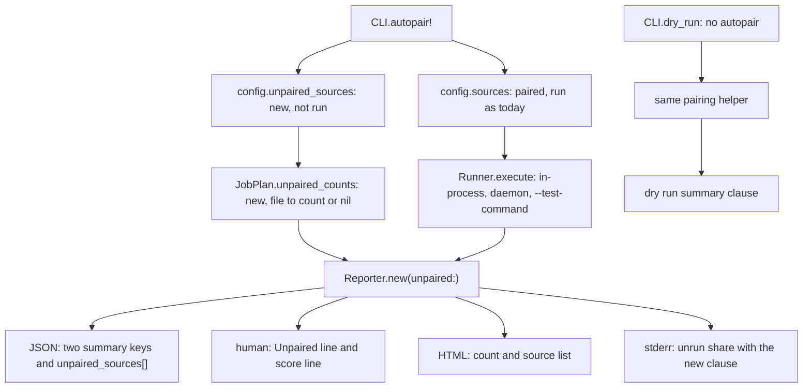

# Count unpaired sources and their mutants in the report - Plan

## Goal Capsule

- **What:** report sources without paired tests and their mutants, as requested in #381 (unpaired-source reporting).
- **Why:** readers need to see how much the run excludes.
- **How:** keep counts outside result rows (KTD1, separate counts) and extend the existing unrun-share warning (KTD3, shared warning).
- **Owners:** the implementing developer or coding agent completes the units. A maintainer decides alternatives and merges.
- **Authority:** this plan, then `AGENTS.md`, then the text of #381. This plan controls differences; see "Corrections to the issue".
- **Stop and ask:** a change affects `summary.total`, `per_source[]`, the score, exit codes or which sources run. Also stop if PR #244 (the 2.0 contract flip) merges first and sets `schema_version` to `2.0`. Stop if a maintainer selects an alternative for Q1 (warning choice) or Q4 (Action change classification).
- **Size:** M (medium). About 25 files: 5 under `lib/`, `action.yml`, `rake/docs_contract.rb`, 11 test files and 7 docs and contract files. No new runtime dependency.
- **Delivery:** one pull request from `main`. Complete U1 (counting), U2 (reports), U3 (dry run), U4 (Action) and U5 (contract and docs), in order. Labels: `enhancement` (feature), `priority: medium` (medium priority), `risk: low` (low risk), `v1.9.0` (target release). Use a minor version: the change adds JSON keys and report text, and removes nothing. Include `Closes #381` in the body. A maintainer merges. No release step.

---

## Product Contract

### Summary

Without `--test`, runs still drop sources without paired tests. They now count those sources and their mutants.

JSON adds `summary.unpaired_sources`, `summary.unpaired_mutants` and top-level `unpaired_sources[]`. Human and HTML reports, dry runs and GitHub Action summaries show both counts. The stderr unrun-share warning includes unpaired mutants. Scores, exit codes and existing JSON keys stay unchanged.

### Problem Frame

Mutineer pairs sources and tests by path convention. A source without a matching test produces only a stderr line (`lib/mutineer/cli.rb:649`). Reports omit it, so readers cannot see the scope missing from the score.

Vladimir reported this on Fizzy, a Rails 8 app. Scores of 78% and 85% covered 759 of 1,071 mutants. He manually found the remaining 312 mutants in 106 sources without paired tests.

### Terms

| Term | Meaning |
|---|---|
| Unpaired source | A named source that the run drops for having no paired test, in a run without `--test`. That means no convention-paired test and, once #382 (the `tests:` map) lands, no `tests:` entry. The run already drops it (`lib/mutineer/cli.rb:644-651`). |
| Unpaired mutant | A mutant Mutineer would schedule in an unpaired source. KTD4 (scheduled-mutant rule) defines the count. |
| Unrun share | The existing stderr warning for mutants that exist but did not run (`lib/mutineer/reporter.rb:124-145`, `:896-899`). |

### Requirements

The implementation owner must meet R1 to R18 below.

**Counting**

- R1 (record skipped sources). Without `--test`, record each unpaired source and still drop it. Keep the same running sources.
- R2 (count scheduled mutants). Use the run's operators, `--only` and `--since`. Record 0 when a source has no mutant.
- R3 (continue after count failures). Never change exit codes. Record an unknown count, name the file and error on stderr, and continue.
- R4 (explicit tests). With `--test`, report 0 sources, 0 mutants and an empty list.
- R5 (all sources unpaired). Keep exit code 2 when every source is unpaired.

**Report**

- R6 (add JSON fields). Add `summary.unpaired_sources` (int), `summary.unpaired_mutants` (int) and top-level `unpaired_sources[]`. Sort `{ file, mutants }` entries by `file`, using the `per_source[]` path form. `mutants` is `null` when the count is unknown. Sum known counts for `unpaired_mutants`. All three keys are additive.
- R7 (preserve existing values). Keep `summary.total`, `summary.attempted`, `summary.no_verdict`, `summary.score` and `per_source[]` unchanged.
- R8 (human report). Add an `Unpaired:` line with both counts and the scope share from KTD12 (scope-share formula). Add unpaired mutants to the score line's excluded counts.
- R9 (HTML report). Add the unpaired count to summary counts. List each unpaired source and its count.
- R10 (unrun-share warning). Use `unplaceable + skipped_invalid + unpaired_mutants`. Keep the 10% limit and floor of 1. Give unpaired mutants a separate clause and hint. Under `--fail-fast`, exclude them from the share because attempted counts are partial (KTD11, partial-run share rule). With `summary.total` 0, print only the R11 message (KTD13, empty-run message rule). Neither exception changes JSON counts.
- R11 (empty-run message). When no mutant ran but unpaired mutants exist, give their count on stderr. Do not claim the changes held nothing to test or generated no mutants.
- R12 (existing skip message). Keep `no test found by convention for <file>; skipping` unchanged.

**Dry run**

- R13 (dry-run counts). Without `--test`, use the same pairing rule and still list every mutant. Add both counts to the summary. Match `summary.unpaired_mutants` from a real run with the same arguments.

**GitHub Action**

- R14 (summary line). Add one line when `summary.unpaired_mutants` exceeds zero. Omit it when the key is absent.
- R15 (empty diff report). With `total` 0 and unpaired mutants, do not describe the change as docs-only or test-only.

**Contract and docs**

- R16 (schema). Set `schema_version` to `1.10` under KTD9 (one schema bump per release). Document new keys in `docs/json-schema.md` and `STABILITY.md`.
- R17 (user docs). Update `docs/results.md`, `docs/cli.md`, `docs/ci.md` and `CHANGELOG.md`. Include the measured Fizzy rates in the CHANGELOG.
- R18 (review rule). Extend `AGENTS.md` "Score-model discipline" to cover sources dropped whole.

### Acceptance Examples

AE1 (paired-run report), AE2 (explicit tests), AE4 (dry run) and AE6 (count failure) copy `test/fixtures/autopair`. It contains `lib/calc.rb`, `lib/greeter.rb` and their two tests. Add `lib/orphan.rb` with one `a + 1` method and `lib/blank.rb` without methods.

- AE1. Covers R1, R2, R6, R7, R12. `mutineer run lib --format json` exits 0. `summary.unpaired_sources` is 2; `summary.unpaired_mutants` is 1. `unpaired_sources` is `[{ "file": "lib/blank.rb", "mutants": 0 }, { "file": "lib/orphan.rb", "mutants": 1 }]`. `summary.total` stays 2. `per_source[]` names only `lib/calc.rb` and `lib/greeter.rb`. Stderr keeps both skip lines.
- AE2. Covers R4. Add `--test test/calc_test.rb`: counts become 0, 0 and `[]`. `per_source[]` includes `lib/orphan.rb`.
- AE3 (warning thresholds). Covers R10. With 2 killed and 3 unpaired, warn: `3 of the 5 mutants in scope were not run (3 in sources with no paired test; 60.0%, limit 10%)`. No warning for 20 killed and 2 unpaired (9.1%), or 1 killed and 1 unpaired (floor of 1). The first report under `--fail-fast` does not warn. Neither does a report with 0 results and 3 unpaired.
- AE4. Covers R13. `mutineer run lib --dry-run` lists the `lib/orphan.rb` mutant. Its summary line includes `1 unpaired (2 sources have no paired test; a run without --test skips them)`.
- AE5 (Fizzy counts). Covers R2, R6. Fizzy commit `d5b7b749d`, sources `app/models app/controllers`, default operators: 106 unpaired sources, 312 unpaired mutants, complete-run `summary.total` 759. At `f220e4832`, the values are 92, 149 and 922. Probe 1 measured counts; no Fizzy test ran.
- AE6. Covers R3. With a directory named `lib/odd.rb`, exit 0. Include `{ "file": "lib/odd.rb", "mutants": null }` and name `lib/odd.rb` on stderr.

### Scope Boundaries

- Add no mutant status or result row (KTD1).
- Add no gate. Counts and warnings never change exit codes.
- Keep pairing unchanged. #379 (namespace-mirrored concern tests) and #382 (`tests:` mapping in `.mutineer.yml`) own pairing changes.
- Add no per-mutant list. Use `--dry-run` on the file instead (Q3, list detail).
- Exclude suppressed mutants from unpaired counts (KTD4).
- Keep individual skip lines (Q5, stderr grouping).
- Under `--fail-fast`, `total` remains partial. New counts remain complete because counting precedes execution. Exclude them from unrun and scope shares (KTD11).

#### Deferred to Follow-Up Work

| Work | Required follow-up |
|---|---|
| Dry run with `--rails` or `--boot`, without `--test` | It exits 2 (`lib/mutineer/cli.rb:438-441`, `docs/cli.md:9`) and cannot show Rails unpaired counts. The implementation owner files an issue in U5 and names it in docs. |
| #362 (`--dry-run` ignores `--format json`) | Its implementation owner adds the same three keys when dry-run JSON becomes available. |
| #349 (measure declined counts and unrun share on a concern-heavy Rails app) | Its implementation owner records unpaired counts and provides evidence for Q2 (warning limits). |
| #402 (pinned Fizzy sample before each release) | Its implementation owner adds both counts to comparisons. |

### Corrections to the issue

- **"Currently, only stderr reports them."** Correct for real runs (`lib/mutineer/cli.rb:649`, probe 2 A and E). Dry runs skip pairing (`lib/mutineer/cli.rb:429`) and list unpaired mutants without marking them. Probe 2 B shows 3 dry-run mutations versus a real-run `total` of 2.
- **"Retain skipped sources in results" and "through `AggregateResult#unrun_count`".** `AggregateResult` counts only result rows (`lib/mutineer/result.rb:189-223`). Unpaired rows would increase `summary.total` and populate `per_source[]` (`lib/mutineer/reporter.rb:224`, `:288`). This breaks `test/cli_test.rb:1359-1367` and defeats `total == 0` checks in `lib/mutineer/cli.rb:763` and `action.yml:486`. Keep separate counts; the reporter extends the share (KTD1; KTD2, reporter-owned share).
- **"Calculate the share as mutants run divided by mutants that exist."** The two shares use different denominators:

  | Share | Formula or measured value | Display |
  |---|---|---|
  | Scope share | Vladimir's 29%: 312 of 1,071, or 29.1%. Use `unpaired_mutants / (total - ignored + unpaired_mutants)`. | Human `Unpaired:` line (KTD12). |
  | Unrun share | Divide by `attempted + unrun` (`lib/mutineer/reporter.rb:128`), excluding no-coverage mutants. Vladimir's tables give 312 of 994, or 31.4%. | Stderr above 10%. |

  `summary.total` includes ignored rows (`lib/mutineer/result.rb:223`); unpaired counts exclude suppressed mutants (KTD4). Remove ignored rows from the scope denominator. Fizzy "after" becomes 149 of 1,061 (14.0%), instead of 149 of 1,071 (13.9%).
- **"106 skipped files."** Correct, but 54 contain no default-operator mutant (probe 1). The 312 mutants occupy 52 files. After test additions, 149 mutants occupy 38 of 92 files.
- **The warning text.** Its two causes (`lib/mutineer/reporter.rb:129-131`) cannot describe unpaired mutants. Add a separate clause. The prefix `mutineer tried to score` is false because pairing dropped these sources before mutant selection (KTD14, accurate warning text).
- **Not in the issue.** Cover `--since`, `--only`, HTML, dry runs, Action summaries and empty-run messages (`lib/mutineer/cli.rb:803-818`). Otherwise their counts or claims can disagree (probe 3 G).
- **Schema version.** The issue specifies none. v1.8.0 and v1.8.1 report `1.9`; new keys require `1.10` (KTD9).
- **"Code and runtime behaviour were not checked."** This plan checked both. See "Probe results".

---

## Planning Contract

### Key Technical Decisions

The implementation owner follows these decisions. A maintainer owns changes to their defaults.

- KTD1. **Keep counts outside result rows; add no status.** Pass counts beside the aggregate. Rejected: an `unpaired` result per mutant. It changes `summary.total` and `per_source[]`, breaking `test/cli_test.rb:1359-1367`. It also defeats `total == 0` checks at `lib/mutineer/cli.rb:763` and `action.yml:486`. That creates medium risk for a low-risk issue. Existing contracts settle the choice; no bake-off ran.
- KTD2. **The reporter owns the share; `AggregateResult#unrun_count` counts rows.** Extend `Reporter#unrun_share_exceeded?` and `#warn_unrun_share`. Reject an `AggregateResult` constructor argument: `by_source` and five backend call sites would silently lose it. Locations: `lib/mutineer/result.rb:266`, `lib/mutineer/runner.rb:211`, `:260`, `:292`, `lib/mutineer/daemon_backend.rb:63`, `:98`.
- KTD3. **Use the existing unrun share.** Keep one share, limit and sentence, as #381 step 4 and `AGENTS.md` require. Append `N in sources with no paired test`; preserve existing text when no source is unpaired. A validation report prefers a separate warning that always prints. Q1 asks the maintainer.
- KTD4. **Count mutants the run would schedule.** Use jobs from `JobPlan.collect_jobs` and `JobPlan.scope_since`. Respect `--only`, `--since`, repeat removal and suppression. Do not check mutant parsing. Rejected: count suppressed mutants, which the user already dismissed. Rejected: check each mutant, which costs one parse per mutant to detect a Mutineer bug.
- KTD5 (failure-safe counting). **Count before execution, one source at a time.** `CLI.execute` counts before `Runner.execute`, protecting completed reports from count failures. Record unknown counts and stderr errors. Reject stopping the run: probe 3 F would change exit 0 to exit 1.
- KTD6 (config transport). **Use `Config#unpaired_sources`.** Add a code-only struct member, like `daemon_timeout` (`lib/mutineer/config.rb:100-104`). Add no flag or `.mutineer.yml` key. Returning values through `validate!`, `run` and `execute` would change three test-used signatures.
- KTD7 (reporter input). **Add `unpaired:` to `Reporter.new`, like `matrix:`.** Four renderers and the share rule use it (`lib/mutineer/reporter.rb:47-51`). Default to an empty hash for existing callers. A `report(...)` keyword like `declined:` would require four pass-through points.
- KTD8 (`--since` scope). **Narrow mutant counts, not the source list.** Count changed-line mutants while listing every dropped source, as skip lines do. Without narrowing, each pull request repeats the app's entire unpaired count, as `declined` does. Cost: two git processes per narrowed source (probe 5).
- KTD9. **Bump the schema once per release.** Read `SCHEMA_VERSION` on the base branch and latest tag. Both currently say `1.9`, so use `1.10`. If the base already says `1.10`, keep it and extend those docs. `docs/json-schema.md:16` requires a minor bump for additive changes; one release ships one version. If the base reports `2.0` because PR #244 (the 2.0 contract flip) merged first, stop and ask a maintainer. The sibling plans for #386 (methods with no mutants) and #388 (errored mutants in JSON) follow the same stop rule.
- KTD10 (shared pairing). **Use one helper for real and dry runs.** `CLI.autopair!` and `CLI.dry_run` share a private pairing helper. Dry runs count their own jobs under KTD4. U3 compares both counts.
- KTD11. **Exclude unpaired mutants from shares under `--fail-fast`.** All backends stop at the first survivor (`lib/mutineer/runner.rb:192`, `:286`, `lib/mutineer/daemon_backend.rb:312`). Their `attempted` and `total` counts are partial; unpaired counts are complete. Fizzy stopping after 4 mutants would warn `312 of 316` (98.7%), versus 31.4% for a complete run (reviewer probe `share_rule.out`). Add `fail_fast:` to `Reporter.new`, default `false`; pass `config.fail_fast` from `CLI.execute`. Keep JSON and `Unpaired:` counts. Rejected: a "partial run" note, which still prints a false percentage. Rejected: drop the counts under `--fail-fast`, which hides known scope.
- KTD12. **Show the scope share on the human `Unpaired:` line.** #381 step 3 requests Vladimir's 29% metric. Use `unpaired_mutants / (total - ignored + unpaired_mutants)`. Remove ignored rows counted by `summary.total` (`lib/mutineer/result.rb:223`) to match suppression exclusions under KTD4. Omit the share under `--fail-fast` (KTD11) or with denominator 0. Rejected: no share in the report, which leaves the issue's main metric to manual calculation. Rejected: `unpaired_mutants / (total + unpaired_mutants)`, which mixes counting bases. Defer HTML and Action percentages to Q7 (scope-share displays); both retain counts.
- KTD13. **Print one message for empty runs with unpaired mutants.** `Reporter#report` calls `warn_unrun_share` (`lib/mutineer/reporter.rb:84`) before `CLI.execute` calls `warn_empty_run` (`lib/mutineer/cli.rb:763`). With 3 unpaired mutants and no results, both would print, including a 100.0% share. Return `false` from `unrun_share_exceeded?` when `@agg.total` is 0. Existing behaviour stays unchanged: row-based `unrun_count` is already 0 then (`lib/mutineer/result.rb:218`). R11 owns the message. Rejected: print both, which states one fact twice with a percentage of nothing.
- KTD14. **Use accurate warning text and actionable hints.** With unpaired mutants above 0, use `N of the M mutants in scope were not run`. Otherwise retain `mutineer tried to score` and tests at `test/reporter_test.rb:531-584`. Never suggest "pass --test": `autopair!` returns immediately when `config.tests` is nonempty (`lib/mutineer/cli.rb:642`). This disables pairing for every source. Suggest a conventional test path or a separate command with `--test` for those sources. Rejected: keep "or pass --test", which makes a Fizzy user run every source against a few named tests.

### Assumptions

No user confirmed these defaults. The maintainer decides the linked questions.

| Assumption | Question |
|---|---|
| Unpaired mutants join the existing unrun share, as #381 step 4 requests. | Q1 |
| One Action summary line does not change Action default behaviour. | Q4 |
| Counts per source suffice; individual mutant ids are unnecessary. | Q3 |
| 106 stderr skip lines remain acceptable. | Q5 |

### High-Level Technical Design



`CLI.execute` counts before `Runner.execute` selects a backend (`lib/mutineer/cli.rb:738`, `lib/mutineer/runner.rb:77-88`). One path serves in-process, daemon and `--test-command` runs. Static Prism parsing loads no source and boots no app. Thus `reload` and `redefine` produce identical counts.

### Report text

The implementation owner uses these strings. Tests pin the quoted text.

| Surface | Required text and conditions |
|---|---|
| Human summary | `Unpaired:     149     (mutants not run; 92 sources have no paired test; 14.0% of the mutants in scope)`. Singular: `1 source has no paired test`. Under `--since`: `mutants on changed lines not run`. Unknown count: append `; 1 source not counted`. Omit the percentage under `--fail-fast` or with KTD12 denominator 0. |
| Score line | Add `149 unpaired` before `excluded` in parentheses (`lib/mutineer/reporter.rb:828-832`). |
| HTML | Add `<span><strong>149</strong> unpaired</span>`. Under `Sources with no paired test`, list every file and count. Show unknown counts as `unknown`. |
| Unrun share | `[mutineer] 3 of the 5 mutants in scope were not run (3 in sources with no paired test; 60.0%, limit 10%). The score leaves them out. This warning does not change the exit code.` Without unpaired mutants, retain `mutineer tried to score` (KTD14). Otherwise add: `See unpaired_sources[] in --format json. To run them, add a test at the conventional path, or run those sources in a separate command with --test.` |
| Count failure | `[mutineer] could not count the mutants in lib/odd.rb (Mutineer::ParseError: Is a directory - lib/odd.rb). The report lists it with no count.` Pass through `Redaction.text`. |
| Empty run | `mutineer: no mutant ran. 3 mutants are in sources with no paired test (unpaired_sources[] in --format json). Add a test at the conventional path, or run those sources in a separate command with --test.` Singular: `1 mutant is in a source with no paired test`. |
| Dry run | Put `; 1 unpaired (2 sources have no paired test; a run without --test skips them)` directly after the declined clause. Without unpaired sources: `; 0 unpaired`. Once #386 (methods with no mutants) lands, its `no mutants in N of M methods` clause follows this clause. |
| Action step summary | `Unpaired: 149 mutant(s) not run and not in the score; 92 source(s) have no paired test.` |
| Action, diff-scoped run with `total` 0 | `No mutant ran for this diff: 3 mutant(s) on changed lines are in sources with no paired test, so the gate is vacuous for this PR.` |

### Probe results

No spike is needed. Central assumptions have probe results or `file:line` evidence. Scripts and output are under `probes/381/` in the context folder; see Sources.

| Probe | Question | Result |
|---|---|---|
| 1. `count_unpaired.rb` on Fizzy `d5b7b749d` | Match Vladimir's "before" counts? | Yes: 292 sources, 106 unpaired, 312 unpaired mutants, 759 paired mutants, 1,071 total, 29.1%. Merge base `8112b3dba` matches. |
| 1. Same script on Fizzy `f220e4832` | Match his "after" counts? | Yes: 92 unpaired sources, 149 unpaired mutants, 922 paired mutants (912 jobs and 10 ignored), 13.9%. |
| 1. Timing | Count cost without `--since`? | Default operators: 0.035 s to 0.061 s. All 21 operators: 0.105 s for 1,707 mutants. Pairing: 0.02 s. |
| 2. `cli_behaviour.sh` A, E | Current real-run report? | Exit 0, `total` 2, no unpaired key, orphan absent from `per_source[]`. Orphan appears only on stderr. |
| 2. B | Does dry run list unpaired mutants? | Yes: 3 mutations versus real-run `total` 2. No mark or stderr line. |
| 2. C | Dry run with `--rails`, without `--test`? | Exit 2: `--boot/--rails requires at least one --test file`. |
| 2. D | Real run with `--test`? | No source dropped. `per_source[]` includes the orphan. |
| 3. F | Directory named `lib/odd.rb`? | Real run skips it and exits 0. Dry run exits 1 with `error reading: Is a directory`. |
| 3. G | Only the unpaired source has a mutant? | Exit 0. Stderr falsely says `no mutants were generated` and warns of a 2.0 error. One mutant exists. |
| 4. Dry run on the Fizzy merge base, without config | End-to-end total and time? | `1071 mutations`, exit 0, 0.46 s. |
| 5. `since_cost.rb` on the Fizzy clone, ref `HEAD~1` | Cost of `--since` narrowing? | All 92 unpaired sources: 2.84 s. The 38 with mutants: 1.19 s. All 292 sources: 9.20 s. |

No daemon run with an unpaired source was checked. Evidence: `lib/mutineer/cli.rb:738` and `lib/mutineer/runner.rb:82-88`. U2 adds the daemon test.

---

## Implementation Units

### U1. Record unpaired sources and count their mutants

**Goal:** carry unpaired sources in config; return a count for each.

**Owner:** implementation owner.

**Requirements:** R1, R2, R3, R4, R5.

**Dependencies:** none.

**Files:**

- `lib/mutineer/config.rb`: add `unpaired_sources` (lines 95-106), default `[]` (lines 117-142), and extend the struct comment.
- `lib/mutineer/cli.rb`: add a private source-to-inferred-tests helper. Call it from `autopair!` (lines 641-660); store unmatched sources in `config.unpaired_sources`.
- `lib/mutineer/job_plan.rb`: add `JobPlan.unpaired_counts(config, operator_classes)` beside `scope_since` (lines 464-472).
- Tests: `test/config_test.rb`, `test/cli_test.rb`, `test/runner_test.rb`.

**Approach:**

1. Move the existing `Pairing.infer_tests` call into the helper (lines 644-647). Preserve `autopair!` warnings, exit 2 and explicit-test early return.
2. Collect each unpaired source's jobs using a config copy naming only that source. Rescue `StandardError` per source and record error text.
3. Narrow collected jobs with one `scope_since` call. Its config copy names only sources with jobs. `ChangedLines.for` starts two git processes per file (`lib/mutineer/changed_lines.rb:51-56`, `:74-81`); the shorter list reduces cost (probe 5).
4. Return counts in `config.unpaired_sources` order and failures as data. Add no stderr output. Preserve callee warnings: unknown `disable-line` operators (`lib/mutineer/job_plan.rb:382-386`) and failed or ignored `git diff` under `--since` (`lib/mutineer/changed_lines.rb:76-89`). Apply KTD4 and KTD5.

**Patterns to follow:** `collect_jobs` returns extra data, including declined counts (`lib/mutineer/job_plan.rb:35-46`). Follow `test_collect_jobs_reports_declined_counts_per_operator` (`test/runner_test.rb:910`) for temporary-file tests.

**Test scenarios:**

- `test_unpaired_sources_defaults_to_empty` (`config_test`): `Config.new.unpaired_sources` is `[]`. Before implementation: `NoMethodError`.
- `test_autopair_records_unpaired_sources` (`cli_test`): temporary project contains `app/foo/bar.rb`, its test and `app/foo/lone.rb`. After `CLI.autopair!`, `config.sources` is `["app/foo/bar.rb"]`; `config.unpaired_sources` is `["app/foo/lone.rb"]`.
- `test_autopair_with_explicit_test_records_no_unpaired_source` (`cli_test`): explicit tests preserve sources; `unpaired_sources` is `[]`. Covers R4.
- `test_unpaired_counts_counts_each_source` (`runner_test`): `orphan.rb` has one `a + 1` method; `blank.rb` has none. With `arithmetic`, counts are 1 and 0.
- `test_unpaired_counts_match_collect_jobs` (`runner_test`): `orphan.rb` count equals its standalone `collect_jobs` job count. This checks the mechanism.
- `test_unpaired_counts_follow_only` (`runner_test`): `only: "Orphan#z"` gives 1; `only: "Other#x"` gives 0.
- `test_unpaired_counts_follow_since` (`runner_test`): git project, two methods, one changed line. `since: "HEAD"` counts only that line's mutant. An unchanged source counts 0.
- `test_unpaired_counts_leave_out_suppressed_mutants` (`runner_test`): `# mutineer:disable-line` on the mutant's line gives 0.
- `test_unpaired_counts_give_nil_for_a_source_they_cannot_read` (`runner_test`): directory `odd.rb` gives `nil`; the failure names it. Nothing raises. Covers R3.
- `test_all_sources_unpaired_exits_two` (`test/cli_test.rb:1371`): passes unchanged. Covers R5.

**Verification:** all three test files pass without changing existing tests.

### U2. Report the counts

**Goal:** show counts in every report format and the unrun-share warning.

**Owner:** implementation owner.

**Requirements:** R6, R7, R8, R9, R10, R11, R12. AE1, AE2, AE3, AE6.

**Dependencies:** U1.

**Files:**

- `lib/mutineer/reporter.rb`:
  - `initialize` (lines 47-51): add `unpaired:` and `fail_fast:` (KTD11).
  - Extend unrun definitions with unpaired mutants, KTD11 and KTD13. Locations: `UNRUN_SHARE_LIMIT` (lines 28-31), `warn_unrun_share` (lines 116-119), `unrun_share_exceeded?` (lines 891-892).
  - `json_report` (lines 213-297): add both summary keys and the list.
  - `summary` (lines 797-819), `score_line` (lines 826-844): add text.
  - `summary_html` (lines 356-367): add count. `html_report`: add source list.
  - `warn_unrun_share` (lines 124-145), `unrun_share_exceeded?` (lines 896-899): add unpaired mutants except under `fail_fast`. Return early for `@agg.total` 0 (KTD13). Select the warning prefix under KTD14.
- `lib/mutineer/result.rb`: explain that the reporter adds unpaired mutants to `unrun_count` in its comment (lines 214-218).
- `lib/mutineer/cli.rb`: `execute` (lines 732-791) counts before `Runner.execute` and prints failures. Pass counts and `config.fail_fast` to `Reporter.new` (line 741). Add the R11 branch to `warn_empty_run` (lines 803-818).
- Tests: `test/json_reporter_test.rb`, `test/reporter_test.rb`, `test/html_reporter_test.rb`, `test/cli_test.rb`, `test/runner_daemon_test.rb`.

**Approach:**

1. Use the strings in "Report text".
2. Resolve operator classes in `execute` as `dry_run` does (`lib/mutineer/cli.rb:899`). Unknown names still exit 2 through `CLI.run` rescue (lines 357-360).
3. Put the new `warn_empty_run` branch first; both existing messages are false for this case. Do not silence it with `--allow-empty`: mutants exist.
4. Keep human output empty when `total` is 0 (`lib/mutineer/reporter.rb:157`). R11 supplies the stderr message.

**Patterns to follow:** `Reporter.new`'s `matrix:` keyword; `declined` rows in `json_report` and `summary`; the two-backend loop in `test_old_format_baseline_matches_on_every_backend` (`test/cli_test.rb:1640-1641`).

**Test scenarios:**

- `test_summary_reports_unpaired_sources_and_mutants` (`json_reporter_test`): `unpaired: { "lib/b.rb" => 2, "lib/a.rb" => 0 }` gives 2 sources, 2 mutants and a file-sorted list. `summary.total` stays 1.
- `test_unpaired_defaults_to_zero_and_an_empty_list` (`json_reporter_test`): no keyword gives 0, 0 and `[]`. Before implementation, keys are absent.
- `test_unknown_unpaired_count_is_null_and_left_out_of_the_sum` (`json_reporter_test`): `{ "a.rb" => nil, "b.rb" => 2 }` gives `a.rb` a `mutants: null` value, 2 sources and 2 mutants.
- `test_human_summary_has_an_unpaired_line` (`reporter_test`): 2 killed results and 2 unpaired mutants match `/Unpaired:\s+2\s+\(mutants not run; 2 sources have no paired test; 50\.0% of the mutants in scope\)/`. `scoped: true` gives `mutants on changed lines not run`. Singular: `1 source has no paired test`. A `nil` count adds `; 1 source not counted`.
- `test_scope_share_leaves_out_ignored_rows` (`reporter_test`): 2 killed, 1 ignored and 2 unpaired give `50.0%`, not `40.0%`. Covers KTD12.
- `test_scope_share_is_absent_under_fail_fast` (`reporter_test`): with `fail_fast: true`, retain `Unpaired:` but omit `%`.
- `test_score_line_lists_unpaired` (`reporter_test`): include `2 unpaired` in the score line.
- `test_unpaired_mutants_join_the_unrun_share` (`reporter_test`): AE3's 2 killed and 3 unpaired produce the specified warning on `err`. Include `in scope`, `unpaired_sources[]` and `run those sources in a separate command with --test`. Exclude `or pass --test`, `unplaceable[]`, `re-parse` and `tried to score`.
- `test_fail_fast_leaves_unpaired_out_of_the_unrun_share` (`reporter_test`): 2 killed, 3 unpaired, `fail_fast: true`. Exclude `were not run`; JSON still reports 3. Covers KTD11.
- `test_no_unrun_warning_when_no_result_exists` (`reporter_test`): 0 results and 3 unpaired produce no `were not run`. Covers KTD13.
- `test_unrun_share_adds_unpaired_to_unplaceable` (`reporter_test`): 2 killed, 1 unplaceable and 2 unpaired give `3 of the 5` and `(1 unplaceable, 2 in sources with no paired test; 60.0%, limit 10%)`.
- `test_no_unrun_warning_for_unpaired_under_the_limit_or_the_floor` (`reporter_test`): 20 killed with 2 unpaired, and 1 killed with 1 unpaired. Neither gives `were not run`. Covers AE3.
- `test_unpaired_warning_keeps_the_exit_code_and_the_json` (`reporter_test`): 2 killed, 3 unpaired, `format: "json", threshold: 80.0`. Warning uses `err`, `out` parses, `exit_code` stays 0.
- Existing unrun-share tests (`test/reporter_test.rb:531-584`) pass unchanged, preserving text when no mutant is unpaired.
- `test_summary_counts_unpaired_and_lists_the_sources` (`html_reporter_test`): include `<span><strong>2</strong> unpaired</span>`, `Sources with no paired test` and an escaped filename. Show `nil` as `unknown`. Omit the heading without unpaired sources.
- `test_unpaired_sources_are_counted_on_every_backend` (`cli_test`): run AE1 in process and with `--test-command "true %{files}"`. Both produce its keys, `per_source[]` and skip lines.
- `test_explicit_test_leaves_no_unpaired_source` (`cli_test`): covers AE2.
- `test_unpaired_count_failure_does_not_fail_the_run` (`cli_test`): covers AE6.
- `test_empty_run_names_unpaired_mutants` (`cli_test`): orphan contains `[a > 1, b < 2, c == 3]`. Use `--operators comparison`, producing one mutant per comparison (`lib/mutineer/mutators/comparison.rb`). Expect `no mutant ran. 3 mutants are in sources with no paired test` and exit 0. Exclude `no mutants were generated` and `were not run`. The count 3 exceeds floor 1, proving KTD13. Before implementation: probe 3 G.
- `test_since_run_counts_unpaired_mutants_on_changed_lines` (`cli_test`): changing `lib/orphan.rb` gives `unpaired_mutants` 1. Changing another file gives 0; both lists retain the orphan. Follow `test_dry_run_labels_declined_under_since` (`test/cli_test.rb:731`).
- `test_orphan_source_warns_and_is_skipped` (`test/cli_test.rb:1359`): passes unchanged. Covers R7 and R12.
- `test_cli_reports_unpaired_sources_via_daemon` (`runner_daemon_test`, under `rake test:daemon`): test reporter hand-off, not pairing. `CLI.execute` skips `validate!` and `autopair!` (`lib/mutineer/cli.rb:732-741`). Set `unpaired_sources` manually to fixture `app/models/tax_table.rb`, which has mutants. Its test exists at `test/fixtures/rails_app/test/models/tax_table_test.rb`. No untested fixture model has mutants; `app/models/application_record.rb` has no method. With `format: "json"`, expect `summary.unpaired_sources` 1 and `unpaired_mutants` equal to that file's `collect_jobs` count. `test_unpaired_sources_are_counted_on_every_backend` covers pairing in process. Follow `test/runner_daemon_test.rb:50-59`.

**Verification:** two runs of the same project produce identical JSON. All existing reporter tests pass unchanged.

### U3. Dry run summary

**Goal:** show how many dry-run mutants a real run would skip.

**Owner:** implementation owner.

**Requirements:** R13. AE4.

**Dependencies:** U1.

**Files:**

- `lib/mutineer/cli.rb`: `dry_run` (lines 898-930), including its summary (lines 926-928).
- Test: `test/cli_test.rb`.

**Approach:** when `config.tests` is empty, call the U1 pairing helper without dropping sources. After `scope_since`, count jobs whose files are unpaired. Add the "Report text" clause. Write the tests with `assert_includes`, not end-anchored matches, so a later clause from #386 does not break them.

**Test scenarios:**

- `test_dry_run_counts_unpaired_mutants`: covers AE4; still lists the `lib/orphan.rb` mutation.
- `test_dry_run_unpaired_count_matches_the_run`: match the dry-run count to JSON `summary.unpaired_mutants` for identical arguments. This prevents drift.
- `test_dry_run_with_explicit_test_reports_zero_unpaired`: `--test test/calc_test.rb --dry-run` contains `; 0 unpaired`.
- `test_dry_run_prints_breakdown` (`test/cli_test.rb:705`): add one assertion. Its project copies `calculator.rb` and two unconventionally named tests to the root (`test/cli_test.rb:90-97`). Thus `calculator.rb` is unpaired; a real run without `--test` exits 2 (reviewer probe `dry_run_breakdown_pairing.out`). Match the number before `unpaired (1 source has no paired test; a run without --test skips them)` to the number before `mutations`.

**Verification:** an orphan project prints the clause; exit codes stay unchanged.

### U4. GitHub Action step summary

**Goal:** show unpaired counts beside the Action score.

**Owner:** implementation owner.

**Requirements:** R14, R15.

**Dependencies:** U2.

**Files:**

- `action.yml`: step-summary `jq` program (lines 467-497).
- Tests: `test/fixtures/action_harness.sh`, `test/action_harness_test.rb`.

**Approach:** read `.summary.unpaired_mutants // 0` and `.summary.unpaired_sources // 0`. Older reports print no added line. Select the diff-scoped sentence (lines 486-488) from the unpaired count. Preserve inputs, outputs, annotations and exit codes.

**Execution note:** PR #395 (Action CLI lookup for `cache_dir` and `baseline`) rewrites much of `action.yml`. Start from a base containing #395, or rebase before review.

**Test scenarios:**

- New harness case: stub reports `unpaired_sources` 2 and `unpaired_mutants` 5. Expect `Unpaired: 5 mutant(s) not run and not in the score; 2 source(s) have no paired test.`
- Existing stub lacks unpaired keys (`test/fixtures/action_harness.sh:15`). Expect no `Unpaired:` line.
- New scoped case: `total` 0 and `unpaired_mutants` 3. Expect `No mutant ran for this diff`; exclude `docs- or test-only`.
- Preserve existing exit codes (`test/action_harness_test.rb:25-31`). Add an expected-exit row for each new case; otherwise its exit goes unchecked. The stub uses `STUB_EXIT` (`test/fixtures/action_harness.sh:30`). Set `STUB_EXIT=0` for both new cases, like `case18` (line 211), and expect 0.

**Verification:** run `test/action_harness_test.rb` with `bash`, `git` and `jq` installed. It skips when any is absent.

### U5. Schema version, docs, CHANGELOG and the review rule

**Goal:** document the keys, counts and warning in the contract and user docs.

**Owner:** implementation owner.

**Requirements:** R16, R17, R18.

**Dependencies:** U2, U3, U4.

**Files:**

- `lib/mutineer/reporter.rb`: update `SCHEMA_VERSION` (line 34) under KTD9.
- Tests pinning `"1.9"`: `test/json_reporter_test.rb:61`, `test/baseline_test.rb:254`, `test/cli_test.rb:917`, `test/cli_test.rb:1328`, `test/equivalent_mutant_test.rb:308`. Update adjacent comments.
- `docs/json-schema.md`:
  1. Update the version example (line 14) and top-level shape (line 36). Add `unpaired_sources` and its sort order. Add `unpaired_sources[]` by `file` to the array-order sentence at lines 6-10.
  2. In "Versioning contract", if the base branch lacks it, add: compare `schema_version` as two integers, major then minor, so `1.10` follows `1.9`. Whichever of the #381, #386 and #388 plans lands first adds it.
  3. Add `summary` rows for `unpaired_sources` and `unpaired_mutants`. Explain KTD4, `--since` and `unpaired_mutants / (total - ignored + unpaired_mutants)` (KTD12). State both caveats: partial `total` invalidates this formula under `--fail-fast`. Under `--since`, `mutants: 0` can mean no changed line or no mutant.
  4. State that `total` excludes unpaired mutants (line 55).
  5. Add `unpaired_mutants` to the unrun-share formulas in `unplaceable` and `skipped_invalid` rows (lines 60 and 62).
  6. Add an `unpaired_sources[]` section.
- `rake/docs_contract.rb`: add the section heading to `HEADING_IDS` (lines 13-25), and its id to `TOC_LABELS` (lines 37-49) with label `unpaired_sources[]`. Without the heading id, `test/docs_contract_test.rb:182-194` fails.
- `STABILITY.md:16`: set the row to "`schema_version` `1.10` (1.8.1 reports `1.9`)". Leave line 114 as it is: it states a past fact.
- `docs/results.md`: add a short paragraph after the result table (lines 5-17), explaining unpaired sources and count locations.
- `docs/cli.md:9`: append " and counted in the report" after "unmatched sources are skipped". Name the new dry-run limitation issue. Do not rewrite the flag name: #380 (directory or glob for `--test`) owns `--test PATH`.
- `docs/ci.md`: add one sentence after the pairing table (line 34).
- `docs/rails.md:142-144`: after "skipped with a warning", state that reports count those models and mutants.
- `docs/rails-setup.md:37`: replace the now-false "A `--dry-run` skips pairing". Explain that `--rails` or `--boot` still requires `--test`; dry runs without boot count unpaired mutants.
- `skills/mutineer/SKILL.md:21`: append "and counted in the report" after "unmatched sources are skipped".
- `README.md:194`: update the `--test` row (named `--test PATH` once #380 lands) to say unmatched sources are skipped and counted in the report. Do not rewrite the flag name.
- `CHANGELOG.md`, under `## [Unreleased]`, `### Added`: add #381. Name keys, display locations, schema `1.10` and measured Fizzy rates from "Probe results".
- `AGENTS.md`, "Score-model discipline": add these sentences. "A run that drops a source whole counts that source and its mutants in the report (`summary.unpaired_sources`, `summary.unpaired_mutants`). Those mutants have a place in the unrun share."

**Approach:** file the dry-run limitation issue described in "Deferred to Follow-Up Work". The same issue covers the misleading "(or use --dry-run)" text at `lib/mutineer/cli.rb:734`. It is the one issue for this limit; the #402 plan (pinned Fizzy sample) links it and files no second one. Name its number in `docs/cli.md` and the CHANGELOG entry. Leave released CHANGELOG sections unchanged.

**Test scenarios:** existing `test/docs_contract_test.rb` checks versions and heading ids (lines 106-110, 152-156, 182-194). Add no prose assertions.

**Verification:** docs contract tests pass; the built site displays the new rows and section.

---

## Verification Contract

The implementation owner runs these checks. Prefix every ruby, rake and bundle command with `LANG=en_US.UTF-8 LC_ALL=en_US.UTF-8`.

| Command | Proves |
|---|---|
| `bundle exec ruby -Ilib -Itest test/runner_test.rb` and the same for `config_test`, `cli_test`, `reporter_test`, `json_reporter_test`, `html_reporter_test`, `action_harness_test`, `docs_contract_test` | Each unit's tests pass. |
| `bundle exec rake test` | The zero-dependency suite and all new tests pass. |
| `ruby -Ilib -e 'require "mutineer"'` | The gem loads. |
| `bundle exec rake yard:strict` | Documentation reaches 100%. Document `unpaired_counts`, the pairing helper, `unpaired_sources` and every new reporter method. |
| `bundle exec rake test:daemon` | U2's daemon test passes. Requires the `test/fixtures/rails_app` bundle. |
| `bundle exec rake site:build`, then `node --test test/site_test.js`, `npm ci --prefix test/browser`, `npx --prefix test/browser playwright install chromium` and `npm test --prefix test/browser` | Website checks pass after U5 changes `docs/json-schema.md`. |

Optional real-code check: requires a Fizzy clone and runs no tests.

```sh
git -C <fizzy clone> archive d5b7b749d app test | tar -x -C <empty scratch dir>
cd <empty scratch dir> && ruby -I <mutineer>/lib <mutineer>/bin/mutineer run app/models app/controllers --dry-run | tail -1
```

The final line must contain `312 unpaired (106 sources have no paired test; a run without --test skips them)`. At `f220e4832`, expect 149 and 92.

## Definition of Done

The implementation owner confirms all conditions:

- Every U1 to U4 test exists, failed before its unit and now passes.
- Scores, exit codes, `summary.total`, `per_source[]` and running sources remain unchanged.
- Existing tests pass unchanged except `"1.9"` pins, `test_dry_run_prints_breakdown` and `test/action_harness_test.rb:25-31`. The dry-run test gains U3's assertion that all `calculator.rb` mutants are unpaired. The exit-code map gains each U4 case.
- Every JSON report includes all three keys. Human, HTML, dry-run and Action summaries show both counts.
- Every format's stderr unrun-share warning includes unpaired mutants, except under `--fail-fast` (KTD11) or without results (KTD13). No hint says "pass --test" (KTD14).
- The reporter, `docs/json-schema.md` and `STABILITY.md` follow KTD9 for `schema_version`.
- The CHANGELOG includes measured rates and the follow-up issue.
- The dry-run limitation issue exists.
- The diff contains no dead code or abandoned attempt.

---

## Risks and Overlaps

The implementation owner handles these overlaps. A maintainer decides stop conditions and alternatives.

| Item | Overlap | Handling |
|---|---|---|
| Siblings rule | reload and redefine; daemon and in-process; Action and CLI; report and dry run | Static counting precedes backend selection. U2 tests in-process, `--test-command` and daemon paths; U4 tests Action; U3 tests dry run. |
| PR #393 (invalid mutants must add a parse error) | Changes the skipped-invalid sentence in `warn_unrun_share` and the `skipped_invalid` row in `docs/json-schema.md`. | Adjacent lines; the later change preserves both edits. |
| PR #395 (Action CLI lookup for `cache_dir` and `baseline`) | Rewrites 246 lines of `action.yml`; adds a `config` command to `lib/mutineer/cli.rb`. | Base U4 on #395. Its `cli.rb` changes avoid `autopair!`, `execute` and `dry_run`. |
| PR #369 (random-order warning for `--test-command`) | Changes help text in `lib/mutineer/cli.rb`. | No shared lines. |
| PR #391 (Rails class-body reload fix) and PR #373 (redaction follow-ups) | No overlap in this plan's files. | No action. |
| PR #375 (place hook-block mutants before remaining file loading) | Changes one comment in `lib/mutineer/job_plan.rb`. | No shared lines. |
| PR #244 (2.0 contract flip) and 2.0 branches of #245, #314 and #322 (related contract work) | Set `schema_version` to `2.0`. Their `lib/mutineer/reporter.rb` lacks unrun share. Version 2.0 fails empty full scans. | Stop and ask if #244 merges first. The 2.0 work owns empty-scan exit behaviour; R11 supplies unpaired counts. |
| Plan for #382 (`tests:` mapping in `.mutineer.yml`) | Changes test availability inside `autopair!`. | Keep pairing decisions in U1's helper. The later change moves its logic there. The shared pairing helper must return mapped tests in both the real run and the dry run. Then R13 (dry-run count equals real-run count) holds with a `tests:` map. The #382 plan adds a test for this. Hint owner: if #382 lands second, the #382 pull request changes the KTD14 and R11 hint strings and `docs/ci.md`. It adds "map one with tests: in .mutineer.yml". If #382 lands first, this pull request names `tests:` there. Keep those strings in one place each, so that edit touches one line in `reporter.rb` and one in `cli.rb`. |
| Plan for #379 (namespace-mirrored concern tests) | Reduces unpaired counts; adds two files to `test/fixtures/autopair`. | No shared code. This plan tests fixture `lib`, so new files do not affect it. |
| Plan for #380 (directory or glob support for `--test`) | Adds a step beside `autopair!`. | No shared code. Explicit `--test` means no unpaired source (R4). Text conflicts at `README.md:194` and `docs/cli.md:9`; keep both sentences. |
| Plan for #386 (methods with no mutants) | Edits the dry-run summary line, `Reporter#summary`, `json_report`, `warn_empty_run`, `docs/json-schema.md`, `rake/docs_contract.rb` and CHANGELOG in the same release. | Text conflicts only. Fixed dry-run order: `<N> mutations; <skipped>; <ignored>; <declined>; <unpaired clause>; no mutants in N of M methods`. The unpaired clause is not last once #386 is on the base. In `warn_empty_run`, the unpaired branch prints first; the #386 method sentence follows when both apply. Share `1.10` under KTD9. |
| Plan for #388 (list errored mutants in JSON) | Adds JSON keys in the same release. | Share `1.10` under KTD9. That plan asks the maintainer to confirm the string `1.10`; the answer applies here too. |
| Cost under `--since` | Two git processes per unpaired source containing mutants. Probe 5 measured 1.19 s on Fizzy. | Accepted. Paired sources already incur this cost. U1 limits the file list. |
| #349 (measure unrun share on a real app) | Depends on this plan; its 10% limit covers a third class. | Record `unplaceable`, `skipped_invalid`, `unpaired_mutants` and `attempted` from one Fizzy run. Answer Q2. |
| Noise | Fizzy exceeds 10% on every full run. After test additions, 13.9% of all mutants are unpaired; KTD12 gives 14.0% after excluding 10 ignored rows. | Intended by #381. The limit is constant; Q1 and Q2 hold alternatives. |
| New stderr lines | Parsing unpaired sources can warn about invalid `disable-line` operators (`lib/mutineer/job_plan.rb:382-386`). Under `--since`, failed `git diff` or Git-ignored files can warn (`lib/mutineer/changed_lines.rb:76-89`). | These warnings are valid. State in the CHANGELOG that Mutineer now parses unpaired sources. |
| `"1.10"` as a string | Text or float comparisons can treat `1.10` as older than `1.9`. | U5 documents integer-part comparisons in `docs/json-schema.md`. Mutineer only checks key presence (`lib/mutineer/baseline.rb:54`). |
| Repro becomes fixture | The rule covers reported bugs; this issue is an enhancement. | Build minimal cases on copied `test/fixtures/autopair`, following `test/cli_test.rb:1359`. AE5 preserves Fizzy counts. |
| Exclusion frequency | The rule requires real-code frequency estimates. | Fizzy: 29.1% before test additions, 13.9% after, 21.9% with all operators. No count failed across 292 files. |

## Open Questions

None blocks implementation. The maintainer owns each answer; use the stated default.

| Question | Default and consequence |
|---|---|
| Q1. Join the unrun share or print a separate warning every time? | Join (KTD3), as #381 step 4 requests. A separate warning distinguishes "how much ran" from "how much could not run". |
| Q2. Give unpaired mutants a separate limit? | Keep one 10% limit for all three classes. Decide after #349 (real-app unrun-share measurement). |
| Q3. List each mutant and its id in `unpaired_sources[]`? | No; use source counts. A later additive key can provide the list. |
| Q4. Is one Action summary line a minor change? | Yes; inputs, outputs, annotations and exit codes stay unchanged. The 1.3.0 minor release similarly added old-format id annotations (`CHANGELOG.md:1295`). If rejected, drop U4 and track it for 2.0. |
| Q5. Combine skip lines above a source-count threshold? | No. `test/cli_test.rb:1364` pins the line; `Unpaired:` supplies the total. |
| Q6 (Rails dry-run support). Allow `--rails` or `--boot` dry runs without `--test`? | Out of scope. The implementation owner files the issue in U5. |
| Q7. Show KTD12 scope share in HTML and Action summaries? | No. Both show counts; the human report shows the share, and JSON supplies its inputs. |

## Sources

- Issue text and comments: context file `issues/381.md`. Vladimir's report: `vladimir-fizzy-report.md`, lines 19, 154, 244, 391, 414 and 436-437.
- Machine-local, best-effort probes: `/private/tmp/claude-501/-Users-davidteren-Projects-claude-worktrees-mutineer-vladimir-issues-planning-21adcb/ae564be8-638b-4dd0-a9e5-9d7a58cb00ae/scratchpad/context/probes/381/`. Scripts: `count_unpaired.rb`, `cli_behaviour.sh`, `since_cost.rb`. Output: `count_unpaired.out`, `cli_behaviour.out`, `cli_behaviour_edge.out`, `dryrun-base.summary`, `since_cost.out`. If unavailable, use the main check in Verification Contract.
- Validation reports dated 2026-11-09: `/Users/davidteren/Projects/DT/mutineer/wip/vlad/`. `opus/` (validation item A7, finding 14) requests count-only keys outside `total`. `grok-cursor/` (A7) requests a new warning clause. `Sol/` (A7) requests a separate scope warning. Its validation item A9 confirms 106, 312, 92 and 149.
- Code reviewed: `lib/mutineer/cli.rb:417-444`, `:641-660`, `:732-818`, `:898-946`; `lib/mutineer/job_plan.rb:66-137`, `:464-488`; `lib/mutineer/result.rb:183-277`; `lib/mutineer/reporter.rb:16-145`, `:213-367`, `:797-899`; `lib/mutineer/config.rb:95-142`; `lib/mutineer/runner.rb:67-260`; `lib/mutineer/pairing.rb:103-110`; `action.yml:456-548`.
- Format example: `docs/plans/2026-10-24-291-feat-excluded-mutant-counts-plan.md`, which introduced the unrun share extended here.