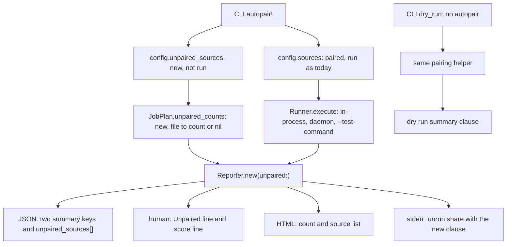

# Count unpaired sources and their mutants in the report - Plan

## Goal Capsule

- **Issue:** #381 (count sources skipped for having no paired test, and their mutants, in the report).
- **Objective:** a reader of any Mutineer report sees how many sources and mutants the run left out. The run left them out because their sources have no paired test.
- **Means:** counts that stay outside the result rows (KTD1), added to the existing unrun-share warning (KTD3).
- **Authority:** this plan, then `AGENTS.md`, then the text of #381. Where this plan differs from the issue, this plan wins (see "Corrections to the issue").
- **Stop and ask when:** a change would alter `summary.total`, `per_source[]`, the score, an exit code or which sources run. Stop also when PR #244 (the 2.0 contract flip) merges first, because it sets `schema_version` to `2.0`. Stop when a maintainer answers Q1 or Q4 with the alternative.
- **Size:** M. About 25 files: 5 under `lib/`, `action.yml`, `rake/docs_contract.rb`, 11 test files and 7 docs and contract files. No new runtime dependency.
- **Delivery:** one pull request from `main`, units in the order U1 to U5. Labels: `enhancement`, `priority: medium`, `risk: low`, `v1.9.0`. Semver: minor, because the change adds JSON keys and report text and removes nothing. The body says `Closes #381`. A maintainer merges. This plan has no release step.

---

## Product Contract

### Summary

A run with no `--test` still drops each source that has no paired test. It now records those sources and counts the mutants in them. The JSON report adds `summary.unpaired_sources`, `summary.unpaired_mutants` and a top-level `unpaired_sources[]` list. The human and HTML reports, the dry run and the GitHub Action step summary show the same two counts. The unrun-share warning on stderr adds the unpaired mutants to its count. No score, exit code or existing JSON key changes.

### Problem Frame

Mutineer pairs a source with its test by path convention. A source with no test at that path leaves the run with one stderr line (`lib/mutineer/cli.rb:649`). Nothing in the report says so. The score then describes only the paired sources, and the reader cannot see how much is missing.

Vladimir Dementyev reported this on Fizzy, a Rails 8 app. His scores of 78% and 85% covered 759 of 1,071 mutants. The other 312 were in 106 sources with no paired test. He found that number by hand.

### Terms

- **Unpaired source:** a source that the command names and for which convention pairing finds no test. The term applies only to a run with no `--test`. The run drops it today (`lib/mutineer/cli.rb:644-651`).
- **Unpaired mutant:** a mutant that Mutineer would schedule in an unpaired source. KTD4 gives the exact rule.
- **Unrun share:** the existing stderr warning for mutants that exist but did not run (`lib/mutineer/reporter.rb:124-145`, `:896-899`).

### Requirements

**Counting**

- R1. In a run with no `--test`, Mutineer records each unpaired source and still drops it. The set of sources that run does not change.
- R2. Mutineer counts the unpaired mutants of each unpaired source with the run's operators, `--only` and `--since`. An unpaired source with no mutant has a count of 0.
- R3. Counting never changes an exit code. When Mutineer cannot count one unpaired source, that count is unknown and the run continues. Stderr names the file and the error.
- R4. A run with `--test` has no unpaired source. Both counts are 0 and the list is empty.
- R5. A run in which every source is unpaired exits 2, as today.

**Report**

- R6. The JSON report adds `summary.unpaired_sources` (int), `summary.unpaired_mutants` (int) and a top-level `unpaired_sources[]`. Each entry is `{ file, mutants }`, sorted by `file`. `file` has the path form that `per_source[]` uses. `mutants` is `null` when the count is unknown. `unpaired_mutants` is the sum of the known counts. All three keys are additive.
- R7. `summary.total`, `summary.attempted`, `summary.no_verdict`, `summary.score` and `per_source[]` keep today's values.
- R8. The human summary block adds one `Unpaired:` line with both counts. The score line lists the unpaired mutants with the other counts that the score leaves out.
- R9. The HTML report adds the unpaired count to its summary counts and lists each unpaired source with its count.
- R10. The unrun share counts unpaired mutants. Unrun is `unplaceable + skipped_invalid + unpaired_mutants`, and the limit of 10% and the floor of 1 stay. The warning names the unpaired part in its own clause and its own hint.
- R11. When no mutant ran and unpaired mutants exist, the empty-run message on stderr gives their count. It does not say that the changes held nothing to test or that no mutants were generated.
- R12. The per-source stderr line `no test found by convention for <file>; skipping` stays as it is.

**Dry run**

- R13. A dry run with no `--test` uses the same pairing rule and still lists every mutant. Its summary line adds the unpaired mutant count and the unpaired source count. The mutant count equals `summary.unpaired_mutants` of a real run with the same arguments.

**GitHub Action**

- R14. The step summary adds one line when `summary.unpaired_mutants` is above zero. A report with no such key adds no line.
- R15. A diff-scoped run can have a `total` of 0 and unpaired mutants. The step summary then does not call the change docs-only or test-only.

**Contract and docs**

- R16. `schema_version` moves to `1.10` under the rule in KTD9. `docs/json-schema.md` and `STABILITY.md` describe the new keys.
- R17. `docs/results.md`, `docs/cli.md`, `docs/ci.md` and `CHANGELOG.md` describe unpaired sources and the two counts. The CHANGELOG entry records the measured Fizzy rates.
- R18. `AGENTS.md` "Score-model discipline" gains a rule for a source that a run drops whole.

### Acceptance Examples

AE1, AE2, AE4 and AE6 use a copy of `test/fixtures/autopair` (`lib/calc.rb`, `lib/greeter.rb` and their two tests). The test adds `lib/orphan.rb` with one `a + 1` method and `lib/blank.rb` with no method.

- AE1. Covers R1, R2, R6, R7, R12. `mutineer run lib --format json` exits 0. `summary.unpaired_sources` is 2 and `summary.unpaired_mutants` is 1. `unpaired_sources` is `[{ "file": "lib/blank.rb", "mutants": 0 }, { "file": "lib/orphan.rb", "mutants": 1 }]`. `summary.total` is 2 and `per_source[]` names only `lib/calc.rb` and `lib/greeter.rb`. Stderr keeps both skip lines.
- AE2. Covers R4. The same run with `--test test/calc_test.rb` reports 0, 0 and `[]`. `per_source[]` names `lib/orphan.rb`.
- AE3. Covers R10. A report with 2 killed mutants and 3 unpaired mutants warns: `3 of the 5 mutants mutineer tried to score were not run (3 in sources with no paired test; 60.0%, limit 10%)`. A report with 20 killed and 2 unpaired does not warn (9.1%). A report with 1 killed and 1 unpaired does not warn (floor of 1).
- AE4. Covers R13. `mutineer run lib --dry-run` lists the `lib/orphan.rb` mutant and ends with `1 unpaired (2 sources have no paired test; a run without --test skips them)`.
- AE5. Covers R2, R6. Fizzy at commit `d5b7b749d`, sources `app/models app/controllers`, default operators: 106 unpaired sources and 312 unpaired mutants. A complete run has a `summary.total` of 759. At `f220e4832` the three numbers are 92, 149 and 922. Probe 1 measured the counts; no Fizzy test ran.
- AE6. Covers R3. With a directory named `lib/odd.rb`, the run exits 0. The list has `{ "file": "lib/odd.rb", "mutants": null }`, and stderr names `lib/odd.rb`.

### Scope Boundaries

- No new mutant status and no new result row (KTD1).
- No new gate. The counts and the warning never change an exit code.
- No change to which sources pair. #379 (pair a concern with the test that mirrors its namespace) and #382 (a `tests:` map in `.mutineer.yml`) own that.
- No per-mutant list for unpaired sources. `--dry-run` on the file gives it (Q3).
- Mutants that the user suppressed in an unpaired source get no count (KTD4).
- The per-source skip lines stay. This plan does not fold them into one line (Q5).
- `--fail-fast` still reports a partial `total`. The new counts are complete under `--fail-fast`, because Mutineer counts before the run starts.

#### Deferred to Follow-Up Work

- A dry run with `--rails` or `--boot` and no `--test` exits 2 (`lib/mutineer/cli.rb:438-441`, `docs/cli.md:9`). So it cannot show the unpaired counts for a Rails app. U5 files an issue for that limit and names it in the docs.
- #362 (`--dry-run` ignores `--format json`). When a fix for that issue lands, the dry-run JSON takes the same three keys.
- #349 (measure the declined count and unrun share on a real concern-heavy Rails app) records the unpaired counts. It also answers Q2.
- #402 (run Mutineer on a pinned Fizzy sample before each release) adds the two counts to the values it compares.

### Corrections to the issue

- **"Currently, only stderr reports them."** True for a real run (`lib/mutineer/cli.rb:649`, probe 2 A and E). Not complete: a dry run skips pairing (`lib/mutineer/cli.rb:429`), so it lists the mutants of unpaired sources with no mark. Probe 2 B shows 3 mutations in the dry run and a `total` of 2 in the real run.
- **"Retain skipped sources in results" and "through `AggregateResult#unrun_count`".** `AggregateResult` counts result rows only (`lib/mutineer/result.rb:189-223`). A row for each unpaired mutant would raise `summary.total` and add `per_source[]` rows (`lib/mutineer/reporter.rb:224`, `:288`). `test/cli_test.rb:1359-1367` pins the opposite. It would also defeat the `total == 0` checks in `lib/mutineer/cli.rb:763` and `action.yml:486`. This plan keeps the counts outside the rows, and the reporter adds them to the share (KTD1, KTD2).
- **"Calculate the share as mutants run divided by mutants that exist."** Two denominators exist. Vladimir's 29% is `unpaired_mutants / (total + unpaired_mutants)`, which is 312 of 1,071. The unrun share divides by `attempted + unrun` (`lib/mutineer/reporter.rb:128`), which leaves out no-coverage mutants. The tables in his report give 312 of 994, or 31.4%, for that share. This plan prints one percentage, the unrun share, and the docs say how to compute the other from the JSON.
- **"106 skipped files."** Right, but 54 of the 106 hold no mutant with the default operators (probe 1). The 312 mutants are in 52 files. After his test additions, the 149 mutants are in 38 of the 92 files.
- **The warning text.** The warning names two causes only (`lib/mutineer/reporter.rb:129-131`). Unpaired mutants need their own clause, or the text calls them unplaceable or invalid.
- **Not in the issue.** `--since` and `--only`, the HTML report, the dry run, the Action step summary and the empty-run message (`lib/mutineer/cli.rb:803-818`). Each one would show a number that disagrees with the report, or a false sentence (probe 3 G).
- **Schema version.** The issue names none. v1.8.0 and v1.8.1 report `1.9`, so the new keys need `1.10` (KTD9).
- **"Code and runtime behaviour were not checked."** This plan checked both. "Probe results" lists what ran.

---

## Planning Contract

### Key Technical Decisions

- KTD1. **Counts outside the result rows; no new status.** The reporter receives the unpaired counts beside the aggregate. Rejected: an `unpaired` status with one result per mutant. It changes `summary.total` and `per_source[]`, breaks the pin at `test/cli_test.rb:1359-1367`, and defeats the `total == 0` checks at `lib/mutineer/cli.rb:763` and `action.yml:486`. That is a medium risk for an issue labelled low. The code already decides this choice, so no bake-off ran.
- KTD2. **The reporter owns the share; `AggregateResult#unrun_count` stays a count of rows.** `Reporter#unrun_share_exceeded?` and `#warn_unrun_share` add the unpaired mutants. Rejected: a constructor argument on `AggregateResult`. `by_source` and five call sites in the three backends build aggregates (`lib/mutineer/result.rb:266`, `lib/mutineer/runner.rb:211`, `:260`, `:292`, `lib/mutineer/daemon_backend.rb:63`, `:98`). Each one would drop the value without an error.
- KTD3. **Unpaired mutants join the existing unrun share.** One share, one limit and one sentence, as #381 step 4 and `AGENTS.md` ask. The new clause is `N in sources with no paired test`. It goes last, so today's pinned text does not change when no source is unpaired. Rejected as the default: a separate warning that always prints. One validation report prefers it, so Q1 asks the maintainer.
- KTD4. **An unpaired mutant is a mutant the run would schedule.** The count is the jobs that `JobPlan.collect_jobs` and `JobPlan.scope_since` return for the unpaired sources. It follows `--only`, `--since`, repeat removal and suppression. It does not check that the mutant parses. Rejected: add suppressed mutants, which reports mutants the user already dismissed. Rejected: check each mutant, which costs one parse per mutant for a class that is a Mutineer bug.
- KTD5. **Count before the run, one source at a time, and never fail the run.** `CLI.execute` counts before `Runner.execute`, so a failure cannot cost a finished report. A source that raises gets an unknown count and a stderr line. Rejected: let the error stop the run. Probe 3 F shows a run that exits 0 today and would then exit 1.
- KTD6. **The unpaired list travels on `Config#unpaired_sources`.** It is a struct member that only code sets, like `daemon_timeout` (`lib/mutineer/config.rb:100-104`). It has no flag and no `.mutineer.yml` key. Rejected: return values through `validate!`, `run` and `execute`, which changes three signatures that tests call.
- KTD7. **`Reporter.new` takes `unpaired:`, like `matrix:`.** Four renderers and the share rule read it (`lib/mutineer/reporter.rb:47-51`). The default is an empty hash, so every existing caller works. Rejected: a `report(...)` keyword like `declined:`, which needs four pass-through points.
- KTD8. **`--since` narrows the mutant counts and not the source list.** A pull-request run then reports only the unpaired mutants on changed lines. The list still names every source the run dropped, as the skip lines do. Rejected: no narrowing, as `declined` does, which repeats every unpaired mutant of the app on each pull request. The cost is two git processes for each narrowed source (probe 5).
- KTD9. **Schema version: one bump per release.** Read `SCHEMA_VERSION` on the base branch and in the latest tag. Today both say `1.9`, so set `1.10`. If the base branch already says `1.10`, keep it and add these keys to the `1.10` docs. Rationale: `docs/json-schema.md:16` asks for a minor bump for an additive change, and one release ships one version.
- KTD10. **One pairing helper for the run and the dry run.** `CLI.autopair!` and `CLI.dry_run` call the same private helper to split the sources. The dry run counts its own jobs with the KTD4 rule. A test compares the two numbers (U3).

### Assumptions

No user confirmed these. Each one has an open question or a rule that covers it.

- The maintainer wants unpaired mutants inside the existing unrun share, as #381 step 4 says (Q1).
- One line in the Action step summary is not a change to the Action's default behaviour (Q4).
- A count per source is enough. Nobody needs the id of each unpaired mutant yet (Q3).
- 106 skip lines on stderr are acceptable for now (Q5).

### High-Level Technical Design



The count runs in `CLI.execute`, before `Runner.execute` chooses a backend (`lib/mutineer/cli.rb:738`, `lib/mutineer/runner.rb:77-88`). So one code path serves the in-process, daemon and `--test-command` runs. The count is a static Prism parse. It loads no source and boots no app, so `reload` and `redefine` give the same number.

### Report text

The tests pin the quoted parts.

- **Human summary line:** `Unpaired:     149     (mutants not run; 92 sources have no paired test)`. One source reads `1 source has no paired test`. Under `--since` the text is `mutants on changed lines not run`. When a count is unknown, the line adds `; 1 source not counted`.
- **Score line:** the list in parentheses adds `149 unpaired` before `excluded` (`lib/mutineer/reporter.rb:828-832`).
- **HTML:** the counts block adds `<span><strong>149</strong> unpaired</span>`. A section with the heading `Sources with no paired test` lists each file and its count. An unknown count reads `unknown`.
- **Unrun share:** `[mutineer] 3 of the 5 mutants mutineer tried to score were not run (3 in sources with no paired test; 60.0%, limit 10%). The score leaves them out. This warning does not change the exit code.` When unpaired mutants are above zero it adds: `See unpaired_sources[] in --format json. To run them, add a test at the conventional path or pass --test.`
- **Count failure:** `[mutineer] could not count the mutants in lib/odd.rb (Mutineer::ParseError: Is a directory - lib/odd.rb). The report lists it with no count.` The message goes through `Redaction.text`.
- **Empty run:** `mutineer: no mutant ran. 3 mutants are in sources with no paired test (unpaired_sources[] in --format json). Add a test at the conventional path, or pass --test.` One mutant reads `1 mutant is in a source with no paired test`.
- **Dry run:** the summary line ends with `; 1 unpaired (2 sources have no paired test; a run without --test skips them)`. With no unpaired source it ends with `; 0 unpaired`.
- **Action step summary:** `Unpaired: 149 mutant(s) not run and not in the score; 92 source(s) have no paired test.`
- **Action, diff-scoped run with a `total` of 0:** `No mutant ran for this diff: 3 mutant(s) on changed lines are in sources with no paired test, so the gate is vacuous for this PR.`

### Probe results

This plan needs no spike. Each central assumption below has a probe result or a `file:line`. Scripts and output are in the context folder under `probes/381/` (see Sources).

| Probe | Question | Result |
|---|---|---|
| 1. `count_unpaired.rb` on Fizzy `d5b7b749d` | Do the proposed counts give Vladimir's "before" numbers? | Yes. 292 sources, 106 unpaired, 312 unpaired mutants, 759 paired mutants, 1,071 in all, 29.1%. The merge base `8112b3dba` gives the same numbers. |
| 1. Same script on Fizzy `f220e4832` | And his "after" numbers? | Yes. 92 unpaired sources, 149 unpaired mutants, 922 paired mutants (912 jobs and 10 ignored), 13.9%. |
| 1. Timing | What does the count cost with no `--since`? | 0.035 s to 0.061 s for the unpaired sources with the default operators. 0.105 s with all 21 operators (1,707 mutants). Pairing takes 0.02 s. |
| 2. `cli_behaviour.sh` A, E | What does a real run report today? | Exit 0, `total` 2, no unpaired key, `per_source[]` without the orphan. The orphan appears on stderr only. |
| 2. B | Does the dry run list unpaired mutants? | Yes: 3 mutations against a real `total` of 2. It prints no mark and no stderr line. |
| 2. C | Dry run with `--rails` and no `--test`? | Exit 2: `--boot/--rails requires at least one --test file`. |
| 2. D | Real run with `--test`? | The run drops no source. `per_source[]` names the orphan. |
| 3. F | A directory named `lib/odd.rb`? | The real run exits 0 and skips it. The dry run exits 1 with `error reading: Is a directory`. |
| 3. G | Only the unpaired source holds a mutant? | Exit 0. Stderr says `no mutants were generated` and warns of an error in 2.0. That is false: one mutant exists. |
| 4. Dry run on the Fizzy merge base, with no config file | End-to-end total and time? | `1071 mutations`, exit 0, 0.46 s. |
| 5. `since_cost.rb` on the Fizzy clone, ref `HEAD~1` | What does `--since` narrowing cost for unpaired sources? | 2.84 s for all 92 unpaired sources. 1.19 s for the 38 that hold a mutant. The same call takes 9.20 s for all 292 sources. |

Not checked: a daemon run with an unpaired source. The plan rests on `lib/mutineer/cli.rb:738` and `lib/mutineer/runner.rb:82-88`, and U2 adds a daemon test.

---

## Implementation Units

### U1. Record unpaired sources and count their mutants

**Goal:** the config carries the unpaired sources, and one helper returns a count for each.

**Requirements:** R1, R2, R3, R4, R5.

**Dependencies:** none.

**Files:**

- `lib/mutineer/config.rb`: add the `unpaired_sources` member (lines 95-106) with a default of `[]` (lines 117-142). Extend the struct comment.
- `lib/mutineer/cli.rb`: a private helper that returns each source with its inferred tests. `autopair!` (lines 641-660) calls it and stores the sources with no test in `config.unpaired_sources`.
- `lib/mutineer/job_plan.rb`: new `JobPlan.unpaired_counts(config, operator_classes)`, beside `scope_since` (lines 464-472).
- Tests: `test/config_test.rb`, `test/cli_test.rb`, `test/runner_test.rb`.

**Approach:**

1. The helper holds the `Pairing.infer_tests` call that `autopair!` makes today (lines 644-647). `autopair!` keeps its warnings, its exit 2 and its early return for a run with tests.
2. `unpaired_counts` collects the jobs of each unpaired source on a copy of the config that names only that source. It rescues `StandardError` for that source and records the error text.
3. It then narrows the collected jobs with one `scope_since` call on a config copy. That copy names only the sources that hold a job. `ChangedLines.for` starts two git processes for each file it gets (`lib/mutineer/changed_lines.rb:51-56`, `:74-81`), so a shorter list costs less (probe 5).
4. It returns the count for each source, in the order of `config.unpaired_sources`, and the failures as data. It prints nothing. KTD4 and KTD5 own the rules.

**Patterns to follow:** `collect_jobs` returns extras as data and prints nothing (`lib/mutineer/job_plan.rb:35-46`). `test_collect_jobs_reports_declined_counts_per_operator` (`test/runner_test.rb:910`) for a helper test on a temp file.

**Test scenarios:**

- `test_unpaired_sources_defaults_to_empty` (config_test): `Config.new.unpaired_sources` is `[]`. Fails before: NoMethodError.
- `test_autopair_records_unpaired_sources` (cli_test): a temp project has `app/foo/bar.rb`, its test and `app/foo/lone.rb`. After `CLI.autopair!`, `config.sources` is `["app/foo/bar.rb"]` and `config.unpaired_sources` is `["app/foo/lone.rb"]`.
- `test_autopair_with_explicit_test_records_no_unpaired_source` (cli_test): a config with a test keeps its sources, and `unpaired_sources` is `[]`. Covers R4.
- `test_unpaired_counts_counts_each_source` (runner_test): `orphan.rb` holds one `a + 1` method and `blank.rb` holds none. With `arithmetic`, the result is 1 and 0.
- `test_unpaired_counts_match_collect_jobs` (runner_test): the count for `orphan.rb` equals the number of jobs that `collect_jobs` returns for that file alone. This asserts the mechanism.
- `test_unpaired_counts_follow_only` (runner_test): `only: "Orphan#z"` gives 1, and `only: "Other#x"` gives 0.
- `test_unpaired_counts_follow_since` (runner_test): in a git project, a source has two methods and one changed line. `since: "HEAD"` counts only the mutant on that line. An unchanged source counts 0.
- `test_unpaired_counts_leave_out_suppressed_mutants` (runner_test): a `# mutineer:disable-line` marker on the mutant's line gives 0.
- `test_unpaired_counts_give_nil_for_a_source_they_cannot_read` (runner_test): a directory named `odd.rb` gives `nil`, the failure names `odd.rb`, and nothing raises. Covers R3.
- `test_all_sources_unpaired_exits_two` (`test/cli_test.rb:1371`) stays green unchanged. Covers R5.

**Verification:** the three test files pass. No existing test changes.

### U2. Report the counts

**Goal:** every report format and the unrun-share warning show the unpaired counts.

**Requirements:** R6, R7, R8, R9, R10, R11, R12. AE1, AE2, AE3, AE6.

**Dependencies:** U1.

**Files:**

- `lib/mutineer/reporter.rb`: `initialize` (lines 47-51) takes `unpaired:`. `json_report` (lines 213-297) adds the two summary keys and the list. `summary` (lines 797-819) and `score_line` (lines 826-844) add the text. `summary_html` (lines 356-367) adds the count, and `html_report` adds the source list. `warn_unrun_share` (lines 124-145) and `unrun_share_exceeded?` (lines 896-899) add the unpaired mutants.
- `lib/mutineer/result.rb`: the comment on `unrun_count` (lines 214-218) says that the reporter adds unpaired mutants.
- `lib/mutineer/cli.rb`: `execute` (lines 732-791) counts before `Runner.execute`, prints each count failure, and passes the counts to `Reporter.new` (line 741). `warn_empty_run` (lines 803-818) gains the branch for R11.
- Tests: `test/json_reporter_test.rb`, `test/reporter_test.rb`, `test/html_reporter_test.rb`, `test/cli_test.rb`, `test/runner_daemon_test.rb`.

**Approach:**

1. "Report text" owns each string.
2. `execute` resolves the operator classes as `dry_run` does (`lib/mutineer/cli.rb:899`). An unknown operator name still exits 2 through the rescue in `CLI.run` (lines 357-360).
3. The new branch in `warn_empty_run` goes first, because both existing messages are false in that case. The `--allow-empty` flag does not silence it: mutants exist, so the run is not the empty run that flag expects.
4. The human report still prints nothing when `total` is 0 (`lib/mutineer/reporter.rb:157`). R11 covers that case on stderr.

**Patterns to follow:** the `matrix:` keyword on `Reporter.new`. The `declined` rows in `json_report` and `summary`. The two-backend loop in `test_old_format_baseline_matches_on_every_backend` (`test/cli_test.rb:1640-1641`).

**Test scenarios:**

- `test_summary_reports_unpaired_sources_and_mutants` (json_reporter_test): `unpaired: { "lib/b.rb" => 2, "lib/a.rb" => 0 }` gives 2 sources, 2 mutants and a list sorted by file. `summary.total` stays 1.
- `test_unpaired_defaults_to_zero_and_an_empty_list` (json_reporter_test): no keyword gives 0, 0 and `[]`. Fails before: the keys are absent.
- `test_unknown_unpaired_count_is_null_and_left_out_of_the_sum` (json_reporter_test): `{ "a.rb" => nil, "b.rb" => 2 }` gives `mutants: null` for `a.rb`, 2 sources and 2 mutants.
- `test_human_summary_has_an_unpaired_line` (reporter_test): the line matches `/Unpaired:\s+2\s+\(mutants not run; 2 sources have no paired test\)/`. `scoped: true` gives `mutants on changed lines not run`. One source gives `1 source has no paired test`. A `nil` count adds `; 1 source not counted`.
- `test_score_line_lists_unpaired` (reporter_test): the score line includes `2 unpaired`.
- `test_unpaired_mutants_join_the_unrun_share` (reporter_test): covers AE3. 2 killed and 3 unpaired give the quoted warning and `unpaired_sources[]` on `err`. It does not include `unplaceable[]` or `re-parse`.
- `test_unrun_share_adds_unpaired_to_unplaceable` (reporter_test): 2 killed, 1 unplaceable and 2 unpaired give `3 of the 5` and `(1 unplaceable, 2 in sources with no paired test; 60.0%, limit 10%)`.
- `test_no_unrun_warning_for_unpaired_under_the_limit_or_the_floor` (reporter_test): 20 killed with 2 unpaired, and 1 killed with 1 unpaired, give no `were not run`. Covers AE3.
- `test_unpaired_warning_keeps_the_exit_code_and_the_json` (reporter_test): 2 killed and 3 unpaired with `format: "json", threshold: 80.0`. The warning is on `err`, `out` parses, and `exit_code` is 0.
- The existing unrun-share tests (`test/reporter_test.rb:531-584`) pass unchanged. That proves today's text holds when nothing is unpaired.
- `test_summary_counts_unpaired_and_lists_the_sources` (html_reporter_test): the page has `<span><strong>2</strong> unpaired</span>`, the heading `Sources with no paired test` and an escaped file name. A `nil` count reads `unknown`. With no unpaired source, the heading is absent.
- `test_unpaired_sources_are_counted_on_every_backend` (cli_test): covers AE1. It runs once in process and once with `--test-command "true %{files}"`. Both give the AE1 keys, the AE1 `per_source[]` and both skip lines.
- `test_explicit_test_leaves_no_unpaired_source` (cli_test): covers AE2.
- `test_unpaired_count_failure_does_not_fail_the_run` (cli_test): covers AE6.
- `test_empty_run_names_unpaired_mutants` (cli_test): the orphan holds `a > 1`, and the run uses `--operators comparison`. Stderr includes `no mutant ran. 1 mutant is in a source with no paired test`. It does not include `no mutants were generated`. Exit 0. Fails before: probe 3 G.
- `test_since_run_counts_unpaired_mutants_on_changed_lines` (cli_test): in a git project, a change to `lib/orphan.rb` gives `unpaired_mutants` 1. A change elsewhere gives 0, and the list still names the orphan. Follows `test_dry_run_labels_declined_under_since` (`test/cli_test.rb:731`).
- `test_orphan_source_warns_and_is_skipped` (`test/cli_test.rb:1359`) passes unchanged. Covers R7 and R12.
- `test_cli_reports_unpaired_sources_via_daemon` (runner_daemon_test, runs under `rake test:daemon`): a daemon config with `unpaired_sources` set to the fixture's `app/models/tax_table.rb` and `format: "json"`. `CLI.execute` prints `summary.unpaired_sources` 1, and `unpaired_mutants` equals the `collect_jobs` count for that file. Follows the test at `test/runner_daemon_test.rb:50-59`.

**Verification:** the JSON output is the same in two runs of one project. Every existing reporter test passes without an edit.

### U3. Dry run summary

**Goal:** the dry run says how many of its mutants a real run would skip.

**Requirements:** R13. AE4.

**Dependencies:** U1.

**Files:**

- `lib/mutineer/cli.rb`: `dry_run` (lines 898-930) and its summary line (lines 926-928).
- Test: `test/cli_test.rb`.

**Approach:** the dry run calls the U1 pairing helper when `config.tests` is empty. It does not drop a source. It counts the jobs, after `scope_since`, whose file is unpaired. The summary line gains the clause from "Report text".

**Test scenarios:**

- `test_dry_run_counts_unpaired_mutants`: covers AE4. The output still lists the `lib/orphan.rb` mutation.
- `test_dry_run_unpaired_count_matches_the_run`: the number in the dry-run clause equals `summary.unpaired_mutants` of the JSON run with the same arguments. This guards against drift between the two paths.
- `test_dry_run_with_explicit_test_reports_zero_unpaired`: `--test test/calc_test.rb --dry-run` ends with `0 unpaired`.
- `test_dry_run_prints_breakdown` (`test/cli_test.rb:705`) gains `assert_includes out, "0 unpaired"`.

**Verification:** a dry run on a project with an orphan prints the clause, and no exit code changes.

### U4. GitHub Action step summary

**Goal:** an Action user sees the unpaired counts beside the score.

**Requirements:** R14, R15.

**Dependencies:** U2.

**Files:**

- `action.yml`: the step-summary `jq` program (lines 467-497).
- Tests: `test/fixtures/action_harness.sh`, `test/action_harness_test.rb`.

**Approach:** the program reads `.summary.unpaired_mutants // 0` and `.summary.unpaired_sources // 0`, so a report from an older gem prints no line. The diff-scoped note (lines 486-488) picks its sentence from the unpaired count. No input, output, annotation or exit code changes.

**Execution note:** PR #395 (the Action asks the CLI for `cache_dir` and `baseline`) rewrites much of `action.yml`. Start this unit from a base that holds #395, or rebase onto it before review.

**Test scenarios:**

- A new harness case feeds a stub report with `unpaired_sources` 2 and `unpaired_mutants` 5. The step summary holds `Unpaired: 5 mutant(s) not run and not in the score; 2 source(s) have no paired test.`
- The existing stub report has no unpaired key (`test/fixtures/action_harness.sh:15`). Its step summary holds no `Unpaired:` line.
- A new case feeds a scoped stub with `total` 0 and `unpaired_mutants` 3. The summary holds `No mutant ran for this diff` and does not hold `docs- or test-only`.
- Every existing case keeps its exit code (`test/action_harness_test.rb:25-31`).

**Verification:** `test/action_harness_test.rb` passes. It skips when `bash`, `git` or `jq` is absent, so run it where all three exist.

### U5. Schema version, docs, CHANGELOG and the review rule

**Goal:** the contract and the user docs describe the new keys, the counts and the warning.

**Requirements:** R16, R17, R18.

**Dependencies:** U2, U3, U4.

**Files:**

- `lib/mutineer/reporter.rb`: `SCHEMA_VERSION` (line 34), under KTD9.
- Tests that pin `"1.9"`: `test/json_reporter_test.rb:61`, `test/baseline_test.rb:254`, `test/cli_test.rb:917`, `test/cli_test.rb:1328`, `test/equivalent_mutant_test.rb:308`, with the comment beside each.
- `docs/json-schema.md`:
  1. The version example (line 14) and the top-level shape (line 36), with the new `unpaired_sources` key and its sort order.
  2. One sentence in "Versioning contract": compare the two parts of the version as integers, so `1.10` comes after `1.9`.
  3. Two `summary` rows, `unpaired_sources` and `unpaired_mutants`. They state the KTD4 rule, the `--since` rule and the formula `unpaired_mutants / (total + unpaired_mutants)`.
  4. The `total` row (line 55) says that it does not count unpaired mutants.
  5. The `unplaceable` and `skipped_invalid` rows (lines 60 and 62) add `unpaired_mutants` to the unrun-share formula.
  6. A new section for `unpaired_sources[]`.
- `rake/docs_contract.rb`: a `HEADING_IDS` entry for the new section heading (lines 13-25). `test/docs_contract_test.rb:182-194` fails without it.
- `STABILITY.md:16`: the schema version.
- `docs/results.md`: one short paragraph after the result table (lines 5-17) on unpaired sources and where the counts appear.
- `docs/cli.md:9`: the `--test` row says that Mutineer skips and counts unmatched sources. It names the new issue for the dry-run limit.
- `docs/ci.md`: one sentence after the pairing table (line 34).
- `CHANGELOG.md` under `## [Unreleased]`, `### Added`: one entry for #381. It names the keys, the surfaces, schema `1.10` and the measured Fizzy rates from "Probe results".
- `AGENTS.md`, "Score-model discipline": add two sentences. "A run that drops a source whole counts that source and its mutants in the report (`summary.unpaired_sources`, `summary.unpaired_mutants`). Those mutants have a place in the unrun share."

**Approach:** file one GitHub issue for the dry-run limit in "Deferred to Follow-Up Work". Name its number in `docs/cli.md` and in the CHANGELOG entry. Released CHANGELOG sections stay as they are.

**Test scenarios:** `test/docs_contract_test.rb` (lines 106-110, 152-156, 182-194) already checks the version in the docs and the heading ids. Test expectation for the prose: none, it is documentation.

**Verification:** the docs contract tests pass, and the built site shows the new rows and the new section.

---

## Verification Contract

Prefix each ruby, rake and bundle command with `LANG=en_US.UTF-8 LC_ALL=en_US.UTF-8`.

| Command | Proves |
|---|---|
| `bundle exec ruby -Ilib -Itest test/runner_test.rb` and the same for `config_test`, `cli_test`, `reporter_test`, `json_reporter_test`, `html_reporter_test`, `action_harness_test`, `docs_contract_test` | Each unit's tests |
| `bundle exec rake test` | The zero-dependency suite, with every new test |
| `ruby -Ilib -e 'require "mutineer"'` | The load smoke |
| `bundle exec rake yard:strict` | 100% documented. `unpaired_counts`, the pairing helper, the `unpaired_sources` member and each new reporter method need a doc comment. |
| `bundle exec rake test:daemon` | The daemon test in U2. It needs the bundle of `test/fixtures/rails_app`. |
| `bundle exec rake site:build`, then `node --test test/site_test.js`, `npm ci --prefix test/browser`, `npx --prefix test/browser playwright install chromium` and `npm test --prefix test/browser` | The website checks. U5 changes `docs/json-schema.md`. |

Optional check on real code. It needs a Fizzy clone and runs no test:

```sh
git -C <fizzy clone> archive d5b7b749d app test | tar -x -C <empty scratch dir>
cd <empty scratch dir> && ruby -I <mutineer>/lib <mutineer>/bin/mutineer run app/models app/controllers --dry-run | tail -1
```

The last line must end with `312 unpaired (106 sources have no paired test; a run without --test skips them)`. With `f220e4832` it must give 149 and 92.

## Definition of Done

- Every test named in U1 to U4 exists and passes. Each new test failed before its unit.
- The score, every exit code, `summary.total`, `per_source[]` and the set of sources that run are unchanged. Every existing test passes without an edit, except the `"1.9"` pins and `test_dry_run_prints_breakdown`, which gains one assertion.
- The three JSON keys are in every JSON report. The human report, the HTML report, the dry run and the Action step summary show both counts.
- The unrun-share warning counts unpaired mutants and prints on stderr for every format.
- `schema_version` follows KTD9 in the reporter, `docs/json-schema.md` and `STABILITY.md`.
- The CHANGELOG entry holds the measured rates and names the follow-up issue.
- The issue for the dry-run limit exists.
- No dead code and no abandoned attempt remains in the diff.

---

## Risks and Overlaps

| Item | Overlap | Handling |
|---|---|---|
| Siblings rule | reload and redefine; daemon and in-process; Action and CLI; report and dry run | The count is static and runs before the backend choice, so strategy and backend do not change it. U2 tests the in-process, `--test-command` and daemon paths. U4 covers the Action. U3 covers the dry run. |
| PR #393 (a mutant is invalid only when it adds a parse error) | Edits the skipped-invalid sentence in `warn_unrun_share` and the `skipped_invalid` row in `docs/json-schema.md`. | Adjacent lines. Whichever lands second keeps both edits. |
| PR #395 (the Action asks the CLI for `cache_dir` and `baseline`) | Rewrites 246 lines of `action.yml` and adds a `config` command to `lib/mutineer/cli.rb`. | U4 starts from a base with #395. The `cli.rb` edits do not touch `autopair!`, `execute` or `dry_run`. |
| PR #369 (warn when `--test-command` runs tests in random order) | Edits help text in `lib/mutineer/cli.rb`. | No shared lines. |
| PR #391 (the reload fix for Rails class bodies) and PR #373 (redaction follow-ups) | None in the files of this plan. | No action. |
| PR #375 (place a hook-block mutant before the rest of its file loads) | Edits one comment in `lib/mutineer/job_plan.rb`. | No shared lines. |
| PR #244 (the 2.0 contract flip) and the 2.0 branches of #245, #314 and #322 | They set `schema_version` to `2.0`. Their `lib/mutineer/reporter.rb` has no unrun share yet. Version 2.0 also makes an empty full scan fail. | Stop and ask if #244 merges first. The 2.0 work decides how an empty scan with unpaired mutants exits. R11 gives it the count. |
| Plan for #382 (a `tests:` map in `.mutineer.yml`) | It changes which sources have a test, inside `autopair!`. | The U1 pairing helper is the one place that decides "unpaired". Whichever lands second moves its logic into that helper. |
| Plan for #379 (pair a concern with the test that mirrors its namespace) | It lowers the unpaired count and adds two files to `test/fixtures/autopair`. | No shared code. The tests of this plan run `lib` in that fixture, so the new files do not change them. |
| Plan for #380 (let `--test` take a directory or a glob) | It adds a step beside `autopair!`. | No shared code. A run with `--test` has no unpaired source (R4). |
| Plan for #388 (the JSON report has no list of errored mutants) | Adds JSON keys in the same release. | KTD9: both share `1.10`. That plan asks the maintainer to confirm the string `1.10`. The answer applies here too. |
| Cost under `--since` | The count adds two git processes for each unpaired source that holds a mutant. Probe 5 measured 1.19 s on Fizzy. | Accepted. A `--since` run already pays the same cost for each paired source. U1 keeps the list short. |
| #349 (measure the unrun share on a real app) | Depends on this plan. Its 10% limit now covers a third class. | #349 records `unplaceable`, `skipped_invalid`, `unpaired_mutants` and `attempted` from one Fizzy run, and answers Q2. |
| Noise | On Fizzy the share is above 10% on every full run. After Vladimir's test additions, 13.9% of all mutants are unpaired. | That is the intent of #381. The limit is a constant, and Q1 and Q2 hold the alternatives. |
| New stderr lines | Mutineer now reads unpaired sources, so a bad operator name in a `disable-line` marker there warns (`lib/mutineer/job_plan.rb:382-386`). | The warning is true. The CHANGELOG entry says that Mutineer now parses unpaired sources. |
| `"1.10"` as a string | A consumer that compares versions as text or as a float reads `1.10` as older than `1.9`. | U5 adds the comparison rule to `docs/json-schema.md`. Mutineer itself only checks that the key exists (`lib/mutineer/baseline.rb:54`). |
| Repro becomes fixture | The rule covers reported bugs. This issue is an enhancement. | The tests build the minimal case on a copy of `test/fixtures/autopair`, as `test/cli_test.rb:1359` does. AE5 keeps the Fizzy numbers. |
| Exclusion frequency | The rule asks for an estimate of how often real code hits the case. | Fizzy: 29.1% of mutants before the test additions, 13.9% after, 21.9% with all operators. No source failed to count in 292 files. |

## Open Questions

None blocks implementation. Each one has a default.

- Q1. Should unpaired mutants join the unrun share, or get a separate warning that always prints? Default: join (KTD3), as #381 step 4 says. The alternative keeps "how much ran" apart from "how much could not run". The maintainer decides.
- Q2. If joined, should unpaired mutants have their own limit? Default: one limit of 10% for the three classes. The maintainer decides after #349 (measure the unrun share on a real app) has numbers.
- Q3. Should `unpaired_sources[]` list each mutant with its id? Default: no, a count per source. A later key can add the list without a breaking change. The maintainer decides.
- Q4. Is one new line in the Action step summary a minor change? Default: yes. It changes no input, output, annotation or exit code. The 1.3.0 minor release added the old-format id annotation in the same way (`CHANGELOG.md:1295`). The maintainer decides. If the answer is no, drop U4 and track it for 2.0.
- Q5. Should the per-source skip lines fold into one line above some count? Default: no. `test/cli_test.rb:1364` pins the line, and the new `Unpaired:` line gives the total. The maintainer decides.
- Q6. Should a dry run with `--rails` or `--boot` work with no `--test`? Default: out of scope. U5 files the issue. The maintainer decides.

## Sources

- Issue text and comments: the context folder file `issues/381.md`. Vladimir's report: `vladimir-fizzy-report.md` lines 19, 154, 244, 391, 414 and 436-437.
- Probes, machine-local and best effort: `/private/tmp/claude-501/-Users-davidteren-Projects-claude-worktrees-mutineer-vladimir-issues-planning-21adcb/ae564be8-638b-4dd0-a9e5-9d7a58cb00ae/scratchpad/context/probes/381/`. Scripts: `count_unpaired.rb`, `cli_behaviour.sh`, `since_cost.rb`. Output: `count_unpaired.out`, `cli_behaviour.out`, `cli_behaviour_edge.out`, `dryrun-base.summary`, `since_cost.out`. If the folder is gone, the plan does not depend on it: the Verification Contract repeats the main check.
- Validation reports of 2026-11-09, under `/Users/davidteren/Projects/DT/mutineer/wip/vlad/`. `opus/` (A7, finding 14) asks for count-only keys outside `total`. `grok-cursor/` (A7) asks for a new warning clause. `Sol/` (A7) asks for a separate scope warning, and A9 gives the same 106, 312, 92 and 149.
- Code read for this plan: `lib/mutineer/cli.rb:417-444`, `:641-660`, `:732-818`, `:898-946`; `lib/mutineer/job_plan.rb:66-137`, `:464-488`; `lib/mutineer/result.rb:183-277`; `lib/mutineer/reporter.rb:16-145`, `:213-367`, `:797-899`; `lib/mutineer/config.rb:95-142`; `lib/mutineer/runner.rb:67-260`; `lib/mutineer/pairing.rb:103-110`; `action.yml:456-548`.
- Format example: `docs/plans/2026-10-24-291-feat-excluded-mutant-counts-plan.md`, which added the unrun share that this plan extends.
