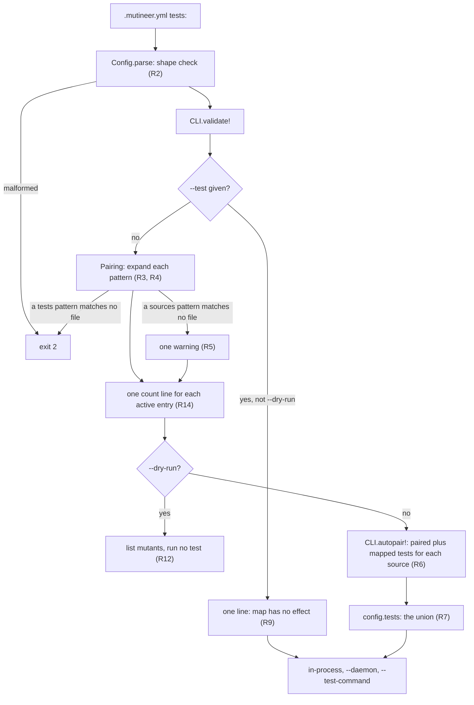

# Add a tests map in .mutineer.yml that adds tests to a source's paired tests - Plan

## Goal Capsule

- **What:** add a `tests:` map in `.mutineer.yml` for #382 (add tests to a source's paired tests).
- **Why:** one `mutineer run` must score sources without conventional pairs and retain every other source.
- **How:** CLI pairing adds mapped tests to the run's single test list (KTD1, run-wide test selection).
- **Authority:** this plan, then `AGENTS.md`, then the text of #382. "Corrections to the issue" records differences.
- **Stop and ask the maintainer when:**
  - U1 (Fizzy cost measurement) gives a stop outcome under "Outcomes";
  - a run without `tests:` would change its test list, output or verdict;
  - `--test` would change meaning;
  - #380 (let `--test` take a directory or glob) merges with rules that differ from R3 and R4 (pattern expansion). Its plan is `docs/plans/2026-11-10-380-feat-test-option-directory-or-glob-plan.md`.
- **Size:** M (medium). One pull request. 3 files under `lib/`, 4 test files, 2 fixture sets, 7 docs and contract files. No new runtime dependency or JSON report change.
- **Release:** minor, for a new feature and additive config key. Labels: `enhancement`, `priority: high` (high priority), `risk: medium` (medium risk), `v1.9.0` (target release). Include `Closes #382`. A person merges. No agent tags or publishes.
- **Owners:** implementation tasks are unassigned. The maintainer owns open decisions.

---

## Product Contract

### Summary

The `.mutineer.yml` `tests:` key maps source patterns to test patterns. Entries activate when they match a source in the run. Their tests join convention-paired tests in the run's list. Coverage selects tests for each mutant. `--test` replaces pairing and the map.

### Problem Frame

Pairing uses file names only (`lib/mutineer/pairing.rb:103-110`). `CLI.autopair!` drops unpaired sources with one warning (`lib/mutineer/cli.rb:641-660`). The only alternative, `--test`, replaces pairing for the whole run (`cli.rb:642`).

Shared code often uses its callers' tests instead of a conventional test path. Vladimir's Fizzy report lists this first under "Missing parts". He ran controller concerns separately, with every controller and integration test passed through `--test` and a separate `--cache-dir`.

Probe 3 shows the problem with two sources. Convention skips the shared source. Using `--test` for that source removes the other's paired test, leaving it without a score.

On the Fizzy clone, 92 of 292 sources under `app/models` and `app/controllers` have no paired test (probe 2).

### Terms

- **Paired test:** a test that `Pairing.infer_tests` finds from a source path.
- **Mapped test:** a test that a `tests:` entry names for a source.
- **Active entry:** an entry with at least one source in the run.
- **Run's test list:** `config.tests`, one list for the whole run.
- **Run directory:** `config.project_root`, where `mutineer` runs. Patterns and source paths are relative to it.

### Requirements

**The config key**

- R1. **Config shape.** `.mutineer.yml` accepts `tests:` as a list of mappings. Each mapping has exactly `sources` and `tests`. Each value is one pattern or a pattern list. The key has no flag.
- R2. **Invalid config.** A malformed map stops every command that loads the file, with exit 2. The message names the file, entry number and fault. `tests: []` and a valueless `tests:` mean "no map". Empty `require:` and `ignore:` keys work the same way (`config.rb:357-359`, `:421-422`).

**Patterns**

- R3. **Pattern syntax.** A pattern is a file, directory or glob relative to the run directory. Globs use Ruby `Dir.glob` syntax: `*`, `**`, `?`, `[]` and `{a,b}`.
- R4. **Pattern expansion.** A `sources` directory includes every `.rb` file below it. A `tests` directory includes `*_test.rb`, `*_spec.rb` and `test_*.rb` files below it, except `test_helper.rb`. Files and globs include their matched files. A `sources` glob expands matched directories by the directory rule. A `tests` glob takes files only, as #380 R2 specifies. Thus, `tests: test/*` and `--test 'test/*'` select the same files.
- R5. **Unmatched patterns.** On `mutineer run`, an unmatched `tests` pattern causes exit 2. An unmatched `sources` pattern prints one stderr warning and continues. Both messages identify the config path, run directory, entry number, key and pattern ("Message text"). Check every entry, active or inactive, including `--dry-run` without `--test`. Skip this check with `--test` (R9). A `--rails` or `--boot` dry run requires `--test` (`cli.rb:438-441`), so it never checks the map. Normal runs check in `validate!`, before boot.

**Pairing**

- R6. **Add mapped tests.** Without `--test`, each source gets its paired tests and every matching entry's tests. Sources with neither retain today's skip warning.
- R7. **One test list.** The run uses the union of those tests, without duplicates. Only active entries add tests.
- R8. **Coverage selection.** Coverage selects each mutant's tests from the run's list, as today. A mapped test can run against any source whose mutated line it covers. Paired tests already follow this rule.
- R9. **Explicit tests win.** `--test` replaces pairing and the map for the whole run. A non-empty map produces one stderr line saying it has no effect. `--dry-run` omits this line because it runs no test.
- R10. **Fixed list order.** Process sources in order. For each source, put paired tests first, then mapped tests in entry order. This sets capture order and combined clean-check load order (`coverage_map.rb:819-830`). `CoverageMap#order_tests` separately sorts each mutant's tests (`coverage_map.rb:170-180`).
- R11. **Existing behaviour.** Without `tests:`, preserve today's test list, coverage digest, verdicts and output. Do the same for a valid map with no active entry.

**Backends and surfaces**

- R12. **Shared integration.** In-process, `--daemon`, `--test-command` and GitHub Action runs receive the map through the run's test list only. `--dry-run` checks R2, plus R5 and R14 without `--test`, runs no test and lists mutants as today. When #381 (count unpaired sources) is on the base, the dry run pairs only to count unpaired sources. Its count treats a source matched by an active entry as paired, the same as the real run.
- R13. **Documentation.** Document the key, R7 to R9, and U5's cost notes in the files listed there.

**Added after review**

- R14. **Entry counts.** Print one stderr line per active entry with its matched source count and added test-file count. Follow #380 R8's format. Print it on `--dry-run` without `--test` too. Resolution only reads disk; it runs no test. Inactive maps print no count line, preserving R11.
- R15. **Exact messages.** Use "Message text" for R2, R5, R9 and R14. Tests assert the quoted parts.

### Acceptance Examples

The `test/fixtures/test_map/` fixture (U4, CLI integration) contains a model and controller with paired tests. Its two concerns are `board_scoped.rb`, without a paired test, and `authentication.rb`, with one.

- AE1. **R6, R7: mapped coverage.** Map `app/controllers/concerns/**/*.rb` to `test/controllers/**/*_test.rb`. `mutineer run app/controllers --format json --matrix` lists `board_scoped.rb` in `per_source`. The matrix identifies `test/controllers/boards_controller_test.rb` as its mutant's killer. Stderr omits that source's "no test found by convention" warning and includes the R14 line for entry 1.
- AE2. **R7, R11: inactive entry.** With the same map, `mutineer run app/models` uses only `test/models/board_test.rb`.
- AE3. **R9: explicit override.** With the same map, `mutineer run app --test test/models/board_test.rb` preserves today's report and adds the "no effect" line.
- AE4. **R5: unmatched test pattern.** Set `tests` to `test/controlers/**/*_test.rb`. The run exits 2. The message names the config path, run directory, entry 1, `tests` and pattern. `--dry-run` gives the same result.
- AE5. **R2: malformed entry.** `tests: [test/a_test.rb]` exits 2. The message requires a mapping with `sources` and `tests` in entry 1 and directs test-file arguments to `--test`.
- AE6. **R6, R10: paired tests first.** `authentication.rb` matches the entry and has a paired test. `config.tests` lists that test first, once, followed by mapped tests.
- AE7. **R5: unmatched source pattern.** Set `sources` to `app/controlers/concerns/**/*.rb`. `mutineer run app` exits 0 and prints one warning naming entry 1, `sources` and the pattern.
- AE8. **R5, R9: boot dry run.** Use AE4's typo. `mutineer run app --boot boot.rb --dry-run --test test/models/board_test.rb` exits 0. Stderr contains no R5, R9 or R14 message.

### Scope Boundaries

- Keep `--test` unchanged. It does not add to the map.
- Add no map flag.
- Keep the JSON report and `schema_version` unchanged.
- Keep coverage selection, cache and digest unchanged (KTD7, existing digest inputs).
- Preserve the skipped-source warning. #381 (count sources without paired tests) owns that report.
- Do not add a `tests:` example to `mutineer init`.

**Considered and not built**

- A test filter per source (KTD1, option a). U1 measurements can change this decision.
- A name filter on glob results. As #380 specifies for `--test`, globs take every matched file. Document `*_test.rb` patterns.
- Mapped tests before other covering tests. `CoverageMap#order_tests` retains "paired first, then cheapest" (`lib/mutineer/coverage_map.rb:170-180`).
- A source filter for mapped tests in a glob. Ruby `Dir.glob` has no exclude syntax. Document test-directory lists (U5 note 7).

#### Deferred to Follow-Up Work

Each item needs a GitHub issue before merge. This planning job could not write to GitHub (Q4, follow-up ownership).

- **Coverage fallback for sources without paired or mapped tests.** Vladimir requested this second option. #382 excludes it, and no open issue tracks it. A broad entry adds tests whenever any matched source runs, including paired sources; it is not a fallback. To exclude system tests, use `sources: app/**/*.rb` with `tests: [test/models, test/controllers, test/integration]`. On Fizzy, `test/**/*_test.rb` matches 265 files, including 4 in `test/system`. The issue's run with every non-system test took 22.5 minutes with 6 jobs and produced 16 timeouts across 1,071 mutants.
- **Failed-capture attribution for mapped tests.** `uncapturable` applies only when a failed test pairs by name (`coverage_map.rb:213-217`, `:263-268`). Failed mapped-test loads instead produce `no_coverage`; the run can exit 0 with score 100 (refute probe r2). Stderr prints "coverage skipped for <test>". Both statuses are excluded from the score. The fix needs source-to-mapped-test pairs in `CoverageMap`, which #201 (split `coverage_map.rb`) is changing. U5 note 8 explains the warning. The main checkout's `wip/vlad/Sol/` validation report requests one selection rule for both.
- **`--since` narrows mutants, not tests.** Every listed test is captured, even when the diff touches no mapped source (`lib/mutineer/runner.rb:149-150`, `:180-182`). #396 covers only in-process `--since` runs with no mutant on a changed line.
- **The full-scope clean check reported 64 test files as not green** (Fizzy report, "Costs and caveats"). #404 (overlapping SQLite runs share worker databases) names a possible cause but says the link is unproven. This job did not search GitHub for another tracking issue.
- **Coverage cache granularity.** The digest includes every source and test (`coverage_map.rb:1415-1418`). One concern edit recaptures all 111 mapped Fizzy tests. Vladimir measured about 6 minutes before the first mutant. U1 S5 measures this cost.
- **A daemon time-limit flag.** The limit is fixed at 60 seconds (`daemon_backend.rb:32`). U1 S2 and S3 show whether timeouts occur. The Definition of Done requires an issue either way.
- **Letter case on macOS and symlinked source directories.** Both can leave sources without mapped tests or an R5 message. See "Risks and Overlaps".

### Corrections to the issue

1. **"Mapped sources run convention-paired tests plus mapped tests."** Mutineer has one run-wide test list. `autopair!` flattens pairs (`cli.rb:651-652`); `CoverageMap#tests_for` selects by file and line without source filtering (`coverage_map.rb:151-153`). The map therefore adds tests to the run (R7, R8). The main checkout's `wip/vlad/opus/` validation report agrees (row A9, action 24).
2. **"Coverage still selects only tests that reach each mutant."** This applies to in-process and daemon runs. `--test-command` runs the full list per mutant (`runner.rb:229-234`, `:281-283`). The daemon also does so without a coverage map (`lib/mutineer/daemon_backend.rb:444`).
3. **The results table omits mutants without verdicts.** Fizzy's `tmp/fullscope.json` records 796 killed, 146 survived, 98 no coverage, 16 timeouts, 4 ran at load, 1 unplaceable and 10 ignored. The score is 796 of 942. "0 errors" is correct. The JSON does not verify 22.5 minutes or 6 jobs.
4. **"All unpaired" predates Vladimir's added tests.** The current Fizzy branch pairs 7 of 16 controller concerns. The remaining 9 contain 4 of 34 default-operator mutants (probes 2 and 4).
5. **The key collides with a Config field.** `Config.field_for("tests")` returns `:tests`, which holds the `--test` list (`lib/mutineer/config.rb:304-306`, `:96`; probe 1). Use a separate field (KTD2, `test_map` storage).
6. **`tests:` is not currently an error.** On `main`, Mutineer warns "unknown config key" and ignores it (`config.rb:208-212`; probe 1). Older versions therefore warn and omit mapped tests. U5 records this in `STABILITY.md`.
7. **The issue omits unmatched-pattern and `--dry-run` behaviour.** R5 and R12 define both.

---

## Planning Contract

### Key Technical Decisions

- KTD1. **Add tests to the run's list without backend changes.** `CLI.autopair!` builds the list all three backends read (`runner.rb:149-150`, `:169-170`, `:241`; `daemon_backend.rb:57`, `:493`). Probe 3 confirms the requested result. Rejected option (a): restrict mapped tests to their entry's sources. This needs one filter in `JobPlan.coverage_selection` and a source-to-allowed-tests lookup. Both callers share that function: `runner.rb:374` in process and `daemon_backend.rb:426` in the daemon parent. The server selects nothing; `--test-command` has no selection (`runner.rb:229-234`). The cache stays unchanged. The filter affects mutant selection only (`job_plan.rb:261-287`). Capture and both clean checks still run every file (`coverage_map.rb:560-565`, `:776-788`, `:819-830`), so capture cost stays unchanged. Fizzy adds 14 test files to a 201-file run (probe 2). The filter would also give mapped tests different rules from paired tests. U1's Q1 count measures the potential verdict benefit. Rejected option (b): separate lists for paired tests too. This lowers existing users' scores and belongs in 2.0. U1 tests the assumption.
- KTD2. **Map YAML `tests` to the new Config field `test_map`.** Make `Config.field_for` read the schema row's field, as `require` needs today. Reusing `:tests` would make file config act like `--test` and disable pairing. The fit review proposed YAML `test_map` because other flagged keys are file forms of those flags. Retain `tests`: #382 and Vladimir use it, and `field_for` already remaps `require` (`config.rb:304-306`). AE5 directs users seeking a file form of `--test` to that flag. Q3 leaves final naming to the maintainer.
- KTD3. **Raise `ConfigError` for malformed maps.** Ignoring entries could silently remove tests. Reject warning-only handling and "becomes an error in Mutineer 2.0" text: this new key needs no migration site. Today, every `tests:` value warns and is ignored (`config.rb:207-211`; probe 1). Invalid shapes will now exit 2. Expected frequency is near zero because the key previously did nothing. A flat test-file list is the likely case. Name it in `CHANGELOG.md` and `STABILITY.md` (U2, U5).
- KTD4. **Let `Config` check shape and `Pairing` read disk.** `Pairing` owns pure path logic (`pairing.rb:6-22`). Expand tests through `Pairing.expand_test`, defined by #380's KTD2 and sketch. Land #380 first. If #382 lands first, add that function with #380's rules.
- KTD5. **Fail unmatched test patterns; warn on unmatched source patterns.** Check every entry, independent of the requested sources. #380 also exits 2 for unmatched `--test` globs. A `tests` typo removes tests and lowers the score without another signal. A `sources` typo drops no test. Fresh Rails apps contain only `.keep` in `app/controllers/concerns/`; failing there would block the docs example. If the intended source has neither mapped nor paired tests, today's warning identifies it (`cli.rb:641-660`). Reject exit 2 for both keys, as first drafted, and warnings for both. Q2 remains open.
- KTD6. **Let `--test` win and print one line.** Follow `warn_unused_settings` (`cli.rb:547-554`). Reject silence because `AGENTS.md` requires explicit failures.
- KTD7. **Keep the coverage digest unchanged.** Mapped tests enter `config.tests`. `compute_digest` uses that list (`coverage_map.rb:1418`), as does `save` for its inputs digest (`:1544`). New glob matches change the list and rebuild the cache. Probe 3 produces three digests from three test lists. Digest files, not map text.
- KTD8. **Expand source patterns with sorted `Dir.glob(pattern, base: root)` results.** Match `Pairing.expand_sources` output by string equality (probe 2). Clean map paths first: `./lib/a.rb` and `lib//a.rb` become `lib/a.rb`. Paired and mapped paths then compare equal. Apply the same cleaning to each path from `Pairing.expand_test` for a tests pattern, because it returns an existing file as typed (#380 R3). Paired and mapped test paths then compare equal. Reject `File.fnmatch?` with `FNM_PATHNAME` and `FNM_EXTGLOB`. It handles sources typed through symlinked directories (designer probe `r1_symlink_glob.rb`), but R5 still needs `Dir.glob` to detect missing matches. `expand_sources` shares the symlink limit. Defer this rare case.
- KTD9. **Append mapped tests after paired tests in `autopair!` (R10).** Preserve `infer_tests`' "exact candidate first" rule. This controls the run's list only; `order_tests` controls each mutant's order.
- KTD10. **Keep framework detection unchanged.** It reads the full list after pairing (`cli.rb:653`).
- KTD11. **Check dry-run maps only when the same real run checks them.** `--test` skips the map in both modes (R9). A `--rails` dry run requires `--test` (`cli.rb:429`, `:438-441`; `docs/rails-setup.md:37`). Real `--rails` runs check in `validate!`, before boot. Reject R5 checks with `--test`: they would fail dry runs whose real runs pass.
- KTD12. **Print one count line per active entry (R14).** One Fizzy concern grows from 1 test file to 111 (probe 2). `per_source` lists sources, not added tests, so it cannot expose this cost before a long run. Follow #380 R8's `--test` count line. Reject the first draft's silence.

### Assumptions

No user was present. The plan assumes:

- A1. **Run-wide selection:** users accept R8 (Q1).
- A2. **Unmatched patterns:** CI can fail on unmatched `tests` patterns and warn on unmatched `sources` patterns (Q2).
- A3. **Naming:** retain `tests`, with `sources` and `tests` inside entries (Q3).
- A4. **Spike access:** the U1 owner can run Fizzy's suite.

### High-Level Technical Design



### Message text

`<config>` is the config path; `<root>` is the run directory. The entry number, the pattern and the counts are examples. All other text is fixed, and tests assert it.

| Requirement | Stream | Text |
|---|---|---|
| R2 | stderr, exit 2 | `<config>: tests entry 1 must be a mapping with sources and tests, not "test/a_test.rb". tests: maps sources to extra tests; to pass test files, use --test` |
| R5, `tests` | stderr, exit 2 | `mutineer: <config>: tests entry 1: tests pattern "test/controlers/**/*_test.rb" matches no file under <root>` |
| R5, `sources` | stderr, run continues | `mutineer: <config>: tests entry 1: sources pattern "app/controlers/concerns/**/*.rb" matches no file under <root>; the entry adds no tests` |
| R9 | stderr | `mutineer: --test replaces pairing, so the tests: map in <config> has no effect` |
| R14 | stderr | `[mutineer] <config>: tests entry 1: 16 sources, 111 test files`. Singular forms: `1 source`, `1 test file`, following #380's "Use `1 test file` for one". |

R2 follows other `parse` prefixes (`config.rb:324`). Each fault has specific text after `tests entry N`.

### Sibling coverage

| Pair | How this plan covers it |
|---|---|
| Reload and redefine | Both read the same test list (`runner.rb:149-150`, `:169-170`). `test/parallel_strategy_test.rb` already compares their verdicts. Add no strategy-specific test. |
| Daemon and in-process | Both read `config.tests` (KTD1). U4 tests the in-process CLI and a daemon run through `CLI.autopair!` in `rake test:daemon`. |
| `--test-command` | It reads the same list (`runner.rb:241`). U4's recorder command checks that `%{files}` receives the mapped file. |
| Action and CLI | The Action adds no map flag; the CLI reads `.mutineer.yml` (U4, approach 4). U5 updates the `test` input and `docs/ci.md`. |
| Report and dry run | The report stays unchanged. Dry runs check the map and run no test (R12). With #381 on the base, both count a mapped source as paired. U4 tests both. |

### Probes

Scripts and output are in `/private/tmp/claude-501/-Users-davidteren-Projects-claude-worktrees-mutineer-vladimir-issues-planning-21adcb/ae564be8-638b-4dd0-a9e5-9d7a58cb00ae/scratchpad/context/probes/382/`. This machine-local folder may disappear. The table records its results.

| Probe | Question | Result |
|---|---|---|
| 1 `p1_today_config.rb` | How does `main` handle `tests:`? | It warns "unknown config key" and ignores it. `KNOWN_KEYS` includes neither `tests` nor `test`. `Config.field_for("tests")` returns `:tests`. |
| 2 `p2_glob_fizzy.rb` | Do Fizzy patterns work, and what do they add? | The entry matches 16 sources and 111 tests. `Dir.glob` equals `Pairing.expand_sources` output. Directory patterns return directories; typos return 0 files. Of 292 sources, 92 are unpaired; the entry covers 9. Test counts: `app/models`, 104 unchanged; `app/models app/controllers`, 201 then 215; one concern, 1 then 111. |
| 3 `p3_union_run.rb` | Does the union work without backend changes? | Convention skips the shared source. Its `--test` leaves the other source with `no_coverage` and no score. Passing both tests gives both sources score 100, one covering test per body line, and killers in `--matrix`. Three test lists produce three digests. |
| 4 `p4_fizzy_dry_run.out` | How many mutants do mapped sources contain? | Controller concerns contain 34 default-operator mutants. `app/models app/controllers` contains 1,061 plus 10 ignored. The 9 unpaired concerns contain 4. |
| 5 `p5_union_lists.rb`, `p5b_plan_helper.rb` | Does the printed U1 helper work with root `.`? | It writes 209 sources and 215 tests for full scope; 16 sources and 111 tests for concerns. `xargs` passes S2's 639 arguments in one call. |
| 6 `p6_yaml_patterns.rb` | How does YAML parse globs? | An internal star needs no quotes. A leading `*` without quotes causes a YAML syntax error. Braces need quotes inside `[...]`. |

Not run: daemon execution, `--test-command` with the map, or timed Fizzy runs. This planning brief prohibits heavy runs.

---

## Implementation Units

### U1. Spike: measure the cost of the run-wide rule on Fizzy

**Owner:** unassigned.

**Goal:** test KTD1 with timings before U4. Change no repository file.

**Requirements:** R7, R8, R11.

**Dependencies:** none. U2 and U3 can proceed.

**Question:** how does the union affect full-scope time, concerns-only time, recapture cost and other sources' verdicts (Q1)?

**Method:** use `--test` to build the map's source and test lists without implementation code. Use a fresh clone of `palkan/fizzy` at `f220e4832` (branch `vova/sfruby-mutation` head), set up as the #402 plan (pinned Fizzy sample before each release) KTD5 to KTD7 describe. Reuse the #402 cache clone if it exists. Never use `/Users/davidteren/Projects/OSS/fizzy-palkan`: it has local Gemfile and boot-file edits. Set `RUBY` to the pinned Ruby 3.4.8 from #402 KTD6, and use the #402 KTD6 environment for every command.

Use Mutineer `main` after PR #391 (Rails class-body reload fix), or branch `fix/1.8.2-rails-reload`. Fizzy's `.mutineer.yml` enables `rails: true` and `daemon: true`, which send concerns through the repaired reload path. Record the commit with `git -C "$M" rev-parse HEAD`.

Run S0 to S5 sequentially in one checkout. Overlapping SQLite runs share worker databases and report tests as not green (#404).

Save `tmp/union_lists.rb` in Fizzy:

```ruby
require "mutineer"
require "mutineer/pairing"
require "fileutils"

root, out, *dirs = ARGV
mapped_sources = Dir.glob("app/controllers/concerns/**/*.rb", base: root)
mapped_tests = %w[test/controllers/**/*_test.rb test/integration/**/*_test.rb]
               .flat_map { |glob| Dir.glob(glob, base: root) }.uniq.sort
pairs = Mutineer::Pairing.expand_sources(dirs, project_root: root).to_h do |source|
  paired = Mutineer::Pairing.infer_tests(source, project_root: root, prefer: "minitest")
  [source, mapped_sources.include?(source) ? (paired | mapped_tests) : paired]
end
pairs.reject! { |_, tests| tests.empty? }
FileUtils.mkdir_p(out)
File.write(File.join(out, "sources.txt"), pairs.keys.join("\n") + "\n")
File.write(File.join(out, "tests.txt"), pairs.values.flatten.uniq.join("\n") + "\n")
```

From Fizzy, set `M` to this repository's path and run:

```sh
"$RUBY" -I"$M/lib" tmp/union_lists.rb . tmp/s2 app/models app/controllers
"$RUBY" -I"$M/lib" tmp/union_lists.rb . tmp/s3 app/controllers/concerns

# S0: one paired concern, convention pairing only (1 test file)
/usr/bin/time -p "$RUBY" "$M/bin/mutineer" app/controllers/concerns/authentication.rb --no-fail-fast --jobs 6 \
  --format json --output tmp/s0.json --cache-dir tmp/cache-s0

# S1: today's run, convention pairing only
/usr/bin/time -p "$RUBY" "$M/bin/mutineer" app/models app/controllers --no-fail-fast --jobs 6 \
  --format json --output tmp/s1.json --cache-dir tmp/cache-s1

# S2: the union that the map builds, full scope
{ cat tmp/s2/sources.txt; sed 's/^/--test /' tmp/s2/tests.txt; } | /usr/bin/time -p xargs \
  "$RUBY" "$M/bin/mutineer" --no-fail-fast --jobs 6 --format json --output tmp/s2.json --cache-dir tmp/cache-s2

# S3: the controller concerns only
{ cat tmp/s3/sources.txt; sed 's/^/--test /' tmp/s3/tests.txt; } | /usr/bin/time -p xargs \
  "$RUBY" "$M/bin/mutineer" --no-fail-fast --jobs 6 --format json --output tmp/s3.json --cache-dir tmp/cache-s3

# S4: S3 again with no edit (a coverage cache hit)
{ cat tmp/s3/sources.txt; sed 's/^/--test /' tmp/s3/tests.txt; } | /usr/bin/time -p xargs \
  "$RUBY" "$M/bin/mutineer" --no-fail-fast --jobs 6 --format json --output tmp/s4.json --cache-dir tmp/cache-s3

# S5: one edit, then S3 again (one forced recapture)
echo "# spike edit" >> app/controllers/concerns/authentication.rb
{ cat tmp/s3/sources.txt; sed 's/^/--test /' tmp/s3/tests.txt; } | /usr/bin/time -p xargs \
  "$RUBY" "$M/bin/mutineer" --no-fail-fast --jobs 6 --format json --output tmp/s5.json --cache-dir tmp/cache-s3
git checkout -- app/controllers/concerns/authentication.rb
```

Record `real` and `summary` values: `total`, `killed`, `survived`, `no_coverage`, `timeout`, `errored`, `score`. Probe 5 expects 209 sources and 215 tests for S2; 16 sources and 111 tests for S3.

For Q1, count S1 survivors in unmatched sources whose `id` is absent from S2 survivors. These represent mutants killed by mapped tests in other sources.

**Time box:** 3 hours.

**Pass criteria:**

- C1. **Clean check:** S2 prints no "the unmutated suite is not green" line. If S1 also fails, repair the checkout before measuring.
- C2. **Full-scope time:** S2 `real` is at most 1.25 times S1 `real`. This is a planning limit, not a measurement.
- C3. **Timeouts:** S2 `summary.timeout` is at most S1 `summary.timeout` plus 5. This allowance is also a planning judgment.
- C4. **Survivors:** each S2 survivor in an S1 source also survives S1. Match `id` in `survivors[]`. Added tests can turn kills into timeouts, never survivors.
- C5. **Concern cost:** S3 `real` and S5 `real` are each at most 0.25 times S1 `real`. This is a planning limit. S0 measures the same concern without the map.
- C6. **Errors:** S2 `summary.errored` is at most S1 `summary.errored`.

S4 has no pass criterion. Add its results to #398 (cache hits still run the full clean check).

**Outcomes:** assess each criterion separately. KTD1 option (a) changes mutant selection only. It cannot fix C1, C2, C3 or C5 because capture and clean checks still run every listed file.

- **All pass:** retain KTD1. Add S0 to S5 results, commit and Q1 count to the pull request body.
- **C1 fails:** rerun S2 alone to exclude overlap (#404). Continued failure is the existing clean-check problem, #360 (no failing test named). Stop before U4, report results to the maintainer, and link or file the issue. Retain KTD1.
- **C2 fails:** retain KTD1 and add timings to U5's cost note. This is capture and clean-check cost (#398; #396, full-map construction for in-process `--since`).
- **C3 fails:** retain KTD1 and file the daemon time-limit issue under "Deferred to Follow-Up Work".
- **C4 fails:** stop before U4 and give the maintainer the survivor ids. Lost kills are a bug, not a cost.
- **C5 fails:** retain KTD1. Document S0, S3, S5 and the `--test` opt-out in U5. File the cache-granularity issue.
- **C6 fails:** confirm the commit includes #391. If it does, stop before U4 and give the maintainer the errored ids.
- **Q1 count:** the maintainer decides Q1 from this result. It does not block U4.
- **Time box expires:** retain KTD1 and put "not measured" in the pull request body. Add no measured figures to docs. The release must wait for S0 to S5 results. The maintainer runs them and adds the results to release notes. Q1 remains open.

**Test scenarios:** none. This unit measures behaviour without code changes.

**Verification:** the pull request body contains six result rows and the Q1 count, or "not measured".

### U2. Parse and check the `tests:` key

**Owner:** unassigned.

**Goal:** `Config.from_file` returns a validated map in its own field.

**Requirements:** R1, R2.

**Dependencies:** none.

**Files:**

- `lib/mutineer/config.rb`:
  - add a `CONFIG_OPTIONS` row (`:43-74`);
  - add a Struct member with default `[]` (`:95-142`);
  - update `field_for` (`:304-306`);
  - add a `parse` branch (`:322-389`) and private helper beside `parse_ignore_list` (`:418-449`).
- `STABILITY.md`, "Config keys" (`:42-72`): add "`tests` is new in 1.9.0. An older version warns that the key is unknown and ignores it. A `tests:` value that is not a list of `sources` and `tests` mappings now exits 2." Preserve the 1.8.0 key list (`:44-49`). `test_stability_lists_every_config_key` requires this addition (`test/docs_contract_test.rb:136-141`).
- `test/config_test.rb`: add two parsed one-entry maps as a `test_map:` pair in `LAYER_SAMPLES` (`:611-633`), following `shared_databases`. The schema row otherwise fails `test_every_option_with_a_yaml_key_has_a_layer_sample` (`:635-638`). Existing loop tests (`:640-660`) check both layers.

**Approach:**

1. Return entries with source-pattern and test-pattern lists. A valueless key returns `[]` (R2).
2. Raise `ConfigError` for:
   - a non-empty value that is not a list;
   - a non-mapping entry;
   - a missing or unknown key;
   - an empty pattern list;
   - a blank, non-string or absolute pattern. Absolute `sources` patterns cannot match sources and would otherwise fail silently.
3. Prefix errors with the file name and `tests entry N`, following `parse` (`config.rb:324`). Use "Message text".
4. Add YARD comments to the method and branch for `rake yard:strict`.

**Patterns to follow:** `parse_ignore_list` and `ignore_mapping` for mappings (`config.rb:418-497`); `:string` for blank-value errors (`:365-377`).

**Test scenarios:** each fails before implementation because the unknown key is ignored.

- `test_tests_key_parses_entries`: parse string `sources` and two `tests` patterns into lists under `:test_map`. Assert no `:tests` key.
- `test_tests_key_leaves_the_test_flag_field_alone`: `Config.resolve({}, file_hash)` returns `tests == []`, `explicit?(:tests) == false`, one `test_map` entry, and `origin(:test_map) == "tests in .mutineer.yml"`.
- `test_empty_tests_list_means_no_map`: both `tests: []` and a valueless key return `[]`.
- `test_config_new_defaults_test_map_to_empty`: assert `Config.new.test_map == []`.
- `test_malformed_tests_key_raises`: each input raises `ConfigError` matching `.mutineer.yml: tests`:
  - a plain string;
  - `[test/a_test.rb]`, also matching `to pass test files, use --test` (AE5);
  - entries missing `tests` or `sources`;
  - an entry with the extra key `test`;
  - `sources: ""` and `sources: []`;
  - patterns `42` and `/abs/a_test.rb`.
- `test_quoted_glob_patterns_parse`: accept `tests: "**/*_test.rb"` and `tests: ["test/{a,b}/**/*_test.rb"]`. An unquoted leading `*` raises the existing "parse error" `ConfigError` (`config.rb:229-230`; probe 6).
- Keep `test_known_keys_come_from_the_schema` green (`test/config_test.rb:282-284`). Assert that `KNOWN_KEYS` includes `tests`.

**Verification:** `test/config_test.rb` and `test/docs_contract_test.rb` pass.

### U3. Expand patterns and resolve the map

**Owner:** unassigned.

**Goal:** `Pairing` resolves validated patterns into files and returns each source's mapped tests.

**Requirements:** R3, R4, R5 detection, R6 lookup, R10.

**Dependencies:** U2's entry shape.

**Files:**

- `lib/mutineer/pairing.rb`: add module functions beside `expand_sources` (`:35-49`) and update the module comment (`:6-22`).
- `test/pairing_test.rb`.

**Approach:**

1. Expand test patterns through `Pairing.expand_test` (KTD4). It returns missing plain paths unchanged, so check that results are files.
2. Resolve the whole map into clean, duplicate-free file lists per entry (KTD8). Return unmatched patterns with entry numbers and keys. The CLI chooses exit 2 or warning from the key (R5).
3. Return each source's mapped tests in entry order (R10).
4. Leave printing and exits to U4.

**Patterns to follow:** `expand_sources`, `existing_relative` (`pairing.rb:35-62`) and the module's pure-function style.

**Test scenarios:** use temp directories. Each initially fails with `NoMethodError`.

- `app/c/**/*.rb` matches `app/c/a.rb` and `app/c/sub/b.rb`.
- `test/{c,i}/**/*_test.rb` matches both directories.
- A `sources` directory returns all nested `.rb` files, matching `expand_sources`.
- A `tests` directory returns `x_test.rb`, `y_spec.rb` and `test_z.rb`, excluding `test_helper.rb` and `support/setup.rb`.
- `test/**/*.rb` includes every file match, including `test_helper.rb` (R4).
- `./lib/a.rb`, `lib//a.rb` and `lib/a.rb` resolve to the same path.
- A tests pattern `./test/controllers/a_test.rb` and the paired `test/controllers/a_test.rb` give one entry in `config.tests` (R7, KTD8).
- The `sources` glob `app/*` expands matched directory `app/c` to its nested `.rb` files.
- Missing `tests` path `test/missing_test.rb` counts as no match.
- The `tests` glob `test/mod*`, matching only directory `test/models`, counts as no match (R4, #380 R2).
- An unmatched test pattern in the second entry returns entry 2 and key `tests` (R5).
- Overlapping patterns return each file once, sorted.
- Two matching entries return both test lists in entry order. No matching entry returns `[]`.

**Verification:** `test/pairing_test.rb` passes without Rails or fork.

### U4. Apply the map in the CLI pairing step

**Owner:** unassigned.

**Goal:** apply mapped tests, validate dry runs and preserve `--test` precedence.

**Requirements:** R5 to R12, R14, R15; AE1 to AE8.

**Dependencies:** U2, U3 and a U1 outcome retaining KTD1.

**Files:**

- `lib/mutineer/cli.rb`: `validate!` (`:417-444`), `autopair!` (`:641-660`) and `BANNER`'s `--test` text (`:53-55`).
- New plain-Ruby fixture `test/fixtures/test_map/`: `app/models/board.rb`, `test/models/board_test.rb`, `app/controllers/boards_controller.rb`, `test/controllers/boards_controller_test.rb`, `app/controllers/concerns/board_scoped.rb`, `app/controllers/concerns/authentication.rb`, `test/controllers/concerns/authentication_test.rb`. The controller includes `BoardScoped`; its test asserts a value computed there. Use no Rails.
- New `test/fixtures/rails_app/app/models/shipping_quote.rb` and `test/fixtures/rails_app/test/integration/shipping_quote_flow_test.rb`: an unpaired plain class and its caller test. #391 adds `shipment.rb`, `shipping_record.rb`, `parcel.rb` and `concerns/trackable.rb` in the same directory ("Risks and Overlaps").
- `test/cli_test.rb` and `test/runner_daemon_test.rb`.
- If #381 is on the base: `lib/mutineer/reporter.rb` (`Reporter#warn_unrun_share`), `CLI.warn_empty_run` in `lib/mutineer/cli.rb`, and `test/reporter_test.rb`, for the hint text in "Risks and Overlaps", row #381.

**Approach:**

1. Resolve once in `validate!`, before `autopair!`. With `--test` and non-empty entries, print R9 and skip resolution; omit R9 under `--dry-run` (KTD11). Otherwise, exit 2 for unmatched `tests` patterns and warn for unmatched `sources` patterns, using R5. Print R14 for each active entry. Determine activity from the same `Pairing.expand_sources` result used by `autopair!`.
2. In `autopair!`, append mapped tests after paired tests (R10). Preserve skip warnings, union construction, framework detection and exit 2 when no source remains.
3. Preserve the one-argument `CLI.autopair!(config)` call (`test/cli_test.rb:1415`).
4. Change no Action code. It adds `--test` only for non-empty `test` input (`action.yml:380`), allowing CLI map handling.

**Patterns to follow:**

- `warn_unused_settings` for R9 (`cli.rb:547-554`).
- `with_autopair_project` and `config_resolved_by_cli` for CLI tests (`test/cli_test.rb:1314`, `:1437`).
- `config_for` for daemon tests (`test/runner_daemon_test.rb:17-28`).

**Test scenarios** in `test/cli_test.rb`: copy the fixture to a temp directory and write `.mutineer.yml` per test. Real-binary tests check pairing, messages and exits. They cannot detect backends that stop reading `config.tests`.

- AE1: `test_tests_map_brings_an_unpaired_source_into_the_run` asserts `per_source`, the `matrix` killer, no `board_scoped.rb` skip warning, and entry 1's R14 line. Previously, pairing skips that source.
- AE2: `test_tests_map_adds_nothing_when_no_mapped_source_runs` asserts `config.tests == ["test/models/board_test.rb"]` after `autopair!` for `app/models`. This guards R7's cost rule.
- AE6: `test_tests_map_keeps_paired_tests_first` asserts that `authentication.rb`'s paired test comes first and no path repeats.
- AE3: `test_explicit_test_replaces_the_tests_map` compares JSON reports from identical `--test` commands with and without a map. Reports match; only the mapped config prints R9.
- AE4: `test_tests_map_pattern_without_a_match_exits_two` checks exit 2 and the config-path/run-directory message for normal and `--dry-run` runs. Adding `--test` gives exit 0.
- AE7: `test_tests_map_sources_pattern_without_a_match_warns` checks exit 0, one R5 `sources` warning, and `config.tests` equal to a run with no map.
- AE8: `test_boot_dry_run_with_test_skips_the_tests_map` combines a one-line Ruby `--boot` file, `--dry-run` and `--test`. Assert exit 0 and no R5, R9 or R14 text. This avoids Rails.
- AE5: `test_malformed_tests_map_exits_two` checks exit 2 and stderr naming `.mutineer.yml`, entry 1 and `use --test`.
- `test_source_without_paired_or_mapped_test_is_still_skipped` adds `app/models/orphan.rb` and checks today's unchanged warning.
- `test_dry_run_lists_the_same_mutants_with_a_tests_map` compares only the mutation lines (lines that start with `[`) with and without a valid map. Only the mapped run prints R14. If #381 is on the base, also assert that the summary's unpaired count with the map is lower by the number of mapped, otherwise unpaired, sources (`board_scoped.rb`).
- `test_mapped_source_is_not_counted_unpaired`, only if #381 is on the base: AE1's map with `--format json` gives a `summary.unpaired_sources` that leaves out `board_scoped.rb`. The dry run gives the same count.
- `test_tests_map_applies_under_test_command` maps `board_scoped.rb` to `test/controllers/boards_controller_test.rb`. A recorder writes arguments to a file, following #380 AE7. `run app/controllers/concerns/board_scoped.rb --test-command "<ruby> record.rb %{files}"` must record `test/controllers/boards_controller_test.rb`. Previously, the run exits 2 with "no test files found by convention".
- Keep `test_orphan_source_warns_and_is_skipped`, `test_all_sources_unpaired_exits_two` and `test_explicit_test_overrides_autopairing` unchanged and green (`test/cli_test.rb:1359`, `:1371`, `:1422`; R11).

**Test scenario** in `test/runner_daemon_test.rb`, under `rake test:daemon`:

- `test_tests_map_runs_a_mapped_source_in_the_daemon` configures `app/models/shipping_quote.rb`, `tests: []`, `daemon: true` and `rails: true`. Its `test_map` maps that source to `test/integration/shipping_quote_flow_test.rb`. Follow `config_for` for other fields (`test/runner_daemon_test.rb:17-28`). Call `CLI.autopair!(config)` and assert that `config.tests` contains only that test file. `Runner.execute` must report at least one killed mutant and no error. The file is the only possible killer. This checks boot-mode pairing and daemon loading outside the mirrored test directory. Previously, `autopair!` exits 2 because the source is unpaired.

**Verification:** repeat probe 3's three commands, replacing `--test` flags with a map. Confirm the third run's result.

### U5. Docs, contract and changelog

**Owner:** unassigned.

**Goal:** explain map configuration and cost.

**Requirements:** R13.

**Dependencies:** U4 and available U1 measurements.

**Files:**

- In `docs/cli.md:9`, `README.md:194`, `docs/ci.md:138` and `action.yml:16-21`, keep the #380 and #381 wording. Append one clause: "the `tests:` map in `.mutineer.yml` adds tests; `--test` replaces both".
- If #381 is on the base: `docs/json-schema.md` and `docs/results.md`, for the unpaired definition in "Risks and Overlaps", row #381.
- `docs/cli.md`: update the `--test` row (`:9`) as above; add a `tests` configuration row (`:49-71`), two validation rows (`:73-84`) and "Extra tests for a source" with the example below.
- `docs/ci.md`: add two lines after the pairing table (`:34-41`) and update the Action `test` row (`:138`).
- `docs/rails-setup.md`: update "Tests" (`:37`) and add a controller-concern example.
- `README.md`: update the `--test` row (`:194`).
- `action.yml`: name `tests:` in the `test` input description (`:16-21`). Change no behaviour.
- `CHANGELOG.md`: add one entry under `## [Unreleased]` in a new `### Added` section. Explain that malformed `tests:` values now exit 2; older versions warned and ignored them (KTD3).

**Approach:** include this example and the notes below.

```yaml
tests:
  - sources: app/controllers/concerns/**/*.rb
    tests: [test/controllers/**/*_test.rb, test/integration/**/*_test.rb]
```

1. An entry adds tests to the whole run when any of its sources runs. Coverage selects tests per mutant. Mapped tests can kill other sources' mutants. A `--baseline` gate therefore needs the baseline run's sources, as `docs/ci.md:25` states.
2. A cache miss captures every listed test file. A cache hit checks only the tests that cover the run's sources (#398, a coverage cache hit still runs the full clean check). Before #398 merges, a hit checks every listed file. Use the sentence that matches the base when the pull request opens. One mapped source loads every test from its entries.
3. `--test-command` runs every listed test for every mutant.
4. Many covering files can exceed a mutant's time limit: 10 seconds in process, 60 seconds with `--daemon`.
5. Quote leading `*` patterns and brace patterns inside `[...]`.
6. `--test` replaces pairing and the map.
7. List test directories instead of a broad glob. `test/**/*_test.rb` includes Rails system tests in `test/system`. Globs have no exclude syntax.
8. Failed mapped-test loads print "coverage skipped for <test>". Their sources get `no_coverage`, not `uncapturable`, without a lower score ("Deferred to Follow-Up Work").
9. Each active entry prints an R14 count line. Use `--dry-run` to inspect counts before long runs.

**Test scenarios:** no prose tests. `test/docs_contract_test.rb` checks U2's `STABILITY.md` addition.

**Verification:** pass the Verification Contract's website checks. Confirm the new row on the built `docs/cli` page.

---

## Verification Contract

If unset, prefix each Ruby, Rake and Bundler command with `LANG=en_US.UTF-8 LC_ALL=en_US.UTF-8`.

| Step | Command | Applies to |
|---|---|---|
| Unit tests while working | `bundle exec ruby -Ilib -Itest test/config_test.rb` (also `pairing_test.rb`, `cli_test.rb`, `docs_contract_test.rb`) | U2, U3, U4 |
| Zero-dependency suite | `bundle exec rake test` | all |
| Load smoke | `ruby -Ilib -e 'require "mutineer"'` | all |
| 100% YARD | `bundle exec rake yard:strict` | U2, U3, U4; comment every new method |
| Daemon tests | `(cd test/fixtures/rails_app && bundle install)`, then `bundle exec rake test:daemon` | U4 |
| Website | `bundle exec rake site:build`, `node --test test/site_test.js`, `npm ci --prefix test/browser`, `npx --prefix test/browser playwright install chromium`, `npm test --prefix test/browser` | U5 |
| Spike | U1's S0 to S5 commands, sequentially | U1 |

The Minitest 6 run is not required; this plan does not change Minitest integration.

## Definition of Done

- Every U2, U3 and U4 test exists, failed before implementation and passes afterward.
- Runs without `tests:` remain unchanged. Existing tests pass without edits, except the required `test_map` addition to `LAYER_SAMPLES` (`test/config_test.rb:611-633`). `test_every_option_with_a_yaml_key_has_a_layer_sample` requires that row.
- The pull request body contains U1 result rows and Q1's count, or "not measured". An unmeasured release waits for results.
- Before merge, the body links a GitHub issue number for every item in "Deferred to Follow-Up Work". Cover fallback, failed-capture attribution, `--since`, full-scope clean checks, cache granularity, daemon time-limit flags, macOS case and symlinked sources. Existing issues such as #396 or #404 can apply.
- Apply the Goal Capsule's labels and include `Closes #382`.
- Document the key in `STABILITY.md` (U2), `docs/cli.md`, `docs/ci.md`, `docs/rails-setup.md`, `README.md`, `action.yml` and `CHANGELOG.md`.
- Leave `lib/mutineer/coverage_map.rb`, `job_plan.rb`, `runner.rb` and `daemon_backend.rb` unchanged, unless the maintainer selects KTD1 option (a) under Q1. Leave `reporter.rb` unchanged except the #381 hint text named in "Risks and Overlaps".
- Remove dead code and abandoned attempts.

---

## Risks and Overlaps

| Item | Overlap or risk | Handling |
|---|---|---|
| #380 (let `--test` take a directory or a glob) | Defines `Pairing.expand_test` and R4's directory rule. Edits shared `--test` help and docs. Preserves typed `--test` directories under `--test-command`. | Land #380 first and reuse its function (KTD4). Mapped patterns always expand to files, including under `--test-command`; they have no legacy behaviour. Explicit `--test` globs still replace the map (R9). |
| #381 (count sources skipped for having no paired test) | Moves `autopair!` pairing into a private helper also used by dry runs. | Define "unpaired" as neither paired nor mapped. The second PR adds mapped tests inside that helper. Dry runs count mapped sources as paired without running tests (R12). When #381 is on the base, this pull request also: (a) changes the unpaired definition in `docs/json-schema.md` and `docs/results.md` to "neither convention-paired nor mapped by tests:"; (b) changes the remedy hints in `Reporter#warn_unrun_share` and `CLI.warn_empty_run`, and the #381 sentence in `docs/ci.md`, to "add a test at the conventional path, map one with tests: in .mutineer.yml, or run those sources in a separate command with --test". It updates the matching assertions in `test/reporter_test.rb` and `test/cli_test.rb`. The main checkout's `wip/vlad/grok-cursor/` validation report recommends #381 first. |
| #379 (pair a source under `concerns/` with the test that mirrors its namespace) | Changes `Pairing.infer_tests`, reducing map needs. | Only `pairing.rb` overlaps. Either order works. |
| #398 (a coverage cache hit still runs the full clean check) | One Fizzy concern grows from 1 test file to 111. Hits then cost about as much as misses. | U5 note 2; record U1 S4 for #398. |
| #396 (an in-process `--since` run builds the full coverage map when no changed line holds a mutant) | Mapped tests enlarge that map. | No change here. See "Deferred to Follow-Up Work". |
| #402 (run Mutineer on a pinned Fizzy sample before each release) | Its script could later contain U1 measurements. | No action now. |
| #360, #282 and #338 (clean runs that are not green, test order and seed) | Larger lists increase exposure to order-dependent tests in combined clean checks (`coverage_map.rb:819-830`). | U1 criterion C1. |
| #404 (two SQLite runs in one checkout share worker databases) | Overlap can fail U1 C1 independently of the map. | Run S0 to S5 sequentially. Repeat S2 alone before deciding C1. |
| PR #391 (the reload fix for Rails class bodies) | Repairs mapped concerns' daemon reload path. Adds `shipment.rb`, `shipping_record.rb`, `parcel.rb` and `concerns/trackable.rb` to `test/fixtures/rails_app/app/models/`, beside new `shipping_quote.rb`. Its dogfood commands name files, not `app/models`, so the new unpaired source does not affect them. | Merge #391 first and use it for U1 ("Method"). Delay the Rails concern docs example until then. Fixture conflicts require matching new filenames. |
| PR #395 (the Action asks the CLI for `cache_dir` and `baseline`) | Edits `BANNER`, `docs/cli.md` and `action.yml`. `mutineer config` also rejects malformed maps with exit 2 (R2). | Text conflict only. |
| PR #369 (warn when `--test-command` runs tests in random order) | Edits `BANNER`, `README.md`, `docs/cli.md` and `docs/rails-setup.md`. | Text conflict only. |
| PR #244 and PR #245 (the 2.0 line) | Rewrite `config.rb` and `cli.rb`; unknown keys are errors there. | Preserve the schema row on rebase. KTD3 adds no "becomes an error in 2.0" site. |
| #201 (split `coverage_map.rb`) | No overlap. | Leave that file unchanged. |
| Time limit for one mutant | Survivors run all covering tests. The saved report contains 16 timeouts. Limits are 10 seconds in process (`lib/mutineer/isolation.rb:28`) and 60 seconds in the daemon (`daemon_backend.rb:32`). The daemon has no limit flag (`config.rb:100-101`). | U1 C3 and U5 note 4. Track the deferred flag in an issue ("Definition of Done"). |
| Verdicts depend on the sources in the run | A mapped-test-only kill becomes a survivor when no entry source runs. A wider baseline then reports a new survivor. Other sources' paired tests already cause this; maps increase it. KTD1 option (a) would prevent the added effect. | U5 note 1; maintainer decision Q1. |
| Letter case on macOS | On case-insensitive disks, wrong-case matches can differ from source paths without R5 firing. On Linux, the pattern matches nothing and exits 2. | Linux CI reports it. Track the deferred fix in an issue ("Definition of Done"). |
| Sources through a symlinked directory | `Dir.glob` does not follow directory symlinks. Typed paths therefore match no entry (KTD8; designer probe `r1_symlink_glob.rb`). `expand_sources` shares this limit (`pairing.rb:51-62`). | Track the deferred fix in an issue ("Definition of Done"). |
| `--test-command` | Each mutant runs the full list, including mapped tests (`runner.rb:281-283`). | U5 note 3. |
| Daemon with no coverage map | Each mutant runs the full list (`daemon_backend.rb:444`). The fallback warning remains. | No change. |
| One cache file | Different source sets produce different test lists and digests, forcing rebuilds. Mapped tests increase rebuild time. | Keep separate `--cache-dir` values per run. #398 (a coverage cache hit still runs the full clean check) does not change this: its Step B forces a full capture when the source list changes, and keyed maps are outside its scope. |
| `--coverage-from` | Not checked with maps. It compares resolved tests (`coverage_map.rb:474`), requiring matching lists as today. | No action. |
| A broad glob | `test/**/*.rb` also loads helpers and support files as tests. | R4 and the docs say to write `*_test.rb` in the pattern. |

## Open Questions

None blocks U2 or U3. U1 gates U4. Q1 does not block U4.

- Q1. **Selection scope; owner: maintainer.** Can mapped tests run against every source (R8), or only their entry's sources? Default: every source, as paired tests do. Restricted selection needs one `JobPlan.coverage_selection` filter and lookup (KTD1). It prevents other-source verdict changes but leaves capture cost unchanged. Decide from U1's Q1 count.
- Q2. **Unmatched patterns; owner: maintainer.** Default: exit 2 for `tests`, warning for `sources` (KTD5). Confirm or change.
- Q3. **Names; owner: maintainer.** Default: `tests` at the top level, then `sources` and `tests` per entry, following #382 and Vladimir. The fit review proposed `test_map` (KTD2). Confirm or change.
- Q4. **Follow-up issues; owner: unassigned.** Default: file them through the implementation pull request before merge ("Definition of Done"). A maintainer must file them if agents cannot write to GitHub.
- Q5. **Override messages; owner: maintainer.** Should R9 print on every `--test` run, including Action workflows with `test` set? Default: yes, one line.
- Q6. **Merge order; owner: maintainer.** Default: #380 (directory/glob `--test`), then #381 (unpaired-source counts), then #382 (tests map). The #380 and #381 plans assume this order.
