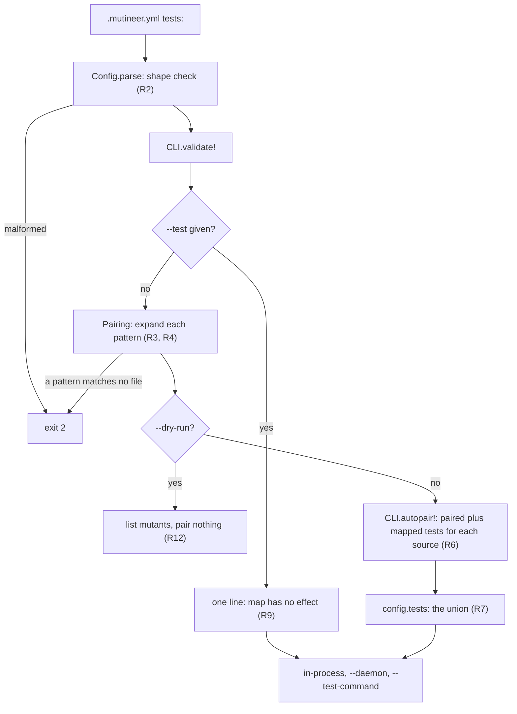

# Add a tests map in .mutineer.yml that adds tests to a source's paired tests - Plan

## Goal Capsule

- **Issue:** #382 (add a `tests:` map in `.mutineer.yml` that adds tests to a source's paired tests).
- **Objective:** one `mutineer run` scores a source that convention cannot pair. The run uses the tests the user names for it, and it holds every other source too.
- **Means:** the CLI pairing step resolves the map and adds its test files to the run's one test list (KTD1).
- **Authority:** this plan, then `AGENTS.md`, then the text of #382. "Corrections to the issue" lists where this plan differs from that text.
- **Stop and ask when:**
  - the U1 spike fails a pass criterion;
  - a run with no `tests:` key would change its test list, its output or a verdict;
  - `--test` would change meaning;
  - #380 (let `--test` take a directory or a glob) has merged with pattern rules that differ from R3 and R4. Its plan is `docs/plans/2026-11-10-380-feat-test-option-directory-or-glob-plan.md`.
- **Size:** M. One pull request. 3 files under `lib/`, 4 test files, 2 fixture sets, 7 docs and contract files. No new runtime dependency. No change to the JSON report.
- **Release:** minor (a new feature and an additive config key). Labels: `enhancement`, `priority: high`, `risk: medium`, `v1.9.0`. The body has `Closes #382`. A person merges. No agent tags or publishes.

---

## Product Contract

### Summary

`.mutineer.yml` gets a `tests:` key. Each entry names source patterns and test patterns. An entry applies when the run holds a source that it matches. Its test files then join the run's test list, next to the tests that convention pairs. Coverage then picks the tests for each mutant, as it does today. `--test` keeps its meaning: it replaces pairing and the map.

### Problem Frame

Pairing reads file names only (`lib/mutineer/pairing.rb:103-110`). `CLI.autopair!` drops a source with no paired test and prints one warning (`lib/mutineer/cli.rb:641-660`). `--test` is the only other way to name tests, and it replaces pairing for every source in the run (`cli.rb:642`).

Shared code has no test at the conventional path. Its tests are the tests of the code that uses it. Vladimir Dementyev's Fizzy report names this first under "Missing parts". To score the controller concerns, he ran them alone. That run took every controller and integration test as `--test`, and a separate `--cache-dir`.

Probe 3 shows both halves on a two-source project. With convention only, the shared source is skipped. With `--test` for the shared source, the other source loses its paired test and scores nothing.

On the Fizzy clone, 92 of the 292 sources under `app/models` and `app/controllers` have no paired test (probe 2).

### Terms

- **Paired test:** a test file that `Pairing.infer_tests` finds for a source by its path.
- **Mapped test:** a test file that an entry of `tests:` names for a source.
- **Active entry:** an entry with one or more of its sources in the run.
- **Run's test list:** `config.tests`. Mutineer keeps one list for the whole run, not one list per source.
- **Run directory:** `config.project_root`, the directory that `mutineer` runs in. Patterns and source paths are relative to it.

### Requirements

**The config key**

- R1. `.mutineer.yml` accepts a `tests:` key that holds a list of entries. Each entry is a mapping with exactly two keys, `sources` and `tests`. Each value is one pattern or a list of patterns. The key has no flag.
- R2. A malformed `tests:` value stops each command that loads the file, with exit 2. The message names the file, the entry number and the fault. `tests: []` is valid and means "no map".

**Patterns**

- R3. A pattern is a file, a directory or a glob, relative to the run directory. A glob uses Ruby `Dir.glob` syntax: `*`, `**`, `?`, `[]` and `{a,b}`.
- R4. A `sources` directory means each `.rb` file below it. A `tests` directory means each file below it with a test name: `*_test.rb`, `*_spec.rb` or `test_*.rb`, but not `test_helper.rb`. A file or a glob means the files it matches. A directory that a glob matches expands by the same directory rule.
- R5. On `mutineer run`, a pattern that matches no file is a usage error (exit 2). The message names the entry number, the key and the pattern. The check covers each entry, active or not, and it also runs under `--dry-run`. It does not run when `--test` is given (R9).

**Pairing**

- R6. Without `--test`, a source gets its paired tests plus the tests of each entry whose `sources` match it. A source with no paired test and no mapped test is skipped with today's warning.
- R7. The run's test list is the union of those tests over the sources in the run, with no duplicates. An entry adds tests only when it is active.
- R8. Coverage selects the tests for each mutant from the run's test list, as today. A mapped test can thus run against a mutant of any source in the run whose line it covers. Paired tests already work this way.
- R9. `--test` replaces pairing and the map for the whole run. When the file holds a map with entries, the run prints one stderr line: the map has no effect.
- R10. For one source, the paired tests come first. The mapped tests follow in entry order.
- R11. A run with no `tests:` key keeps today's test list, coverage digest, verdicts and output. So does a run with a valid map and no active entry.

**Backends and surfaces**

- R12. The in-process, `--daemon` and `--test-command` backends and the GitHub Action get the map through the run's test list only. `--dry-run` checks the map (R2, R5) and lists mutants as today. It pairs nothing.
- R13. The docs describe the key, R7 to R9, and the cost notes in U5. U5 lists the files.

### Acceptance Examples

The fixture is `test/fixtures/test_map/` (U4). It holds a model and a controller, each with a paired test. It holds two concerns: `board_scoped.rb` has no paired test, and `authentication.rb` has one.

- AE1. **Covers R6, R7.** The map sends `app/controllers/concerns/**/*.rb` to `test/controllers/**/*_test.rb`. `mutineer run app/controllers --format json --matrix` lists `board_scoped.rb` in `per_source`. The matrix names `test/controllers/boards_controller_test.rb` as the killer of its mutant. Stderr has no "no test found by convention" line for that source.
- AE2. **Covers R7, R11.** Same map. `mutineer run app/models` uses only `test/models/board_test.rb`.
- AE3. **Covers R9.** Same map. `mutineer run app --test test/models/board_test.rb` gives the same report as today, plus the "no effect" line.
- AE4. **Covers R5.** The entry's `tests` pattern is `test/controlers/**/*_test.rb`. The run exits 2 and names entry 1, `tests` and the pattern. `--dry-run` gives the same exit and message.
- AE5. **Covers R2.** `tests: [test/a_test.rb]` exits 2. The message says that entry 1 must be a mapping with `sources` and `tests`.
- AE6. **Covers R6, R10.** `authentication.rb` matches the entry and has a paired test. Its tests are the paired test first, then the mapped tests. The paired test appears once.

### Scope Boundaries

- No change to `--test`. It does not add to the map.
- No flag for the map.
- No change to the JSON report. `schema_version` stays.
- No change to coverage selection, the coverage cache or its digest (KTD7).
- No change to the text of the skipped-source warning. #381 (count sources skipped for having no paired test) owns that report.
- `mutineer init` does not write a `tests:` example.

**Considered and not built**

- A test filter for each source (KTD1, option a). The U1 numbers can change this call.
- A name filter on glob results. A glob takes each file it matches, as the plan for #380 specifies for `--test`. The docs say to write `*_test.rb` in the pattern.
- An order rule that runs mapped tests before other covering tests. `CoverageMap#order_tests` (`lib/mutineer/coverage_map.rb:170-180`) keeps "paired first, then cheapest".
- A stderr line that reports how many test files the map added. The report already lists each mapped source under `per_source`. A user request for the line would change this call.

#### Deferred to Follow-Up Work

Each item needs a GitHub issue. This planning job could not write to GitHub (Q4).

- **Coverage fallback for a source with no paired and no mapped test.** Vladimir asked for it as the second option. #382 puts it out of scope, and no open issue tracks it. Until it exists, one broad entry gives the same effect for every source: `sources: app/**/*.rb` with `tests: test/**/*_test.rb`. The saved Fizzy report shows the cost of that run: 16 timeouts in 1,071 mutants.
- **Failed-capture attribution for mapped tests.** A mutant is `uncapturable` only when a failed test pairs with its source by name (`coverage_map.rb:213-217`, `:263-268`). A failed mapped test leaves `no_coverage`. Both stay out of the score. The validation report in `wip/vlad/Sol/` of the main checkout asks for one selection rule for both. No issue tracks it.
- **`--since` narrows mutants, not the test list.** Each test in the run's list is captured, also when the diff touches no mapped source (`lib/mutineer/runner.rb:149-150`, `:180-182`). #396 covers one case only: an in-process `--since` run with no mutant on a changed line.
- **The full-scope clean check that reported 64 test files as not green** (Fizzy report, "Costs and caveats"). Not checked: this job did not search GitHub for a tracking issue.

### Corrections to the issue

1. **"Mapped sources run convention-paired tests plus mapped tests."** Mutineer has no test list for each source. `autopair!` flattens every pair into one list (`cli.rb:651-652`), and `CoverageMap#tests_for` selects by file and line with no source filter (`coverage_map.rb:151-153`). The map therefore adds tests to the run (R7, R8). The validation report in `wip/vlad/opus/` of the main checkout says the same (row A9, action 24).
2. **"Coverage still selects only tests that reach each mutant."** This holds for in-process and daemon runs. `--test-command` runs the full list for each mutant (`runner.rb:229-234`, `:281-283`). The daemon does the same when its coverage map is not available (`lib/mutineer/daemon_backend.rb:444`).
3. **The results table leaves out the mutants that got no verdict.** The saved report is `tmp/fullscope.json` in the Fizzy clone. Its counts: 796 killed, 146 survived, 98 no coverage, 16 timeouts, 4 ran at load, 1 unplaceable, 10 ignored. The score is 796 of 942. "0 errors" is correct. Not checked: the 22.5 minutes and the 6 jobs are not in the JSON.
4. **"All unpaired" is the state before Vladimir added tests.** On the current Fizzy branch, 7 of the 16 controller concerns have a paired test. The 9 without one hold 4 of the 34 default-operator mutants (probes 2 and 4).
5. **The key name collides with a Config field.** `Config.field_for("tests")` returns `:tests`, the field that holds the `--test` list (`lib/mutineer/config.rb:304-306`, `:96`; probe 1). The key needs its own field (KTD2).
6. **A `tests:` key is not an error today.** Mutineer on `main` warns "unknown config key" and ignores it (`config.rb:208-212`; probe 1). A project that adds the key and runs an older version gets that warning and no mapped tests. U5 records this in `STABILITY.md`.
7. **The issue does not say what a pattern with no match does, or what `--dry-run` does.** R5 and R12 decide both.

---

## Planning Contract

### Key Technical Decisions

- KTD1. **The map adds to the run's test list. No backend changes.** `CLI.autopair!` already builds the one list that all three backends read (`runner.rb:149-150`, `:169-170`, `:241`; `daemon_backend.rb:57`, `:493`). Probe 3 shows that this list gives the result the issue asks for. Rejected: (a) a filter that lets a mapped test run only against its entry's sources. It adds a second selection rule beside pairing's rule. It touches `JobPlan.coverage_selection` and three backends. The measured gain is small: the Fizzy example adds 14 test files to a 201-file run (probe 2). Rejected: (b) a list for each source for paired tests too. It lowers scores for current users, so it is a 2.0 topic. U1 measures the bet.
- KTD2. **The YAML key `tests` maps to a new Config field, `test_map`.** `Config.field_for` reads the field from the schema row, as the `require` key needs today. Rejected: reuse of `:tests`. A file key would then look like `--test` and switch pairing off.
- KTD3. **A malformed map raises `ConfigError`.** The key is new, so no old shape needs a warning period. A dropped entry would remove tests without a failure. Rejected: warn and ignore with the "becomes an error in Mutineer 2.0" text. That adds a 2.0 migration site for a key with no history.
- KTD4. **`Config` checks the shape. `Pairing` reads the disk.** `Pairing` already holds the pure path logic (`pairing.rb:6-22`). Each test pattern goes through `Pairing.expand_test`, the function that the plan for #380 defines (its KTD2 and its sketch). That plan asks to land #380 first. If #382 lands first, it adds the function with the rules of that plan.
- KTD5. **A pattern with no match is exit 2 on each run.** The check covers every entry, so the result does not depend on which sources a run names. #380 sets the same rule for a `--test` glob. Rejected: a warning. The source then runs with fewer tests, or is skipped, and the score drops with no failure. Q2 holds the choice.
- KTD6. **`--test` wins, and says so.** The run prints one line, in the style of `warn_unused_settings` (`cli.rb:547-554`). Rejected: silence. `AGENTS.md` asks for explicit failures over silent ones.
- KTD7. **The coverage digest needs no change.** Mapped tests are in `config.tests`. `compute_digest` reads that list as the test group (`coverage_map.rb:1418`), and `save` reads it for the inputs digest (`:1544`). A new file that matches a glob changes the list, so the cache rebuilds. Probe 3 shows three test lists give three digests. The map text is not digested, because only the files matter.
- KTD8. **Source patterns expand with `Dir.glob(pattern, base: root)`, sorted.** The result has the same form as `Pairing.expand_sources`, so a source matches by string equality (probe 2). Each result path of the map is cleaned first, so `./lib/a.rb` and `lib//a.rb` both give `lib/a.rb`. A mapped test and a paired test for one file then compare equal. Rejected: `File.fnmatch?`. It needs flags for `**` and braces, and it cannot tell that a pattern matches no file.
- KTD9. **`autopair!` appends the mapped tests after the paired ones (R10).** This keeps `infer_tests`' "exact candidate first" rule, and `order_tests` still finds the paired files first.
- KTD10. **Framework detection stays as it is.** It reads the whole list after pairing (`cli.rb:653`).

### Assumptions

No user was present. These are bets of this plan.

- A1. Users accept the run-wide rule in R8 (Q1).
- A2. Exit 2 for a pattern with no match is acceptable in CI (Q2).
- A3. The key keeps the name `tests`, with `sources` and `tests` inside each entry (Q3).
- A4. The person who does U1 can run the Fizzy suite.

### High-Level Technical Design



### Sibling coverage

| Pair | How this plan covers it |
|---|---|
| Reload and redefine | The map changes the test list only. Both strategies read the same list (`runner.rb:149-150`, `:169-170`), and `test/parallel_strategy_test.rb` already compares their verdicts on one list. No new test for each strategy. |
| Daemon and in-process | Both read `config.tests` (KTD1). U4 has CLI tests for the in-process path and one daemon test in `rake test:daemon`. |
| `--test-command` | It reads the same list (`runner.rb:241`). U4 has one CLI test for it. |
| Action and CLI | The Action passes no flag for the map, and the CLI reads `.mutineer.yml` (U4, approach 4). U5 updates the `test` input text and `docs/ci.md`. |
| Report and dry run | The report does not change. The dry run checks the map and pairs nothing (R12). U4 tests both. |

### Probes

Scripts and output are in the planning scratch folder, `/private/tmp/claude-501/-Users-davidteren-Projects-claude-worktrees-mutineer-vladimir-issues-planning-21adcb/ae564be8-638b-4dd0-a9e5-9d7a58cb00ae/scratchpad/context/probes/382/`. The folder is on one machine and can be gone. The results below are the record.

| Probe | Question | Result |
|---|---|---|
| 1 `p1_today_config.rb` | What does `main` do with a `tests:` key? | It warns "unknown config key" and ignores the key. `KNOWN_KEYS` has no `tests` and no `test`. `Config.field_for("tests")` is `:tests`. |
| 2 `p2_glob_fizzy.rb` | Do the issue's patterns work on Fizzy, and how many tests do they add? | The entry matches 16 sources and 111 tests. `Dir.glob` output equals `Pairing.expand_sources` output. A directory pattern returns the directory, not its files. A typo returns 0 files. 92 of 292 sources are unpaired, and the entry covers 9 of them. Test files: `app/models` 104 with or without the entry; `app/models app/controllers` 201, then 215; one concern 1, then 111. |
| 3 `p3_union_run.rb` | Does the union give the wanted run with no backend change? | Convention only: the shared source is skipped. `--test` for it: the other source has `no_coverage` and no score. Both tests as `--test`: both sources score 100, coverage maps each body line to one test, and `--matrix` names each killer. The three test lists give three digests. |
| 4 `p4_fizzy_dry_run.out` | How many mutants are in the mapped sources? | The controller concerns hold 34 default-operator mutants. `app/models app/controllers` holds 1,061 plus 10 ignored. The 9 unpaired concerns hold 4. |
| 5 `p5_union_lists.rb`, `p5b_plan_helper.rb` | Does the U1 helper work as printed, with root `.`? | It writes 209 sources and 215 tests for the full scope, and 16 sources and 111 tests for the concerns. `xargs` passes the 639 arguments of S2 in one call. |
| 6 `p6_yaml_patterns.rb` | How does YAML read glob patterns? | A star inside a pattern needs no quotes. A pattern that starts with `*` is a YAML syntax error without quotes. Braces need quotes inside a `[...]` list. |

Not run: a daemon run, a `--test-command` run with the map, and any timed run on Fizzy. The brief for this job allows no heavy run.

---

## Implementation Units

### U1. Spike: measure the cost of the run-wide rule on Fizzy

**Goal:** confirm KTD1 with wall-clock numbers before U4 depends on it. This unit changes no file in this repository.

**Requirements:** R7, R8, R11.

**Dependencies:** none. U2 and U3 do not wait for it.

**Question:** does the union of paired and mapped tests keep a full-scope run near today's time? What does a concerns-only run cost?

**Method:** `--test` flags can build the source list and the test list that the map will build. The spike therefore needs no code. Use a Fizzy checkout on the branch `vova/sfruby-mutation`, with its bundle installed and its test databases prepared. Use Mutineer 1.8.1 or `main`, and record the version. The maintainer's clone at `/Users/davidteren/Projects/OSS/fizzy-palkan` has the branch. Ask before a run there: this planning job had read access only.

Save this helper as `tmp/union_lists.rb` in the Fizzy checkout:

```ruby
require "mutineer"
require "mutineer/pairing"
require "fileutils"

root, out, *dirs = ARGV
mapped_sources = Dir.glob("app/controllers/concerns/**/*.rb", base: root)
mapped_tests = %w[test/controllers/**/*_test.rb test/integration/**/*_test.rb]
               .flat_map { |glob| Dir.glob(glob, base: root) }.uniq.sort
pairs = Mutineer::Pairing.expand_sources(dirs, project_root: root).to_h do |source|
  paired = Mutineer::Pairing.infer_tests(source, project_root: root, prefer: "minitest")
  [source, mapped_sources.include?(source) ? (paired | mapped_tests) : paired]
end
pairs.reject! { |_, tests| tests.empty? }
FileUtils.mkdir_p(out)
File.write(File.join(out, "sources.txt"), pairs.keys.join("\n") + "\n")
File.write(File.join(out, "tests.txt"), pairs.values.flatten.uniq.join("\n") + "\n")
```

Then run, from the Fizzy checkout, with `M` set to the path of this repository:

```sh
ruby -I"$M/lib" tmp/union_lists.rb . tmp/s2 app/models app/controllers
ruby -I"$M/lib" tmp/union_lists.rb . tmp/s3 app/controllers/concerns

# S1: today's run, convention pairing only
/usr/bin/time -p bin/mutineer app/models app/controllers --no-fail-fast --jobs 6 \
  --format json --output tmp/s1.json --cache-dir tmp/cache-s1

# S2: the union that the map builds, full scope
{ cat tmp/s2/sources.txt; sed 's/^/--test /' tmp/s2/tests.txt; } | /usr/bin/time -p xargs \
  bin/mutineer --no-fail-fast --jobs 6 --format json --output tmp/s2.json --cache-dir tmp/cache-s2

# S3: the controller concerns only
{ cat tmp/s3/sources.txt; sed 's/^/--test /' tmp/s3/tests.txt; } | /usr/bin/time -p xargs \
  bin/mutineer --no-fail-fast --jobs 6 --format json --output tmp/s3.json --cache-dir tmp/cache-s3

# S4: S3 again with no edit (a coverage cache hit)
{ cat tmp/s3/sources.txt; sed 's/^/--test /' tmp/s3/tests.txt; } | /usr/bin/time -p xargs \
  bin/mutineer --no-fail-fast --jobs 6 --format json --output tmp/s4.json --cache-dir tmp/cache-s3
```

For each run, record `real` and these `summary` values: `total`, `killed`, `survived`, `no_coverage`, `timeout`, `errored`, `score`. Probe 5 gives the expected list sizes: 209 sources and 215 tests for S2, 16 sources and 111 tests for S3.

**Time box:** 2 hours.

**Pass criteria:**

- C1. S2 passes its clean check. Stderr has no "the unmutated suite is not green" line. If S1 fails the same check, repair the checkout first: that is not a spike result.
- C2. S2 `real` is at most 1.25 times S1 `real`. The factor is a planning judgment, not a measured limit.
- C3. S2 `summary.timeout` is at most S1 `summary.timeout` plus 5. The 5 is a planning judgment too.
- C4. `summary.killed` plus `summary.timeout` in S2 is at least the same sum in S1. More tests can turn a kill into a timeout, and never into a survivor.

S3 and S4 have no pass criterion. Their numbers go into the docs cost note (U5). They also go onto #398 (a coverage cache hit still runs the full clean check).

**Outcomes:**

- **All four pass:** keep KTD1. Put the S1 to S4 numbers in the pull request body.
- **One fails:** stop before U4. Give the maintainer the numbers. The fallback is option (a) of KTD1. It changes U4 only, so U2 and U3 stay valid.
- **Not run in the time box:** continue with KTD1, say "not measured" in the pull request body, and write no measured number in the docs. The maintainer runs S1 to S4 before the release that ships this change. Q1 stays open.

**Test scenarios:** Test expectation: none. This unit measures and changes no code.

**Verification:** the pull request body holds the four result rows, or the "not measured" line.

### U2. Parse and check the `tests:` key

**Goal:** `Config.from_file` returns a checked map under its own field.

**Requirements:** R1, R2.

**Dependencies:** none.

**Files:**

- `lib/mutineer/config.rb`:
  - a new `CONFIG_OPTIONS` row (`:43-74`);
  - a new Struct member and its `[]` default (`:95-142`);
  - `field_for` (`:304-306`);
  - a new branch in `parse` (`:322-389`), with a private helper beside `parse_ignore_list` (`:418-449`).
- `STABILITY.md`, section "Config keys" (`:42-72`): add "`tests` is new in 1.9.0. An older version warns that the key is unknown and ignores it." Leave the list of 1.8.0 keys (`:44-49`) as it is. `test_stability_lists_every_config_key` (`test/docs_contract_test.rb:136-141`) fails without the new line.
- Tests: `test/config_test.rb`.

**Approach:**

1. The parsed value is a list of entries. Each entry holds a list of source patterns and a list of test patterns.
2. The helper raises `ConfigError` for each of these faults:
   - the value is not a list;
   - an entry is not a mapping;
   - a key is missing or unknown;
   - a pattern list is empty;
   - a pattern is blank, is not a string, or is an absolute path. An absolute `sources` pattern can never match a source, so it would fail without a message.
3. The message starts with the file name and `tests entry N`, like the other `parse` messages (`config.rb:324`).
4. The new method and its branch each need a YARD comment for `rake yard:strict`.

**Patterns to follow:** `parse_ignore_list` and `ignore_mapping` (`config.rb:418-497`) for a list of mappings; the `:string` branch (`:365-377`) for "blank is an error".

**Test scenarios** (each fails before the change: the key is unknown and ignored):

- `test_tests_key_parses_entries`: one entry with a string `sources` and a list of two `tests` patterns. The hash holds the entry under `:test_map`, with both values as lists. The hash has no `:tests` key.
- `test_tests_key_leaves_the_test_flag_field_alone`: `Config.resolve({}, file_hash)` gives `tests == []`, `explicit?(:tests) == false`, one `test_map` entry, and `origin(:test_map) == "tests in .mutineer.yml"`.
- `test_empty_tests_list_means_no_map`: `tests: []` gives `[]`.
- `test_config_new_defaults_test_map_to_empty`: `Config.new.test_map == []`.
- `test_malformed_tests_key_raises`: a table of inputs. Each one raises `ConfigError` with a message that matches `.mutineer.yml: tests`. The inputs:
  - a key with no value;
  - a plain string;
  - `[test/a_test.rb]` (covers AE5);
  - an entry with no `tests`, and an entry with no `sources`;
  - an entry with a third key `test`;
  - `sources: ""` and `sources: []`;
  - a pattern `42`, and a pattern `/abs/a_test.rb`.
- `test_quoted_glob_patterns_parse`: `tests: "**/*_test.rb"` and `tests: ["test/{a,b}/**/*_test.rb"]` parse. An unquoted leading `*` raises the existing "parse error" `ConfigError` (`config.rb:229-230`; probe 6).
- `test_known_keys_come_from_the_schema` (`test/config_test.rb:282-284`) stays green, and a new assert checks that `KNOWN_KEYS` includes `tests`.

**Verification:** `test/config_test.rb` and `test/docs_contract_test.rb` pass.

### U3. Expand patterns and resolve the map

**Goal:** `Pairing` turns the checked map into file lists and answers "which mapped tests does this source get".

**Requirements:** R3, R4, R5 (the detection), R6 (the lookup), R10.

**Dependencies:** U2 for the entry shape.

**Files:**

- `lib/mutineer/pairing.rb`: new module functions beside `expand_sources` (`:35-49`), and one more line in the module comment (`:6-22`).
- Tests: `test/pairing_test.rb`.

**Approach:**

1. Test patterns expand through `Pairing.expand_test` (KTD4). That function returns a missing plain path as typed, so the map code checks that each result is a file.
2. One function resolves the whole map. It returns the file lists for each entry, cleaned and with no duplicates (KTD8). It also returns each pattern that matched no file, with its entry number and key.
3. One function returns the mapped tests for one source path, in entry order (R10).
4. No function prints or exits. The CLI does that in U4.

**Patterns to follow:** `expand_sources` and `existing_relative` (`pairing.rb:35-62`); the pure style of the module.

**Test scenarios** (each in a temp directory; each fails before the change with `NoMethodError`):

- `app/c/**/*.rb` matches `app/c/a.rb` and `app/c/sub/b.rb`.
- `test/{c,i}/**/*_test.rb` matches files in both directories.
- A `sources` directory gives each `.rb` file below it, equal to `expand_sources` for that directory.
- A `tests` directory gives `x_test.rb`, `y_spec.rb` and `test_z.rb`, and not `test_helper.rb` or `support/setup.rb`.
- A `tests` glob `test/**/*.rb` gives each match, `test_helper.rb` included (R4).
- `./lib/a.rb`, `lib//a.rb` and `lib/a.rb` give the same file path.
- A `sources` glob `app/*` that matches the directory `app/c` gives the `.rb` files below `app/c`.
- A `tests` pattern `test/missing_test.rb`, with no file at that path, counts as no match.
- A `tests` pattern with no match sits in the second entry. The result names entry 2 and the key `tests` (covers R5).
- Two patterns that overlap give each file once, sorted.
- A source that two entries match gets both test lists, in entry order. A source that no entry matches gets `[]`.

**Verification:** `test/pairing_test.rb` passes. No Rails and no fork are needed.

### U4. Apply the map in the CLI pairing step

**Goal:** a run uses mapped tests, a dry run checks the map, and `--test` still wins.

**Requirements:** R5 to R12. Covers AE1 to AE6.

**Dependencies:** U2, U3, and a U1 outcome that keeps KTD1.

**Files:**

- `lib/mutineer/cli.rb`: `validate!` (`:417-444`), `autopair!` (`:641-660`) and the `--test` text in `BANNER` (`:53-55`).
- `test/fixtures/test_map/` (new, plain Ruby, no Rails): `app/models/board.rb`, `test/models/board_test.rb`, `app/controllers/boards_controller.rb`, `test/controllers/boards_controller_test.rb`, `app/controllers/concerns/board_scoped.rb`, `app/controllers/concerns/authentication.rb`, `test/controllers/concerns/authentication_test.rb`. The controller includes `BoardScoped`, and its test asserts a value that `BoardScoped` computes.
- `test/fixtures/rails_app/app/models/shipping_quote.rb` and `test/fixtures/rails_app/test/integration/shipping_quote_flow_test.rb` (new): a plain class with no paired test, and the one test that uses it.
- Tests: `test/cli_test.rb`, `test/runner_daemon_test.rb`.

**Approach:**

1. `validate!` resolves the map once, before `autopair!`. With `--test` and a map with entries, it prints the R9 line and resolves nothing. Otherwise a pattern with no match prints the R5 message and exits 2.
2. `autopair!` gives each source its paired tests, then its mapped tests (R10). The rest of the method stays: the skipped-source warning, the union, framework detection, and exit 2 when no source is left.
3. Tests call `CLI.autopair!(config)` with one argument today (`test/cli_test.rb:1415`). Keep that call shape valid.
4. The Action needs no code change. It adds `--test` only for a non-empty `test` input (`action.yml:380`), so the CLI applies the map.

**Patterns to follow:**

- `warn_unused_settings` (`cli.rb:547-554`) for the R9 line.
- `with_autopair_project` and `config_resolved_by_cli` (`test/cli_test.rb:1314`, `:1437`) for the CLI tests.
- `config_for` (`test/runner_daemon_test.rb:17-28`) for the daemon test.

**Test scenarios** in `test/cli_test.rb`. Each copies the fixture to a temp directory and writes its own `.mutineer.yml`. This seam catches pairing, messages and exit codes through the real binary. It does not catch a backend that stops reading `config.tests`.

- Covers AE1. `test_tests_map_brings_an_unpaired_source_into_the_run`: asserts the `per_source` file list, the killer file from `matrix`, and no skip warning for `board_scoped.rb`. Before the change, the source is skipped.
- Covers AE2. `test_tests_map_adds_nothing_when_no_mapped_source_runs`: after `autopair!` for `app/models`, `config.tests == ["test/models/board_test.rb"]`. This test guards the cost rule in R7.
- Covers AE6. `test_tests_map_keeps_paired_tests_first`: after `autopair!` for `authentication.rb`, the first test is the paired file and no path repeats.
- Covers AE3. `test_explicit_test_replaces_the_tests_map`: run the same `--test` command with a map in the file and with no map. The two JSON reports are equal. Stderr has the R9 line only when the file holds a map.
- Covers AE4. `test_tests_map_pattern_without_a_match_exits_two`: exit 2 and the message, for a run and for `--dry-run`. With `--test`, the same file gives exit 0.
- Covers AE5. `test_malformed_tests_map_exits_two`: exit 2, and stderr names `.mutineer.yml` and entry 1.
- `test_source_without_paired_or_mapped_test_is_still_skipped`: an added `app/models/orphan.rb` gets today's warning text, unchanged.
- `test_dry_run_lists_the_same_mutants_with_a_tests_map`: `--dry-run` stdout is equal with and without a valid map.
- `test_tests_map_applies_under_test_command`: the map sends `board_scoped.rb` to `test/controllers/boards_controller_test.rb`. `run app/controllers/concerns/board_scoped.rb --test-command "<ruby> %{files}" --format json` exits 0 and reports a killed mutant in that file. Before the change, the run exits 2 with "no test files found by convention".
- `test_orphan_source_warns_and_is_skipped`, `test_all_sources_unpaired_exits_two` and `test_explicit_test_overrides_autopairing` (`test/cli_test.rb:1359`, `:1371`, `:1422`) stay green with no edit (R11).

**Test scenario** in `test/runner_daemon_test.rb` (runs in `rake test:daemon`):

- `test_tests_map_runs_a_mapped_source_in_the_daemon`: the map sends `app/models/shipping_quote.rb` to `test/integration/shipping_quote_flow_test.rb`. The test resolves that map with the U3 functions for the fixture app root, and gets that one test file. It builds the config as `config_for` does, with absolute paths, from that source and that test. `Runner.execute` reports one or more killed mutants and no error. The one test file is the only possible killer. This seam catches a mapped test that the daemon cannot load from outside the mirrored test directory. It does not go through `CLI.autopair!`: the CLI tests cover that step.

**Verification:** probe 3's three commands, with a map in place of the `--test` flags, give the result of its third run.

### U5. Docs, contract and changelog

**Goal:** a user can write an entry from the docs and knows what it costs.

**Requirements:** R13.

**Dependencies:** U4, and the U1 numbers when they exist.

**Files:**

- `docs/cli.md`:
  - the `--test` row (`:9`);
  - a `tests` row in the configuration table (`:49-71`);
  - two rows in the validation table (`:73-84`);
  - a short section "Extra tests for a source", with the example below.
- `docs/ci.md`: two lines after the pairing table (`:34-41`), and the `test` row of the Action inputs (`:138`).
- `docs/rails-setup.md`: the "Tests" row (`:37`) and a controller-concern example.
- `README.md`: the `--test` row (`:194`).
- `action.yml`: the `test` input description (`:16-21`) names the `tests:` key. No behaviour changes.
- `CHANGELOG.md`: one entry under `## [Unreleased]`, in a new `### Added` section.

**Approach:** the docs section holds this example and these notes.

```yaml
tests:
  - sources: app/controllers/concerns/**/*.rb
    tests: [test/controllers/**/*_test.rb, test/integration/**/*_test.rb]
```

1. An entry adds its tests to the whole run when the run holds one of its sources. Coverage picks the tests for each mutant. A mapped test can thus also kill a mutant of another source in that run. A `--baseline` gate therefore needs the sources of the run that wrote the baseline, as `docs/ci.md:25` already says.
2. Mutineer captures coverage for each test file in the run and checks it clean, also on a cache hit (#398). A run of one mapped source loads every test of its entries.
3. `--test-command` runs every test in the run for every mutant.
4. A mutant that many test files cover can pass the time limit for one mutant. The limit is 10 seconds in process and 60 seconds with `--daemon`.
5. Quote a pattern that starts with `*`. Quote a pattern with braces inside a `[...]` list.
6. `--test` replaces pairing and the map.

**Test scenarios:** Test expectation: none for the prose. `test/docs_contract_test.rb` checks the `STABILITY.md` line that U2 adds.

**Verification:** the website checks in the Verification Contract pass, and the built `docs/cli` page shows the new row.

---

## Verification Contract

Prefix each ruby, rake and bundle command with `LANG=en_US.UTF-8 LC_ALL=en_US.UTF-8` in a shell where they are unset.

| Step | Command | Applies to |
|---|---|---|
| Unit tests while working | `bundle exec ruby -Ilib -Itest test/config_test.rb` (also `pairing_test.rb`, `cli_test.rb`, `docs_contract_test.rb`) | U2, U3, U4 |
| Zero-dependency suite | `bundle exec rake test` | all |
| Load smoke | `ruby -Ilib -e 'require "mutineer"'` | all |
| 100% YARD | `bundle exec rake yard:strict` | U2, U3, U4 (each new method needs a comment) |
| Daemon tests | `(cd test/fixtures/rails_app && bundle install)`, then `bundle exec rake test:daemon` | U4 |
| Website | `bundle exec rake site:build`, `node --test test/site_test.js`, `npm ci --prefix test/browser`, `npx --prefix test/browser playwright install chromium`, `npm test --prefix test/browser` | U5 |
| Spike | the S1 to S4 commands in U1 | U1 |

Not required: the Minitest 6 run. This plan does not touch the Minitest integration.

## Definition of Done

- Each test named in U2, U3 and U4 exists, failed before its unit, and passes after it.
- A run with no `tests:` key is unchanged: every existing test passes with no edit.
- The U1 result rows, or the "not measured" line, are in the pull request body.
- The pull request has the labels in the Goal Capsule and `Closes #382`.
- `STABILITY.md` (U2), `docs/cli.md`, `docs/ci.md`, `docs/rails-setup.md`, `README.md`, `action.yml` and `CHANGELOG.md` describe the key.
- `lib/mutineer/coverage_map.rb`, `job_plan.rb`, `runner.rb`, `daemon_backend.rb` and `reporter.rb` have no diff, unless U1 failed and the maintainer chose option (a) of KTD1.
- No dead code and no abandoned attempt remain in the diff.

---

## Risks and Overlaps

| Item | Overlap or risk | Handling |
|---|---|---|
| #380 (let `--test` take a directory or a glob) | Its plan defines `Pairing.expand_test` and the directory rule that R4 repeats. It edits the same `--test` help text and docs rows. Under `--test-command`, that plan keeps a `--test` directory as typed. | KTD4: land #380 first, and call its function. A mapped pattern always expands to files, also under `--test-command`: the key is new, so no old value needs the old reading. `--test` with a glob still replaces the map (R9). |
| #381 (count sources skipped for having no paired test) | Its plan moves the pairing call of `autopair!` into one private helper, and the dry run calls that helper too. | "Unpaired" must mean "no paired test and no mapped test". The pull request that lands second puts the mapped tests inside that helper. The dry run then counts a mapped source as paired, and R12 still holds: it runs no test. The validation report in `wip/vlad/grok-cursor/` of the main checkout advises #381 first. |
| #379 (pair a source under `concerns/` with the test that mirrors its namespace) | It changes what `Pairing.infer_tests` finds, so fewer sources need an entry. | No code overlap beyond `pairing.rb`. Either order. |
| #398 (a coverage cache hit still runs the full clean check) | The map moves a one-concern run on Fizzy from 1 test file to 111. A cache hit then costs about as much as a miss. | U5 note 2. U1 records S4 for #398. |
| #396 (an in-process `--since` run builds the full coverage map when no changed line holds a mutant) | That map is bigger with mapped tests. | No change here. See "Deferred to Follow-Up Work". |
| #402 (run Mutineer on a pinned Fizzy sample before each release) | Its script can hold the U1 measurement later. | None now. |
| #360, #282 and #338 (clean runs that are not green, test order and seed) | A larger test list raises the chance that the combined clean check meets a test that depends on order (`coverage_map.rb:819-830`). | U1 criterion C1. |
| PR #391 (the reload fix for Rails class bodies) | Mapped concerns reach the daemon's reload path, which #391 repairs. | Merge #391 first, or keep the Rails concern example out of the docs until it lands. No file overlap. |
| PR #395 (the Action asks the CLI for `cache_dir` and `baseline`) | It edits `BANNER`, `docs/cli.md` and `action.yml`. `mutineer config` loads the file, so a malformed map exits 2 there too (R2). | Text conflict only. |
| PR #369 (warn when `--test-command` runs tests in random order) | It edits `BANNER`, `README.md` and `docs/cli.md`. | Text conflict only. |
| PR #244 and PR #245 (the 2.0 line) | They rewrite `config.rb` and `cli.rb`. On that branch an unknown config key is an error. | Rebase keeps the new schema row. KTD3 adds no "becomes an error in 2.0" site. |
| #201 (split `coverage_map.rb`) | None. | This plan does not touch that file. |
| Time limit for one mutant | A survivor runs every covering test. The saved full-suite report has 16 timeouts. The limit is 10 seconds in process (`lib/mutineer/isolation.rb:28`) and 60 seconds in the daemon (`daemon_backend.rb:32`). The daemon limit has no flag (`config.rb:100-101`). | U1 criterion C3, and U5 note 4. File an issue for a daemon limit flag if S3 shows timeouts. |
| Verdicts depend on the sources in the run | A mutant that only a mapped test kills survives in a run that holds no source of that entry. Against a baseline from a wider run, it shows as a new survivor. Paired tests of other sources already cause this. The map makes it more frequent. Option (a) of KTD1 would stop the added part. | U5 note 1. Q1 holds the choice. |
| Letter case on macOS | On a case-insensitive disk, a pattern with the wrong case matches files, but its paths never equal a source path. R5 does not fire there. On Linux the same pattern matches no file and exits 2. | None. CI on Linux reports it. |
| `--test-command` | Each mutant runs the whole list, mapped tests included (`runner.rb:281-283`). | U5 note 3. |
| Daemon with no coverage map | Each mutant runs the whole list (`daemon_backend.rb:444`). The existing fallback warning still prints. | No change. |
| One cache file | Two runs with different source sets use different test lists and digests, so each one rebuilds the cache. Mapped runs make each rebuild longer. | A separate `--cache-dir` for each run, as today. #398 owns the fix. |
| `--coverage-from` | Not checked with a map. It compares the resolved test list (`coverage_map.rb:474`), so both runs need the same list, as today. | None. |
| A broad glob | `test/**/*.rb` also loads helpers and support files as tests. | R4 and the docs say to write `*_test.rb`. |

## Open Questions

None blocks U2 or U3. Q1 gates U4 through U1.

- Q1. Does a mapped test run against every source in the run (R8), or only against its entry's sources? Default: every source, as paired tests do today. The second choice costs more code, and it keeps the map from changing the verdicts of other sources. The maintainer decides after the U1 numbers.
- Q2. Is a pattern with no match an error or a warning? Default: exit 2 (KTD5). The maintainer decides.
- Q3. Are the names final: `tests` for the key, `sources` and `tests` inside an entry? Default: yes, as #382 and Vladimir's report write them. The maintainer decides.
- Q4. Who files the four follow-up issues in "Deferred to Follow-Up Work"? Default: the session that commits this plan. The pull request for this plan then names each number.
- Q5. Does the R9 line print on every `--test` run, also for an Action workflow that sets `test`? Default: yes, one line. The maintainer decides.
- Q6. Which order do #380, #381 and #382 merge in? Default: #380, then #381, then #382, as the plans for #380 and #381 also assume. The maintainer decides.
