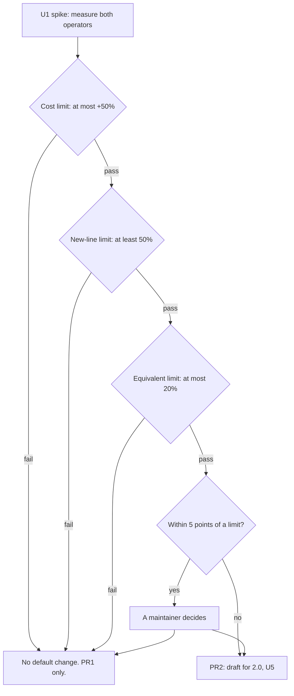

# Default mutants for bare if and rescue bodies - Plan

## Goal Capsule

- **Issue:** #386 (a method whose body is a single `if` or `rescue` expression gets no default mutants).
- **Objective:** a user sees which methods a run did not mutate. Then "no mutants" no longer reads as "nothing to test". A maintainer gets measured evidence for the default operator set.
- **Means:** count the methods with no mutants in the shared job plan (KTD3). Decide a default change with a noise spike, and ship it only in 2.0 (KTD1, KTD7).
- **Authority:** this plan, then `AGENTS.md`, then issue #386. Where this plan differs from the issue, this plan wins (see "Corrections to the issue").
- **Execution profile:** Standard depth. Two pull requests. PR1 is a minor change for v1.9.0. PR2 is a draft for v2.0 and exists only when the spike passes.
- **Stop and ask when:** a PR1 change alters the score, an exit code, the mutants that run, or `MutatorRegistry::DEFAULT_NAMES`. Also stop when a spike result is within 5 percentage points of a limit. Also stop when a maintainer wants the default change in a 1.x release.
- **Who finishes:** the implementer opens the pull requests. A maintainer merges them and decides each release.
- **Size:** PR1 is small to medium: 4 files under `lib/`, 7 under `test/`, and 4 docs and contract files. PR2 is about 20 files, mostly docs and pinned lists.

---

## Product Contract

### Summary

PR1 makes the gap visible and changes no score. Every run counts the methods that got no mutants from the selected operators. The dry run and the JSON report list them. The human summary and the JSON report show the count.

A spike then measures `condition_true` and `condition_false` as default operators against three stated limits. If one operator passes, PR2 adds it to the default set as a draft for 2.0. The plan rejects the narrow rule and builds no rescue operator.

### Problem Frame

The default set is five operators: `arithmetic`, `comparison`, `boolean_connector`, `boolean_literal` and `statement_removal` (`lib/mutineer/mutator_registry.rb:60`). `statement_removal` never changes the last statement of a list (`lib/mutineer/mutators/statement_removal.rb:17-18`). The other four need an arithmetic, comparison or boolean token. So a method with one expression and none of those tokens gets zero default mutants.

Fizzy's `DayTimelinesScoped#day` is such a method. Its whole file gets zero default mutants (probe 1). The run says nothing about the method. Vladimir Dementyev found the survivor that pointed at a real bug only with `condition_false`, an opt-in operator. See `vladimir-fizzy-report.md`, lines 36, 272 and 279.

The gap is wide, and the issue's shape is a small part of it (probe 2):

| Corpus | Methods | Zero default mutants | Of those, empty body | Of those, with a conditional or a def-level rescue |
|---|---|---|---|---|
| Mutineer `lib/` | 788 | 140 (17.8%) | 1 | 18 (12.9%) |
| Fizzy `app/models` and `app/controllers` (copy) | 1,177 | 700 (59.5%) | 32 | 102 (14.6%) |

R1 counts every one of these methods. So the new count is 140 on `lib/` and 700 on the Fizzy copy.

### Requirements

**Visibility (PR1, v1.9.0)**

- R1. Every run counts the methods that got zero mutants from the selected operators. An empty method is one of them.
- R2. A dry run prints one line for each such method, and adds the count to its summary line.
- R3. The human summary prints the count on a `No mutants:` line.
- R4. The JSON report adds `summary.subjects`, `summary.unmutated_subjects`, and a top-level `unmutated_subjects` array. Each array entry holds `subject`, `file` and `line`. The array sorts by file, line and subject.
- R5. When a real run finds methods and generates no mutants, the empty-run warning gives the method count and names `--list-operators`.
- R6. The count and the list are the same on every backend (in-process, `--daemon`, `--test-command`) and for both strategies.
- R7. Under `--since`, the count covers the scanned files, and the text says that `--since` does not narrow it.
- R8. In every 1.x release, the score, each exit code, the mutants that run and `MutatorRegistry::DEFAULT_NAMES` stay as they are.

**Default set decision (U1, PR2)**

- R9. A spike measures `condition_true` and `condition_false` against the limits in KTD7 before any default change.
- R10. A default operator change ships only in 2.0, as a draft pull request with the labels `breaking change` and `v2.0`.
- R11. An operator joins the default set whole. No rule makes the mutants of one operator depend on the output of another operator.

**Contract**

- R12. `schema_version` moves one minor step for the release (KTD6). `docs/json-schema.md`, `STABILITY.md`, `README.md` and `CHANGELOG.md` describe the new keys and lines.
- R13. `README.md` names the two opt-in operators that force a condition, with a list a user can copy.

### Acceptance Examples

- AE1. Covers R1, R2. A file holds `Day#day` (the Fizzy shape: an `if`/`else` body with a `rescue`) and `Day#total` (`a + b`). A dry run with the default operators prints `[no mutants] Day#day` with the file and line. Its summary line includes `1 of 2 methods have no mutants with the selected operators`.
- AE2. Covers R1. The same dry run with `--operators condition_false` prints one mutation for `Day#day` and no `[no mutants]` line for it.
- AE3. Covers R1. A file with only `def noop; end` gives `1 of 1 methods` and one `[no mutants]` line. No rule treats an empty method as a special case.
- AE4. Covers R5. A real run on a file that holds only `Day#day`, with a test, exits 0. Stderr includes `1 method was found, and the selected operators mutate none of them`.
- AE5. Covers R4. A JSON run on the AE1 file gives `summary.subjects` 2 and `summary.unmutated_subjects` 1. The `unmutated_subjects` array has one entry, for `Day#day`.
- AE6. Covers R8. `test/integration_test.rb` passes with no edit in PR1.

### Scope Boundaries

- No default operator changes in 1.x (KTD1).
- The narrow rule is not built: condition forcing only in a method that otherwise gets zero default mutants (KTD2).
- No rescue operator is built (KTD9).
- The HTML report does not show the count. It does not show `declined` either.
- The GitHub Action step summary does not change. The JSON report that the Action returns carries the new keys.
- Methods in a source with no paired test are not counted in a real run. The CLI drops that source first (`lib/mutineer/cli.rb:641-659`). #381 (count sources skipped for having no paired test) owns that count.
- `--since` does not narrow the count (KTD5).
- Considered and not built: a `default` name in `--operators`, so a user can write `default,condition_false`. Today the list replaces the default set (`docs/equivalent-skips.md:77`). A user report that the five-name list stops them would change this call.

#### Deferred to Follow-Up Work

- An issue for the `return_nil` gap. That operator gives no mutant for the last expression of a method with a def-level `rescue` (Corrections, item 5).
- An issue for an opt-in rescue operator, only if a maintainer wants one. KTD9 holds the numbers for it.

### Corrections to the issue

1. **The count 9 is not what `main` gives.** With every operator, the Fizzy file gives 10 mutants on `main` at `8d9905c4` (probe 1). 7 are in `#day` and 3 are in `#set_day_timeline`. The log `grok-cursor/evidence/if-rescue-all.txt` shows 7, because it holds only the `#day` method. Not checked: which Mutineer version gave 9.
2. **The cause is wider than an `if` or a `rescue`.** `#set_day_timeline` in the same file is one assignment. It also gets zero default mutants (probe 1). On the Fizzy copy, 700 methods get zero default mutants (probe 2). 598 of them hold no conditional and no def-level rescue. Of those 598, 32 are empty.
3. **The Fizzy report does not ask for a rescue operator.** It names the method shape (`vladimir-fizzy-report.md` line 36). For controllers it suggests four opt-in operators: `condition_true`, `condition_false`, `chain_link` and `call_to_receiver` (line 279). "Removal of a `rescue` clause body" is an addition of the issue.
4. **A real run already warns when a whole run has zero mutants** (`lib/mutineer/cli.rb:803-818`). The dry run in the issue does not warn. Neither names a method. A method with zero mutants inside a larger run is silent on every surface.
5. **`return_nil` also skips `#day`.** Prism gives a def with a `rescue` a `BeginNode` body (probe 1). `ReturnNil#final_expression_nil` returns unless the body is a `StatementsNode` (`lib/mutineer/mutators/return_nil.rb:50-51`). The issue does not name this gap.
6. **The release label needs two parts.** The issue has the label `v1.9.0` and says the change may need 2.0. PR1 is the 1.9.0 part. The default change is the 2.0 part (KTD1).
7. **The three validation reports disagree on the version.** The grok-cursor report calls a minor release correct (its row A10). The opus and Sol reports say 2.0 (their rows A10). KTD1 gives the evidence for 2.0.
8. **Not checked: the survivor itself.** The report says `if (false)` survives in `DayTimelinesScoped#day`. A Fizzy run is out of bounds for this plan, so no run confirmed it.

---

## Planning Contract

### Key Technical Decisions

- KTD1. **A default operator change is a major change. It ships in 2.0.** `AGENTS.md` ("Releasing") says a behavior change to the GitHub Action's defaults is a major bump. The Action passes `--operators` only when the user sets the input (`action.yml:386`). It installs the latest gem when `version` is empty (`action.yml:131-139`). So a new default set reaches those Action users on their next run, with no opt-in. With `--baseline`, a new survivor then fails their run. The registry comment says the explicit default list keeps the default survivor set unchanged (`lib/mutineer/mutator_registry.rb:28-32`).
  - Rejected: a minor release with a "scores can change" note, as 1.8.0 did (`CHANGELOG.md:59-64`). That release made the same operators reach more methods. It did not change which operators run.
  - Rejected: a patch release. The change is not a fix.
- KTD2. **A whole operator, not the narrow rule.** The narrow rule adds condition forcing only to a method that otherwise gets zero default mutants. Probe 2 compares the two:

  | Candidate | Added mutants, `lib/` | Added mutants, Fizzy copy | Zero-mutant methods it lifts |
  |---|---|---|---|
  | Narrow rule, both operators | +26 (+0.6%) | +234 (+21.8%) | 13 of 140, and 99 of 700 |
  | `condition_true` whole | +1,126 (+26.8%) | +370 (+34.5%) | the same 13 and 99 |
  | `condition_false` whole | +1,126 (+26.8%) | +370 (+34.5%) | the same 13 and 99 |
  | Both whole | +2,252 (+53.6%) | +740 (+69.1%) | the same 13 and 99 |

  The narrow rule is cheap, but it breaks a rule the code already states. The mutants of one operator must not depend on which other operators run (`lib/mutineer/mutators/condition_forcing.rb:21-26`). Under the narrow rule, adding `x + 1` to a method removes its condition mutants. No operator name describes that behaviour. The rule also leaves 601 of the 700 Fizzy methods at zero, as each whole operator does. Only R1 to R5 reach those.
- KTD3. **Count in `JobPlan.collect_jobs`, and return the result in its extras hash.** The in-process, external and daemon backends and the dry run all call it (`lib/mutineer/runner.rb:180`, `:255`; `lib/mutineer/daemon_backend.rb:55`; `lib/mutineer/cli.rb:900`). One change covers every backend and both strategies. Rejected: counting in `Reporter` from the results. A method with no mutants has no result row.
- KTD4. **A method is listed when the operator pass returns no mutation for it.** The check runs before suppression, the repeat drop and the parse check. An empty method is listed too. Rejected: leaving empty methods out. That rule needs a special case in the count, the docs and the warning. It would hide 1 method in `lib/` and 32 in the Fizzy copy. So a method whose mutants are all ignored or all invalid is not listed. A method whose candidates were all declined is listed, and `declined` counts those candidates too.
- KTD5. **`--since` does not narrow the count, and the text says so.** This is the rule that `declined` follows (`lib/mutineer/cli.rb:939-946`). Rejected: narrowing by the line range of each def. It needs a new input for `JobPlan.scope_since` in three backends (Q2).
- KTD6. **One schema bump per release.** `main` and the tag `v1.8.1` both report `1.9` (`lib/mutineer/reporter.rb:34`). So the first additive change after `v1.8.1` sets `1.10`. If the base branch already says `1.10` and no tag reports it, keep `1.10`. Add the new keys to its docs.
- KTD7. **Three limits decide the default change.** Each operator is judged alone, on unrounded values.
  - **Cost limit:** the operator adds at most 50% to the count of valid default mutants. This holds on `lib/` and on the Fizzy copy. A default run may take at most half as long again.
  - **New-line limit:** at least 50% of the operator's survivors sit on a new line. A new line has no survivor from a default operator. The measure needs at least 20 survivors of that operator.
  - **Equivalent limit:** at most 20% of the triaged new-line survivors are equivalent. Triage at most 30. A survivor that the triage cannot classify counts as equivalent.

  The new-line limit exists because of twins. Forcing an else-less `if` to false gives the same program as the `nil` that `statement_removal` puts in its place. The texts differ, so the job plan keeps both (`lib/mutineer/mutators/condition_forcing.rb:21-26`). A twin survivor adds one to the score denominator and tells the user nothing new.
- KTD8. **At most one operator joins.** Both operators together fail the cost limit today (+53.6% and +69.1%). If both pass alone, the one with the higher new-line share joins. On a tie, `condition_false` joins, because it found the Fizzy gap.
- KTD9. **No rescue operator in this plan.** On the Fizzy copy, 4 of the 700 methods with zero default mutants have a def-level rescue. The copy holds 31 rescue clauses in 1,177 methods, and 22 of them hold one statement or none (probe 2). A new operator is a feature with its own equivalent-mutant questions: a re-raise, an `ensure`, a rescue modifier. It needs its own issue.
- KTD10. **Names.** The extras keys are `:subjects` (every method found) and `:unmutated_subjects`. The JSON keys use the same names. The human label is `No mutants:` and the dry run prefix is `[no mutants]`. "Subject" is already the JSON word for a method (`subject` in `survivors[]`).
- KTD11. **The empty-run warning keeps its order.** A declined count still comes first (`test/cli_test.rb:754` pins that text). The method count comes next. The generic "check that the sources contain code" text stays for a run that found no method.

### Assumptions

These are bets of the planning agent. No user confirmed them.

- The maintainer wants PR1 even when the spike fails both operators.
- The Fizzy copy (`app/models` and `app/controllers` at `f220e4832`) stands for a concern-heavy Rails app in the cost counts.
- The limits in KTD7 (50%, 50%, 20%) are a proposal. A maintainer can change them before the spike starts (Q1).
- A copy of the two Fizzy folders is enough for the static counts. The spike needs no Fizzy bundle.

### High-Level Technical Design



A failed limit within 5 points also goes to a maintainer. The work in U2, U3 and U4 does not depend on the spike outcome. PR1 merges after U1 records its result.

### Evidence from the planning probes

The spike starts from these numbers. The scripts and logs are in `/private/tmp/claude-501/-Users-davidteren-Projects-claude-worktrees-mutineer-vladimir-issues-planning-21adcb/ae564be8-638b-4dd0-a9e5-9d7a58cb00ae/scratchpad/context/probes/386/`. That folder is local to one machine and can be gone. U1 gives the commands again, so a missing folder blocks nothing.

- **Probe 1** (`probe1_repro.rb`): a copy of Fizzy `app/controllers/concerns/day_timelines_scoped.rb` gives 0 default mutants and 10 with every operator. The body of `#day` is a `Prism::BeginNode` with one `RescueNode`. `return_nil` gives `#day` no mutant.
- **Probe 2** (`probe2_noise.rb`): the static counts in Problem Frame, KTD2 and KTD9.
- **Probe 4** (`probe4_cli_dry_run.out`): the CLI dry run gives the same totals as probe 2. `lib/` gives 4,202 default mutants. The Fizzy copy gives 1,071, the number in the Fizzy report.
- **Probes 3 and 5** (`probe3_killrate.sh`, `probe5_mutators.sh`, `probe_overlap.rb`): real runs on two slices of `lib/`.

  | Slice | Operator set | Mutants | Killed | Survived | Exact score | Survivors on a new line |
  |---|---|---|---|---|---|---|
  | Self-dogfood (`config.rb`, `mutant_id.rb`, `baseline.rb`) | default | 240 | 201 | 33 | 85.90 | n/a |
  | Self-dogfood | `condition_true` | 61 | 56 | 5 | 91.80 | 4 of 5 |
  | Self-dogfood | `condition_false` | 61 | 51 | 9 | 85.00 | 1 of 9 |
  | Self-dogfood | `condition_negation` | 61 | 61 | 0 | 100.00 | n/a |
  | Self-dogfood | default and `condition_false` | 301 | 252 | 42 | 85.71 | n/a |
  | Self-dogfood | default and both | 362 | 308 | 47 | 86.76 | n/a |
  | `lib/mutineer/mutators/*.rb` | default | 222 | 203 | 19 | 91.44 | n/a |
  | `lib/mutineer/mutators/*.rb` | `condition_true` | 58 | 50 | 8 | 86.21 | 3 of 8 |
  | `lib/mutineer/mutators/*.rb` | `condition_false` | 58 | 54 | 4 | 93.10 | 0 of 4 |

  Across both slices, `condition_true` has 7 of 13 survivors on a new line (53.8%). `condition_false` has 1 of 13 (7.7%). Both samples are below the 20 survivors that KTD7 needs. No equivalent triage is done. `condition_negation` left no survivor, so R13 does not name it.

---

## Implementation Units

### PR1: Report the methods with no mutants (v1.9.0)

Waits on: nothing.

### U1. Noise spike: condition forcing as a default operator

**Goal:** decide, with numbers, whether `condition_true` or `condition_false` joins the default set in 2.0.

**Requirements:** R9, R11.

**Dependencies:** none. U2, U3 and U4 can start before it ends. PR1 merges after its result is recorded.

**Question:** does either operator pass the three limits in KTD7?

**Time box:** 4 hours. If a limit is not measured when the time ends, the outcome is "no default change". The result names the open limit.

**Method:** run every command from the repo root. Prefix each with `LANG=en_US.UTF-8 LC_ALL=en_US.UTF-8`.

1. Record the base commit: `git rev-parse HEAD`.
2. Measure the cost on `lib/`. The last line of each dry run holds the total.

   ```sh
   D=arithmetic,comparison,boolean_connector,boolean_literal,statement_removal
   bundle exec bin/mutineer run lib --dry-run | tail -1
   bundle exec bin/mutineer run lib --dry-run --operators "$D,condition_true" | tail -1
   bundle exec bin/mutineer run lib --dry-run --operators "$D,condition_false" | tail -1
   ```

3. Measure the cost on a Rails app. `$FIZZY` is a local Fizzy checkout on the branch `vova/sfruby-mutation` at `f220e4832`. Copy two folders into a scratch folder, then run the same three dry runs on the copy. Do not run Mutineer inside the Fizzy checkout.

   ```sh
   mkdir -p "$SCRATCH/fizzy/app"
   cp -R "$FIZZY/app/models" "$FIZZY/app/controllers" "$SCRATCH/fizzy/app/"
   bundle exec bin/mutineer run "$SCRATCH/fizzy/app/models" "$SCRATCH/fizzy/app/controllers" --dry-run | tail -1
   ```

4. Measure survivors on `lib/` with real runs. Run each slice three times: with `$D`, with `condition_true`, and with `condition_false`. Write each report to the scratch folder.

   ```sh
   bundle exec bin/mutineer run lib/mutineer/config.rb lib/mutineer/mutant_id.rb lib/mutineer/baseline.rb \
     --test test/config_test.rb --test test/mutant_id_test.rb --test test/baseline_test.rb \
     --operators "$OPS" --format json --output "$SCRATCH/dogfood_$NAME.json" --cache-dir "$SCRATCH/cache_$NAME"
   ```

   The second slice is `lib/mutineer/mutators/*.rb` with one `--test` flag for each file in `test/mutators/`. Add more slices of `lib/` until each operator has 20 survivors or no slice is left. Use only slices whose unit tests do not start `bin/mutineer`.
5. Compute the new-line share from the reports. Compare `survivors[]` of the operator run with `survivors[]` of the `$D` run of the same slice. A survivor is on a new line when the `$D` run has no survivor with the same `file` and `line`.
6. Triage the new-line survivors, at most 30 for each operator. Mark each one as a test gap or as equivalent. A survivor is equivalent when no test can tell the mutant from the original. A guard that only saves time is an example.
7. Record the exact score of the self-dogfood slice with the default set and each operator added. `.github/workflows/ci.yml:217-234` gates that slice at 85.
8. Check the Rails gates on a scratch branch that adds the operator to `DEFAULT_NAMES`. Run `bin/dogfood` in `test/fixtures/rails_app`, then `bundle exec rake test:daemon`. Both assert a 100% score on files with 4 conditionals in total (`test/fixtures/rails_app/bin/dogfood:40-41`, `test/rails_dogfood_daemon_test.rb:36`). Record each gate that fails. Delete the scratch branch.

**Pass and fail:** an operator passes when it meets all three limits in KTD7. It fails when it misses one. A value within 5 percentage points of a limit goes to a maintainer.

**Outcomes:**

- One operator passes: write PR2 with that operator (U5).
- Both pass: KTD8 picks one, then U5.
- None passes: no PR2. PR1 closes #386 (no default mutants for a bare `if` or `rescue` body). The README text from R13 stays the answer for branch logic.
- The 20 survivor sample is not reached: no PR2, and the result says so.

**Record:** add a `## Spike Result` section to this plan file in the PR1 branch. It holds the base commit, each number, the triage list and the outcome. The spike merges no code. Its scripts stay in the scratch folder.

**Test expectation:** none. The spike changes no behaviour.

### U2. Count the methods with no mutants in the job plan and the dry run

**Goal:** `collect_jobs` returns the count and the list, and the dry run prints them.

**Requirements:** R1, R2, R6, R7, AE1, AE2, AE3.

**Dependencies:** none.

**Files:**

- `lib/mutineer/job_plan.rb`: `collect_jobs` (lines 66-137) and its doc comment (lines 26-65).
- `lib/mutineer/runner.rb`: the extras list in the `execute` doc comment (lines 52-56).
- `lib/mutineer/cli.rb`: `dry_run` (lines 898-930), and a new helper beside `declined_summary` (lines 939-946).
- Tests: `test/runner_test.rb`, `test/cli_test.rb`, `test/daemon_backend_contract_test.rb`.

**Approach:**

1. In the subject loop of `collect_jobs`, count each subject in `subjects`. Add a subject to `unmutated_subjects` when `mutations` is empty (KTD4).
2. Each entry holds the qualified name, `subject.file` and the line of the def. The other JSON arrays use `subject.file` too (`lib/mutineer/reporter.rb:737-750`).
3. Sort the list by file, line and name, once, here. The dry run and the reporter keep that order. Return both values in the extras hash.
4. In `dry_run`, print one `[no mutants]` line for each entry after the mutation lines. Append the count to the summary line. Under `--since`, add the "not narrowed" text (KTD5).

**Patterns to follow:** the `declined` counter in `collect_jobs` (lines 87 and 95) and `declined_summary` in the CLI. The Fizzy shape is a named constant in `test/cli_test.rb`, as `HEREDOC_CONDITION` is at line 715. That constant is the repro fixture for #386.

**Test scenarios** (each fails before the unit unless it says otherwise):

- `test_collect_jobs_lists_methods_with_no_mutants` (runner_test): a temp file holds `Day#day` in the Fizzy shape, `Day#total` with `a + b`, and an empty `Day#noop`. With the default operators, `extras[:subjects]` is 3. `extras[:unmutated_subjects]` has two entries, `Day#day` and `Day#noop`, each with the file and the def line. Fails before: the keys are absent.
- `test_collect_jobs_lists_no_method_an_operator_reaches` (runner_test): the same file with only `condition_false` does not list `Day#day`. It lists `Day#total` and `Day#noop`.
- `test_collect_jobs_lists_a_method_whose_candidates_were_all_declined` (runner_test): the heredoc condition source at `test/runner_test.rb:913` with `condition_true` lists the method, and `extras[:declined]` is still `{ "condition_true" => 1 }`.
- `test_collect_jobs_does_not_list_a_method_with_only_ignored_mutants` (runner_test): `a + b` with a `# mutineer:disable-line` comment and the `arithmetic` operator gives an empty list.
- `test_collect_jobs_sorts_unmutated_subjects` (runner_test): two files passed in reverse name order come back sorted by file, then line. Two runs then give the same JSON bytes.
- `test_dry_run_lists_methods_with_no_mutants` (cli_test): covers AE1. The output includes `[no mutants] Day#day` and `1 of 2 methods have no mutants with the selected operators`.
- `test_dry_run_with_condition_false_mutates_the_bare_if` (cli_test): covers AE2. The output has a `[condition_false] Day#day` line and no `[no mutants] Day#day` line.
- `test_dry_run_labels_unmutated_methods_under_since` (cli_test): in a git project, as `test_dry_run_labels_declined_under_since` builds one (line 731), the summary includes `not narrowed by --since` beside the method count.
- `test_dry_run_prints_breakdown` (cli_test, line 705) gains `assert_includes out, "0 of 6 methods have no mutants"`. The calculator fixture has 6 methods, and each gets a default mutant (probe 4).
- The parity test at `test/daemon_backend_contract_test.rb:572-587` gains two assertions. The daemon and external runs return the `:subjects` and `:unmutated_subjects` that `collect_jobs` returns. This test catches a backend that drops the keys. It does not prove the CLI prints them.

**Verification:** the three test files pass. A dry run on `lib/` prints 140 `[no mutants]` lines on the probe base commit, `8d9905c4`.

### U3. Show the count in the JSON report, the human summary and the empty-run warning

**Goal:** a real run reports the count and the list.

**Requirements:** R3, R4, R5, R7, AE4, AE5.

**Dependencies:** U2.

**Files:**

- `lib/mutineer/reporter.rb`: `report` (lines 62-71), `human_report` (lines 155-162), `json_report` (from line 213) and `summary` (lines 797-819).
- `lib/mutineer/cli.rb`: `execute` (lines 759-763) and `warn_empty_run` (lines 803-818).
- Tests: `test/json_reporter_test.rb`, `test/reporter_test.rb`, `test/cli_test.rb`.

**Approach:**

1. `report` takes `subjects:` (default 0) and `unmutated_subjects:` (default an empty list), and passes them on as it passes `declined:`.
2. `json_report` adds the two summary keys and the top-level array. Each gets an additive-key comment that names the schema version and #386.
3. `summary` adds the `No mutants:` row after the `Declined:` row. With `scoped: true`, the row adds `not narrowed by --since`.
4. `execute` passes both extras to `reporter.report`.
5. `warn_empty_run` adds the method-count cause in the order that KTD11 gives.

**Patterns to follow:** the `declined:` keyword on `report`, `human_report` and `json_report`, and the `Declined:` row in `summary`.

**Test scenarios:**

- `test_summary_reports_unmutated_subjects` (json_reporter_test): render with `subjects: 2` and one list entry. `summary["subjects"]` is 2, `summary["unmutated_subjects"]` is 1, and the top-level `unmutated_subjects` holds the entry with `subject`, `file` and `line`. Covers AE5. Fails before: unknown keyword.
- `test_unmutated_subjects_default_to_none` (json_reporter_test): render without the keywords. The summary values are 0 and the array is `[]`. Fails before: the keys are absent.
- `test_human_summary_has_a_no_mutants_line` (reporter_test): `report` with `subjects: 5` and two entries prints a line that matches `/No mutants:\s+2/` and names 5. With `scoped: true`, the line adds `not narrowed by --since`. Fails before: unknown keyword.
- `test_empty_run_names_unmutated_methods` (cli_test): covers AE4. A project holds only `Day#day` and a test file. The run exits 0. Stderr includes `1 method was found, and the selected operators mutate none of them` and `--list-operators`. It does not include `Check that the sources contain code`.
- `test_empty_run_names_declined_candidates` (cli_test, line 748) passes with no edit. It guards the order in KTD11.
- `test_json_report_carries_unmutated_subjects` (cli_test): a copy of the calculator fixture gains a method `note` in the Fizzy shape. A JSON run with the strong test gives `summary.unmutated_subjects` 1 and the entry for `Calculator#note`.

**Verification:** the JSON output is the same across two runs of one project. `test/integration_test.rb` passes with no edit (AE6).

### U4. Schema version, docs and CHANGELOG

**Goal:** the contract describes the new keys and lines.

**Requirements:** R12, R13.

**Dependencies:** U3.

**Files:**

- `lib/mutineer/reporter.rb`: `SCHEMA_VERSION` (line 34), by KTD6.
- Tests that pin `"1.9"`, only when KTD6 moves the version: `test/json_reporter_test.rb:61`, `test/baseline_test.rb:254`, `test/cli_test.rb:917`, `test/cli_test.rb:1328`, `test/equivalent_mutant_test.rb:308`.
- `docs/json-schema.md`: the version examples (lines 14 and 36) and the top-level shape (lines 34-48). Add two `summary` rows after `declined_by_operator` (line 64) and a new `unmutated_subjects[]` section. The rows say four things. The count runs before suppression. An empty method is counted. `--only` narrows the count and `--since` does not. A real run leaves out a source with no paired test.
- `STABILITY.md`: the schema version at lines 16 and 114. When a maintainer confirms Q5, add one contract row for the default operator set.
- `README.md`: the Operators section (lines 214-221). Add what a `No mutants:` count means. Name the two operators that force a condition: `condition_true` and `condition_false`. The Fizzy report suggests them for controllers. Add one `operators:` list a user can copy, as `docs/equivalent-skips.md:79-92` does for `range`.
- `CHANGELOG.md`, under `## [Unreleased]`, `### Added`: one entry for #386. It names the dry run lines, the `No mutants:` row, the three JSON keys and the schema version. It says that scores do not change.

**Test scenarios:** `test/docs_contract_test.rb:152-156` already checks that `STABILITY.md` names `SCHEMA_VERSION`. Test expectation for the prose: none, because it is documentation.

**Verification:** the docs contract tests pass. `bundle exec rake site:build` shows the new rows on the schema page.

### PR2: Add the passing operator to the default set (v2.0, draft)

Waits on: PR1, merge order only. It also waits on a passing U1 result, which it needs before it can start.

`AGENTS.md` ("Release policy for agents", item 5) keeps a breaking change as its own draft pull request. Its labels are `breaking change` and `v2.0`.

### U5. Promote the operator that passed the spike

**Goal:** a run with no `--operators` also runs the operator that passed.

**Requirements:** R10, R11.

**Dependencies:** U1 with a pass outcome. U2 to U4 merged first.

**Files:**

- `lib/mutineer/mutator_registry.rb`: `DEFAULT_NAMES` and `TIER2_NAMES` (lines 59-65) and the class comment (lines 26-32).
- `lib/mutineer/mutators/condition_forcing.rb`: the "(Tier-2)" text in the class comments (lines 7, 113 and 125).
- `test/mutator_registry_test.rb`: the pinned default list (lines 32-35) and the tier list (lines 81-89).
- `test/cli_test.rb`: `test_list_operators_shows_default_and_disabled` (lines 127-134).
- `test/integration_test.rb`: Scenario A (lines 43-58). `Pricing#total` is a bare `if`/`else`, so it gains one mutant (probe 4). Pin the new exact score and the new exact survivor set.
- New fixture pair `test/fixtures/day_param.rb` and `test/fixtures/day_param_test.rb`, with one new oracle scenario in `test/integration_test.rb`.
- `.github/workflows/ci.yml`: the self-dogfood threshold (lines 216-234), set from the score that U1 step 7 recorded.
- The Rails gates that U1 step 8 found red: `test/fixtures/rails_app/bin/dogfood`, `test/rails_dogfood_daemon_test.rb`, and the strong fixture tests under `test/fixtures/rails_app/test/models/`. Add an assertion to a strong test for each new mutant that survives. Do not lower a 100% gate.
- The operator count rows: `README.md:149` and `docs/comparison.md:35` say "5 by default, 16 opt-in". `test/docs_contract_test.rb:160-174` pins the README row.
- Docs that name the default set: `README.md:220-221`, `docs/index.md:102`, `docs/index.html:233`, `docs/cli.md:11` and `:51`, `docs/ci.md:143`, `docs/quick-start.md:49`, `docs/equivalent-skips.md:77-92` with its committed twin `docs/equivalent-skips.html`, and `action.yml:52`.
- `STABILITY.md`: one new item in "2.0 changes" (lines 81-126). `CHANGELOG.md`: one entry under the 2.0 section.

**Approach:**

1. Move the one operator name from `TIER2_NAMES` to `DEFAULT_NAMES`. `mutineer init` reads `DEFAULT_NAMES` (`lib/mutineer/init.rb:83`), so a new config gets the new list.
2. Keep the operator's mutants as they are. A run that names the operator in `--operators` gets the same mutants and the same ids as before.
3. The CHANGELOG entry tells three groups what to do. A user with an `operators:` list in `.mutineer.yml` keeps the old set until they add the name. `mutineer init` wrote such a list. A user with `--baseline` writes a new full baseline. A user who wants the old set passes the five names.
4. Base the branch on the 2.0 line that a maintainer names (Q4).

**Test scenarios:**

- `test_default_names_constant` (mutator_registry_test) pins the six names. Fails before: five names.
- `test_list_operators_shows_default_and_disabled` (cli_test) asserts the operator prints `tier 1` and `default`.
- `test_dry_run_gives_the_bare_if_a_default_mutant` (cli_test): the `Day#day` constant from U2 with no `--operators` gives one mutation line for `Day#day` and no `[no mutants]` line.
- `test_day_param_survivor` (integration_test): the new fixture pair with the default operators leaves exactly one survivor, the forced condition in `DayParam#day`. This is the exact-survivor oracle for the #386 repro.
- `test_pricing_boundary_survivor` (integration_test) pins the new exact numbers for Scenario A.
- `test/docs_contract_test.rb:160-174` passes: every page lists every operator.
- A run that names the five old operators gives the same ids as before the change, on the calculator fixture.

**Verification:** the full local gate passes on the 2.0 base. `bundle exec rake test:daemon` and `bin/dogfood` pass, so the operator is checked under reload, redefine and the daemon. The self-dogfood job passes at its new threshold.

---

## Verification Contract

Prefix every ruby, rake and bundle command with `LANG=en_US.UTF-8 LC_ALL=en_US.UTF-8` in a shell where they are unset.

| Command | Applies to | Proves |
|---|---|---|
| `bundle exec rake test` | PR1, PR2 | The zero-dependency suite passes, with every new test. |
| `ruby -Ilib -e 'require "mutineer"'` | PR1, PR2 | The gem loads. |
| `bundle exec rake yard:strict` | PR1, PR2 | 100% documented. The new CLI helper and each changed doc comment need a docstring. |
| `bundle exec rake site:build`, then `node --test test/site_test.js` | PR1, PR2 | The schema page and the README changes build. |
| `bundle exec rake test:daemon` | PR2 | The Rails fixture app runs with the new default set. |
| `bundle exec bin/mutineer run lib --dry-run \| tail -1` | PR1 | The summary line holds `140 of 788 methods`. The mutation total stays 4,202. Both numbers are for the probe base commit, `8d9905c4`. |
| The self-dogfood command in `.github/workflows/ci.yml:226-234` | PR2 | The slice passes its threshold with the new default set. |

Labels: PR1 gets the labels of #386: `enhancement`, `priority: medium`, `risk: medium` and `v1.9.0`. PR2 gets `enhancement`, `priority: medium`, `risk: medium`, `breaking change` and `v2.0`, and stays a draft. Use existing labels only. Semver: PR1 is a new feature, so a minor bump. PR2 changes a default that Action users get, so a major bump. No part of this plan tags, publishes or merges a release.

## Definition of Done

- PR1: every test in U2 and U3 exists, failed before its unit, and passes after.
- PR1: the score, every exit code, the mutants that run and `DEFAULT_NAMES` are unchanged. Every existing test passes with no edit, except the `"1.9"` pins that KTD6 moves and `test_dry_run_prints_breakdown`, which gains one assertion.
- PR1: the dry run, the human summary and the JSON report show the count. The in-process, daemon and external backends give the same count.
- PR1: `schema_version` follows KTD6 in the reporter, `docs/json-schema.md` and `STABILITY.md`.
- U1: the plan file holds a `## Spike Result` section with the base commit, each number and the outcome.
- PR2, when U1 passes: the pull request is a draft with both labels. The exact-survivor oracle pins the new numbers.
- #386 (no default mutants for a bare `if` or `rescue` body) closes with PR1. When U1 passes, a new issue for the 2.0 change is open before PR1 merges (Q3).
- No spike script, dead code or abandoned attempt is in either diff.

---

## Risks and Overlaps

| Item | Overlap | Handling |
|---|---|---|
| Sibling plan for #381 (count sources skipped for having no paired test) | Adds `summary` keys, edits `Reporter#summary`, `json_report` and `docs/json-schema.md`. | Text conflicts only. Both plans set `1.10` by the same rule (KTD6). Its plan adds the docs sentence that `1.10` comes after `1.9`. #381 owns the methods in unpaired sources. |
| Sibling plan for #388 (errored mutants in the JSON report) | Adds JSON keys in the same release. | Its plan sets `1.10` by the same rule (KTD6). Text conflicts on the five `"1.9"` test pins only. |
| #349 (measure the declined count and unrun share on a real Rails app) | Uses Fizzy for a measure. | U1 step 3 gives static counts only. It does not replace the #349 run. |
| #362 (`--dry-run` ignores `--format json`) | The dry run has no machine format. | R2 prints text lines. If #362 lands first, add the list to its JSON output. |
| Pull request #393 (a mutant is invalid only when it adds a parse error) | Changes `Mutation#valid?` (`lib/mutineer/mutation.rb`). | The static totals in this plan can move by a few mutants. Record the base commit in U1. |
| Pull request #375 (place a hook-block mutant before the rest of its file loads) | Edits a comment in `lib/mutineer/job_plan.rb`. | Text conflict only. |
| Pull request #395 (the Action asks the CLI for the cache folder) | Edits `lib/mutineer/cli.rb` away from `dry_run` and `warn_empty_run`. | Text conflict only. |
| Pull request #369 (warn on a random test order) | Edits `lib/mutineer/cli.rb` away from `dry_run` and `warn_empty_run`. | Text conflict only. |
| Pull request #244 (the 2.0 contract flip) and pull request #245 (parallel Rails by default) | Both rewrite `cli.rb`, `job_plan.rb` and `reporter.rb`. The #244 branch sets `schema_version` to `2.0`. | PR1 lands on `main` first. The 2.0 line then carries the keys. PR2 bases on that line (Q4). |
| #284 (preconditions for the 2.0 defaults) | Tracks what 2.0 changes by default. | When U1 passes, a maintainer adds the operator change to that list (Q3). |
| Empty full scans fail in 2.0 (`STABILITY.md:94-99`) | A run on the Fizzy file alone has zero default mutants, so it fails in 2.0 without `--allow-empty`. | R5 makes the warning say why. A passing U5 also gives that file a mutant. |
| Self-dogfood threshold | The slice scores 85.90 today against a gate of 85. A new default operator moves it. | U1 step 7 records the score. U5 sets the threshold. |
| Equivalent mutants | A forced condition on a guard that only saves time is equivalent. `docs/equivalent-skips.md` has no entry for condition forcing. | The equivalent limit in KTD7 measures it. A failing share stops PR2. |
| Twin survivors | 12 of 13 `condition_false` survivors sit on a line with a default survivor (probes 3 and 5). | The new-line limit in KTD7. |
| Noise of the new lines | A dry run on the Fizzy copy prints 700 more lines. | The lines sit after the mutation lines, and each starts with `[no mutants]`, so a filter can drop them. |

## Open Questions

None blocks PR1. Q3 and Q4 gate PR2.

- Q1. Are the limits in KTD7 right: 50% cost, 50% new-line, 20% equivalent? Default: yes. A maintainer decides before U1 starts.
- Q2. Should `--since` narrow the method count to methods that hold a changed line? Default: no, the text says it is not narrowed (KTD5). A maintainer decides.
- Q3. Where does the 2.0 change live when U1 passes? Default: PR1 closes #386 (no default mutants for a bare `if` or `rescue` body). A maintainer opens a new issue with the labels `breaking change` and `v2.0`. That issue links from #284 (preconditions for the 2.0 defaults). A maintainer decides.
- Q4. Which branch is the base of PR2? Default: the branch of pull request #244 (the 2.0 contract flip). A maintainer decides.
- Q5. Should `STABILITY.md` say that the default operator set does not change in a minor release? Default: yes, as one row in the contract table, in PR1. It is a new public promise, so a maintainer confirms it before PR1 merges.
- Q6. Should the follow-up issues in "Deferred to Follow-Up Work" be filed? Default: yes for the `return_nil` gap, no for the rescue operator. A maintainer decides.
- Q7. Should a maintainer run both operators on Fizzy itself? Default: yes, on the 13 controller concern files, when a working Fizzy setup exists. The Fizzy finding came from controller code, and `lib/` holds none. Add the result to the new-line share. Without that run, the spike result says the Rails measure is missing. A maintainer decides.
