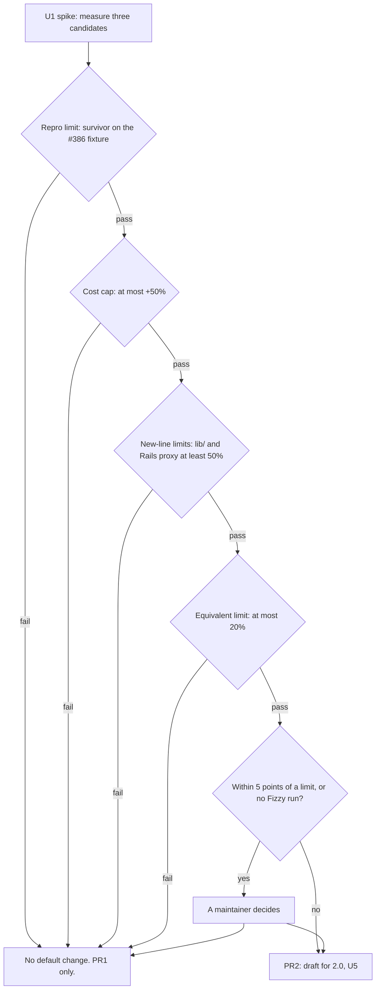

# Default mutants for bare if and rescue bodies - Plan

## Goal Capsule

**Ship method visibility in v1.9.0. Change the default operators only in 2.0, after the spike passes.**

- **What:** Count and list methods that receive no mutants from the selected operators.
- **Why:** Explain “no mutants” and give maintainers measured evidence for the default operator set.
- **How:** Count in the shared job plan (KTD3); use the spike to decide any 2.0 default change (KTD1, KTD7).

| Item | Plan |
|---|---|
| Issue | #386: a method containing one `if` or `rescue` expression receives no default mutants. |
| Authority | Follow this plan, then `AGENTS.md`, then issue #386. This plan controls differences; see “Corrections to the issue”. |
| Delivery | Standard depth. Two pull requests and one docs-only record. PR1 adds visibility in v1.9.0 and has its own gate (KTD13). PR2 changes defaults, stays a draft for v2.0, and exists only after a passing spike. |
| Stop conditions | Ask a maintainer if PR1 changes scores, exit codes, executed mutants or `MutatorRegistry::DEFAULT_NAMES`. Also ask for results within 5 percentage points of a limit, or a proposed 1.x default change. Also stop and ask if the base reports `schema_version` `2.0` because PR #244 (the 2.0 contract flip) merged first (KTD6). |
| Owners | The implementer owns tasks, tests and pull requests. A maintainer owns decisions, merges, releases and closure of #386 (KTD13). |
| Size | PR1: 4 files under `lib/`, 7 under `test/`, and 5 docs and contract files. PR2: about 25 files, mainly docs and pinned lists. |

---

## Product Contract

### Summary

PR1 counts methods with no mutants without changing scores. The human summary, dry run summary and JSON report show the count. JSON and `--dry-run --verbose` list the methods.

The spike measures `condition_true`, `condition_false` and a two-branch `condition_false` form against defined limits (KTD12). A passing candidate can enter the default set through draft PR2 for 2.0. Do not build the narrow rule or a rescue operator.

### Problem Frame

The five defaults are `arithmetic`, `comparison`, `boolean_connector`, `boolean_literal` and `statement_removal` (`lib/mutineer/mutator_registry.rb:60`). `statement_removal` skips a list’s last statement (`lib/mutineer/mutators/statement_removal.rb:17-18`). The others need arithmetic, comparison or boolean tokens. A single-expression method without these tokens receives no default mutants.

Fizzy’s `DayTimelinesScoped#day` has this shape. Its file receives no default mutants (probe 1), with no method warning. Vladimir found a survivor pointing to a real bug only through opt-in `condition_false`. See `vladimir-fizzy-report.md`, lines 36, 272 and 279.

The issue covers a small part of the gap (probe 2):

| Corpus | Methods | Zero default mutants | Of those, empty body | Of those, with a conditional or a def-level rescue |
|---|---|---|---|---|
| Mutineer `lib/` | 788 | 140 (17.8%) | 1 | 18 (12.9%) |
| Fizzy `app/models` and `app/controllers` (copy) | 1,177 | 700 (59.5%) | 32 | 102 (14.6%) |

R1, the method-count requirement, includes all 140 methods in `lib/` and all 700 in the Fizzy copy.

### Requirements

**Visibility (PR1, v1.9.0)**

| ID | Requirement |
|---|---|
| R1 | Count methods with zero mutants from selected operators, including empty methods. Count each method once across source path spellings. |
| R2 | Add the count to the dry run summary. Under `--verbose`, list each method with prefix `no mutants:` and no square brackets (KTD10). |
| R3 | Add a `No mutants:` human-summary row. State that it counts methods; name `--dry-run --verbose` and JSON as list sources. |
| R4 | Add JSON keys `summary.subjects`, `summary.unmutated_subjects` and top-level `unmutated_subjects`. Each array entry contains `subject`, `file` and `line`. Sort by file, line and subject. |
| R5 | When a real run finds methods but generates no mutants, include the method count and `--list-operators` in the warning. Support singular and plural forms. |
| R6 | Return the same count and list across in-process, `--daemon` and `--test-command` backends, with both strategies. |
| R7 | Under `--since`, count methods in scanned files. State that `--since` does not narrow the count. |
| R8 | In 1.x, preserve scores, exit codes, executed mutants and `MutatorRegistry::DEFAULT_NAMES`. |

**Default set decision (U1, PR2)**

| ID | Requirement |
|---|---|
| R9 | Before changing defaults, measure `condition_true`, `condition_false` and the two-branch form (KTD12) against KTD7 limits. |
| R10 | Ship default changes only in 2.0, through a draft pull request labelled `breaking change` and `v2.0`. |
| R11 | Promote a whole operator. Its mutants must not depend on another operator’s output. |

**Contract**

| ID | Requirement |
|---|---|
| R12 | Move `schema_version` one minor step per release (KTD6). Document new keys and lines in `docs/json-schema.md`, `STABILITY.md`, `README.md` and `CHANGELOG.md`. |
| R13 | Name both opt-in condition-forcing operators in `README.md`, with a list users can copy. |

**Added in review**

| ID | Requirement |
|---|---|
| R14 | Promote an operator only if it leaves a survivor on the #386 repro fixture. Its test never passes `day` (KTD7). |
| R15 | Give each remaining PR1 limitation a GitHub issue before PR1 opens. Cite each in `README.md` and the CHANGELOG entry (U4). |

### Acceptance Examples

| ID | Requirements | Expected result |
|---|---|---|
| AE1 | R1, R2 | A file contains `Day#day`, an `if`/`else` body with `rescue`, and `Day#total`, containing `a + b`. The default dry run prints `no mutants in 1 of 2 methods`. With `--verbose`, it prints `no mutants: Day#day`, file and line. |
| AE2 | R1 | The same run with `--operators condition_false --verbose` prints one `Day#day` mutation and no `no mutants: Day#day` line. |
| AE3 | R1 | A file containing only `def noop; end` prints `no mutants in 1 of 1 methods`. With `--verbose`, it prints one `no mutants:` line. Empty methods have no special rule. |
| AE4 | R5 | A real run on only `Day#day`, with a test, exits 0. Stderr includes `1 method was found, and the selected operators made no mutant in it`. With two such methods, it includes `2 methods were found, and the selected operators made no mutant in any of them`. |
| AE5 | R4 | JSON for the AE1 file gives `summary.subjects` 2 and `summary.unmutated_subjects` 1. The `unmutated_subjects` array contains one `Day#day` entry. |
| AE6 | R8 | `test/integration_test.rb` passes without edits in PR1. |
| AE7 | R1 | `collect_jobs` counts methods once across three source path spellings. Currently, `Project.discover` returns 21 subjects for 3 spellings of `lib/mutineer/mutant_id.rb`, versus 7 for one (probe r2). |

### Scope Boundaries

- Keep default operators unchanged in 1.x (KTD1).
- Do not build the narrow rule: condition forcing only where defaults otherwise produce no mutants (KTD2).
- Do not build a rescue operator (KTD9). Even all operators leave a one-statement rescue body unchanged. Document this limitation and its issue in `README.md` (U4).
- Leave the HTML report unchanged. It shows neither this count nor `declined`. Track the limitation through U4.
- Leave the GitHub Action step summary unchanged. It has no `declined` key (`action.yml:460-547`). A line on most runs adds noise: 17.8% of `lib/` methods have no default mutant. The Action’s JSON report carries the keys; U4 tracks the summary limitation. The sibling plan for #381, unpaired-source counts, adds a summary line because unpaired sources affect score meaning. Methods without mutants do not.
- Real runs exclude sources without paired tests before counting (`lib/mutineer/cli.rb:641-659`). #381 owns that count. Dry runs skip this removal and list those methods (`lib/mutineer/cli.rb:429`).
- `--since` does not narrow the count (KTD5). Track this through U4.
- Do not add a `default` name to `--operators` for `default,condition_false`. Lists currently replace defaults (“Endless range” section of `docs/equivalent-skips.md`). Revisit if users report that the five-name list blocks them.

#### Deferred to Follow-Up Work

File an issue for each item before PR1 opens (R15, U4 step 6). This plan files none. A maintainer must file them if the implementer cannot (Q6).

| Follow-up | Scope |
|---|---|
| `return_nil` and rescue bodies | One issue for both gaps. `return_nil` skips the final expression with a def-level `rescue` (Corrections, item 5). No operator mutates a one-statement rescue body; `grok-cursor/evidence/if-rescue-all.txt` has no mutant for `head :not_found`. KTD9 gives the rescue-operator counts. |
| HTML report | Add the missing `No mutants:` count. |
| Action step summary | Add the missing `No mutants:` count. |
| `--since` | Narrow the method count (Q2). |

### Corrections to the issue

1. **`main` gives 10 mutants, not 9.** At `8d9905c4`, the Fizzy file gives 7 in `#day` and 3 in `#set_day_timeline` (probes 1, r2). `grok-cursor/evidence/if-rescue-all.txt` contains only `#day`, so shows 7. The version that gave 9 is unverified.
2. **The gap extends beyond `if` and `rescue`.** The single assignment in `#set_day_timeline` also receives no default mutants (probe 1). Of 700 affected Fizzy methods, 598 contain neither a conditional nor def-level rescue; 32 are empty (probe 2).
3. **The Fizzy report requests no rescue operator.** It names the method shape (`vladimir-fizzy-report.md` line 36). For controllers, it suggests `condition_true`, `condition_false`, `chain_link` and `call_to_receiver` (line 279). The issue adds “Removal of a `rescue` clause body”.
4. **Real runs already warn when the entire run has zero mutants** (`lib/mutineer/cli.rb:803-818`). The issue’s dry run does not. Neither identifies methods; methods without mutants remain silent within larger runs.
5. **`return_nil` also skips `#day`.** Prism represents a def-level `rescue` body as `BeginNode` (probe 1). `ReturnNil#final_expression_nil` requires `StatementsNode` (`lib/mutineer/mutators/return_nil.rb:50-51`). The issue omits this gap.
6. **Split the release target.** The issue has `v1.9.0` and suggests 2.0 may be necessary. PR1 targets 1.9.0; the default change targets 2.0 (KTD1).
7. **Validation reports disagree.** The grok-cursor report supports a minor release; opus and Sol require 2.0 (each report’s row A10). KTD1 gives the 2.0 evidence.
8. **The survivor remains unverified.** The report says `if (false)` survives in `DayTimelinesScoped#day` (`vladimir-fizzy-report.md:272`). A Fizzy run is outside this plan’s scope.
9. **Only `condition_false` exposes this gap.** `#day` rescues only `ArgumentError` (Fizzy `app/controllers/concerns/day_timelines_scoped.rb:15-21`). Forced true without `day`, `Time.zone.parse(nil)` reaches `Date._parse(nil)` and raises `TypeError` (probe r4). A no-parameter test therefore kills `condition_true`. The issue offers either operator.
10. **Real runs exclude the Fizzy concern.** `Pairing.infer_tests` finds no test for `app/controllers/concerns/day_timelines_scoped.rb` (probe r3). `autopair!` removes it (`lib/mutineer/cli.rb:641-659`); dry runs skip autopair (`lib/mutineer/cli.rb:429`). #379, namespace-test pairing for concerns, and #381, unpaired-source counts, address this gap.

---

## Planning Contract

### Key Technical Decisions

- KTD1. **Default operator changes require 2.0.** `AGENTS.md` (“Releasing”) requires a major bump for Action default behaviour changes. The explicit registry list protects the default survivor set (`lib/mutineer/mutator_registry.rb:26-32`). Adding an operator changes every default run. The Action passes `--operators` only for an explicit input (`action.yml:386`).
  - Precedent: 1.8.0 changed default-run survivors in a minor release (`CHANGELOG.md:59-64`). #297, concern scoring under reload, and #275, counting repeated mutants once, also exposed new survivors with `--baseline`. Those changes preserved the operator set; this change alters its stated guard.
  - The 2.0 gem also reaches @v1 Action users. An empty `version` input (`action.yml:110-113`) runs `gem install mutineer --no-document` without a version limit (`action.yml:131-139`). The #244 branch, the 2.0 contract flip, leaves this unchanged. U5 therefore requires an Action-pin decision (Q9).
  - Reject a minor release with a “scores can change” note, despite the 1.8.0 precedent. The registry and Action contracts require 2.0.
  - Reject a patch release: this is not a fix.

- KTD2. **Promote a whole operator; reject the narrow rule.** The narrow rule forces conditions only in methods with no default mutants. Probe 2 and `probes/386/redesign/shape_count.out` compare costs:

  | Candidate | Added mutants, `lib/` | Added mutants, Fizzy copy | Zero-mutant methods it lifts |
  |---|---|---|---|
  | Narrow rule, both operators | +26 (+0.6%) | +234 (+21.8%) | 13 of 140, and 99 of 700 |
  | `condition_true` whole | +1,126 (+26.8%) | +370 (+34.5%) | the same 13 and 99 |
  | `condition_false` whole | +1,126 (+26.8%) | +370 (+34.5%) | the same 13 and 99 |
  | Both whole | +2,252 (+53.6%) | +740 (+69.1%) | the same 13 and 99 |
  | Two-branch form (KTD12) | +269 (+6.4%) | +136 (+12.7%) | Unverified. U1 counts it. |

  The narrow rule costs less but breaks operator independence (`lib/mutineer/mutators/condition_forcing.rb:21-26`). Adding `x + 1` would remove condition mutants, without an operator name explaining this behaviour. It still leaves 601 of 700 Fizzy methods without mutants, as each whole operator does. Only R1 to R5 cover those methods.
  - The two-branch form uses syntax alone, preserving R11. KTD12 includes it; its `elsif` share is approximate.

- KTD3. **Count in `JobPlan.collect_jobs`; return counts through its extras hash.** All backends and dry runs call it (`lib/mutineer/runner.rb:180`, `:255`; `lib/mutineer/daemon_backend.rb:55`; `lib/mutineer/cli.rb:900`). This covers both strategies. `lib/mutineer/migrate.rb:45` reads only `:id_map` and `:dropped_id_map`, so remains unaffected. Rejected: counting in `Reporter` from the results. A method with no mutants has no result row.

- KTD4. **List methods when the operator pass returns no mutations.** Check before suppression, duplicate removal and parsing. Include empty methods; excluding them adds special rules and hides 1 `lib/` method and 32 Fizzy methods. Do not list methods whose mutants are all ignored or invalid. List methods whose candidates are all declined; `declined` also counts those candidates.

- KTD5. **Keep the count outside `--since` narrowing and state this.** Follow `declined` (`lib/mutineer/cli.rb:939-946`). Reject def-line-range narrowing: it needs a new `JobPlan.scope_since` input across three backends (Q2).

- KTD6. **Bump the schema once per release.** `main` and `v1.8.1` report `1.9` (`lib/mutineer/reporter.rb:34`). The first additive change after `v1.8.1` sets `1.10`. Keep an existing, unreleased `1.10` and document the new keys. If the base reports `2.0` because PR #244 (the 2.0 contract flip) merged first, stop and ask a maintainer. The sibling plan for #381 (unpaired-source counts) uses the same rule. The #388 plan (errored mutants in JSON) keeps `2.0` instead; the maintainer settles that difference.

- KTD7. **Apply five limits to each candidate using unrounded values.**

  | Limit | Pass condition |
  |---|---|
  | Repro, required | Leave a survivor on the #386 fixture (R14). Its test calls `day` only without a parameter. Probe r4 predicts failure for `condition_true` (Corrections, item 9). |
  | `lib/` new-line share, required | At least 50% of candidate survivors have no default-operator survivor on their line. Require at least 20 candidate survivors from real runs. |
  | Rails new-line proxy, required | At least 50% of candidate mutants in the Fizzy copy have no default mutant on their line. Use two dry runs. Probe r1 gives 59.5% for each whole operator on Fizzy and 14.4% on `lib/`. A Fizzy survivor run replaces the proxy (Q7). Without one, refer a pass to a maintainer and state the missing measure. |
  | Equivalent share, required | At most 20% of triaged new-line survivors are equivalent. Triage at most 30; count unclassified survivors as equivalent. |
  | Cost cap, mutant-count proxy | Add at most 50% to valid default mutants in both corpora. This measures count, not runtime. No single candidate fails; “both whole” fails at +53.6% and +69.1% (KTD2). U1 repeats counts on its base commit. |

  The `lib/` limit exists because of twins. Forcing an else-less `if` false matches the `nil` replacement from `statement_removal`. Different text keeps both mutants (`lib/mutineer/mutators/condition_forcing.rb:21-26`). A twin survivor increases the score denominator without new information. Removable statements account for 66.3% of `lib/` conditionals and 23.8% on Fizzy (probe r1). Thus `lib/` alone is insufficient; the Rails proxy and repro limit cover the Fizzy shape.

- KTD8. **Promote at most one operator.** Both whole operators fail the cost cap together. If several candidates pass, select the one adding fewer mutants. The two-branch form adds fewest (KTD2). Require the repro and Rails limits, not only `lib/` results.

- KTD9. **Exclude a rescue operator.** Only 4 of 700 affected Fizzy methods have def-level rescue. Across 1,177 methods, 22 of 31 rescue clauses contain one statement or none (probe 2). Re-raise, `ensure` and rescue-modifier equivalence need a separate feature issue (R15).

- KTD10. **Use consistent names.** Extras and JSON use `:subjects` for all discovered methods and `:unmutated_subjects` for the list. Human output uses `No mutants:`. Dry run lines use `no mutants:` without brackets. Mutation lines retain `[<operator>]` (`lib/mutineer/cli.rb:919`), preserving scripts that count lines starting with `[`. JSON already uses `subject` in `survivors[]` for methods.

- KTD11. **Preserve warning order.** Put declined counts first, as `test/cli_test.rb:754` requires, then method counts. Keep generic “check that the sources contain code” text when no method was found.

- KTD12. **Test a two-branch `condition_false` form.** It covers `if` with `else` or `elsif`, ternaries, and `unless` with `else`. Its unused branch is not removal’s `nil`, so it produces no twin. Syntax alone determines selection, preserving R11 and covering #386. If it passes, give it a separate 2.0 operator name (Q8).
  - U1 needs no new operator code. A scratch script filters `condition_false` reports by shape.
  - Preserve `condition_false`: changing its meaning would silently remove opt-in mutants.

- KTD13. **Gate PR1 independently; keep #386 open until U1 records its result.** One reviewer opposed delaying PR1; two opposed closing #386 while 1.x retains the gap. Both conditions apply. PR1 uses `Refs #386`, not `Closes #386`. A separate docs-only pull request adds `## Spike Result` to this plan. A maintainer then closes #386 or moves it to `v2.0` (Q3). PR2 waits for that record.
  - Reject making PR1 wait for U1: visibility in v1.9.0 does not depend on the 2.0 decision.
  - Reject closing #386 through PR1: the Fizzy method still has no default mutant.

- KTD14. **Print per-method dry run lines only with `--verbose`.** Fizzy would otherwise gain 700 lines, covering 59.5% of methods (probe 2). Always print the summary count. Reuse `--verbose` (`lib/mutineer/cli.rb:168`); keep the complete JSON array.
  - Reject unconditional lines: most affected methods contain one line without an operator-detected gap.
  - Reject adding the count to `tier2_hint` (`lib/mutineer/cli.rb:819-831`); the human summary already contains `No mutants:`.
  - Cost: committed JSON baselines gain the array, although `lib/mutineer/baseline.rb:83` reads only survivors. New methods change baseline files, as existing arrays such as `no_coverage[]` already do.

- KTD15. **Include twins in the `lib/` survivor share.** Reject the reviewer proposal to count only non-twins. Twins reach users and increase the denominator; excluding them hides cost. The two-branch form prevents twins directly (KTD12).

### Assumptions

These planning assumptions have no user confirmation.

- The maintainer wants PR1 even if every spike candidate fails.
- Fizzy `app/models` and `app/controllers` at `f220e4832` represent a concern-heavy Rails app for static costs and the proxy.
- KTD7 limits (50%, 50%, 50%, 20%) remain proposals. A maintainer can change them before U1 starts (Q1).
- Copies of those folders suffice for static counts; the spike needs no Fizzy bundle.
- A stdlib fixture represents the Fizzy method. Both `Time.parse(nil)` and `Time.zone.parse(nil)` reach `Date._parse(nil)`, raising `TypeError` (probe r4). U1 step 2 checks this.

### High-Level Technical Design



Refer failures within 5 points to a maintainer too. U2, shared counting; U3, reports; and U4, contracts, remain independent of U1. PR1 has its own merge gate (KTD13).

### Evidence from the planning probes

Scripts and logs are under `/private/tmp/claude-501/-Users-davidteren-Projects-claude-worktrees-mutineer-vladimir-issues-planning-21adcb/ae564be8-638b-4dd0-a9e5-9d7a58cb00ae/scratchpad/context/probes/386/`. This local folder can disappear. U1 repeats the commands, so its absence blocks nothing.

| Probe | Evidence |
|---|---|
| Probe 1 (`probe1_repro.rb`) | Fizzy `app/controllers/concerns/day_timelines_scoped.rb` gives 0 default mutants and 10 with all operators. `#day` has a `Prism::BeginNode` body with one `RescueNode`; `return_nil` produces no mutant. |
| Probe 2 (`probe2_noise.rb`) | Static counts in Problem Frame, KTD2 and KTD9. |
| Probe 4 (`probe4_cli_dry_run.out`) | CLI totals match probe 2: 4,202 default mutants in `lib/`; 1,071 in Fizzy, matching its report. |
| Probes 3 and 5 (`probe3_killrate.sh`, `probe5_mutators.sh`, `probe_overlap.rb`) | Real runs on the two `lib/` slices below. |

| Slice | Operator set | Mutants | Killed | Survived | Exact score | Survivors on a new line |
|---|---|---|---|---|---|---|
| Self-dogfood (`config.rb`, `mutant_id.rb`, `baseline.rb`) | default | 240 | 201 | 33 | 85.90 | n/a |
| Self-dogfood | `condition_true` | 61 | 56 | 5 | 91.80 | 4 of 5 |
| Self-dogfood | `condition_false` | 61 | 51 | 9 | 85.00 | 1 of 9 |
| Self-dogfood | `condition_negation` | 61 | 61 | 0 | 100.00 | n/a |
| Self-dogfood | default and `condition_false` | 301 | 252 | 42 | 85.71 | n/a |
| Self-dogfood | default and both | 362 | 308 | 47 | 86.76 | n/a |
| `lib/mutineer/mutators/*.rb` | default | 222 | 203 | 19 | 91.44 | n/a |
| `lib/mutineer/mutators/*.rb` | `condition_true` | 58 | 50 | 8 | 86.21 | 3 of 8 |
| `lib/mutineer/mutators/*.rb` | `condition_false` | 58 | 54 | 4 | 93.10 | 0 of 4 |

Combined new-line shares are 7 of 13 (53.8%) for `condition_true` and 1 of 13 (7.7%) for `condition_false`. Both lack KTD7’s 20 survivors. Equivalent triage is incomplete. R13 omits `condition_negation` because it left no survivor.

Review probes are in `refute/` and `redesign/` within the same folder:

| File | Evidence |
|---|---|
| `r1_static_lines.out` | Condition mutants without a default mutant on their line: 14.4% in `lib/`, 59.5% in Fizzy. Shares in zero-default-mutant methods: 1.2% and 31.6%. Twin candidates: 66.3% and 23.8%. |
| `r2_cli.out` | One file gives 21 subjects across 3 path spellings, versus 7 for one. All 6 calculator methods receive one default mutant. |
| `r3_pairing.out` | `Pairing.infer_tests` returns `[]` for the Fizzy concern. |
| `r4_parse_nil.out` | `Date._parse(nil)` raises `TypeError`. |
| `shape_count.out` | Two-branch conditionals: 269 of 1,126 in `lib/`; 136 of 370 in Fizzy. |

---

## Implementation Units

### PR1: Report the methods with no mutants (v1.9.0)

No dependencies. Use `Refs #386` (KTD13).

### U1. Noise spike: condition forcing as a default operator

| Item | Contract |
|---|---|
| Goal | Decide whether `condition_true`, `condition_false` or the two-branch form becomes a 2.0 default. |
| Requirements | R9, R11, R14. |
| Dependencies | None. PR1 does not wait (KTD13). |
| Question | Does a candidate meet KTD7? |
| Time box | 6 hours. Any unmeasured limit means “no default change”; name the missing measure. |

**Method:** Run from the repo root. Prefix commands with `LANG=en_US.UTF-8 LC_ALL=en_US.UTF-8`. Set:

```sh
SCRATCH=$(mktemp -d)          # all spike output goes here; nothing goes into the repo
FIZZY=/path/to/fizzy          # a local Fizzy checkout, branch vova/sfruby-mutation at f220e4832
D=arithmetic,comparison,boolean_connector,boolean_literal,statement_removal
```

In step 6, `$OPS` holds the operator list. `$NAME` labels it: `default`, `condition_true` or `condition_false`.

1. Record `git rev-parse HEAD`. For step 9, use a base containing #391, the Rails class-body reload fix.
2. Build the #386 fixture in `$SCRATCH`. In `day_param.rb`, define `DayParam#day` using stdlib: `if @params[:day]`, then `Time.parse(@params[:day])`, otherwise `Time.now`. Add `rescue ArgumentError`, returning `:not_found`. In `day_param_test.rb`, assert that `DayParam.new({}).day` returns a `Time`; never pass `day`. First confirm `Time.parse(nil)` raises `TypeError` with `ruby -rtime -e 'Time.parse(nil)'`.
3. Run each candidate and record whether it leaves a survivor.

   ```sh
   for OPS in condition_true condition_false; do
     bundle exec bin/mutineer run "$SCRATCH/day_param.rb" --test "$SCRATCH/day_param_test.rb" \
       --operators "$OPS" --format json --output "$SCRATCH/repro_$OPS.json"
   done
   ```

   Use the `condition_false` result for the two-branch form: `#day` has `if` and `else`.
4. Measure `lib/` cost from each dry run’s final line.

   ```sh
   bundle exec bin/mutineer run lib --dry-run | tail -1
   bundle exec bin/mutineer run lib --dry-run --operators "$D,condition_true" | tail -1
   bundle exec bin/mutineer run lib --dry-run --operators "$D,condition_false" | tail -1
   ```

5. Measure Fizzy cost and the Rails proxy on a copy. Do not run Mutineer inside the Fizzy checkout.

   ```sh
   mkdir -p "$SCRATCH/fizzy/app"
   cp -R "$FIZZY/app/models" "$FIZZY/app/controllers" "$SCRATCH/fizzy/app/"
   bundle exec bin/mutineer run "$SCRATCH/fizzy/app/models" "$SCRATCH/fizzy/app/controllers" --dry-run > "$SCRATCH/fizzy_default.txt"
   bundle exec bin/mutineer run "$SCRATCH/fizzy/app/models" "$SCRATCH/fizzy/app/controllers" --dry-run \
     --operators condition_false > "$SCRATCH/fizzy_condition_false.txt"
   ```

   Calculate the share of `condition_false` lines whose `file:line` is absent from `fizzy_default.txt`. Repeat for the two-branch subset in step 7. `condition_true` uses the same lines (probe r1).
6. Run each `lib/` slice three times, with `OPS` set to `$D`, `condition_true` and `condition_false`.

   ```sh
   bundle exec bin/mutineer run lib/mutineer/config.rb lib/mutineer/mutant_id.rb lib/mutineer/baseline.rb \
     --test test/config_test.rb --test test/mutant_id_test.rb --test test/baseline_test.rb \
     --operators "$OPS" --format json --output "$SCRATCH/dogfood_$NAME.json" --cache-dir "$SCRATCH/cache_$NAME"
   ```

   The second slice is `lib/mutineer/mutators/*.rb`, with one `--test` per file in `test/mutators/`. Add slices until each candidate has 20 survivors or none remain. Exclude slices whose unit tests start `bin/mutineer`.
7. Compare candidate `survivors[]` with `$D` `survivors[]` from the same slice. A new-line survivor has no default survivor with the same `file` and `line`. For the two-branch form, use a Prism script in `$SCRATCH`. Keep `condition_false` survivors whose `file`, `line` and `token` match a two-branch conditional (KTD12).
8. Triage at most 30 new-line survivors per candidate as test gaps or equivalent mutants. Equivalent means no test can distinguish mutant from original, such as a guard that only saves time.
9. Record the exact self-dogfood score with defaults and each added candidate. `.github/workflows/ci.yml:217-234` requires 85.
10. On a scratch branch, add the candidate to `DEFAULT_NAMES`. Run `bin/dogfood` in `test/fixtures/rails_app`, then `bundle exec rake test:daemon`. On `main`, both require 100% across files containing 4 conditionals (`test/fixtures/rails_app/bin/dogfood:40-41`, `test/rails_dogfood_daemon_test.rb:36`). #391 adds `shipment` and `trackable` fixtures, with a `bin/dogfood` check for 0 survivors. Record failed gates. Delete the scratch branch.

**Pass and fail:** Require every KTD7 gating limit. Refer results within 5 percentage points, including failures, to a maintainer. Refer a pass without a Fizzy survivor run to a maintainer too (Q7).

| Outcome | Action |
|---|---|
| One candidate passes | Prepare PR2 through U5. |
| Several pass | Select through KTD8, then U5. |
| None passes | Do not create PR2. A maintainer closes #386, the bare `if` or `rescue` default gap, with PR1 as the answer. R13’s README guidance remains the branch-logic answer. |
| Fewer than 20 survivors | Do not create PR2. Record the insufficient sample. |

**Record:** Add `## Spike Result` to this plan through a separate docs-only pull request (KTD13). Include the base commit, all measurements, triage list and outcome. Merge no spike code; keep scripts in `$SCRATCH`.

**Test expectation:** None. The spike changes no behaviour.

### U2. Count the methods with no mutants in the job plan and the dry run

| Item | Contract |
|---|---|
| Goal | Return counts and lists from `collect_jobs`; display them in dry runs. |
| Requirements | R1, R2, R6, R7, AE1, AE2, AE3, AE7. |
| Dependencies | None. |

**Files:**

| File | Location |
|---|---|
| `lib/mutineer/job_plan.rb` | `collect_jobs`, lines 66-137; doc comment, lines 26-65. |
| `lib/mutineer/runner.rb` | `execute` extras documentation, lines 52-56. |
| `lib/mutineer/cli.rb` | `dry_run`, lines 898-930; new helper beside `declined_summary`, lines 939-946. |
| Tests | `test/runner_test.rb`, `test/cli_test.rb`, `test/daemon_backend_contract_test.rb`. |

**Approach:**

1. Count unique subjects in `collect_jobs`, keyed by `[id_path, def start offset]`, like `name_decls` (`lib/mutineer/job_plan.rb:76-79`). `Project.discover` repeats subjects across path spellings (probe r2). The CLI removes duplicate paths (probe r2d), but `collect_jobs` already protects IDs. Use the same key for `unmutated_subjects` when `mutations` is empty (KTD4).
2. Store qualified name, `subject.file` and def line. Other JSON arrays also use `subject.file` (`lib/mutineer/reporter.rb:737-750`).
3. Sort once by file, line and name. Return both values in extras; preserve order in dry runs and reports.
4. Add `; no mutants in N of M methods` to the dry run summary, directly after the declined clause. If the #381 plan (unpaired-source counts) has landed, put it before that plan’s unpaired clause. The #381 tests require the line to end with the unpaired clause, so either merge order then passes. Add “not narrowed” under `--since` (KTD5). With `--verbose`, print `no mutants:` entries after mutation lines (KTD14).
   - Without `--test`, the dry-run count includes sources that a real run skips as unpaired (#381). So it can be larger than `summary.subjects` for the same arguments. Optionally, after #381 lands, use its shared pairing helper to drop unpaired sources from this count.

**Patterns to follow:** Reuse `collect_jobs`’s `declined` counter, lines 87 and 95, and CLI `declined_summary`. Define the Fizzy repro as a named constant in `test/cli_test.rb`, like `HEREDOC_CONDITION` at line 715.

**Test scenarios:** Each fails before this unit unless stated otherwise.

| Test | Assertions |
|---|---|
| `test_collect_jobs_lists_methods_with_no_mutants` (`runner_test`) | A temp file contains Fizzy-shaped `Day#day`, `Day#total` with `a + b`, and empty `Day#noop`. Defaults give `extras[:subjects]` 3. `extras[:unmutated_subjects]` lists `Day#day` and `Day#noop`, with file and def line. Before: keys are absent. |
| `test_collect_jobs_lists_no_method_an_operator_reaches` (`runner_test`) | With only `condition_false`, the same file lists `Day#total` and `Day#noop`, but excludes `Day#day`. |
| `test_collect_jobs_lists_a_method_whose_candidates_were_all_declined` (`runner_test`) | Use the heredoc source at `test/runner_test.rb:913`. With only `condition_true`, list the method and assert `extras[:declined]` is `{ "condition_true" => 1 }`. Adding `arithmetic` mutates `a + b`, so excludes the method. |
| `test_collect_jobs_does_not_list_a_method_with_only_ignored_mutants` (`runner_test`) | `a + b`, `# mutineer:disable-line` and `arithmetic` give an empty list. |
| `test_collect_jobs_sorts_unmutated_subjects` (`runner_test`) | Reverse-ordered files return entries sorted by file, then line. Repeated runs produce identical JSON bytes. |
| `test_collect_jobs_counts_a_method_once_across_path_spellings` (`runner_test`) | AE7: three spellings of `lib/mutineer/mutant_id.rb` give the same `:subjects` as one. |
| `test_dry_run_counts_methods_with_no_mutants` (`cli_test`) | AE1: print `no mutants in 1 of 2 methods`. Print `no mutants: Day#day` only with `--verbose`. Use `assert_includes`, not an end-of-line match, so either merge order with #381 passes. |
| `test_dry_run_with_condition_false_mutates_the_bare_if` (`cli_test`) | AE2: with `--verbose`, print `[condition_false] Day#day`, but no `no mutants: Day#day` line. |
| `test_dry_run_labels_unmutated_methods_under_since` (`cli_test`) | Use a git project like `test_dry_run_labels_declined_under_since`, line 731. Put `not narrowed by --since` beside the count. |
| `test_dry_run_prints_breakdown` (`cli_test`, line 705) | Add `assert_includes out, "no mutants in 0 of 6 methods"`. All 6 calculator methods receive a default mutant (probe r2). |
| Parity test, `test/daemon_backend_contract_test.rb:572-587` | Assert daemon and external extras match `collect_jobs` for `:subjects` and `:unmutated_subjects`. This detects dropped keys, not CLI display errors. |

**Verification:** All three test files pass. At probe base `8d9905c4`, `lib/` prints `no mutants in 140 of 788 methods`. With `--verbose`, it prints 140 `no mutants:` lines.

### U3. Show the count in the JSON report, the human summary and the empty-run warning

| Item | Contract |
|---|---|
| Goal | Report counts and lists in real runs. |
| Requirements | R3, R4, R5, R7, AE4, AE5. |
| Dependencies | U2. |

**Files:**

| File | Location |
|---|---|
| `lib/mutineer/reporter.rb` | `report`, lines 62-71; `human_report`, lines 155-162; `json_report`, from line 213; `summary`, lines 797-819. |
| `lib/mutineer/cli.rb` | `execute`, lines 759-763; `warn_empty_run`, lines 803-818. |
| Tests | `test/json_reporter_test.rb`, `test/reporter_test.rb`, `test/cli_test.rb`. |

**Approach:**

1. Add `subjects:` with default 0 and `unmutated_subjects:` with an empty-list default to `report`. Pass them through like `declined:`. The #381 plan passes `unpaired:` through `Reporter.new` because its share warning needs the value inside `report`. Keep each choice; do not mix both forms for one value.
2. Add both summary keys and the top-level array in `json_report`. Give each an additive-key comment naming the schema version and #386.
3. After `Declined:`, add `No mutants:   N       (methods of M that the selected operators did not mutate; --dry-run --verbose and the JSON report list them)`. With `scoped: true`, append `; not narrowed by --since` to the note, like `Declined:`.
4. Pass both extras from `execute` to `reporter.report`.
5. Extend `warn_empty_run` in KTD11 order. Use `1 method was found, and the selected operators made no mutant in it` or `N methods were found, and the selected operators made no mutant in any of them`. Then name `--list-operators`. The declined text already handles both forms (`lib/mutineer/cli.rb:810-811`). The #381 plan adds a first branch for unpaired mutants when none ran. When that branch applies, it prints instead, and this message and its method count do not print. Keep `test_empty_run_names_unpaired_mutants` from #381 green.

**Patterns to follow:** Use `declined:` in `report`, `human_report` and `json_report`, plus `summary`’s `Declined:` row.

**Test scenarios:**

| Test | Assertions |
|---|---|
| `test_summary_reports_unmutated_subjects` (`json_reporter_test`) | AE5: render `subjects: 2` and one entry. Assert `summary["subjects"]` 2, `summary["unmutated_subjects"]` 1, and top-level `unmutated_subjects` containing `subject`, `file`, `line`. Before: unknown keyword. |
| `test_unmutated_subjects_default_to_none` (`json_reporter_test`) | Without keywords, both summary values are 0 and the array is `[]`. Before: keys are absent. |
| `test_human_summary_has_a_no_mutants_line` (`reporter_test`) | With `subjects: 5` and two entries, assert `No mutants:   2       (methods of 5 that the selected operators did not mutate; --dry-run --verbose and the JSON report list them)`. With `scoped: true`, require ending `; not narrowed by --since)`. Before: unknown keyword. |
| `test_empty_run_names_unmutated_methods` (`cli_test`) | AE4: a project containing only `Day#day` and its test exits 0. Require `1 method was found, and the selected operators made no mutant in it` and `--list-operators`. Exclude `Check that the sources contain code`. With two methods, require `2 methods were found, and the selected operators made no mutant in any of them`. |
| `test_empty_run_names_declined_candidates` (`cli_test`, line 748) | Pass without edits, preserving KTD11 warning order. |
| `test_json_report_carries_unmutated_subjects` (`cli_test`) | Add Fizzy-shaped `note` to a calculator-fixture copy. With the strong test, JSON gives `summary.unmutated_subjects` 1 and a `Calculator#note` entry. |

**Verification:** Two runs of one project produce identical JSON. `test/integration_test.rb` passes unchanged (AE6).

### U4. Schema version, docs, CHANGELOG and tracking issues

| Item | Contract |
|---|---|
| Goal | Document new keys and lines; track every remaining limitation. |
| Requirements | R12, R13, R15. |
| Dependencies | U3. |

**Files:**

| File | Change |
|---|---|
| `lib/mutineer/reporter.rb` | Update `SCHEMA_VERSION`, line 34, under KTD6. |
| Version-pinning tests | Only if KTD6 changes `"1.9"`: `test/json_reporter_test.rb:61`, `test/baseline_test.rb:254`, `test/cli_test.rb:917`, `test/cli_test.rb:1328`, `test/equivalent_mutant_test.rb:308`. |
| `docs/json-schema.md` | Update version examples, lines 14 and 36, and top-level shape, lines 34-48. Add two `summary` rows after `declined_by_operator`, line 64, and an `unmutated_subjects[]` section. State: counting precedes suppression; empty methods count; `--only` narrows counts, but `--since` does not; real runs exclude unpaired sources. Add `unmutated_subjects[]` ordering by `(file, line, subject)` at lines 8-10. State that without `--test`, the dry-run method count includes sources a real run skips as unpaired (#381). It can be larger than `summary.subjects` for the same arguments. In “Versioning contract”, if the base does not have it yet, add: compare `schema_version` as two integers, major then minor, so `1.10` follows `1.9`. Whichever of the #381, #386 and #388 plans lands first adds it. |
| `rake/docs_contract.rb` | Add the heading to `HEADING_IDS`, the hash at line 13, and its id to `TOC_LABELS`. `test/docs_contract_test.rb:182-194` rejects missing entries. |
| `STABILITY.md` | Set line 16 to “`schema_version` `1.10` (1.8.1 reports `1.9`)” if the base does not have it yet. Leave line 114 as it is, because it states a past fact. After maintainer confirmation of Q5, add a default-operator contract row. |
| `README.md` | In Operators, lines 214-221, explain `No mutants:`. Name `condition_true` and `condition_false`, which the Fizzy report recommends for controllers. Add a copyable `operators:` list, following `range` in the “Endless range” section of `docs/equivalent-skips.md` (find it by heading; the #399 docs plan inserts a subsection above it). Cite the rescue-body limitation and issue. |
| `CHANGELOG.md` | Under `## [Unreleased]`, `### Added`, add #386. Name the dry run count, `--verbose` lines, `No mutants:` row, three JSON keys and schema version. State that scores remain unchanged; cite step 6 issues. |

**Approach:**

1. to 5. Update the listed files.
6. Before PR1 opens, file or cite issues for every item in “Deferred to Follow-Up Work”. Cover the combined `return_nil` and rescue-body gap, HTML count, Action summary count and `--since` narrowing. Use existing labels. If filing is unavailable, stop and ask a maintainer (Q6).

**Test scenarios:**

| Test | Check |
|---|---|
| `test/docs_contract_test.rb:152-156` | Already checks that `STABILITY.md` names `SCHEMA_VERSION`. |
| `test_json_schema_html_carries_markdown_source_content` (`test/docs_contract_test.rb:182-194`) | Checks the new heading and id. |
| Prose | No test required. |

**Verification:** Docs contract tests pass. `bundle exec rake site:build` includes the new schema rows.

### PR2: Add the passing operator to the default set (v2.0, draft)

Require U1’s passing record (KTD13), PR1 merged on `main`, and a 2.0 base containing PR1.

`AGENTS.md` (“Release policy for agents”, item 5) requires a separate draft for breaking changes. Apply `breaking change` and `v2.0`.

### U5. Promote the operator that passed the spike

| Item | Contract |
|---|---|
| Goal | Run the passing operator when `--operators` is absent. |
| Requirements | R10, R11, R14. |
| Dependencies | Passing U1; U2 to U4 merged. |

**Preconditions:**

- Include PR1 in the base. Existing 2.0 branches predate #291, excluded-mutant counts, and return only `{ id_map: }` from `collect_jobs` (`origin/feat/v2-breaking-flip:lib/mutineer/job_plan.rb:101`). Without PR1’s `no mutants:` output, `test_dry_run_gives_the_bare_if_a_default_mutant` cannot run. Rebase the maintainer-selected line on `main` if needed (Q4), or stop and ask.
- Include #391, the Rails class-body reload fix, and its gate fixtures.
- Before leaving draft, obtain maintainer confirmation of an @v1 Action `~> 1` install limit or tracking in #284, 2.0-default preconditions. Otherwise, a maintainer files an issue and links it from #284 (Q9).

**Files:**

| File | Change |
|---|---|
| `lib/mutineer/mutator_registry.rb` | Update `DEFAULT_NAMES`, `TIER2_NAMES`, lines 59-65, and class comment, lines 26-32. For the two-branch form, update `ALL`. |
| `lib/mutineer/mutators/condition_forcing.rb` | Update “(Tier-2)” comments, lines 7, 113 and 125. For the two-branch form, add a named class (Q8) and its test under `test/mutators/`. |
| `test/mutator_registry_test.rb` | Update pinned defaults, lines 32-35, and tier list, lines 81-89. |
| `test/cli_test.rb` | Update `test_list_operators_shows_default_and_disabled`, lines 127-134. |
| `test/integration_test.rb` | Update Scenario A, lines 43-58. Bare `if`/`else` method `Pricing#total` gains one mutant (probe 4). Pin the exact score and survivor set. |
| `test/fixtures/day_param.rb`, `test/fixtures/day_param_test.rb` | Copy U1 step 2 fixtures. Add an oracle scenario to `test/integration_test.rb`. |
| `.github/workflows/ci.yml` | Set the self-dogfood threshold, lines 216-234, from U1 step 9. Update job name `self-dogfood (threshold 85)`, line 217. |
| `README.md:5` | Update badge URL `at%20least%20N%25` and alt text `mutation score at least N%`. `test/docs_contract_test.rb:95-104` pins both to the threshold. |
| Rails gates failing in U1 step 10 | Update `test/fixtures/rails_app/bin/dogfood`, including #391’s `shipment` and `trackable` check; `test/rails_dogfood_daemon_test.rb`; #391 fixture tests; and strong tests under `test/fixtures/rails_app/test/models/`. Add assertions for surviving new mutants. Keep every 100% gate. |
| Operator-count rows | Update “5 by default, 16 opt-in” in `README.md:149` and `docs/comparison.md:35`. `test/docs_contract_test.rb:160-174` pins the README row. A new operator name also changes the opt-in count. If #397 (class-body macro mutants) has merged, its formula in `test/docs_contract_test.rb` already derives the counts. Then update only the README and `docs/comparison.md` numbers. |
| Default-set docs | Update `README.md:220-221`, `docs/index.md:102`, `docs/index.html:233`, `docs/cli.md:11`, `:51` and `:91`, `docs/ci.md:143`, `docs/quick-start.md:49`, the “Endless range” section of `docs/equivalent-skips.md` (find it by heading; the #399 docs plan inserts a subsection above it), its committed twin `docs/equivalent-skips.html`, and `action.yml:52`. |
| `STABILITY.md`, `CHANGELOG.md` | Add one “2.0 changes” item in `STABILITY.md`, lines 81-126, and one 2.0 CHANGELOG entry. |

**Approach:**

1. Move the selected name from `TIER2_NAMES` to `DEFAULT_NAMES`. For the two-branch form, first add its class and name. `mutineer init` reads `DEFAULT_NAMES` (`lib/mutineer/init.rb:83`), so new configs receive the list.
2. Preserve existing operator mutants. Explicit `--operators` selection must produce the same mutants and IDs.
3. Explain three migration paths in CHANGELOG. Existing `.mutineer.yml` `operators:` lists, including those from `mutineer init`, remain unchanged until edited. `--baseline` users need a new full baseline. Users wanting the old set must pass its five names.
4. Use the maintainer-selected 2.0 branch (Q4) after all preconditions hold.

**Test scenarios:**

| Test | Assertions |
|---|---|
| `test_default_names_constant` (`mutator_registry_test`) | Pin six names. Before: five. |
| `test_list_operators_shows_default_and_disabled` (`cli_test`) | The operator prints `tier 1` and `default`. |
| `test_dry_run_gives_the_bare_if_a_default_mutant` (`cli_test`) | Use U2’s `Day#day` constant, no `--operators`, and `--verbose`. Require one mutation line and no `no mutants: Day#day`. |
| `test_day_param_survivor` (`integration_test`) | Defaults leave exactly one survivor in the new fixture pair: the selected operator’s forced condition in `DayParam#day`. This is the #386 exact-survivor oracle. |
| `test_pricing_boundary_survivor` (`integration_test`) | Pin Scenario A’s new exact values. |
| `test_readme_badges_match_the_self_dogfood_threshold` (`test/docs_contract_test.rb:95-104`) | Pass with the new threshold. |
| `test/docs_contract_test.rb:160-174` | Every page lists every operator. |
| Old operator set | Explicitly selecting the five old operators preserves calculator-fixture IDs. |

**Verification:** Pass the full local gate on the 2.0 base. Pass `bundle exec rake test:daemon` and `bin/dogfood`, covering reload, redefine and daemon execution. Pass self-dogfood at its new threshold.

---

## Verification Contract

Prefix ruby, rake and bundle commands with `LANG=en_US.UTF-8 LC_ALL=en_US.UTF-8` when those variables are unset.

| Command | Applies to | Proves |
|---|---|---|
| `bundle exec rake test` | PR1, PR2 | The zero-dependency suite, including new tests, passes. |
| `ruby -Ilib -e 'require "mutineer"'` | PR1, PR2 | The gem loads. |
| `bundle exec rake yard:strict` | PR1, PR2 | Documentation reaches 100%. Document the new CLI helper and changed doc comments. |
| `bundle exec rake site:build`, then `node --test test/site_test.js` | PR1, PR2 | Schema and README changes build. |
| `bundle exec rake test:daemon` | PR2 | Rails fixtures pass with the new defaults. |
| `bundle exec bin/mutineer run lib --dry-run \| tail -1` | PR1 | At probe base `8d9905c4`, the summary prints `no mutants in 140 of 788 methods`; total mutants remain 4,202. |
| The self-dogfood command in `.github/workflows/ci.yml:226-234` | PR2 | The slice meets its new-default threshold. |

| Pull request | Labels and release scope |
|---|---|
| PR1 | Match #386: `enhancement`, `priority: medium` (medium priority), `risk: medium` (medium risk), `v1.9.0`. A feature requires a minor bump. |
| PR2 | Apply `enhancement`, `priority: medium`, `risk: medium`, `breaking change`, `v2.0`. Keep draft status. Changing Action defaults requires a major bump. |

Use existing labels only. This plan does not tag, publish or merge a release.

## Definition of Done

- PR1: All U2 and U3 tests exist, fail before their unit, and pass afterwards.
- PR1: Scores, exit codes, executed mutants and `DEFAULT_NAMES` remain unchanged. Existing tests pass unchanged, except KTD6’s `"1.9"` pins and one added assertion in `test_dry_run_prints_breakdown`.
- PR1: Dry run, human and JSON reports show counts. In-process, daemon and external backends agree.
- PR1: The reporter, `docs/json-schema.md` and `STABILITY.md` follow KTD6 for `schema_version`.
- PR1: Every “Deferred to Follow-Up Work” item has an issue cited in `README.md` or CHANGELOG (R15).
- PR1: The body uses `Refs #386`, not `Closes #386` (KTD13).
- U1: A docs-only pull request adds `## Spike Result` to this plan, including base commit, measurements and outcome.
- #386, the bare `if` or `rescue` default gap: U1’s record exists; a maintainer closes it or moves it to `v2.0`. If U1 passes, a new 2.0 issue exists and #284 links it (Q3).
- PR2, if U1 passes: Keep draft status and both required labels. The exact-survivor oracle pins new values.
- Both diffs exclude spike scripts, dead code and abandoned attempts.

---

## Risks and Overlaps

| Item | Overlap | Handling |
|---|---|---|
| Sibling plan for #381 (count sources skipped for having no paired test) | Adds `summary` keys; edits `Reporter#summary`, `json_report`, `docs/json-schema.md`, `rake/docs_contract.rb`; adds an Action summary line. | Text conflicts only. Both use `1.10` under KTD6. Whichever plan lands first adds the integer-comparison rule (U4). #381 owns unpaired-source methods. Scope Boundaries explains this plan’s summary exclusion. Both edit `warn_empty_run` and the dry-run summary. Put the method-count clause before the #381 unpaired clause (U2 step 4). In `warn_empty_run`, the #381 unpaired branch comes first and replaces this plan’s message (U3 step 5). Tests use `assert_includes`, not end-of-line matches. |
| #397 (class-body macro mutants) | Adds subjects with no `def_node` when a macro operator is selected. Its KTD5 also keys ordinals on `subject.node` (`lib/mutineer/job_plan.rb:100`). | `summary.subjects` and `unmutated_subjects` count methods only. Whichever plan lands second skips subjects without `def_node` in the count. It adds one `collect_jobs` test with `macro_removal` selected. |
| #379 (pair a concern with its namespace test) | The Fizzy concern is unpaired (probe r3), so real runs exclude it. | Until #379 lands, only dry runs list `DayTimelinesScoped#day`. |
| Sibling plan for #388 (errored mutants in the JSON report) | Adds JSON keys in the same release. | Uses `1.10` under KTD6. Text conflicts affect only five `"1.9"` test pins. |
| #349 (measure the declined count and unrun share on a real Rails app) | Measures Fizzy. | U1 step 5 provides static counts, not the #349 run. |
| #362 (`--dry-run` ignores `--format json`) | Dry runs lack machine output. | R2 uses text. If #362 lands first, include the list in its JSON output. |
| Pull request #391 (the reload fix for Rails class bodies) | Adds Rails fixtures and strict `bin/dogfood` checks for `shipment` and `trackable`. | Include #391 in U1 step 10’s base. U5 covers its fixtures. |
| Pull request #393 (a mutant is invalid only when it adds a parse error) | Changes `Mutation#valid?` in `lib/mutineer/mutation.rb`. | Static totals can shift by a few mutants. Record U1’s base commit. |
| Pull request #375 (place a hook-block mutant before the rest of its file loads) | Edits a `lib/mutineer/job_plan.rb` comment. | Text conflict only. |
| Pull request #395 (the Action asks the CLI for the cache folder) | Edits `lib/mutineer/cli.rb` outside `dry_run` and `warn_empty_run`. | Text conflict only. |
| Pull request #369 (warn on a random test order) | Edits `lib/mutineer/cli.rb` outside `dry_run` and `warn_empty_run`. | Text conflict only. |
| Pull request #244 (the 2.0 contract flip) and pull request #245 (parallel Rails by default) | Rewrite `cli.rb`, `job_plan.rb` and `reporter.rb`. #244 sets `schema_version` to `2.0`. Both predate #291; their `collect_jobs` returns only `{ id_map: }`. | Merge PR1 to `main`, then rebase the 2.0 line to carry its keys. Base PR2 there (Q4, U5 preconditions). If #244 merges first, stop and ask (KTD6). |
| #284 (preconditions for the 2.0 defaults) | Tracks default changes in 2.0. | After a U1 pass, a maintainer adds this operator change (Q3). |
| @v1 Action users get the 2.0 gem | Empty `version` installs the latest gem (`action.yml:131-139`). | Apply U5’s precondition and Q9. |
| Empty full scans fail in 2.0 (`STABILITY.md:94-99`) | The Fizzy file alone has no default mutants, so fails without `--allow-empty`. | R5 explains the cause. A passing U5 adds a mutant. |
| Self-dogfood threshold | Current score is 85.90 against 85; a default operator changes it. | U1 step 9 records the score. U5 updates threshold, job name and README badge. |
| Equivalent mutants | Forcing a time-saving guard is equivalent. `docs/equivalent-skips.md` has no condition-forcing entry. | Measure through KTD7. A failing equivalent share stops PR2. |
| Twin survivors | 12 of 13 `condition_false` survivors share a line with a default survivor (probes 3 and 5). | Apply KTD7’s `lib/` new-line limit. The two-branch form prevents twins (KTD12). |
| Noise of the new lines | Fizzy dry runs find 700 methods without mutants. | Print method lines only with `--verbose` (KTD14). The `no mutants:` prefix permits filtering. |

## Open Questions

None blocks PR1. Q3, issue placement; Q4, base branch; Q8, operator name; and Q9, Action pinning, gate PR2.

| ID | Question | Default and owner |
|---|---|---|
| Q1 | Are KTD7 limits correct: 50% `lib/` new-line share, 50% Rails proxy, 20% equivalent share, 50% cost cap? | Yes. A maintainer decides before U1 starts. |
| Q2 | Should `--since` count only methods containing a changed line? | No. State that counts are not narrowed (KTD5). A maintainer decides. |
| Q3 | Where does a passing 2.0 change live, and when does #386 close? | After U1’s record, a maintainer closes #386, the bare `if` or `rescue` default gap. The maintainer opens a new issue labelled `breaking change` and `v2.0`, linked from #284, 2.0-default preconditions. Alternative: move #386 to `v2.0`. |
| Q4 | Which branch is PR2’s base? | The branch for pull request #244, the 2.0 contract flip, rebased on `main` after PR1 and #391. A maintainer decides. |
| Q5 | Should `STABILITY.md` promise an unchanged default operator set across minor releases? | Yes. Add one contract-table row in PR1. A maintainer must confirm this new public promise before PR1 merges. |
| Q6 | Who files “Deferred to Follow-Up Work” issues? | The implementer, before PR1 opens (U4 step 6). This plan files none. Without implementer GitHub write access, a maintainer must file them before PR1 merges. |
| Q7 | Should candidates run on Fizzy itself? | Yes, on the 13 controller concern files when a working setup exists. The finding came from controllers; `lib/` has none. Results replace KTD7’s Rails proxy. Without a run, refer a pass to a maintainer. A maintainer decides. |
| Q8 | What names the two-branch operator if it passes? | `condition_false_two_branch`. A maintainer decides before U5. |
| Q9 | Must @v1 Action installs use `~> 1` before RubyGems receives 2.0.0? | Yes. A maintainer adds the work to #284 or files an issue, and decides before PR2 leaves draft. |
