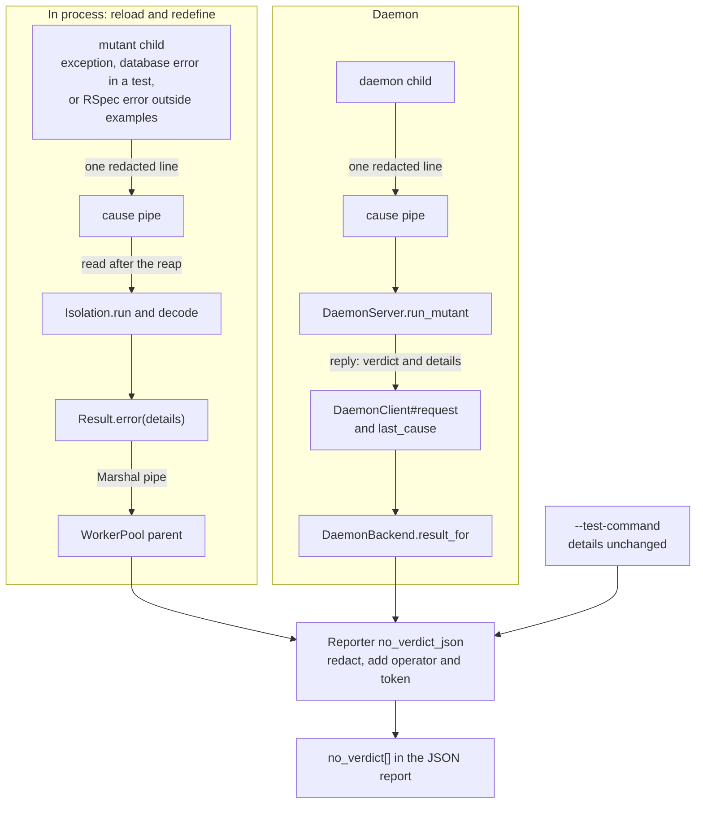

# Name the cause of each errored mutant in the JSON report - Plan

## Goal Capsule

- **Issue:** #388 (the JSON report has no list of errored mutants and no error message for them).
- **Objective:** a person or a script that reads the JSON report can tell why an errored mutant has no verdict. For a crash in the mutant's child, the report names the exception. Stderr is not needed for that.
- **Means:** the mutant's child sends one redacted cause line to its parent, and `no_verdict[].details` carries it (KTD1, KTD2).
- **Authority:** this plan, then `AGENTS.md`, then the text of #388. Where this plan differs from the issue, this plan wins (see "Corrections to the issue").
- **Stop and ask when:** a change would alter a verdict, the score or an exit code. Stop when a maintainer says the new `details` text needs a major version. Stop when a cause line cannot be redacted before it leaves the child.
- **Size:** M. About 29 files: 9 under `lib/` (1 new), 16 under `test/` (3 new), and 4 docs files. No new runtime dependency.
- **Delivery:** one pull request. Labels: `enhancement`, `priority: medium`, `risk: low`, `v1.9.0`. Semver class: minor, because the JSON report gains keys. A person merges it. No release step is part of this plan.

---

## Product Contract

### Summary

When a mutant's child ends with an error, it sends one cause line to its parent. The line holds the exception class and the first line of the message. It is redacted and at most 500 characters long. `no_verdict[].details` carries that line on the in-process path (reload and redefine) and on the daemon path. Each `no_verdict[]` entry also gains `operator` and `token`. The report gains no new top-level array, because `no_verdict[]` already lists every errored mutant.

### Problem Frame

Vladimir Dementyev ran Mutineer on Fizzy, a Rails 8 app. His report (linked from #388) lists four different causes of errored mutants. They are a shared database, a concern loaded twice, an enum declared twice, and a callback skipped twice. Issue #388 says that the diagnosis needed stderr.

The JSON report names each errored mutant, but its `details` text is generic. In process it is `child exited with status 2` (`lib/mutineer/isolation.rb:373`). On the daemon it is `daemon verdict: error` (`lib/mutineer/daemon_backend.rb:509`). The exception class and message go only to stderr (`lib/mutineer/isolation.rb:70`, `lib/mutineer/daemon_server.rb:368`). A script cannot tell one cause from another.

The reporter already tells users to read `no_verdict[]` "for the cause of each" (`lib/mutineer/reporter.rb:92`, `:96`). The docs say `details` names the failure, "a daemon crash, say" (`docs/json-schema.md:155`). Neither is true today for a crash in a mutant's child. The plan for #296 (an in-test database error scores `error`) deferred this gap (`docs/plans/2026-10-24-296-fix-in-test-db-error-verdict-plan.md:76`).

### Terms

- **Cause line:** one line that says why a mutant's child ended with an error. Its form is `Class: first line of the message`.
- **Errored mutant:** a mutant with the status `error`. It is counted in `summary.errored` and listed in `no_verdict[]` with `status: "error"`.

### Requirements

**Cause line**

- R1. A cause line is `Class: text`. `text` is the first line of the exception message that is not blank, with no spaces at its ends.
- R2. When the message is blank, or equal to the class name, the cause line is the class name alone.
- R3. The child redacts the class name and the message with `Redaction.text` before it cuts the line. No cause line crosses a pipe without redaction.
- R4. A cause line is at most 500 characters. A longer line is cut to 500 characters and ends in `...`. A prefix that mutineer adds counts toward the limit.
- R5. Building or sending a cause line never raises, and never changes the child's exit status.

**In-process runs (reload and redefine)**

- R6. When a mutant's child ends with an unhandled exception, `details` is the cause line of that exception.
- R7. The first failed Minitest test can have a database connection or lock error. Then `details` is `a test failed with a database error: ` plus the cause line of that error.
- R8. When RSpec reports an error outside its examples and no example failed, `details` is the fixed text in KTD5.
- R9. A child that exits with status 2 and sends no cause line keeps `child exited with status 2`. A child that a signal ended keeps `unexpected exit status: nil`. A timeout keeps `details: null`.
- R10. A worker crash keeps its `worker crashed: ` prefix. The text after the prefix follows R1 to R3. The whole text follows R4.
- R11. A process that the child forks cannot send a cause line for the child.

**Daemon runs**

- R12. The daemon reply for an `error` verdict carries the cause line under a new optional key, `details`. R6 and R7 hold on the daemon too.
- R13. When the daemon crashed or stopped answering, `details` is `daemon crashed` or `daemon stopped answering`.
- R14. When the daemon gives no cause, `details` stays `daemon verdict: error`.

**JSON report**

- R15. Each `no_verdict[]` entry gains `operator` and `token`, with the meaning they have in `no_coverage[]`. Both are `null` on an entry that has no mutation.
- R16. The reporter passes each `details` text through `Redaction.text` before it writes the JSON. A `null` stays `null`.
- R17. `schema_version` moves by one minor step (KTD7). `docs/json-schema.md`, `docs/results.md`, `STABILITY.md` and `CHANGELOG.md` describe the change.

**Unchanged**

- R18. No verdict, score or exit code changes. The `[mutineer-child]` and `[daemon-child]` stderr lines still print, with the same text.

### Acceptance Examples

- AE1. Covers R6, R15. The fixture class in U2 raises `ArgumentError` when its body runs twice. A `--strategy reload --format json` run reports 1 errored mutant and exits 0. Its entry has `details: "ArgumentError: Once::LOADED is already defined (this class body cannot run twice)"`, `operator: "arithmetic"` and a 12-character `id`. The same run with `--strategy redefine` reports 0 errored and 1 killed.
- AE2. Covers R12. A daemon payload of `NoSuchConstantXYZ.definitely_missing` gives the verdict `error`. Its cause line starts with `NameError: uninitialized constant NoSuchConstantXYZ`.
- AE3. Covers R3, R4. `DATABASE_URL` is `postgres://u:s3cret@ho st/db`, and the child raises `no connection: ` plus that URL. `details` holds `[REDACTED]` and does not hold `s3cret`.
- AE4. Covers R9. A child whose block returns 2 gives `details: "child exited with status 2"`.
- AE5. Covers R13. A daemon that never replies gives the verdict `error` and `details: "daemon stopped answering"`.

### Scope Boundaries

- No new top-level `errored` array (KTD1, Q2).
- No change to `--test-command` details. That backend already says what it knows (`lib/mutineer/external_backend.rb:186`, `:192`, `:209`, `:214`). The exception text is only in the command's output, and mutineer does not parse that output (Q4).
- No change to `--dry-run`. A dry run runs no mutant, so it has no errored mutant.
- No change to the GitHub Action. `action.yml:476` reads only `summary.no_verdict`.
- No structured `error_class` key (Q5).
- Considered and not built: a text for a child that a signal ended. Today's text stays on both paths (R9, R14). A user report that needs the signal number would change this call.

#### Deferred to Follow-Up Work

- The human and HTML reports show only the errored count (`lib/mutineer/reporter.rb:802`, `:363`). They list no errored mutant and no cause. The implementer files a follow-up issue and names it in the pull request (Q3).
- A `--matrix` run that scores `error` through the early-end rule gets a fixed text (KTD5). It does not carry the class of the database error. The same follow-up issue tracks that limit.

### Corrections to the issue

- The issue says the JSON has "no errored mutant IDs". That is wrong. `no_verdict[]` lists every errored mutant with `subject`, `file`, `line`, `id`, `status: "error"` and `details` (`lib/mutineer/reporter.rb:278-280`, `:779-788`, `docs/json-schema.md:150-163`). Probes A and C show such an entry.
- The issue lists `no_verdict` among the top-level keys, but it does not say what the key holds.
- The issue asks for a new `errored` array. The real gaps are the text of `details` and the missing `operator` key (`lib/mutineer/reporter.rb:780-787`).
- The issue says exception text appears "only on stderr". That is right for a child crash in process and on the daemon. It is not complete. A worker crash already puts `worker crashed: Class: message` in `details` (`lib/mutineer/worker_pool.rb:78`), and `--test-command` gives its own details.
- The issue names one source of an `error`, the child exception. There are two more. One is a database error inside a test (`lib/mutineer/minitest_integration/in_test_database_error.rb:116-123`). The other is an RSpec error outside examples (`lib/mutineer/test_runners/rspec.rb:70-74`).
- "Bump the schema version per policy" needs a value. The tags v1.8.0 and v1.8.1 already report `1.9` (`git show v1.8.1:lib/mutineer/reporter.rb`, line 34). The next minor is `1.10`.
- "Runtime behaviour was not checked." Probes A to D checked it (see "Probe results").
- The issue does not name #347. The plan for #296 says #347 tracks the cause in `no_verdict[].details`. Not checked: the text of #347, because it is not in the context folder and this job avoids `gh` (Q6).

---

## Planning Contract

### Key Technical Decisions

- KTD1. **Enrich `no_verdict[]`. Add no `errored` array.** A consumer filters `no_verdict[]` on `status == "error"`. Rejected: a top-level `errored[]`, as the issue asks. It would repeat entries that `no_verdict[]` already holds, as `uncapturable[]` does. The reporter comment at `lib/mutineer/reporter.rb:266-271` says why the key is named for the condition.
- KTD2. **A second pipe per mutant fork carries the cause line.** The fork boundary opens the pipe. The child writes one line. The parent reads without blocking after it reaps the child, and takes the last complete line. Probe B verifies this. Rejected: capturing the child's stderr, because stderr stays open for the user's own output (`lib/mutineer/isolation.rb:37-38`). Rejected: the `--matrix` kill channel, because it exists only with `--matrix` (`lib/mutineer/isolation.rb:52`). Rejected: a temp file per mutant, because it adds disk writes and one more orphan to sweep.
- KTD3. **One stdlib-only module owns the cause line and the pipe.** New `Mutineer::ChildCause` in `lib/mutineer/child_cause.rb`, beside `ChildStdout` and `ChildCoverage`. The daemon must load it without Prism (`lib/mutineer/daemon_server.rb:22-27`). It keeps the armed pipe and the armed process id as process state, as `InTestDatabaseError` keeps `armed_pid`. The process id check gives R11. Rejected: passing the pipe through `TestRunners` and `MinitestIntegration.run`, because that changes three method signatures for one writer. The name has no `Error` suffix, because the module is not an exception class.
- KTD4. **`DaemonClient#request` still returns the verdict word.** A new reader, `last_cause`, gives the cause of the last request that returned `error`. The class already keeps per-request state this way (`@timed_out`, `lib/mutineer/daemon_client.rb:409`, read at `:389`). Each client serves one thread at a time (`lib/mutineer/daemon_backend.rb:358-366`). Rejected: a `[verdict, details]` return value. One caller in `lib/` and 21 lines in `test/` call or stub `request` as a verdict word (`git grep -n '\.request(' -- lib test`).
- KTD5. **Two sources with no exception object get a fixed text.**
  - The `--matrix` early-end rule (`lib/mutineer/isolation.rb:172`): `a test failed with a database error, then the child ended before the suite finished`. The child never reached the code that names the error, and a later crash would name the wrong cause.
  - An RSpec error outside examples: `RSpec reported an error outside its examples, for example a spec file that raised while it loaded`. `run` sends it, so `failure_code` keeps no side effect. Not checked: whether RSpec gives that exception through a public API.
- KTD6. **Redact at the source and at the sink.** The child redacts (R3), so no secret crosses the pipe or reaches a Marshal payload. The reporter redacts again (R16). That covers a source that does not redact (`worker result unreadable`, `lib/mutineer/worker_pool.rb:145`) and every later source. Rejected: sink only, because the daemon reply would cross a process boundary with the secret in it.
- KTD7. **Schema version: one minor bump per release.** Read `SCHEMA_VERSION` on the base branch and in the latest release tag. The tag v1.8.1 reports `1.9`. If the base says `1.9`, set `1.10`. If the base already says `1.10`, keep it and add these keys to the `1.10` docs. If PR #244 (the 2.0 contract flip) merged first, keep `2.0` while no tag reports it. Rationale: `docs/json-schema.md:16-17` asks for a minor bump per additive change, and two unreleased changes ship as one version.
- KTD8. **The limit is 500 characters, and it is a constant.** The two longest sample causes are 172 and 196 characters: the Rails enum error and the shared-database error (`lib/mutineer/daemon_server.rb:257-258`). The cut is by characters, after redaction, so it cannot split a password from its URL. `lib/mutineer/minitest_integration/in_test_database_error.rb:157-159` states the same order.
- KTD9. **The new `details` text is not a breaking change.** The key keeps its type and its documented meaning, "the cause where there is one" (`docs/json-schema.md:155`). The CHANGELOG names the change under `### Changed`. Rejected: a new key beside `details`, because two keys for one cause would disagree with the docs.
- KTD10. **Add `token` with `operator`.** The issue asks for `operator` only. `docs/json-schema.md:146` says `operator` and `token` together name the change. One entry shape for every mutant list costs one line, through `diff_for` (`lib/mutineer/reporter.rb:756-769`).

### Assumptions

These are bets that no user confirmed.

- A consumer accepts new text in `details` (KTD9).
- A consumer reads `"1.10"` as the minor after `"1.9"` (Q1).
- One line of 500 characters is enough to tell causes apart (KTD8).
- The `v1.9.0` label on #388 is still the target release.

### High-Level Technical Design

What `details` holds for an `error` entry after this change:

| How the mutant got `error` | `details` | Requirement |
|---|---|---|
| The child raised | `Class: first line` | R6, R12 |
| The first failed Minitest test had a database error | `a test failed with a database error: Class: first line` | R7 |
| RSpec error outside examples | the fixed text in KTD5 | R8 |
| `--matrix` early-end rule | the fixed text in KTD5 | KTD5 |
| The child exited 2 with no cause | `child exited with status 2`, or `daemon verdict: error` on the daemon | R9, R14 |
| A signal ended the child | `unexpected exit status: nil`, or `daemon verdict: error` on the daemon | R9, R14 |
| The daemon crashed or stopped answering | `daemon crashed` or `daemon stopped answering` | R13 |
| A pool worker crashed | `worker crashed: Class: first line` | R10 |
| `--test-command` | unchanged | Scope Boundaries |

### Probe results

Scripts and output are in `/private/tmp/claude-501/-Users-davidteren-Projects-claude-worktrees-mutineer-vladimir-issues-planning-21adcb/ae564be8-638b-4dd0-a9e5-9d7a58cb00ae/scratchpad/context/probes/388/`. That folder is on the planning machine only. If it is gone, the plan still holds: each probe is small enough to write again.

| Probe | Question | Result |
|---|---|---|
| A, `probe_a_current_details.rb` | What does `details` hold today, and which keys does a `no_verdict[]` entry have? | A child that raised `ArgumentError` gives `child exited with status 2`. A block that returns 2, or calls `exit 2`, gives the same text. A SIGKILL gives `unexpected exit status: nil`. The daemon mapping gives `daemon verdict: error`. The entry keys are `subject, file, line, id, status, details`. |
| B, `probe_b_error_pipe.rb` | Can a second pipe carry one line, read without blocking after the reap? | All 8 checks pass on arm64 macOS, Ruby 3.4.9. A grandchild that holds the write end does not delay the parent (0.002 s). A killed child and a line with no newline give no cause. A 1,949-byte line does not block. The pipe and the read add 0.14 ms per fork over 300 forks. |
| C, `probe_c_cli_repro.sh` | Does a class body that cannot run twice give a real errored mutant? | `--strategy reload`: 1 errored, `details` is `child exited with status 2`, and stderr has the `[mutineer-child] ArgumentError` line. `--strategy redefine`: 1 killed, 0 errored. |
| D, `probe_d_output.txt` | Does `lib/mutineer/daemon_server.rb` load without Prism today? | Yes. It loads 6 mutineer files, and `Prism` stays undefined. |

Not checked:

- Linux. The probes ran on macOS only. CI runs the suite on both.
- The daemon path against a real Rails app. `rake test:daemon` is a heavy run, and the brief forbids it.
- The real Fizzy errors. PR #391 (the reload fix for Rails class bodies) removes them, and the brief forbids a daemon run on Fizzy. The fixture in U2 has the same shape.

---

## Implementation Units

### U1. The cause line and its pipe

**Goal:** one stdlib-only module builds a cause line, sends it from a child, and reads it in the parent.

**Requirements:** R1, R2, R3, R4, R5, R11.

**Dependencies:** none.

**Files:**

- `lib/mutineer/child_cause.rb` (new): module `Mutineer::ChildCause` and its limit constant. It requires only `redaction.rb`.
- `test/child_cause_test.rb` (new).

**Approach:** the module does four things (KTD2, KTD3).

1. Build the line from an exception, per R1 to R4. On any failure, return `Redaction::FAILED`.
2. Arm: remember the pipe's write end and the current process id. The child calls this once, after the fork.
3. Report: write one line when this process is the armed one. Cut it per R4. Never raise.
4. Read: take every byte that is ready, without blocking. Return the last complete line, or nothing.

Keep to the syntax of `lib/mutineer/child_stdout.rb` and `lib/mutineer/redaction.rb`: the app's Ruby can be older than 3.4.

**Patterns to follow:** `Redaction.describe` (`lib/mutineer/redaction.rb:114-118`) for the never-raise rule. `KillChannel.emit` (`lib/mutineer/kill_channel.rb:266-280`) for a write that never raises. `Isolation.drain` (`lib/mutineer/isolation.rb:126-134`) for the read.

**Test scenarios** (each fails before with a `LoadError` on the new file):

- `test_line_names_the_class_and_the_message`: `ArgumentError.new("enum declared twice")` gives `ArgumentError: enum declared twice`.
- `test_line_uses_the_first_line_that_is_not_blank`: a message of two newlines, `Migrations are pending.`, then a second line gives `RuntimeError: Migrations are pending.`.
- `test_line_is_the_class_alone_without_a_message`: `IOError.new` gives `IOError`. An empty message gives the class name too.
- `test_line_is_cut_to_the_limit`: a 2,000-character message of a 4-byte character gives 500 characters. The line ends in `...` and is valid UTF-8.
- `test_line_hides_the_database_password`: covers AE3. Reuse the URL value at `test/isolation_test.rb:536`.
- `test_line_is_redacted_before_the_cut`: `DATABASE_URL` is unset. A `RuntimeError` message has 467 filler characters, then that URL. The line holds no `s3c`. A cut before redaction leaves `s3c` in the line, so the test fails for the wrong order. With `DATABASE_URL` set to that URL, both orders pass, and the test proves nothing.
- `test_line_fails_closed`: an error whose `message` raises gives `Redaction::FAILED`.
- `test_a_reported_line_reaches_the_parent`: a forked child arms, reports `X: y` and ends with `exit!`, as both fork boundaries do. The parent reads `X: y`. `exit!` flushes no buffer, so this test fails for a buffered write.
- `test_report_does_nothing_when_not_armed`: a report in the test process raises nothing and writes nothing.
- `test_a_grandchild_cannot_report`: the armed child forks a grandchild that reports, waits for it, and exits. The parent reads nothing.
- `test_read_ignores_a_line_with_no_newline`.
- `test_read_takes_the_last_complete_line`: two lines give the second.
- `test_read_does_not_block_on_an_open_empty_pipe`: the write end stays open, and the read returns nothing inside a 2-second timeout.
- `test_the_daemon_server_still_loads_without_prism`: a fresh Ruby requires `lib/mutineer/daemon_server.rb` and then `lib/mutineer/child_cause.rb`. `Prism` stays undefined. This test passes before U3 and guards it.

**Verification:** the new test file passes. `bundle exec rake yard:strict` stays at 100%.

### U2. Carry the cause on the in-process path

**Goal:** an in-process `error` result names its cause, under reload and under redefine.

**Requirements:** R6, R7, R8, R9, R10, R18, AE1, AE3, AE4.

**Dependencies:** U1.

**Files:**

- `lib/mutineer/isolation.rb`: `run` (lines 51-118), `decode` (369-376), and the early-end line in `finish` (172).
- `lib/mutineer/minitest_integration/in_test_database_error.rb`: `exit_code` (116-123) and its doc comment.
- `lib/mutineer/test_runners/rspec.rb`: `run`, at the line that calls `failure_code` (60).
- `lib/mutineer/worker_pool.rb`: the crash text (line 78).
- `test/fixtures/reload_error/once.rb` and `test/fixtures/reload_error/once_test.rb` (new): the class and test from probe C.
- Tests: `test/isolation_test.rb`, `test/test_runners/minitest_test.rb`, `test/test_runners/rspec_test.rb`, `test/worker_pool_test.rb`, `test/cli_test.rb`.

**Approach:**

1. `Isolation.run` opens the cause pipe before the fork. The child closes the read end and arms the module. The parent closes the write end. An `ensure` closes both ends.
2. The child's `rescue Exception` branch reports the cause line. It still prints the `[mutineer-child]` line (R18).
3. After the reap, the parent reads the cause and gives it to `decode`. Do this at both `decode` calls (lines 90 and 101). Status 2 uses the cause when there is one (R9). A timeout result does not read.
4. `finish` line 172 builds the `error` result with the first fixed text in KTD5.
5. `InTestDatabaseError.exit_code` reports the R7 text when it returns 2. Its stderr line does not change.
6. `RSpec.run` reports the second fixed text in KTD5 when `failure_code` is 2.
7. `WorkerPool` builds its crash text from the cause line (R10).

Strategy does not matter here: reload and redefine both run inside `Isolation.run` (`lib/mutineer/runner.rb:381-406`).

**Patterns to follow:** the kill-channel pipe in `Isolation.run` (lines 52-55, 80-82, 114-118). The fixtures are files, as the "repro becomes fixture" rule asks. `Rakefile:23` keeps `test/fixtures/` out of the suite's own test list.

**Test scenarios:**

- `test_unhandled_exception_names_its_cause` (isolation_test): a block that raises `ArgumentError, "enum declared twice"` gives `details == "ArgumentError: enum declared twice"`. Fails before: the text is `child exited with status 2`.
- `test_exit_two_without_a_cause_keeps_its_text` (isolation_test): covers AE4. A block that returns 2, and one that calls `exit 2`, give `child exited with status 2`. Passes before and after. It guards R9.
- `test_signal_death_and_timeout_keep_their_details` (isolation_test): a SIGKILL gives `unexpected exit status: nil`. A timeout gives `nil`. Passes before and after.
- `test_cause_hides_the_database_password` (isolation_test): covers AE3. The setup of the test at line 535, with the assertion on `result.details`.
- `test_a_long_cause_is_cut` (isolation_test): a 5,000-character message gives 500 characters.
- `test_a_grandchild_with_the_pipe_open_does_not_delay_the_result` (isolation_test): the block forks a child that sleeps 3 seconds, then raises `boom`. The result comes back inside 2 seconds with `RuntimeError: boom`.
- `test_a_matrix_child_that_raises_names_its_cause` (isolation_test): with `channel: true`, a block that sends `start` and raises gives `error`, `RuntimeError: boom` and an incomplete row.
- `test_error_diagnostic_reaches_stderr_after_block_swaps_streams` (line 115) and `test_error_diagnostic_hides_the_database_password` (line 535) pass unchanged. They prove R18.
- `test_database_error_names_its_cause` (minitest_test): `db_error_verdict({ "FIRST" => "connection" }, matrix: false)` gives `a test failed with a database error: ActiveRecord::ConnectionNotEstablished: the database is gone`. The same call with `matrix: true` gives the same text. Fails before.
- `test_matrix_early_end_has_the_fixed_text` (minitest_test): `{ "FIRST" => "connection", "SECOND" => "exit" }` with `matrix: true` gives the first fixed text in KTD5. Fails before: `details` is nil.
- `test_spec_file_that_raises_while_loading_scores_error_not_killed` (rspec_test, line 102) gains an assertion: `details` is the second fixed text in KTD5. `test_failed_example_still_kills_when_an_error_outside_examples_follows` passes unchanged.
- `test_worker_crash_details_are_one_line` (worker_pool_test): a block that raises `"first\nsecond"` gives `worker crashed: RuntimeError: first`. `test_worker_crash_details_hide_the_password` (line 143) passes unchanged.
- `test_json_names_the_cause_of_an_errored_mutant` (cli_test): covers AE1. Copy the two fixtures to a temp project. Run `run once.rb --test once_test.rb --operators arithmetic --jobs 1 --format json` with each strategy. Reload: exit 0, `summary.errored == 1`, the `details` text of AE1, and the `[mutineer-child] ArgumentError` line on stderr. Redefine: `summary.errored == 0` and `summary.killed == 1`. Fails before on the `details` text.

**Verification:** the five test files pass. The Minitest 6 suite passes too, because this unit changes the Minitest integration.

### U3. Carry the cause on the daemon path

**Goal:** a daemon `error` result names its cause, and a daemon failure says which kind it was.

**Requirements:** R12, R13, R14, R18, AE2, AE5.

**Dependencies:** U1. U2 gives the database-error text (R7) that the daemon child also sends.

**Files:**

- `lib/mutineer/daemon_server.rb`: the `require` list (lines 3-9), the protocol comment (line 40), and `run_mutant` (341-386).
- `lib/mutineer/daemon_client.rb`: `request` (115-137) and the new reader `last_cause`.
- `lib/mutineer/daemon_backend.rb`: `job_result` (442-447) and `result_for` (504-511).
- Tests: `test/daemon_redaction_test.rb`, `test/daemon_shared_databases_test.rb`, `test/daemon_client_deadline_test.rb`, `test/daemon_backend_contract_test.rb`, and `test/daemon_client_test.rb` (runs in `rake test:daemon`).

**Approach:**

1. `run_mutant` opens the cause pipe before the fork. The child closes the read end and arms the module. The `rescue` branch reports the cause line and still writes the `[daemon-child]` line.
2. After `wait_verdict`, the daemon reads the cause. The reply gains `"details"` only for the verdict `error` with a cause (R12).
3. `request` clears `last_cause` at its start. An `error` reply sets it from `"details"`. The crash branch sets the R13 text before `restart!`, from the same flag that `restart!` prints (`lib/mutineer/daemon_client.rb:389`).
4. `job_result` passes `last_cause` to `result_for` for an `error` verdict. `result_for` keeps today's text as the fallback (R14).

**Execution note:** start with the failing zero-dependency `run_mutant` test. It proves the pipe inside the daemon before any Rails run.

**Patterns to follow:** `test_child_error_log_hides_the_password` (`test/daemon_redaction_test.rb:111-126`) drives `run_mutant` with a fake worker database. The stand-in daemon child in `test/daemon_client_deadline_test.rb:17-26`.

**Test scenarios:**

- `test_child_error_reply_names_the_cause` (daemon_redaction_test): the setup of line 111. The reply has `"details" == "RuntimeError: routing failed for postgres://u:[REDACTED]@ho st/db"`. The reply and the log hold no `s3cret`. Fails before: the reply has no `"details"`.
- `test_a_parallel_fork_watches_sql_before_the_check` (daemon_shared_databases_test, line 89) gains two assertions. The `error` reply's `"details"` starts with `RuntimeError: shared database used during a parallel run: cable.`. The `survived` reply has no `"details"` key.
- `test_request_scores_error_and_respawns_when_the_daemon_never_replies` (daemon_client_deadline_test, line 43) gains `assert_equal "daemon stopped answering", @client.last_cause`. Covers AE5.
- `test_request_keeps_the_cause_of_an_error_reply` (daemon_client_deadline_test): a stand-in daemon answers each request with `verdict: "error"` and `details: "ArgumentError: x"`. `request` returns `"error"`, and `last_cause` is `ArgumentError: x`. A later `killed` reply gives `last_cause == nil`.
- `test_a_closed_pipe_is_a_daemon_crash` (daemon_client_deadline_test): the stand-in daemon exits before it replies. `last_cause` is `daemon crashed`. Stub `restart!`, as the test at line 43 does, so no real daemon starts.
- `test_a_crash_running_one_mutant_is_an_error_verdict_on_both_paths` (daemon_backend_contract_test, line 238): the fake client gains `last_cause`, which returns nil. The `daemon verdict: error` assertion stays (R14).
- `test_a_daemon_cause_reaches_the_result_on_both_paths` (daemon_backend_contract_test): the fake returns `"error"` and a `last_cause` of `ArgumentError: enum`. `results[0].details` is that text under `run_serial` and under `run_parallel`.
- `test_daemon_reports_structured_verdicts` (daemon_client_test, line 40): covers AE2. After request 3, `last_cause` matches the AE2 text. After request 4, it is nil.
- `test_in_test_database_error_is_error_not_killed` (daemon_client_test, line 61): after request 2, `last_cause` is `a test failed with a database error: ActiveRecord::ConnectionNotEstablished: gone`. The stderr assertion at the end stays.

**Verification:** the four zero-dependency test files pass. `bundle exec rake test:daemon` passes with the fixture app's bundle.

### U4. The JSON entry, the schema version and the docs

**Goal:** each `no_verdict[]` entry names its mutant in full, and the contract documents the change.

**Requirements:** R15, R16, R17, AE1.

**Dependencies:** U2, U3.

**Files:**

- `lib/mutineer/reporter.rb`: the `require` list (lines 3-6), `no_verdict_json` (779-788), the comment above the `no_verdict:` key (266-277), and `SCHEMA_VERSION` (34).
- Tests: `test/json_reporter_test.rb`, `test/cli_test.rb`.
- Tests that pin `"1.9"`: `test/baseline_test.rb:254`, `test/cli_test.rb:917`, `test/cli_test.rb:1328`, `test/equivalent_mutant_test.rb:308`, `test/json_reporter_test.rb:61`.
- `docs/json-schema.md`, `docs/results.md`, `STABILITY.md`, `CHANGELOG.md`.

**Approach:**

1. `no_verdict_json` adds `operator` and `token` (KTD10). It redacts `details` when it is not nil (R16).
2. Set `SCHEMA_VERSION` per KTD7. Every `1.10` below means the version that KTD7 gives.
3. `docs/json-schema.md`:
   - The version example (line 14) and the shape block (line 36).
   - The `errored` row (line 65) says each one is in `no_verdict[]` with `status: "error"`.
   - The `no_verdict[]` section (lines 150-163) gets the new entry shape and the table from "High-Level Technical Design".
   - The same section says `details` is one line of at most 500 characters for a child cause.
   - The same section says `details` can hold run-specific text, such as an object address or a temp file name. Two runs with equal verdicts can then differ in `details`.
   - The same section says redaction hides database passwords only. An exception message can hold another secret, so treat the report as you treat the run's log.
   - Mark `operator`, `token` and the new texts "schema `1.10`, #388".
4. `docs/results.md:13`: the Errored row says the JSON report names the cause in `no_verdict[].details`.
5. `STABILITY.md:16`: the schema version, per KTD7, with the note that 1.8.1 reports `1.9`.
6. `CHANGELOG.md` under `## [Unreleased]`:
   - `### Added`: `no_verdict[]` entries gain `operator` and `token` (schema `1.10`, #388).
   - `### Changed`: `no_verdict[].details` names the cause of an errored mutant. Name the two old texts that a cause now replaces (KTD9).

**Patterns to follow:** `mutant_json` (`lib/mutineer/reporter.rb:737-750`) for `operator` and `token`. `matrix_row_json` (`:507-516`) for nil-safe access. The `1.9` rows in `docs/json-schema.md:60-64` for the "Additive key" wording.

**Test scenarios:**

- `test_no_verdict_entries_name_the_mutant` (json_reporter_test): an `error` result and a `timeout` result, each with the subject and `mutation_at(">=", ">", :comparison)`. Each entry has `operator == "comparison"` and `token == ">="`. Fails before: the keys are absent.
- `test_no_verdict_entry_without_a_subject_still_appears` (line 113) gains two assertions: `operator` and `token` are nil.
- `test_no_verdict_details_hide_the_database_password` (json_reporter_test): with the URL of AE3 in `DATABASE_URL`, an `error` result whose details quote the URL gives `[REDACTED]` and no `s3cret`. A `timeout` entry keeps `details` nil, not an empty string. Fails before: the password is in the JSON.
- `test_json_names_the_cause_of_an_errored_mutant` (cli_test, from U2) gains the rest of AE1: `operator == "arithmetic"`, a `token` that is not empty, and a 12-character `id`.
- The five `"1.9"` pins move to the KTD7 version, with the comment beside each.
- `test/docs_contract_test.rb:106-110` and `:152-156` already check that the docs and `STABILITY.md` name `SCHEMA_VERSION`. Test expectation for the prose: none, it is documentation.

**Verification:** the JSON of two runs of the calculator fixture stays byte-identical. The docs contract tests pass. `bundle exec rake site:build` shows the new rows.

---

## Verification Contract

Prefix every ruby, rake and bundle command with `LANG=en_US.UTF-8 LC_ALL=en_US.UTF-8` in a shell where they are unset.

| Command | Why |
|---|---|
| `bundle exec rake test` | The zero-dependency suite, with every new test in U1, U2 and U4, and the zero-dependency tests in U3. |
| `ruby -Ilib -e 'require "mutineer"'` | The load smoke. |
| `bundle exec rake yard:strict` | 100% documented. The new module, its methods, its constant and `last_cause` each need a doc comment. |
| `BUNDLE_GEMFILE=gemfiles/minitest6.gemfile bundle install`, then `BUNDLE_GEMFILE=gemfiles/minitest6.gemfile bundle exec rake test` | U2 changes the Minitest integration. |
| `bundle exec rake test:daemon` | U3 changes the daemon. It needs the bundle of `test/fixtures/rails_app`. |
| `bundle exec rake site:build`, then `node --test test/site_test.js` | U4 changes `docs/json-schema.md` and `docs/results.md`, which the site publishes. |
| `npm ci --prefix test/browser`, `npx --prefix test/browser playwright install chromium`, `npm test --prefix test/browser` | The website browser checks in `AGENTS.md`. |
| `bundle exec ruby -Ilib -Itest test/child_cause_test.rb` | One file, for a quick loop. The same form runs any test file named in a unit. |

`AGENTS.md` rules that apply: zero runtime dependencies, no `eval`, 100% YARD docs, a CHANGELOG entry under Unreleased, and labels on the pull request.

## Definition of Done

- Every test named in U1 to U4 exists. Each one failed before its unit, except the guards marked "passes before", and passes after.
- An errored mutant's `details` names its cause in process, under both strategies (AE1). It does so on the daemon too (AE2).
- No test shows a database password in `details`, in a daemon reply or on stderr (AE3).
- No verdict, score, exit code or stderr line changed. Every existing test passes without an edit, except the edits this plan names.
- `schema_version` follows KTD7 in the reporter, `docs/json-schema.md` and `STABILITY.md`.
- The pull request names the follow-up issue for the human and HTML reports (Q3). It says how it relates to #347 (Q6).
- The pull request has the labels in the Goal Capsule and `Closes #388` in its body.
- No dead code or abandoned attempts remain in the diff.

---

## Risks and Overlaps

| Item | Overlap or risk | Handling |
|---|---|---|
| PR #391 (the reload fix for Rails class bodies, branch `fix/1.8.2-rails-reload`) | It edits `run_mutant` in `lib/mutineer/daemon_server.rb`, the method U3 changes. It also removes the Fizzy errors that showed this gap. | A text conflict only. Rebase on whichever lands first. The fixture in U2 replaces Fizzy as the repro. |
| PR #393 (a mutant is invalid only when it adds a parse error) | It edits `apply_surgical` in `lib/mutineer/isolation.rb`, a comment in `lib/mutineer/reporter.rb`, `job_result` and `docs/json-schema.md`. | Different lines. A text conflict at most. |
| PR #375 (place a hook-block mutant before the rest of its file loads) | It edits `apply_whole_file` and `apply_payload`. An error it raises goes through the same `rescue` as today. | No change needed. |
| PR #373 (redaction follow-ups) | It rewrites rules inside `lib/mutineer/redaction.rb`. `Redaction.text` and `Redaction.describe` keep their names on that branch. | No change needed. A validation report said its secret scan was red. So reuse the existing test URL and add no new secret-like text. |
| Secrets that are not database passwords | `Redaction` hides database passwords only. An exception message can hold another secret, such as an API key. Today that text reaches stderr and the CI log. After this change it also reaches the JSON report, which CI can keep as an artifact. | U4 documents it. A worker crash already puts such text in `details` (`lib/mutineer/worker_pool.rb:78`), so this is a wider use of an existing path. |
| PR #369 (warn when `--test-command` runs tests in random order) | It edits `lib/mutineer/external_backend.rb`, which this plan does not change. | None. |
| PR #244 (the 2.0 contract flip), and PRs #245, #314, #322 and #335 on the 2.0 line | They edit `request`, `run_mutant`, the reporter and the schema docs. #244 sets `schema_version` to `2.0` and adds a daemon verdict word. | KTD7 gives the version. The reply key `details` is additive beside a new verdict word. Text conflicts otherwise. |
| Sibling plans for #381 (count unpaired sources) and #386 (default mutants for a bare `if` or `rescue` body) | Each adds JSON keys in the same release, and each sets `1.10` under the same rule. | The three plans share one schema bump (KTD7). The first to land sets `1.10`. The others keep it. |
| #361 (no list of killed mutant ids in JSON) and #362 (`--dry-run` ignores `--format json`) | Related JSON gaps. Neither touches `no_verdict[]`. | Out of scope. If #361 adds a list, it can reuse the entry shape. |
| #360 (a not-green clean run names no failing test) | It needs a cause from a coverage-capture child, a different fork boundary. | Out of scope. `ChildCause` could serve it later. |
| #347 | The plan for #296 says #347 tracks this gap. | Q6. |
| Run-specific text | A message can hold an object address or a temp file name, so `details` can differ between two equal runs. | Documented in U4. No test compares `details` across runs of an errored mutant. |
| The string `1.10` | A consumer that compares versions as strings or as floats reads `1.10` wrong. | The docs tell consumers to accept any `1.x` (`docs/json-schema.md:21`). The plan for #381 adds a docs sentence on how to compare the two parts. Q1. |
| File descriptors | Each mutant fork holds two more descriptors until the reap. | An `ensure` closes both ends. Probe B measured 0.14 ms per fork on macOS. Not measured on Linux. |
| Repo rules | No new status, skip or exclusion, so "count what you exclude" and "estimate exclusion frequency" do not apply. The score model does not change. | None. |

## Open Questions

None blocks the work. Each has a default.

- Q1. Is `"1.10"` the right version string? Default: yes, per `docs/json-schema.md:16-17`. The other option is to hold these keys for `2.0`. The maintainer decides.
- Q2. Should the report also have a top-level `errored` array, as #388 asks? Default: no (KTD1). An array built from the same entries stays additive later. The maintainer decides.
- Q3. Should the human and HTML reports list errored mutants and their causes? Default: not in this change. The implementer files the follow-up issue. The maintainer sets its priority.
- Q4. Should `--test-command` put the last line of the command's output in `details`? Default: no, because mutineer does not parse that output. The maintainer decides.
- Q5. Should each entry have an `error_class` key? Default: no. For a child that raised, the class is the text before the first `: ` in `details`. The key stays additive later. The maintainer decides.
- Q6. Does #347 already track part of this work? Default: the implementer reads #347 and states the relation in the pull request body. The maintainer closes or narrows #347.
- Q7. Is 500 characters the right limit? Default: yes (KTD8). The implementer can raise the constant if a real message needs more.
