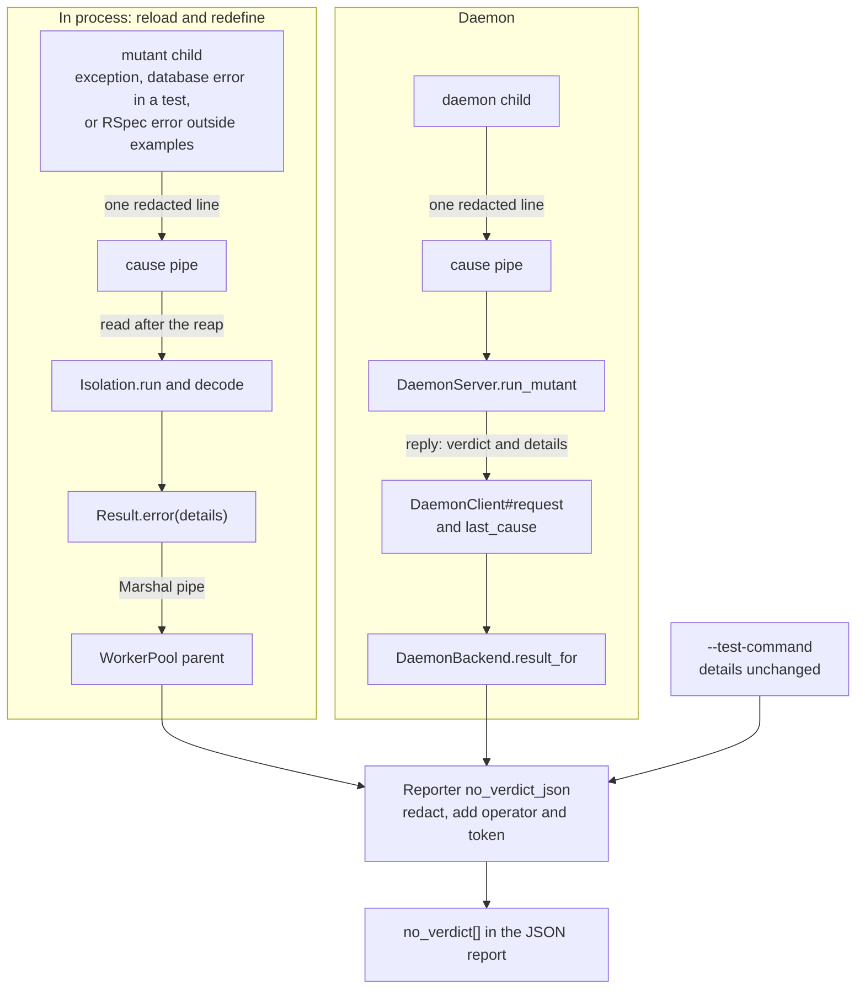

# Name the cause of each errored mutant in the JSON report - Plan

Add error causes to the existing JSON entries so readers can diagnose errored mutants without stderr.

## Goal Capsule

- **What:** name each errored mutant's cause in `no_verdict[].details`.
- **Why:** a person or script must know why the mutant has no verdict.
- **How:** send one redacted cause line from child to parent (KTD1, existing list; KTD2, cause pipe).
- **Issue:** #388 says JSON lacks errored mutant IDs and messages. The IDs already exist; the cause text is missing.
- **Authority:** this plan, then `AGENTS.md`, then the text of #388 (the source issue). This plan takes precedence where they differ. See "Corrections to the issue".
- **Owners:** the implementer completes the units, tests, docs and pull request. A maintainer makes policy decisions.
- **Stop and ask:** a change would alter a verdict, score or exit code. Also stop if a maintainer requires a major version for the new `details` text. Stop if redaction cannot occur before the cause leaves the child. Also stop if the base reports `schema_version` `2.0` because PR #244 (the 2.0 contract flip) merged first.
- **Size:** M (medium). About 29 files: 9 under `lib/` (1 new), 16 under `test/` (3 new), and 4 docs files. No new runtime dependency.
- **Delivery:** one pull request. Labels: `enhancement` (feature), `priority: medium` (medium priority), `risk: low` (low risk), `v1.9.0` (target release). Semver: minor, because JSON gains keys. A person merges. This plan includes no release step.

---

## Product Contract

### Summary

The mutant's child sends a redacted cause line containing the exception class and message's first line. The limit is 500 characters. `no_verdict[].details` carries it for reload, redefine and daemon runs. Each entry also gains `operator` and `token`. No new top-level array is needed: `no_verdict[]` already lists every errored mutant.

### Problem Frame

Vladimir ran Mutineer on Fizzy, a Rails 8 app. His report, linked from #388, identifies four causes: a shared database, a concern loaded twice, an enum declared twice, and a callback skipped twice. Diagnosis required stderr.

| Location | Current behavior |
|---|---|
| In process | `details` is `child exited with status 2` (`lib/mutineer/isolation.rb:373`). |
| Daemon | `details` is `daemon verdict: error` (`lib/mutineer/daemon_backend.rb:509`). |
| Child diagnostics | Only stderr gets the exception class and message (`lib/mutineer/isolation.rb:70`, `lib/mutineer/daemon_server.rb:368`). |
| Reporter guidance | It directs users to `no_verdict[]` "for the cause of each" (`lib/mutineer/reporter.rb:92`, `:96`). |
| Documentation | It says `details` names the failure, "a daemon crash, say" (`docs/json-schema.md:155`). |
| Previous deferral | The #296 plan, for database errors inside tests, deferred this gap (`docs/plans/2026-10-24-296-fix-in-test-db-error-verdict-plan.md:76`). |

The guidance does not hold for child crashes. Scripts cannot distinguish their causes.

### Terms

| Term | Meaning |
|---|---|
| Cause line | One line explaining the child's error: `Class: first line of the message`. |
| Errored mutant | A mutant with status `error`, counted in `summary.errored` and listed in `no_verdict[]` with `status: "error"`. |

### Requirements

**Cause line**

| ID | Requirement |
|---|---|
| R1 | Use `Class: text`. `text` is the first nonblank message line, with spaces removed at its ends. |
| R2 | Use the class name alone when the message is blank or equals that name. |
| R3 | Redact the class name and message with `Redaction.text` before cutting. Never send an unredacted cause through a pipe. |
| R4 | Limit the line to 500 characters, including any prefix mutineer adds. Cut longer lines to 500 characters, ending in `...`. |
| R5 | Building or sending never raises or changes the child's exit status. Parent reads return valid UTF-8, replacing invalid bytes. The daemon reply must not make `JSON.generate` raise. |

**In-process runs (reload and redefine)**

| ID | Requirement |
|---|---|
| R6 | For an unhandled child exception, set `details` to its cause line. |
| R7 | If the first failed Minitest test has a database connection or lock error, use `a test failed with a database error: ` plus its cause line. |
| R8 | If RSpec reports an error outside examples and no example failed, use KTD5's fixed text (fixed cause messages). |
| R9 | Status 2 without a cause keeps `child exited with status 2`. Signal death keeps `unexpected exit status: nil`. Timeout keeps `details: null`. |
| R10 | Worker crashes keep `worker crashed: `. Apply R1 to R3 after the prefix and R4 to the whole text. |
| R11 | A process forked by the child cannot send the child's cause line. |

**Daemon runs**

| ID | Requirement |
|---|---|
| R12 | An `error` reply carries the cause under a new optional `details` key. R6 and R7 also apply. |
| R13 | Daemon failure uses `daemon crashed` or `daemon stopped answering`. |
| R14 | Without a cause, keep `daemon verdict: error`. |

**JSON report**

| ID | Requirement |
|---|---|
| R15 | Add `operator` and `token` to each `no_verdict[]` entry, with their `no_coverage[]` meanings. Both are `null` without a subject file or mutation. Use the `result_line` guard (`lib/mutineer/reporter.rb:568-570`): `diff_for` needs the source of `subject.file`. |
| R16 | Pass each non-null `details` value through `Redaction.text` before JSON output. Keep `null`. |
| R17 | Increase `schema_version` by one minor step under KTD7 (schema version rule). Update `docs/json-schema.md`, `docs/results.md`, `STABILITY.md` and `CHANGELOG.md`. |

**Unchanged**

| ID | Requirement |
|---|---|
| R18 | Change no verdict, score or exit code. Keep the `[mutineer-child]` and `[daemon-child]` stderr lines and their text. |

### Acceptance Examples

| ID | Coverage | Expected result |
|---|---|---|
| AE1 | R6, R15: child cause and mutant fields | The fixture in U2 (in-process transport) raises `ArgumentError` when its class body runs twice. `--strategy reload --format json` reports 1 errored mutant and exits 0. Its entry has `details: "ArgumentError: Once::LOADED is already defined (this class body cannot run twice)"`, `operator: "arithmetic"` and a 12-character `id`. With `--strategy redefine`, it reports 0 errored and 1 killed. |
| AE2 | R12: daemon cause | Payload `NoSuchConstantXYZ.definitely_missing` returns `error`. Its cause starts with `NameError: uninitialized constant NoSuchConstantXYZ`. |
| AE3 | R3, R4: redaction and limit | Set `DATABASE_URL` to `postgres://u:s3cret@ho st/db`. The child raises `no connection: ` plus that URL. `details` contains `[REDACTED]`, without `s3cret`. |
| AE4 | R9: fallback | A child block returning 2 gives `details: "child exited with status 2"`. |
| AE5 | R13: daemon timeout | A daemon that never replies gives `error` and `details: "daemon stopped answering"`. |

### Scope Boundaries

- No top-level `errored` array (KTD1; Q2, array choice).
- Keep `--test-command` details unchanged (KTD11, external-command scope). Its fixed messages are at `lib/mutineer/external_backend.rb:186`, `:192`, `:209`, `:214`. It parses output for the summary and SimpleCov gate (`:195`, `:205-206`, `:213`), but includes no output line in `details`.
- Keep `--dry-run` unchanged. It runs no mutant and has no errored mutant.
- Keep the GitHub Action unchanged. `action.yml:476` reads only `summary.no_verdict`.
- Add no structured `error_class` key (Q5, separate class field).
- Keep signal-death text on both paths (R9, R14).

#### Deferred to Follow-Up Work

The implementer files one issue per item before opening the pull request (Q8, follow-up ownership). The pull request, `docs/json-schema.md` and `CHANGELOG.md` name every tracking issue.

| Known limit | Follow-up |
|---|---|
| Human and HTML reports show only the errored count (`lib/mutineer/reporter.rb:802`, `:363`). | Lists and causes remain deferred (Q3, human and HTML reports). |
| The `--matrix` early-end rule uses fixed text (KTD5). | It does not carry the database exception class. |
| RSpec errors outside examples use fixed text (KTD5). | The sink contains the class and message (probe r3), but this plan does not parse it. |
| Signal death keeps `unexpected exit status: nil` (R9). | No signal number is included. |
| `--test-command` details include no command-output line. | Track under KTD11 and Q4 (external-command causes). |
| No `error_class` key is added. | Scripts use the parsing rule in U4 (JSON and documentation), as Q5 specifies. |

### Corrections to the issue

| Issue statement or omission | Correction |
|---|---|
| JSON has "no errored mutant IDs". | `no_verdict[]` already includes `subject`, `file`, `line`, `id`, `status: "error"` and `details`. See `lib/mutineer/reporter.rb:278-280`, `:779-788`, `docs/json-schema.md:150-163`, and probes A and C. |
| It names the top-level `no_verdict` key. | It does not explain its contents. |
| It requests a new `errored` array. | The gaps are cause text and `operator` (`lib/mutineer/reporter.rb:780-787`). |
| Exception text appears "only on stderr". | This holds for child crashes in process and on the daemon. Worker crashes already use `worker crashed: Class: message` (`lib/mutineer/worker_pool.rb:78`). `--test-command` supplies separate details. |
| It names only child exceptions as an `error` source. | Database errors inside tests also qualify (`lib/mutineer/minitest_integration/in_test_database_error.rb:116-123`). So do RSpec errors outside examples (`lib/mutineer/test_runners/rspec.rb:70-74`). |
| "Bump the schema version per policy". | Tags v1.8.0 and v1.8.1 report `1.9` (`git show v1.8.1:lib/mutineer/reporter.rb`, line 34). The next minor is `1.10`. |
| "Runtime behaviour was not checked." | Probes A to D checked it. See "Probe results". |
| It omits #347 (possible existing cause-reporting issue). | The #296 plan says #347 tracks causes in `no_verdict[].details`. Its text was not checked: the context folder lacks it, and this job avoids `gh` (Q6, issue overlap). |

---

## Planning Contract

### Key Technical Decisions

The implementer follows these decisions. A maintainer decides any requested policy change.

| ID | Decision and reason | Rejected option |
|---|---|---|
| KTD1 | **Enrich `no_verdict[]`.** Consumers filter `status == "error"`. The comment at `lib/mutineer/reporter.rb:266-271` explains the condition-based name. | A top-level `errored[]` repeats existing entries, as `uncapturable[]` does. |
| KTD2 | **Use a second pipe per mutant fork.** The child writes one line. After reaping, the parent reads without blocking and takes the last complete line. Probe B verifies this. | Stderr must remain open for user output (`lib/mutineer/isolation.rb:37-38`). The kill channel requires `--matrix` (`lib/mutineer/isolation.rb:52`). A temp file adds disk writes and orphan cleanup. |
| KTD3 | **One stdlib-only module owns line and pipe behavior.** Add `Mutineer::ChildCause` in `lib/mutineer/child_cause.rb`, beside `ChildStdout` and `ChildCoverage`. The daemon loads it without Prism (`lib/mutineer/daemon_server.rb:22-27`). Store the armed pipe and process id, as `InTestDatabaseError` stores `armed_pid`. The process check enforces R11. | Passing the pipe through `TestRunners` and `MinitestIntegration.run` changes three signatures for one writer. No `Error` suffix: the module is not an exception. |
| KTD4 | **Keep `DaemonClient#request` returning the verdict word.** Add `last_cause` for the last request returning `error`. This matches `@timed_out` (`lib/mutineer/daemon_client.rb:409`, read at `:389`). Each client serves one thread (`lib/mutineer/daemon_backend.rb:358-366`). | Returning `[verdict, details]` changes existing callers and stubs: one in `lib/` and 21 lines in `test/`. Command: `git grep -n '\.request(' -- lib test`. |
| KTD5 | **Use fixed text when no exception object is available.** For `--matrix` early end (`lib/mutineer/isolation.rb:172`), use `a test failed with a database error, then the child ended before the suite finished`. The child never reached error-reporting code; a later crash would identify the wrong cause. For RSpec, use `RSpec reported an error outside its examples, for example a spec file that raised while it loaded`. Send it from `run`; keep `failure_code` free of side effects. | Do not parse the RSpec sink yet. Probe r3 confirms that when `test/fixtures/rspec/load_error_spec.rb` raises while it loads, the sink at `lib/mutineer/test_runners/rspec.rb:47-52` holds `An error occurred while loading`, `RuntimeError:` and the message. It also sets `non_example_failure` true. Formatter text is not an API and can change on upgrade. Track this in "Deferred to Follow-Up Work". |
| KTD6 | **Redact at source and sink.** Child redaction protects the pipe and Marshal payload (R3). Reporter redaction protects every later source (R16), including `worker result unreadable` (`lib/mutineer/worker_pool.rb:145`). | Sink-only redaction lets secrets cross the daemon boundary. |
| KTD7 | **Make one minor schema bump per release.** Read base-branch `SCHEMA_VERSION` and the latest release tag. Tag v1.8.1 reports `1.9`. Change base `1.9` to `1.10`; keep existing `1.10` and extend its docs. If the base reports `2.0` because PR #244 (the 2.0 contract flip) merged first, stop and ask a maintainer. The sibling plans for #381 and #386 use the same rule. | `docs/json-schema.md:16-17` requires a minor bump for additive changes. Multiple unreleased changes share one version. |
| KTD8 | **Set a 500-character constant.** The Rails enum sample is 172 characters; the shared-database sample is 196 (`lib/mutineer/daemon_server.rb:257-258`). Cut by characters after redaction, so the cut cannot separate a password from its URL. `lib/mutineer/minitest_integration/in_test_database_error.rb:157-159` requires this order. | None. |
| KTD9 | **Treat new `details` text as nonbreaking.** Its type and documented meaning stay: "the cause where there is one" (`docs/json-schema.md:155`). Document it under `### Changed` in the CHANGELOG. | A second cause key would conflict with the documented role of `details`. |
| KTD10 | **Add `token` with `operator`.** Although the issue requests only `operator`, both identify the change (`docs/json-schema.md:146`). `diff_for` gives a common entry shape in one line (`lib/mutineer/reporter.rb:756-769`). | None. |
| KTD11 | **Keep `--test-command` details unchanged.** Track output-derived causes in Q4. The backend does parse output (`:195`, `:205-206`, `:213`); the earlier plan claimed otherwise. | A reviewer proposed the last nonblank output line at `lib/mutineer/external_backend.rb:209` and `:214`. It is often a summary or backtrace frame. No exception object is available. |
| KTD12 | **Share the database-error builder between stderr and `details`.** `InTestDatabaseError#line` uses `text.lines.first`, which can be blank (`lib/mutineer/minitest_integration/in_test_database_error.rb:163-166`). Use `ChildCause` for `Class: text`. Keep the prefix, `delete_suffix(".")` and hint. Users can then find the cause from `details` in stderr. | Separate first-line rules produce different text for one error. |
| KTD13 | **Convert pipe bytes to UTF-8 in the parent.** Reuse `Redaction.utf8` (`lib/mutineer/redaction.rb:86-93`). Probe r1 shows `JSON.generate` rejects non-ASCII binary strings with json 3.1.0. The reply loop has no `rescue` (`lib/mutineer/daemon_server.rb:126`). A failure ends the daemon, triggers respawn (`lib/mutineer/daemon_client.rb:131-136`), then aborts after `MAX_RESTARTS` (`:39`, `:383-387`). | A reply-loop `rescue` would hide the cause and still lose the reply. |

### Assumptions

No user has confirmed these assumptions.

- Consumers accept new `details` text (KTD9).
- Consumers read `"1.10"` as the minor after `"1.9"` (Q1, version string).
- A 500-character line distinguishes causes (KTD8).
- The `v1.9.0` label on #388 remains the release target.

### High-Level Technical Design

| How the mutant got `error` | `details` | Requirement |
|---|---|---|
| The child raised | `Class: first line` | R6, R12 |
| The first failed Minitest test had a database error | `a test failed with a database error: Class: first line` | R7 |
| RSpec error outside examples | Fixed text in KTD5 | R8 |
| `--matrix` early-end rule | Fixed text in KTD5 | KTD5 |
| The child exited 2 without a cause | `child exited with status 2`; daemon: `daemon verdict: error` | R9, R14 |
| A signal ended the child | `unexpected exit status: nil`; daemon: `daemon verdict: error` | R9, R14 |
| The daemon crashed or stopped answering | `daemon crashed` or `daemon stopped answering` | R13 |
| A pool worker crashed | `worker crashed: Class: first line` | R10 |
| `--test-command` | Unchanged | Scope Boundaries |

### Probe results

Scripts and output are at `/private/tmp/claude-501/-Users-davidteren-Projects-claude-worktrees-mutineer-vladimir-issues-planning-21adcb/ae564be8-638b-4dd0-a9e5-9d7a58cb00ae/scratchpad/context/probes/388/`.

This folder exists only on the planning machine. If missing, recreate the small probes; the plan remains valid.

| Probe | Question | Result |
|---|---|---|
| A, `probe_a_current_details.rb` | Current `details` and `no_verdict[]` keys? | Raising `ArgumentError`, returning 2 and calling `exit 2` each give `child exited with status 2`. SIGKILL gives `unexpected exit status: nil`. Daemon mapping gives `daemon verdict: error`. Keys: `subject, file, line, id, status, details`. |
| B, `probe_b_error_pipe.rb` | Can a second pipe provide a nonblocking read after reaping? | All 8 checks pass on arm64 macOS, Ruby 3.4.9. A grandchild holding the write end does not delay the parent (0.002 s). A killed child or a line without a newline gives no cause. A 1,949-byte line does not block. Added cost: 0.14 ms per fork over 300 forks. |
| C, `probe_c_cli_repro.sh` | Does a class that cannot run twice produce an errored mutant? | `--strategy reload`: 1 errored, `child exited with status 2`, and `[mutineer-child] ArgumentError` on stderr. `--strategy redefine`: 1 killed, 0 errored. |
| D, `probe_d_output.txt` | Does `lib/mutineer/daemon_server.rb` load without Prism? | Yes. It loads 6 mutineer files; `Prism` stays undefined. |
| r1, `refute/r1_binary_json.rb` | Can `JSON.generate` accept non-ASCII pipe bytes? | No. It raises `JSON::GeneratorError` on Ruby 3.4.9, json 3.1.0. This requires KTD13. |
| r2, `refute/r2_redaction_order.rb` | Does the test distinguish redaction order? | Yes, with `DATABASE_URL` unset. `Redaction.text` converts binary text to valid UTF-8. Shared-database cause: 196 characters. Enum sample: 172. |
| r3, `refute/r3_rspec_sink.rb` | Does the RSpec sink contain the class and message? | Yes. It contains `RuntimeError:` and the message. `non_example_failure` is true (KTD5). |

Not checked:

- Linux: probes ran only on macOS. CI runs the suite on both.
- A real Rails app through the daemon: `rake test:daemon` is heavy, and the brief forbids it.
- Real Fizzy errors: PR #391 (Rails class-body reload fix) removes them. The brief forbids a Fizzy daemon run. U2's fixture reproduces the same shape.

---

## Implementation Units

The implementer owns every unit and its verification.

### U1. The cause line and its pipe

**Goal:** build, send and read cause lines through one stdlib-only module.

**Requirements:** R1, R2, R3, R4, R5, R11.

**Dependencies:** none.

**Files:**

- `lib/mutineer/child_cause.rb` (new): `Mutineer::ChildCause` and its limit constant. Require only `redaction.rb`.
- `test/child_cause_test.rb` (new).

**Approach:** implement four operations (KTD2, KTD3).

1. Build an exception line under R1 to R4. Return `Redaction::FAILED` on any failure.
2. Arm after the fork: store the write end and current process id.
3. Report only from the armed process. Write one line, enforce R4 and never raise.
4. Read all ready bytes without blocking. Return the last complete line as valid UTF-8, replacing invalid bytes, or nothing (KTD13).

Follow `lib/mutineer/child_stdout.rb` and `lib/mutineer/redaction.rb` syntax. The app's Ruby can be older than 3.4.

**Patterns to follow:**

| Pattern | Source |
|---|---|
| Never raise | `Redaction.describe`, `lib/mutineer/redaction.rb:114-118` |
| Write without raising | `KillChannel.emit`, `lib/mutineer/kill_channel.rb:266-280` |
| Nonblocking read | `Isolation.drain`, `lib/mutineer/isolation.rb:126-134` |

**Test scenarios:** each initially fails with `LoadError` for the new file.

| Test | Check |
|---|---|
| `test_line_names_the_class_and_the_message` | `ArgumentError.new("enum declared twice")` gives `ArgumentError: enum declared twice`. |
| `test_line_uses_the_first_line_that_is_not_blank` | Two newlines, `Migrations are pending.`, then another line gives `RuntimeError: Migrations are pending.`. |
| `test_line_is_the_class_alone_without_a_message` | `IOError.new` gives `IOError`. An empty message also gives only the class name. |
| `test_line_is_cut_to_the_limit` | A 2,000-character message using a 4-byte character gives 500 valid UTF-8 characters, ending in `...`. |
| `test_line_hides_the_database_password` | Cover AE3 with the URL at `test/isolation_test.rb:536`. |
| `test_line_is_redacted_before_the_cut` | Unset `DATABASE_URL`. Use 467 filler characters followed by that URL in a `RuntimeError` message. The result contains no `s3c`. Cutting first leaves `s3c`. Setting `DATABASE_URL` makes both orders pass and proves nothing. |
| `test_line_fails_closed` | An error whose `message` raises gives `Redaction::FAILED`. |
| `test_a_reported_line_reaches_the_parent` | A forked child arms, reports `X: y`, then uses `exit!`, as both fork boundaries do. The parent reads `X: y`. A buffered write fails because `exit!` does not flush. |
| `test_report_does_nothing_when_not_armed` | Reporting from the test process neither raises nor writes. |
| `test_a_grandchild_cannot_report` | The armed child forks a reporting grandchild, waits, then exits. The parent reads nothing. |
| `test_read_ignores_a_line_with_no_newline` | Ignore incomplete lines. |
| `test_read_takes_the_last_complete_line` | Two complete lines return the second. |
| `test_read_returns_valid_utf8_for_a_multibyte_line` | A child reports `RuntimeError: café`. Reading returns that text as UTF-8; `JSON.generate` succeeds. Invalid byte `\xFF` becomes a replacement character. Before conversion, the binary string causes `JSON::GeneratorError`. |
| `test_read_does_not_block_on_an_open_empty_pipe` | Keep the write end open. Reading returns nothing within a 2-second timeout. |
| `test_the_daemon_server_still_loads_without_prism` | Fresh Ruby requires `lib/mutineer/daemon_server.rb`, then `lib/mutineer/child_cause.rb`. `Prism` stays undefined. This passes before U3 (daemon transport) and guards it. |

**Verification:** the new test file passes. `bundle exec rake yard:strict` remains at 100%.

### U2. Carry the cause on the in-process path

**Goal:** name each in-process `error` cause under reload and redefine.

**Requirements:** R6, R7, R8, R9, R10, R18, AE1, AE3, AE4.

**Dependencies:** U1.

**Files:**

| File | Change |
|---|---|
| `lib/mutineer/isolation.rb` | `run` (lines 51-118), `decode` (369-376), early-end result in `finish` (172) |
| `lib/mutineer/minitest_integration/in_test_database_error.rb` | `exit_code` (116-123) and its doc comment |
| `lib/mutineer/test_runners/rspec.rb` | `run`, at the `failure_code` call (60) |
| `lib/mutineer/worker_pool.rb` | Crash text (line 78) |
| `test/fixtures/reload_error/once.rb`, `test/fixtures/reload_error/once_test.rb` | New class and test from probe C |
| `test/isolation_test.rb`, `test/test_runners/minitest_test.rb`, `test/test_runners/rspec_test.rb`, `test/worker_pool_test.rb`, `test/cli_test.rb` | Tests |

**Approach:**

1. Open the cause pipe before `Isolation.run` forks. The child closes the read end and arms `ChildCause`. The parent closes the write end. Close both ends in `ensure`.
2. Report the cause in the child's `rescue Exception` branch. Keep the `[mutineer-child]` stderr line (R18).
3. After reaping, read the cause and pass it to both `decode` calls (lines 90 and 101). Status 2 uses an available cause (R9). Timeout results do not read.
4. At `finish` line 172, use KTD5's first fixed text.
5. When `InTestDatabaseError.exit_code` returns 2, report R7's text. Build stderr's `Class: text` through `ChildCause`. Keep its prefix, period rule and hint (KTD12).
6. When `failure_code` is 2, make `RSpec.run` report KTD5's second fixed text.
7. Build `WorkerPool` crash text from the cause line (R10).

Both strategies use `Isolation.run` (`lib/mutineer/runner.rb:381-406`).

**Patterns to follow:** use the kill-channel pipe pattern in `Isolation.run` (lines 52-55, 80-82, 114-118). Keep reproductions as fixture files under the "repro becomes fixture" rule. `Rakefile:23` excludes `test/fixtures/` from the suite's test list.

**Test scenarios:**

| Test | Check |
|---|---|
| `test_unhandled_exception_names_its_cause` (`isolation_test`) | Raising `ArgumentError, "enum declared twice"` gives `details == "ArgumentError: enum declared twice"`. Before: `child exited with status 2`. |
| `test_exit_two_without_a_cause_keeps_its_text` (`isolation_test`) | Returning 2 or calling `exit 2` gives `child exited with status 2` (AE4). Passes before and after; guards R9. |
| `test_signal_death_and_timeout_keep_their_details` (`isolation_test`) | SIGKILL gives `unexpected exit status: nil`; timeout gives `nil`. Passes before and after. |
| `test_cause_hides_the_database_password` (`isolation_test`) | Cover AE3 using the setup at line 535 and assert on `result.details`. |
| `test_a_long_cause_is_cut` (`isolation_test`) | A 5,000-character message gives 500 characters. |
| `test_a_grandchild_with_the_pipe_open_does_not_delay_the_result` (`isolation_test`) | The block forks a child sleeping 3 seconds, then raises `boom`. Within 2 seconds, return `RuntimeError: boom`. |
| `test_a_matrix_child_that_raises_names_its_cause` (`isolation_test`) | With `channel: true`, send `start`, then raise. Return `error`, `RuntimeError: boom` and an incomplete row. |
| `test_error_diagnostic_reaches_stderr_after_block_swaps_streams` (line 115); `test_error_diagnostic_hides_the_database_password` (line 535) | Pass unchanged; prove R18. |
| `test_database_error_names_its_cause` (`minitest_test`) | `db_error_verdict({ "FIRST" => "connection" }, matrix: false)` gives `a test failed with a database error: ActiveRecord::ConnectionNotEstablished: the database is gone`. `matrix: true` gives the same text. Stderr contains the `details` text after R7's prefix (KTD12). Fails before. |
| `test_database_error_line_skips_a_blank_first_line` (`minitest_test`) | A database message starts with a newline, then `the database is gone`. Stderr and `details` contain that text. Before: stderr has an empty cause. |
| `test_matrix_early_end_has_the_fixed_text` (`minitest_test`) | `{ "FIRST" => "connection", "SECOND" => "exit" }` with `matrix: true` gives KTD5's first fixed text. Before: `details` is nil. |
| `test_spec_file_that_raises_while_loading_scores_error_not_killed` (`rspec_test`, line 102) | Assert that `details` equals KTD5's second fixed text. Keep `test_failed_example_still_kills_when_an_error_outside_examples_follows` unchanged. |
| `test_worker_crash_details_are_one_line` (`worker_pool_test`) | Raising `"first\nsecond"` gives `worker crashed: RuntimeError: first`. Keep `test_worker_crash_details_hide_the_password` (line 143) unchanged. |
| `test_json_names_the_cause_of_an_errored_mutant` (`cli_test`) | Copy both fixtures to a temp project. Run `run once.rb --test once_test.rb --operators arithmetic --jobs 1 --format json` with each strategy. Reload: exit 0, `summary.errored == 1`, AE1's `details`, and `[mutineer-child] ArgumentError` on stderr. Redefine: `summary.errored == 0`, `summary.killed == 1`. Fails before on `details`. |

**Verification:** all five test files pass. The Minitest 6 suite also passes because this unit changes its integration.

### U3. Carry the cause on the daemon path

**Goal:** name daemon mutant errors and distinguish daemon failure types.

**Requirements:** R12, R13, R14, R18, AE2, AE5.

**Dependencies:** U1 and U5 (daemon pipe spike). U2 supplies R7's database-error text, also sent by daemon children.

**Files:**

| File | Change |
|---|---|
| `lib/mutineer/daemon_server.rb` | `require` list (lines 3-9), protocol comment (line 40), `run_mutant` (341-386) |
| `lib/mutineer/daemon_client.rb` | `request` (115-137), new `last_cause` reader |
| `lib/mutineer/daemon_backend.rb` | `job_result` (442-447), `result_for` (504-511) |
| `test/daemon_redaction_test.rb`, `test/daemon_shared_databases_test.rb`, `test/daemon_client_deadline_test.rb`, `test/daemon_backend_contract_test.rb` | Zero-dependency tests |
| `test/daemon_client_test.rb` | Tests run by `rake test:daemon` |

**Approach:**

1. Open the cause pipe before `run_mutant` forks. The child closes the read end, arms `ChildCause`, and reports from `rescue`. Keep `[daemon-child]` stderr output. The daemon closes the write end immediately after forking. Close both ends in `ensure`, including timeout paths. One daemon serves every mutant (`lib/mutineer/daemon_server.rb:341-386`); missed closes leak two descriptors per mutant.
2. Read the cause after `wait_verdict`. Add `"details"` only when the verdict is `error` and a cause exists (R12).
3. Clear `last_cause` when `request` starts. Set it from an `error` reply's `"details"`. Before `restart!`, the crash branch sets R13's text using the flag printed at `lib/mutineer/daemon_client.rb:389`.
4. For `error`, pass `last_cause` from `job_result` to `result_for`. Keep the existing fallback (R14).

**Execution note:** complete U5 first to prove daemon pipe behavior before a Rails run.

**Patterns to follow:** `test_child_error_log_hides_the_password` drives `run_mutant` with a fake worker database (`test/daemon_redaction_test.rb:111-126`). Use the stand-in daemon child at `test/daemon_client_deadline_test.rb:17-26`.

**Test scenarios:**

| Test | Check |
|---|---|
| `test_child_error_reply_names_the_cause` (`daemon_redaction_test`) | Use line 111's setup. Assert `"details" == "RuntimeError: routing failed for postgres://u:[REDACTED]@ho st/db"`. Reply and log contain no `s3cret`. Before: no `"details"`. |
| `test_a_non_ascii_cause_reaches_the_reply` (`daemon_redaction_test`) | Use the same setup with `routing failed: café`. `JSON.generate(reply)` succeeds; `reply["details"]` is `RuntimeError: routing failed: café` (R5, KTD13). |
| `test_run_mutant_does_not_leak_descriptors` (`daemon_redaction_test`) | Run the same setup 50 times. `/dev/fd` entry count equals the count after the first run. Without `ensure`, it grows by two per run. |
| `test_a_parallel_fork_watches_sql_before_the_check` (`daemon_shared_databases_test`, line 89) | Add two assertions. The `error` reply's `"details"` starts with `RuntimeError: shared database used during a parallel run: cable.`. The `survived` reply has no `"details"`. |
| `test_request_scores_error_and_respawns_when_the_daemon_never_replies` (`daemon_client_deadline_test`, line 43) | Add `assert_equal "daemon stopped answering", @client.last_cause` (AE5). |
| `test_request_keeps_the_cause_of_an_error_reply` (`daemon_client_deadline_test`) | Stand-in replies with `verdict: "error"`, `details: "ArgumentError: x"`. `request` returns `"error"`; `last_cause` is `ArgumentError: x`. A later `killed` reply leaves `last_cause == nil`. |
| `test_a_closed_pipe_is_a_daemon_crash` (`daemon_client_deadline_test`) | Stand-in exits before replying. `last_cause` is `daemon crashed`. Stub `restart!` as at line 43, preventing a real daemon start. |
| `test_a_crash_running_one_mutant_is_an_error_verdict_on_both_paths` (`daemon_backend_contract_test`, line 238) | Add a nil-returning `last_cause` to the fake client. Keep the `daemon verdict: error` assertion (R14). |
| `test_a_daemon_cause_reaches_the_result_on_both_paths` (`daemon_backend_contract_test`) | Fake returns `"error"` and `last_cause` of `ArgumentError: enum`. Both `run_serial` and `run_parallel` put it in `results[0].details`. |
| `test_daemon_reports_structured_verdicts` (`daemon_client_test`, line 40) | After request 3, `last_cause` matches AE2. After request 4, it is nil. |
| `test_in_test_database_error_is_error_not_killed` (`daemon_client_test`, line 61) | After request 2, `last_cause` is `a test failed with a database error: ActiveRecord::ConnectionNotEstablished: gone`. Keep the final stderr assertion. |

**Verification:** the four zero-dependency files pass. `bundle exec rake test:daemon` passes with the fixture app's bundle.

### U4. The JSON entry, the schema version and the docs

**Goal:** fully identify each mutant in `no_verdict[]` and document the contract.

**Requirements:** R15, R16, R17, AE1.

**Dependencies:** U2, U3.

**Files:**

| File | Change |
|---|---|
| `lib/mutineer/reporter.rb` | `require` list (lines 3-6), `no_verdict_json` (779-788), `no_verdict:` comment (266-277), `SCHEMA_VERSION` (34) |
| `test/json_reporter_test.rb`, `test/cli_test.rb` | JSON tests |
| `test/baseline_test.rb:254`, `test/cli_test.rb:917`, `test/cli_test.rb:1328`, `test/equivalent_mutant_test.rb:308`, `test/json_reporter_test.rb:61` | Tests pinning `"1.9"` |
| `docs/json-schema.md`, `docs/results.md`, `STABILITY.md`, `CHANGELOG.md` | Contract and change documentation |

**Approach:**

1. Add `operator` and `token` in `no_verdict_json` (KTD10). Redact non-nil `details` (R16).
2. Set `SCHEMA_VERSION` under KTD7. Below, `1.10` means the version that rule selects.
3. Update `docs/json-schema.md`:

   | Location | Required update |
   |---|---|
   | Version example, line 14; shape block, line 36 | Use the selected version. |
   | `errored` row, line 65 | State that each errored mutant appears in `no_verdict[]` with `status: "error"`. |
   | `no_verdict[]`, lines 150-163 | Add the entry shape and "High-Level Technical Design" table. |
   | Same section | Limit child-cause `details` to one line and 500 characters. |
   | Same section | Explain that object addresses or temp file names can make `details` differ between equal-verdict runs. |
   | Same section | State that redaction hides only database passwords. Treat reports like logs because messages can contain other secrets. |
   | New fields and text | Mark `operator`, `token` and new texts "schema `1.10`, #388". |
   | Byte-identical JSON promise, lines 5-6 | Add one exception: `no_verdict[].details` of an errored mutant can hold run-specific text. |
   | Beside the `details` table | For scripts, remove `a test failed with a database error: ` or `worker crashed: ` when present. The class is then the text before the first `: `. Fixed text has no class. |
   | "Deferred to Follow-Up Work" items | Name every tracking issue. |
   | Versioning contract | If the base branch lacks it, add: compare `schema_version` as two integers, major then minor. Whichever of the #381, #386 and #388 plans lands first adds it, as with KTD7. |

4. At `docs/results.md:13`, state in the Errored row that JSON names causes in `no_verdict[].details`.
5. At `STABILITY.md:16`, set the row to "`schema_version` `1.10` (1.8.1 reports `1.9`)" if the base does not have it yet. Leave line 114 as it is.
6. Under `## [Unreleased]` in `CHANGELOG.md`, add:

   | Heading | Required entry |
   |---|---|
   | `### Added` | `no_verdict[]` gains `operator` and `token` (schema `1.10`, #388). |
   | `### Changed` | `no_verdict[].details` names errored mutant causes (KTD9). |
   | `### Changed` | An available cause replaces `child exited with status 2` and `daemon verdict: error`. |
   | `### Changed` | `worker crashed: ` is followed by one line of at most 500 characters. |
   | `### Changed` | `--matrix` early end and RSpec errors outside examples change from `null` to KTD5's fixed texts. |
   | `### Changed` | Daemon crashes change from `daemon verdict: error` to `daemon crashed` or `daemon stopped answering`. |
   | Follow-up references | Name every tracking issue from "Deferred to Follow-Up Work". |

**Patterns to follow:**

| Pattern | Source |
|---|---|
| `operator` and `token` | `mutant_json`, `lib/mutineer/reporter.rb:737-750` |
| Nil-safe access | `matrix_row_json`, `:507-516` |
| "Additive key" wording | `1.9` rows, `docs/json-schema.md:60-64` |

**Test scenarios:**

| Test | Check |
|---|---|
| `test_no_verdict_entries_name_the_mutant` (`json_reporter_test`) | Give `error` and `timeout` results a subject and `mutation_at(">=", ">", :comparison)`. Each entry has `operator == "comparison"` and `token == ">="`. Before: keys absent. |
| `test_no_verdict_entry_without_a_subject_still_appears` (line 113) | Add assertions that `operator` and `token` are nil. |
| `test_no_verdict_entry_with_a_mutation_but_no_file_has_no_token` (`json_reporter_test`) | Give an `error` result a mutation and a subject with nil `file`. Both fields remain nil; reporting does not raise. A mutation-only guard fails R15. |
| `test_no_verdict_details_hide_the_database_password` (`json_reporter_test`) | Put AE3's URL in `DATABASE_URL` and quote it in an `error` result's details. JSON contains `[REDACTED]`, without `s3cret`. A `timeout` keeps nil `details`, not an empty string. Before: JSON exposes the password. |
| `test_json_names_the_cause_of_an_errored_mutant` (`cli_test`, from U2) | Complete AE1: assert `operator == "arithmetic"`, nonempty `token`, and a 12-character `id`. |
| Five `"1.9"` pins | Use KTD7's version and update each adjacent comment. |
| `test/docs_contract_test.rb:106-110`, `:152-156` | Existing checks require docs and `STABILITY.md` to name `SCHEMA_VERSION`. Add no prose-specific test expectation. |

**Verification:** two calculator-fixture runs produce byte-identical JSON. Docs contract tests pass. `bundle exec rake site:build` shows the new rows.

### U5. Spike: the cause pipe inside the daemon

**Goal:** prove cause transport through `DaemonServer.run_mutant` and its JSON reply before U3 continues.

Probes A to D covered the in-process pipe, CLI reproduction and Prism-free loading, not daemon transport.

**Question:** can U1 and a `run_mutant` pipe carry ASCII and non-ASCII causes without changing `lib/mutineer/daemon_server.rb:126`?

**Method:**

1. Write U3's `test_child_error_reply_names_the_cause` and `test_a_non_ascii_cause_reaches_the_reply`. Confirm failure with:
   `LANG=en_US.UTF-8 LC_ALL=en_US.UTF-8 bundle exec ruby -Ilib -Itest test/daemon_redaction_test.rb`
2. Add the pipe under U3 steps 1 and 2. Run the same command again.

**Time box:** 1 hour.

**Pass:** both tests pass and the reply loop at `:126` stays unchanged. Continue U3.

**Fail:** a test fails only through a reply-loop change, or the cause does not reach the reply. Stop. Record the findings in KTD2 and KTD13. Ask a maintainer before continuing U3.

Keep the tests in U3. The spike never independently merges code to `main`.

---

## Verification Contract

The implementer runs these checks. Prefix ruby, rake and bundle commands with `LANG=en_US.UTF-8 LC_ALL=en_US.UTF-8` where those variables are unset.

| Command | Why |
|---|---|
| `bundle exec rake test` | Run the zero-dependency suite, including U1, U2, U4 and U3's zero-dependency tests. |
| `ruby -Ilib -e 'require "mutineer"'` | Check loading. |
| `bundle exec rake yard:strict` | Require 100% documentation for the new module, methods, constant and `last_cause`. |
| `BUNDLE_GEMFILE=gemfiles/minitest6.gemfile bundle install`, then `BUNDLE_GEMFILE=gemfiles/minitest6.gemfile bundle exec rake test` | Check U2's Minitest integration changes. |
| `bundle exec rake test:daemon` | Check U3 using the `test/fixtures/rails_app` bundle. |
| `bundle exec rake site:build`, then `node --test test/site_test.js` | Check published changes from `docs/json-schema.md` and `docs/results.md`. |
| `npm ci --prefix test/browser`, `npx --prefix test/browser playwright install chromium`, `npm test --prefix test/browser` | Run the website browser checks required by `AGENTS.md`. |
| `bundle exec ruby -Ilib -Itest test/child_cause_test.rb` | Run a quick single-file check. Use this form for other unit test files. |

Apply `AGENTS.md`: zero runtime dependencies, no `eval`, 100% YARD docs, an Unreleased CHANGELOG entry, and pull request labels.

## Definition of Done

The implementer verifies every item before delivery.

- All U1 to U4 tests exist and pass. Each failed before its unit, except guards marked "passes before".
- In-process `details` names causes under both strategies (AE1). Daemon causes also appear (AE2).
- Tests expose no database password in `details`, daemon replies or stderr (AE3).
- Verdicts, scores, exit codes and stderr lines remain unchanged. Existing tests pass without edits except those specified here.
- Reporter, `docs/json-schema.md` and `STABILITY.md` use KTD7's `schema_version`.
- U5 passed, or KTD2 and KTD13 record its findings.
- The pull request, `docs/json-schema.md` and `CHANGELOG.md` name all follow-up issues (Q3, Q8).
- The pull request explains its relation to #347 (Q6).
- The pull request has Goal Capsule labels and `Closes #388` in its body.
- The diff contains no dead code or abandoned attempts.

---

## Risks and Overlaps

| Item | Overlap or risk | Handling |
|---|---|---|
| PR #391 (Rails class-body reload fix, branch `fix/1.8.2-rails-reload`) | Changes `run_mutant` in `lib/mutineer/daemon_server.rb`, also changed by U3. Removes the Fizzy errors that exposed this gap. | Text conflict only. Rebase on whichever lands first. Use U2's fixture instead of Fizzy. |
| PR #393 (invalidate mutants only for added parse errors) | Changes `apply_surgical` in `lib/mutineer/isolation.rb`, a `lib/mutineer/reporter.rb` comment, `job_result` and `docs/json-schema.md`. | Different lines; at most a text conflict. |
| PR #375 (place hook-block mutants before the remaining file loads) | Changes `apply_whole_file` and `apply_payload`. Errors use the existing `rescue`. | No change needed. |
| PR #373 (redaction follow-ups) | Changes `lib/mutineer/redaction.rb` rules. Keeps `Redaction.text` and `Redaction.describe`. | No change needed. Its validation report showed a failing secret scan. Reuse the existing test URL; add no new secret-like text. |
| Secrets other than database passwords | `Redaction` hides only database passwords. Exception text can contain API keys. This text already reaches stderr and CI logs; it will also reach stored JSON artifacts. | U4 documents the risk. Worker crashes already expose such text through `details` (`lib/mutineer/worker_pool.rb:78`); this extends that path. |
| PR #369 (warn about random test order with `--test-command`) | Changes `lib/mutineer/external_backend.rb`, outside this plan. | None. |
| PR #244 (2.0 contract change), and PRs #245, #314, #322 and #335 (other 2.0 work) | Change `request`, `run_mutant`, reporter and schema docs. #244 sets `schema_version` to `2.0` and adds a daemon verdict word. | Stop and ask (KTD7). `details` remains additive alongside the new verdict. Other overlaps are text conflicts. |
| #389 plan (full reload for Rails daemon runs, v2.0 draft) | Rewrites `run_mutant` and `apply_payload` in `lib/mutineer/daemon_server.rb`. | This plan lands first (v1.9.0). Open and close the cause pipe in `run_mutant`, with the close in `ensure`. The #389 full-reload branch can then report R9 errors through `ChildCause`. |
| Plans for #381 (count unpaired sources) and #386 (default mutants for bare `if` or `rescue` bodies) | Both add JSON keys and select `1.10` for the same release. | Share one schema bump (KTD7). The first plan sets `1.10`; the others retain it. |
| #361 (missing killed-mutant IDs in JSON) and #362 (`--dry-run` ignores `--format json`) | Related JSON gaps; neither changes `no_verdict[]`. | Out of scope. A #361 list can reuse the entry shape. |
| #360 (clean-run failure lacks failing test names) | Needs a cause from a coverage-capture child at another fork boundary. | Out of scope. `ChildCause` could support it later. |
| #347 (possible existing cause-reporting issue) | The #296 plan says it tracks this gap. | Resolve through Q6. |
| Run-specific text | Object addresses and temp file names can make `details` differ across equal runs. | U4 documents this. Do not compare errored-mutant `details` across runs. |
| Version string `1.10` | String or float comparisons interpret it incorrectly. | `docs/json-schema.md:21` tells consumers to accept any `1.x`, but omits comparison rules. U4 adds them unless #381 or #386 lands first. See Q1. |
| File descriptors | Each fork holds two extra descriptors until reaping. A daemon leak loses two per mutant. | Close both ends in `ensure` within `Isolation.run` (U2) and `run_mutant` (U3). Guard with `test_run_mutant_does_not_leak_descriptors`. Probe B measured 0.14 ms per fork on macOS; Linux was not measured. |
| Non-ASCII daemon cause | Binary text makes `JSON.generate` raise. The run aborts after `MAX_RESTARTS` (probe r1). | Apply KTD13 and U1/U3 tests. U5 verifies transport first. |
| Repo rules | No status, skip or exclusion is added. "Count what you exclude" and "estimate exclusion frequency" do not apply. | No score-model change. |

## Open Questions

None blocks implementation. Each has a default.

| ID | Question | Default | Owner |
|---|---|---|---|
| Q1 | Is `"1.10"` the correct version string? | Yes, under `docs/json-schema.md:16-17`. Alternatively, hold the keys for `2.0`. | Maintainer decides. |
| Q2 | Add the top-level `errored` array requested by #388? | No (KTD1). The same entries can form an additive array later. | Maintainer decides. |
| Q3 | List errored mutants and causes in human and HTML reports? | Defer. | Implementer files the follow-up; maintainer sets priority. |
| Q4 | Put the last command-output line in `--test-command` details? | Defer (KTD11). The backend parses summaries, but the last line often does not identify the cause. Track a follow-up. | Maintainer decides. |
| Q5 | Add `error_class` to each entry? | No. Use U4's prefix-removal and first-`: ` parsing rule. A later key remains additive. Track a follow-up. | Maintainer decides. |
| Q6 | Does #347 already cover some work? | Read #347 and explain the relation in the pull request body. | Implementer checks; maintainer closes or narrows #347. |
| Q7 | Is 500 characters enough? | Yes (KTD8). Raise the constant if a real message requires it. | Implementer. |
| Q8 | Who files "Deferred to Follow-Up Work" issues? | This planning job made no GitHub write; none exists yet. File one per item before opening the pull request, under `AGENTS.md`. | Implementer files them. Without access, a maintainer must file them. The maintainer may combine items into fewer issues. |
