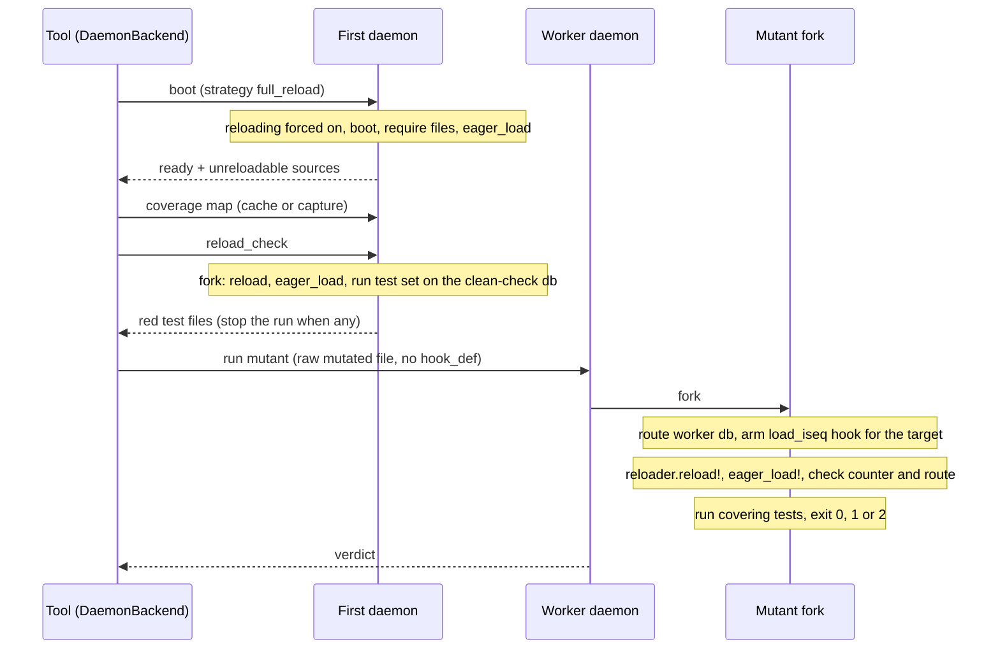

# Full-reload strategy for Rails daemon runs - Plan

## Goal Capsule

- **Issue:** #389 (an opt-in strategy for Rails daemon runs: substitute the mutant, `reload!`, `eager_load!`).
- **Objective:** a Rails team can score mutants against a freshly built copy of their app classes. A class body that runs a second time no longer causes an error or a false verdict. The team needs no patch in a boot file. The run stops with a clear message when the app is not safe to reload.
- **Means:** a new opt-in value `--strategy full_reload` for `--daemon --rails` runs (KTD1). Each mutant fork gives Ruby the mutant's text through a standard-library hook (KTD2). Then it reloads and eager loads the app (KTD3, KTD4).
- **Authority:** this plan, then `AGENTS.md`, then the text of #389. Where this plan differs from the issue, this plan wins (see "Corrections to the issue").
- **Spike first:** U1 is a spike. It merges no code. Its result decides whether U2 to U7 start as written (see U1 outcomes).
- **Stop and ask when:** a spike question in U1 fails and its outcome row says "stop". Stop when the work needs a runtime gem, `eval`, or a string compile of source text. Stop when a change would alter the behaviour of a run that does not pass `--strategy full_reload`.
- **Size:** L. About 34 files: 9 under `lib/` (1 new), 11 test files (2 new), 6 fixture files (5 new), `Rakefile`, `action.yml`, and 5 docs files. No new runtime dependency.
- **Delivery:** one pull request after the spike. Labels: `enhancement`, `priority: medium`, `risk: high`, `v2.0`. Semver class: minor. The strategy is new and opt-in, and no default changes (KTD11). A person merges it. No release step is part of this plan.

---

## Product Contract

### Summary

Add `full_reload` as a third value of `--strategy`. It works only with `--daemon --rails` and Minitest. Every daemon in such a run boots the app with class reloading on and eager loads it. Before mutants run, one fork reloads the app with no mutant and runs the test set. If a test goes red, the run stops and names it. In each mutant fork, a hook gives Ruby the mutant's text when Rails reloads that file. Then the fork reloads, eager loads, checks that the mutant loaded, and runs the covering tests. Sources that Rails does not reload are scored `unplaceable` before any fork. The reload guards from #391 (the reload fix for Rails class bodies) and `ConcernBlocks` stay on the `reload` path only.

### Problem Frame

The daemon always uses the `reload` strategy (`lib/mutineer/cli.rb:506-511`). It `load`s the mutated file over the class that is already defined (`lib/mutineer/daemon_server.rb:479-493`). The class body runs a second time. Rails rejects or duplicates some of those macros: enums, `skip_before_action`, validators and block callbacks. On Fizzy, Vladimir Dementyev needed four boot-file patches for an error-free run. #391 adds guards for each known macro. Each new macro needs a new guard, and macro mutants (#397, mutate class-body macros) cannot work on a reopened class at all.

Vladimir's prototype reloads the whole app per fork instead. On his nine-file Fizzy sample it gave 0 errors and the same survivors as the patched setup. It needed no enum, callback or concern patch. The prototype prepends onto a private method, needs the `require-hooks` gem, and needs a hand-written boot file. Mutineer has zero runtime dependencies, so the gem cannot ship it as is.

### Requirements

**Selecting the strategy**

- R1. `--strategy full_reload` is accepted on the command line and through the Action's `strategy` input. No default changes. Runs without this value behave as today.
- R2. `full_reload` needs `--daemon`, `--rails` and Minitest. Any other combination exits 2 with a message that names what is missing. This covers `--test-command`, `--no-daemon`, `--boot` without `--rails`, and RSpec.
- R3. A `--dry-run` applies the same validation as a real run.

**Booting**

- R4. Every daemon in a `full_reload` run boots with class reloading on and eager loads the app after the boot and the `--require` files. The run prints one stderr line that says it turned reloading on.
- R5. When reloading is still off after the boot, the daemon refuses to start. The run ends with a message that names the cause. It does not fall back to `reload`.
- R6. When the app's Ruby has no instruction-sequence hook, the daemon refuses to start with a message. This covers a Ruby that is not MRI.

**Placing a mutant**

- R7. In a mutant fork, the mutant's text stands in for the original file at the original file's real path. `require_relative` and `__dir__` resolve as for the original. The original path is the one in `$LOADED_FEATURES`. `__FILE__` and `source_location` name a hidden file beside the original, as under `reload` today (KTD2).
- R8. A source file that no reloading autoloader manages is known at boot. Its mutants score `unplaceable` and do not run. The run prints one stderr line that lists those files.
- R9. When a mutant fork finishes its reload and eager load and the mutant's file was never compiled, the mutant scores `error`. The message names the file.
- R10. A method in a concern's `included` or `prepended` block is placeable under `full_reload`, including the cases that `reload` marks `unplaceable`. The reload runs the mutated block in every includer.
- R11. The mutant runs against its worker's own database. A reload that changes the connection of `ActiveRecord::Base` does not send tests to the shared test database.

**Safety and scoring**

- R12. Before the first mutant, one fork reloads the app with no mutant, eager loads it, and runs the run's test set. A red test stops the run with exit 2. The message names each red test file and says that state set at boot outside `to_prepare` is the usual cause. The check runs on a coverage cache hit too.
- R13. The score formula, the statuses and the JSON shape do not change. `unplaceable` keeps its count and its place in the unrun share (`lib/mutineer/result.rb:218`).
- R14. The user docs say how to enable the strategy and what it needs. They name the `to_prepare` rule and say that zero errors alone do not prove a setup. They also name the known false-survival risk of a stale reference to an old class (KTD10).

### Acceptance Examples

- AE1. **Covers R1, R10, R13.** Given the fixture's enum model and its concern with an `included` block, when `--daemon --rails --strategy full_reload` runs them, then no mutant errors, and each verdict equals the verdict of the same mutant under `--test-command`.
- AE2. **Covers R12.** Given the fixture with `MUTINEER_RELOAD_UNSAFE=1` (an initializer that sets a class attribute in `after_initialize`), when a `full_reload` run starts, then it exits 2 before any mutant and names the test file that went red.
- AE3. **Covers R8.** Given a fixture source under `lib/` that an initializer requires, when it is a source of a `full_reload` run, then its mutants are `unplaceable` and the stderr line names the file.
- AE4. **Covers R2.** Given `--rails --no-daemon --strategy full_reload`, when the run starts, then it exits 2 with a message that names `--daemon`.
- AE5. **Covers R9.** Given a mutant fork whose reload never compiles the target, when the fork ends, then the mutant is `error` and stderr names the file.

### Scope Boundaries

**Non-goals, considered and not built:**

- No `.mutineer.yml` key. `strategy` is a command-line-only setting today (`lib/mutineer/config.rb:69`, `docs/cli.md:86`, `STABILITY.md:63`). Q1 asks whether to add one.
- No optional `require-hooks` integration. One mechanism keeps one behaviour to test (KTD2).
- No lazy-load mode. Eager load makes the substitution check exact (KTD4). U1 measures the cost. A lazy option needs evidence that eager load is too slow.
- No new JSON key for the cause of an `unplaceable` mutant. The stderr line (R8) and the docs carry it. Evidence that would change this: a user who needs the cause in CI without stderr.
- No change to how `ran_at_load` is decided. A full reload re-runs class bodies, so that classification may be too strict under `full_reload`. U1 counts it. A change needs its own issue (KTD10).
- No macro mutants. That is #397 (mutate class-body macros), which depends on this plan.
- No default change. The 2.0 default stays as `STABILITY.md:115-120` says until #284 (preconditions for the 2.0 daemon and reload default) decides otherwise.

### Deferred to Follow-Up Work

- In-process `--rails --strategy full_reload` without the daemon. The implementer files an issue (Q7). Until then R2 rejects the combination.
- RSpec on the daemon path. The daemon is Minitest only today (`lib/mutineer/cli.rb:500-504`).

### Corrections to the issue

- **The sample numbers have two sources.** The issue table gives 53 mutants and 16 survivors for the nine models. It gives 30 mutants and 7 survivors for the controllers. Those match the saved reproduction reports in the Fizzy clone (probe P3). Vladimir's report gives 89 mutants and 23 survivors for the same nine files on 1.8.0 (report section "Full reload per mutant", Results). The issue does not say why the counts differ. Not checked: the cause, because a Mutineer run in the Fizzy clone is out of bounds for this job.
- **The saved patched and full-reload reports are byte-identical.** `tmp/nine_patched.json` and `tmp/nine_reload.json` have the same SHA-1. The two controller files match too (probe P3). Identical survivors are therefore confirmed. The JSON has no time field. The issue's wall times (36.1 s, 39.5 s, 30.6 s, 36.8 s) are not in these files. Its cost of 0.6 to 0.9 s per mutant is not there either. Not checked: those times. U1 measures cost again.
- **`strategy: full_reload` in `.mutineer.yml` does not fit the config model.** `strategy` has no YAML key (`lib/mutineer/config.rb:69-70`). The docs list it as command-line only (`docs/cli.md:86`). This plan uses `--strategy` and the Action input. Q1 asks about a key.
- **A require hook is not needed.** The issue proposes a path-limited `Kernel#load` or `require` hook, or optional `require-hooks`. The report says a hand-written require hook failed with a `NameError`. Probes P1 and P2 show a hook on `RubyVM::InstructionSequence.load_iseq` that substitutes the mutant with the standard library only. It works with and without Bootsnap, with eager and lazy loading, and through a symlinked path.
- **The prototype does place hook-block mutants.** The issue says the prototype leaves mutants in `included do` blocks unplaced. For a def that `reload` can place, the payload already holds the mutated file with the mutated def inside the block (`lib/mutineer/daemon_backend.rb:436-440`, `lib/mutineer/job_plan.rb:222-227`). A full reload runs that block in every includer. Probe P1 shows a mutated def in an `included` block taking effect in the includer. The defs that `reload` cannot place never reached the prototype: the tool scores them `unplaceable` before it sends a payload (`lib/mutineer/daemon_backend.rb:432`, `lib/mutineer/subject.rb:53-55`).
- **False kills are not the only reload-safety risk.** Probe P1 shows that state set in `after_initialize` is lost after a reload (`after_initialize_check=FAIL`). That causes false kills, as the issue says. It also shows that a registry filled at boot keeps the old class (`real_killer_stale_registry=PASS` with the mutant applied). A test that goes through such a registry runs the original code, so the mutant can falsely survive. A clean run after a reload cannot detect that direction.
- **A source that Rails does not reload is a silent survivor.** Probe P1 with reloading off shows zero substitutions. The fork runs the original code and raises no error. The same holds for a source outside the reloading autoload paths. The issue does not list this. R8 and R9 close it.
- **MySQL and Postgres have a concrete routing risk.** Fizzy's `ApplicationRecord` calls `configure_replica_connections` (`app/models/application_record.rb:4` in the Fizzy clone). That calls `connects_to` when a replica is configured (`lib/rails_ext/active_record_replica_support.rb:22-25` there), which the issue says is true for MySQL. A reload runs that class body again. The fork routed `ActiveRecord::Base` to a worker database before the reload (`lib/mutineer/rails_worker_db.rb:400-416`). The new `connects_to` can send it back to the shared test database. R11 and spike S6 cover it.
- **#378, #383, #384 and #385 have a fix already.** On the `reload` path, #391 (the reload fix for Rails class bodies) closes them. It also closes #390 (validators and block callbacks run twice). Full reload is a second way to avoid them, not the only one.

---

## Planning Contract

### Key Technical Decisions

- KTD1. **A third `--strategy` value, `full_reload`.** It names a way to place a mutant, as `reload` and `redefine` do, so it belongs on that option. `validate_daemon!` today rewrites any strategy except `reload` to `reload` with a warning (`lib/mutineer/cli.rb:506-511`). It must keep `full_reload`. Rejected: a separate boolean such as `rails_reload: full`, because two settings would describe one choice. Rejected: the prototype's name `rails_reload`, because `full_reload` pairs with `reload` and matches the issue title.
- KTD2. **Substitute through `RubyVM::InstructionSequence.load_iseq`, with `compile_file` on a hidden tempfile.** In the mutant fork only, prepend a module to the singleton class of `RubyVM::InstructionSequence`. `apply_payload` already writes the mutant to a hidden tempfile beside the source. For the target's real path, the hook returns `compile_file` of that tempfile. The reload and eager load run inside the tempfile block, because the block deletes the file when it ends (`lib/mutineer/daemon_server.rb:481-488`). For any other path it calls `super` when one exists, or returns `nil` so Ruby compiles normally. A counter records each substitution. Probe P2 verifies this on Rails 7.2.4 with Bootsnap 1.26.1. Rejected: `RubyVM::InstructionSequence.compile` of the mutant string. It keeps `__FILE__` exact (probe P1), but it is dynamic string execution, which 0.6.1 removed for supply-chain scanner flags (`CHANGELOG.md:1796-1799`). Q2 keeps that choice open. Rejected: `require-hooks`, a runtime gem. Rejected: a symlinked copy of an autoload root, because Zeitwerk refuses to manage a directory twice (evidence `symlink-zeitwerk.txt`). Rejected: writing the real file as `FileSwap` does, because parallel workers share it.
- KTD3. **Turn reloading on at boot from inside the daemon.** Before the boot file loads, watch for the definition of `Rails::Application::Configuration`. `install_zeitwerk_ignore!` watches for `Zeitwerk::Loader` the same way (`lib/mutineer/daemon_server.rb:392-415`). Then prepend a `cache_classes=` writer that always stores `false`. Rails sends `enable_reloading=` through that writer (`railties-7.2.4/lib/rails/application/configuration.rb:349-355`). So both spellings in `config/environments/test.rb` are covered. After the boot, check `Rails.application.config.reloading_enabled?` and the main autoloader (R5). Rejected: a boot file the user writes, as in the prototype, because every user would copy it.
- KTD4. **Eager load after the boot and after each reload.** The prototype does this. Every reloadable file then compiles before tests run, so a zero counter means the mutant did not load (R9). Probe P1 shows lazy loading also substitutes, but only when a test touches the constant. Rejected: lazy loading by default, because a mutant whose constant no test touches would survive without an error.
- KTD5. **Two placement guards: a boot list and a fork counter.** At boot, the daemon asks each reloading Zeitwerk loader whether it manages each source. Zeitwerk 2.8.3 has `Loader#cpath_expected_at` for that. Not checked: the oldest Zeitwerk with it. The daemon returns the unmanaged files in its ready reply. The tool scores their mutants `unplaceable` (R8), an existing counted status. The fork counter (KTD2) is the backstop for anything the list misses (R9). Rejected: the counter alone, because a whole file would then score `error` and fail `--threshold`.
- KTD6. **The reload-safety check is a new daemon command.** After the coverage map, the backend sends `reload_check` to the first daemon. That daemon forks, reloads with no mutant, and eager loads. The fork then runs the run's test set with `MinitestIntegration.run`, on the database the clean check uses. Red files return in the reply. The backend stops the run as `JobPlan.abort_if_unclean!` does (`lib/mutineer/job_plan.rb:177`). The map daemon boots on every run, cache hit or not. The serial path boots it in `build_coverage_map` (`lib/mutineer/daemon_backend.rb:141-152`) and the parallel path in `prepare_run` (`:165-171`). So the check always runs. Rejected: a check in the coverage capture fork, which a cache hit skips (`lib/mutineer/coverage_map.rb:377-404`). Rejected: a check per worker, because it multiplies the cost by the worker count. Rejected: docs only, as the issue suggests, because the false kills would reach the score unseen.
- KTD7. **Route, reload, then verify the route.** The fork keeps today's order and routes to its worker database before it applies the mutant (`lib/mutineer/daemon_server.rb:357-360`). After the reload and eager load, it checks that `ActiveRecord::Base` still points at the worker database. When it does not, it routes again once. When the second check fails, the mutant scores `error`. Rejected: routing only after the reload, because class bodies that query during the reload would then use the shared database.
- KTD8. **The `full_reload` path skips `ConcernBlocks` and the #391 guards.** The class body runs once on a new class. There is nothing to forget or to guard. The backend sends the raw mutated file with no `hook_def` key. `Subject#unplaceable?("full_reload")` returns `false` (R10). The `maintain_test_schema` skip that #391 adds in `run_mutant` still applies to every strategy.
- KTD9. **Daemon only, Minitest only.** The 2.0 default under discussion is the daemon (`STABILITY.md:115-120`). The in-process path forks from the tool's own process and shares its boot, so it needs its own design. R2 rejects it and Q7 tracks it.
- KTD10. **No new status, and `ran_at_load` stays as it is.** `JobPlan.load_verdict` (`lib/mutineer/job_plan.rb:353`) still marks survivors on load-time lines. That is strict, never generous, so it cannot raise a score. A stale reference to an old class can still give a false survival. The docs name it (R14). U1 measures how often each case happens.
- KTD11. **Release class: minor, label `v2.0`.** The change adds a value and changes no default. So it is not breaking, and the pull request is not a draft. The issue carries `v2.0`. Q5 asks whether it can ship in a 1.x minor instead.

### How this meets the #284 checklist

#284 tracks the preconditions for making daemon plus reload the 2.0 default. Not checked: the text of #284, because it is not in the context folder and this job avoids `gh`. The three validation reports ask #284 for these gates. This plan supplies evidence for each one and changes no default:

| Gate the reports ask for | What this plan supplies |
|---|---|
| Verdicts equal a fresh process (Sol A13, Grok A13) | S8: `full_reload` against `--test-command` on the fixture and the Fizzy sample. |
| Lazy and eager load (Sol A13) | S5. |
| Worker counts 1 and N (Sol A13) | S8 runs `--jobs 1` and `--jobs 4`. |
| Three apps, one on Postgres (Sol A13) | The fixture, Fizzy, and the second app in S9. S6 covers MySQL and Postgres on the fixture. |
| Unplaceable count per strategy (Opus A13) | S8 records `unplaceable` for `reload` and `full_reload`. |
| Reload-unsafe initializers (Opus A15) | R12 and S3. |

### Assumptions

These are bets that no user confirmed.

- `__FILE__` naming the hidden tempfile is acceptable, because `reload` already does the same (KTD2, Q2).
- Rails 7.1 and later is the floor for `full_reload`. Not checked: Rails 7.0, which has no `enable_reloading` writer. The `cache_classes=` writer exists there too, so it may work.
- The run's whole test set is an acceptable cost for the reload-safety check (Q3).
- The `v2.0` label on #389 stays the target (Q5).

### High-Level Technical Design

The run has two new steps on the first daemon and one new path in each mutant fork.

The strategy decides three things on the tool side:

| Strategy | Daemon allowed | Hook-block def with no `reload_hook_call` | Payload |
|---|---|---|---|
| `reload` | yes | `unplaceable` | mutated file, plus `hook_def` when the subject has one |
| `redefine` | no, rewritten to `reload` (today) | `unplaceable` (`owner_unknown`) | not sent |
| `full_reload` | required | placeable | raw mutated file |

### Probe results

Scripts and output are in `CTX/probes/389/`, where `CTX` is the context folder of this planning job. Every probe ran on MRI 3.4.9, Rails 7.2.4 and Bootsnap 1.26.1, with the Gemfile of an earlier validation probe.

- P1. `iseq_reload_probe.rb` and `.out`: a rerun of the Sol validation probe. A fork prepends `load_iseq`, compiles the mutant string at the real path, then calls `reloader.reload!` and `eager_load!`. With reloading on, the mutant applies (`changed`), `source_location`, `__dir__` and `require_relative` match the original, and one validator stays one. A macro mutant takes effect (`macro_probe_amount_1_valid=false`). The same holds with `LAZY=1` and with `WITHOUT_BOOTSNAP=1`. The mutant came in through a symlinked path and matched by real path. With reloading off, the hook has zero hits and the fork runs the original code without an error. In every reloading case, `after_initialize` state is lost, and a boot-time registry still holds the old class.
- P2. `iseq_compile_file_probe.rb` and `.out`: P1 with `compile_file` of a hidden tempfile beside the source. The mutant applies, `__dir__` and `require_relative` match, the real path is in `$LOADED_FEATURES`, and `__FILE__` and `source_location` name the tempfile. Eager and lazy both pass. The tempfile is gone after the probe.
- P3. `fizzy_saved_reports.out`: the saved Fizzy JSON reports. The patched and full-reload reports are byte-identical for both samples: 53 mutants, 30 killed, 16 survived, 0 errored for the models, and 30, 22, 7, 0 for the controllers.
- P4. Reads in the Fizzy clone: `config/environments/test.rb:12` sets `enable_reloading = false`, `:18` sets `eager_load` from `CI`, and `config/initializers/multi_tenant.rb` now sets `Account.multi_tenant` in `to_prepare`.

Not checked: Rails 8.x, Zeitwerk below 2.8.3, Ruby below 3.4.9, MySQL and Postgres, and any time cost. U1 covers each.

---

## Implementation Units

### U1. Spike: prove the mechanism on real apps (no merge)

**Goal:** answer each open central question with evidence before U2 starts. The spike lands no code on `main`. It writes a short report under `CTX/reports/` or in the pull request body.

**Time box:** two working days. Stop at the box and report what is known.

**Method:** build a throwaway branch with KTD2, KTD3 and KTD4 in `lib/mutineer/daemon_server.rb`. Use a fresh clone of `palkan/fizzy` branch `vova/sfruby-mutation` in a scratch directory, never the shared clone. Revert its local Mutineer boot patches there. Prefix every command with `LANG=en_US.UTF-8 LC_ALL=en_US.UTF-8`.

| Spike | Question | Command or method | Pass | Fail, and what the plan does |
|---|---|---|---|---|
| S1 | Does the KTD2 hook substitute on Rails 8.2.0.alpha with Bootsnap? | Rerun probe P2 under the Fizzy Gemfile. Then `bin/mutineer` on the nine-file sample with `--daemon --rails --strategy full_reload --jobs 8 --format json`. | Counter is 1 per fork, 0 errors, same survivor ids as `tmp/nine_reload.json`. | Stop. Report to the maintainer, with Q2's string compile as the fallback to weigh. |
| S2 | Does KTD3 turn reloading on? | Fixture app and Fizzy: boot the daemon and print `reloading_enabled?` for the app config and `Rails.autoloaders.main`. Run the clean suite under it. | Both `true`, clean suite green. | Use a documented boot file, as the prototype does. R4 becomes a check with a clear error. |
| S3 | Does R12 catch an unsafe initializer? | In the scratch Fizzy, move `Account.multi_tenant` back to `after_initialize`. Run the sample. Then restore it. | The run stops before mutants and names the bundle test. After the restore it runs. | Keep R12, add the failing pattern to the docs, and report what the check missed. |
| S4 | Are hook-block defs placed? | Fixture: a concern whose `included` def `reload` marks `unplaceable`, with a test that checks it. | Its mutants run under `full_reload` and are killed. | Keep them `unplaceable` under `full_reload` and document why. |
| S5 | What does eager load cost against lazy? | Fizzy sample with `eager_load!` per fork and without it. Record the time per fork and the counter. | Eager adds at most 0.5 s per mutant over lazy. | Open an issue for a lazy option. Keep eager as the default. |
| S6 | Does the worker route survive a reload on MySQL and Postgres? | `test/daemon_mysql_test.rb` and `test/daemon_postgres_test.rb` patterns with `full_reload`. Add `connects_to` to the fixture's `ApplicationRecord` behind an env switch. Log the database name before and after the reload. | KTD7 keeps every test on its worker database. | Route only after the reload (KTD7's rejected order) and measure it again. |
| S7 | What does one mutant cost? | Fizzy sample: median time of `reload!` plus `eager_load!` per fork, and total wall time against `--strategy reload` with #391's guards. | Median at most 1.0 s per fork. | Over 2.0 s: stop and ask. Between: document the cost. |
| S8 | Do verdicts equal a fresh process? | Fixture and the Fizzy sample: `full_reload` against `--test-command` at `--jobs 1` and `--jobs 4`. Record `unplaceable` and `ran_at_load` per strategy. | Same verdict per mutant id. Each difference is explained and filed. | Each unexplained difference is a blocker. Stop and ask. |
| S9 | Does it work on a second app? | `rubygems/rubygems.org` (Minitest, Postgres) on two models and one concern. Q4 lets the maintainer pick another. | S1, S2 and S8 pass there. | Record the cause. File an issue per app-specific blocker. |
| S10 | Which Ruby versions have the hook? | `ruby -e 'p RubyVM::InstructionSequence.respond_to?(:compile_file)'` and P2 on 3.2, 3.3, 3.4 and 4.0 if installed. | All MRI versions pass. | R6 names the versions that fail. |

**Verification:** each row has a recorded result. The report states which rows passed and which plan changes follow.

### U2. The strategy value, its validation, and the subject rule

**Goal:** `--strategy full_reload` parses, validates, and makes hook-block subjects placeable.

**Requirements:** R1, R2, R3, R10.

**Dependencies:** U1.

**Files:**

- `lib/mutineer/config.rb`: add `full_reload` to the `strategy` values (`:69-70`).
- `lib/mutineer/cli.rb`: usage text (`:67`). `validate_test_command!` (`:470-474`) and `validate_daemon!` (`:491-512`) per R2 and KTD1. A new check for `full_reload` without `--daemon`.
- `lib/mutineer/subject.rb`: `unplaceable?` returns `false` for `full_reload` (`:53-55`), and its doc comment names the third value.
- `test/config_test.rb`, `test/cli_test.rb`, `test/cli_daemon_test.rb`, `test/subject_test.rb`.

**Approach:** follow the existing usage-error shape (`warn` plus `exit 2`). `Config.resolve` keeps `redefine` as the in-process `--rails` default (`lib/mutineer/config.rb:250-252`). An explicit `full_reload` already skips that line through `explicit?(:strategy)`.

**Patterns to follow:** `validate_test_command!` rejecting `redefine`, and its tests in `test/cli_test.rb`.

**Test scenarios:**

- `test_strategy_accepts_full_reload` (`test/config_test.rb`): `Config.parse(:strategy, "full_reload")` returns `"full_reload"`.
- `test_full_reload_with_daemon_is_kept` (`test/cli_daemon_test.rb`): `--rails --daemon --strategy full_reload` keeps the value. No warning about forcing `reload`.
- `test_full_reload_without_daemon_exits_2`: covers AE4. Stderr names `--daemon`.
- `test_full_reload_with_test_command_exits_2`.
- `test_full_reload_with_boot_but_no_rails_exits_2`.
- `test_full_reload_with_rspec_exits_2`: the existing rspec rejection fires first. The test pins that order.
- `test_dry_run_validates_full_reload`: covers R3. `--dry-run --rails --strategy full_reload` without `--daemon` exits 2.
- `test_redefine_with_daemon_still_rewrites_to_reload`: guards today's behaviour.
- `test_hook_block_subject_is_placeable_under_full_reload` (`test/subject_test.rb`): a subject with `hook_block: true` and `reload_hook_call: nil` is `unplaceable?("reload")` and not `unplaceable?("full_reload")`.

**Verification:** the four test files pass in the zero-dependency suite.

### U3. The app-side full reload module

**Goal:** a stdlib-only module forces reloading at boot, substitutes the mutant in a fork, and counts the substitutions.

**Requirements:** R4, R5, R6, R7, R9.

**Dependencies:** U1.

**Files:**

- `lib/mutineer/full_reload.rb` (new): module `Mutineer::FullReload`. It loads without Prism and without the rest of the gem, like `concern_blocks.rb`.
- `test/full_reload_test.rb` (new, zero-dependency suite).

**Approach:**

1. Boot: install the KTD3 writer through a `TracePoint`, the same way as `install_zeitwerk_ignore!`. Verify after the boot (R5) and check that the hook exists (R6).
2. Arm: in a fork, take the target's real path and the hidden tempfile path. Prepend the KTD2 module once. Reset the counter.
3. Reload: call `Rails.application.reloader.reload!`, then `Rails.application.eager_load!`. Raise with the file name when the counter is zero (R9).
4. Report the unmanaged sources for KTD5 from the reloading loaders.

Every method and constant needs a YARD comment.

**Patterns to follow:** `lib/mutineer/concern_blocks.rb` for a stdlib-only module that the daemon loads. `lib/mutineer/daemon_server.rb:392-415` for the `TracePoint` watch.

**Test scenarios** (each fails before with a `LoadError` on the new file):

- `test_armed_hook_substitutes_on_require`: in a fork, a temp `widget.rb` returns `:original`. With the hook armed for its real path and a mutant that returns `:mutant`, `require` gives `:mutant`, and the counter is 1.
- `test_armed_hook_substitutes_on_load`: the same through `load`.
- `test_substitution_keeps_dir_and_require_relative`: the mutant calls `require_relative "sibling"` and returns `__dir__`. Both resolve against the original directory.
- `test_loaded_features_holds_the_real_path`: after `require`, `$LOADED_FEATURES` holds the original path, not the tempfile.
- `test_other_files_compile_normally`: a second file loads its own text, and the counter stays 1.
- `test_target_reached_through_a_symlink_matches`: the hook matches a path that differs only by a symlinked directory.
- `test_hook_composes_with_an_existing_load_iseq`: a stand-in module already defines `load_iseq` and counts calls. Non-target paths reach it. The target does not.
- `test_parent_stays_unhooked`: after the fork exits, a `require` in the parent loads the original text.
- `test_zero_substitutions_raises_with_the_file_name`: covers AE5. The check raises, and the message names the file.
- `test_forced_writer_keeps_cache_classes_false`: a stand-in `Rails::Application::Configuration` class, defined after the watch is installed, receives `cache_classes = true` and `enable_reloading = false`. Both leave `cache_classes` `false`.
- `test_loads_without_prism`: a fresh Ruby requires `lib/mutineer/daemon_server.rb` and `lib/mutineer/full_reload.rb`. `Prism` stays undefined.

These tests cover the hook and the writer. They miss the Rails reloader and Zeitwerk, which U6 covers.

**Verification:** the new file passes. `bundle exec rake yard:strict` stays at 100%.

### U4. Wire the daemon server and the protocol

**Goal:** the daemon boots, places mutants, and runs the reload-safety check under `full_reload`.

**Requirements:** R4, R5, R8, R9, R11, R12.

**Dependencies:** U3.

**Files:**

- `lib/mutineer/daemon_server.rb`: the protocol comment (`:29-41`). `boot!` (`:151-190`) installs the writer when the boot config says `full_reload`, eager loads after the `--require` files, and adds the unmanaged sources to the ready reply. `run_mutant` (`:341-383`) checks and repeats the route after the reload (KTD7). `apply_payload` (`:479-493`) takes the `full_reload` branch (KTD8). A new `reload_check` command handler (KTD6).
- `lib/mutineer/daemon_client.rb`: a method that sends `reload_check` and returns the red files. The ready reply keeps the unmanaged list.
- `lib/mutineer/rails_worker_db.rb`: a read-only check that `ActiveRecord::Base` points at the given worker database. It reuses the configuration that `after_fork` builds (`:400-416`).
- `test/daemon_client_test.rb`, `test/daemon_server_hook_def_test.rb`.

**Approach:** the `full_reload` branch in `apply_payload` keeps today's tempfile, `flock` and sweep rules. It writes the mutant there, arms `FullReload`, and calls its reload inside the tempfile block (KTD2). It never calls `ConcernBlocks.load_mutant`. A `hook_def` key in a `full_reload` payload is a defect and raises. The `reload_check` fork follows the error model of `run_mutant`: exit codes and `describe_error` on stderr.

**Patterns to follow:** `build_coverage_map` for a command that returns data in its reply. `run_mutant` for the fork, the process group and the deadline.

**Test scenarios:**

- `test_ready_reply_lists_unreloadable_sources` (`test/daemon_client_test.rb`, daemon suite): a fixture source under `lib/` is in the list. A model is not.
- `test_boot_refuses_when_reloading_stays_off`: covers R5. The fixture's env switch sets reloading off after the forced writer. The client raises `DaemonBootError`, and its message names reloading.
- `test_reload_check_returns_no_files_on_a_safe_app`.
- `test_reload_check_names_the_red_file`: covers AE2.
- `test_full_reload_payload_with_hook_def_errors` (`test/daemon_server_hook_def_test.rb`): the verdict is `error`, and stderr names the key.

**Verification:** `bundle exec rake test:daemon` passes with the new tests.

### U5. The tool side: boot config, payload, unplaceable, and the check

**Goal:** the backend sends the strategy, the raw payload and the check, and scores unreloadable sources.

**Requirements:** R8, R10, R12, R13.

**Dependencies:** U2, U4.

**Files:**

- `lib/mutineer/daemon_backend.rb`: `boot_config` (`:467-494`) adds `strategy`. `job_result` (`:416-447`) uses `subject.unplaceable?(config.strategy)` and builds no `hook_def` under `full_reload`. It scores a subject in an unreloadable file `unplaceable`. `build_coverage_map` (`:141`) and `prepare_run` (`:165`) both send `reload_check` after the map and stop the run when files come back. It prints the R8 stderr line once.
- `lib/mutineer/reporter.rb`: the comment and the human line at `:806-809` name the third cause.
- `test/daemon_backend_contract_test.rb`.

**Approach:** keep the `--jobs 1` and `--jobs N` paths on the one `job_result`, as its comment requires (`:400-403`). The unreloadable set comes from the first daemon's ready reply, as the database names do today.

**Test scenarios** (stubbed client, zero-dependency suite):

- `test_full_reload_payload_is_the_raw_mutated_file`: a hook-block subject with a `reload_hook_call` sends the mutated file unchanged, with no `hook_def` key.
- `test_full_reload_places_a_subject_reload_cannot`: a subject with `hook_block: true` and no `reload_hook_call` gets a request, not `unplaceable`.
- `test_reload_strategy_payload_is_unchanged`: guards the `reload` payload and its `hook_def`.
- `test_unreloadable_source_scores_unplaceable`: covers AE3. No request is sent, and the result counts in `unplaceable_count`.
- `test_unreloadable_sources_warn_once`: one stderr line lists every unreloadable file.
- `test_red_reload_check_stops_the_run`: exit 2, and stderr names each file and the `to_prepare` hint. One case per path: `--jobs 1` and `--jobs 2`.
- `test_reload_check_is_not_sent_under_reload`: a `reload` run sends no `reload_check`.
- `test_boot_config_carries_the_strategy`.

**Verification:** the zero-dependency suite passes. The unrun-share warning counts the new `unplaceable` results without a change to `lib/mutineer/result.rb`.

### U6. Fixture app and daemon integration tests

**Goal:** prove AE1 to AE5 against a real Rails app, and turn each spike repro into a fixture.

**Requirements:** R4, R7, R8, R9, R10, R11, R12.

**Dependencies:** U4, U5.

**Files:**

- `test/fixtures/rails_app/config/initializers/reload_unsafe.rb` (new): sets a class attribute in `after_initialize` only when `MUTINEER_RELOAD_UNSAFE=1`.
- `test/fixtures/rails_app/lib/fixture_rounding.rb` (new) and the initializer that requires it: a source no autoloader manages.
- `test/fixtures/rails_app/app/models/concerns/` (new concern) and its test: an `included` def that `reload` marks `unplaceable`. Reuse #391's `Trackable` when that pull request has merged.
- `test/fixtures/rails_app/app/models/application_record.rb`: `connects_to` behind an env switch, for S6.
- `test/rails_full_reload_daemon_test.rb` (new).
- `Rakefile`: add the new file to `DAEMON_TESTS`.

**Approach:** each test runs the CLI under the fixture bundle, as `test/rails_dogfood_daemon_test.rb` does. Assert exact verdicts per mutant id, not only error counts, because zero errors alone do not prove the setup (R14). The verdict oracle is the same mutant under `--test-command`.

**Execution note:** start with AE2. It fails until U4 and U5 exist, and it proves the check sees the fixture's initializer.

**Test scenarios:**

- `test_full_reload_matches_test_command_on_enum_and_concern`: covers AE1. Same verdict per id at `--jobs 1` and `--jobs 2`.
- `test_full_reload_kills_an_included_block_mutant`: covers R10. The mutant runs and is killed.
- `test_unsafe_initializer_stops_the_run`: covers AE2.
- `test_lib_source_is_unplaceable`: covers AE3.
- `test_worker_route_survives_connects_to`: covers R11. With the `connects_to` switch on, each fork's tests write to its worker database. The shared test database stays unchanged.
- `test_postgres_and_mysql_full_reload`: in `test/daemon_postgres_test.rb` and `test/daemon_mysql_test.rb`, one `full_reload` run each. They skip locally without the server, as today.
- `test_existing_reload_runs_are_unchanged`: the existing dogfood tests stay green with no edit.

**Verification:** `bundle exec rake test:daemon` passes. The Postgres and MySQL tests pass in the rails-integration CI job.

### U7. Docs, Action and CHANGELOG

**Goal:** a user can enable `full_reload`, knows what it needs, and knows its limits.

**Requirements:** R1, R13, R14.

**Dependencies:** U5.

**Files:**

- `docs/rails-setup.md`: a "Full reload (opt-in)" section. Cover the command, the reloading and eager-load boot, the `to_prepare` rule with the Fizzy example, the reload-safety check, validation by known survivors, the stale-reference risk, the cost from S7, and the daemon and Minitest limits. Update the daemon table (`:267`).
- `docs/cli.md`: the `--strategy` row (`:21`).
- `docs/ci.md`: the Action `strategy` input row (`:145`).
- `action.yml`: the `strategy` input description (`:59-62`). The input already passes the value through (`:388`), so behaviour does not change.
- `docs/json-schema.md`: the `unplaceable` text (`:60`, `:94-102`) adds the `full_reload` cause and says that `full_reload` places hook-block defs.
- `CHANGELOG.md`: an `### Added` entry under Unreleased that names #389.

**Test expectation:** none beyond the website checks. The site build covers the docs.

**Verification:** `bundle exec rake site:build`, `node --test test/site_test.js` and the browser tests pass.

---

## Verification Contract

Prefix every ruby, rake and bundle command with `LANG=en_US.UTF-8 LC_ALL=en_US.UTF-8`.

| Command | Why |
|---|---|
| `bundle exec rake test` | The zero-dependency suite, with U2, U3 and U5 tests. |
| `ruby -Ilib -e 'require "mutineer"'` | The load smoke. |
| `bundle exec rake yard:strict` | 100% documented, including the new module and its constants. |
| `bundle exec rake test:daemon` | U4 and U6. It needs the bundle of `test/fixtures/rails_app`. |
| `BUNDLE_GEMFILE=gemfiles/minitest6.gemfile bundle install`, then `BUNDLE_GEMFILE=gemfiles/minitest6.gemfile bundle exec rake test` | The reload-safety check calls `MinitestIntegration.run`. |
| `bundle exec rake site:build`, then `node --test test/site_test.js` | U7 changes published docs. |
| `npm ci --prefix test/browser`, `npx --prefix test/browser playwright install chromium`, `npm test --prefix test/browser` | The website checks in `AGENTS.md`. |
| `bundle exec ruby -Ilib -Itest test/full_reload_test.rb` | One file, for a quick loop. |

`AGENTS.md` rules that apply: zero runtime dependencies, no `eval`, 100% YARD docs, Rails tests in `test:daemon` only, plain `bundle exec` in subprocesses, a CHANGELOG entry, and labels on the pull request.

## Definition of Done

- U1's report exists, and every row has a result. The plan's text matches the outcomes it chose.
- Every test named in U2 to U6 exists. Each one failed before its unit, except the guards that keep today's behaviour, and passes after.
- AE1 to AE5 hold in tests.
- A run without `--strategy full_reload` behaves as before. Every existing test passes without an edit, except the edits this plan names.
- No new status, JSON key or score rule exists (R13).
- The siblings are covered: reload and redefine keep their payloads and rules (U2, U5). Daemon is supported, and in-process is rejected with an issue filed (R2, Q7). The Action and the CLI accept the same value (U7). The report counts the new `unplaceable` results, and a dry run validates the same way (R3, U5).
- The pull request names the follow-up issues it filed. It has the labels in the Goal Capsule and `Closes #389` in its body.
- No dead code or abandoned spike code remains in the diff.

---

## Risks and Overlaps

| Item | Overlap or risk | Handling |
|---|---|---|
| #391 (the reload fix for Rails class bodies, branch `fix/1.8.2-rails-reload`) | It edits `run_mutant`, `ConcernBlocks.load_mutant` and adds `ReloadGuards`. | Build on it once it merges. `full_reload` bypasses its guards (KTD8). Its `maintain_test_schema` skip still applies. |
| #375 (place a hook-block mutant before the rest of its file loads) | It edits `apply_payload` and the hook-block placement. | A text conflict. Its rules apply to `reload` only. |
| #388 plan (name the cause of each errored mutant in JSON) | It adds a cause line from the daemon child. | When it lands first, R9's and KTD7's errors use that cause line. No change otherwise. |
| #397 (mutate class-body macros) | It depends on this plan for daemon macro mutants. | Its plan cites this one. Both reload guards from #391 need a narrowing before macros reach `reload`. |
| #402 (run Mutineer on a pinned Fizzy sample before each release) | Stored counts change when the sample uses `full_reload`. | Counts change only for a sample config with `full_reload`. The pull request that changes the config updates the counts. |
| #284 (preconditions for the 2.0 daemon and reload default) | This plan supplies evidence, not a default. | See "How this meets the #284 checklist". |
| 2.0 line: #244, #245, #314, #322, #335 | They edit `validate_daemon!`, strategy defaults, `run_mutant` and worker databases. | Text conflicts. #322 counts `ran_at_load` mutants, which KTD10 leaves as is. #335 suffixes every SQLite database, which KTD7's check reads. |
| #332 and #337 (SQLite copy per worker, mixed adapters) | Worker routing rules. | KTD7 checks the route with the same configuration `after_fork` builds. |
| #398 (a cache hit still runs the full clean check) | R12 adds a second full test run. | Q3. When #398 narrows the clean check, the reload-safety check can use the same test set. |
| #393 (a mutant is invalid only when it adds a parse error) | It edits `job_result`. | Text conflict. |
| #404 (two SQLite runs share worker databases) | A run lock. | Independent. |
| #286 (`ran_at_load` mutants) | `full_reload` re-runs class bodies. | KTD10. S8 counts it. |
| Supply-chain scanners | `RubyVM::InstructionSequence.compile_file` may draw a flag even with no string compile. | U1 runs the scanner the project uses on the spike branch. A flag goes to Q2. |
| Ruby internals | `load_iseq` is an MRI hook that Bootsnap also uses. A Ruby release can change it. | R6 checks at boot. S10 records versions. |
| Exclusion frequency | KTD5 adds an `unplaceable` cause. | S8 and S9 count it per app. Fizzy's `app/` is autoloaded, so only files such as `lib/rails_ext/` qualify there. |

## Open Questions

None blocks U1. Each has a default and an owner.

- Q1. Should `strategy` get a `.mutineer.yml` key? Default: no, keep it command-line only like today. The maintainer decides.
- Q2. Should the hook compile the mutant string so `__FILE__` names the real file? Default: no, use `compile_file` (KTD2). The maintainer decides after U1's scanner check.
- Q3. Is the whole test set the right scope for the reload-safety check? Default: yes. Revisit with #398. The maintainer decides.
- Q4. Which second app does S9 use? Default: `rubygems/rubygems.org`. Not checked: that it boots in its test environment with reloading on. The maintainer may name another.
- Q5. Can this ship in a 1.x minor, since it changes no default? Default: keep the `v2.0` label from the issue. The maintainer decides.
- Q6. Should a lazy-load option exist? Default: no, unless S5 fails. The maintainer decides.
- Q7. In-process `full_reload`: the implementer files a follow-up issue. The maintainer sets its priority.
- Q8. Does #284 need new items from this plan? Default: the implementer proposes the gates in "How this meets the #284 checklist" as a comment draft for the maintainer. The maintainer edits #284.
