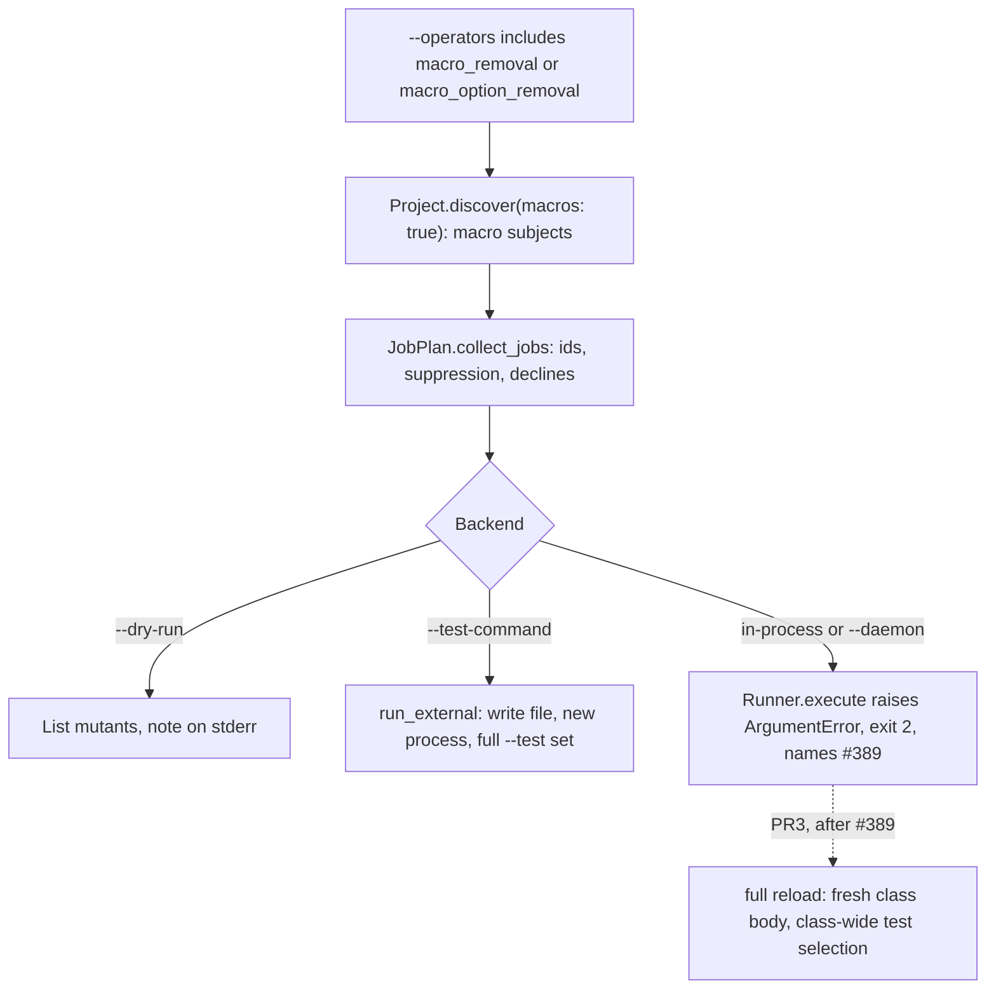

# Class-body macro mutants - Plan

## Goal Capsule

- **Issue:** #397 (mutate class-body macros: `scope`, `validates`, associations, callbacks).
- **Objective:** a Rails user can learn whether their tests notice a removed validation, association, callback, scope or `dependent:` option. A score never reports such a mutant as tested when the backend could not place it.
- **Means:** two opt-in macro operators that run only on the `--test-command` backend in the first release (KTD1, KTD4). The daemon gets them later, on the full-reload strategy of #389 (KTD9).
- **Authority:** this plan, then `AGENTS.md`, then issue #397. Where this plan differs from the issue, this plan wins (see "Corrections to the issue").
- **Execution profile:** Deep. Spike first (U1). PR1 ships the `--test-command` slice. PR2 is a small follow-up that depends on pull request #391 (the reload fix for Rails class bodies). PR3 adds the daemon and waits on #389 (full reload for Rails daemon runs).
- **Stop and ask when:** U1 fails a pass criterion. Also stop when a change alters the id of an existing mutant, the default operator set, an exit code of a run without macro operators, or the GitHub Action's defaults. Also stop when a maintainer wants macro mutants on `--strategy reload` before #389 lands.
- **Who finishes:** the implementer opens the pull requests. A maintainer merges them and decides each release.
- **Size:** PR1 is medium: about 9 files under `lib/`, 8 test files, 2 fixture pairs, and 7 docs files. PR2 is 2 files. PR3 is medium and is planned here at decision level only.

---

## Product Contract

### Summary

Mutineer mutates only `def` bodies today. PR1 adds two opt-in operators. `macro_removal` replaces one class-body macro call with `nil`. `macro_option_removal` removes one keyword option from such a call, for example `dependent: :destroy`. The operators find a fixed list of Rails macros in class and module bodies and in a concern's `included` block.

A real run with a macro operator needs `--test-command`. That backend writes the mutated file and starts a new process for each mutant, so each mutant gets a fresh class body. Every other backend refuses the run with a usage error that names #389. A dry run lists the macro mutants on any backend.

### Problem Frame

Subjects are `Prism::DefNode`s only. `Project::SubjectVisitor#visit_def_node` creates every subject (`lib/mutineer/project.rb:398-424`). `Mutators::Base#mutations_for` visits only `subject.def_node.body` (`lib/mutineer/mutators/base.rb:12`, `:24-25`). So a class body is never mutated.

Much of a Rails model is class-body code. Probe 1 counts the macro calls in Fizzy at `f220e4832`:

| Fizzy folder | Files | Files with a listed macro | Associations | Callbacks | Scopes | Validations |
|---|---|---|---|---|---|---|
| `app/models` | 174 | 100 | 182 | 67 | 82 | 21 |
| `app/controllers` | 118 | 54 | 0 | 82 | 0 | 0 |

Vladimir Dementyev's Fizzy report names this gap ("Class-body macro subjects", `vladimir-fizzy-report.md` line 35). It lists real Fizzy bugs in macros: missing scopes and a missing `has_many :entropies, dependent: :destroy` (lines 222-223).

The backends differ in what they can do with a macro mutant:

- `--strategy redefine` loads one mutated `def` (`lib/mutineer/isolation.rb:239-321`). It cannot place a class-body edit.
- `--strategy reload` in process and `--daemon` `load` the mutated file over the class that is already loaded. A removed macro stays in effect, and a changed macro runs next to the original (probe 3). That gives false survivors and false kills.
- `--test-command` writes the mutated file with `FileSwap.with` and runs the suite in a new process (`lib/mutineer/runner.rb:304-316`). Probe 2 shows that a removed `validates` and a removed `dependent:` option are killed by a test that checks them and survive a test that does not.

### Requirements

**Mutants (PR1)**

- R1. `macro_removal` gives one mutant for each listed macro call: it replaces the whole call with `nil`.
- R2. `macro_option_removal` gives one mutant for each top-level keyword option of a listed macro call: it removes that pair.
- R3. `macro_option_removal` declines a candidate that would leave `validates` or `validates_with` without a validator, and counts it in `declined` (KTD6).
- R4. A listed macro is a receiver-less call to a name in KTD3, written as a direct statement of a class body, a module body, or a concern's `included` or `prepended` block.
- R5. Both operators are opt-in. `DEFAULT_NAMES` does not change. The operators are not suggested by the tier-2 hint.

**Identity (PR1)**

- R6. A macro subject has a name that no `def` can have: `Card.has_many(:entropies)`, or `Card.before_save()` when the first argument is not a symbol (KTD5).
- R7. Mutant ids of every existing mutant stay the same, with and without macro operators.
- R8. `--only` and `# mutineer:disable-line` work on macro subjects and lines as they do on methods.

**Backends (PR1)**

- R9. A real run that selects a macro operator without `--test-command` stops before any boot or fork. It exits 2 and names `--test-command` and #389. This applies to the in-process strategies, `--daemon`, the CLI, the Action and library callers of `Runner.execute`.
- R10. A dry run lists macro mutants on every backend. Without `--test-command` it prints one stderr note that a real run needs `--test-command`.
- R11. A macro subject is `unplaceable` under both strategies, so no path can load it on top of a loaded class.
- R12. On `--test-command`, a macro mutant is killed by a test that checks the macro and survives a test that does not. This is the done condition of #397.

**Safety of the reload guards (PR1 and PR2)**

- R13. A test fails when any operator other than the two macro operators gives a mutation outside a `def` body.
- R14. After #391 (the reload fix for Rails class bodies) merges, a test fails when a macro subject reaches `ConcernBlocks.load_mutant`.

**Contract (PR1)**

- R15. `--list-operators`, `README.md`, `docs/index.md`, `docs/index.html`, `docs/llms.txt`, `docs/json-schema.md`, `STABILITY.md` and `CHANGELOG.md` describe the operators, the subject names and the backend limit.

### Acceptance Examples

- AE1. Covers R1, R12. A Rails-free fixture class `Widget` calls `validates :name, presence: true`. With `--operators macro_removal --test-command "ruby %{files}"`, the strong test kills the mutant `Widget.validates(:name)`. The weak test lets it survive. The report's survivor has operator `macro_removal` and token `validates :name, presence: true`.
- AE2. Covers R2, R12. The same fixture calls `has_many :parts, dependent: :destroy`. `macro_option_removal` gives one mutant with token `, dependent: :destroy`, because the removed range holds the comma before the pair. The strong test kills it and the weak test lets it survive.
- AE3. Covers R3. `validates :name, presence: true` gives no `macro_option_removal` mutant, and `declined` holds `{ "macro_option_removal" => 1 }`. `validates :name, presence: true, allow_nil: true` gives two option candidates. The `presence:` candidate is declined. The `allow_nil:` candidate is a mutant.
- AE4. Covers R9. `mutineer run widget.rb --test widget_strong_test.rb --operators macro_removal` exits 2. Stderr names `--test-command` and #389. No fork and no coverage capture runs.
- AE5. Covers R7. The calculator fixture with the default operators gives the same ids as with the default operators plus both macro operators.
- AE6. Covers R10. `mutineer run widget.rb --dry-run --operators macro_removal` lists two `[macro_removal]` lines and prints the note on stderr. It exits 0.

### Scope Boundaries

- No macro mutants on `--strategy reload`, `--strategy redefine` or `--daemon` in PR1 (KTD4).
- No change to a scope's lambda body. Existing operators do not visit it (KTD8).
- No `enum`, `normalizes`, `encrypts`, `delegate`, `attribute`, `serialize`, `broadcasts*`, attachment or `rescue_from` macros. KTD3 lists the first set.
- No macros in `class << self` bodies, in method bodies, or in blocks other than a concern's `included` or `prepended` block.
- No change to the default operator set, the score formula or any status.
- No change to the Action's inputs. The Action passes `operators` through (`action.yml:386`), so a user can opt in there.

#### Deferred to Follow-Up Work

Each item needs a GitHub issue before PR1 merges (Q4).

- Scope-body mutants: run the existing operators on the lambda body of `scope` (KTD8).
- The next macro set: `enum`, `normalizes`, `encrypts`, `delegate`, `has_one_attached`, `broadcasts*`.
- Macro mutants on the daemon. PR3 below holds the decisions. It waits on #389 (full reload for Rails daemon runs).

### Corrections to the issue

1. **The guard code is not on `main`.** `EnumRedeclaration` and `CallbackReskipping` are in `lib/mutineer/reload_guards.rb` on the branch of pull request #391 only (lines 43-53 and 62-73 there). `main` at `8d9905c4` has no such file. So the guard test is PR2, after #391 merges (R14).
2. **`CallbackReskipping` is wider than the issue says.** It adds `raise: false` when each filter is a method of the class, or a callback that the parent still has (`reload_guards.rb:478-491` on #391). The issue names only the first case.
3. **The guards are safe because of an invariant in two places.** The issue names `lib/mutineer/mutators/base.rb`. That file states it (`:12`) and enforces it (`:24-25`). The guard comment on #391 relies on it: "The class body outside methods is the original's" (`reload_guards.rb:56`). Probe 4 confirms it today: 21 operators gave 11 mutations on a file full of macros, and 0 were outside a `def` body.
4. **"An added or changed one runs twice" is true for some macros only.** On reload, `validates` and block callbacks append a copy. `has_many` keeps one reflection and `scope` replaces its method (`grok-cursor/evidence/macro-detail-7.2.txt`; the grok-cursor report, row A6). Pull request #391 removes repeated copies only when they match exactly. It keeps both copies of a changed entry ("Not covered" in its body). So a changed macro on reload is unsound in different ways for different macros. KTD4 refuses all of them.
5. **The external backend does not write the file itself.** `Runner.run_external` writes it with `FileSwap.with` (`lib/mutineer/runner.rb:313-315`). `ExternalBackend.run` only runs the command (`lib/mutineer/external_backend.rb:171`). The claim of a fresh class body is right: each mutant runs in a new process. Probe 2 checks it Rails-free. U1 checks it on Rails.
6. **The done condition misses three parts.** It does not say how a macro mutant gets an id, what the other backends do with one, or how a user opts in. R6 to R11 add them.
7. **#286 matters for PR3.** The issue says "Not #286" (load-time code in general). In process, the coverage capture clears the boot coverage before each test (`lib/mutineer/coverage_map.rb:646`). A class-body line is a load line (`coverage_map.rb:46-54`). So `JobPlan.coverage_selection` finds no test for a macro line and calls `ran_at_load?` (`lib/mutineer/job_plan.rb:262-286`). PR3 must choose tests for a macro line in another way (KTD9).
8. **Not checked: a Rails macro mutant on `--test-command`.** The issue says the path was not run. This plan did not run it either. A Fizzy run is out of bounds for planning, and the fixture app needs its own bundle. U1 runs it.

---

## Planning Contract

### Key Technical Decisions

- KTD1. **Opt in with operator names, not a new flag.** `--operators macro_removal,macro_option_removal`, or the same names in `.mutineer.yml` and the Action's `operators` input. The operator list is already how a user opts in to more mutants (`lib/mutineer/mutator_registry.rb:26-32`). Discovery adds macro subjects only when a selected operator is a macro operator.
  - Rejected: a `--macros` flag. It is a second switch for one concept, and it would need a Config field, a YAML key and an Action input.
  - Rejected: discovering macro subjects on every run. It adds subjects to every run, and it moves the method count that the sibling plan for #386 (methods that get no mutants) adds.
- KTD2. **A new tier for macro operators.** `MutatorRegistry::MACRO_NAMES` holds the two names. `tier` returns 3 for them. `--list-operators` prints `macro` in place of `disabled`, and the description says `--test-command only`. `tier2_hint` (`lib/mutineer/cli.rb:820-832`) reads `TIER2_NAMES` only, so it never suggests them.
  - Rejected: adding them to `TIER2_NAMES`. The hint would suggest them on runs that must refuse them.
- KTD3. **A fixed list of macro names, in one constant.** `Project::SubjectVisitor::MACRO_CALLS` matches:
  - validations: `validates`, `validates_*_of`, `validate`, `validates_with`, `validates_associated`;
  - associations: `has_many`, `has_one`, `belongs_to`, `has_and_belongs_to_many`;
  - callbacks: `before_`, `after_` and `around_` with `validation`, `save`, `create`, `update`, `destroy`, `commit`, `rollback`, `initialize`, `find`, `touch` or `action`, and `after_create_commit`, `after_update_commit`, `after_destroy_commit`, `after_save_commit`;
  - `scope`.

  These are the four families of the issue title. A name that is not in the list gives no subject.
  - Rejected: any receiver-less call in a class body. `include`, `attr_accessor` and `self.table_name =` would become mutants with a high equivalent share.
- KTD4. **PR1 runs macro mutants only on `--test-command`.** `Runner.execute` raises `ArgumentError` when a selected operator is a macro operator and `config.test_command` is nil. It does this before the external branch, the daemon branch and any boot (`lib/mutineer/runner.rb:67-77`). The CLI already turns an `ArgumentError` into a usage error with exit 2 (`lib/mutineer/cli.rb:356-359`). One check covers the CLI, the Action, the daemon and library callers. `Subject#unplaceable?` also returns true for a macro subject, as a second guard (R11). `JobPlan.coverage_selection` returns `[:verdict, Result.unplaceable]` for a macro subject as its first step. `Runner.run` calls it before any other subject check (`lib/mutineer/runner.rb:374`). Without that step, `StatementLines.for(subject.def_node, ...)` would raise on a nil `def_node`. The daemon calls it only when its coverage map is not empty (`lib/mutineer/daemon_backend.rb:426`). So the `Runner.execute` check stays the main guard.
  - Rejected: run them in process and report `unplaceable`. A user who opts in would get only unrun mutants and the unrun-share warning, with no clear reason.
  - Rejected: run them on reload with narrower guards. Probe 3 shows a removed macro stays in effect, so the verdicts are false.
- KTD5. **Subject identity.** A macro subject is a `Subject` with `def_node: nil`, a new field `macro_node` (the `Prism::CallNode`) and `singleton: true`. Its `name` is the macro name plus parentheses: `has_many(:entropies)`, with the first argument when it is a symbol literal, else `before_save()`. So `qualified_name` gives `Card.has_many(:entropies)` with no change to that method. Ruby does not allow `(` in a method name, so a macro name cannot equal a method name. `JobPlan.collect_jobs` keys the subject ordinal on the declaration offset (`lib/mutineer/job_plan.rb:100`). It uses a new `Subject#node` (the def node or the macro node), so two `validates :name` lines get ordinals 0 and 1. The id formula does not change (`lib/mutineer/mutant_id.rb:43-47`).
  - Rejected: put the line number in the name. A line move would change the id, which breaks baselines.
  - Rejected: a separate `MacroSubject` struct. `Reporter`, `MutantId`, `scope_since` and `Runner.run_external` read only `file` and `qualified_name` from a subject (`lib/mutineer/reporter.rb:739-743`, `lib/mutineer/job_plan.rb:482-487`). A second type adds a branch at each of those places.
- KTD6. **The edits.** Each edit keeps the file parsing.
  - `macro_removal` replaces the call, with its block, by `nil`. This is the replacement that `statement_removal` uses.
  - `macro_option_removal` removes one pair of the call's last `KeywordHashNode`, with the comma and space before it. It declines (calls `decline`) when the call is `validates` or `validates_with` and no validator key stays. Rails raises at load for `validates` with no validator. Probe 1 finds 12 such one-key `validates` calls in Fizzy models. A non-validator key is one of `if`, `unless`, `on`, `allow_nil`, `allow_blank`, `strict`, `message`.
  - Both operators inherit `drop_dangling_heredocs` from `Mutators::Base`, so a heredoc in a macro is safe.
- KTD7. **A shared base for macro operators.** `Mutators::MacroBase < Base` overrides `mutations_for` to visit `subject.macro_node` and returns `[]` for a def subject. `Base#mutations_for` returns `[]` for a macro subject (`def_node` is nil). `Base.macro?` returns false and `MacroBase.macro?` returns true. So no def operator ever edits a class body, and the invariant in Correction 3 holds.
- KTD8. **Scope bodies are a follow-up.** A scope's lambda body runs when a test calls the scope, not at load. Reload replaces the scope method, so a body mutant could take effect there too (`macro-detail-7.2.txt`). It needs the existing operators to visit a lambda, a new subject kind, and coverage for lambda lines. That is a different feature. PR1 covers a missing scope with `macro_removal`.
- KTD9. **PR3 decisions for the daemon, after #389.**
  - Macro mutants run only on the full-reload strategy of #389. The `ArgumentError` from KTD4 then allows that strategy too.
  - Full reload does not call `ConcernBlocks.load_mutant`, so the #391 guards are not on its path. R14 keeps that true.
  - Test selection for a macro line: the union of `tests_for` over every line of every `def` body in the same class body, plus the tests that `Pairing.infer_tests` pairs with the file. With no test, the verdict is `no_coverage`.
  - A macro mutant never gets `ran_at_load`. Full reload runs the mutated class body, so a load-time value is the mutant's value.
  - The U8 spike confirms the selection before PR3 writes code.
  - Rejected for PR3: the whole `--test` set for every macro mutant. It is correct, but on a Rails suite it costs a full run for each mutant.
- KTD10. **Release.** PR1 adds opt-in operators and changes no default. By `AGENTS.md` that is a minor feature. Issue #397 has the label `v2.0`, so PR1 takes `v2.0` (Q1). PR1 is not a breaking change, so it need not stay a draft.

### Assumptions

These are bets of the planning agent. No user confirmed them.

- A maintainer accepts operator names as the opt-in (KTD1).
- `bin/rails test %{files}` in the fixture app runs with the app's own bundle when `--test-command` strips the `BUNDLE_*` variables (`lib/mutineer/external_backend.rb:140-142`). U1 checks this.
- The first macro list in KTD3 covers the Fizzy bugs that the report names. Scope-body bugs ("missing scopes") are covered as a removal only.
- A sibling agent plans #389. PR3 follows that plan's strategy name.

### High-Level Technical Design

### Evidence from the planning probes

The scripts and logs are in `/private/tmp/claude-501/-Users-davidteren-Projects-claude-worktrees-mutineer-vladimir-issues-planning-21adcb/ae564be8-638b-4dd0-a9e5-9d7a58cb00ae/scratchpad/context/probes/397/`. That folder is local to one machine and can be gone. U1 gives its own commands, so a missing folder blocks nothing.

- **Probe 1** (`probe1_macro_census.rb`): a static Prism census of Fizzy at `f220e4832`. The table in Problem Frame comes from it. Other counts: 59 `dependent:` options, 16 block or lambda callbacks and 82 scope lambdas in models. Keyword options on listed macros: 209 on associations, 22 on callbacks and 20 on validations in models, and 29 on callbacks in controllers. Mutineer's own `lib/` has 0 listed macros in 69 files.
- **Probe 2** (`probe2_fresh_process.out`): a Rails-free `Widget` with recording macros, run as a new process for each edit. The original passes both tests. Removing `validates` gives strong exit 1 and weak exit 0. Removing `dependent: :destroy` gives strong exit 1 and weak exit 0.
- **Probe 3** (`probe3_reload_on_top.out`): the same class loaded twice, as reload does. With `validates` removed, the validation stays and an empty name is still invalid: a false survivor. With `presence: false`, both entries stay.
- **Probe 4** (`probe4_def_body_invariant.out`): every operator in `MutatorRegistry::ALL` on a file with seven class-body macros and one method. 11 mutations, 0 outside the `def` body.

**Cost estimate, from probe 1.** Fizzy's report has 731 generated mutants in models and 340 in controllers (the Sol report, row A7). Both operators would add about 352 removals plus 239 to 251 option removals in models, about 81% more. In controllers they add 82 plus 29, about 33% more. Each `--test-command` mutant runs the whole `--test` set in series (`lib/mutineer/runner.rb:229-234`). The README must say so (U6).

---

## Implementation Units

### PR1: Macro mutants on `--test-command`

Waits on: nothing. U1 must record a pass before PR1 merges.

### U1. Spike: a Rails macro mutant on `--test-command`

**Goal:** confirm on Rails what probe 2 shows without Rails.

**Requirements:** R12.

**Dependencies:** none. U2 to U4 can start before it ends.

**Question:** in the fixture Rails app, does a fresh-process test run kill a removed `validates` and a removed `dependent:` option when a test checks them, and let them survive when no test checks them? How long does one mutant take?

**Time box:** 2 hours. If a question has no answer when the time ends, PR1 does not merge. The result names the open question.

**Method:** work in a scratch copy, never in the repo's fixture folder.

1. `cp -R test/fixtures/rails_app "$SCRATCH/app" && cd "$SCRATCH/app" && bundle install`.
2. Add a model `Crate` with `has_many :crate_items, dependent: :destroy` and `validates :label, presence: true`, a `CrateItem` with `belongs_to :crate`, and the two tables in `db/schema.rb`. Add `test/models/crate_strong_test.rb`, which asserts the error on a blank label and that destroying a crate removes its items. Add `test/models/crate_weak_test.rb`, which only saves a valid crate.
3. Run `bin/rails test test/models/crate_strong_test.rb` and the weak test. Record each exit code and the time.
4. Remove the `validates` line, run both again, then restore the line. Remove `, dependent: :destroy`, run both again, then restore it.
5. Remove `belongs_to :crate` and run the strong test. Record the exit code and whether the output has a Minitest summary line. This shows how `ExternalBackend` scores an edit that breaks a load.
6. Run the same command through the environment that `ExternalBackend.child_env` builds: `env -u BUNDLE_GEMFILE -u BUNDLE_BIN_PATH -u RUBYOPT bin/rails test test/models/crate_strong_test.rb`.

**Pass:** in step 4 each strong run exits 1 with a failing test in its summary, and each weak run exits 0. Step 6 runs. **Fail:** any other outcome in steps 4 or 6.

**Outcomes:**

- Pass: PR1 goes on. U5 builds its Rails test from the `Crate` fixture.
- Fail on step 6 only: PR1 goes on. The docs give the command form that worked. A maintainer reviews it.
- Fail on step 4: stop and ask. The fresh-process claim is wrong on Rails, and the plan needs a new backend decision.
- Step 5 informs the docs only. An exit 1 with a failing summary is a kill. An exit 1 without a summary is `error`.

**Record:** add a `## Spike Result` section to this plan in the PR1 branch, with the Rails version, the commit, each exit code and the times. The spike merges no code.

**Test expectation:** none. The spike changes no behaviour.

### U2. Discover macro subjects

**Goal:** `Project.discover` returns macro subjects when asked, with the names and ordinals from KTD5.

**Requirements:** R4, R6, R7, R8, R11.

**Dependencies:** none.

**Files:**

- `lib/mutineer/subject.rb`: add the `macro_node` field (`:27-28`), `#macro?`, `#node`, a nil `#body_loc` for a macro (`:60-62`), and macro handling in `#unplaceable?` (`:53-55`). Update the class comment.
- `lib/mutineer/project.rb`: `Project.discover` (`:17-27`) takes `macros: false` and passes it to `SubjectVisitor`. Add `MACRO_CALLS` beside `CONCERN_BLOCKS` (`:173`). Add macro recording for the direct statements of a class body, a module body, and a concern's `included` or `prepended` block, next to `visit_class_node` and `visit_module_node` (`:257-268`). Skip `class << self` bodies. Keep macro subjects in their own list, `SubjectVisitor#macro_subjects`. `discover` appends that list after `promote_module_functions!` and `exclude_ambiguous_hook_defs!`. Both of those read `@subjects` by index with `@subject_keys`, or read `def_node` (`:41-72`, `:241-252`). A macro in `@subjects` would shift that index or raise on a nil `def_node`.
- `lib/mutineer/job_plan.rb`: `collect_jobs` passes `macros:` (`:87`) and keys the ordinal on `subject.node` (`:100`).
- Tests: `test/project_test.rb`, `test/subject_test.rb`, `test/mutant_id_test.rb`.

**Approach:**

1. `collect_jobs` sets `macros: operator_classes.any?(&:macro?)`.
2. A macro subject has the visitor's namespace, `lexical`, `file`, `singleton: true`, `def_node: nil` and `macro_node`. Its `owner_unknown` is the visitor's value. That field matters only for redefine, which never gets a macro.
3. `Subject#unplaceable?` returns true for a macro subject on both strategies.
4. `Subject#node` returns `def_node || macro_node`. Use it only where a location is read for every subject kind.

**Patterns to follow:** `CONCERN_BLOCKS` and the `included` block detection in `SubjectVisitor` (`lib/mutineer/project.rb:173`, `:284-300`).

**Test scenarios:** each fails before the unit.

- `test_discover_finds_no_macro_subjects_by_default` (project_test): a model with `validates` and one `def` gives one subject, the def. This guards R7.
- `test_discover_names_macro_subjects` (project_test): with `macros: true`, `has_many :entropies, dependent: :destroy` in `class Card` gives `Card.has_many(:entropies)`. `before_save { x }` gives `Card.before_save()`. `self.table_name = "x"` and `include Foo` give no subject.
- `test_discover_finds_macros_in_a_concern_included_block` (project_test): `module Card::Closeable; extend ActiveSupport::Concern; included do; has_one :closure; end; end` gives `Card::Closeable.has_one(:closure)`.
- `test_discover_skips_macros_in_methods_and_singleton_bodies` (project_test): `validates` inside a `def` and inside `class << self` gives no macro subject.
- `test_macro_subject_is_unplaceable_under_both_strategies` (subject_test): `unplaceable?("reload")` and `unplaceable?("redefine")` are both true. `body_loc` is nil.
- `test_two_identical_macros_get_distinct_ids` (mutant_id_test): two `validates :name` lines in one class give different ids through `collect_jobs`, with subject ordinals 0 and 1.
- `test_existing_ids_do_not_change_with_macro_operators` (mutant_id_test): covers AE5. The calculator fixture plus one class-body `validates` gives the same def-mutant ids with `DEFAULT_NAMES` as with `DEFAULT_NAMES` plus both macro operators.

**Verification:** the three test files pass.

### U3. The two macro operators

**Goal:** `macro_removal` and `macro_option_removal` give the edits in KTD6.

**Requirements:** R1, R2, R3, R5.

**Dependencies:** U2.

**Files:**

- New `lib/mutineer/mutators/macro_base.rb`: `Mutators::MacroBase` (KTD7).
- New `lib/mutineer/mutators/macro_removal.rb` and `lib/mutineer/mutators/macro_option_removal.rb`.
- `lib/mutineer/mutators/base.rb`: `mutations_for` returns `[]` when `subject.def_node` is nil (`:20-28`). Add `self.macro?` (false). Update the class comment to name the invariant and #397.
- `lib/mutineer/mutator_registry.rb`: the two requires, the `ALL` entries, `MACRO_NAMES`, `DESCRIPTIONS`, and `tier` (`:34-117`).
- `lib/mutineer/cli.rb`: `list_operators` (`:336-342`) prints `macro` for a macro operator.
- Tests: new `test/mutators/macro_removal_test.rb` and `test/mutators/macro_option_removal_test.rb`, `test/mutator_registry_test.rb`, `test/cli_test.rb`.

**Approach:** each operator visits only `subject.macro_node`. `macro_option_removal` reads the keyword names as symbols. It removes the pair and the separator before it. When the pair is first, it removes the separator after it. Every mutation must pass `Mutation#valid?`.

**Patterns to follow:** `Mutators::StatementRemoval` for the `nil` replacement, and the `decline` calls in `Mutators::ConditionForcing`.

**Test scenarios:**

- `test_removes_each_listed_macro` (macro_removal_test): a class with `validates`, `has_many`, `before_save { }` and `scope :active, -> { }` gives four mutants. Each replaces the whole call and its block with `nil`, and the result parses.
- `test_gives_nothing_for_a_def_subject` (macro_removal_test): a def subject gives `[]`.
- `test_removes_each_keyword_option` (macro_option_removal_test): `has_many :parts, dependent: :destroy, inverse_of: :box` gives two mutants. One result is `has_many :parts, inverse_of: :box` and the other is `has_many :parts, dependent: :destroy`.
- `test_declines_a_validates_with_no_validator_left` (macro_option_removal_test): covers AE3. `validates :name, presence: true` gives `[]` and `declined` 1. With `allow_nil: true` added, it gives one mutant that keeps `presence: true`, and `declined` 1.
- `test_def_operators_never_edit_a_macro_subject` (macro_option_removal_test): every operator outside `MACRO_NAMES` gives `[]` for a macro subject.
- `test_macro_names_are_neither_default_nor_tier2` (mutator_registry_test): `MACRO_NAMES` has no overlap with `DEFAULT_NAMES` or `TIER2_NAMES`, `tier("macro_removal")` is 3, and `ALL.keys` equals the three lists together.
- `test_list_operators_marks_macro_operators` (cli_test): the `macro_removal` line holds `tier 3` and `macro`.
- `test_tier2_hint_never_names_a_macro_operator` (cli_test): `tier2_hint(nil)` does not include `macro_`.

**Verification:** the four test files pass. `test/mutators/` passes unchanged otherwise.

### U4. Refuse macro mutants outside `--test-command`

**Goal:** R9 to R11 and R13.

**Requirements:** R9, R10, R11, R13.

**Dependencies:** U3.

**Files:**

- `lib/mutineer/runner.rb`: the check in `execute` after `operator_classes` (`:72`) and before the external branch (`:77`).
- `lib/mutineer/cli.rb`: `dry_run` (`:898-930`) prints the stderr note once.
- `lib/mutineer/job_plan.rb`: `coverage_selection` (`:262`) returns `[:verdict, Result.unplaceable]` for a macro subject as its first step (KTD4).
- Tests: `test/cli_test.rb`, `test/runner_test.rb`, new `test/mutators/def_body_invariant_test.rb`.

**Approach:** the error text is: "the macro operators (macro_removal, macro_option_removal) need --test-command. Reload and the daemon run the class body again on the loaded class, so a removed macro stays in effect (#389 tracks full reload)." The dry-run note says that a real run needs `--test-command`.

**Test scenarios:**

- `test_macro_operator_without_test_command_is_a_usage_error` (cli_test): covers AE4. Exit 2. Stderr has `--test-command` and `#389`. No `.mutineer` cache folder is created, which shows no coverage capture ran.
- `test_runner_execute_refuses_macro_operators_on_the_daemon` (runner_test): `Runner.execute` with `daemon: true` and `operators: ["macro_removal"]` raises `ArgumentError` before it spawns a daemon. The test stubs `DaemonBackend.execute` to fail if it is called.
- `test_runner_run_gives_a_macro_subject_unplaceable` (runner_test): covers R11. `Runner.run` with a macro subject, its mutation and an empty `CoverageMap.from_data` map returns `unplaceable` and forks no child. The test stubs `Isolation.run` to fail if it is called.
- `test_dry_run_lists_macro_mutants_with_a_note` (cli_test): covers AE6.
- `test_runs_without_macro_operators_are_unchanged` (cli_test): a run with the default operators on a model with macros prints no note and exits as before.
- `test_no_def_operator_mutates_outside_a_def_body` (def_body_invariant_test): covers R13. For each name in `ALL` minus `MACRO_NAMES`, every mutation on the probe 4 source lies inside a `def` body. The failure message names the operator and says that the reload guards of #391 depend on this. This is the repro fixture for the guard limit.

**Verification:** the three test files pass.

### U5. End-to-end proof on `--test-command`

**Goal:** the done condition of #397, Rails-free in the default suite and on Rails in the daemon suite.

**Requirements:** R12, AE1, AE2.

**Dependencies:** U1 (pass), U4.

**Files:**

- New fixtures `test/fixtures/widget.rb`, `test/fixtures/widget_strong_test.rb`, `test/fixtures/widget_weak_test.rb`: the probe 2 files. This is the repro fixture for #397.
- `test/runner_external_test.rb`: two tests.
- The `Crate` model, `CrateItem` model, schema tables, `crate_strong_test.rb` and `crate_weak_test.rb` from U1, under `test/fixtures/rails_app/`.
- New `test/rails_macro_test_command_test.rb`, added to the daemon list in `Rakefile` (`:5-15`).

**Test scenarios:**

- `test_macro_mutants_are_killed_by_a_checking_test` (runner_external_test): `--operators macro_removal,macro_option_removal --test-command "ruby %{files}" --format json` on `widget.rb` with the strong test. All three mutants are killed: `Widget.validates(:name)` (`macro_removal`), `Widget.has_many(:parts)` (`macro_removal`), and `Widget.has_many(:parts)` with token `, dependent: :destroy` (`macro_option_removal`). The test asserts each id, subject, operator and token, so it checks the mechanism, not only the exit code.
- `test_macro_mutants_survive_an_unchecking_test` (runner_external_test): the same run with the weak test. The same three ids are in `survivors[]` and the score is 0.0. The same ids in both tests show that only the test changed the verdict.
- `test_crate_macro_mutants_on_rails` (rails_macro_test_command_test): `Runner.execute` with `test_command: "bin/rails test %{files}"` and the U1 command form on `app/models/crate.rb`. With the strong test, the `validates` removal and the `dependent:` removal are killed. With the weak test, both survive. A third case runs `--operators macro_removal` with `daemon: true` and asserts `ArgumentError`.

**Verification:** `bundle exec rake test` and `bundle exec rake test:daemon` pass.

### U6. Docs, contract and CHANGELOG

**Goal:** R15.

**Requirements:** R15.

**Dependencies:** U5.

**Files:**

- `README.md`: the Operators section and the operator count row (`:149`). Add a "Class-body macros" part: the two names, the list in KTD3, the `--test-command` limit with #389, the cost estimate, and the subject name form.
- `docs/index.md`, `docs/index.html` and `docs/llms.txt`: the operator lists and the operator counts.
- `test/docs_contract_test.rb:160-174`: add `MACRO_NAMES` to the names each page must list, and to the count text.
- `docs/json-schema.md`: the `subject` row (`:81`) describes the macro name form. No key changes, so `SCHEMA_VERSION` (`lib/mutineer/reporter.rb:34`) does not move.
- `docs/cli.md`: `--operators` names the macro tier.
- `STABILITY.md`: the subject name form for macros is stable from this release.
- `CHANGELOG.md`, under `## [Unreleased]`, `### Added`: one entry for #397 that names the operators, the backend limit and the follow-up issues (Q4).

**Test scenarios:** `test_operator_pages_name_every_registered_operator` passes with the macro names. Test expectation for the prose: none, because it is documentation.

**Verification:** `bundle exec rake site:build`, then `node --test test/site_test.js`, pass.

### PR2: Guard test after #391

Waits on: pull request #391 (the reload fix for Rails class bodies) and PR1, merge only.

### U7. Keep macro subjects away from the reload guards

**Goal:** R14.

**Requirements:** R14.

**Dependencies:** #391 merged, U4.

**Files:**

- `lib/mutineer/reload_guards.rb`: one comment line in the `ReloadGuards` comment that names `test/mutators/def_body_invariant_test.rb` and the U4 refusal as the reason the guards stay safe.
- `test/reload_guards_test.rb` (added by #391): one test.

**Test scenarios:** `test_a_macro_subject_never_reaches_the_load_guards`: `Runner.run` with a macro subject and `strategy: "reload"` returns `unplaceable` and never calls `ConcernBlocks.load_mutant` (stubbed to fail).

**Verification:** `bundle exec rake test` passes.

### PR3: Macro mutants on the daemon (after #389)

Waits on: #389 (full reload for Rails daemon runs) merged, and PR1 merged. This part is at decision level. The #389 plan names the strategy, and this part follows it.

### U8. Spike: test selection for a macro line

**Question:** on the fixture app with full reload, does the selection in KTD9 choose a test that kills each `Crate` macro mutant?

**Method:** with #389 on a scratch branch, print the selection of KTD9 for each `Crate` mutant from the daemon's coverage map. Then run each mutant on the daemon and compare its verdict with its `--test-command` verdict from U5.

**Time box:** 4 hours.

**Pass:** each daemon verdict equals the `--test-command` verdict. **Fail:** any difference. Then use the whole `--test` set for macro mutants and record the cost.

### U9. Allow macro operators on full reload

**Files:** `lib/mutineer/runner.rb` (the KTD4 check allows the full-reload strategy), `lib/mutineer/job_plan.rb` (`coverage_selection` and `ran_at_load?` take the macro branch from KTD9), `lib/mutineer/subject.rb` (`unplaceable?` is false for a macro under full reload), the daemon tests, and the docs from U6.

**Test scenarios:**

- `Crate` macro mutants on the daemon with full reload give the U5 verdicts.
- A macro mutant never has the status `ran_at_load`.
- Under plain reload the run still exits 2.

---

## Verification Contract

Prefix every ruby, rake and bundle command with `LANG=en_US.UTF-8 LC_ALL=en_US.UTF-8` in a shell where they are unset.

| Command | Applies to | Proves |
|---|---|---|
| `bundle exec rake test` | PR1, PR2, PR3 | The zero-dependency suite passes with the new tests, including the Rails-free end-to-end proof. |
| `ruby -Ilib -e 'require "mutineer"'` | PR1, PR2, PR3 | The gem loads. |
| `bundle exec rake yard:strict` | PR1, PR2, PR3 | 100% documented. The new classes, `MACRO_CALLS`, `MACRO_NAMES` and each new method need a docstring. |
| `bundle exec rake test:daemon` | PR1, PR3 | The Rails macro test on `--test-command` passes, and the daemon refuses macro operators. |
| `bundle exec rake site:build`, then `node --test test/site_test.js` | PR1 | The docs build and list the new operators. |
| `bundle exec bin/mutineer run test/fixtures/widget.rb --dry-run --operators macro_removal,macro_option_removal` | PR1 | The output lists 3 mutants and the stderr note. |
| `bundle exec bin/mutineer run lib --dry-run \| tail -1`, before and after | PR1 | The total is the same. Mutineer's `lib/` has 0 listed macros (probe 1). |

Labels: PR1 gets `enhancement`, `risk: high` and `v2.0`, the labels of #397. PR2 gets `enhancement` and `v2.0`. PR3 gets `enhancement`, `risk: high` and `v2.0`. Use existing labels only. Semver: each pull request adds an opt-in feature, so each is a minor change by `AGENTS.md`. None changes a default, so none is a major change. No part of this plan tags, publishes or merges a release.

## Definition of Done

- U1 has a `## Spike Result` section that records a pass.
- Every test in U2 to U5 exists, failed before its unit, and passes after.
- A run without a macro operator gives the same mutants, ids, score and exit code as before PR1. `test/integration_test.rb` passes with no edit.
- A real run with a macro operator and no `--test-command` exits 2 on every backend, before any boot.
- The docs list both operators, the macro list, the backend limit and the cost.
- Issues exist for each item in "Deferred to Follow-Up Work", and the CHANGELOG entry names them.
- #397 closes with PR1. PR2 and PR3 reference it.
- No spike script, dead code or abandoned attempt is in any diff.

---

## Risks and Overlaps

| Item | Overlap | Handling |
|---|---|---|
| Pull request #391 (the reload fix for Rails class bodies) | Adds the two guards and `ConcernBlocks.load_mutant`. | PR1 does not depend on it. PR2 adds the guard test after it merges. |
| #389 (full reload for Rails daemon runs), and its sibling plan in this batch | The daemon path for macros. | PR3 waits on it. KTD4 names it in the error text. |
| #286 and pull request #322 (`ran_at_load` mutants and their count) | A macro line is a load line in process. | PR1 never reaches that path. PR3 keeps macro mutants out of `ran_at_load` (KTD9). |
| Sibling plan for #386 (methods that get no mutants) | Counts subjects in `collect_jobs`. | Macro subjects exist only when a macro operator runs. That plan should count `def` subjects only, or report macros on their own line. Text conflict in `collect_jobs`. |
| Sibling plan for #388 (errored mutants in the JSON report) | A macro removal that breaks a load scores `error`. | Its list shows these mutants. No conflict. |
| Sibling plans for #381 and #382 (unpaired sources, a `tests:` map) | Choose the `--test` set that `--test-command` runs. | No conflict. A macro mutant runs that whole set. |
| Sibling plan for #402 (a pinned Fizzy sample before each release) | Could add a macro sample. | Out of scope. Q5. |
| Pull request #393 (a mutant is invalid only when it adds a parse error) | Changes `Mutation#valid?`. | Both edits keep the file parsing. No conflict. |
| Pull request #369 (warn when `--test-command` runs tests in random order) | Edits the external backend and the CLI. | Text conflict only. |
| Pull requests #244 and #245 (the 2.0 contract flip, parallel Rails by default) | Rewrite `cli.rb`, `runner.rb` and `job_plan.rb`. | Base PR1 on the line that a maintainer names (Q2). |
| Pull request #375 (place a hook-block mutant before its file loads) | Edits `lib/mutineer/job_plan.rb` and hook handling in `project.rb`. | Text conflict only. Macro discovery reads the same `included` detection. |
| Cost | Probe 1 estimates about 81% more mutants in Fizzy models, each a full serial `--test` run. | Opt-in only. The README gives the estimate and suggests `--only` or a narrow `--test` set. |
| Equivalent mutants | Removing `inverse_of:` or `class_name:` often changes nothing that a test can see. | Users ignore these with `# mutineer:disable-line macro_option_removal`. Track the share in the follow-up issue (Q4). |
| A removal that breaks a load | Removing `belongs_to` can raise in a later macro. | U1 step 5 shows the verdict. `ExternalBackend` scores exit 1 without a summary as `error`, outside the score. |
| Bootsnap cache | A same-size mutant in the same second could load a stale compile. | `ExternalBackend.child_env` sets `DISABLE_BOOTSNAP_COMPILE_CACHE=1` (#285). |

## Open Questions

None blocks PR1, except that U1 must pass.

- Q1. Should PR1 wait for 2.0, or ship in a 1.x minor? It is opt-in and changes no default. Default: keep the `v2.0` label of #397. A maintainer decides.
- Q2. Which branch is the base of PR1? Default: `main`. The 2.0 line takes it on its next rebase. A maintainer decides.
- Q3. Should a dry run without `--test-command` refuse macro operators, as a real run does? Default: no. It lists the mutants and prints a note (R10), so a user can see the cost first. A maintainer decides.
- Q4. Should the follow-up issues be filed: scope bodies, the next macro set, and the equivalent share of `macro_option_removal`? Default: yes, before PR1 merges. A maintainer decides.
- Q5. Should the pinned Fizzy sample of #402 include a macro run on `--test-command`? Default: not in the first version of #402. A maintainer decides.
- Q6. Are `validates_*_of`, `validates_with` and `validates_associated` worth listing? Fizzy models use only `validates` (15 calls) and `validate` (6 calls). Default: yes. They are one regex and old apps use them. A maintainer decides.
