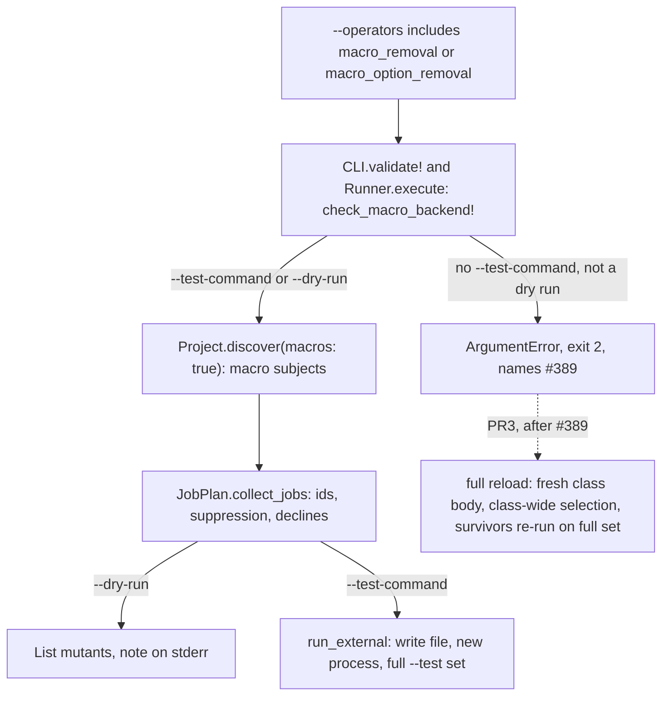

# Class-body macro mutants - Plan

**Add two opt-in macro operators for `--test-command`. Add daemon support after #389 (full reload for Rails daemon runs).**

- **What:** Remove selected Rails macro calls or keyword options.
- **Why:** Show whether tests detect the removed behaviour.
- **How:** The implementer delivers PR1 (external-command support), PR2 (guard comment) and PR3 (daemon support).

## Goal Capsule

- **Issue:** #397 (mutate class-body macros: `scope`, `validates`, associations, callbacks).
- **Objective:** Show whether tests detect a removed validation, association, callback, scope or `dependent:` option. Never score a macro mutant as tested when the backend could not place it.
- **Means:** Two opt-in operators, initially restricted to `--test-command` (KTD1, operator selection; KTD4, backend restriction). Daemon support follows #389 through full reload (KTD9, daemon design).
- **Who gets what when:** PR1 serves `--test-command` users. Vladimir's Fizzy flow uses `--rails`, the daemon and full reload (report lines 237-248 and 381-387). It gets macro mutants in PR3, after #389.
- **Authority:** This plan, then `AGENTS.md`, then issue #397. This plan controls conflicts; see "Corrections to the issue".
- **Execution profile:** Deep. Start with the Rails spike (U1). PR1 implements `--test-command` support. PR2 adds one comment after pull request #391 (the reload fix for Rails class bodies). PR3 adds daemon support after #389.
- **Stop and ask when:** U1 fails a pass criterion. Also stop before changing existing mutant ids, default operators, exit codes without macro operators, or GitHub Action defaults. Stop if a maintainer requests macro mutants on `--strategy reload` before #389 merges.
- **Who finishes:** The implementer owns implementation tasks and opens the pull requests. A maintainer owns merges, open decisions and each release.
- **Size:** PR1 is medium: 11 files under `lib/`, 9 test files, 2 fixture pairs, a `bin/rails` binstub and 11 docs files. PR2 changes 1 file. PR3 is medium; this plan defines its decisions only.

---

## Product Contract

### Summary

Mutineer currently mutates only `def` bodies. PR1 adds two opt-in operators:

| Operator | Change |
|---|---|
| `macro_removal` | Replace one class-body macro call with `nil`. |
| `macro_option_removal` | Replace one keyword option, such as `dependent: :destroy`, with `**{}`, which passes no keyword. |

Discovery uses a fixed Rails macro list in class bodies, module bodies and a concern's `included` block.

Real runs require `--test-command`. It writes each mutated file and starts a fresh process, which gives each mutant a fresh class body. Other backends reject real runs with a usage error naming #389. Dry runs list macro mutants on any backend.

### Problem Frame

All subjects are `Prism::DefNode`s. `Project::SubjectVisitor#visit_def_node` creates them (`lib/mutineer/project.rb:398-422`). `Mutators::Base#mutations_for` visits only `subject.def_node.body` (`lib/mutineer/mutators/base.rb:12`, `:24-25`). Class bodies therefore receive no mutations.

Probe 1 counts listed macro calls in Fizzy at commit `f220e4832`:

| Fizzy folder | Files | Files with a listed macro | Associations | Callbacks | Scopes | Validations |
|---|---|---|---|---|---|---|
| `app/models` | 174 | 100 | 182 | 67 | 82 | 21 |
| `app/controllers` | 118 | 54 | 0 | 82 | 0 | 0 |

Vladimir's Fizzy report identifies "Class-body macro subjects" as a gap (`vladimir-fizzy-report.md` line 35). Full reload adds no mutants until macros are mutated; macro subjects make full reload useful (line 381).

The report's missing scopes and missing `has_many :entropies, dependent: :destroy` do not prove this feature's value. They appear under "What it can't catch": their fixes added absent code (lines 218-223). See Correction 9.

| Backend | Macro behaviour |
|---|---|
| `--strategy redefine` | Loads one mutated `def`; cannot place class-body edits (`lib/mutineer/isolation.rb:239-321`). |
| In-process `--strategy reload` and `--daemon` | `load` the mutated file over an existing class. Removed macros remain active; changed macros run beside originals. Probe 3 shows false survivors and false kills. |
| `--test-command` | Uses `FileSwap.with`, then starts a fresh process (`lib/mutineer/runner.rb:304-312`). Probe 2 shows correct strong-test kills and weak-test survivors for removed `validates` and `dependent:`. |

### Requirements

**Mutants (PR1)**

- R1. `macro_removal` creates one mutant per listed macro call, replacing the whole call with `nil`.
- R2. `macro_option_removal` creates one mutant per top-level keyword option, replacing that pair with `**{}` (KTD6, edit rules).
- R3. `macro_option_removal` declines and counts candidates that leave `validates` without a validator (KTD6). `validates_with` uses a positional validator and never declines.
- R4. Listed macros are receiver-less calls from KTD3 (macro list). They must be direct statements in class bodies, module bodies, or concern `included` or `prepended` blocks.
- R5. Both operators are opt-in. Keep `DEFAULT_NAMES` unchanged and exclude them from the tier-2 hint.

**Identity (PR1)**

- R6. Macro subject names cannot match a `def`: `Card.has_many(:entropies)`, or `Card.before_save()` without a first symbol argument (KTD5, identity).
- R7. Preserve every existing mutant id, with and without macro operators.
- R8. Apply `--only` and `# mutineer:disable-line` as for methods. `--only` selects same-name macros together (KTD5).

**Backends (PR1)**

- R9. Reject real macro runs without `--test-command` before boot, fork or other warnings. Exit 2 and name `--test-command` and #389. Cover in-process strategies, `--daemon`, CLI, Action and library callers of `Runner.execute`.
- R10. Dry runs list macro mutants on every backend. Without `--test-command`, print one stderr note that real runs require it.
- R11. Withdrawn. R9 prevents macro subjects reaching `Subject#unplaceable?` or `JobPlan.coverage_selection` (KTD4).
- R12. On `--test-command`, checking tests kill macro mutants; non-checking tests let them survive. This completes #397.

**Safety of the reload guards (PR1 and PR2)**

- R13. A test must fail if any non-macro operator mutates outside a `def` body.
- R14. In PR1, a test must fail if any macro run reaches `ConcernBlocks.load_mutant` on any strategy or daemon. That method is on `main` (`lib/mutineer/concern_blocks.rb:57`).

**Contract (PR1)**

- R15. Document operators, subject names and backend limits in `--list-operators`, `README.md`, `docs/index.md`, `docs/index.html`, `docs/llms.txt`, `docs/json-schema.md`, `docs/cli.md`, `docs/equivalent-skips.md`, `docs/equivalent-skips.html`, `docs/rails.md`, `docs/rails.html`, `docs/rails-setup.md`, `STABILITY.md` and `CHANGELOG.md`.

**Line of an option removal (PR1)**

- R16. Start each `macro_option_removal` mutant on the removed pair's line. Use that line for `# mutineer:disable-line`, `--since`, reports and Action annotations.

### Acceptance Examples

- AE1 (macro removal). Covers R1, R12. Rails-free `Widget` calls `validates :name, presence: true`. With `--operators macro_removal --test-command "ruby %{files}"`, the strong test kills `Widget.validates(:name)`; the weak test permits survival. The survivor reports operator `macro_removal` and token `validates :name, presence: true`.
- AE2 (option removal). Covers R2, R12, R16. `Widget` calls `has_many :parts, dependent: :destroy`. `macro_option_removal` creates one mutant: token `dependent: :destroy`, replacement `**{}`. The strong test kills it; the weak test permits survival.
- AE3 (validator protection). Covers R3. `validates :name, presence: true` creates no option mutant; `declined` contains `{ "macro_option_removal" => 1 }`. `validates :name, presence: true, allow_nil: true` creates two candidates: decline `presence:`, mutate `allow_nil:`. `validates_with FooValidator, if: :x` creates one mutant and no decline.
- AE4 (backend refusal). Covers R9. `mutineer run widget.rb --test widget_strong_test.rb --operators macro_removal` exits 2. Stderr names `--test-command` and #389. Never call `Runner.execute`.
- AE5 (stable ids). Covers R7. The calculator fixture produces identical ids with default operators and with defaults plus both macro operators.
- AE6 (dry run). Covers R10. `mutineer run widget.rb --dry-run --operators macro_removal` lists two `[macro_removal]` lines, prints the stderr note and exits 0.

### Scope Boundaries

- PR1 excludes macro mutants on `--strategy reload`, `--strategy redefine` and `--daemon` (KTD4).
- Scope lambda bodies remain unchanged. Existing operators do not visit them (KTD8, scope-body follow-up).
- Exclude `enum`, `normalizes`, `encrypts`, `delegate`, `attribute`, `serialize`, `broadcasts*`, attachment and `rescue_from` macros. KTD3 defines the initial list.
- Exclude macros in `class << self`, methods, and blocks other than concern `included` or `prepended` blocks.
- Keep default operators, score formula and statuses unchanged.
- Keep Action inputs unchanged. Its `operators` input already passes through (`action.yml:386`).
- Keep the three #391 reload guards unchanged (Correction 10).
- Add no JSON key. Q7 (JSON subject identification) covers a subject-kind field.

#### Deferred to Follow-Up Work

A maintainer must file an issue for each item before PR1 merges (Q4, follow-up issues).

- Apply existing operators to `scope` lambda bodies (KTD8).
- Add the next macro set: `enum`, `normalizes`, `encrypts`, `delegate`, `has_one_attached`, `broadcasts*`.
- Add daemon macro mutants through PR3, after #389.
- Track eager-loading effects on load-breaking macro verdicts (Risks, Q8).
- Improve same-name block callback identity; inserting one above others shifts later ids (KTD5, Q9).

### Corrections to the issue

1. **The guard code is not on `main`.** `EnumRedeclaration`, `CallbackReskipping` and `RepeatedCallbacks` exist only on pull request #391's branch. Their locations are `lib/mutineer/reload_guards.rb`, lines 43-53, 62-73 and 128. `main` at commit `8d9905c4` has no such file. `ConcernBlocks.load_mutant` already exists on `main` (`lib/mutineer/concern_blocks.rb:57`), called at `isolation.rb:207` and `daemon_server.rb:487`. Put the guard test in PR1 (R14); PR2 adds only a `reload_guards.rb` comment.
2. **`CallbackReskipping` covers more cases.** It adds `raise: false` when each filter is a class method or a callback retained by its parent (`reload_guards.rb:478-491` on #391). The issue names only the first case.
3. **Two locations establish the guard invariant.** `lib/mutineer/mutators/base.rb` states it at `:12` and enforces it at `:24-25`. The #391 comment relies on it: "The class body outside methods is the original's" (`reload_guards.rb:56`). `RepeatedCallbacks` also relies on it when removing callbacks duplicated by a load (`reload_guards.rb:128` on #391). The issue names two guards; there are three. Probe 4 confirms the invariant: 21 operators produced 11 mutations, with 0 outside a `def` body.
4. **Only some changed macros run twice.** Reload appends `validates` and block callbacks. `has_many` retains one reflection; `scope` replaces its method (`grok-cursor/evidence/macro-detail-7.2.txt`; grok-cursor report, row A6). Pull request #391 removes exact duplicates only. Changed entries retain both copies ("Not covered" in its body). Macro reload is therefore unsound in different ways. KTD4 rejects every case.
5. **The external backend does not write files.** `Runner.run_external` uses `FileSwap.with` (`lib/mutineer/runner.rb:309-311`). `ExternalBackend.run` only runs the command (`lib/mutineer/external_backend.rb:171`). Each mutant gets a fresh process and class body. Probe 2 checks this without Rails; U1 checks Rails.
6. **The done condition omits identity, backend handling and opt-in.** R6 to R10 add these requirements.
7. **#286 (load-time code and `ran_at_load`) affects PR3.** The issue says "Not #286". In-process capture clears coverage recorded before each test (`lib/mutineer/coverage_map.rb:646`). Class-body lines are load lines (`coverage_map.rb:46-54`). With eager loading, they run before tests; `JobPlan.coverage_selection` finds no test and calls `ran_at_load?` (`lib/mutineer/job_plan.rb:262-286`). With lazy loading, the autoloading test captures the class body and becomes the selected test. `preload_owners` runs only under redefine (`runner.rb:137`). PR3 therefore needs different macro test selection (KTD9). U8 (selection spike) checks both load modes.
8. **Rails macro mutants on `--test-command` remain untested.** Neither the issue nor this plan ran that path. Fizzy runs are outside planning scope; the fixture app needs its own bundle. U1 performs the check.
9. **The example bug is absent code.** The issue's "Why" cites a missing `has_many :entropies, dependent: :destroy`. The report places it under "What it can't catch": "mutation testing can only perturb existing code" (`vladimir-fizzy-report.md` lines 218-223). Macro mutants find test gaps for existing macros, not absent macros. The supporting evidence is line 35 (unmutated macros) and line 381 (full reload needs macro subjects).
10. **Keep the reload guards unchanged.** The issue requests narrowing or disabling two #391 guards. KTD4 rejects macro runs on reload and daemon before `ConcernBlocks.load_mutant`, where the guards run. R13 and R14 protect that boundary. PR3 uses full reload, which does not call `load_mutant` (KTD9).

---

## Planning Contract

### Key Technical Decisions

- KTD1. **Opt in through operator names.** Use `--operators macro_removal,macro_option_removal`, `.mutineer.yml`, or the Action's `operators` input. Operator selection already controls opt-in mutants (`lib/mutineer/mutator_registry.rb:26-32`). Discover macro subjects only when a selected operator needs them.
  - Reject `--macros`: a second switch would require a Config field, YAML key and Action input.
  - Reject discovery on every run: it adds subjects and changes the method count planned in #386 (methods without mutants).

- KTD2. **Use one registry for a separate macro tier.** `MutatorRegistry::MACRO_NAMES` holds both names and alone determines macro-operator membership. `tier` returns 3; currently, all names outside `TIER2_NAMES` receive 1 (`mutator_registry.rb:111`). Keep `--list-operators` state `disabled` (`lib/mutineer/cli.rb:338`). End each description with `(--test-command only)`. `tier2_hint` reads only `TIER2_NAMES` (`cli.rb:825-832`), so it cannot suggest macro operators.
  - Reject adding them to `TIER2_NAMES`: the hint would suggest operators that the run must reject.
  - Reject state `macro`: the state column means default or non-default. Another value needs another documented meaning.
  - Reject duplicate `macro?` class methods. `collect_jobs` accepts classes outside `ALL` (`lib/mutineer/job_plan.rb:67-72`); those classes need not implement `macro?`. Use `MACRO_NAMES.include?(MutatorRegistry::ALL.key(klass))`, which returns false for unknown classes.

- KTD3. **Keep macro names in one fixed constant.** `Project::SubjectVisitor::MACRO_CALLS` matches:
  - Validations: `validates`, `validates_*_of`, `validate`, `validates_with`, `validates_associated`.
  - Associations: `has_many`, `has_one`, `belongs_to`, `has_and_belongs_to_many`.
  - Callbacks: `before_`, `after_` and `around_` with `validation`, `save`, `create`, `update`, `destroy`, `commit`, `rollback`, `initialize`, `find`, `touch` or `action`. Also include `after_create_commit`, `after_update_commit`, `after_destroy_commit`, `after_save_commit`.
  - `scope`.

  These match the issue title's four families. Unlisted names produce no subject.
  - Reject arbitrary receiver-less class-body calls: `include`, `attr_accessor` and `self.table_name =` would produce many equivalent mutants.

- KTD4. **Restrict PR1 to `--test-command`, with one check at two entry points.** Add `MutatorRegistry.check_macro_backend!(config)`. Raise `ArgumentError` when an operator is in `MACRO_NAMES`, `config.test_command` is nil and `config.dry_run` is false.
  - Call it first in `Runner.execute`, before `RailsRunEnv.pin_process!` (`lib/mutineer/runner.rb:71`), external dispatch (`:77`) and daemon dispatch (`:82-88`). This covers the Action, daemon and library callers.
  - Call it in `CLI.validate!` beside `validate_test_command!` (`lib/mutineer/cli.rb:420`). Refuse before `Config.warn_rails_default_change` prints (`cli.rb:354`). CLI converts `ArgumentError` to usage exit 2 (`cli.rb:357-360`).
  - `Mutators::Base#mutations_for` returns `[]` for macro subjects (KTD7, shared base). `collect_jobs` applies every selected operator to every subject, including dry runs.
  - Add no other guard. `Runner.run` has one caller after the refusal (`runner.rb:196`). `DaemonBackend.execute` has one caller (`runner.rb:88`). `STABILITY.md` names no Ruby API. Thus, `Subject#unplaceable?` (withdrawn R11) and `JobPlan.coverage_selection` cannot receive these subjects through an entry point.
  - Reject in-process `unplaceable` results: users would receive only unrun mutants and an unrun-share warning without a clear cause.
  - Reject reload with narrower guards: removed macros remain active (probe 3), producing false verdicts.
  - Reviewers disagreed about extra `Subject#unplaceable?`, `coverage_selection` and `DaemonBackend.job_result` checks. Reject them because entry points cannot reach those paths. An `unplaceable?` edit would also conflict with #389. PR3 adds the required full-reload branch.

- KTD5. **Subject identity.** Use `Subject` with `def_node: nil`, new `macro_node` containing the `Prism::CallNode`, and `singleton: false`. `name` includes the first symbol-literal argument, such as `has_many(:entropies)`; otherwise, use `before_save()`. `qualified_name` uses `.` when `macro_node` exists (`lib/mutineer/subject.rb:32-34`), producing `Card.has_many(:entropies)`. Keep `singleton` false: `isolation.rb:282`, `:321` and `job_plan.rb:226` interpret it as a singleton `def`. Ruby method names cannot contain `(`, so names cannot collide. `JobPlan.collect_jobs` keys subject ordinals on declaration offset (`lib/mutineer/job_plan.rb:100`). New `Subject#node` returns the def or macro node. Two `validates :name` declarations therefore receive ordinals 0 and 1. Preserve the id formula (`lib/mutineer/mutant_id.rb:43-47`).
  - Limit: same-kind block callbacks share names such as `Card.before_save()`. Inserting one above another shifts later ordinals and ids. The Fizzy redesign probe found 1 of 434 macro subjects with an ordinal above 0 (`probes/397/redesign/name_twins.out`). Document this in `STABILITY.md` through U6 (documentation). Q9 tracks better names.
  - Limit: `--only` exactly matches qualified names (`lib/mutineer/project.rb:26`) and selects all same-name macros. Quote shell arguments containing `(`, `)` and `:`: `--only 'Card.has_many(:entropies)'`. Narrow further with `# mutineer:disable-line`. U6 documents this.
  - Reject line numbers in names: moving code would change ids and break baselines.
  - Reject `MacroSubject`: `Reporter`, `MutantId`, `scope_since` and `Runner.run_external` need only `file` and `qualified_name` (`lib/mutineer/reporter.rb:739-743`, `lib/mutineer/job_plan.rb:482-487`). Another type adds branches.
  - Reject `singleton: true` for the separator: it misstates the field's meaning.

- KTD6. **The edits.** Preserve file parsing.
  - `macro_removal` replaces the call and its block with `nil`, as `statement_removal` does.
  - `macro_option_removal` replaces one pair in the final `KeywordHashNode` with `**{}`. Empty double splats pass no keyword (`probes/397/refute/r3_splat_noop.out`). Start at the pair to preserve its line (R16). Lines derive from `start_offset` (`lib/mutineer/job_plan.rb:103`, `:484`). Removing the preceding comma can start on the previous line and bypass the pair's suppression (`probes/397/refute/r1_call_ranges.out`).
  - Call `decline` if `validates` would retain no validator key. Rails raises at load without a validator (`activemodel-8.1.4` `validates.rb:116`). Probe 1 found 12 such one-key calls in Fizzy models. Non-validator keys are Rails `_validates_default_keys`: `if`, `unless`, `on`, `allow_blank`, `allow_nil`, `strict` (activemodel 7.2.4, `validates.rb:157-159`), plus `except_on` (activemodel 8.1.4, `validates.rb:162-163`). Every other key is a validator. Positional validators mean `validates_with` never declines.
  - Both operators inherit `drop_dangling_heredocs` from `Mutators::Base`. `dangling_heredoc?` reads `@body` by default (`lib/mutineer/mutators/base.rb:98`), so `MacroBase#mutations_for` sets it to `subject.macro_node` (KTD7). Replacing a heredoc-bearing `validates` with `nil` fails parsing (`r1_call_ranges.out`); this check declines it.
  - Reject removing the preceding separator: it moves the mutant to the previous argument's line.

- KTD7. **A shared base for macro operators.** `Mutators::MacroBase < Base` overrides `mutations_for`. Set `@source`, `@mutations`, `@declined` and `@body = subject.macro_node`; `Base#decline` and `drop_dangling_heredocs` read them (`base.rb:69-98`). Return `[]` for def subjects. `Base#mutations_for` returns `[]` when `def_node` is nil. Every override must preserve this check. `Mutators::ReturnNil#mutations_for` bypasses `super` and reads `subject.def_node.body` (`lib/mutineer/mutators/return_nil.rb:16-27`). U3 (macro operators) adds its nil check. `RangeLiteral`, `ChainLink` and `CallToReceiver` call `super`, so `Base` covers them. Def operators never edit class bodies, preserving Correction 3's invariant.

- KTD8. **Scope bodies are a follow-up.** Scope lambdas run when called, not at load. Reload replaces scope methods, so body mutants could work there (`macro-detail-7.2.txt`). They need lambda traversal, another subject kind and lambda-line coverage. PR1 removes whole `scope` calls with `macro_removal`. This detects test gaps for existing scopes, not missing scopes (Correction 9).

- KTD9. **PR3 decisions for the daemon, after #389.**
  - Permit macro mutants only on #389's full-reload strategy. Extend KTD4's check accordingly.
  - Full reload bypasses `ConcernBlocks.load_mutant` and the #391 guards. R14 protects this boundary.
  - Initial selection combines `tests_for` across every `def` body line in the same class body, `Pairing.infer_tests` file matches, and captures containing the macro line. The last case covers lazy loading (Correction 7). With no test, report `no_coverage`.
  - Subset kills are final. Re-run each survivor on the whole `--test` set and use that verdict. Another file can check `dependent: :destroy` or `valid?` entirely through Active Record without calling the class's methods.
  - Never report `ran_at_load` for a macro subject: full reload runs the mutated class body (#389 KTD10, probe R-B). This is a macro-only exception to #389 R15, which records it. `def` subjects keep #389 R15 and its S8 outcome.
  - Under #398 R17 (the clean-check selection contract), every test that a macro mutant can run must be in `clean_check_test_paths`. When macro operators are selected, set the clean-check set to the whole `--test` set, because the survivor re-run uses it. U9 adds a test that a red non-covering test stops a cache-hit macro run.
  - Confirm selection in U8 before writing PR3 code.
  - Reject the whole `--test` set for every mutant: correct, but it requires a full Rails run per mutant. Re-running survivors limits that cost to survivors.
  - Reject narrow selection alone: it can miss the only cross-model check and count a false survivor in the denominator.

- KTD10. **Release.** PR1 adds opt-in operators without changing defaults, so `AGENTS.md` classifies it as a minor feature. Retain #397's `v2.0` label (2.0 target), pending Q1 (release target). PR1 is not breaking. Keep PR1 a draft until Q1 is answered: a merge to `main` ships in the next 1.x release, which contradicts a `v2.0` label (same rule as #389 KTD11). If the maintainer picks 1.x, relabel PR1 with the next 1.x minor label, such as `v1.9.0`, and mark it ready. PR2 (comment only) takes the label of the release that ships #391. PR3 follows #389 and stays a draft while #389 is a draft.

- KTD11. **Operator counts on the docs pages.** Count every operator in `ALL`; all outside `DEFAULT_NAMES` are opt-in. Change `test/docs_contract_test.rb:170-173` to `total = ALL.size` and `opt_in = total - DEFAULT_NAMES.size`. For the README row, use the counts from `ALL.size` and `DEFAULT_NAMES.size` on the base branch; today 23 (5 by default, 18 opt-in). #386 PR2 can change them. Use `<b class="odo" data-from="0">23</b> types of code change` in `docs/index.html`, and `23 mutation operators` in `docs/llms.txt`.
  - Reject `| Operators | 23 (5 by default, 16 opt-in, 2 macro) |`: macro operators are also opt-in.

### Assumptions

The planning agent made these assumptions. No user confirmed them.

- A maintainer accepts operator-name opt-in (KTD1).
- `bin/rails test %{files}` uses the fixture app's bundle under `ExternalBackend.child_env`. That environment clears `BUNDLE_*`, `RUBY*`, `GEM_*` and `CLEAR_ENV_KEYS` (`lib/mutineer/external_backend.rb:140-141`). It sets `DISABLE_BOOTSNAP_COMPILE_CACHE=1` (`:131`). The fixture's `config/boot.rb` sets its own `BUNDLE_GEMFILE`. U1 verifies this.
- A sibling agent plans #389. PR3 uses that plan's strategy name.

### High-Level Technical Design

### Evidence from the planning probes

Scripts and logs are in `/private/tmp/claude-501/-Users-davidteren-Projects-claude-worktrees-mutineer-vladimir-issues-planning-21adcb/ae564be8-638b-4dd0-a9e5-9d7a58cb00ae/scratchpad/context/probes/397/`. This machine-local folder may disappear. U1 provides independent commands.

| Probe | Evidence |
|---|---|
| **Probe 1**, `probe1_macro_census.rb` | Static Prism census of Fizzy at `f220e4832`; supplies the Problem Frame table. Models contain 59 `dependent:` options, 16 block or lambda callbacks and 82 scope lambdas. Keyword options: 209 association, 22 callback and 20 validation options in models; 29 callback options in controllers. Mutineer's `lib/` has 0 listed macros across 69 files. |
| **Probe 2**, `probe2_fresh_process.out` | Rails-free recording macros in `Widget`, with a fresh process per edit. Original passes both tests. Removing `validates` or `dependent: :destroy` gives strong exit 1 and weak exit 0. |
| **Probe 3**, `probe3_reload_on_top.out` | Load the class twice. Removing `validates` leaves the original validation active: an empty name remains invalid, producing a false survivor. With `presence: false`, both entries remain. |
| **Probe 4**, `probe4_def_body_invariant.out` | Apply every `MutatorRegistry::ALL` operator to seven class-body macros and one method. Result: 11 mutations, 0 outside the `def` body. |
| **Refute probes**, `refute/r1_call_ranges.out`, `refute/r3_splat_noop.out` | Comma-first option removal starts on the preceding line and escapes `suppress_map`. In-place `**{}` parses and passes no keyword. Replacing heredoc-bearing `validates` with `nil` fails parsing. |

**Cost estimate from probe 1.** Fizzy reports 731 generated model mutants and 340 controller mutants (Sol report, row A7). Both operators add about 352 removals and 239 to 251 option removals in models: about 600 mutants, or 81% more. Controllers gain 82 plus 29, about 33% more.

Each `--test-command` mutant runs the whole `--test` set serially (`lib/mutineer/runner.rb:281-287`). Estimated added model time is U1 step 3's seconds per mutant times 600. U1 records it; U6 adds it to README with advice to use `--only` or a narrow `--test` set.

---

## Implementation Units

### PR1: Macro mutants on `--test-command`

No dependency. U1 must record a pass before PR1 merges.

### U1. Spike: a Rails macro mutant on `--test-command`

**Owner:** Implementer.

**Goal:** Confirm probe 2's Rails-free results on Rails.

**Requirements:** R12.

**Dependencies:** None. U2 to U4 can start meanwhile.

**Question:** Do strong tests kill removed `validates` and `dependent:` options while weak tests permit survival in fresh Rails processes? What is the time per mutant? How does eager or lazy loading affect load-breaking removal verdicts?

**Time box:** 2 hours. Any unanswered question blocks PR1's merge; name it in the result.

**Method:** Use a scratch copy, never the repo fixture folder. `$WT` is the worktree path.

1. `cp -R "$WT/test/fixtures/rails_app" "$SCRATCH/app"`. In `$SCRATCH/app/Gemfile`, replace `path: "../../.."` (line 30) with `path: "$WT"`, using the absolute path. Run `cd "$SCRATCH/app" && bundle install`.
2. Add standard `bin/rails`, requiring `config/application` through `config/boot` and running `rails/commands`. Run `chmod +x bin/rails`. The fixture currently has only `bin/dogfood`.
3. Add `Crate` with `has_many :crate_items, dependent: :destroy` and `validates :label, presence: true`. Add `CrateItem` with `belongs_to :crate`, and both tables in `db/schema.rb`. Add `test/models/crate_strong_test.rb` to check blank-label errors and item destruction when destroying a crate. Add `test/models/crate_weak_test.rb` to save only a valid crate. Run `bin/rails test test/models/crate_strong_test.rb` and the weak test. Record exit codes and times.
4. Remove `validates`, run both tests, then restore it. Replace `dependent: :destroy` with `**{}`, run both tests, then restore it.
5. Remove `belongs_to :crate`. Run the strong test with `config.eager_load = false` (`config/application.rb:15`), then with `config.eager_load = true`. Record exits and whether each output contains a Minitest failure or error summary.
6. Repeat step 3 under `ExternalBackend.child_env`. Print it with `ruby -I"$WT/lib" -rmutineer -e 'puts Mutineer::ExternalBackend.child_env.map { |k, v| "#{k}=#{v}" }'`. From `$SCRATCH/app`, run `env -i` with those pairs and `bin/rails test test/models/crate_strong_test.rb`.

**Pass:** Each step 4 strong run exits 1 with a failing-test summary; each weak run exits 0. **Fail:** Any other step 4 outcome. Step 6 is checked on its own; the Outcomes table gives the action for each step 6 result.

**Outcomes:**

| Outcome | Next action |
|---|---|
| Pass | Implementer continues PR1. U5 (end-to-end proof) uses `Crate` and the binstub. |
| Step 6 alone fails | Implementer continues PR1 and documents the command form that worked. A maintainer reviews it. |
| Step 4 fails | Implementer stops and asks. The Rails fresh-process claim failed; the backend decision needs revision. |
| Step 5 result | Implementer records it for docs and Q8 (load-breaking verdicts). Expected lazy loading: Minitest reports an in-test error; `failure_reported?` makes it a kill (`external_backend.rb:240-243`). Expected eager loading: failure occurs before tests. Summary check enabled gives `error` (`:213-215`); disabled gives a kill on exit 1 (`runner.rb:271-275`). |

**Record:** Add `## Spike Result` to this plan on PR1's branch. Include Rails version, commit, each exit code, step 5 verdicts and seconds per mutant. Merge no spike code.

**Test expectation:** None; the spike changes no behaviour.

### U2. Discover macro subjects

**Owner:** Implementer.

**Goal:** `Project.discover` optionally returns macro subjects with KTD5 names and ordinals.

**Requirements:** R4, R6, R7, R8.

**Dependencies:** None.

**Files:**

- `lib/mutineer/subject.rb`: Add `macro_node` (`:27-28`), `#macro?`, `#node`, macro `.` separation in `#qualified_name` (`:32-34`), and nil macro `#body_loc` (`:60-62`). Update the class comment; preserve `#unplaceable?` (KTD4).
- `lib/mutineer/project.rb`: Add `macros: false` to `Project.discover` (`:17-27`) and pass it to `SubjectVisitor`. Add `MACRO_CALLS` beside `CONCERN_BLOCKS` (`:172`). Record direct class, module and concern `included` or `prepended` statements beside `visit_class_node` and `visit_module_node` (`:257-268`). Skip `class << self`. Store macros separately in `SubjectVisitor#macro_subjects`. `discover` appends them after `promote_module_functions!` and `exclude_ambiguous_hook_defs!`. Those methods index `@subjects` through `@subject_keys`, or read `def_node` (`:41-72`, `:241-252`). Earlier macro insertion would shift indexes or raise on nil `def_node`.
- `lib/mutineer/job_plan.rb`: Pass `macros:` to `Project.discover` in `collect_jobs` (`:88`); key ordinals on `subject.node` (`:100`).
- Tests: `test/project_test.rb`, `test/subject_test.rb`, `test/mutant_id_test.rb`.

**Approach:**

1. Set `macros: operator_classes.any? { |k| MutatorRegistry::MACRO_NAMES.include?(MutatorRegistry::ALL.key(k)) }` in `collect_jobs`. Classes outside `ALL` return nil and count as def operators (KTD2).
2. Copy the visitor's namespace, `lexical`, `file` and `owner_unknown`. Set `singleton: false`, `def_node: nil` and `macro_node`. `owner_unknown` matters only to redefine, which rejects macros.
3. Return `def_node || macro_node` from `Subject#node`. Use it only for locations shared by all subject kinds.

**Patterns to follow:** `CONCERN_BLOCKS` and `SubjectVisitor`'s `included` detection (`lib/mutineer/project.rb:172`, `:305-313`).

**Test scenarios:** Each must fail before this unit.

- `test_discover_finds_no_macro_subjects_by_default` (`project_test`): `validates` plus one `def` yields only the def subject, protecting R7.
- `test_discover_names_macro_subjects` (`project_test`): With `macros: true`, `has_many :entropies, dependent: :destroy` in `class Card` yields `Card.has_many(:entropies)`. `before_save { x }` yields `Card.before_save()`. `self.table_name = "x"` and `include Foo` yield nothing. Macro `singleton` is false.
- `test_discover_finds_macros_in_a_concern_included_block` (`project_test`): `module Card::Closeable; extend ActiveSupport::Concern; included do; has_one :closure; end; end` yields `Card::Closeable.has_one(:closure)`.
- `test_discover_skips_macros_in_methods_and_singleton_bodies` (`project_test`): Ignore `validates` inside `def` and `class << self`.
- `test_only_selects_every_same_name_macro` (`project_test`): R8. Two `validates :name` declarations with `--only 'Card.validates(:name)'` yield two subjects.
- `test_macro_subject_has_no_body_loc` (`subject_test`): `body_loc` is nil, `node` is the macro node, and `qualified_name` uses `.`.
- `test_two_identical_macros_get_distinct_ids` (`mutant_id_test`): Two `validates :name` declarations receive distinct ids through `collect_jobs`, with ordinals 0 and 1.
- `test_existing_ids_do_not_change_with_macro_operators` (`mutant_id_test`): AE5. Add class-body `validates` to the calculator fixture. Compare def-mutant ids under `DEFAULT_NAMES` and defaults plus both macro operators.

**Verification:** All three test files pass.

### U3. The two macro operators

**Owner:** Implementer.

**Goal:** Implement KTD6 edits through `macro_removal` and `macro_option_removal`.

**Requirements:** R1, R2, R3, R5, R16.

**Dependencies:** U2.

**Files:**

- New `lib/mutineer/mutators/macro_base.rb`: Implement `Mutators::MacroBase` (KTD7). `mutations_for` sets `@source`, `@mutations`, `@declined` and `@body = subject.macro_node`, visits that node, then calls `drop_dangling_heredocs`.
- New `lib/mutineer/mutators/macro_removal.rb` and `lib/mutineer/mutators/macro_option_removal.rb`.
- `lib/mutineer/mutators/base.rb`: Return `[]` from `mutations_for` when `subject.def_node` is nil (`:20-28`). Document the invariant, all three #391 guards and #397.
- `lib/mutineer/mutators/return_nil.rb`: Add the same nil check (`:16-27`); this override does not call `super`.
- `lib/mutineer/mutator_registry.rb`: Add two requires, `ALL` entries, `MACRO_NAMES`, `DESCRIPTIONS` ending with `(--test-command only)`, `tier` (`:111`) and `check_macro_backend!` (U4, backend refusal).
- `lib/mutineer/cli.rb`: Preserve `list_operators` (`:336-342`). Tier and description identify macro operators.
- Tests: New `test/mutators/macro_removal_test.rb`, new `test/mutators/macro_option_removal_test.rb`, `test/mutator_registry_test.rb`, `test/cli_test.rb`.

**Approach:** Visit only `subject.macro_node`. Read keyword names as symbols; replace each selected pair's range with `**{}`. Every mutation must pass `Mutation#valid?`.

**Patterns to follow:** `Mutators::StatementRemoval` for `nil`; `Mutators::ConditionForcing` for `decline`.

**Test scenarios:**

- `test_removes_each_listed_macro` (`macro_removal_test`): `validates`, `has_many`, `before_save { }` and `scope :active, -> { }` yield four mutants. Each replaces its whole call and block with `nil`; every result parses.
- `test_gives_nothing_for_a_def_subject` (`macro_removal_test`): Return `[]`.
- `test_declines_a_heredoc_split` (`macro_removal_test`): `validates :name, format: { with: <<~RE }` plus heredoc body yields no mutant and `declined` 1.
- `test_replaces_each_keyword_option` (`macro_option_removal_test`): `has_many :parts, dependent: :destroy, inverse_of: :box` yields two mutants. Results are `has_many :parts, **{}, inverse_of: :box` and `has_many :parts, dependent: :destroy, **{}`. Both parse.
- `test_option_removal_starts_on_the_pair_line` (`macro_option_removal_test`): R16. For `has_many :parts,\n  dependent: :destroy,\n  inverse_of: :box`, the `dependent:` mutant starts on line 2. `# mutineer:disable-line macro_option_removal` on line 2 makes `collect_jobs` suppress it.
- `test_declines_a_validates_with_no_validator_left` (`macro_option_removal_test`): AE3. `validates :name, presence: true` yields `[]`, with `declined` 1. Adding `allow_nil: true` yields one mutant retaining `presence: true`, with `declined` 1. `validates :name, presence: true, except_on: :create` declines removal of `presence:`.
- `test_validates_with_never_declines` (`macro_option_removal_test`): `validates_with FooValidator, if: :x` yields one mutant and `declined` 0.
- `test_def_operators_never_edit_a_macro_subject` (`macro_option_removal_test`): Every operator outside `MACRO_NAMES`, including `return_nil`, returns `[]`.
- `test_macro_names_are_neither_default_nor_tier2` (`mutator_registry_test`): `MACRO_NAMES` overlaps neither `DEFAULT_NAMES` nor `TIER2_NAMES`. `tier("macro_removal")` returns 3; `ALL.keys` equals the three lists combined.
- `test_list_operators_marks_macro_operators` (`cli_test`): The `macro_removal` line contains `tier 3`, `disabled` and `--test-command only`.
- `test_tier2_hint_never_names_a_macro_operator` (`cli_test`): `tier2_hint(nil)` excludes `macro_`.

**Verification:** All four test files pass. Other `test/mutators/` tests pass unchanged.

### U4. Refuse macro mutants outside `--test-command`

**Owner:** Implementer.

**Goal:** R9, R10, R13 and R14.

**Requirements:** R9, R10, R13, R14.

**Dependencies:** U3.

**Files:**

- `lib/mutineer/mutator_registry.rb`: Add `check_macro_backend!(config)` (KTD4).
- `lib/mutineer/runner.rb`: Call it first in `execute`, before `RailsRunEnv.pin_process!` (`:71`).
- `lib/mutineer/cli.rb`: Call it beside `validate_test_command!` in `validate!` (`:420`). Print one stderr note in `dry_run` (`:898-930`).
- Tests: `test/cli_test.rb`, `test/runner_test.rb`, new `test/mutators/def_body_invariant_test.rb`.

**Approach:** Use this error text:

"the macro operators (macro_removal, macro_option_removal) need --test-command. Reload and the daemon run the class body again on the loaded class, so a removed macro stays in effect (#389 tracks full reload). Add --test-command \"bin/rails test %{files}\", or remove macro_removal and macro_option_removal from --operators or .mutineer.yml."

The dry-run note states that real runs require `--test-command`.

**Test scenarios:**

- `test_macro_operator_without_test_command_is_a_usage_error` (`cli_test`): AE4. Exit 2; stderr includes `--test-command`, `#389` and `bin/rails test %{files}`. Stub `Mutineer::Runner.execute` to fail if called, proving refusal before boot, coverage capture or fork. Print no preceding Rails notice.
- `test_runner_execute_refuses_macro_operators_on_every_backend` (`runner_test`): R9, R14. `Runner.execute` with `operators: ["macro_removal"]` raises `ArgumentError` for `strategy: "reload"`, `strategy: "redefine"` and `daemon: true`. Stub `RailsRunEnv.pin_process!`, `DaemonBackend.execute`, `Isolation.run` and `ConcernBlocks.load_mutant` to fail if called. Name all three #391 reload guards in the failure message.
- `test_dry_run_lists_macro_mutants_with_a_note` (`cli_test`): AE6.
- `test_runs_without_macro_operators_are_unchanged` (`cli_test`): Default operators on a model with macros print no note and preserve exit behaviour.
- `test_no_def_operator_mutates_outside_a_def_body` (`def_body_invariant_test`): R13. Every mutation from `ALL` minus `MACRO_NAMES` remains inside a `def` body on probe 4's source. Failure messages name the operator and the dependent guards: `EnumRedeclaration`, `CallbackReskipping`, `RepeatedCallbacks` from #391. This is the guard-limit repro fixture.

**Verification:** All three test files pass.

### U5. End-to-end proof on `--test-command`

**Owner:** Implementer.

**Goal:** Complete #397 through Rails-free default-suite tests and Rails daemon-suite tests.

**Requirements:** R12, AE1, AE2.

**Dependencies:** U1 passes; U4 completes.

**Files:**

- New `test/fixtures/widget.rb`, `test/fixtures/widget_strong_test.rb`, `test/fixtures/widget_weak_test.rb`: Use probe 2 as #397's repro fixture.
- `test/runner_external_test.rb`: Add two tests.
- Add U1's `Crate`, `CrateItem`, schema tables, `crate_strong_test.rb` and `crate_weak_test.rb` under `test/fixtures/rails_app/`.
- New `test/fixtures/rails_app/bin/rails`: Use U1 step 2's standard binstub.
- New `test/rails_macro_test_command_test.rb`: Add it to `DAEMON_TESTS` in `Rakefile` (`:7-16`).

**Test scenarios:**

- `test_macro_mutants_are_killed_by_a_checking_test` (`runner_external_test`): Run `widget.rb` with the strong test and `--operators macro_removal,macro_option_removal --test-command "ruby %{files}" --format json`. Kill all three mutants: `Widget.validates(:name)` and `Widget.has_many(:parts)` under `macro_removal`, plus `Widget.has_many(:parts)` under `macro_option_removal`, token `dependent: :destroy`. Assert each id, subject, operator and token to verify the mechanism.
- `test_macro_mutants_survive_an_unchecking_test` (`runner_external_test`): Repeat with the weak test. The same three ids appear in `survivors[]`; score is 0.0. Matching ids prove only the test changed the verdict.
- `test_crate_macro_mutants_on_rails` (`rails_macro_test_command_test`): Use `Dir.chdir` to enter the fixture app; `ExternalBackend.spawn_capture` sets no working directory (`external_backend.rb:371-372`). Call `Runner.execute` on `app/models/crate.rb` with `test_command: "bin/rails test %{files}"`, or U1's working command form. Strong tests kill `validates` and `dependent:` removals; weak tests permit both to survive. A third case uses `--operators macro_removal` with `daemon: true` and asserts `ArgumentError`.

**Verification:** `bundle exec rake test`, `bundle exec rake test:daemon` and unchanged `test/fixtures/rails_app/bin/dogfood` pass.

### U6. Docs, contract and CHANGELOG

**Owner:** Implementer.

**Goal:** R15.

**Requirements:** R15.

**Dependencies:** U5.

**Files:**

- `README.md`: Update Operators and the count row (`:149`) per KTD11. Add "Class-body macros" covering:
  - Both names, KTD3's list, the `--test-command` restriction and #389.
  - About 600 added Fizzy model mutants times U1's seconds per mutant. Recommend `--only` or a narrow `--test` set.
  - Subject naming and quoted `--only 'Card.has_many(:entropies)'`. Same-name macros are selected together; narrow with `# mutineer:disable-line`.
  - Load-breaking removals, such as `belongs_to`, can score `error`. Errors count in the broken share; `--threshold` can exit 1 despite a passing score (`lib/mutineer/reporter.rb:182-191`).
- `docs/index.md`, `docs/index.html`, `docs/llms.txt`: Update operator lists and KTD11 counts.
- `test/docs_contract_test.rb:160-174`: Require `DEFAULT_NAMES + TIER2_NAMES + MACRO_NAMES` on each page and KTD11's count text.
- `docs/equivalent-skips.md`, `docs/equivalent-skips.html`: Add "Macro option removal". `Base#declined` links here (`lib/mutineer/mutators/base.rb:54-57`). Explain the load-error skip: Rails rejects `validates` without a validator. Include Fizzy's 12 one-key model calls. Put the "Macro option removal" `<h2>` after "Endless range", never between "Call to receiver" and "Endless range". The #399 guard test in `test/site_docs_test.rb` reads that span.
- `docs/rails.md`, `docs/rails.html`, `docs/rails-setup.md`: Add one paragraph covering macro mutants, `--test-command` and Q8's eager-loading limitation.
- `docs/json-schema.md`: Describe macro subject names in the `subject` row (`:81`): names ending in `)` identify macros (Q7). Preserve keys and `SCHEMA_VERSION` (`lib/mutineer/reporter.rb:34`).
- `docs/cli.md`: Document the macro tier and `--test-command` restriction under `--operators`.
- `STABILITY.md`: Declare macro subject naming stable from this release. Document declaration-order ordinals: inserting a same-name block callback changes later ids (KTD5).
- `CHANGELOG.md`: Under `## [Unreleased]`, `### Added`, add one #397 entry naming operators, backend restriction and follow-up issues (Q4).

**Test scenarios:** `test_operator_pages_name_every_registered_operator` checks macro names and KTD11 counts. Both `site_docs_test.rb` equivalent-skips tests (`:80-95`) pass unchanged. Prose needs no test.

**Verification:** Run `bundle exec rake site:build`, then `node --test test/site_test.js`; both pass.

### PR2: Guard comment after #391

Requires merged pull request #391 (the reload fix for Rails class bodies) and merged PR1.

### U7. Name the invariant in the reload guards

**Owner:** Implementer.

**Goal:** Link `reload_guards.rb` readers to the tests protecting all three guards.

**Requirements:** R13, R14.

**Dependencies:** #391 merged; U4 complete.

**Files:**

- `lib/mutineer/reload_guards.rb`: Add one line to the `ReloadGuards` comment. Name `EnumRedeclaration`, `CallbackReskipping`, `RepeatedCallbacks`, `test/mutators/def_body_invariant_test.rb`, and the macro-refusal test in `test/runner_test.rb`.

**Test expectation:** None. PR1 already includes R14's test (U4), because `ConcernBlocks.load_mutant` is on `main`.

**Verification:** `bundle exec rake test` and `bundle exec rake yard:strict` pass.

### PR3: Macro mutants on the daemon (after #389)

Requires merged #389 (full reload for Rails daemon runs) and merged PR1. These are decisions only; use #389's strategy name.

### U8. Spike: test selection for a macro line

**Owner:** Implementer.

**Question:** Does KTD9's full-reload selection find tests that kill each `Crate` macro mutant? Does re-running survivors catch cross-file checks?

**Method:** Use a scratch branch with #389.

1. Add a cross-model test, such as `test/models/shelf_test.rb`, as the only check of `Crate`'s `dependent: :destroy`. It must call no `Crate` method. Add a model with macros but no `def`.
2. Print KTD9's selection for each mutant from daemon coverage. Repeat with `config.eager_load = true` and false.
3. Compare each daemon verdict with its U5 `--test-command` verdict.

**Time box:** 4 hours.

**Pass:** Verdicts match in both load modes, and re-running the survivor lets the cross-model test kill its mutant. **Fail:** Any difference. Use the whole `--test` set for macro mutants and record its cost.

### U9. Allow macro operators on full reload

**Owner:** Implementer.

**Files:** Update:

- `lib/mutineer/mutator_registry.rb`: Permit macro operators in `check_macro_backend!` only when `config.strategy == "full_reload"` and `config.daemon` is true. #389 checks those two together in the CLI only. A library call without the daemon still raises `ArgumentError`.
- `lib/mutineer/job_plan.rb`: Add KTD9's macro branch to `coverage_selection` and `ran_at_load?`. Branch on `subject.macro?` only. Leave the `def` rule that #389 R15 sets unchanged.
- `lib/mutineer/coverage_map.rb`: When #398 Step A has merged, `clean_check_test_paths` returns the whole `--test` set if a macro operator is selected (KTD9).
- `lib/mutineer/subject.rb`: Handle full-reload macros in `unplaceable?` as #389 defines.
- The daemon backend: Implement KTD9's survivor re-run.
- The daemon tests and U6 docs.

**Test scenarios:**

- Full-reload daemon `Crate` mutants match U5 verdicts.
- U8's cross-model test kills its mutant.
- Macro mutants never receive `ran_at_load`.
- Plain reload still exits 2.
- `Runner.execute` with a macro operator, `strategy: "full_reload"` and `daemon: false` raises `ArgumentError`.
- With #398 Step A merged, a red test that covers no macro line stops a cache-hit macro run.

---

## Verification Contract

The implementer runs these checks. Where unset, prefix every ruby, rake and bundle command with `LANG=en_US.UTF-8 LC_ALL=en_US.UTF-8`.

| Command | Applies to | Proves |
|---|---|---|
| `bundle exec rake test` | PR1, PR2, PR3 | Zero-dependency tests pass, including Rails-free end-to-end proof. |
| `ruby -Ilib -e 'require "mutineer"'` | PR1, PR2, PR3 | The gem loads. |
| `bundle exec rake yard:strict` | PR1, PR2, PR3 | 100% documentation. New classes, `MACRO_CALLS`, `MACRO_NAMES` and methods need docstrings. |
| `bundle exec rake test:daemon` | PR1, PR3 | Rails macro tests pass on `--test-command`; daemon macro refusal passes. |
| `test/fixtures/rails_app/bin/dogfood` | PR1 | Dogfood passes with `Crate` tables and binstub. |
| `bundle exec rake site:build`, then `node --test test/site_test.js` | PR1 | Docs build and list new operators. |
| `bundle exec bin/mutineer run test/fixtures/widget.rb --dry-run --operators macro_removal,macro_option_removal` | PR1 | Output lists 3 mutants and the stderr note. |
| `bundle exec bin/mutineer run lib --dry-run \| tail -1`, before and after | PR1 | Total remains unchanged. Mutineer's `lib/` has 0 listed macros (probe 1). |

**Labels:** The implementer uses existing labels only.

| Pull request | Labels |
|---|---|
| PR1 | `enhancement`, `risk: high` (high risk), `v2.0`, matching #397. |
| PR2 | `enhancement`, `v2.0`. |
| PR3 | `enhancement`, `risk: high`, `v2.0`. |

**Semver:** Each pull request adds an opt-in feature, making it minor under `AGENTS.md`. None changes defaults or constitutes a major change. This plan does not tag, publish or merge releases.

## Definition of Done

The implementer completes these checks; a maintainer owns issue filing and merges.

- U1's `## Spike Result` records a pass, step 5 verdicts and seconds per mutant.
- Every U2 to U5 test exists, failed before its unit and passes afterward.
- Runs without macro operators preserve mutants, ids, scores and exit codes. `test/integration_test.rb` passes unchanged.
- Real macro runs without `--test-command` exit 2 on every backend before boot or other warnings.
- Docs cover both operators, macro names, backend restriction, cost and broken-share gate.
- Every "Deferred to Follow-Up Work" item has an issue named in the CHANGELOG entry.
- PR1 closes #397. PR2 and PR3 reference it.
- PR1 and PR3 stay drafts until a maintainer answers Q1 (KTD10).
- Diffs contain no spike scripts, dead code or abandoned attempts.

---

## Risks and Overlaps

The implementer handles code, tests and docs below. A maintainer owns the decisions and issues identified by Q references.

| Item | Overlap | Handling |
|---|---|---|
| Pull request #391 (the reload fix for Rails class bodies) | Adds three guards in `reload_guards.rb`. `ConcernBlocks.load_mutant` already exists on `main`. | PR1 includes R14 without depending on #391. PR2 adds one comment after #391 merges. |
| #389 (full reload for Rails daemon runs), and its sibling plan in this batch | Provides daemon macro support and changes `Subject#unplaceable?`. | PR3 waits. KTD4 names it in the error. PR1 leaves `unplaceable?` unchanged, avoiding that text conflict. |
| #286 and pull request #322 (`ran_at_load` mutants and their count) | In-process macro lines are load lines. | PR1 cannot reach that path. PR3 excludes macros from `ran_at_load` (KTD9). |
| Sibling plan for #386 (methods that get no mutants) | Counts subjects in `collect_jobs` and writes their `def` lines. Macro `def_node` is nil, causing `NoMethodError`. | Count only subjects with `subject.def_node`; macros are not methods. Whichever plan lands second adds `test_collect_jobs_subject_count_ignores_macros`: `--operators macro_removal` on a class with one `validates` and one `def` gives `extras[:subjects]` 1. Expect a text conflict in `collect_jobs`. |
| Sibling plan for #398 (a narrowed clean check on a coverage cache hit) | Its R17 requires every test a mutant can run in `clean_check_test_paths`. PR3's survivor re-run uses the whole `--test` set. A red non-covering test could then give a false kill. | PR3 sets the clean-check set to the whole `--test` set when a macro operator is selected (KTD9). U9 tests it. |
| Sibling plan for #388 (errored mutants in the JSON report) | Load-breaking removals can score `error`. | Its list includes these mutants. No conflict. |
| Sibling plans for #381 and #382 (unpaired sources, a `tests:` map) | Select the `--test` set for `--test-command`. | No conflict. Macro mutants run the whole set. |
| Sibling plan for #402 (a pinned Fizzy sample before each release) | Could include a macro sample. | Outside scope; Q5 (Fizzy sample). |
| Pull request #393 (a mutant is invalid only when it adds a parse error) | Changes `Mutation#valid?`. | Both edits preserve parsing. No conflict. |
| Pull request #369 (warn when `--test-command` runs tests in random order) | Changes external backend and CLI. | Text conflict only. |
| Pull requests #244 and #245 (the 2.0 contract flip, parallel Rails by default) | Rewrite `cli.rb`, `runner.rb` and `job_plan.rb`. | Use the maintainer-selected base for PR1 (Q2, base branch). |
| Pull request #375 (place a hook-block mutant before its file loads) | Changes `lib/mutineer/job_plan.rb` and hook handling in `project.rb`. | Text conflict only. Macro discovery shares `included` detection. |
| The shared fixture app | U5 adds two models, two tables, two tests and `bin/rails` to `test/fixtures/rails_app`. Dogfood, postgres and mysql daemon jobs share it (`.github/workflows/ci.yml:70-90`). | Run `bin/dogfood` and `rake test:daemon` on PR1. `bin/dogfood` mutates only `app/models/order.rb`. Exclude `Crate` from dogfood and daemon-test mutation lists. |
| Cost | About 600 added Fizzy model mutants, or 81% more; each runs the full `--test` set serially. | Keep opt-in. README gives time estimates and recommends `--only` or narrow `--test` sets. |
| Equivalent mutants | Removing `inverse_of:` or `class_name:` often has no test-visible effect. | Use `# mutineer:disable-line macro_option_removal`. Track the share in Q4's follow-up issue. |
| A removal that breaks a load | Removing `belongs_to` can break later macros. Lazy-loading test errors are kills (`external_backend.rb:240-243`). Eager loading with summary checks gives `error` (`:213-215`); without them, exit 1 is a kill (`runner.rb:271-275`). Errors count in the broken share, so `--threshold` can exit 1 despite a passing score (`reporter.rb:182-191`). | Record U1 step 5 verdicts; document them and the gate in U6. Fizzy models have 0 `accepts_nested_attributes_for`, so frequency is low there. A maintainer files Q8's tracking issue. |
| Bootsnap cache | Same-size mutants within one second could load stale compiled code. | `ExternalBackend.child_env` sets `DISABLE_BOOTSNAP_COMPILE_CACHE=1` (`external_backend.rb:131`, #285, Bootsnap cache protection). |

## Open Questions

None blocks PR1, except U1's required pass. A maintainer owns every decision and issue below.

- Q1. **Release target:** Wait for 2.0 or ship in a 1.x minor? Defaults remain unchanged. Default: retain #397's `v2.0` label. Until answered, PR1 stays a draft.
- Q2. **Base branch:** Which branch should PR1 use? Default: `main`; the 2.0 line takes it on its next rebase.
- Q3 (dry-run behaviour). **Should dry runs reject macro operators without `--test-command`?** Default: no. List mutants and print R10's note so users can inspect cost.
- Q4. **Follow-up issues:** File issues for scope bodies, the next macro set and `macro_option_removal`'s equivalent share? Default: yes, before PR1 merges. A maintainer must file them.
- Q5. **Fizzy sample:** Include a `--test-command` macro run in #402's pinned sample? Default: exclude it from #402's first version.
- Q6 (validation list). **Include `validates_*_of`, `validates_with` and `validates_associated`?** Fizzy models use only `validates` (15 calls) and `validate` (6 calls). Default: yes; they require one regex and serve older apps.
- Q7. **JSON identification:** Add `subject_kind` with a minor schema bump, or document names ending in `)` as macros? Default for PR1: document the naming rule; preserve the schema.
- Q8. **Load-breaking verdicts:** Eager loading changes the verdict (Risks). Default: document this in PR1. A maintainer must file a tracking issue; the planning agent cannot write to GitHub.
- Q9 (callback identity). **How should same-name block callbacks get stable ids?** Inserting one shifts later ids (KTD5). Options: name by kind plus first option, or key ordinals on call text. Default: document the limit in `STABILITY.md` for PR1. The Fizzy redesign probe found 1 such subject in 434. A maintainer must file a tracking issue.
