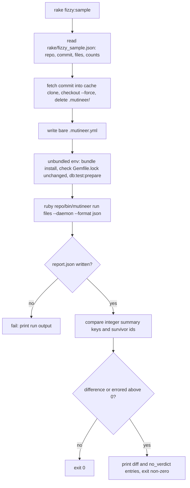

# Pre-release Fizzy sample check - Plan

## Goal Capsule

- **Issue:** #402 (before each release, run Mutineer on a pinned Fizzy sample and compare counts).
- **Objective:** before each release, a maintainer learns if Mutineer's verdicts on a real Rails 8.2 app changed since the last release. Each change is explained before the release goes out.
- **Means:** a Rake task runs the release candidate on eight pinned Fizzy files. It compares the JSON report with counts stored in the repo (KTD1, KTD4).
- **Authority:** this plan, then `AGENTS.md`, then the text of #402. Where this plan differs from the issue, this plan wins (see "Corrections to the issue").
- **Stop and ask when:** the spike (U1) reaches a "stop and ask" row, or its Q1 or Q4 fallback fails. Stop also before a change to a file the gem ships (`lib/`, `bin/`, `skills/`). Stop before any schedule, workflow or release step that runs the check automatically.
- **Size:** S. Six files: `rake/fizzy_sample.rb` (new), `rake/fizzy_sample.json` (new), `Rakefile`, `test/fizzy_sample_test.rb` (new), `AGENTS.md`, `test/release_workflow_test.rb`. No runtime dependency. No gem code changes.
- **Delivery:** one pull request from `main`, after PR #391 (the reload fix for Rails class bodies) merges. Units U1 to U4 in order. U1 is a spike and merges nothing. Labels: `enhancement`, `priority: medium`, `risk: low`, `v1.9.0`. Semver: none. No file in the gem changes (`mutineer.gemspec:34` ships `lib/`, `bin/`, `skills/`, `README.md`, `LICENSE`, `CHANGELOG.md`). The body says `Closes #402`. A person merges. This plan has no release step.

---

## Product Contract

### Summary

A new task, `rake fizzy:sample`, fetches Fizzy at one pinned commit into a cache folder outside the repo. It installs Fizzy's own bundle and prepares the SQLite test database. Then it runs the Mutineer code of the current checkout on eight Fizzy files, with `--daemon` and `--format json`. It then compares every integer count in `summary` and the set of survivor ids with the values in `rake/fizzy_sample.json`. Any difference, or any errored mutant, fails the task and prints what changed. A second task, `rake fizzy:record`, stores the counts of the last run after a maintainer has explained the change. `AGENTS.md` makes the check a precondition of release step 1.

### Problem Frame

Vladimir Dementyev ran Mutineer 1.8.0 on Fizzy, a Rails 8.2 app. He found six reload bugs that the gem's suite and `test/fixtures/rails_app` did not catch: #378, #383, #384, #385, #387 and #390. PR #391 fixes them and adds fixture cases. Fixtures catch known bugs only. The fixture app pins `rails ~> 7.1` (`test/fixtures/rails_app/Gemfile:12`) and resolves Rails 7.2.4, so no CI job runs Rails 8.2. A full Fizzy run takes many minutes (his `app/models` scan took about 6 minutes on 8 cores), and it needs Fizzy's bundle. So it cannot run on every pull request.

### Requirements

**The check**

- R1. One command runs the check from a mutineer checkout: `bundle exec rake fizzy:sample`. A person runs it by hand. No schedule, workflow or release job runs it.
- R2. The check runs the Mutineer code of the current checkout, not a released gem.
- R3. The check uses one pinned Fizzy commit and the eight files in KTD3. The repository URL, commit and file list live in `rake/fizzy_sample.json`.
- R4. Fizzy runs with its committed `Gemfile.lock`, unchanged, and with SQLite.
- R5. The run uses no Fizzy boot workarounds, so a reload regression shows as errored mutants (KTD2).
- R6. A warm run takes under 15 minutes. "Warm" means the clone and Fizzy's gems already exist. The first run may take longer.

**The comparison**

- R7. The check fails when any integer key of `summary` differs from the stored value, or when the survivor id set differs (KTD4).
- R8. The check fails when `summary.errored` is above 0, whatever the stored value.
- R9. A key that is new in the report and absent from the stored counts prints a note and does not fail the check.
- R10. On failure the check prints each changed key with its old and new value. It also prints each new or gone survivor id, and `file:line status details` for each `no_verdict` entry.
- R11. `rake fizzy:record` writes the counts and survivor ids of the last report into `rake/fizzy_sample.json`, with the Mutineer version and the date. It refuses when `summary.no_verdict` is above 0.

**Release process**

- R12. The "Releasing" section of `AGENTS.md` says to run the check on `main` before step 1. A difference gets an explanation in a pull request before the counts are recorded again.

### Acceptance Examples

- AE1. Covers R7. The report matches the stored counts and survivor ids. The task prints `Fizzy sample matches the counts recorded with <version>` and exits 0.
- AE2. Covers R7, R8, R10. A regression makes two `MagicLink` mutants error. The task prints `errored: 0 -> 2`, `killed: 17 -> 15`, `no_verdict: 0 -> 2`, the two `no_verdict` entries, and exits non-zero. Probe P3 produced exactly this diff from saved Fizzy reports.
- AE3. Covers R7. One survivor id is new. The task prints `survivors new: [<id>]` and exits non-zero.
- AE4. Covers R9. A later release adds `summary.unpaired_sources` (#381, count unpaired sources). All other values match. The task prints a note naming the new key and exits 0.
- AE5. Covers R11. The stored file has no counts yet. The task prints the run's counts, says to run `rake fizzy:record`, and exits non-zero.
- AE6. Covers R11. The last report has `no_verdict: 2`. `rake fizzy:record` refuses and writes nothing.

### Scope Boundaries

- Daemon path only. The daemon forces `--strategy reload` (`lib/mutineer/cli.rb:505-510`), so the sample covers neither redefine nor in-process `--rails`. `test/fixtures/rails_app/bin/dogfood` covers both after PR #391. The implementing pull request files an issue for this limitation (repo rule "Track every limitation").
- CLI only. The GitHub Action wraps the CLI and keeps its defaults. No `action.yml` change.
- SQLite only. Fizzy also supports MySQL (`lib/fizzy.rb:8-10` in the Fizzy tree). The saved MySQL and SQLite model reports had identical survivor ids (probe P3), so a second adapter adds time for little signal now.
- No dry-run comparison. `summary.total` already counts every scheduled mutant.

**Considered and not built**

- No percentage threshold for a "large change". A pinned tree, a pinned seed and a pinned commit should give identical counts, so any difference needs a reason. The repo rule "Gate on unrounded values" also argues against a rounded threshold. U1 Q3 tests the determinism this rests on.
- No per-release history list in the JSON file. Git history keeps earlier records. Nothing reads them.
- No run lock. Two `fizzy:sample` runs at once would share worker databases in the cache clone (#404, add a run lock). A person runs the check by hand, once per release.
- No support for Fizzy's `Gemfile.saas`. It needs private repositories (probe P1).
- No environment variable to move the cache folder. Nobody asked for one. Add it if a maintainer's home folder cannot hold the clone.

#### Deferred to Follow-Up Work

- #349 (measure the declined count and unrun share on a real Rails app) can reuse U2's clone and setup steps. That plan decides the reuse.

### Corrections to the issue

1. **The issue names the wrong bug set.** It says "#378 and #383 to #390" are bugs that escaped. Three of those are features, not escaped bugs: #386 (no default mutants for a bare `if` or `rescue` body), #388 (no errored list in JSON) and #389 (full-reload strategy). The reload bugs are #378, #383, #384, #385, #387 and #390 (PR #391 body, "Closes" line).
2. **Not every problem has a fixture case.** The issue says "Each now has a fixture case." PR #391 adds fixture cases for its six bugs only. Its file list adds `Shipment`, `Trackable` and `Parcel`. Not checked: which ten problems the issue counts.
3. **The JSON keys have other names.** The issue says to store `error` and `skipped`. The report has `errored` and `skipped_invalid` (`lib/mutineer/reporter.rb:229-230`). It has no plain `skipped` key. The plan stores every integer key of `summary`, because a mutant that moves from `killed` to `no_coverage` is also a change.
4. **The issue does not say which Fizzy repository to pin.** `basecamp/fizzy` has no Mutineer config and no tests from Vladimir's work. The pin is `palkan/fizzy` commit `f220e4832bf40b6f4d4f944253d7a7731d366d37`, the head of public branch `vova/sfruby-mutation` (probe P1). This is the tree behind Vladimir's numbers.
5. **Fizzy's own boot file would hide the bugs.** At `f220e4832`, `test/mutineer_boot.rb` adds `eager_load!`, an enum redeclaration patch and a `skip_callback` patch. These are workarounds for #383, #378 and #384. A check that loads them cannot see those regressions. KTD2 drops the boot file.
6. **"Large change" has no definition.** This plan treats any change as needing an explanation (R7).
7. **The 15-minute budget needs a scope.** A first run clones Fizzy and installs its gems. R6 applies the budget to a warm run.
8. **More work than #389 changes the counts.** PR #391 itself changes scores for models whose tests count validator errors (#390, its "Score change" note). These can also change counts: #386, #397 (mutate class-body macros), PR #393 (invalid only on a new parse error) and PR #375 (early hook-block placement). Each such pull request re-records the counts (see "Risks and Overlaps").

---

## Planning Contract

### Key Technical Decisions

- KTD1. **A Rake task with its logic in `rake/fizzy_sample.rb`.** The repo keeps developer tooling in `rake/`. The `Rakefile` loads it with `require_relative` inside the task, as `site:build` does. Files in `rake/` do not ship in the gem (`mutineer.gemspec:34`) and fall outside YARD (`.yardopts` lists `lib/**/*.rb` only). Rejected: a script in `bin/`, because `bin/*` ships in the gem (`mutineer.gemspec:34`). Rejected: a shell script, because the comparison parses JSON and needs a unit test.
- KTD2. **Run without Fizzy's boot file.** The task writes its own `.mutineer.yml` into the cache clone: `rails: true`, `daemon: true`, `shared_databases: [cable]`, and no `require:` key. After PR #391, Mutineer itself handles the enum, callback, lazy-concern and migration-check cases (PR #391 body, "Fix" table). Saved reports show that each workaround removed on Mutineer 1.8.1 makes mutants error (probe P3). So without the workarounds, the sample sees regressions of exactly those fixes. Rejected: run both Vladimir's boot file and the bare config, as the opus report suggests (item 16). The second variant tests Fizzy's workarounds, not Mutineer, and doubles the time.
- KTD3. **Eight paired files, 63 Tier-1 mutants.** Each file has a test at the conventional path. So #379, #380 and #382 (pairing changes) cannot change the sample. Mutant counts come from probe P2.

  | File | Mutants | What it exercises |
  |---|---|---|
  | `app/models/magic_link.rb` | 2 | enum, `validates`, `before_validation` callbacks (#378, #390) |
  | `app/models/user/role.rb` | 11 | concern with `included do` and an enum (#383, #378) |
  | `app/controllers/join_codes_controller.rb` | 7 | `allow_unauthenticated_access` skip (#384) |
  | `app/models/card/postponable.rb` | 11 | concern, known survivors |
  | `app/models/card/stallable.rb` | 5 | concern with `before_update` and `after_update_commit` (#390) |
  | `app/models/card/statuses.rb` | 4 | concern with enum, `before_save`, lambda `after_create` (#378, #390) |
  | `app/models/account/import.rb` | 18 | two enums, known survivors |
  | `app/models/account/join_code.rb` | 5 | `validates` |

  The saved 1.8.1 report with Vladimir's boot file had 15 survivors in four of these files. So a false kill also shows as a gone survivor. Rejected: Vladimir's controller sample, because only `join_codes_controller.rb` exercises the callback skip.
- KTD4. **Exact comparison of integer summary keys and survivor ids.** The score is derived from `killed` and `survived`, so the task does not compare it. Per-source rows add nothing that the survivor ids and the totals do not show. Probe P3 ran this comparison on saved reports. It flagged every workaround-off run and passed identical runs. Rejected: comparing only `killed`, `survived`, `errored` and `skipped` as the issue lists, because a shift into `no_coverage` or `timeout` would pass.
- KTD5. **Run the checkout's Mutineer outside Fizzy's bundle.** The task starts `<RbConfig.ruby> <repo>/bin/mutineer run ...` with Fizzy as the working folder. The absolute Ruby path keeps a version manager from picking Fizzy's `.ruby-version` (3.4.8) for the tool side. The daemon still runs `bundle exec ruby` in Fizzy, so the app side uses Fizzy's Ruby. `bin/mutineer` loads `../lib/mutineer` with `require_relative`. The daemon loads `daemon_server.rb` from the tool by absolute path and so bypasses the app bundle (`lib/mutineer/daemon_client.rb:22-28`, `:345-350`). Fizzy's lock pins `mutineer (1.8.0)` from RubyGems (`Gemfile.lock:321` at `f220e4832`), and its Gemfile sets `require: false`, so that copy is installed but never loaded. U1 Q4 verifies this. Rejected: editing Fizzy's Gemfile to a `path:` gem, because that rewrites the lock that R4 keeps unchanged.
- KTD6. **Pin the environment, not only the tree.** Child processes run inside `Bundler.with_unbundled_env`, so the mutineer bundle does not leak into Fizzy. The task sets `RAILS_ENV=test`, `SAAS=false` and `DATABASE_ADAPTER=sqlite` (Fizzy picks its Gemfile and adapter from these, `lib/fizzy.rb:3-14`). It removes `CI`, because Fizzy's test env eager-loads when `CI` is set (Vladimir's report, boot-file table), and that would hide #383. It removes `SEED`, so Minitest uses `PINNED_SEED = 1` (`lib/mutineer/minitest_integration.rb:34`, `:41-50`). It passes `--daemon --jobs 4 --format json --output <cache>/report.json`.
- KTD7. **A cold coverage cache on every run.** The task deletes the clone's `.mutineer/` before each run. A cache hit skips work in the capture path (opus report, item 13), so a warm cache could hide a coverage regression.
- KTD8. **The cache folder lives outside the repo.** It is `~/.cache/mutineer/fizzy-sample`. A clone inside the repo would nest a git checkout in the working tree. Every worktree can share the outside clone and its installed gems. `Config.find_file` searches upward from the working folder (`lib/mutineer/config.rb:170-182`), and the clone has its own `.mutineer.yml`, so the search stops there.

### High-Level Technical Design

### Probe results

Scripts and output are in the session context folder, `probes/402/`.

- P1 (`p1_remotes.sh`). With global git config and tokens unset, `palkan/fizzy` and `basecamp/fizzy` are public. Branch `vova/sfruby-mutation` points at `f220e4832bf40b6f4d4f944253d7a7731d366d37`. Every git source in Fizzy's base `Gemfile.lock` is public. `basecamp/queenbee-plugin` and `basecamp/rails-structured-logging`, which `Gemfile.saas` needs, are not. The first two probe runs reported everything public. The cause was the local credentials and a missing `timeout` binary on macOS. The third run fixed both.
- P2 (`p2_dry_run_counts.sh`). A dry run with the worktree's Mutineer (`8d9905c4`) gave 63 mutants for the KTD3 files: 2, 11, 7, 11, 5, 4, 18 and 5. These match the saved 1.8.1 reports. Side finding: with `rails: true` in `.mutineer.yml`, `--dry-run` refuses to run without `--test`. The help says `--test` is "not under --dry-run" (`lib/mutineer/cli.rb:53-55`). See Open Questions Q4.
- P3 (`p3_compare_prototype.rb`). The KTD4 comparison ran on reports saved on 2026-11-09 in the Fizzy clone's `tmp/`. Those runs used Mutineer from a local path, 1.8.1 per the clone's edited `Gemfile.lock`. With one boot workaround removed, it reported `errored` rising to 2 (enum), 7 (callback), 8 (eager load) and 17 (schema check). It passed the identical run, the run without the warning filter, patched against full reload, and SQLite against MySQL. Not checked: the exact commands that made those reports.

### Assumptions

- PR #391 merges before U3 records counts. U1 can run on its branch head before the merge. Without PR #391, the bare config errors on most of the sample (probe P3, `no_schema.json` errored 17 of 20).
- The maintainer's machine can build Fizzy's gems for Ruby 3.4.8 (Fizzy's `.ruby-version`). U1 Q1 checks this.
- Fizzy's tests need nothing beyond `db:test:prepare`, for example no asset build. U1 Q1 checks this.

---

## Implementation Units

### U1. Spike: prove the sample runs, repeats and detects regressions

**Goal:** answer Q1 to Q4 before any code merges. The spike writes a throwaway script under the scratch folder and merges nothing.

**Requirements:** R2, R4, R5, R6, R7.

**Dependencies:** PR #391 branch `fix/1.8.2-rails-reload` available locally.

**Files:** none in the repo.

**Approach:**
1. Fetch `f220e4832` from `https://github.com/palkan/fizzy.git` into a fresh folder outside every checkout. Never use `/Users/davidteren/Projects/OSS/fizzy-palkan`, which is read-only and has local edits.
2. Write the KTD2 config. In the KTD6 environment, run `bundle install`, then `git diff --exit-code Gemfile.lock`, then `bin/rails db:test:prepare`.
3. Run the KTD5 command three times with the Mutineer code of PR #391's head. Time each run.
4. Run it once with `main` at `8d9905c4` (before PR #391) as the negative control.

**Time box:** 2 hours, including the first `bundle install`.

| Question | Pass | Fail, and what the plan does |
|---|---|---|
| Q1. Does the pinned tree install and run with the base Gemfile and SQLite? | `bundle install` succeeds, `Gemfile.lock` is unchanged, the run writes a report with `summary.total` 63. | Record the error. If a system library is missing, add a precondition line to the task's failure message. If the lock must change, stop and ask. |
| Q2. Is a warm run under 15 minutes? | Each warm run takes 10 minutes or less, which leaves headroom. | Between 10 and 15 minutes: keep it and note the time. Over 15: drop `account/import.rb` (18 mutants) and re-time. |
| Q3. Are the three runs identical? | All integer summary keys and survivor ids match across the three runs. | If only `timeout` varies, find the file and drop it. Any other variation: stop and ask, because KTD4 rests on determinism. |
| Q4. Does the daemon run the checkout's code? | `main` errors on the sample, and PR #391's head gives `errored: 0`. | Both give 0: the app bundle's 1.8.0 is loading, or the bugs do not reproduce. Switch KTD5 to a side Gemfile that does `eval_gemfile "Gemfile"` and declares a `path:` gem for mutineer in a copy, then repeat Q4. |

**Verification:** the pull request body records Q1 to Q4 outcomes, three wall times and the negative-control `errored` count.

### U2. The task and its comparison

**Goal:** `rake fizzy:sample` and `rake fizzy:record` exist and behave as R1 to R11 state.

**Requirements:** R1 to R11.

**Dependencies:** U1 passed.

**Files:**
- `rake/fizzy_sample.rb` (new): a module, in the style of `rake/site_build.rb`, with the steps of the flowchart above. The comparison and record logic are pure functions on parsed JSON, so tests need no Fizzy.
- `rake/fizzy_sample.json` (new): `repo`, `commit` and `files` from KTD3. No counts yet.
- `Rakefile`: a `fizzy` namespace with `sample` and `record` tasks, each with a `desc`. Each task loads `rake/fizzy_sample.rb` with `require_relative` inside its block, like `site:build`.
- `test/fizzy_sample_test.rb` (new).

**Approach:**
- The module loads without Bundler, git or network access, so the zero-dependency suite can require it. Only the run steps touch them.
- The comparison follows KTD4 and R7 to R10. It returns a list of lines. An empty list means a match.
- Record follows R11. It writes sorted survivor ids and pretty-printed JSON, so diffs stay small.
- A setup failure (fetch, install, changed lock, database) aborts with the failing command and its output. It never falls through to the comparison.
- The run exits 0 or 1 from Mutineer. Both count as a completed run when the report exists, because the comparison decides the result.

**Patterns to follow:** `rake/site_build.rb` and its use in `Rakefile`. Probe P3's comparison prototype.

**Test scenarios** (`test/fizzy_sample_test.rb`, zero-dependency suite, no network). This seam catches the comparison, record and command-shape logic. It misses real Fizzy behaviour, which U1 and the manual run cover.
- Covers AE1. Equal summaries and survivor ids give an empty diff.
- Covers AE2. `errored` 0 to 2 and `killed` 17 to 15 give two lines naming each key with old and new values. The `no_verdict` entries print as `file:line status details`.
- `errored` is 1 in both stored and new data: the diff still fails (R8).
- Covers AE3. One new and one gone survivor id each give a line with the id.
- Covers AE4. A key only in the new report gives a note, not a failure.
- A key in the stored counts but absent from the report fails, naming the key.
- Covers AE5. Stored data without counts fails and names `rake fizzy:record`.
- Covers AE6. Record with `no_verdict` 2 raises and leaves the file unchanged.
- Record writes the integer keys, sorted survivor ids, the version from `Mutineer::VERSION`, and a date.
- The command builder includes `--daemon`, `--format json` and `--output`, and starts this checkout's `bin/mutineer` with the running Ruby's absolute path (KTD5). The environment it builds has `SAAS=false`, `DATABASE_ADAPTER=sqlite` and `RAILS_ENV=test`, and has no `CI` or `SEED` (KTD6). This asserts the mechanism, not only the exit code.
- The written config has `rails`, `daemon` and `shared_databases`, and no `require` key (KTD2).

**Verification:** the new test file passes. `bundle exec rake -T` lists both tasks.

### U3. Record the first counts

**Goal:** `rake/fizzy_sample.json` holds the counts that `main` gives after PR #391.

**Requirements:** R3, R11.

**Dependencies:** U2, and PR #391 merged into the branch base.

**Files:** `rake/fizzy_sample.json`.

**Approach:** run `rake fizzy:sample` (it fails per AE5), review the report, then run `rake fizzy:record`. Check that `errored` is 0 and that the survivor list includes ids in `account/import.rb` and `card/postponable.rb`, where the 1.8.1 run had survivors. Run `rake fizzy:sample` once more. It must pass (AE1) and finish under R6's budget.

**Test expectation:** none. This unit writes data. U2's tests cover the logic.

**Verification:** the pull request body gives the recorded summary, the warm wall time and the Mutineer version.

### U4. Make the check part of the release procedure

**Goal:** `AGENTS.md` names the check before release step 1, and a test keeps that text in place.

**Requirements:** R12.

**Dependencies:** U2.

**Files:** `AGENTS.md`, `test/release_workflow_test.rb`.

**Approach:**
- Add one short paragraph in "Releasing", directly before "1. Prepare the pull request". It says: run `bundle exec rake fizzy:sample` on an up-to-date `main`. If it fails, explain each difference in a pull request that re-records with `rake fizzy:record`, and merge that pull request before step 1. A person or an agent with the maintainer's yes may run it, because it writes nothing on GitHub.
- Do not renumber steps 1 to 6. `test/release_workflow_test.rb:514-551` asserts the texts "Step 5 (approve the" and "step 6 (move the floating major tag)". `AGENTS.md:164-165` and `CONTRIBUTING.md:23` also refer to "steps 1 to 4".
- Do not add the check to any workflow (R1).

**Test scenarios** (`test/release_workflow_test.rb`, `test_agent_docs_gate_releasing_on_a_maintainer`):
- `AGENTS.md` includes `rake fizzy:sample`.
- Existing assertions in that test still pass unchanged.

**Verification:** `test/release_workflow_test.rb` passes.

---

## Verification Contract

| Gate | Command |
|---|---|
| New tests | `LANG=en_US.UTF-8 LC_ALL=en_US.UTF-8 bundle exec ruby -Ilib -Itest test/fizzy_sample_test.rb` |
| Release doc test | `LANG=en_US.UTF-8 LC_ALL=en_US.UTF-8 bundle exec ruby -Ilib -Itest test/release_workflow_test.rb` |
| Zero-dep suite | `bundle exec rake test` |
| Load smoke | `ruby -Ilib -e 'require "mutineer"'` |
| Docs gate | `bundle exec rake yard:strict` (no `lib/` change, run per `AGENTS.md`) |
| Real check | `bundle exec rake fizzy:sample` passes on the branch, with the warm time in the pull request body |

No Minitest 6 run is needed: the Minitest integration does not change. No website checks: no site file changes.

## Definition of Done

- U1 outcomes, the three wall times and the negative-control result are in the pull request body.
- `rake fizzy:sample` passes on the branch head in under 15 minutes warm.
- `rake/fizzy_sample.json` holds the commit, the eight files and counts recorded from `main` after PR #391, with `errored` 0.
- `AGENTS.md` names the check before step 1, and the test asserts it.
- No file under `lib/`, `bin/`, `skills/` or `.github/` changes.
- The pull request files an issue for the daemon-only limitation (Scope Boundaries) and names it.
- No spike script or abandoned code remains in the diff.

---

## Risks and Overlaps

| Item | Effect | Handling |
|---|---|---|
| PR #391 (reload fix for Rails class bodies) | Before it merges, the bare config errors on most of the sample. | Hard dependency. U3 records only after it merges. |
| #389 (full-reload strategy, v2.0) | Changes how mutants load, so counts can change. | Its pull request re-records with an explanation. |
| #386 (default mutants for bare `if` and `rescue` bodies), #397 (mutate class-body macros) | Change `total` and every count after it. | Their pull requests re-record. |
| PR #393 (invalid only on new parse errors), PR #375 (early hook-block placement) | Can change `skipped_invalid` or verdicts. | Their pull requests run the check. A change gets a re-record with a reason. |
| #381 (count unpaired sources) | Adds summary keys. | R9 makes new keys a note. |
| #388 (errored list in JSON) | Gives richer error lines. | R10 prints `no_verdict` details today. It can switch to the new list later. |
| #404 (SQLite run lock) | Two runs in one clone share worker databases. | The cache clone is separate from every working checkout. Concurrent sample runs are a non-goal. |
| #332 and PR #335 (a SQLite copy per daemon worker, 2.0) | Change worker database handling. | The sample uses `shared_databases: [cable]`, so those changes show up here as errors. |
| #349 (unrun share on a real app) | Wants a wider Fizzy run. | Reuses U2's clone and bootstrap later (Deferred). |
| #284 (2.0 daemon default checklist) | Asks for one pinned reference app. | The recorded sample can serve as that evidence. Not this plan's scope. |
| The `palkan/fizzy` fork disappears or is force-pushed | The pinned commit may become unfetchable. | The URL and commit live in one data file. See Q1. |
| Fizzy pins Rails `8.2.0.alpha` at `d0e506f` (`Gemfile.lock:16-18`, `:95`) | An alpha Rails commit can vanish from GitHub. | The lock pins the commit. U1 Q1 shows whether it still installs. |

Sibling plans in this batch: the plans for #379, #380, #381, #382, #386 and #388 change pairing or reporting. KTD3 picks paired files only, so only #381 (new keys) and #386 (new mutants) touch the sample's output.

## Open Questions

- Q1. **Which Fizzy repository holds the pin long term?** Default: `palkan/fizzy` at `f220e4832`, because that tree produced every number in the report. If the fork goes away, re-pin to a `basecamp/fizzy` commit and re-record. The maintainer decides whether to keep a copy of the commit.
- Q2. **May an urgent security patch skip the check?** Default: no skip. The check takes minutes. If it fails for a reason the patch does not touch, the maintainer may release and state the reason in the release pull request. The maintainer decides.
- Q3. **Should a CHANGELOG entry mention the check?** Default: no. The CHANGELOG ships in the gem and lists user-facing changes, and this changes none. The maintainer decides.
- Q4. **File an issue for the dry-run side finding?** Under `rails: true` in `.mutineer.yml`, `--dry-run` demands a `--test`, against its help text (probe P2). Default: the implementing pull request files one issue and links it. The maintainer sets its priority.

## Sources

- Issue #402 and Vladimir Dementyev's Fizzy report (session context folder).
- Validation reports of 2026-11-09: Sol item A19 and the "validation tiers" step, grok-cursor A19, opus A19 and items 13 and 16.
- PR #391 body: the fixed issues, the fixture cases and the score-change note.
- Fizzy tree at `f220e4832`: `.mutineer.yml`, `test/mutineer_boot.rb`, `Gemfile.lock`, `lib/fizzy.rb`, `.ruby-version`.
- Repo: `lib/mutineer/reporter.rb:213-250`, `lib/mutineer/daemon_client.rb:22-28`, `lib/mutineer/minitest_integration.rb:34-50`, `lib/mutineer/cli.rb:505-510`, `lib/mutineer/config.rb:170-182`, `mutineer.gemspec:34`, `Rakefile`, `AGENTS.md` "Releasing", `test/release_workflow_test.rb:514-551`.
