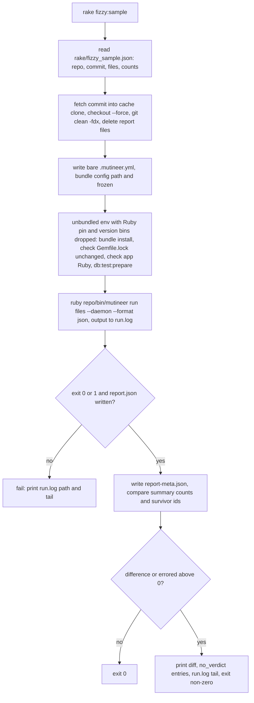

# Pre-release Fizzy sample check - Plan

## Goal Capsule

- **What:** Add a manual Fizzy sample check before each release (#402, run Mutineer on a pinned Fizzy sample and compare counts).
- **Why:** The maintainer must understand verdict changes on a real Rails 8.2 app before release.
- **How:** A Rake task runs eight pinned files and compares JSON counts (KTD1, task location; KTD4, comparison rules).
- **Authority:** This plan, then `AGENTS.md`, then the text of #402. This plan controls differences; see "Corrections to the issue".
- **Stop and ask:** Follow U1 (sample spike) stop conditions. Stop before changing shipped files in `lib/`, `bin/` or `skills/`. Stop before adding any schedule, workflow or release step that runs the check automatically.
- **Size:** S (small). Six files: `rake/fizzy_sample.rb` (new), `rake/fizzy_sample.json` (new), `Rakefile`, `test/fizzy_sample_test.rb` (new), `AGENTS.md`, `test/release_workflow_test.rb`. No runtime dependency or gem code change.
- **Delivery:** One pull request from `main`, after PR #391 (Rails class-body reload fixes) merges. Run U1 (spike), U2 (tasks), U3 (first counts) and U4 (release instructions) in order. U1 merges nothing.
- **Labels:** `enhancement`, `priority: medium` (medium priority), `risk: low` (low risk), `v1.9.0` (target release).
- **Semver:** None. No shipped file changes. `mutineer.gemspec:34` ships `lib/`, `bin/`, `skills/`, `README.md`, `LICENSE` and `CHANGELOG.md`.
- **Completion:** The pull request body says `Closes #402`. A person merges. This plan has no release step.

---

## Product Contract

### Summary

`rake fizzy:sample` fetches a pinned Fizzy commit into an external cache, installs its bundle and pins its Ruby. It prepares SQLite and runs the current checkout's Mutineer on eight files with `--daemon` and `--format json`.

The task compares `summary` counts and survivor ids with `rake/fizzy_sample.json`. Differences or errored mutants fail the check and print details. After the maintainer explains changes, `rake fizzy:record` stores the last run's counts. `AGENTS.md` requires the check before release step 1.

### Problem Frame

Vladimir found six reload bugs in Mutineer 1.8.0 on Fizzy, a Rails 8.2 app. The gem suite and `test/fixtures/rails_app` missed them:

| Issue | Problem |
|---|---|
| #378 | Enum reload |
| #383 | Lazy concern loading |
| #384 | Callback skip |
| #385 | Migration checks with `shared_databases` |
| #387 | Deprecation warning |
| #390 | Repeated validators and block callbacks |

PR #391 fixes these bugs and adds fixtures. Fixtures cover known bugs only. The fixture app pins `rails ~> 7.1` (`test/fixtures/rails_app/Gemfile:12`) and resolves Rails 7.2.4. No CI job runs Rails 8.2.

Vladimir's `app/models` scan took about 6 minutes on 8 cores. A full Fizzy run also needs Fizzy's bundle, so it cannot run on every pull request.

### Requirements

**The check**

- R1. A person runs `bundle exec rake fizzy:sample` from a mutineer checkout. No schedule, workflow or release job runs it.
- R2. Run the current checkout's Mutineer code, not a released gem.
- R3. Use one pinned Fizzy commit and eight files (KTD3, sample files). Store the repository URL, commit and files in `rake/fizzy_sample.json`.
- R4. Use Fizzy's unchanged, committed `Gemfile.lock` and SQLite.
- R5. Use no Fizzy boot workarounds, so reload regressions produce errored mutants (KTD2, bare config).
- R6. A warm run takes under 15 minutes. Warm means the clone and Fizzy's gems exist. The first run may take longer.

**The comparison**

- R7. Fail if any stored integer `summary` value or the survivor id set changes. Compare integer hashes (`declined_by_operator`, `legacy_id_matches`) by inner key, such as `declined_by_operator.<name>` (KTD4).
- R8. Fail if `summary.errored` exceeds 0, regardless of the stored value.
- R9. Print a note for report keys absent from stored counts. These keys do not fail the check.
- R10. On failure, print each changed key's old and new values, plus new and gone survivor ids. Print `file:line status details` for each `no_verdict` entry. Then print the run log path and its last 40 lines (R13, run logging).
- R11. `rake fizzy:record` writes the last report's counts and survivor ids into `rake/fizzy_sample.json`. Include the Mutineer version, mutineer commit SHA, app-side Ruby version (R15, Ruby check) and date. Refuse if `summary.errored` exceeds 0. Stable `timeout` or `uncapturable` counts are allowed; R7 catches later changes.

**Release process**

- R12. In `AGENTS.md`, "Releasing" requires the check on `main` before step 1. Before recording changed counts, the maintainer explains each difference in a pull request. Name the merged pull requests that caused it (KTD10, release-time recording).

**Added after review**

- R13. Every run writes Mutineer's stdout and stderr to `<cache>/run.log`, on success or failure.
- R14. `rake fizzy:sample` writes `<cache>/report-meta.json` beside `report.json`. Include the pinned commit, file list and run's mutineer commit SHA. `rake fizzy:record` refuses mismatches against `rake/fizzy_sample.json` or current `git rev-parse HEAD`.
- R15. Run Fizzy with its `.ruby-version`: 3.4.8 at the pin. Check app-side `RUBY_VERSION` before running; fail on mismatch (KTD6, environment pin).

### Acceptance Examples

- AE1. R7: Matching counts and survivor ids print `Fizzy sample matches the counts recorded with <version> at <sha>`. Exit 0.
- AE2. R7, R8, R10: Two `MagicLink` mutants error. Print `errored: 0 -> 2`, `killed: 17 -> 15`, `no_verdict: 0 -> 2`, both `no_verdict` entries and the log path. Exit non-zero. Probe P3 (saved-report comparison) produced this exact diff.
- AE3. R7: A new survivor id prints `survivors new: [<id>]`. Exit non-zero.
- AE4. R9: A release adds `summary.unpaired_sources` (#381, count unpaired sources). Other values match. Name the new key in a note; exit 0.
- AE5. R11: No stored counts exist. Print the run's counts and the instruction to run `rake fizzy:record`. Exit non-zero.
- AE6. R11: The last report has `errored: 2`. `rake fizzy:record` refuses and writes nothing.
- AE7. R14: `report-meta.json` names a different mutineer SHA from current `HEAD`. `rake fizzy:record` refuses, names both SHAs and writes nothing.
- AE8. R15: App-side Ruby is 3.4.9; `.ruby-version` specifies 3.4.8. Fail before running and name both versions.

### Scope Boundaries

- **Daemon only.** It forces `--strategy reload` (`lib/mutineer/cli.rb:506-511`). The sample excludes redefine and in-process `--rails`. After PR #391, `test/fixtures/rails_app/bin/dogfood` covers both. The implementing pull request files a limitation issue under "Track every limitation".
- **CLI only.** The GitHub Action keeps its CLI wrapper and defaults. No `action.yml` change.
- **SQLite only.** Fizzy also supports MySQL (`lib/fizzy.rb:8-10` in Fizzy). Saved MySQL and SQLite model reports had identical survivor ids (probe P3). A second adapter adds little signal now.
- **No dry-run comparison.** `summary.total` counts every scheduled mutant.
- **Ruby pin for rbenv and asdf only.** Set `RBENV_VERSION` and `ASDF_RUBY_VERSION`, and drop their version bins from `PATH` (KTD6). `DaemonClient` uses the same rule (`lib/mutineer/daemon_client.rb:225-246`). Other setups remain unpinned; R15 detects and names a wrong Ruby. The implementing pull request files a limitation issue for `mise` and `chruby` (Q5).
- **A task lock on the cache.** `rake fizzy:sample` and `rake fizzy:record` take `File#flock(LOCK_EX | LOCK_NB)` on `<cache>/fizzy-sample.lock` before fetch and `git clean`. They hold it until they exit. A second task stops at once with "another fizzy:sample run is using <cache>" and a non-zero exit. Reason: KTD7's `git clean -fdx` deletes the running run's SQLite files and the #404 run lock (`storage/*-mutineer.lock`). So #404 (the SQLite run lock) cannot stop the overlap.

**Considered and not built**

- **No "large change" threshold.** A pinned tree, seed and commit should produce identical counts. Every difference needs a reason. "Gate on unrounded values" also argues against rounded thresholds. U1 Q3 (repeatability check) tests this assumption.
- **No per-release JSON history.** Git retains earlier records. Nothing reads a separate list.
- **No `Gemfile.saas` support.** It needs private repositories (probe P1, public-repository check).
- **No cache-location option.** KTD8 (cache location) follows `XDG_CACHE_HOME`. A maintainer whose home folder cannot hold the clone sets that variable.

#### Deferred to Follow-Up Work

- #349 (measure declined counts and unrun share on a real Rails app) can reuse U2's clone and setup. That plan decides reuse. Each `rake fizzy:sample` run replaces the clone's `.mutineer.yml` with the bare config (KTD2) and runs `git clean -fdx` (KTD7). A reuser must restore `.mutineer.yml` with `git checkout -- .mutineer.yml` and keep outputs outside the clone.
- #388 (errored mutants and messages in JSON) will provide each errored mutant's cause. R10 can later print that cause instead of the log tail. This plan makes no such change.

### Corrections to the issue

1. **The bug set is wrong.** The issue lists "#378 and #383 to #390" as escaped bugs. Three are features: #386 (no default mutants for bare `if` or `rescue` bodies), #388 (no errored JSON list), and #389 (full-reload strategy). The reload bugs are #378, #383, #384, #385, #387 and #390 (PR #391 body, "Closes" line).
2. **Fixtures cover only six bugs.** The issue says "Each now has a fixture case." PR #391 adds `Shipment`, `Trackable` and `Parcel` for its six bugs. Which ten problems the issue counts was not checked.
3. **JSON names differ.** The issue lists `error` and `skipped`; the report uses `errored` and `skipped_invalid` (`lib/mutineer/reporter.rb:229-230`). No plain `skipped` key exists. Store every integer `summary` key to catch changes such as `killed` moving to `no_coverage`.
4. **The repository is unspecified.** `basecamp/fizzy` lacks Mutineer config and Vladimir's tests. Pin `palkan/fizzy` commit `f220e4832bf40b6f4d4f944253d7a7731d366d37`, public branch `vova/sfruby-mutation` head (probe P1). This tree produced Vladimir's numbers.
5. **Fizzy's boot file hides regressions.** At `f220e4832`, `test/mutineer_boot.rb` adds `eager_load!`, an enum redeclaration patch and a `skip_callback` patch. These work around #383, #378 and #384. KTD2 omits the boot file.
6. **"Large change" is undefined.** R7 requires an explanation for every change.
7. **The 15-minute limit needs scope.** Initial setup clones Fizzy and installs gems. R6 applies to warm runs.
8. **Other changes affect counts.** PR #391 changes scores where tests count validator errors (#390, "Score change" note). Other causes include #386 (default mutants for bare `if` and `rescue` bodies), PR #393 (invalid only on new parse errors), and PR #375 (early hook-block placement). At release time, name the merged pull request responsible for each difference (KTD10). #397's macro operators (mutate class-body macros) are opt-in (397 R5). The sample sets no `operators` key, so they cannot change its counts.

---

## Planning Contract

### Key Technical Decisions

- KTD1. **Put task logic in `rake/fizzy_sample.rb`.** Follow the developer tooling in `rake/`. The `Rakefile` uses `require_relative` inside each task, like `site:build`. Files in `rake/` are outside the gem (`mutineer.gemspec:34`) and YARD (`.yardopts` lists only `lib/**/*.rb`). Reject `bin/`: `bin/*` ships in the gem (`mutineer.gemspec:34`). Reject shell: JSON comparison needs unit tests.

- KTD2. **Omit Fizzy's boot file.** Write `.mutineer.yml` in the cache clone with `rails: true`, `daemon: true`, `shared_databases: [cable]`, and no `require:` key. PR #391 handles enum, callback, lazy-concern and migration-check cases (body, "Fix" table).

  Removing each of four workarounds on Mutineer 1.8.1 produced errors (probe P3). This evidence covers only #378, #383, #384 and #385, across 20 mutants with no survivors. #387's warning cannot affect counts. #390 appears only when a survivor becomes a kill.

  U1 Q5 (repeated-callback regression check) tests #390 coverage. If it fails, `test_the_daemon_runs_each_validator_and_block_callback_once` in `test/rails_dogfood_daemon_test.rb` (PR #391) remains the only guard.

  Reject running both Vladimir's boot file and bare config (opus report, item 16). The extra variant tests Fizzy's workarounds and doubles runtime.

- KTD3. **Use eight paired files with 63 Tier-1 mutants.** Each has a test at its conventional path. Thus #379, #380 and #382 (pairing changes) cannot affect the sample. Counts come from probe P2 (dry-run counts).

  | File | Mutants | What it exercises |
  |---|---|---|
  | `app/models/magic_link.rb` | 2 | Enum, `validates`, `before_validation` callbacks (#378, #390) |
  | `app/models/user/role.rb` | 11 | Concern with `included do` and enum (#383, #378) |
  | `app/controllers/join_codes_controller.rb` | 7 | `allow_unauthenticated_access` skip (#384) |
  | `app/models/card/postponable.rb` | 11 | Concern and known survivors |
  | `app/models/card/stallable.rb` | 5 | Concern with `before_update` and `after_update_commit` (#390) |
  | `app/models/card/statuses.rb` | 4 | Concern with enum, `before_save`, lambda `after_create` (#378, #390) |
  | `app/models/account/import.rb` | 18 | Two enums and known survivors |
  | `app/models/account/join_code.rb` | 5 | `validates` |

  The saved 1.8.1 report with Vladimir's boot file had 15 survivors across four files. False kills therefore appear as gone survivors. Reject Vladimir's controller sample: only `join_codes_controller.rb` exercises the callback skip.

- KTD4. **Compare summary counts and survivor ids exactly.** Compare every integer `summary` key. Also compare inner keys in `declined_by_operator` (`lib/mutineer/reporter.rb:250`) and `legacy_id_matches`. This catches declines moving between operators while `declined` stays unchanged.

  Do not compare score; it derives from `killed` and `survived`. `scoped` is boolean, and the task never passes `--since`. Per-source rows add no signal beyond survivor ids and totals.

  Probe P3 flagged every saved workaround-off run and passed identical runs. Reject the issue's `killed`, `survived`, `errored`, `skipped` subset: shifts into `no_coverage` or `timeout` could pass.

- KTD5. **Run checkout Mutineer outside Fizzy's bundle.** Start `<RbConfig.ruby> <repo>/bin/mutineer run ...` with Fizzy as the working folder. The absolute Ruby path prevents tool-side selection of Fizzy's `.ruby-version` (3.4.8).

  `bin/mutineer:4` loads `../lib/mutineer` through `require_relative`. `DAEMON_PATH` identifies the checkout's `daemon_server.rb` (`lib/mutineer/daemon_client.rb:37`). The daemon loads it with `-r` (`:349`), bypassing the app bundle (`:25-29`). `daemon_server.rb:3-9` requires only stdlib and adjacent files.

  Fizzy locks RubyGems `mutineer (1.8.0)` (`Gemfile.lock:321` at `f220e4832`). Its `require: false` (`Gemfile:64`) leaves that copy installed but unloaded.

  Reject a `path:` gem edit: it rewrites the lock protected by R4. Reject a side Gemfile with `eval_gemfile`: this loading path needs neither.

- KTD6. **Pin the environment and tree.** Run children inside `Bundler.with_unbundled_env` to exclude mutineer's bundle. Set `RAILS_ENV=test`, `SAAS=false`, `DATABASE_ADAPTER=sqlite`; Fizzy uses these to select its Gemfile and adapter (`lib/fizzy.rb:3-14`).

  Remove `CI`: Fizzy's test environment otherwise eager-loads, hiding #383 (`config/environments/test.rb:18` in Fizzy). Remove `SEED` so Minitest uses `PINNED_SEED = 1` (`lib/mutineer/minitest_integration.rb:34`, `:45-50`). Pass `--daemon --jobs 4 --format json --output <cache>/report.json`.

  **Ruby pin:** The daemon uses plain `bundle exec ruby` and retains existing Ruby pins (`lib/mutineer/daemon_client.rb:334-339`). `app_env` retains `RBENV_VERSION` (`:176-187`). No daemon client passes `ruby_version` (`lib/mutineer/daemon_backend.rb:142`, `:169`, `:302`, `:350`). Thus rbenv's tool-side pin reaches the app. Probe R1 (inherited Ruby pin) confirms 3.4.9 instead of 3.4.8.

  A pin alone does not reach the task's own children. Under `bundle exec rake`, rbenv puts `<rbenv root>/versions/<tool Ruby>/bin` first on `PATH`. `Bundler.with_unbundled_env` keeps that entry. So `bundle` resolves to the tool Ruby and ignores `RBENV_VERSION` (probe G1). Only the daemon drops these bins (`lib/mutineer/daemon_client.rb:178`, `:225-246`).

  Read Fizzy's `.ruby-version`. Build one child environment before `bundle install`. Set `RBENV_VERSION` and `ASDF_RUBY_VERSION` to that value. Drop rbenv and asdf version-bin `PATH` entries when a shim directory exists, and put the shims first. Use the daemon's rule (`scrub_managed_ruby_bins!`, `:225-246`; predicates `:297`, `:311`). Call that private method, so the two rules cannot drift. This adds no gem code change.

  Use this environment for every child: `bundle install`, the Ruby check, `db:test:prepare` and the run. First execute `bundle exec ruby -e 'print RUBY_VERSION'` in the clone. Fail on mismatch (R15, AE8).

  Store the value in `report-meta.json` and, through `rake fizzy:record`, the recorded counts. U1 Q6 (daemon Ruby check) verifies the daemon's Ruby. Reject a CLI `ruby_version` option: this developer task must not change gem code.

- KTD7. **Clean the tree and coverage cache before every run.** Run `git checkout --force <commit>` and `git clean -fdx` in the clone. This removes `.mutineer/`, `.bundle/`, old logs and SQLite worker databases (`*.sqlite3` is ignored by Fizzy's `.gitignore`). Delete `<cache>/report.json` and `<cache>/report-meta.json` too.

  Coverage cache hits skip capture work (opus report, item 13). A warm coverage cache could hide regressions.

- KTD8. **Keep the cache outside the repo.** Use `$XDG_CACHE_HOME/mutineer/fizzy-sample` when `XDG_CACHE_HOME` is set; otherwise use `~/.cache/mutineer/fizzy-sample`. Store `fizzy/`, `gems/`, `report.json`, `report-meta.json` and `run.log`. Keeping gems outside the clone protects them from `git clean -fdx`.

  After cleaning, run `bundle config set --local path <cache>/gems` and `bundle config set --local frozen true`. These write `.bundle/config`.

  Do not use environment `BUNDLE_PATH`. `restored_user_env` removes it when Bundler saved no original value (`lib/mutineer/daemon_client.rb:212-214`). The daemon reads `.bundle/config` beside `BUNDLE_GEMFILE`.

  The external clone avoids a nested checkout and lets all worktrees share gems. `Config.find_file` searches upward (`lib/mutineer/config.rb:170-182`); the clone's `.mutineer.yml` stops that search.

- KTD9. **Bind recorded data to its run.** `rake fizzy:sample` writes the commit, files, mutineer SHA (`git rev-parse HEAD`) and app-side Ruby into `report-meta.json`. `rake fizzy:record` checks the first three against `rake/fizzy_sample.json` and current `HEAD`. Refuse differences (R14). This prevents recording another worktree's report or an older pin from the shared cache.

  Store both `Mutineer::VERSION` and SHA. Before release step 1, `main` still has the previous release's version. `release-pr.yml` bumps it later (`AGENTS.md`, "Releasing" step 1). The SHA identifies the executed code. Reject version-only records: they mislead before the bump.

- KTD10. **Require recording only at release time.** The only required run is on `main` before release. If it fails, the maintainer explains each difference by its merged pull request, in one pull request that re-records.

  A count-changing pull request may optionally run the check and report expected changes. Reject mandatory checks and recording on every such pull request, as the first draft's Risks table implied. That contradicts #402's runtime premise and creates two rules for one file.

### High-Level Technical Design

### Probe results

Scripts and output are in the session context folder, `probes/402/`.

| Probe | Result and limits |
|---|---|
| P1 (`p1_remotes.sh`) | With global git config and tokens unset, `palkan/fizzy` and `basecamp/fizzy` are public. `vova/sfruby-mutation` points to `f220e4832bf40b6f4d4f944253d7a7731d366d37`. All git sources in base `Gemfile.lock` are public. `Gemfile.saas` needs private `basecamp/queenbee-plugin` and `basecamp/rails-structured-logging`. The first two runs falsely reported everything public because of local credentials and missing macOS `timeout`. The third fixed both. |
| P2 (`p2_dry_run_counts.sh`) | Worktree Mutineer `8d9905c4` produced 63 mutants: 2, 11, 7, 11, 5, 4, 18 and 5. These match saved 1.8.1 reports. With `rails: true` in `.mutineer.yml`, `--dry-run` without `--test` exits 2. Dry runs skip convention pairing (`lib/mutineer/cli.rb:429`), then fail the no-test boot check (`:439`). The message at `:734` says "(or use --dry-run)", implying no test is needed. See Open Questions Q4 (dry-run issue). |
| P3 (`p3_compare_prototype.rb`) | KTD4 compared reports saved on 2026-11-09 in the Fizzy clone's `tmp/`. They used local-path Mutineer 1.8.1, according to edited `Gemfile.lock`. Removing one workaround raised `errored` to 2 (enum), 7 (callback), 8 (eager load) or 17 (schema check). Comparison passed identical runs, warning-filter removal, the full-reload patch, and SQLite against MySQL. These reports contain 20 mutants and no survivors, so survivor regression detection remains untested. The original commands were not checked. |
| R1 (`r1_rbenv_pin.sh`, reviewer) | Tool-side Ruby 3.4.9 with `RBENV_VERSION=3.4.9` also gave a Fizzy child 3.4.9. A shell started directly in Fizzy used 3.4.8. This supports KTD6. |
| R2 (`r2_git_sources.sh`, reviewer; locked-source check) | `hotwired/turbo-rails` branch `offline-cache` still points to locked revision `93ce5bc`. |
| G1 (`g1_rake_child_ruby.sh`, gate; task child Ruby) | Under `bundle exec`, `PATH` starts with the rbenv 3.4.9 version bin. A child with `RBENV_VERSION=3.4.8` and that `PATH` ran 3.4.9. With the version bin dropped, it ran 3.4.8. KTD6 drops these bins for every child. |

### Assumptions

- PR #391 merges before U3 records counts. U1 may use its branch head. Without it, bare config errors on most samples: probe P3's `no_schema.json` errored 17 of 20.
- The maintainer has Ruby 3.4.8, as specified by Fizzy's `.ruby-version`, through rbenv or asdf. The machine can build Fizzy's gems. KTD6 supplies the pin and drops version bins for every child (probe G1). U1 Q1 and Q6 verify setup and daemon Ruby.
- Fizzy needs only `db:test:prepare`, with no asset build or other setup. U1 Q1 checks this.

---

## Implementation Units

### U1. Spike: prove the sample runs, repeats and detects regressions

**Goal:** Answer Q1 to Q6 before merging code. Write a throwaway script in the scratch folder; merge nothing.

**Requirements:** R2, R4, R5, R6, R7, R15.

**Dependencies:** PR #391 branch `fix/1.8.2-rails-reload` is available locally.

**Files:** None in the repo.

**Approach:**

1. Fetch `f220e4832` from `https://github.com/palkan/fizzy.git` into a fresh folder outside all checkouts. Run `git init`, `git fetch --depth 1 <url> <full sha>`, then `git checkout FETCH_HEAD`. Never use `/Users/davidteren/Projects/OSS/fizzy-palkan`; it is read-only and has local edits.
2. Write KTD2 config and KTD8 bundle config. Use the KTD6 environment and Ruby pin. Run `bundle install`, then `git diff --exit-code Gemfile.lock`, then `bundle exec ruby -e 'print RUBY_VERSION'`, then `bin/rails db:test:prepare`.
3. Run the KTD5 command three times with PR #391's head. Time each run.
4. Run once with `main` at `8d9905c4`, before PR #391, as the negative control.
5. Run a throwaway copy of PR #391's head with `ReloadGuards.during_load` skipping `RepeatedCallbacks.remove` (`lib/mutineer/reload_guards.rb:97` on that branch).
6. During one step 3 run, add `$stderr.puts "APP_RUBY=#{RUBY_VERSION}"` to the clone's `test/test_helper.rb`. Read the output. The next `checkout --force` and `git clean` remove the edit.

**Time box:** 2 hours, including the first `bundle install`.

| Question | Pass | Fail, and what the plan does |
|---|---|---|
| Q1. Does the pinned tree install and run with the base Gemfile and SQLite? | `bundle install` succeeds, `Gemfile.lock` stays unchanged, and the report has `summary.total` 63. | Record the error. For a missing system library, add a precondition to the failure message. If only `BUNDLED WITH` differs, install Bundler 2.7.2 for Ruby 3.4.8 (`gem install bundler -v 2.7.2`) and retry. This is a tool mismatch. For any other required lock change, stop and ask. For other install or boot failures, record the error, stop and ask. |
| Q2. Is a warm run under 15 minutes? | Each warm run takes 10 minutes or less, leaving headroom. | Between 10 and 15 minutes: retain the sample and note the time. Over 15: drop `account/import.rb` (18 mutants) and re-time. |
| Q3. Are the three runs identical? | All compared summary keys and survivor ids match. | If only `timeout` varies, identify and drop the file. For other variation, stop and ask: KTD4 requires determinism. |
| Q4. Does the sample detect reload regressions? | `main` at `8d9905c4` produces `errored` above 0; PR #391's head produces `errored: 0`. The code already proves that the checkout loads (KTD5). | If `main` gives `errored: 0`, the sample misses the bugs: stop and ask. If PR #391's head gives `errored` above 0, record `no_verdict` details, stop and ask. |
| Q5. Does the sample see a #390 regression? | Skipping `RepeatedCallbacks.remove` removes at least one survivor id or raises `killed` against Q3. | No change means no #390 coverage, as KTD2 states. Name `test_the_daemon_runs_each_validator_and_block_callback_once` as the guard in the pull request body. Make no other change. |
| Q6. Does the daemon run Fizzy's Ruby? | Output contains `APP_RUBY=3.4.8`, matching the pre-run check. | Record both values, stop and ask. The pre-run check alone does not prove daemon Ruby. |

**Verification:** Put Q1 to Q6 outcomes, three wall times, the negative-control `errored` count and Q5 diff in the pull request body.

### U2. The task and its comparison

**Goal:** Implement `rake fizzy:sample` and `rake fizzy:record` to meet R1 to R11 and R13 to R15.

**Requirements:** R1 to R11, R13, R14, R15.

**Dependencies:** U1 passed.

**Files:**

- `rake/fizzy_sample.rb` (new): Follow `rake/site_build.rb` and the flowchart. Keep comparison, recording and staleness checks as pure functions on parsed JSON. Tests must not need Fizzy.
- `rake/fizzy_sample.json` (new): Store `repo`, `commit` and `files` from KTD3, without counts.
- `Rakefile`: Add `fizzy` namespace tasks `sample` and `record`, each with a `desc`. The `sample` description names the cache folder and explains the longer initial clone and gem install. Each task uses `require_relative` inside its block to load `rake/fizzy_sample.rb`, like `site:build`.
- `test/fizzy_sample_test.rb` (new).

**Approach:**

- Load the module without Bundler, git or network access. Only execution steps use them.
- Print one start line per step: fetch, install, Ruby check, database, run, compare.
- Follow KTD4 and R7 to R10. Comparison returns a list of lines; an empty list means a match.
- Follow R11 and R14 for recording. Sort survivor ids and pretty-print JSON to keep diffs small.
- Abort setup failures with the failed command and output. Fetch, install, changed lock, Ruby mismatch or database failures must never reach comparison.
- Take the task lock on `<cache>/fizzy-sample.lock` first, before fetch and `git clean` (Scope Boundaries). Hold it until exit. Never delete the lock file.
- Write run stdout and stderr to `<cache>/run.log` (R13).
- A completed run requires exit 0 or 1 and `report.json`. Other exits, including 2 for usage or config errors, are setup failures. Print the log path and tail. KTD7 deletes `report.json` first, preventing stale comparison.

**Patterns to follow:** `rake/site_build.rb`, its `Rakefile` use, and probe P3's comparison prototype.

**Test scenarios** (`test/fizzy_sample_test.rb`, zero-dependency suite, no network). Test comparison, recording and command construction. U1 and the manual run cover real Fizzy behaviour.

- AE1: Equal summaries and survivor ids produce an empty diff.
- AE2: `errored` 0 to 2 and `killed` 17 to 15 produce two lines with old and new values. Print `no_verdict` entries as `file:line status details`.
- R8: `errored` 1 in both reports still fails.
- AE3: New and gone survivor ids each produce a line naming the id.
- AE4: A new report key produces a note, not failure.
- A stored key missing from the report fails and names the key.
- R7: Moving a `declined_by_operator` count between operators names both inner keys, even with unchanged `declined`.
- AE5: Missing stored counts fails and names `rake fizzy:record`.
- AE6: Recording `errored` 2 raises and leaves the file unchanged.
- R11: Recording `timeout` 3 with `errored` 0 writes counts.
- AE7: A meta SHA mismatch against supplied `HEAD` raises, names both SHAs and leaves the file unchanged. Different commits or file lists also refuse recording.
- Recording writes compared keys, sorted survivor ids, `Mutineer::VERSION`, mutineer SHA, app-side Ruby and date.
- Exit 2 means setup failure. Exit 0 or 1 with a report means completion.
- Cache selection uses `$XDG_CACHE_HOME/mutineer/fizzy-sample` when set; otherwise `~/.cache/mutineer/fizzy-sample`.
- The command includes `--daemon`, `--format json`, `--output`, and checkout `bin/mutineer` with the running Ruby's absolute path (KTD5). Its environment includes `SAAS=false`, `DATABASE_ADAPTER=sqlite`, `RAILS_ENV=test`. `RBENV_VERSION` and `ASDF_RUBY_VERSION` equal the supplied `.ruby-version`. Exclude `CI` and `SEED` (KTD6). Assert the mechanism, not only the exit code.
- KTD6, probe G1: Build the child environment with a temporary rbenv root that has `shims/` and `versions/3.4.9/bin`. Put that version bin first on `PATH`. The built `PATH` has no `<rbenv root>/versions/<v>/bin` entry. The shim directory stays on `PATH`. The same environment serves `bundle install`, the Ruby check, `db:test:prepare` and the run.
- AE8: Ruby `3.4.9` against `.ruby-version` `3.4.8` fails and names both versions.
- Written config includes `rails`, `daemon`, `shared_databases`, and no `require` key (KTD2).
- A second task call while a spawned process holds `<cache>/fizzy-sample.lock` fails before any git command and names the cache path.

**Verification:** The new test file passes. `bundle exec rake -T` lists both tasks.

### U3. Record the first counts

**Goal:** Store counts from `main` after PR #391 in `rake/fizzy_sample.json`.

**Requirements:** R3, R11, R14.

**Dependencies:** U2; PR #391 merged into the branch base.

**Files:** `rake/fizzy_sample.json`.

**Approach:**

1. Run `rake fizzy:sample`; expect AE5 failure.
2. Review the report, then run `rake fizzy:record`.
3. Confirm `errored` is 0. Confirm survivor ids in `account/import.rb` and `card/postponable.rb`, which had survivors in 1.8.1.
4. Run `rake fizzy:sample` again. Require AE1 success within R6's budget.

**Test expectation:** None. This unit writes data; U2 tests the logic.

**Verification:** Put the recorded summary, warm wall time, Mutineer version, mutineer SHA and app-side Ruby in the pull request body.

### U4. Make the check part of the release procedure

**Goal:** Require the check before release step 1 in `AGENTS.md`, with a test protecting that instruction.

**Requirements:** R12.

**Dependencies:** U2.

**Files:** `AGENTS.md`, `test/release_workflow_test.rb`.

**Approach:**

- Add a short paragraph in "Releasing", directly before "1. Prepare the pull request". Require `bundle exec rake fizzy:sample` on current `main`. On failure, explain each difference by its merged pull request in a pull request that uses `rake fizzy:record`. Merge that pull request before step 1. A person or an agent with maintainer approval may run the check; it writes nothing on GitHub.
- Keep steps 1 to 6 unchanged. `test/release_workflow_test.rb:514-551` asserts "Step 5 (approve the" and "step 6 (move the floating major tag)". `AGENTS.md:164-165` and `CONTRIBUTING.md:23` also reference "steps 1 to 4".
- Add no workflow check (R1).

**Test scenarios** (`test/release_workflow_test.rb`, `test_agent_docs_gate_releasing_on_a_maintainer`):

- `AGENTS.md` includes `rake fizzy:sample`.
- Existing assertions pass unchanged.

**Verification:** `test/release_workflow_test.rb` passes.

---

## Verification Contract

| Gate | Command |
|---|---|
| New tests | `LANG=en_US.UTF-8 LC_ALL=en_US.UTF-8 bundle exec ruby -Ilib -Itest test/fizzy_sample_test.rb` |
| Release doc test | `LANG=en_US.UTF-8 LC_ALL=en_US.UTF-8 bundle exec ruby -Ilib -Itest test/release_workflow_test.rb` |
| Zero-dep suite | `bundle exec rake test` |
| Load smoke | `ruby -Ilib -e 'require "mutineer"'` |
| Docs gate | `bundle exec rake yard:strict` (required by `AGENTS.md`, despite no `lib/` change) |
| Real check | `bundle exec rake fizzy:sample` passes on the branch; record warm time in the pull request body |

Skip Minitest 6: its integration does not change. Skip website checks: no site file changes.

## Definition of Done

- The pull request body records U1 outcomes, three wall times, the negative-control result and Q5 result.
- `rake fizzy:sample` passes on the branch head in under 15 minutes warm.
- `rake/fizzy_sample.json` stores the commit, eight files and counts from `main` after PR #391. It includes `errored` 0, mutineer SHA and app-side Ruby 3.4.8.
- `AGENTS.md` requires the check before step 1, protected by a test.
- No files under `lib/`, `bin/`, `skills/` or `.github/` change.
- The pull request files and names the daemon-only and the `mise` and `chruby` limitation issues from Scope Boundaries.
- No spike scripts or abandoned code remain in the diff.

---

## Risks and Overlaps

Follow KTD10: explain release-time differences by the merged pull requests that caused them. Checks on individual pull requests are optional.

| Item | Effect | Handling |
|---|---|---|
| PR #391 (reload fix for Rails class bodies) | Bare config errors on most samples before it merges. | Required dependency. U3 records after merge. |
| #389 (full-reload strategy, v2.0) | Adds opt-in `--strategy full_reload`, unused by this sample. | Counts change only if a pull request selects `full_reload` (#389 plan, Risks row for #402). That pull request re-records. |
| #386 (default mutants for bare `if` and `rescue` bodies) | Changes `total` and subsequent counts. | Name it as a cause at release time (KTD10). #397's macro operators (mutate class-body macros) are opt-in (397 R5). The sample sets no `operators` key, so they cannot change its counts. |
| PR #393 (invalid only on new parse errors), PR #375 (early hook-block placement) | Can change `skipped_invalid` or verdicts. | Name them as causes at release time (KTD10). |
| #381 (count unpaired sources) | Adds summary keys. | R9 reports new keys as notes. |
| #388 (errored list in JSON) | Gives each errored mutant's cause. | R10 currently prints `no_verdict` details and the log tail. It may use the new list later. |
| PR #322 (count tested `ran_at_load` mutants, 2.0) | Adds `summary.ran_at_load_tested` in its `lib/mutineer/reporter.rb` diff. | R9 reports a note. Explain moved counts at release time. |
| PR #314 (unverified survivors in a baseline, 2.0) and PR #244 (the 2.0 default flip) | Change `reporter.rb` and `cli.rb`. PR #244 also changes `config.rb` and may change defaults. | R9 handles new keys. Explain count changes at release time. Explicit `--daemon`, `--jobs 4` and `--format json` prevent changes to those defaults affecting the task. |
| #404 (SQLite run lock) | Concurrent runs in one clone share worker databases. | Keep the cache clone separate from working checkouts. The task lock on the cache stops overlapping sample runs before `git clean`. |
| #332 and PR #335 (a SQLite copy per daemon worker, 2.0) | Change worker database handling. | The sample uses `shared_databases: [cable]`; these changes appear as errors here. |
| #349 (unrun share on a real app) | Needs a wider Fizzy run. | Reuse U2's clone and bootstrap later (Deferred). |
| #284 (2.0 daemon default checklist) | Needs one pinned reference app. | Recorded samples may provide evidence. This is outside the plan. |
| The `palkan/fizzy` fork disappears or is force-pushed | The pinned commit may become unavailable. | Keep URL and commit in one data file. See Q1. |
| Fizzy pins Rails `8.2.0.alpha` at `d0e506f` (`Gemfile.lock:16-18`, `:95`) | An alpha Rails commit may disappear from GitHub. | The lock pins the commit. U1 Q1 tests installation. |
| Fizzy pins `turbo-rails` branch `offline-cache` at `93ce5bc` (`Gemfile.lock:8-10`) | Rebase or deletion may make the revision unavailable. The branch head still matches the lock (probe R2). | U1 Q1 tests the locked revision. For later failures, re-pin as in Q1. |

Sibling plans #379, #380, #381, #382, #386 and #388 change pairing or reporting. KTD3 uses paired files, so only #381 (new keys) and #386 (new mutants) affect sample output.

## Open Questions

- Q1. **Which Fizzy repository holds the long-term pin?** Default: `palkan/fizzy` at `f220e4832`, which produced all report numbers. If it disappears, re-pin to `basecamp/fizzy` and re-record. **Owner:** The maintainer decides whether to retain a copy of the commit.
- Q2. **May an urgent security patch skip the check?** Default: no; the check takes minutes. For failures unrelated to the patch, the maintainer may release and explain why in the release pull request. **Owner:** Maintainer.
- Q3. **Should the CHANGELOG mention this check?** Default: no. The CHANGELOG ships in the gem and records user-facing changes; this adds none. **Owner:** Maintainer.
- Q4. **File the dry-run issue?** With `rails: true` in `.mutineer.yml`, `--dry-run` without `--test` exits 2 at `lib/mutineer/cli.rb:439`. Yet `:734` says "(or use --dry-run)" (probe P2). Default: do not file a new issue. Cite the issue that the #381 implementing pull request files (its U5). File one only if #381 (count unpaired sources) has not merged when this pull request opens. **Owner:** The maintainer sets its priority.
- Q5. **Pin Ruby beyond rbenv and asdf?** Default: no. R15 names the wrong Ruby so the maintainer can correct setup manually. **Owner:** The maintainer decides whether a `mise` or `chruby` user needs support.

## Sources

- Issue #402 and Vladimir's Fizzy report in the session context folder.
- Validation reports dated 2026-11-09: Sol item A19 (validation finding) and "validation tiers"; grok-cursor A19; opus A19 and items 13 and 16.
- PR #391 body: fixed issues, fixtures and score-change note. Also `lib/mutineer/reload_guards.rb:90-99` and `test/rails_dogfood_daemon_test.rb`.
- Fizzy at `f220e4832`: `.mutineer.yml`, `test/mutineer_boot.rb`, `Gemfile`, `Gemfile.lock`, `lib/fizzy.rb`, `.ruby-version`, `.gitignore`, `config/environments/test.rb`.
- Repo: `bin/mutineer:4`, `lib/mutineer/reporter.rb:213-250`, `:866-873`, `lib/mutineer/daemon_client.rb:25-37`, `:176-214`, `:225-246`, `:297`, `:311`, `:334-349`, `lib/mutineer/daemon_server.rb:3-9`, `lib/mutineer/daemon_backend.rb:142`, `:169`, `:302`, `:350`, `lib/mutineer/minitest_integration.rb:34-50`, `lib/mutineer/cli.rb:53-55`, `:429-441`, `:506-511`, `:734`, `lib/mutineer/config.rb:170-182`, `mutineer.gemspec:34`, `Rakefile`, `AGENTS.md` "Releasing", `test/release_workflow_test.rb:514-551`.
- `docs/plans/2026-11-10-389-feat-rails-full-reload-strategy-plan.md`, Risks row for #402.