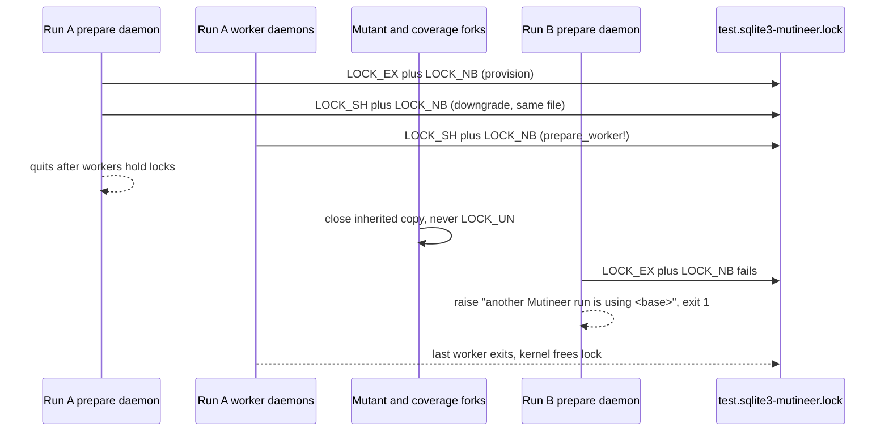

# SQLite run lock for daemon runs in one checkout - Plan

## Goal Capsule

- **Issue:** #404 (two SQLite daemon runs in one checkout share worker databases and stop with a false not-green; add a run lock).
- **Objective:** a second `--rails --daemon` run on the same SQLite test database stops at once with one clear message. The first run finishes with correct results. No run reports a false "the unmutated suite is not green".
- **Means:** a `File#flock` lock on a file next to the base SQLite file (KTD1). It is taken where Postgres and MySQL take their run lock (KTD2).
- **Authority:** this plan, then `AGENTS.md`, then the issue text. Where this plan differs from the issue, this plan wins (see "Corrections to the issue").
- **Stop and ask when:** U1 shows a Linux `flock` result that differs from the macOS probe. Also stop when a change would alter a score, a verdict or an exit code of a run on its own.
- **Execution profile:** one pull request. Labels: `bug`, `priority: medium`, `risk: low`, `v1.9.0`. Body: `Closes #404`.
- **Size:** S. One `lib/` file, two test files, the fixture app `.gitignore`, one docs page, `CHANGELOG.md`. No new runtime dependency.
- **Release and semver:** a fix, so patch class. It ships in the v1.9.0 batch. It changes no GitHub Action default. No agent tags or publishes a release.

---

## Product Contract

### Summary

The provisioning daemon of a SQLite run takes an exclusive `flock` on `<base file>-mutineer.lock`, then holds it as a shared lock. Each worker daemon of the same run takes a shared lock. A second run cannot get the exclusive lock. It stops with "another Mutineer run is using <base file>", the message of the other adapters. Mutant forks and coverage forks close their copy of the lock file and never unlock it.

### Problem Frame

SQLite worker files have fixed names: `storage/test.sqlite3` gives `storage/test-0.sqlite3`, `storage/test-1.sqlite3` and so on (`lib/mutineer/rails_worker_db.rb:117-120`). `provision` and `prepare_worker!` return early for SQLite (`lib/mutineer/rails_worker_db.rb:304`, `:327`), so a SQLite run takes no lock. Every coverage capture fork re-seeds slot 0 (`lib/mutineer/daemon_server.rb:323-330`). Two overlapping runs therefore overwrite each other's worker files. A local reproduction on Fizzy gave about 56 not-green test files per run, while a run on its own was green (`wip/vlad/opus/2026-11-09-deep-validation-report.md` line 34). Vladimir Dementyev's report also says "don't run two scans in one checkout" (`CTX/vladimir-fizzy-report.md` line 442). Postgres and MySQL runs already stop the second run with a clear message (`lib/mutineer/rails_worker_db.rb:340`, `:651`, `:957`, `:1046`).

### Requirements

**Stop the second run**

- R1. A second daemon run on the same SQLite base file stops before its coverage map and clean check. It prints "another Mutineer run is using <absolute base file path>" and exits with status 1.
- R2. The first run holds the lock from provisioning until its last worker daemon exits. Mutant forks, coverage forks and timed-out forks never release it.

**Keep a run on its own unchanged**

- R3. A run on its own gives the same verdicts, scores and exit codes as before, with `--jobs 1` and with `--jobs N`.
- R4. A crashed or killed run never blocks the next run. The kernel frees the lock, and no stale-file check exists.
- R5. An in-memory SQLite database (`:memory:`), an empty name and a `file:` URI take no lock and behave as today.
- R6. When the lock file cannot be opened or created, the run stops before any mutant with an error that names the lock path.

**Lock file and docs**

- R7. The lock file is `<absolute base file>-mutineer.lock`. Mutineer never deletes it. The fixture app's `.gitignore` ignores it.
- R8. `docs/rails-setup.md` states the SQLite run lock, the lock file name and the stop message. `CHANGELOG.md` has a "Fixed" entry under "Unreleased".

### Acceptance Examples

- AE1. **Covers R1.** Given run A holds the lock on `test/fixtures/rails_app/storage/test.sqlite3`, when run B starts with `--rails --daemon`:
  - run B exits 1 and prints "another Mutineer run is using" with that absolute path.
  - run B prints no mutation score and no "not green" text.
- AE2. **Covers R2.** Given run A holds the lock, when one of A's forks closes its copy of the lock file and exits, then run B still stops as in AE1.
- AE3. **Covers R4.** Given run A was killed with SIGKILL while it held the lock, when run B starts, then run B scores 100.0 on the fixture.
- AE4. **Covers R3.** Given no other run, when a run uses `--jobs 2`, then its verdicts equal the `--jobs 1` verdicts (existing `test/runner_daemon_parallel_test.rb` `test_strong_suite_jobs2_equals_jobs1_and_scores_100`).

### Scope Boundaries

Considered and not built:

- **A lock for in-process `--rails` runs.** In-process runs do not load `RailsWorkerDb` and use no worker files (only `lib/mutineer/daemon_server.rb:197` loads it). Two in-process runs are like two `rails test` runs. A report of real harm from that overlap would change this call.
- **Taking the lock before the app boots.** The second run's daemon boots the app and runs `--require` files before it checks the lock (`lib/mutineer/daemon_server.rb:173-178`). Those files can write to the base file. Postgres and MySQL have the same order. A repro where that window changes a verdict would change this call.
- **Waiting or retrying for the lock.** The second run stops at once, like the other adapters. A request for a queued run would change this call.
- **A lock for `file:` URI databases.** Rare, and a stop or a lock there needs URI parsing. See Open Questions for the tracking issue.
- **Scoring a busy SQLite error as `error`.** The Opus validation report item 4 says a `BusyException` during a mutant may score as killed. That is a separate question, not this lock.

### Corrections to the issue

1. **Slot numbers start at 0.** `worker_database_path(database, 0)` gives `storage/test-0.sqlite3` (`lib/mutineer/rails_worker_db.rb:117-120`). Slot 0 collides most, because every capture fork re-seeds it (`lib/mutineer/daemon_server.rb:328`).
2. **The suggested name `storage/test.sqlite3.mutineer.lock` is not git-ignored in the fixture app.** The fixture ignores `/storage/*.sqlite3` and suffixed forms only (`test/fixtures/rails_app/.gitignore:1-5`). Probe P2 shows both candidate names are not ignored there. The plan uses `-mutineer.lock` (KTD4) and adds a fixture ignore line (U3).
3. **MySQL has no real shared lock.** Its "shared" lock is one name from a pool of exclusive `GET_LOCK` names (`lib/mutineer/rails_worker_db.rb:1120-1165`). The SQLite design follows Postgres, which uses real shared advisory locks (`:815-819`).
4. **"Add the same two tests for SQLite" needs a different file and a skip.** The Postgres tests skip unless `DB=postgres` (`test/daemon_postgres_test.rb:21-23`). SQLite tests go in `test/daemon_worker_db_test.rb`. They must skip when `DB` is set, because the Postgres and MySQL CI jobs run the same `rake test:daemon` (`.github/workflows/ci.yml:110`, `:129`, `:154`, `:178`).
5. **A fork child that unlocks releases the lock for the whole run.** The issue only says a child that exits must not drop it. Probe P1 case G shows `flock(LOCK_UN)` in a child frees the parent's lock. The fork path must close its copy, never unlock (KTD5).
6. **The downgrade from exclusive to shared is not atomic.** Another run can take the lock in that gap. The Postgres path handles the same gap with a second try and the same message (`lib/mutineer/rails_worker_db.rb:666-670`). The SQLite path does the same (KTD2).
7. **Not checked:** the claims "about 56 test files" and "only one threaded test logged a `BusyException`". The run logs are not in this checkout. The Opus report line 34 states them.

---

## Planning Contract

### Key Technical Decisions

- KTD1. **`File#flock` on a separate lock file next to the base file.** The kernel frees it when the last holder closes or dies, so a crash never leaves a stale lock (probe P1 case H). Rejected: `flock` on the database file itself, because SQLite uses POSIX record locks on that file, and an extra open and close by Mutineer can drop SQLite's own locks. Rejected: a lock in the cache directory, because `--cache-dir` can differ between two runs that share one database. Rejected: a pid file, because it needs a stale check after a crash.
- KTD2. **Exclusive, then shared, in `provision`. Shared in `prepare_worker!`.** This mirrors `provision_postgres` (`lib/mutineer/rails_worker_db.rb:645-673`). The prepare daemon keeps its lock until worker daemons hold theirs (`lib/mutineer/daemon_backend.rb:78-81`), so it must downgrade, or the workers' shared request fails. Every request uses `LOCK_NB`. A failed downgrade raises the same message.
- KTD3. **Resolve the base path as the Rails SQLite adapter does.** Expand a relative name against `Rails.root` when it is set (activerecord 7.2.4 `sqlite3_adapter.rb:103-111`). Return nil for `""`, `:memory:` and `file:` names. Pull request #335 (a SQLite copy for every SQLite database, 2.0 line) adds `sqlite_file_config?` and `sqlite_file` with these semantics (`origin/feat/332-suffix-all-sqlite-databases:lib/mutineer/rails_worker_db.rb:655-668`). Add them now with the same names and doc text, so the #335 rebase drops its copy. Rejected: the `pragma_database_list` lookup that `after_fork` uses (`:411`), because it opens a SQLite connection in the daemon parent, which the parent never does today.
- KTD4. **Name the file `<base file>-mutineer.lock`.** SQLite names its own side files with a `-` suffix (`-journal`, `-wal`, `-shm`), so ignore rules written for those also match. Rails 7.2 to 8.1 app templates ignore `/storage/*` (probe P2). Rejected: the issue's `.mutineer.lock` form, for the reason in correction 2.
- KTD5. **Fork children close their copy in `forget_lock_connection_after_fork!` and never call `LOCK_UN`.** Closing never frees the lock while the daemon holds it (probe P1 cases B to E). Closing also stops an orphaned child from holding the lock after its daemon exits. `after_fork` already calls this hook first (`lib/mutineer/rails_worker_db.rb:403`), so no new call site is needed.
- KTD6. **Never delete the lock file.** An unlink while another process has the file open gives two lock files with different inodes, and both runs would then hold "the" lock.
- KTD7. **One open per process.** A second `open` of the same path in one process is a separate lock owner and conflicts with the first (probe P1 case I). Keep the open `File` in a module variable and reuse it. Store it in `@sqlite_lock_file`, not in `@lock_connection`, because that name and its detach logic are for database clients (`:880-906`).
- KTD8. **Open the lock file read-only with create, and let an open failure stop the run.** A read-only directory gives `Errno::EACCES`, and its message names the path (probe P1 case J1). A daemon run cannot work in that directory today: SQLite cannot write a database there, because it creates its journal file beside it (probe P3). So a stop changes no working run (R3), and no rescue or warning code is needed. Read-only mode is enough for `flock` (probe P1 case J2), so a lock file that another user created still opens. Rejected: warn and continue, because it adds code for a run that fails later anyway.

### High-Level Technical Design

### Assumptions

- The relative `database:` value resolves against `Rails.root`, and the daemon's working directory is the app root. Both hold for the fixture (`test/fixtures/rails_app/config/database.yml` default branch).
- Every run in one checkout uses the same primary base file. Under #335 a run also copies other SQLite files, but those runs still share the primary, so one lock covers them.
- Linux `flock` keeps the macOS semantics from probe P1. U1 checks this, and the zero-dependency tests in U2 run on `ubuntu-latest` and `macos-latest` (`.github/workflows/ci.yml:22`).

### Probes run for this plan

Scripts and output are in `CTX/probes/404/`.

- P1. `flock_probe.rb` (Ruby 3.4.9, arm64-darwin25). 17 of 17 cases pass. A held `LOCK_EX` blocks another process (A2, A3). It stays held when a fork child closes its copy (B), exits with `exit!` (C), drops the `File` and runs GC (D), or is killed with SIGKILL (E). A downgrade to `LOCK_SH` on the same file works, and then another `LOCK_SH` succeeds while `LOCK_EX` fails (F1 to F3). A child that calls `flock(LOCK_UN)` frees the lock for everyone (G). A killed holder frees the lock (H2). A second `open` in one process conflicts (I). A read-only directory gives `Errno::EACCES` (J1). An existing lock file opened read-only can still be locked (J2).
- P2. `gitignore_probe.out`. Neither `storage/test.sqlite3-mutineer.lock` nor `storage/test.sqlite3.mutineer.lock` is ignored in the fixture app. Fizzy ignores `/storage/*`. The railties 7.2.4, 8.0.5 and 8.1.4 app templates each have one `/storage/*` line. Not checked: Rails 7.1 and older templates (not installed here).
- P3. `readonly_dir_probe.out` (sqlite3 CLI). In a `0555` directory, an insert into a writable database file fails with "attempt to write a readonly database". A read still works.

---

## Implementation Units

### U1. Spike: confirm the flock facts on Linux

- **Goal:** prove probe P1 holds on Linux before code depends on it.
- **Requirements:** R2, R4.
- **Dependencies:** none.
- **Files:** none in the repo. Use `CTX/probes/404/flock_probe.rb`.
- **Approach:**
  1. Run the probe in a Linux container with Ruby 3.4, for example `docker run --rm -v <probe dir>:/p ruby:3.4-slim ruby /p/flock_probe.rb`. Pulling the image is a download, so ask the person first.
  2. If the pull is not approved, skip the spike. The U2 zero-dependency tests then act as the Linux check on the `ubuntu-latest` CI job.
- **Time box:** 15 minutes.
- **Pass:** all 17 lines print `PASS`. Continue with U2.
- **Fail:** any line prints `FAIL`. Stop and report the case. Case B to E failing means forks need a different design. Case F failing means the downgrade needs a guard lock like MySQL.
- **Test expectation:** none. A spike merges no code.

### U2. Take the SQLite run lock in RailsWorkerDb

- **Goal:** SQLite runs take and keep the lock that R1 and R2 describe.
- **Requirements:** R1, R2, R4, R5, R6, R7.
- **Dependencies:** U1.
- **Files:**
  - `lib/mutineer/rails_worker_db.rb`
  - `test/rails_worker_db_test.rb`
- **Approach:**
  1. Add a constant for the `-mutineer.lock` suffix (KTD4).
  2. Add `sqlite_file_config?` and `sqlite_file` with the #335 semantics (KTD3). Add a small path helper that returns the lock path, or nil for R5 cases.
  3. Add one lock helper that takes the lock path, the base path for the message and `shared:`. It opens the file once per process, read-only with create (KTD7, KTD8). It calls `flock` with `LOCK_NB` and raises "another Mutineer run is using <base>" on a miss. It does not rescue an open failure.
  4. In `provision`, replace the SQLite early return with exclusive then shared (KTD2). Keep the `available?` and `count < 1` returns first.
  5. In `prepare_worker!`, replace the SQLite early return with a shared request.
  6. In `forget_lock_connection_after_fork!`, close `@sqlite_lock_file` and set it to nil (KTD5).
  7. Give every new method and constant a YARD comment.
- **Patterns to follow:** `provision_postgres` and `prepare_worker!` (`lib/mutineer/rails_worker_db.rb:325-345`, `:645-673`). The message must start with "another Mutineer run", so `provision_wrapped?` (`:1746-1749`) keeps it unwrapped.
- **Test scenarios** (zero-dependency suite: these need no Rails, so they run on Linux and macOS in CI. They do not prove the daemon wiring. U3 does.):
  - Path helper with `storage/test.sqlite3` and no `Rails` constant returns `File.expand_path("storage/test.sqlite3") + "-mutineer.lock"`.
  - Path helper with an absolute name keeps it and adds the suffix.
  - Path helper with `""`, `:memory:`, `file:storage/test.sqlite3?mode=ro` and `file::memory:?cache=shared` returns nil each time.
  - A spawned plain Ruby process holds `LOCK_SH` on a temp lock file. An exclusive request in the test raises `RuntimeError` whose message is "another Mutineer run is using <base>". `provision_wrapped?` is true for that error.
  - With no other holder, exclusive then shared in the test succeeds. A spawned process then gets `LOCK_SH` and fails `LOCK_EX`.
  - A shared request after an exclusive request in the same process does not raise (KTD7).
  - The test holds the lock, forks, and the child calls `forget_lock_connection_after_fork!` and exits with `exit!`. The child reports `@sqlite_lock_file` as nil through its exit code. A spawned process still fails `LOCK_EX` afterwards.
  - A lock path in a `chmod 0555` directory makes the helper raise `Errno::EACCES`, and the message contains the lock path.
  - An existing lock file with mode `0444` in a writable directory still opens, and the helper takes the lock.
  - `provision` with `current_adapter` stubbed to `sqlite3` and a stubbed config takes the lock. `provision` with a stubbed `:memory:` config takes none and does not raise.
- **Verification:** the new tests pass with `bundle exec rake test` on macOS, and on Linux in CI.

### U3. Daemon integration tests and the fixture ignore line

- **Goal:** prove the stop, the fork safety and the crash recovery through a real CLI run on the SQLite fixture.
- **Requirements:** R1, R2, R3, R4, R7.
- **Dependencies:** U2.
- **Files:**
  - `test/daemon_worker_db_test.rb`
  - `test/fixtures/rails_app/.gitignore`
- **Approach:**
  1. Add `/storage/*-mutineer.lock` to the fixture `.gitignore`.
  2. Add `spawn_holder`, `stop_holder` and `run_cli` helpers by copying them from `test/daemon_postgres_test.rb:246-280`, as `test/daemon_mysql_test.rb:355` does.
  3. Each new test skips when `ENV["DB"]` is set, because then the fixture does not use SQLite.
- **Patterns to follow:** `test_a_second_run_stops_while_the_first_holds_the_lock`, `test_the_lock_survives_a_fork_child_that_frees_its_copy` and `test_a_killed_run_does_not_block_the_next_run` (`test/daemon_postgres_test.rb:171-227`).
- **Test scenarios** (`rake test:daemon`, rails-integration CI job. They catch the daemon wiring and the CLI exit. They miss non-fixture path shapes, which U2 covers.):
  - Covers AE1. A holder under the fixture bundle calls `prepare_worker!` and prints `READY`. `run_cli(1)` exits 1. Output includes "another Mutineer run is using" and the absolute `storage/test.sqlite3` path. Output has no "mutation score" and no "not green". The file `storage/test.sqlite3-mutineer.lock` exists, and `git check-ignore` exits 0 for it.
  - Covers AE2. The holder calls `prepare_worker!`, forks a child that calls `forget_lock_connection_after_fork!`, runs GC three times and exits with `exit!`. After the child exits, `run_cli(1)` still exits 1 with the same message.
  - Covers AE3. The holder calls `provision(2)` and is killed with SIGKILL. `Mutineer::Runner.execute` with `--jobs 1` then gives a mutation score of 100.0.
  - Covers AE4. No new test. `test_strong_suite_jobs2_equals_jobs1_and_scores_100` must stay green, because it fails if worker daemons cannot share the prepare daemon's lock.
- **Verification:** `rake test:daemon` is green with `DB` unset, and the new tests report as skipped in the Postgres and MySQL jobs. Existing tests that start a direct client (no `db_role`) now take the lock at boot (`lib/mutineer/daemon_server.rb:214`). Today they run one client at a time and quit it in `ensure`, so they stay green. A failure with the lock message there means two clients overlap.

### U4. Docs and CHANGELOG

- **Goal:** users can find the lock, its file and its message.
- **Requirements:** R8.
- **Dependencies:** U2.
- **Files:**
  - `docs/rails-setup.md`
  - `CHANGELOG.md`
- **Approach:**
  1. In the provisioning table (`docs/rails-setup.md:140-147`), add a SQLite row. It says worker files are `<base>-<N>.sqlite3`, and that a run takes a lock on `<base file>-mutineer.lock`.
  2. Move the "Concurrent runs" row out of the MySQL table (`:157`) into that table, so it covers SQLite, PostgreSQL and MySQL.
  3. State that apps whose `.gitignore` does not cover `storage/*` should add the lock file.
  4. Add a "Fixed" entry under "Unreleased" in `CHANGELOG.md` that names #404.
- **Test expectation:** none. Docs only. If the site build reads `docs/rails-setup.md`, run the website checks from `AGENTS.md`.
- **Verification:** the two docs read correctly, and `rake site:build` succeeds when the website checks apply.

---

## Verification Contract

| Check | Command | Proves |
|---|---|---|
| Unit tests for U2 | `LANG=en_US.UTF-8 LC_ALL=en_US.UTF-8 bundle exec ruby -Ilib -Itest test/rails_worker_db_test.rb` | Path rules, lock helper, fork close, unwritable path |
| Zero-dependency suite | `bundle exec rake test` | Nothing else broke |
| Load smoke | `ruby -Ilib -e 'require "mutineer"'` | The gem loads |
| Docs coverage | `bundle exec rake yard:strict` | Every new method and constant has a comment |
| Daemon tests (SQLite) | `bundle exec rake test:daemon` with the fixture bundle installed, as in `.github/workflows/ci.yml:82-90` | AE1 to AE4 |
| Daemon tests (Postgres, MySQL) | CI jobs with `DB=postgres` and `DB=mysql` | Existing lock tests stay green. The new SQLite tests skip |
| Website checks | The commands in `AGENTS.md` "Website checks" | Only when U4 changes the built site |

## Definition of Done

- R1 to R8 hold, and each acceptance example has its test.
- All Verification Contract checks are green on the pull request head.
- The pull request has the labels in the Goal Capsule and `Closes #404`.
- If Open Question 1 keeps the `file:` limit, a tracking issue exists and the pull request names it.
- No spike code, debug output or abandoned attempt is left in the diff.

---

## Risks and Overlaps

- **#335 (a SQLite copy for every SQLite database, 2.0 line, held):** it rewrites `after_fork` and adds `sqlite_file_config?` and `sqlite_file`. This plan adds those helpers with the same names and meaning (KTD3). The #335 rebase must keep the lock calls in `provision` and `prepare_worker!`.
- **#244 (the 2.0 breaking flip):** `STABILITY.md:121-125` says a provisioning failure moves from exit 1 to exit 3 in 2.0. The SQLite lock stop is a provisioning failure, so it moves with it.
- **#245 (parallel Rails by default, 2.0):** it changes `lib/mutineer/rails_worker_db.rb`, `lib/mutineer/daemon_server.rb` and `test/rails_worker_db_test.rb`. Expect text conflicts only.
- **#391 (the reload fix for Rails class bodies):** it adds `skip_schema_check!` near `touched_shared_databases`. No overlap with the lock lines.
- **#375 (hook-block placement):** it changes `lib/mutineer/daemon_server.rb`. Not checked whether it touches `setup_worker_db`. This plan does not change that file.
- **#389 (full-reload strategy, sibling plan in this batch):** Ruby opens files with close-on-exec. If that strategy re-execs a daemon, the new process loses the lock. That plan must keep the lock open across its reload or take it again.
- **#337 (daemon database isolation for mixed-adapter apps):** the lock covers the SQLite primary only. A mixed app with a SQLite secondary database gets no lock from this plan.
- **#360 (a not-green run names no failing test):** unaffected. This plan removes one cause of the not-green stop.
- **A run whose first daemon fails to boot:** `prepare_run` then starts worker daemons only (`lib/mutineer/daemon_backend.rb:173-178`), and they take shared locks. Two such runs do not stop each other. Postgres has the same gap. Such a run usually fails to boot its workers too.
- **The 64-file not-green run in Vladimir's report:** this lock may not explain it. Whether his runs overlapped is unknown (Opus report line 148).

## Open Questions

1. **How to track the `file:` URI limit?** Default: no lock for `file:` names, and the implementer files one GitHub issue for it before the pull request opens ("Track every limitation" in `.expectation-fit/ways-of-working.yaml`). Decider: the implementer, with maintainer review.
2. **Should the stop message also name the lock file?** Default: no. Keep the shared wording "another Mutineer run is using <base>", and let `docs/rails-setup.md` name the file. Decider: a maintainer at review.
