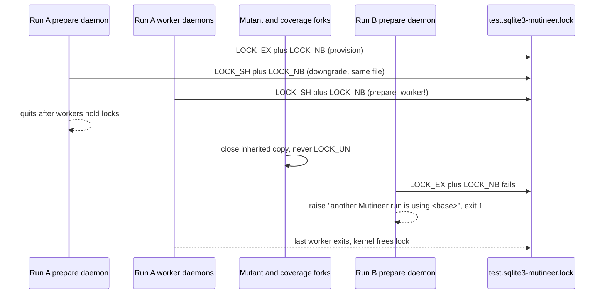

# SQLite run lock for daemon runs in one checkout - Plan

## Goal Capsule

- **What:** Stop a second `--rails --daemon` run on the same SQLite test database immediately, with one clear message.
- **Why:** #404 reports overlapping runs that share worker databases and cause false "the unmutated suite is not green" results.
- **How:** Use `File#flock` beside the base SQLite file (KTD1, lock mechanism), at the existing adapter lock points (KTD2, lock sequence).

The first run must finish with correct results.

| Item | Contract |
|---|---|
| Authority | Follow this plan, then `AGENTS.md`, then the text of issue #404. This plan wins conflicts; see "Corrections to the issue". |
| Stop conditions | Stop if U1, the Linux lock probe, differs from the macOS probe. Also stop if a change alters a solo run's score, verdict or exit code. |
| Execution | Use one pull request. Apply `bug`, `priority: medium` (medium priority), `risk: low` (low risk) and `v1.9.0` (target release). Include `Closes #404`. |
| Size | S (small): one `lib/` code file, one `lib/` comment change (`lib/mutineer/daemon_server.rb`), two test files, fixture `.gitignore`, one docs page, `CHANGELOG.md`. Add no runtime dependency. |
| Release | This fix is patch class and ships in the v1.9.0 batch. It changes no GitHub Action default. No agent tags or publishes a release. |

---

## Product Contract

### Summary

| Process | Lock behaviour |
|---|---|
| Provisioning daemon | Take exclusive `flock` on `<base file>-mutineer.lock`, then hold a shared lock. |
| Worker daemons | Each daemon holds a shared lock for the same run. |
| Second run | Its exclusive request fails. Stop with the other adapters' message: "another Mutineer run is using <base file>". |
| Mutant and coverage forks | Close the inherited lock file. Never unlock it. |

### Problem Frame

| Evidence | Effect |
|---|---|
| Worker names are fixed (`lib/mutineer/rails_worker_db.rb:117-120`). | `storage/test.sqlite3` produces `storage/test-0.sqlite3`, `storage/test-1.sqlite3` and subsequent slots. |
| SQLite returns early from `provision` and `prepare_worker!` (`lib/mutineer/rails_worker_db.rb:304`, `:327`). | SQLite runs take no lock. |
| Every coverage capture fork re-seeds slot 0 (`lib/mutineer/daemon_server.rb:323-330`). | Overlapping runs overwrite each other's worker files. |
| Fizzy reproduction (`wip/vlad/opus/2026-11-09-deep-validation-report.md` line 34). | Each overlapping run had about 56 not-green test files. A solo run was green. |
| Vladimir's report (`CTX/vladimir-fizzy-report.md` line 442). | It says "don't run two scans in one checkout". |
| Existing adapter locks (`lib/mutineer/rails_worker_db.rb:340`, `:651`, `:957`, `:1046`). | Postgres and MySQL already stop the second run with a clear message. |

### Requirements

**Stop the second run**

| Requirement | Required behaviour |
|---|---|
| R1 | Stop the second daemon run on the same SQLite base file before coverage mapping and the clean check. Print "another Mutineer run is using <absolute base file path>" and exit with status 1. |
| R2 | Hold the first run's lock from provisioning until its last worker daemon exits. Mutant, coverage and timed-out forks must never release it. |

**Keep a run on its own unchanged**

| Requirement | Required behaviour |
|---|---|
| R3 | Preserve solo-run verdicts, scores and exit codes with `--jobs 1` and `--jobs N`. |
| R4 | A crashed or killed run must never block the next run. Let the kernel free the lock; add no stale-file check. |
| R5 | Take no lock for `:memory:`, an empty name or a `file:` URI. Preserve current behaviour. |
| R6 | If the lock file cannot open or be created, stop before any mutant. The error must name the lock path. |

**Lock file and docs**

| Requirement | Required behaviour |
|---|---|
| R7 | Use `<absolute base file>-mutineer.lock`. Never delete it. Ignore it in the fixture app's `.gitignore`. |
| R8 | Document the SQLite run lock, file name and stop message in `docs/rails-setup.md`. Include: "The lock file never goes stale. Do not delete it while a run is active. Wait for the other run to finish, or stop it." Add a "Fixed" entry under "Unreleased" in `CHANGELOG.md`. |

**Regression fixture**

| Requirement | Required behaviour |
|---|---|
| R9 | Run two real overlapping CLI runs on the SQLite fixture in a `rake test:daemon` test. The second must stop as R1 requires. The first must match solo-run per-mutant verdicts ("Repro becomes fixture", `.expectation-fit/ways-of-working.yaml:31-32`). |

### Acceptance Examples

- AE1. **Covers R1.** Run A holds the lock on `test/fixtures/rails_app/storage/test.sqlite3`. Run B starts with `--rails --daemon`:
  - Run B exits 1 and prints "another Mutineer run is using" with that absolute path.
  - Run B prints no mutation score or "not green" text.
- AE2. **Covers R2.** A fork of run A closes its inherited lock file and exits. Run B still stops as AE1 requires.
- AE3. **Covers R4.** Run A receives SIGKILL while holding the lock. Run B then scores 100.0 on the fixture. It prints no "another Mutineer run" text and holds the lock while its daemon lives.
- AE4. **Covers R3.** With no competing run, `--jobs 2` verdicts equal `--jobs 1` verdicts. Existing coverage: `test/runner_daemon_parallel_test.rb`, `test_strong_suite_jobs2_equals_jobs1_and_scores_100`.
- AE5. **Covers R9.** Real run B starts in the same checkout during real run A's mutant phase. Run B exits 1 with the lock message and no "not green" text. Run A's per-mutant verdicts equal solo-run verdicts.

### Scope Boundaries

Considered and not built:

| Exclusion | Reason and revisit condition |
|---|---|
| Lock for in-process `--rails` runs | These runs do not load `RailsWorkerDb` or use worker files. Only `lib/mutineer/daemon_server.rb:197` loads it. Overlap resembles two `rails test` runs. Revisit after a report of real harm. Track under the umbrella issue in Open Question 3. |
| Lock before `--require` files | The prepare daemon boots the app and runs `--require` files before the provision command checks the lock (`lib/mutineer/daemon_server.rb:173-177`). These files can write the base file. The fixture uses `create_table force: true` (`test/fixtures/rails_app/test/support/seed_setup.rb:5-7`), supported by #222 (boot-time row writes through `--require`). SQLite remains exposed throughout run A. It seeds slot 0 in every capture fork (`lib/mutineer/daemon_server.rb:323-330`). It also seeds slots on first use and after errors or timeouts (`:345`, `:381`). Postgres copies all slots once under its exclusive lock, so its window is short (`lib/mutineer/rails_worker_db.rb:645-673`). Fizzy's `test/mutineer_boot.rb` does not write, so this does not affect the reported case. KTD9, the boot-lock decision, explains the exclusion. Track under Open Question 3. |
| Waiting or retrying | Stop immediately, as other adapters do. Revisit if queued runs are requested. |
| Lock for `file:` URI databases | These are rare; locking or rejecting them needs URI parsing. See Open Questions for tracking. |
| Scoring a busy SQLite error as `error` | Opus validation report item 4 says a mutant's `BusyException` may score as killed. Handle this separately. |

Sibling surfaces ("Cover the siblings", `.expectation-fit/ways-of-working.yaml:14-16`):

| Surface | Action |
|---|---|
| `--test-command` runs | Make no change. They use no worker databases and already hold a per-source `flock`. Contention raises `ConcurrentRunError` (`lib/mutineer/file_swap.rb:131-167`, `lib/mutineer/cli.rb:385-389`). |
| `--dry-run` | Add no lock. It boots no daemon and writes no database (`lib/mutineer/cli.rb:356`). |
| GitHub Action | Make no change. It runs one job per checkout, preventing this overlap. |
| In-process `--rails` runs | See the first exclusion above. |

### Corrections to the issue

1. **Slots start at 0.** `worker_database_path(database, 0)` returns `storage/test-0.sqlite3` (`lib/mutineer/rails_worker_db.rb:117-120`). Slot 0 collides most because every capture fork re-seeds it (`lib/mutineer/daemon_server.rb:328`).
2. **The fixture does not ignore `storage/test.sqlite3.mutineer.lock`.** Its rules cover `/storage/*.sqlite3` and specific suffixes (`test/fixtures/rails_app/.gitignore:1-5`). Ignore probe P2 confirms neither candidate name is ignored. Use `-mutineer.lock` (KTD4, file naming) and add an ignore rule (U3, daemon tests and fixture).
3. **MySQL has no real shared lock.** It uses one name from a pool of exclusive `GET_LOCK` names (`lib/mutineer/rails_worker_db.rb:1120-1165`). Follow Postgres, which has shared advisory locks (`:815-819`).
4. **SQLite needs another test file and a skip.** Postgres tests require `DB=postgres` (`test/daemon_postgres_test.rb:21-23`). Put SQLite tests in `test/daemon_worker_db_test.rb` and skip when `DB` is set. Postgres and MySQL CI jobs also run `rake test:daemon` (`.github/workflows/ci.yml:110`, `:129`, `:154`, `:178`).
5. **A child unlock releases the whole run's lock.** The issue addresses child exit only. Fork-lock probe P1, case G, shows `flock(LOCK_UN)` releases the parent's lock. Children must close their copy, never unlock (KTD5, fork cleanup).
6. **Downgrading is not atomic.** Another run can acquire the lock between exclusive and shared modes. Postgres handles this with another attempt and the same message (`lib/mutineer/rails_worker_db.rb:666-670`). SQLite must do the same (KTD2).
7. **Two report claims remain unchecked.** These are "about 56 test files" and "only one threaded test logged a `BusyException`". The logs are absent from this checkout; Opus report line 34 states both.

---

## Planning Contract

### Key Technical Decisions

- KTD1. **Use `File#flock` on a separate file beside the base file.** The kernel releases it when the last holder closes or dies (probe P1, case H). Reject the database file: SQLite uses POSIX record locks there, which an extra open and close can release. Reject the cache directory: runs sharing a database can use different `--cache-dir` values. Reject a pid file: it needs crash cleanup checks. Reuse `FileSwap`'s `LOCK_EX | LOCK_NB` technique, but not its `ConcurrentRunError` (`lib/mutineer/file_swap.rb:25-43`, `:131-167`). Raise the `RailsWorkerDb` message for consistency across all three adapters. `provision_wrapped?` preserves it (`lib/mutineer/rails_worker_db.rb:1746-1749`).

- KTD2. **Request exclusive then shared in `provision`; request shared in `prepare_worker!`.** Follow `provision_postgres` (`lib/mutineer/rails_worker_db.rb:645-673`). The prepare daemon retains its lock until worker daemons hold theirs (`lib/mutineer/daemon_backend.rb:78-81`). Downgrade first so workers can acquire shared locks. Use `LOCK_NB` for every request. A failed downgrade raises the same message.

- KTD3. **Resolve the base path as the Rails SQLite adapter does.** Expand relative names against `Rails.root` when set (activerecord 7.2.4, `sqlite3_adapter.rb:103-111`). Return nil for `""`, `:memory:` and `file:` names. Pull request #335 (copies for every SQLite database, 2.0 line) adds `sqlite_file_config?` and `sqlite_file` with these semantics (`origin/feat/332-suffix-all-sqlite-databases:lib/mutineer/rails_worker_db.rb:655-668`). Use the same names and doc text now; remove the duplicate when rebasing #335. Both helpers accept `ActiveRecord::DatabaseConfigurations::DatabaseConfig` and read `config.adapter` and `config.database`, not a Hash. Production callers pass `ActiveRecord::Base.connection_db_config`. Zero-dependency tests use `Struct.new(:adapter, :database)` because ActiveRecord is absent. Reject the `pragma_database_list` lookup from `after_fork` (`:411`). It requires a live connection in every daemon parent, retained across forks. Most apps need no such connection, although `--require` can open one (`test/fixtures/rails_app/test/support/seed_setup.rb:5`).

- KTD4. **Name the file `<base file>-mutineer.lock`.** SQLite uses `-journal`, `-wal` and `-shm` side files. The railties 7.0.4 template ignores `/db/*.sqlite3-*`, which matches this name (`lib/rails/generators/rails/app/templates/gitignore.tt:13`). Rails 7.2 to 8.1 templates ignore `/storage/*` (probe P2). The fixture's `-shm` and `-wal` rules do not match; U3 adds a rule. Reject `.mutineer.lock` for correction 2's reason.

- KTD5. **Close inherited files in `forget_lock_connection_after_fork!`; never call `LOCK_UN`.** Closing preserves the daemon's lock (probe P1, cases B to E). It also prevents an orphaned child from retaining the lock after daemon exit. `after_fork` already calls this hook first (`lib/mutineer/rails_worker_db.rb:403`); add no call site.

- KTD6. **Never delete the lock file.** Unlinking an open file permits two lock files with different inodes. Both runs could then hold "the" lock.

- KTD7. **Open once per process.** Another `open` creates a separate lock owner that conflicts with the first (probe P1, case I). Reuse a module-level `File` in `@sqlite_lock_file`. Do not use `@lock_connection`; its name and detach logic concern database clients (`:880-906`). If an open file exists for another path, raise `ArgumentError` naming both paths. One daemon locks one base file throughout its life. A different path indicates a bug; silent reuse would lock the wrong file. Reject a path-keyed Hash such as `FileSwap::OWNED` (`lib/mutineer/file_swap.rb:41-43`): a daemon needs only one SQLite run lock.

- KTD8. **Open read-only with create; let open failures stop the run.** A read-only directory raises `Errno::EACCES` with the path (probe P1, case J1). Daemon runs already fail there because SQLite must create a journal beside the database (probe P3). Stopping therefore preserves working runs (R3) and needs no rescue or warning. Read-only mode supports `flock` (probe P1, case J2), including an existing file created by another user. Reject warning and continuing: it adds code before a later failure.

- KTD9. **Keep locking in `provision` and `prepare_worker!`, after boot and `--require`.** Boot-time locking would close the second Scope Boundaries window. However, `prepare_run` rescues a prepare daemon's `DaemonBootError`, warns about coverage fallback and starts only workers (`lib/mutineer/daemon_backend.rb:169-178`). Workers request shared locks. Run A would therefore hold only a shared lock, allowing run B to continue. Boot-time locking also needs a new `prepare_run` error path. Exclude that larger change and track it under Open Question 3.

### High-Level Technical Design

### Assumptions

| Assumption | Basis or check |
|---|---|
| Relative `database:` resolves against `Rails.root`; the daemon works from the app root. | Both hold for the fixture's default branch in `test/fixtures/rails_app/config/database.yml`. |
| Runs in one checkout share the primary base file. | #335 also copies other SQLite files, but the shared primary needs only one lock. |
| Linux and macOS have the same relevant `flock` semantics. | U1 checks probe P1. U2 zero-dependency tests run on `ubuntu-latest` and `macos-latest` (`.github/workflows/ci.yml:22`). |

### Probes run for this plan

Scripts and output are in `CTX/probes/404/`.

- P1. **`flock_probe.rb`: 17 of 17 cases pass on Ruby 3.4.9, arm64-darwin25.**
  - Held `LOCK_EX` blocks another process (A2, A3).
  - A fork child preserves the lock when it closes its copy (B), uses `exit!` (C), or drops `File` and runs GC (D).
  - SIGKILL of the child also preserves it (E).
  - Same-file downgrade to `LOCK_SH` works; another `LOCK_SH` succeeds while `LOCK_EX` fails (F1 to F3).
  - A child's `flock(LOCK_UN)` releases everyone's lock (G).
  - Killing the holder releases the lock (H2).
  - Another `open` in the same process conflicts (I).
  - A read-only directory raises `Errno::EACCES` (J1).
  - An existing file opened read-only supports locking (J2).
- P2. **`gitignore_probe.out`.** The fixture ignores neither `storage/test.sqlite3-mutineer.lock` nor `storage/test.sqlite3.mutineer.lock`. Fizzy ignores `/storage/*`. Railties 7.2.4, 8.0.5 and 8.1.4 templates each contain one `/storage/*` line. Rails 7.1 and older templates were not checked because they are not installed here.
- P3. **`readonly_dir_probe.out`, sqlite3 CLI.** In a `0555` directory, inserting into a writable database fails with "attempt to write a readonly database". Reading succeeds.

---

## Implementation Units

### U1. Spike: confirm the flock facts on Linux

- **Goal:** Confirm probe P1 on Linux before code depends on it.
- **Requirements:** R2, R4.
- **Dependencies:** None.
- **Files:** No repo changes. Use `CTX/probes/404/flock_probe.rb`.
- **Approach:**
  1. Run the probe in a Linux container with Ruby 3.4: `docker run --rm -v <probe dir>:/p ruby:3.4-slim ruby /p/flock_probe.rb`. The implementer must ask the person before downloading the image.
  2. If the pull is not approved, skip the spike. U2 zero-dependency tests then provide the Linux check in `ubuntu-latest` CI.
- **Time box:** 15 minutes.
- **Pass:** All 17 lines print `PASS`; continue with U2.
- **Fail:** Any `FAIL` means stop and report the case. Failures in cases B to E need another fork design. Case F failure needs a guard lock like MySQL.
- **Test expectation:** None. Merge no spike code.

### U2. Take the SQLite run lock in RailsWorkerDb

- **Goal:** Acquire and retain the SQLite lock required by R1 and R2.
- **Requirements:** R1, R2, R4, R5, R6, R7.
- **Dependencies:** U1.
- **Files:**
  - `lib/mutineer/rails_worker_db.rb`
  - `lib/mutineer/daemon_server.rb` (comment only)
  - `test/rails_worker_db_test.rb`
- **Approach:**
  1. Add a constant for `-mutineer.lock` (KTD4).
  2. Add `sqlite_file_config?(config)` and `sqlite_file(config)` with #335 semantics (KTD3). Both accept `DatabaseConfig`. Add a path helper accepting the same `DatabaseConfig`; return the lock path or nil for R5 cases. Production callers pass `ActiveRecord::Base.connection_db_config`.
  3. Add one helper accepting the lock path, message base path and `shared:`. Open once per process, read-only with create (KTD7, KTD8). Raise `ArgumentError` if `@sqlite_lock_file` is open for another path (KTD7). Call `flock` with `LOCK_NB`; on failure, raise "another Mutineer run is using <base>". Do not rescue open failures.
  4. Replace the SQLite early return in `provision` with exclusive then shared requests (KTD2). Keep `available?` and `count < 1` returns first.
  5. Replace the SQLite early return in `prepare_worker!` with a shared request.
  6. In `forget_lock_connection_after_fork!`, close `@sqlite_lock_file` only when it is open, then set it to nil (KTD5). A second call in the same fork is then a no-op.
  7. Add YARD comments for every new method and constant.
  8. Correct three comments: `provision`'s "SQLite is a no-op" (`lib/mutineer/rails_worker_db.rb:290-291`), `prepare_worker!`'s "SQLite has no lock here" (`:321`), and `setup_worker_db`'s "SQLite provisioning does nothing" (`lib/mutineer/daemon_server.rb:192-195`). State that SQLite takes the run lock and copies files on first use.
  9. In `test/rails_worker_db_test.rb`'s `teardown` (`:416-421`), close an open `@sqlite_lock_file` and set it to nil.
- **Patterns to follow:** Follow `provision_postgres` and `prepare_worker!` (`lib/mutineer/rails_worker_db.rb:325-345`, `:645-673`). Start the error with "another Mutineer run" so `provision_wrapped?` (`:1746-1749`) preserves it.
- **Test scenarios:** These zero-dependency tests run without Rails on Linux and macOS. U3 tests daemon wiring.
  - Use `Struct.new(:adapter, :database)` in every path helper test (KTD3).
  - Without a `Rails` constant, `storage/test.sqlite3` returns `File.expand_path("storage/test.sqlite3") + "-mutineer.lock"`.
  - An absolute name retains its path and receives the suffix.
  - Each of `""`, `:memory:`, `file:storage/test.sqlite3?mode=ro` and `file::memory:?cache=shared` returns nil.
  - A spawned plain Ruby process holds `LOCK_SH` on a temporary lock file. The test's exclusive request raises `RuntimeError` with "another Mutineer run is using <base>". `provision_wrapped?` returns true.
  - Without another holder, exclusive then shared requests succeed. A spawned process then acquires `LOCK_SH` and fails `LOCK_EX`.
  - A same-process shared request after an exclusive request succeeds (KTD7).
  - Requesting another temporary path while holding the first raises `ArgumentError` naming both paths (KTD7).
  - While the test holds the lock, fork a child that calls `forget_lock_connection_after_fork!` and `exit!`. Its exit code confirms `@sqlite_lock_file` is nil. A spawned process must still fail `LOCK_EX`.
  - Calling `forget_lock_connection_after_fork!` twice in one fork raises nothing, and a spawned process still fails `LOCK_EX`.
  - A lock path in a `chmod 0555` directory raises `Errno::EACCES` containing that path. Skip when `Process.euid.zero?`; root ignores directory write permission.
  - An existing `0444` lock file in a writable directory opens and locks.
  - Stub `available?` to true, `current_adapter` to `sqlite3`, and the config; verify `provision` acquires the lock. ActiveRecord is absent, and `provision` checks availability first (`lib/mutineer/rails_worker_db.rb:300`). A stubbed `:memory:` config takes no lock and raises no error.
- **Verification:** Pass `bundle exec rake test` on macOS and Linux CI.

### U3. Daemon integration tests and the fixture ignore line

- **Goal:** Verify rejection, fork safety and crash recovery through real CLI execution on the SQLite fixture.
- **Requirements:** R1, R2, R3, R4, R7, R9.
- **Dependencies:** U2.
- **Files:**
  - `test/daemon_worker_db_test.rb`
  - `test/fixtures/rails_app/.gitignore`
- **Approach:**
  1. Add `/storage/*-mutineer.lock` to the fixture `.gitignore`.
  2. Copy `spawn_holder`, `stop_holder` and `run_cli` from `test/daemon_postgres_test.rb:246-280`, following `test/daemon_mysql_test.rb:355`.
  3. Skip each new test when `ENV["DB"]` is set; the fixture then uses another adapter.
- **Patterns to follow:** Use `test_a_second_run_stops_while_the_first_holds_the_lock`, `test_the_lock_survives_a_fork_child_that_frees_its_copy` and `test_a_killed_run_does_not_block_the_next_run` (`test/daemon_postgres_test.rb:171-227`).
- **Test scenarios:** Run through `rake test:daemon` in rails-integration CI. These verify daemon wiring and CLI exit; U2 covers other path forms.
  - **AE1:** Under the fixture bundle, a holder calls `prepare_worker!` and prints `READY`. `run_cli(1)` exits 1. Output contains "another Mutineer run is using" and the absolute `storage/test.sqlite3` path. It contains neither "mutation score" nor "not green". Confirm `storage/test.sqlite3-mutineer.lock` exists and `git check-ignore` exits 0 for it.
  - **AE2:** The holder calls `prepare_worker!`, then forks. The child calls `forget_lock_connection_after_fork!`, runs GC three times and uses `exit!`. After child exit, `run_cli(1)` still exits 1 with the same message.
  - **AE3:** The holder calls `provision(2)`, then receives SIGKILL. `Mutineer::Runner.execute` with `--jobs 1` must then score 100.0, without "another Mutineer run" output. During its mutant phase, a spawned plain Ruby process must fail `LOCK_EX | LOCK_NB` on `storage/test.sqlite3-mutineer.lock` ("Assert the mechanism"). At minimum, confirm the lock file exists after the run.
  - **AE4:** Add no test. Keep `test_strong_suite_jobs2_equals_jobs1_and_scores_100` green; it fails if workers cannot share the prepare daemon's lock.
  - **AE5 (R9):** Create a temporary `--require` file that prepends `before_setup` with `sleep 0.5` to `Minitest::Test`. This keeps run A active for several seconds. Start CLI run A on the fixture source and test, using that file, `--format json` and `--output <tmp>/a.json`. Poll through spawned plain Ruby processes until `LOCK_EX | LOCK_NB` fails, confirming run A holds the lock. Start run B with `run_cli(1)`, without the sleep file. Assert exit 1, "another Mutineer run is using" output, and no "not green". Wait for run A. Compare per-mutant verdicts in `a.json` with a solo run using identical arguments and `--output <tmp>/solo.json`.
- **Verification:** Pass `rake test:daemon` with `DB` unset. Confirm the new tests skip in Postgres and MySQL jobs.

Direct clients without `db_role` now acquire the lock at boot (`lib/mutineer/daemon_server.rb:214`). Existing tests start one client at a time and quit it in `ensure`. A lock-message failure indicates overlapping clients.

Check `test_daemon_crash_is_seen_while_a_child_still_runs` first (`test/daemon_client_test.rb:175-204`) when `rake test:daemon` reports that message. This KTD5 guard kills a direct-client daemon while its mutant child sleeps for 60 seconds. The replacement daemon provisions again and requests `LOCK_EX`. That request fails if the child retains its inherited lock file.

### U4. Docs and CHANGELOG

- **Goal:** Document the lock, file and stop message.
- **Requirements:** R8.
- **Dependencies:** U2.
- **Files:**
  - `docs/rails-setup.md`
  - `CHANGELOG.md`
- **Approach:**
  1. Add a SQLite row to the provisioning table (`docs/rails-setup.md:140-147`). Name worker files `<base>-<N>.sqlite3` and the run lock `<base file>-mutineer.lock`.
  2. Move "Concurrent runs" from the MySQL table (`:157`) into that table, covering SQLite, PostgreSQL and MySQL.
  3. Tell apps to add the lock file to `.gitignore` unless their rules cover `storage/*`.
  4. Add to the SQLite row: "The lock file never goes stale. Do not delete it while a run is active. Wait for the other run to finish, or stop it." (KTD6, R8.)
  5. Add a "Fixed" entry under "Unreleased" in `CHANGELOG.md`, naming #404.
- **Test expectation:** Add no tests for these docs changes. `docs/rails-setup.md` is a site page (`rake/site_docs.rb:34`) and contributes to `llms-full.txt` (`rake/docs_contract.rb:98`). Run the website checks required by `AGENTS.md`.
- **Verification:** Review both docs and pass the website checks.

---

## Verification Contract

| Check | Command | Proves |
|---|---|---|
| Unit tests for U2 | `LANG=en_US.UTF-8 LC_ALL=en_US.UTF-8 bundle exec ruby -Ilib -Itest test/rails_worker_db_test.rb` | Path rules, lock helper, fork close and unwritable path |
| Zero-dependency suite | `bundle exec rake test` | No detected regressions |
| Load smoke | `ruby -Ilib -e 'require "mutineer"'` | The gem loads |
| Docs coverage | `bundle exec rake yard:strict` | Every new method and constant has a comment |
| Daemon tests (SQLite) | `bundle exec rake test:daemon` with the fixture bundle installed, as in `.github/workflows/ci.yml:82-90` | AE1 to AE5 |
| Daemon tests (Postgres, MySQL) | CI jobs with `DB=postgres` and `DB=mysql` | Existing lock tests pass; new SQLite tests skip |
| Website checks | The commands in `AGENTS.md` "Website checks" (`bundle exec rake site:build`, `node --test test/site_test.js`, then the Playwright commands) | Required validation for U4's site page, `docs/rails-setup.md` |

## Definition of Done

The implementer must confirm:

- R1 to R9 hold, with test coverage for every acceptance example.
- All Verification Contract checks pass on the pull request head.
- The pull request has the Goal Capsule labels and `Closes #404`.
- If Open Question 1 retains the `file:` limit, the pull request names its tracking issue.
- The maintainer has filed Open Question 3's umbrella issue. The pull request body and SQLite row in `docs/rails-setup.md` name it.
- The diff contains no spike code, debug output or abandoned attempt.

---

## Risks and Overlaps

| Item | Effect and required action |
|---|---|
| #335 (copies for every SQLite database, 2.0 line, held) | It rewrites `after_fork` and adds `sqlite_file_config?` and `sqlite_file`. This plan uses matching helpers (KTD3). During rebase, preserve lock calls in `provision` and `prepare_worker!`. |
| #244 (breaking default changes for 2.0) | `STABILITY.md:121-125` changes provisioning failures from exit 1 to exit 3 in 2.0. The SQLite lock stop follows that change. |
| #245 (parallel Rails by default, 2.0) | It changes `lib/mutineer/rails_worker_db.rb`, `lib/mutineer/daemon_server.rb` and `test/rails_worker_db_test.rb`. Expect text conflicts only. |
| #391 (Rails class-body reload fix) | It adds `skip_schema_check!` near `touched_shared_databases`, away from the lock lines. |
| #375 (hook-block placement) | It changes only `lib/mutineer/daemon_server.rb` near lines 473-490 (`git diff origin/main...origin/claude/fix-348-hook-block-placement-778918`). It does not change `setup_worker_db`; this plan changes only that comment (U2 step 8). |
| #389 (full-reload strategy, sibling plan in this batch) | #389 forks and reloads inside the daemon. It does not re-execute it, so the daemon keeps its lock. Its KTD7 routes the fork again after the reload. That second routing runs `after_fork`, which calls `forget_lock_connection_after_fork!` a second time in one fork. U2 step 6 makes that call a no-op (KTD5). No other action is needed. If a later design re-executes the daemon, it must reacquire the lock. Ruby opens files with close-on-exec. |
| #337 (daemon database isolation for mixed-adapter apps) | Workers copy only the primary database (`lib/mutineer/rails_worker_db.rb:226-228`, `:235-237`). Its Postgres, MySQL or SQLite lock already stops a second run. A SQLite secondary needs isolation, not another lock. |
| #360 (not-green output omits the failing test) | This plan removes one cause of not-green results; it does not change that issue. |
| First daemon fails to boot | `prepare_run` starts only workers, which request shared locks (`lib/mutineer/daemon_backend.rb:173-178`). Two such runs do not stop each other. Postgres has the same gap; workers usually also fail to boot. Track under Open Question 3. |
| `--jobs 1` respawn window | `run_serial` quits the prepare daemon after its worker starts (`lib/mutineer/daemon_backend.rb:302-305`). A worker crash leaves no lock until its replacement requests a shared lock. Run B can acquire exclusive, downgrade, and continue beside run A. Postgres has the same gap. Track under Open Question 3. |
| Concurrent in-process and daemon runs | The in-process run writes the base without locking (Scope Boundaries). The daemon seeds workers from that base on first use, which can cause false not-green results. Track under Open Question 3. |
| Vladimir's 64-file not-green run | This lock may not explain it. Whether the runs overlapped is unknown (Opus report line 148). |

## Open Questions

1. **How to track the `file:` URI limit?** Default: take no lock for `file:` names. The implementer files one tracking issue before opening the pull request ("Track every limitation", `.expectation-fit/ways-of-working.yaml`). **Decider:** the implementer, with maintainer review.

2. **Should the stop message name the lock file or give recovery steps?** Default: no. Keep "another Mutineer run is using <base>". Use `docs/rails-setup.md` for the file name and "do not delete it, wait or stop the other run" (R8). A "wait for it to finish" hint would apply to all three adapters. Preserve the prefix: `provision_wrapped?` checks only that text (`lib/mutineer/rails_worker_db.rb:1748`). **Decider:** a maintainer at review.

3. **Which issue tracks the remaining gaps?** Default: a maintainer files one umbrella GitHub issue before the pull request opens. An agent in this batch may not write to GitHub. Cover all three adapters: unlocked in-process runs, the pre-lock `--require` window (KTD9), and first-daemon boot failures. Also cover the `--jobs 1` respawn window and concurrent in-process and daemon runs. The implementer names the issue in the pull request body and `docs/rails-setup.md` ("Track every limitation", `.expectation-fit/ways-of-working.yaml:11-13`). **Decider:** a maintainer.
