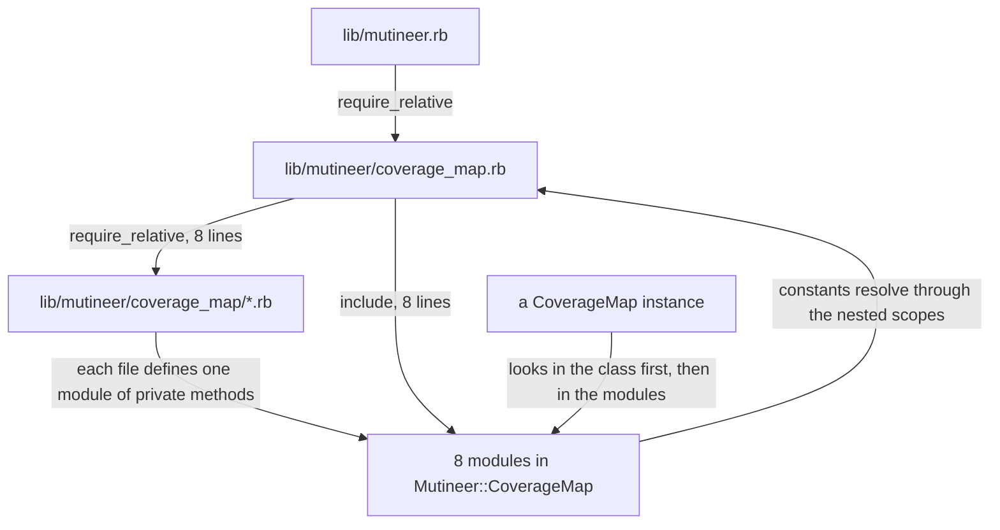

# Split coverage_map.rb into included modules - Plan

## Goal Capsule

- **Issue:** #201 (split `lib/mutineer/coverage_map.rb` into smaller units).
- **Objective:** four 1.10.0 issues (#497, #467, #496, #421) start in separate module files, not in one 2,781-line file. Their pull requests conflict much less. One known overlap stays: #421 and #467 both need `save` (see "Risks and Overlaps"). A Mutineer user sees no change.
- **Means:** a pure move of 126 private methods into eight modules that `Mutineer::CoverageMap` includes (KD1, KTD6).
- **Authority:** this plan, then `AGENTS.md`, then the issue text. Where this plan differs from the issue, this plan wins (see "Corrections to the issue").
- **Stop and ask when:**
  - `lib/mutineer/coverage_map.rb` on `origin/main` differs from commit `2e876780`, or an open pull request changes that file.
  - A move needs a method body edit, a rename, a visibility change or a test edit to pass.
  - `bundle exec rake yard:strict` prints a warning that the U1 baseline does not have.
  - `bundle exec rake fizzy:sample` cannot run, or its counts on the branch head differ from its counts on the base commit (U1).
  - The cache check in U10 does not report a cache hit.
- **Execution profile:** one pull request with nine commits (eight seam commits, one CHANGELOG commit). Labels: `enhancement`, `priority: low`, `risk: medium`, `v1.10.0`. Body: `Refs #201`, never `Closes #201`.
- **Size:** M. One `lib/` file shrinks, eight `lib/` files are new, `CHANGELOG.md` gets one entry. No test file changes. No new runtime dependency.
- **Release and semver:** no behavior change, so patch class. It ships in the v1.10.0 batch. No agent merges, tags or publishes.

---

## Product Contract

### Summary

Eight groups of private methods move out of `lib/mutineer/coverage_map.rb` into eight module files under `lib/mutineer/coverage_map/`. `Mutineer::CoverageMap` includes each module. Each method keeps its name, parameters, body, doc comment and private visibility. The class keeps its constants, its public methods, three script helpers and five path helpers.

### Problem Frame

`lib/mutineer/coverage_map.rb` has 2,781 lines and one class at commit `2e876780`. Four open 1.10.0 issues change it: #497 (clean check), #467 (load-line recording), #496 (capture reuse) and #421 (cache and partial recapture). In one file, their pull requests conflict with each other. No open pull request changes the file today, so a split now costs the least. The other four issues then start from `main` after this split merges.

### Key Decisions

David, the maintainer, decided on 2026-11-21 that this split merges first, before the other 1.10.0 work. The scope below is the recommendation of Claude. David confirms it when he approves this plan. Do not widen it.

- **KD1. A pure move into modules that `Mutineer::CoverageMap` includes.** (session-settled: recommended by Claude, approval by David pending, chosen over separate objects with public methods, which the first comment on #201 suggests: the four 1.10.0 issues need the split now, and a move has the lowest risk.) Governs R1, R2, R4, R5, R6.
- **KD2. One commit for each seam.** (session-settled: recommended by Claude, approval by David pending, chosen over one commit for the whole split: a reviewer reads each commit as a move.) Governs R3.
- **KD3. The pull request refers to #201 and does not close it.** (session-settled: recommended by Claude, approval by David pending, chosen over closing #201: the "about 300 lines per unit" target and the shared instance state are not done.) Governs R10.

### Requirements

**Structure**

- R1. Each of the eight seams in KTD6 is one module file under `lib/mutineer/coverage_map/`, and `Mutineer::CoverageMap` includes that module.
- R2. Each moved method keeps its name, parameters, body, doc comment and private visibility.
- R3. Each seam is one commit. That commit holds only the move, the module wrapper, one `require_relative` line and one `include` line.

**Behavior does not change**

- R4. The public API does not change. This covers the public methods, the readers and the nine constant paths such as `Mutineer::CoverageMap::RESULT_FD`. The eight new module constants, such as `Mutineer::CoverageMap::Cache`, are an intended addition. They are `@api private`, and they get API pages. The U10 inventory comparison allows them and no other new constant.
- R5. The coverage cache format does not change. A `coverage.json` that the 1.9.0 code writes loads as a cache hit when Mutineer is outside the project root, as with a normal gem install. The cache fingerprints `coverage_map.rb` only when the capture loads it from inside the project root, outside `vendor/bundle/`, as the boot-mode fork capture does. Then the changed file causes one rebuild, as any release that edits a loaded file does. The default subprocess scripts do not load it.
- R6. No existing test file changes. `test/coverage_map_test.rb` still calls 22 private methods with `send` and passes as it is.
- R7. Each generated child script is the same text as before the move.
- R8. CLI output and the JSON report do not change.

**Repository rules**

- R9. The gem keeps zero runtime dependencies and no `eval`. `bundle exec rake yard:strict` reports 100% documented.
- R10. The pull request body says `Refs #201`. It has the four labels in the Goal Capsule and a `CHANGELOG.md` entry. No agent merges it or pushes a tag.

### Scope Boundaries

Not in this pull request. Each item stays open on #201 unless the line says otherwise.

- **The "about 300 lines per unit" target in #201.** Four of the eight modules are under 300 lines. `ChildScripts`, `Cache`, `Recording` and `SkeletonDigest` are larger (KTD6).
- **The shared instance state.** Every module reads and writes the instance variables of `Mutineer::CoverageMap`. No method takes its state as an argument.
- **Replacing `send(:private_method)` in tests with public calls.** The first comment on #201 suggests it. It needs public methods, so it is not a pure move.
- **Moving the blame methods into `Mutineer::Pairing`.** The first comment on #201 suggests it. It changes call sites, so it is not a pure move.
- **Moving the three script helpers that read `__dir__`.** See KTD4 and Open Question 1.
- **A committed test that loads an old `coverage.json`.** Considered and not built. A saved cache holds fingerprints of fixture files, so a fixture edit breaks the test. U10 does the check by hand instead (KTD11). A cache format change in a later pull request would change this call.
- **Renaming or regrouping methods so each module name fits exactly.** Two seams hold methods that their issue name does not cover (see "Corrections to the issue", item 6). The seams stay as decided.

### Corrections to the issue

The second comment on #201 has the seam table. These points differ from the file at `2e876780`.

1. **The class has 144 methods, not 146.** Lines 1356 and 1473 hold `def Minitest.autorun; end` as text inside two heredocs. A search for `def` counts them.
2. **The line ranges cut doc comments at the wrong place.** Each range in the issue starts at the first `def` line. It ends one line before the next seam's `def`. So the first method loses its doc comment. The range also takes the next seam's doc comment. KTD6 has the correct ranges.
3. **The `send` count needs more detail.** The issue's 55 is the number of lines with `.send(:` in `test/coverage_map_test.rb`. Those lines hold 62 calls to 22 private methods. Three more lines call `send(name)` with a variable.
4. **"Public API, 32 to 297" has three parts.** The class head with constants and readers is lines 32 to 107. The ten public methods are lines 109 to 293. The single `private` keyword is line 295.
5. **Three methods of "Child processes and scripts" cannot move.** `minitest_file_order_setup`, `rspec_seed_install` and `rspec_order_preamble` read `__dir__` (lines 1520, 1538, 1553). See KTD4.
6. **Two seam names do not cover all their methods.** "Capture reuse" also holds `cached_or`, `clean_check_test_paths`, `warn_unchecked`, `source_fingerprints` and `key_source`, which every run uses. "Skeleton and digest" also holds `cache_path`, `read_cache`, `save` and three warning methods.
7. **The path helpers are lines 2750 to 2779.** Lines 2780 and 2781 close the class and the module.
8. **The branch `refactor/split-coverage-map` is stale.** It has one commit from 2026-10-06 on an old base, and another worktree holds it. Do not build on it and do not delete it.

---

## Planning Contract

### Key Technical Decisions

- KTD1. **Each module file uses the nested form: `module Mutineer`, then `class CoverageMap`, then `module <Name>`.** Ruby finds a constant through the lexical scopes first. The nested form keeps `CoverageMap` and `Mutineer` in that chain, so `RESULT_FD`, `Pairing` and `MinitestIntegration::PINNED_SEED` still resolve. Never write `module Mutineer::CoverageMap::<Name>`. That compact form drops both outer scopes, and the first call raises `NameError`. `lib/mutineer/test_runners/rspec_seed.rb` is the pattern.
- KTD2. **All nine constants stay in `lib/mutineer/coverage_map.rb`.** Other files read them by path: `lib/mutineer/runner.rb`, `lib/mutineer/daemon_server.rb`, `lib/mutineer/job_plan.rb`, `test/runner_test.rb` and `test/coverage_map_test.rb`. With KTD1, each moved method still finds them. No module defines a constant.
- KTD3. **Each module file has its own `private` line, directly under the `module <Name>` line.** The `private` keyword at line 295 of `coverage_map.rb` covers only methods in that class body. A method in an included module keeps the visibility it has in the module. The line 295 keyword stays, because eight private methods remain below it.
- KTD4. **`minitest_file_order_setup`, `rspec_seed_install` and `rspec_order_preamble` stay in `coverage_map.rb`.** Each one builds a path with `File.expand_path("...", __dir__)`. In a file under `lib/mutineer/coverage_map/`, `__dir__` is a different directory, and the paths point at files that do not exist. A move needs a body edit, which KD1 forbids. Conflict note for KD1: this seam does not move whole. The three methods are lines 1510 to 1558, one block, and no 1.10.0 issue names them.
- KTD5. **The five path helpers stay in the class.** `abs_source_paths`, `abs_preload_paths`, `abs_load_paths`, `relativize` and `absolute` are 30 lines. Every seam and two public methods call them. No 1.10.0 issue changes them, so a ninth file gives nothing.
- KTD6. **Module names, files and line ranges are fixed by the seam manifest below.** No module name may equal a constant that the moved code reads. A module named `Digest`, `Coverage`, `Process` or `Pairing` inside `CoverageMap` hides the real constant and breaks the methods.
- KTD7. **`coverage_map.rb` loads each module file with `require_relative`. A module file requires nothing.** `test/daemon_backend_contract_test.rb` loads every file under `lib/mutineer` with `ruby -w` and fails on a "circular require" warning. A module file that requires `../coverage_map` causes that warning. Moved methods need their constants only when they run, and by then `coverage_map.rb` has loaded them.
- KTD8. **Move whole line ranges, never `def` to `end` matches.** Follow the move procedure below. The ranges start at the first doc comment line and end at the last `end`. Ten heredocs in the file hold Ruby text, and a `def` search cuts them wrong (correction 1).
- KTD9. **The two-space indent is the only text change.** The nested form adds one level. All ten heredocs are `<<~RUBY`, which removes the common indent, so the script text stays the same (R7). The file has no `<<-` heredoc, no tab and no multi-line string literal that a new indent can change.
- KTD10. **The order is smallest and most independent first.** All modules mix into one class, and Ruby resolves each call on `self` when it runs. So every order passes the suite. The order in "Implementation Units" puts single-range seams first and the two interleaved seams last.
- KTD11. **The cache check is a manual check with a stated method (U1, U10), not a new test.** See Scope Boundaries.
- KTD12. **These files need no change:** `mutineer.gemspec` (`Dir.glob("lib/**/*.rb")`), `.yardopts` (`lib/**/*.rb`), `lib/mutineer.rb` (it requires `mutineer/coverage_map`), `Rakefile` and `rake/site_build.rb`.

### Seam manifest

Line numbers are for `lib/mutineer/coverage_map.rb` at commit `2e876780`. Each range runs from the first doc comment line to the last `end` line. After the first move, line numbers in the working file shift. Read the ranges from the pinned commit. Find each block in the working file by its first and last method.

| Unit | Module in `Mutineer::CoverageMap` | File in `lib/mutineer/coverage_map/` | Lines at `2e876780` | Methods | First and last method |
|---|---|---|---|---|---|
| U2 | `FailedTestBlame` | `failed_test_blame.rb` | 297 to 476 | 13 | `covered_source_files` to `spec_mirror?` |
| U3 | `CaptureReuse` | `capture_reuse.rb` | 478 to 703 | 10 | `cached_or` to `key_source` |
| U4 | `Capture` | `capture.rb` | 705 to 942 | 10 | `run_phase_a` to `accept_capture_payload` |
| U5 | `Cache` | `cache.rb` | 2020 to 2338 | 18 | `file_fingerprint` to `run_inputs_digest` |
| U6 | `SkeletonDigest` | `skeleton_digest.rb` | 2340 to 2748 | 23 | `source_skeletons` to `warn_incomplete` |
| U7 | `Recording` | `recording.rb` | 1602 to 2018 | 25 | `record` to `loaded_relative` |
| U8 | `CleanCheck` | `clean_check.rb` | 944 to 1120, then 1240 to 1330 | 12 | `record_failed_clean` to `subprocess_clean_pass?`, then `fork_clean_pass?` to `kill_group` |
| U9 | `ChildScripts` | `child_scripts.rb` | 1122 to 1238, then 1332 to 1508, then 1560 to 1600 | 15 | `spawn_script` to `result_channel_expression`, then `clean_check_script` to `minitest_seed_args_expression`, then `rspec_subprocess_script` |

The eight modules hold 126 methods. `coverage_map.rb` keeps 18: ten public methods, the three methods of KTD4 and the five path helpers of KTD5. It has about 400 lines after U9.

### Move procedure

Every seam unit (U2 to U9) follows these steps. A unit lists only what differs.

1. Create the module file. It starts with the `# frozen_string_literal: true` line, then the nested form of KTD1.
2. Write a doc comment directly above the `module <Name>` line. It says what the methods do. It says they are private methods of `Mutineer::CoverageMap` and use its instance variables. It ends with `@api private`.
3. Put `private` on the first line of the module body (KTD3).
4. Cut the seam's line ranges from `coverage_map.rb`. Paste them into the module in the same order. Keep every doc comment and every blank line between methods.
5. Add two spaces at the start of each line that is not empty (KTD9). Change nothing else.
6. In `coverage_map.rb`, add one `require_relative "coverage_map/<file>"` line after the `require_relative "pairing"` line.
7. In `coverage_map.rb`, add one `include <Name>` line at the top of the class body, above the `DEFAULT_CAPTURE_TIMEOUT` comment. Keep the includes in manifest order.
8. Leave one blank line where each range was.
9. Run the move check and the local gate in the Verification Contract. Then commit.

A fix after review goes in a new commit on top. Do not rewrite a seam commit, because a reviewer has read it as a move.

### High-Level Technical Design

### Assumptions

No person confirmed these. Each one has a check.

- `origin/main` still has `lib/mutineer/coverage_map.rb` as at `2e876780` when work starts. U1 checks this.
- YARD still resolves links such as `{#spawn_script}` and `{RESULT_FD}` in moved doc comments. YARD looks in the parent class and its included modules. The plan did not run YARD. U1 saves the warnings, and U10 compares them.
- The published API pages gain eight module pages, and the private methods show there. The plan treats this as acceptable for a pure move. `test/site_test.js` and `test/yard_pages_test.rb` name no `CoverageMap` page.
- The maintainer chooses the merge method. A squash merge keeps the per-seam commits on the pull request page only.

---

## Implementation Units

| Unit | Title | Files | Depends on |
|---|---|---|---|
| U1 | Baseline on `main` | none | none |
| U2 | Move failed-test blame | `coverage_map.rb`, `coverage_map/failed_test_blame.rb` | U1 |
| U3 | Move capture reuse | `coverage_map.rb`, `coverage_map/capture_reuse.rb` | U2 |
| U4 | Move capture core | `coverage_map.rb`, `coverage_map/capture.rb` | U3 |
| U5 | Move cache and partial recapture | `coverage_map.rb`, `coverage_map/cache.rb` | U4 |
| U6 | Move skeleton and digest | `coverage_map.rb`, `coverage_map/skeleton_digest.rb` | U5 |
| U7 | Move map and load-line recording | `coverage_map.rb`, `coverage_map/recording.rb` | U6 |
| U8 | Move the clean check | `coverage_map.rb`, `coverage_map/clean_check.rb` | U7 |
| U9 | Move child processes and scripts | `coverage_map.rb`, `coverage_map/child_scripts.rb` | U8 |
| U10 | CHANGELOG, final checks, pull request | `CHANGELOG.md` | U9 |

### U1. Baseline on `main`

- **Goal:** save the evidence that U10 compares against, before any line moves.
- **Requirements:** R2, R4, R5, R7.
- **Dependencies:** none.
- **Files:** none in the repository. Keep the evidence in a temporary directory outside the checkout.
- **Approach:**
  1. Start a new branch from current `origin/main`. Do not use `refactor/split-coverage-map` (correction 8).
  2. Compare `lib/mutineer/coverage_map.rb` with commit `2e876780`. Check that no open pull request changes the file. Stop if either check fails.
  3. Save the method inventory of `Mutineer::CoverageMap`: each public and private instance method that `Object` does not have, with its visibility and its `parameters`. Add the nine constant names and values.
  4. Copy `test/fixtures/calculator.rb` and `test/fixtures/calculator_strong_test.rb` into the temporary directory. Use that directory as `project_root`. Then the cache records no Mutineer file as a dependency.
  5. Save the script texts. Build a `CoverageMap` over the two copies, once with `framework: "minitest"` and once with `framework: "rspec"`. Save the strings that `clean_check_script` and `subprocess_script` return. Run this in the same checkout directory that U10 uses, because the scripts hold absolute paths into `lib/`.
  6. Save a cache. Call `build_or_load` on the Minitest map with `cache_dir` set to a second temporary directory. Keep a copy of the `coverage.json` it writes. `lib/mutineer/version.rb` says `1.9.0` on this commit, so this is a 1.9.0 cache.
  7. Save the full output of `bundle exec rake yard:strict`.
  8. Run `bundle exec rake fizzy:sample` on the clean base commit and save its output. `rake/fizzy_sample.json` holds counts from Mutineer 1.8.2 (2026-11-10), and `main` has changed mutants since. If the base run differs from that file, the difference is not from this work. Report it to the maintainer. Do not stop, and do not run `bundle exec rake fizzy:record`.
  9. If the temporary directory is lost later, check out `origin/main` in the same directory and make the evidence again.
- **Patterns to follow:** the `coverage_map` helper in `test/runner_test.rb` builds a map over the same fixture with a temporary cache directory.
- **Test expectation:** none. This unit changes no file in the repository.
- **Verification:** the temporary directory holds the inventory, four script texts, one `coverage.json`, the YARD output and the Fizzy output. `git status` shows no change.

### U2. Move failed-test blame

- **Goal:** `Mutineer::CoverageMap::FailedTestBlame` holds the 13 methods that decide if a failed test file blames a source.
- **Requirements:** R1, R2, R3, R6, R9.
- **Dependencies:** U1.
- **Files:**
  - `lib/mutineer/coverage_map.rb`
  - `lib/mutineer/coverage_map/failed_test_blame.rb` (new)
- **Approach:**
  1. Follow the move procedure for the U2 row of the seam manifest.
  2. This is the first move, so it also adds the first `require_relative` line and the first `include` line.
  3. The block starts directly under the `private` line. Keep that `private` line (KTD3).
- **Notes for this seam:** it reads `@failed_test_files`, `@map`, `@project_root` and its memo `@blame_for`. It calls `Pairing` and `relativize`. The public methods `uncapturable_source?` and `method_uncapturable?` call into it.
- **Test expectation:** none. The move adds no behavior. `test/coverage_map_test.rb` and `test/runner_test.rb` already cover blame through `uncapturable_source?` and `method_uncapturable?`.
- **Verification:** the move check reports no difference. The local gate is green. `git diff origin/main -- test/` is empty.

### U3. Move capture reuse

- **Goal:** `Mutineer::CoverageMap::CaptureReuse` holds the 10 methods from `cached_or` to `key_source`.
- **Requirements:** R1, R2, R3, R6, R9.
- **Dependencies:** U2.
- **Files:**
  - `lib/mutineer/coverage_map.rb`
  - `lib/mutineer/coverage_map/capture_reuse.rb` (new)
- **Approach:** follow the move procedure for the U3 row of the seam manifest.
- **Notes for this seam:** the module doc comment must name both parts. One part is the cache flow that every run uses (`cached_or`, `clean_check_test_paths`, `warn_unchecked`). The other part checks a `--coverage-from` capture (`reuse_capture` to `load_mismatch`). The methods raise `CoverageFromError`, which `coverage_map.rb` defines in `module Mutineer`. KTD1 keeps it reachable.
- **Test expectation:** none. The move adds no behavior. The tests call `clean_check_test_paths` and `accepted_capture` with `send`.
- **Verification:** as U2.

### U4. Move capture core

- **Goal:** `Mutineer::CoverageMap::Capture` holds the 10 methods from `run_phase_a` to `accept_capture_payload`.
- **Requirements:** R1, R2, R3, R6, R9.
- **Dependencies:** U3.
- **Files:**
  - `lib/mutineer/coverage_map.rb`
  - `lib/mutineer/coverage_map/capture.rb` (new)
- **Approach:** follow the move procedure for the U4 row of the seam manifest.
- **Notes for this seam:** `fork_capture` (lines 789 to 853) forks, calls `Process.setpgid` and uses `Marshal`. It reads `ChildStdout`, `OrphanGuard` and `Redaction` from `module Mutineer`. Three lines end with a `# rubocop:disable` comment. Keep those comments.
- **Test expectation:** none. The move adds no behavior. The tests call `fork_capture`, `capture`, `describe_status` and `run_phase_a_via_fork` with `send`.
- **Verification:** as U2.

### U5. Move cache and partial recapture

- **Goal:** `Mutineer::CoverageMap::Cache` holds the 18 methods from `file_fingerprint` to `run_inputs_digest`.
- **Requirements:** R1, R2, R3, R5, R6, R9.
- **Dependencies:** U4.
- **Files:**
  - `lib/mutineer/coverage_map.rb`
  - `lib/mutineer/coverage_map/cache.rb` (new)
- **Approach:** follow the move procedure for the U5 row of the seam manifest.
- **Notes for this seam:** `partial_cache?` reads `PARTIAL_CACHE_KEYS`, the first class constant that a moved method reads. Its doc comment links `{PARTIAL_CACHE_KEYS}`. The methods that write the cache file are in U6, not here.
- **Test expectation:** none. The move adds no behavior. The cache hit and partial recapture tests in `test/coverage_map_test.rb` cover it through `build_or_load`.
- **Verification:** as U2.

### U6. Move skeleton and digest

- **Goal:** `Mutineer::CoverageMap::SkeletonDigest` holds the 23 methods from `source_skeletons` to `warn_incomplete`.
- **Requirements:** R1, R2, R3, R5, R6, R9.
- **Dependencies:** U5.
- **Files:**
  - `lib/mutineer/coverage_map.rb`
  - `lib/mutineer/coverage_map/skeleton_digest.rb` (new)
- **Approach:** follow the move procedure for the U6 row of the seam manifest.
- **Notes for this seam:** the module doc comment must say that the module also reads and writes the cache file (`cache_path`, `read_cache`, `save`). `save` reads `NARROW_LOAD_LINES` and `LOAD_LINE_PAIRS`. The methods call `Digest::SHA256`, so the module name must stay `SkeletonDigest` (KTD6).
- **Test expectation:** none. The move adds no behavior. The tests call `compute_digest` seven times, `source_skeleton_digest` five times, `read_cache` and `each_def` with `send`. `test_source_skeleton_rule_holds_across_real_ruby_files` also reads every file under `lib/`, so it checks the new files.
- **Verification:** as U2.

### U7. Move map and load-line recording

- **Goal:** `Mutineer::CoverageMap::Recording` holds the 25 methods from `record` to `loaded_relative`.
- **Requirements:** R1, R2, R3, R6, R7, R9.
- **Dependencies:** U6.
- **Files:**
  - `lib/mutineer/coverage_map.rb`
  - `lib/mutineer/coverage_map/recording.rb` (new)
- **Approach:** follow the move procedure for the U7 row of the seam manifest.
- **Notes for this seam:** `test_coverage_assignment` has one `<<~RUBY` heredoc (line 1920). Indent its lines with the rest (KTD9). `load_coverage_expression` and `loaded_files_expression` return long one-line strings of Ruby text. Do not wrap them. This module holds `credit_load_only_line?` and `load_line_pairs`, which #467 changes.
- **Test expectation:** none. The move adds no behavior. The tests call `record` and `lines_with_called_defs` with `send`.
- **Verification:** as U2.

### U8. Move the clean check

- **Goal:** `Mutineer::CoverageMap::CleanCheck` holds the 12 methods that run the unmutated tests and record a red result.
- **Requirements:** R1, R2, R3, R6, R9.
- **Dependencies:** U7.
- **Files:**
  - `lib/mutineer/coverage_map.rb`
  - `lib/mutineer/coverage_map/clean_check.rb` (new)
- **Approach:**
  1. Follow the move procedure for the U8 row of the seam manifest.
  2. The seam has two ranges. Paste the first range, one blank line, then the second range.
  3. The six methods between the ranges (`spawn_script` to `result_channel_expression`) stay for U9.
- **Notes for this seam:** `truncate_clean_detail` reads `CLEAN_FAILURE_DETAIL_LIMIT`, and `combined_clean_timeout` reads `COMBINED_TIMEOUT_FACTOR`. `run_clean_with_report` calls `Minitest.define_singleton_method`, which is a normal call and not a heredoc.
- **Test expectation:** none. The move adds no behavior. The tests call `fork_clean_pass?` eight times, `subprocess_clean_pass?` five times, `truncate_clean_detail`, `verify_combined_clean`, `combined_clean_timeout` and `verify_cached_clean` with `send`.
- **Verification:** as U2.

### U9. Move child processes and scripts

- **Goal:** `Mutineer::CoverageMap::ChildScripts` holds the 15 methods that start a child Ruby and build its script text.
- **Requirements:** R1, R2, R3, R6, R7, R9.
- **Dependencies:** U8.
- **Files:**
  - `lib/mutineer/coverage_map.rb`
  - `lib/mutineer/coverage_map/child_scripts.rb` (new)
- **Approach:**
  1. Follow the move procedure for the U9 row of the seam manifest.
  2. The seam has three ranges. Paste them in file order with one blank line between them.
  3. Do not move lines 1510 to 1558 (KTD4). They stay where they are, above the path helpers.
- **Notes for this seam:** six heredocs move, at lines 1349, 1383, 1430, 1441, 1465 and 1567. Lines 1356 and 1473 are `def Minitest.autorun; end` inside heredoc text, not methods. The methods read `RESULT_FD`, `RESULT_GRACE` and `REDACTION_PATH`. `REDACTION_PATH` is safe because the constant, with its `__dir__`, stays in `coverage_map.rb` (KTD2).
- **Test expectation:** none. The move adds no behavior. The tests call `spawn_script` four times, `clean_check_script` twice and `subprocess_script` with `send`. `test/seed_contract_test.rb` runs the generated scripts for Minitest and RSpec.
- **Verification:** as U2. Also, the four script texts equal the U1 texts.

### U10. CHANGELOG, final checks, pull request

- **Goal:** the branch head passes every check, and the pull request is open with the correct body and labels.
- **Requirements:** R4, R5, R7, R8, R9, R10.
- **Dependencies:** U9.
- **Files:**
  - `CHANGELOG.md`
- **Approach:**
  1. Add one entry under `## [Unreleased]`, in a `### Changed` section. It says the private methods of `Mutineer::CoverageMap` now live in eight modules under `lib/mutineer/coverage_map/`. It says the public API, the coverage cache, CLI output and the JSON report do not change. It names #201.
  2. Commit the entry. Then run every row of the Verification Contract on that commit.
  3. Run the cache check. Build the U1 Minitest map again with the U1 `project_root` and the U1 `cache_dir`, and call `build_or_load`. Pass: `@phase_a_ran` is not `true`, and `tests_for` gives the same tests as on `main` for a covered line.
  4. Run the format check. Write a new cache into an empty directory with the head code. Pass: it has the same keys as the U1 file, and every value except `timings` is equal.
  5. Compare the method inventory and the YARD output with U1. The inventory must be equal, except for the eight new module constants (R4). The YARD output must have no new warning.
  6. Run the author self-check skill (`.claude/skills/author-self-check/SKILL.md`) before the first push. Then follow "PR review gate" in `AGENTS.md`.
  7. Open one pull request. The body says `Refs #201` and lists the eight modules. It states the three methods that did not move (KTD4). It gives the result of each manual check. It tells reviewers to read each seam commit with `git show --color-moved=dimmed-zebra --color-moved-ws=allow-indentation-change`.
  8. Add the four labels from the Goal Capsule.
- **Patterns to follow:** the `CHANGELOG.md` entry "Job selection moved from `Mutineer::Runner` to a new `Mutineer::JobPlan` module (#75)".
- **Test expectation:** none. The unit adds a CHANGELOG entry and runs checks.
- **Verification:** every row of the Verification Contract is green on the pull request head, and the pull request has the body and labels above.

---

## Verification Contract

Run every local command in a UTF-8 locale, as `CONTRIBUTING.md` describes: `LANG=en_US.UTF-8` on macOS, `LANG=C.UTF-8` on Linux, and `LC_ALL` unset or set to the same value.

| Check | When | Command or method | Proves |
|---|---|---|---|
| Move check | each of U2 to U9 | Take the unit's line ranges from `lib/mutineer/coverage_map.rb` at `2e876780`. Add two spaces to each line that is not empty. Compare with the module body below its `private` line. | R2: no line of a method or doc comment changed |
| Local gate | each of U2 to U9, and U10 | `bundle exec rake test`, then `ruby -Ilib -e 'require "mutineer"'`, then `bundle exec rake yard:strict` | R6, R9. Also no circular require (KTD7) |
| No test change | U10 | `git diff origin/main -- test/` prints nothing | R6 |
| Minitest 6 | U10 | `BUNDLE_GEMFILE=gemfiles/minitest6.gemfile bundle install`, then `BUNDLE_GEMFILE=gemfiles/minitest6.gemfile bundle exec rake test` | The generated Minitest scripts work on Minitest 6 |
| Prism 2 | U10 | `bundle install`, then `BUNDLE_GEMFILE=gemfiles/prism2.gemfile bundle install`, then `MUTINEER_REQUIRE_PRISM_ERRORS=1 BUNDLE_GEMFILE=gemfiles/prism2.gemfile bundle exec rake test` | `source_skeleton_digest` and `method_bodies` work on Prism 2 |
| Daemon tests | U10 | `bundle install` in `test/fixtures/rails_app`, then `bundle exec rake test:daemon` from the root | `lib/mutineer/daemon_server.rb` still builds a map in a Rails app |
| Fizzy sample | U1 and U10 | `bundle exec rake fizzy:sample` on the base commit, then on the head with every change committed. Compare the two outputs. | R8: the counts on a real Rails 8 app are the same before and after the move |
| Cache check | U10 | U10 steps 3 and 4 | R5 |
| Script texts | U9 and U10 | Build the four texts as in U1 step 5 and compare | R7 |
| Method inventory | U10 | Build the inventory as in U1 step 3 and compare | R2, R4: same names, visibility, parameters and constants; the only new constants are the eight modules |
| YARD warnings | U10 | Compare the `bundle exec rake yard:strict` output with U1 | Doc comment links still resolve |
| Site build | U10 | `bundle exec rake site:build`, then `node --test test/site_test.js` | The eight new API pages build |
| CI gates | pull request head | The gates in `AGENTS.md`, "CI gates that block merge" | Linux and macOS, `rails dogfood`, `website browser tests` |

`bundle exec rake fizzy:sample` needs Fizzy's Ruby through rbenv or asdf, and network access for the first run. If it cannot run, stop and report. Do not skip it. The task compares with `rake/fizzy_sample.json` and can fail on the base commit. That failure does not block this work, but a difference between base and head does.

## Definition of Done

- R1 to R10 hold.
- The branch has eight seam commits in the order U2 to U9, then the CHANGELOG commit. Fix commits, if any, are on top.
- Every Verification Contract row is green on the pull request head.
- `lib/mutineer/coverage_map.rb` holds the class head, ten public methods, the `private` line, the three KTD4 methods and the five path helpers.
- The pull request says `Refs #201` and has the labels `enhancement`, `priority: low`, `risk: medium` and `v1.10.0`.
- #201 stays open. No agent merges the pull request or pushes a tag.
- The diff holds no temporary script, debug output or unused file.

---

## Risks and Overlaps

- **A new pull request changes `coverage_map.rb` before this one merges.** Then the ranges in KTD6 are wrong. U1 step 2 detects it at the start. If it occurs later, rebase. Then find each block by its first and last method. Run the move check against the new base.
- **A module file written in the compact form.** The suite catches it, because the first call to a method that reads a constant raises `NameError` (KTD1).
- **A method keeps a body that matches but loses its doc comment.** `bundle exec rake yard:strict` catches it, because it needs 100%.
- **The Linux and macOS jobs differ.** `fork_capture` and `fork_clean_pass?` use process groups. The move does not change them, and CI runs both systems.
- **Where the four 1.10.0 issues start after the merge:**

| Issue | Files after this split |
|---|---|
| #497 (a failed clean check names no failing test) | `lib/mutineer/coverage_map/clean_check.rb`, `lib/mutineer/coverage_map/child_scripts.rb` |
| #467 (standalone load-only lines) | `lib/mutineer/coverage_map/recording.rb` |
| #496 (`--since` captures every source) | `lib/mutineer/coverage_map/capture_reuse.rb` |
| #421 (per-test cache invalidation) | `lib/mutineer/coverage_map/cache.rb`, `lib/mutineer/coverage_map/skeleton_digest.rb` |

- **#421 and #467 both need `save`.** `save` is in `skeleton_digest.rb`, and the constants `NARROW_LOAD_LINES` and `LOAD_LINE_PAIRS` are in `coverage_map.rb`. Those two issues can still conflict there.

## Open Questions

Neither question blocks this work.

1. **Do the three KTD4 methods move later?** Default: no. A later change can put each path in a class constant, as `REDACTION_PATH` does, and then move the methods. That is a body edit, so it stays on #201. Decider: a maintainer.
2. **Squash merge or merge commit?** Default: the maintainer's usual method. See Assumptions. Decider: a maintainer at merge.

## Sources

- `lib/mutineer/coverage_map.rb` at `2e876780`: 2,781 lines, 144 methods, 9 constants, `private` at line 295, `__dir__` at lines 52, 1520, 1538 and 1553.
- `test/daemon_backend_contract_test.rb`, `test_loading_every_lib_file_emits_no_circular_require_warning`: the reason for KTD7.
- `test/coverage_map_test.rb`, `test_source_skeleton_rule_holds_across_real_ruby_files`: it reads every file under `lib/`.
- `lib/mutineer/test_runners/rspec_seed.rb` and `lib/mutineer/test_runners.rb`: the nested file and `require_relative` pattern.
- `mutineer.gemspec` line 34 and `.yardopts`: both use `lib/**/*.rb`.
- `AGENTS.md`: "Before every commit", "Website checks", "CI gates that block merge", "PR review gate", "Labels", "Releasing".
- Issue #201 and its two comments (2026-11-21 seam table in the second comment).
