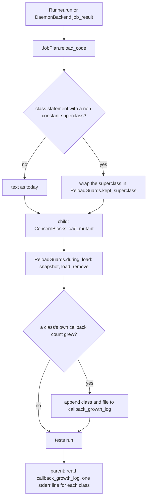

# Reload a class with a call superclass, and warn on a repeated callback - Plan

Suggested model and effort for the build: Opus 5.5, high.

**Decision status:** David chose the #492 fix in this plan (KTD1, "keep the live superclass") on 2026-11-21, from three options: keep the live superclass, `remove_const`, or `redefine` for the file.

## Goal Capsule

- **Issues:** #492 (`--strategy reload` and the daemon error every mutant in a class whose superclass is `Data.define(...)`). #479 (reload still keeps both copies of a callback in six cases).
- **Objective:** a mutant in a class such as `class InclusionValue < Data.define(:type, :value)` gets a real verdict under `--strategy reload` and under `--daemon`. A run that kept a repeated callback in a class says so once, with the class name.
- **Means:** the mutant file reopens the class with the superclass that the class already has (KTD1). The reload guard counts callbacks after each load and logs a class whose count grew (KTD5).
- **Authority:** this plan, then `AGENTS.md`, then the issue text. Where this plan differs from an issue, this plan wins (see "Corrections to the issues").
- **Stop and ask when:** a change would alter a verdict, a score or an exit code for a file that has no call superclass. Also stop when U2 needs a change in `lib/mutineer/daemon_server.rb` or `lib/mutineer/daemon_client.rb`.
- **Execution profile:** one pull request (Group A of the 1.10.0 batch) with two commits. Commit 1 is #492 (U1 to U4). Commit 2 is #479 (U5 to U7). Labels: `bug`, `priority: medium`, `risk: medium`, `v1.10.0`. Body: `Closes #492` and `Refs #479`.
- **Size:** M. Six `lib/` files, the Rails fixture app, tests, two docs pages, `CHANGELOG.md`. No new runtime dependency. No `eval`.
- **Release and semver:** two fixes, so patch class. They ship in the v1.10.0 batch. No GitHub Action default changes. No agent tags, merges or publishes.

---

## Product Contract

### Summary

Reload loads the mutant file over a class that exists. For a class statement whose superclass is a call, the mutant file now asks for the superclass the class already has, so Ruby accepts the reopen. Nothing is removed and no class object changes. A method inside the superclass call's block cannot be placed this way, so it is `unplaceable`, as under `redefine`.

For #479 the fix stays the full-reload strategy (#389, `v2.0`). This plan adds only a stderr warning that names each class whose callback count grew after a reload.

### Problem Frame

`class X < Data.define(:a)` builds a new anonymous superclass on each evaluation. Reload evaluates the class statement a second time, so Ruby raises `TypeError: superclass mismatch for class X`. Every mutant of the file then scores `error`. The reporter's run had 12 such mutants in one file, and in-process `redefine` killed all 12. The daemon forces reload (`lib/mutineer/cli.rb:612-626`), so those mutants never get a verdict there. The 2.0 plan makes the daemon the default with `--rails` (#284).

The repro needs no Rails. The parent requires each source before it forks (`lib/mutineer/runner.rb:180-188`), so the class exists when the child loads the mutant.

For #479: when reload cannot tell which old callback a new one repeats, both copies stay. The class then runs the callback twice. A test that counts errors or callback runs fails for every mutant of that file. Those kills are false, and nothing tells the user.

### Requirements

**#492: a call superclass**

- R1. Under `--strategy reload` in-process and under `--daemon`, a mutant of a method in the body of a class whose superclass is a call gets the verdict its tests give. No `superclass mismatch` error occurs.
- R2. The class object stays the same object across the reload. An instance, a subclass or a constant from another file still points at the class the mutant changed.
- R3. R1 holds for every class statement whose superclass is not a plain constant: `Data.define(...)`, `Struct.new(...)`, `Class.new(Parent)`, `DelegateClass(Parent)`, a nested class, and a `class A::B < ...` path.
- R4. A method inside the block of a superclass call (`class X < Struct.new(:a) do ... end`) is `unplaceable` under reload. It is counted in `summary.unplaceable`, listed in `unplaceable[]`, and it has its place in the unrun share. A `:maybe` selection stays `no_coverage`, as for other unplaceable methods.
- R5. A file with no call superclass gets the same verdicts, score and exit code as before.
- R6. No new mutant status, no new JSON key. The schema stays `1.10`.

**#479: the warning**

- R7. After a reload run, stderr names each class whose callback count grew, once for each class, with its source file. The exact text is in KTD8.
- R8. The warning changes no verdict, no score, no JSON field and no exit code.
- R9. A class whose repeated callbacks all paired gives no warning. A subclass that only inherited the growth gives no warning.
- R10. The warning works in-process and in the daemon, with `--jobs 1` and `--jobs N`.

**Docs and tracking**

- R11. `docs/json-schema.md` names the new `unplaceable` cause under reload. `docs/rails-setup.md` names the warning. `CHANGELOG.md` under "Unreleased" has a "Fixed" entry for #492 and an "Added" entry for the #479 warning that says the six cases remain. #479 stays open.
- R12. Before the pull request opens, three GitHub issues exist, and the CHANGELOG and the pull request body name them: the `class Row < BaseRow` sibling (Scope Boundaries, first item), the `define_callbacks` reset (Corrections to the issues, item 4), and a schema `1.11` JSON key for the callback growth, after Group E (Scope Boundaries, fourth item).

### Acceptance Examples

- AE1. **Covers R1, R5.** Given the issue's repro (`test/fixtures/call_superclass.rb` in the Appendix) and a test that kills the `switch?` mutant, when the run uses `--strategy reload`, then that mutant is `killed` and `errored` is 0.
- AE2. **Covers R2.** Given another file holds `DEFAULT_VALUE = InclusionValue.new(...)` and a test asserts `DEFAULT_VALUE == InclusionValue.new(...)`, when a mutant of `InclusionValue` loads, then that assertion still passes. The verdicts equal the `--strategy redefine` verdicts.
- AE3. **Covers R2.** Given `class SpecialValue < InclusionValue` in another file and a test that calls `switch?` only through `SpecialValue`, then the `switch?` mutant is `killed`.
- AE4. **Covers R4.** Given `class BlockStruct < Struct.new(:a) do def in_block? = a == 1 end`, then the mutants of `in_block?` are `unplaceable` and a mutant of a method in the class body runs.
- AE5. **Covers R1.** Given the Rails fixture app and `--daemon`, the mutants of a `Data.define` model get the same verdicts as the in-process reload run.
- AE6. **Covers R7, R9.** Given a class whose concern and class body both add `before_save(&:stamp)`, when three mutants of its file run, then stderr has the KTD8 header one time and names that class one time, and names no subclass.
- AE7. **Covers R8.** Given the AE6 run, the JSON report equals the report of the same run with the warning code removed, byte for byte, apart from timing fields.

### Scope Boundaries

Considered and not built:

- **A superclass constant that the same file assigns again.** `BaseRow = Struct.new(:v)` and then `class Row < BaseRow` still raises `superclass mismatch for class Row` (probe P2). The reload points `BaseRow` at a new class. Keeping the old parent for `Row` would hide every mutant in the new `BaseRow` block, and those would be silent false survivors. The error is visible, so it stays. U4 files the tracking issue (R12).
- **The assignment form.** `Point = Struct.new(:x) do ... end` already reloads without an error (probe P2), because the constant is assigned again. The old class object is replaced there. That is today's behaviour and this plan does not change it.
- **A fix for the six #479 cases.** Full reload (#389) owns it.
- **A JSON key for the warning.** A key needs schema `1.11` and must merge after Group E (report fields). For 1.10.0 the warning is on stderr only, so it shows in a terminal and in the GitHub Action log, and a JSON-only consumer does not see it. R12 files the issue for the key.
- **A per-file switch to `redefine`.** See KTD1.

### Corrections to the issues

1. **#492 offers two fixes. This plan recommends a third.** The evidence is in KTD1.
2. **#492 says the problem is in `--daemon` and `--strategy reload`.** It also needs no Rails and no boot file. A plain Ruby file reproduces it (probe P1).
3. **#479 says "a class whose callback count grew".** A subclass inherits each callback its parent gains, so its count grows too (probe P4). The warning names only the class whose own count grew (KTD5).
4. **Not in #479's list:** a class body that calls `define_callbacks` itself resets its chain on reload, and a callback that a concern added is lost (probe P4, first run). The count shrinks there, so this warning does not see it. R12 files an issue for it.

---

## Planning Contract

### Key Technical Decisions

- KTD1. **Keep the live superclass.** (session-settled: user-directed, chosen over `remove_const` and a per-file switch to `redefine`: same class object, verdicts match `redefine` in probe P3, no change to the daemon files) For each class statement whose superclass is not a constant, the mutant text wraps the superclass expression: `class X < ::Mutineer::ReloadGuards.kept_superclass(Module.nesting.first, :X) { Data.define(:a) }`. The helper returns `X.superclass` when `X` is already a class in that scope. Otherwise it yields. Evidence, from prototype runs outside the gem (probes P1 to P3):

  | Test set, 3 mutants | Today, reload | `redefine` | `remove_const` | Keep the superclass |
  |---|---|---|---|---|
  | Direct tests | 3 errored | 2 killed, 1 survived | 2 killed, 1 survived | 2 killed, 1 survived |
  | Another file holds an old instance, test compares with `==` | 3 errored | 3 survived | **3 killed (false)** | 3 survived |
  | Test reaches the method through a subclass in another file | 3 errored | 1 killed, 2 survived | **3 survived (1 false)** | 1 killed, 2 survived |

  **Rejected: `remove_const` before the reload (issue option 1).** The load then builds a new class object. Each object that still points at the old class goes stale: an instance in a constant or a registry, a subclass in another file, a module that another file included into the class. `Data#==` compares classes, so the table's row 2 gives false kills. A subclass keeps the old parent, so row 3 gives a false survivor. A subclass in the same file would raise its own `superclass mismatch`, so the removal would have to cascade. A removed class is a new key for `RepeatedCallbacks.snapshot` (`lib/mutineer/reload_guards.rb:141-147`), so the #451 pairing skips it, and its subclasses keep the old chains. Zeitwerk still maps the constant to the original file. No run checked what a later Zeitwerk unload does with it.

  **Rejected: `redefine` for that file (issue option 2).** In-process it is possible. The daemon cannot do it today: it is reload-only (`lib/mutineer/cli.rb:612-626`), and `Isolation.apply_surgical` reads the live method's visibility and path in the child and needs Prism (`lib/mutineer/isolation.rb:285-340`). `lib/mutineer/daemon_server.rb` must load without Prism (`:26-31`). The change would add protocol fields and child code in the two files that Group C changes. A mutant that `redefine` cannot place is `unplaceable` (`lib/mutineer/subject.rb:53-55`), which is already counted, but a "report note" needs a stderr line or a JSON key in schema `1.11`. The switch would also bring the `redefine` false survivors of #493 into reload runs for those files.

  **Why the kept superclass is safe.** A mutant changes a method body only. The superclass expression in the mutant file is the original text, so its first evaluation already built the class the tests expect. The class object, its instances, its subclasses and its callback chains stay as for any other reloaded class, so the #451 pairing is unchanged.

- KTD2. **One tool-side builder for the reload text, used by both paths.** `Runner.run` (`lib/mutineer/runner.rb:475-483`) and `DaemonBackend.job_result` (`lib/mutineer/daemon_backend.rb:445-452`) build the same text in two places today. Add `JobPlan.reload_code`, which returns the text and the `hook_def`. It calls `JobPlan.hook_mutant` or `ReachProbe.wrap_mutation` as today, then applies the KTD1 rewrite. Both call sites use it. The daemon then needs no change in `lib/mutineer/daemon_server.rb` or `lib/mutineer/daemon_client.rb`: the payload's `"code"` already carries any text. `--test-command` swaps the file on disk and runs a new process, so it has no mismatch and must not get the rewrite.
- KTD3. **The rewrite covers every superclass that is not a constant.** A `Prism::ClassNode` whose `superclass` is neither `Prism::ConstantReadNode` nor `Prism::ConstantPathNode` is rewritten. That covers `Data.define`, `Struct.new`, `Class.new`, `DelegateClass`, and an index call such as `ActiveRecord::Migration[7.1]`. For a call that returns the same class each time, `X.superclass` is that class, so nothing changes. The scope argument is `Module.nesting.first` for `class X`, the parent's source text for `class A::B::X`, and `Object` for `class ::X`.
- KTD4. **A method inside the superclass expression is `unplaceable` under reload.** The kept superclass does not run that block again, so the mutant would not load (probe P2: `BlockStruct#in_block?` survived falsely). Discovery marks the subject, and `Subject#unplaceable?("reload")` returns true for it. `redefine` already reports the same subject as `unplaceable` (probe P2), so both strategies agree. This reuses an existing status, so R6 holds.
- KTD5. **The callback count is read in `ReloadGuards.during_load`.** `RepeatedCallbacks.snapshot` already holds each class's chains from before the load (`lib/mutineer/reload_guards.rb:93`). After `RepeatedCallbacks.remove` (`:97`), a class has grown when one of its chains has more entries than in the snapshot. The growth is the class's own when its superclass's same chain grew by less. Probe P4 confirms the three shapes: a certain pair stays at 1, an unclear pair goes from 2 to 3, and a subclass inherits the same 2 to 3.
- KTD6. **The child appends to a log file. The parent prints.** Each mutant runs in its own fork, so only the parent can print once for each class. The child appends one line (`class name`, tab, `source file`) to a file. One short append is safe with parallel workers. The parent reads the file after the run, removes repeats, and prints. The path reaches the child as module state: `ReloadGuards.callback_growth_log = path`. In-process, the parent sets it before it forks. In the daemon, the path travels as the payload key `"callback_growth_log"`, and `apply_payload` sets it. Rejected: a warning from the child's own stderr, because it prints once for each mutant. Rejected: a field on `Result`, because it changes the JSON report.
- KTD7. **The run returns the grown classes in `extras`.** `Runner.execute` and `DaemonBackend.execute` both return `[aggregate, source_map, extras]` (`lib/mutineer/runner.rb:263`, `lib/mutineer/daemon_backend.rb:100`). The rows go in `extras[:callback_growth]`, and the CLI prints them where it prints the other end-of-run warnings. `AggregateResult` and `Reporter` do not change, so R8 holds.
- KTD8. **One header line, then one line for each class.** Many classes can grow in one run, so the advice prints once and each class gets a short line. The text follows the `[mutineer] ` prefix and the "does not change the exit code" sentence of `warn_unrun_share` (`lib/mutineer/reporter.rb:162-180`):

  ```text
  [mutineer] after a reload, 2 classes run a callback more than once (#479). A test that counts callback runs or errors can then kill mutants falsely. This warning does not change the score or the exit code. To check those kills, run the file with --no-daemon --strategy redefine, or with --test-command.
  [mutineer]   Doubled (app/models/doubled.rb)
  [mutineer]   Once (app/models/once.rb)
  ```

  The class count is the number of rows. The file path is project-relative, as in the JSON report. A class name comes from Ruby, so the CLI prints it with `inspect`-style escaping of control characters, as other warnings print file names.

### High-Level Technical Design



### Assumptions

- A mutation changes text inside a `def` only, so it never adds or removes a class statement. Discovery builds subjects from `def` nodes (`lib/mutineer/subject.rb:1-8`).
- The mutant text may call `::Mutineer::ReloadGuards`. The in-process child has it, and the daemon loads `concern_blocks`, which requires `reload_guards` (`lib/mutineer/daemon_server.rb:8`). `JobPlan.hook_mutant` already emits a call to `::Mutineer::ConcernBlocks.store_hook_def` (`lib/mutineer/job_plan.rb:356`).
- `lib/mutineer/reload_guards.rb` runs on the app's Ruby in the daemon, which can be older than 3.4. New code there uses no syntax newer than the file already uses.

### Probes run for this plan

All probes ran on 2026-11-21 with Ruby 3.4.9 on arm64-darwin25, at commit `2e876780`. P1 to P3 used a script outside the gem that prepended a rewrite onto `Isolation.apply_whole_file`. The fixtures are in the Appendix.

- P1. The issue's repro. `--strategy reload`: 1 mutant, 1 errored, `TypeError: superclass mismatch for class InclusionValue`. `--strategy redefine`: 1 killed. No Rails and no boot file.
- P2. Sibling shapes in one file. Today under reload: 7 of 7 errored. With the KTD1 rewrite and without the `Row < BaseRow` shape: 6 mutants, 4 killed, 2 survived, 0 errored. One survivor is `BlockStruct#in_block?` (false, see KTD4). `redefine` gives `unplaceable` for it. With `Row < BaseRow` in the file, all 7 still error with `superclass mismatch for class Row`. The assignment form `Point = Struct.new(:x) do ... end` gives 1 killed under reload today.
- P3. The KTD1 table. Three test sets, four setups.
- P4. Real ActiveSupport, from the Rails fixture bundle. `ConcernBlocks.load_mutant` on a file with four classes whose parent owns `define_callbacks :save`. Callback counts before and after: `Paired` 1 and 1. `Doubled` (the same `&:stamp` on a concern and the class body) 2 and 3. `DoubledChild < Doubled` 2 and 3. `Once` (`@done ||= before_save { ... }` beside the same block text) 2 and 3. A first run where each class called `define_callbacks` itself gave `Doubled` 2 and 1.

---

## Implementation Units

### U1. The repro as fixtures, with failing tests

- **Goal:** the issue's repro fails in the suite before any `lib/` change.
- **Requirements:** R1, R2, R3, R4.
- **Dependencies:** none.
- **Files:**
  - `test/fixtures/call_superclass.rb`, `test/fixtures/call_superclass_holders.rb`, `test/fixtures/call_superclass_shapes.rb` (Appendix)
  - `test/fixtures/call_superclass_test.rb`, `test/fixtures/call_superclass_holder_eq_test.rb`, `test/fixtures/call_superclass_subclass_test.rb`, `test/fixtures/call_superclass_shapes_test.rb`
  - `test/call_superclass_reload_test.rb` (new)
- **Approach:**
  1. Copy the fixtures from the Appendix.
  2. Write the tests below. Run them and confirm they fail with `superclass mismatch`. Keep the failing output for the pull request body.
- **Patterns to follow:** `test/class_macro_load_test.rb:50-54` runs `Mutineer::Runner.execute` in a subprocess with a `Config`. `test/daemon_server_hook_def_test.rb:19-28` builds a daemon payload and runs `apply_payload` in a fork.
- **Test scenarios** (zero-dependency suite. They prove the in-process path and the daemon child's load. They do not prove a real daemon run. U4 does.):
  - Covers AE1. Reload on `call_superclass.rb` with the direct test: `errored` is 0, and the `switch?` mutant is `killed`.
  - Covers AE2. Reload with the holder test: the verdict list equals the `redefine` verdict list.
  - Covers AE3. Reload with the subclass test: the `switch?` mutant is `killed`.
  - Covers R3. Reload on `call_superclass_shapes.rb`: `errored` is 0, and each class-body method's verdict equals its `redefine` verdict.
  - Covers AE4. In the shapes run, the `in_block?` mutants are `unplaceable` under reload, and `in_body?` runs.
  - Covers R1 for the daemon child. Build the payload with the tool-side builder, send it through JSON, and call `apply_payload` in a fork: no `TypeError`, and the mutated method is live.
- **Verification:** each test fails before U2 and U3, for the stated reason.

### U2. Keep the live superclass

- **Goal:** R1 to R3 hold on both paths.
- **Requirements:** R1, R2, R3, R5, R6.
- **Dependencies:** U1.
- **Files:**
  - `lib/mutineer/reload_guards.rb` (add `ReloadGuards.kept_superclass`)
  - `lib/mutineer/job_plan.rb` (add `JobPlan.reload_code` and the rewrite)
  - `lib/mutineer/runner.rb` (`Runner.run`, lines 475-483)
  - `lib/mutineer/daemon_backend.rb` (`job_result`, lines 445-452)
  - `test/reload_guards_test.rb`, `test/runner_test.rb` (the JobPlan helpers have no test file of their own)
- **Approach:**
  1. `ReloadGuards.kept_superclass(scope, name)`: use `Object` when `scope` is nil. Return the constant's `superclass` when `scope.const_defined?(name, false)` and the constant is a `Class`. Otherwise yield.
  2. The rewrite (KTD3): parse the final text, collect the class nodes, and splice from the last one to the first. Use byte offsets, as `ReachProbe.wrap` does. Add no parse check after the rewrite: the wrap puts an expression in a block, which parses wherever the expression parsed. If a shape ever breaks that, the child's `load` raises `SyntaxError`, and the mutant scores `error` with that message.
  3. `JobPlan.reload_code` (KTD2). Replace the two branches in `Runner.run` and the payload branches in `job_result` with it. Keep the payload keys and the `hook_def` conversion as they are.
  4. Give each new method a YARD comment.
- **Test scenarios:**
  - `kept_superclass` returns the live superclass for a defined class, yields for an undefined name, yields when the name is a module, and uses `Object` for a nil scope.
  - `kept_superclass` with a namespace scope does not find a top-level class of the same name.
  - The rewrite leaves a file with only constant superclasses byte-identical.
  - The rewrite handles `class X`, `class A::B::X`, `class ::X`, a nested class, a superclass call with a block, and a multi-line superclass call. Each result parses and has the same line count.
  - The rewrite after `ReachProbe.wrap_mutation` and after `JobPlan.hook_mutant` still parses.
  - For each fixture file and each shape above, `Parser.invalid?` is false for the rewritten text.
- **Verification:** the U1 tests for R1 to R3 pass. `test/integration_test.rb` (the exact-survivor oracle) and `test/daemon_backend_contract_test.rb` stay green.

### U3. Mark a method inside a superclass expression

- **Goal:** R4 holds.
- **Requirements:** R4, R6.
- **Dependencies:** U2.
- **Files:**
  - `lib/mutineer/subject.rb` (new field, `unplaceable?`)
  - `lib/mutineer/project.rb` (`visit_class_node`, line 257; the `Subject.new` call near line 404)
  - `test/project_test.rb`
- **Approach:**
  1. Add the `Subject` field `in_superclass_block`, true for a def inside a class statement's superclass expression. Set it in `visit_class_node` while the visitor is inside `node.superclass`.
  2. `Subject#unplaceable?("reload")` also returns true for that field. `Runner.run` (`lib/mutineer/runner.rb:455`) and `job_result` (`lib/mutineer/daemon_backend.rb:436`) already turn that into `unplaceable`, or `no_coverage` for a `:maybe` selection.
  3. Update the `Subject` class comment.
- **Test scenarios:**
  - A def in the block of `class X < Struct.new(:a) do ... end` has the field set. A def in the class body does not.
  - A def in `X = Struct.new(:a) do ... end` does not have the field set.
  - `unplaceable?("reload")` is true for the marked subject, and the existing hook-block cases are unchanged.
- **Verification:** the U1 test for AE4 passes.

### U4. Daemon run on the Rails fixture, docs, and the tracking issue

- **Goal:** prove R1 through a real daemon run, and record the change.
- **Requirements:** R1, R11, R12.
- **Dependencies:** U2, U3.
- **Files:**
  - `test/fixtures/rails_app/app/models/inclusion_value.rb` and its test under `test/fixtures/rails_app/test/models/`
  - `test/runner_daemon_test.rb`
  - `docs/json-schema.md` (the `unplaceable` row at line 68 and the prose at lines 113-130)
  - `CHANGELOG.md`
  - `.expectation-fit/decisions/reload-and-redefine-strategies.md`
- **Approach:**
  1. Before adding the model, search `test/` for tests that run every file under `app/models`. A new model can change their counts.
  2. Add the model and a daemon test (pattern: `test/runner_daemon_test.rb:17-28`).
  3. Docs: add "a method inside the block of a class statement's superclass call" to the reload causes of `unplaceable` in `docs/json-schema.md`. A `unplaceable[]` row has no reason field, so this list is where a user finds the cause. Add a "Fixed" entry that names #492 and the sibling that still errors.
  4. Add one entry to the decisions file, in its `- **Title.** When ... (source)` shape: **Keep the Live Superclass on Reload.** When the mutant text reopens a class with a call superclass, reuse `X.superclass`; a method in the superclass block is `unplaceable` under reload. (#492)
  5. File the three R12 issues with `gh issue create`. Start each body with `**Claude:**`. Use existing labels only. Name them in the CHANGELOG entries and the pull request body.
- **Test scenarios** (`rake test:daemon`, rails-integration CI job):
  - Covers AE5. A daemon run on the `Data.define` model: `errored` is 0, and the verdicts equal the in-process reload run on the same model.
- **Verification:** `rake test:daemon` is green. Commit 1 ends here.

### U5. Count callbacks after the load (child side)

- **Goal:** the child knows which classes grew and writes them to the log.
- **Requirements:** R7, R9.
- **Dependencies:** none. It can start after commit 1.
- **Files:**
  - `lib/mutineer/reload_guards.rb`
  - `test/reload_guards_test.rb`
  - `test/support/rails_callback_restore_probe.rb` and `test/rails_callback_restore_test.rb`
- **Approach:**
  1. Tests first, with the stand-in chains that `test/reload_guards_test.rb` already has.
  2. Add `RepeatedCallbacks.grown_classes(before)` (KTD5). It returns the classes whose own count grew. It returns an empty list without ActiveSupport.
  3. Add `ReloadGuards.callback_growth_log=` and its reader. In `during_load`, after `RepeatedCallbacks.remove`, append one line for each grown class when the log is set. Use the class's name, or `inspect` for a class with no name. A write failure must not fail the load: rescue `SystemCallError` only, and write one line to the child's stderr: `[mutineer] could not write the callback-growth log: <error message>`.
  4. Extend the real-ActiveSupport probe with the P4 shapes.
- **Test scenarios:**
  - A class whose chain has one more entry than its snapshot is returned.
  - A class whose entries all paired is not returned.
  - A subclass whose parent's chain grew by the same count is not returned. A subclass that grew by more than its parent is returned.
  - A class that is not in the snapshot is not returned.
  - With the log set, `during_load` appends `name<TAB>source file`. With the log unset, it writes nothing.
  - With real ActiveSupport (fixture bundle): `Doubled` and `Once` are returned. `Paired` and `DoubledChild` are not.
- **Verification:** the zero-dependency suite passes, and `rake test:daemon` passes for the probe test.

### U6. Carry the log to the parent and print once

- **Goal:** R7, R8 and R10 hold on both paths.
- **Requirements:** R7, R8, R10.
- **Dependencies:** U5.
- **Files:**
  - `lib/mutineer/job_plan.rb` (one helper that makes the log file and reads it back)
  - `lib/mutineer/runner.rb` (`Runner.execute`)
  - `lib/mutineer/daemon_backend.rb` (`execute`, and the payload in `job_result`)
  - `lib/mutineer/daemon_server.rb` (`apply_payload` only, and the protocol comment at lines 33-48)
  - `lib/mutineer/cli.rb` (the warning)
  - `test/runner_test.rb`, `test/cli_test.rb`, `test/runner_daemon_test.rb`, `test/daemon_backend_contract_test.rb`
- **Approach:**
  1. The helper makes a `Tempfile`, yields its path, and returns the unique `[class, file]` rows. It deletes the file on every exit path.
  2. In-process: set `ReloadGuards.callback_growth_log` in the parent before the pool forks, only for `--strategy reload`. Clear it after the run.
  3. Daemon: add `"callback_growth_log"` to each mutant payload. In `apply_payload`, set `ReloadGuards.callback_growth_log` from it before `ConcernBlocks.load_mutant`. A missing key leaves it nil. Change nothing else in that file.
  4. Put the rows in `extras[:callback_growth]` (KTD7).
  5. The CLI prints the KTD8 text on every format, only when the rows are not empty.
- **Test scenarios:**
  - Covers AE6. A run with three mutants of one file whose class grows prints the KTD8 header one time and the class one time.
  - A class name with a newline in its `inspect` text prints on one line.
  - A child that cannot write the log prints the KTD8 write-failure line, and its verdict is unchanged.
  - A run with no grown class prints no such line, and `extras[:callback_growth]` is empty.
  - Covers AE7. The JSON report of a run with a grown class has no new key, and its `summary` equals the same run's summary without the log.
  - Covers R10. A daemon run with `--jobs 2` on a fixture model with the P4 `Doubled` shape prints the class one time (`rake test:daemon`).
  - The daemon payload contract test lists `"callback_growth_log"` as an optional key.
  - `--strategy redefine` sets no log.
- **Verification:** both suites are green. The exit code of each test run is the same with and without a warning.

### U7. Docs and CHANGELOG for the warning

- **Goal:** users can find the warning and what to do.
- **Requirements:** R11.
- **Dependencies:** U6.
- **Files:**
  - `docs/rails-setup.md` (the reload limits table, lines 64-72)
  - `CHANGELOG.md`
  - `.expectation-fit/decisions/reload-and-redefine-strategies.md`
- **Approach:**
  1. In the reload limits table of `docs/rails-setup.md` (lines 64-72), add a row: the warning, what it means, and the two checks from KTD8.
  2. Add an "Added" entry (a new warning) that says `Refs #479`, that the six cases remain, and that the warning changes no score. Name the schema `1.11` issue from R12.
  3. Add one entry to the decisions file, in the same shape: **Callback Growth Warning Is Report-Only.** When reviewing the reload growth warning, keep it to one header and one line for each class, and keep verdicts, the score, the JSON report and the exit code unchanged. (#479)
- **Test expectation:** none. Docs only. Run the website checks from `AGENTS.md` if `rake site:build` reads a changed page.
- **Verification:** the docs read correctly. Commit 2 ends here.

---

## Verification Contract

| Check | Command | Proves |
|---|---|---|
| The repro tests | `LANG=en_US.UTF-8 LC_ALL=en_US.UTF-8 bundle exec ruby -Ilib -Itest test/call_superclass_reload_test.rb` | AE1 to AE4 |
| The guard tests | `LANG=en_US.UTF-8 LC_ALL=en_US.UTF-8 bundle exec ruby -Ilib -Itest test/reload_guards_test.rb` | `kept_superclass`, `grown_classes`, the log |
| Zero-dependency suite | `LANG=en_US.UTF-8 LC_ALL=en_US.UTF-8 bundle exec rake test` | R5, and nothing else broke |
| Prism 2 suite | `MUTINEER_REQUIRE_PRISM_ERRORS=1 BUNDLE_GEMFILE=gemfiles/prism2.gemfile bundle exec rake test` | The rewrite's Prism node use works on Prism 2 |
| Load smoke | `ruby -Ilib -e 'require "mutineer"'` | The gem loads |
| Docs coverage | `bundle exec rake yard:strict` | Each new method has a comment |
| Daemon tests | `bundle exec rake test:daemon` with the fixture bundle installed | AE5, AE6 in the daemon, the real-ActiveSupport probe |
| Website checks | The commands in `AGENTS.md` "Website checks" | Only when a changed docs page is in the built site |
| Author self-check | `.claude/skills/author-self-check/SKILL.md` before the first push | Stale doc copies and common-case-only sentences |

## Definition of Done

- R1 to R12 hold, and each acceptance example has its test.
- Each check in the Verification Contract is green on the pull request head.
- The pull request has two commits, the labels in the Goal Capsule, `Closes #492` and `Refs #479`. #479 is still open.
- The three R12 issues exist, and the CHANGELOG and the pull request body name them.
- The pull request body states the KTD1 decision and that David chose it on 2026-11-21.
- `STATUS.md` is not in any commit.
- No prototype code, debug output or abandoned attempt is left in the diff.

---

## Risks and Overlaps

- **Group C (#490, #491, in build now):** it changes `run_tests` in `lib/mutineer/daemon_server.rb` (lines 569-582) and the environment code in `lib/mutineer/daemon_client.rb`. This plan changes `apply_payload` in `daemon_server.rb` (one line, lines 549-563) and the protocol comment (lines 33-48), in commit 2 only. It does not change `daemon_client.rb`: `request` passes the payload through unchanged (`:131-147`). Commit 1 (#492) touches neither file. Expect a text-only rebase. Do not reformat either file.
- **The split of `lib/mutineer/coverage_map.rb` (#201, merges first):** this plan does not touch that file.
- **Group B (#493):** see the next section. Its build may stack on this branch, so keep the names `JobPlan.reload_code` and `ReloadGuards.kept_superclass` stable after the first push.
- **Group E (report fields, schema `1.11`):** no overlap. This plan adds no JSON key.
- **One more Prism parse for each reload mutant.** It is small beside a fork and a test run. If `rake fizzy:sample` shows a slower run before the release, skip the parse for a source file whose original text has no such class statement.
- **A superclass call with a wanted side effect on each load.** The kept superclass skips it on the second evaluation. The first evaluation already ran it. No such case is known.
- **A mutated method that only computes the superclass** (`class X < Struct.new(*fields)`). The kept superclass does not see the mutant. A survivor whose line ran at load already becomes `ran_at_load` (`lib/mutineer/job_plan.rb:506-509`), so it is not a false survivor.
- **False warnings.** A mutant whose method adds a callback at load makes the count grow with no repeat. The warning says "can", and it changes no score.

## For the Group B plan (#493)

A reload-based fix for #493 can reuse this work:

- **`JobPlan.reload_code`** is the one place that builds whole-file reload text for the in-process path and the daemon. A fix that reloads the file that calls the macro can build that file's text there.
- **`ReloadGuards.kept_superclass`** makes it safe to reload a caller file whose classes have call superclasses. Without it, a reload of such a file errors.
- **The growth log (`ReloadGuards.callback_growth_log`, `extras[:callback_growth]`)** reports a caller file whose reload repeated a callback. The #493 example adds `validates` and `validate { ... }` through a macro, so its reload goes through `RepeatedCallbacks`. The warning shows where the pairing failed.
- **`Subject#unplaceable?("reload")`** is where a new reload limit goes. It needs no new status and no new JSON key.
- **The fixtures** in `test/fixtures/call_superclass*.rb` and the daemon model give a zero-dependency and a daemon test bed for class-body reloads.

Not reusable: this plan does not add a strategy switch for one file or one subject. `Runner.run` still takes one strategy for the run.

## Sources

- **Context retrieval:** `mcp__auggie__codebase-retrieval` was not available in the planning session (connection timeout). Every answer below came from `grep` for exact names and from reading the files.
- **Where reload loads the mutant file:** both paths call `ConcernBlocks.load_mutant` (`lib/mutineer/concern_blocks.rb:74-97`), from `Isolation.apply_whole_file` (`lib/mutineer/isolation.rb:231-233`) and from `apply_payload` (`lib/mutineer/daemon_server.rb:549-563`). Found by `grep` for `load_mutant` and `apply_whole_file`.
- **What happens to a constant before a reload:** nothing is removed. `ReloadGuards.load_original` loads the original through Zeitwerk when it is not loaded yet (`lib/mutineer/reload_guards.rb:968-985`). A `grep` for `remove_const` in `lib/` has no match.
- **Where repeated callbacks are paired:** `ReloadGuards::RepeatedCallbacks` (`lib/mutineer/reload_guards.rb:137-300`), covered by `test/reload_guards_test.rb` and `test/rails_callback_restore_test.rb`.
- **Issues and pull requests:** #492, #479, #413 (closed), pull request #451 (merged), #493, #490, #491.
- **Rules:** `AGENTS.md` ("Score-model discipline", "Shift-left rules"), `.expectation-fit/decisions/reload-and-redefine-strategies.md`.
- **Probes:** P1 to P4 above.

## Appendix

### Fixtures for U1

`test/fixtures/call_superclass.rb`:

```ruby
class InclusionValue < Data.define(:type, :value)
  def switch? = type == "switch"

  def weak? = type == "weak"
end

module Billing
  class Money < Struct.new(:cents, keyword_init: true)
    def zero? = cents == 0
  end
end
```

`test/fixtures/call_superclass_holders.rb`:

```ruby
require_relative "call_superclass"
DEFAULT_VALUE = InclusionValue.new(type: "switch", value: 1)

class SpecialValue < InclusionValue
end
```

Pass both files as sources, so the parent loads the holders before it forks. The three fixture tests:

- Direct: `assert InclusionValue.new(type: "switch", value: 1).switch?`, the `refute` for another type, a call of `weak?` with no assertion, and the two `Billing::Money#zero?` assertions.
- Holder: `assert_equal DEFAULT_VALUE, InclusionValue.new(type: "switch", value: 1)` and a call of `weak?` with no assertion.
- Subclass: `assert SpecialValue.new(type: "switch", value: 1).switch?` and the `refute` for another type.

`test/fixtures/call_superclass_shapes.rb`:

```ruby
require "delegate"
class BlockStruct < Struct.new(:a) do
  def in_block? = a == 1
end
  def in_body? = a == 2
end

class Wrapped < DelegateClass(Array)
  def big? = size > 2
end

class Made < Class.new(StandardError)
  def loud? = message == "x"
end

module Outer
  class Inner < Struct.new(:n)
    def one? = n == 1
  end
end

class Outer::Pathed < Struct.new(:n)
  def two? = n == 2
end
```

Its test asserts each predicate once true and once false.

### The callback shapes for U5 and U6 (probe P4)

The parent and the concern are in a file that the reload does not load again:

```ruby
class Base
  include ActiveSupport::Callbacks
  define_callbacks :save
  def self.before_save(*args, &block) = set_callback(:save, :before, *args, &block)
  def log = (@log ||= [])
  def stamp = log << :stamp
  def save = run_callbacks(:save) { log }
end

module Stamps
  extend ActiveSupport::Concern
  included do
    before_save(&:stamp)
  end
end
```

The reloaded file:

```ruby
class Paired < Base
  before_save { |r| r.log << :own }
end

class Doubled < Base
  include Stamps
  before_save(&:stamp)
end

class DoubledChild < Doubled
end

class Once < Base
  before_save { |r| r.log << :a }
  @done ||= before_save { |r| r.log << :a }
end
```
