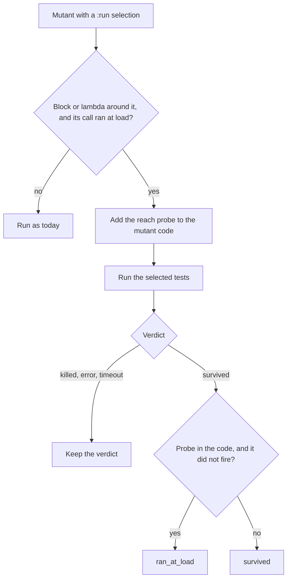

# Stale stored blocks of a class macro score ran_at_load, not survived - Plan

Suggested model and effort for the build: Fable 5.2, high.

## Goal Capsule

- **Issue:** #493 (redefine reports false survivors for a class macro that runs at load, with lazy loading, in process).
- **Objective:** a mutant in a block that a class macro stored before the mutant was applied no longer counts as a survivor when no test ran the mutated code. The score of a run no longer falls because of code that the run could not execute.
- **Means:** the reach probe that `:maybe` mutants already use (#345). A survivor inside a block or lambda whose call ran at load becomes `ran_at_load` only when the probe did not see the mutated expression return during a test (KTD1).
- **Decision owner:** David chose this fix on 2026-11-21, in the planning session, from three options (see KTD1).
- **Authority:** this plan, then `AGENTS.md`, then the issue text. Where this plan differs from the issue, this plan wins (see "Corrections to the issue").
- **Stop and ask when:** a test of the exact-survivor oracle (`test/integration_test.rb`, `test/rspec_integration_test.rb`) changes its verdicts. Also stop when a mutant that the probe saw run would leave the score, when a measured run in U5 crosses the completeness gate, or when the fix needs a new JSON key or a new status.
- **Execution profile:** one pull request from `main`. Labels: `bug`, `priority: high`, `risk: high`, `v1.10.0`. Body: `Closes #493`.
- **Size:** M. Five `lib/` files, four test files, seven fixture files, two docs pages, one decision record, `CHANGELOG.md`. No new runtime dependency. No `eval`.
- **Release and semver:** a fix in the 1.10.0 minor release. It changes a score only by moving mutants from `survived` to `ran_at_load`. The killed count stays, so a score can rise and cannot fall. A `--threshold` gate that failed on the score can pass, and a baseline survivor can show as fixed. One gate can go from pass to fail: the completeness gate (`Reporter#broken_share_exceeded?`) fails a `--threshold` run when more than 1 mutant and more than 10% of the attempted mutants have no verdict, and each moved survivor makes `attempted` smaller (see "Risks and Overlaps"). The #435 fix in 1.9.0 moved survivors to `ran_at_load` in the same way. It changes no GitHub Action default, no exit code rule and no JSON key. No agent tags or publishes a release.

---

## Product Contract

### Summary

A class macro such as `language_field` stores blocks (`validate { ... }`, `normalizes ..., with: ->(v) { ... }`). When the class that calls the macro loads before the mutant is applied, the class keeps the original blocks. A mutant inside such a block then passes every test, because no test runs the mutated code. Today that mutant counts as `survived`. After this change it counts as `ran_at_load`, the existing status for code that ran before the mutant. The probe decides: when a test did run the mutated block, the mutant keeps its verdict.

### Problem Frame

The report had 2 false survivors of 5, on Mutineer 1.9.0, Rails 8.1, `config.eager_load = false`, in-process `--rails` (which uses `--strategy redefine`). `--daemon` killed the same 2 mutants.

The cause is in three places:

1. `Runner.preload_owners` (`lib/mutineer/runner.rb`) loads the class of every subject in the parent, for `redefine` with a boot file. It exists so that a class body that calls its own method counts as load (#187, `test/load_time_test.rb` `test_boot_redefine_preloads_a_lazily_loaded_class`). A side effect: every source class loads before any mutant. So `Product`, a source, runs `Record.language_field` in the parent, with the original code. Lazy loading does not help here.
2. `JobPlan.ran_at_load?` (`lib/mutineer/job_plan.rb`) turns a survivor into `ran_at_load` when its statement's line ran at load. It leaves out a mutant inside a block, because the line of `xs.each { ... }` can count at load without the block (the #286 hazard). Pull request #444 (the #435 fix) added one exception: a `define_method` or `define_singleton_method` call.
3. So a mutant inside any other stored block stays `survived`, even when the tests ran only the original block.

The same false survivor occurs under `--strategy reload` and the daemon when the caller loads at boot (Rails eager load, `CI` set). P1 measured this for in-process `reload`. For the daemon it follows from the code: `DaemonBackend.job_result` calls the same `JobPlan.load_verdict`. Reload runs the macro's file again. It does not run the caller's class body again.

Measured in a scratch project (probe P1 and P2 below), with the operators `comparison`, `statement_removal` and `call_to_receiver`:

| Run | Mutants in the macro | Score |
|---|---|---|
| `redefine`, lazy boot, both files are sources (the #493 case), 1.9.0 | 5 survived (all false), 2 `ran_at_load` | 60.0 |
| The same run with the prototype | 7 `ran_at_load` | 90.0 |
| `reload`, eager boot, 1.9.0 | 5 survived (all false), 2 `ran_at_load` | 60.0 |
| `redefine`, lazy boot, only the macro's file is a source, 1.9.0 and prototype | 7 killed | 94.1 |

### Requirements

**The false survivors**

- R1. A mutant in a block or lambda is `ran_at_load` when all of these hold: its verdict is `survived`, the call that holds the block ran at load, the probe is in the mutant's code, and the probe did not see the mutated expression return during a test.
- R2. R1 holds for in-process `redefine`, in-process `reload`, and the daemon. The three paths use one rule from `JobPlan`.
- R3. R1 holds for a one-line block, a multi-line block and a lambda literal, in a method whose body is not on the `def` line.

**What must not change**

- R4. A survivor whose mutated expression returned during a test stays `survived`. The `each` case stays scored (`test/class_macro_load_test.rb` `test_an_each_block_on_a_load_line_stays_a_survivor`).
- R5. A kill, an error and a timeout stay what they are. A mutant that no test covers keeps its pre-fork verdict.
- R6. A mutant whose probe cannot be put in the code keeps the verdict it has today. No evidence means no change.
- R6a. A mutant with a `:maybe` selection keeps the verdict it has today (#254, #345). The new rule reads only a `:run` selection.
- R7. A caller that loads after the mutant keeps real verdicts. The lazy runs in `test/class_macro_load_test.rb` stay `killed`.
- R8. The `define_method` rule of #435 stays as it is.
- R9. No new status and no new JSON key. `summary.ran_at_load` and `ran_at_load[]` carry the moved mutants. The schema version does not change because of this fix.
- R10. The exact-survivor oracle keeps its verdicts.

**Records**

- R11. `docs/json-schema.md`, `docs/rails-setup.md`, `CHANGELOG.md` and `.expectation-fit/decisions/scoring-and-verdicts.md` state the new rule and its limits.
- R12. The pull request states how many mutants moved on the three measured runs (U5), and names the GitHub issue that tracks the limit in "Scope Boundaries", item 1.

### Acceptance Examples

The fixture is in U2. `L` is the lambda line, `B` is the multi-line block.

- AE1. **Covers R1, R2, R3.** Given both fixture files are sources and the boot file only registers `autoload`, when the run uses `redefine`:
  - each mutant inside `L` and `B` is `ran_at_load`.
  - the real survivor (`>` to `>=` in `initialize`) is `survived`.
  - no mutant inside `L` or `B` is `survived`.
- AE2. **Covers R2.** Given the boot file requires both files, when the run uses `reload` or `redefine`, then the verdicts equal AE1.
- AE3. **Covers R7.** Given only the macro's file is a source and the boot file only registers `autoload`, when the run uses `redefine` or `reload`, then each mutant inside `L` and `B` is `killed`.
- AE4. **Covers R4.** Given the `apply_each` fixture, when boot calls `apply([])` and the test calls `apply([1])`, then the mutant is `survived` under both strategies.
- AE5. **Covers R6.** Given a candidate mutant with a `:run` selection and a code text with no probe in it, when the child reports `survived`, then the verdict is `survived`.
- AE6. **Covers R2.** Given a daemon job for a candidate mutant and a client that answers `survived`, when the client wrote the sentinel, then the verdict is `survived`. When it did not, the verdict is `ran_at_load`.

### Scope Boundaries

Considered and not built:

1. **Real kills for these mutants under `redefine`.** The daemon kills them when the caller loads lazily. `redefine` cannot, because `Runner.preload_owners` loads every source class in the parent. A fix needs a child that loads the owner itself and detects load-time calls there. That is a redesign of the redefine load order, not a fix for a 1.x minor release. The build files one issue for it (U4) and names it in the docs. A measured loss of kills on a real app that blocks a user would change this call.
2. **Reload of the caller's file (the issue's second fix).** See KTD1 and "Corrections to the issue", item 1. It is issue #389 (`v2.0`).
3. **Every survivor of a method that ran at load becomes `ran_at_load` (the issue's first fix, as written).** See KTD1. It hides mutants that a test did run.
4. **The probe for the `define_method` rule of #435.** The probe could keep a `define_method` survivor that a test did run in the score. That makes survivors appear in a run that has none today. It belongs to #286 (`v2.0`), not to this fix.
5. **A block in a one-line or endless `def`.** Its body is on the `def` line, which counts when the method is defined. `docs/json-schema.md` already states this limit and names #389. The reported case does not need it, and the prototype did not cover it. A report of a false survivor in such a `def` would change this call.
6. **A Rails fixture test.** The zero-dependency fixture shows the same mechanism (P1). The Rails fixture app feeds the dogfood counts. A case that only Rails shows would change this call.
7. **A new count for the moved mutants.** Pull request #322 (`v2.0`) adds `summary.ran_at_load_tested`. This fix adds no key (R9).
8. **A change to the `Ran at load` row of the human report.** The row says "ran while the app or class loaded; mutineer cannot re-run that; verify with --test-command". That is true for a stored block: its call ran at load, and the run cannot store the block again. So `lib/mutineer/reporter.rb` does not change.

### Corrections to the issue

1. **The #435 fix did not reload a file.** The issue says "reload the file that calls the macro, as in #435". Pull request #444 (the #435 fix) changed `JobPlan.ran_at_load?` and `StatementLines`: it classifies a `define_method` mutant as `ran_at_load`. Its body says "Re-running the caller's class body ... stays #389". No code in this repo runs a caller's class body again for a macro. The nearest code is `ConcernBlocks.place_hook_def` (#297), which places one `def` of a concern hook block.
2. **Lazy loading is not the trigger.** The trigger is that the caller is a source. `Runner.preload_owners` then loads it in the parent. With only the macro's file as a source, `redefine` kills the same mutants (P1).
3. **The bug is not only in `redefine`.** In-process `reload` and the daemon give the same false survivors when the caller loads at boot (P1 for in-process `reload`; the daemon uses the same `JobPlan.load_verdict`, by code reading). So the fix is in the shared verdict code.
4. **The affected mutants are those inside a stored block.** A mutant of the macro's own statements, outside a block, is already `ran_at_load` on 1.9.0 (P1). The issue names lines 24 and 26, which hold a lambda and a block. That matches.
5. **Not checked:** the reporter's app. The reproduction is a plain Ruby fixture with `autoload`, not Rails with Zeitwerk.

---

## Planning Contract

### Key Technical Decisions

- KTD1. **Classify with the probe, in the shared verdict code.** (session-settled: user-directed, chosen over "every survivor of a method called at load becomes `ran_at_load`" and over "reload the caller's file": the probe moves only mutants that it did not see run in a test, and it needs no second run of a class body.) Evidence for each rejected option:
  - **The issue's first fix as written** would use `CoverageMap#method_ran_at_load?` for a whole method. A method that boot calls and tests also call would lose every survivor, including a mutant in a branch or in an `each` block that a test ran. That is the exact loss issue #286 reports.
  - **The issue's second fix** has no base in the code (correction 1). To run a caller's class body again, the tool must know the callers, which no data records. It also brings the reload faults into `redefine`: a callback that runs twice (#479), `superclass mismatch` for `Data.define` (#492), and the cases that `lib/mutineer/reload_guards.rb` handles. It would stack on the Group A branch (#492, #479). Issue #389 (`v2.0`, `risk: high`) is the planned form of this work.
- KTD2. **The candidate rule reads only data that exists.** A mutant is a candidate when its selection is `:run` and a `Prism::BlockNode` or `Prism::LambdaNode` around it sits in a statement whose line is in `CoverageMap#load_lines`. A method whose body is on the `def` line gives no candidate (Scope Boundaries, item 5). A call that runs only sometimes (`validate { ... } if c`) gives no candidate, as in `StatementLines.stored_method_lines`. That check is for the call that holds the block, not for the mutant's place inside the block. The syntax does not say if a block is stored or runs at once. The probe decides (KTD3). This plan changes no code in `lib/mutineer/coverage_map.rb`.
- KTD3. **The probe gives the verdict, the load line gives the name.** A candidate is only a reason to add the probe. The status changes only when the probe did not fire. The load line makes the name `ran_at_load` true: the call did run at load.
- KTD4. **One probe criterion.** The probe fires when the mutated expression returns during a test. A raise inside the expression does not count. This is the documented rule for `no_coverage` (`.expectation-fit/decisions/scoring-and-verdicts.md`, "Document no-coverage probe semantics"). Rejected: a second mode that fires on entry. It adds a parameter to four methods for one rare case (see Open Question 1).
- KTD5. **No probe in the code means no change.** `ReachProbe.wrap` returns nil when the wrapped text does not parse, and `Isolation.mutated_def` and `ReachProbe.wrap_mutation` then return the text with no probe. The parent builds the same text before the fork and checks that it holds the reach key. The text comes from `Isolation.mutated_def` for `redefine`, from `JobPlan.hook_mutant` for a hook-block `def`, and from `ReachProbe.wrap_mutation` for the other reload mutants. One helper does the check. Rejected: a flag from the child, because the daemon child cannot load `ReachProbe`.
- KTD6. **A new method beside `JobPlan.load_verdict`, not an edit of it.** Pull request #322 (`v2.0`, open, draft) edits the last line of `load_verdict`. A separate method keeps the two changes in different hunks.
- KTD7. **Order of the three verdict steps:** `load_verdict`, then `selection_verdict`, then the new step. A `:maybe` mutant gets its verdict from the first two steps, as today, and the new step does not change it (R6a). So this fix moves no mutant out of `no_coverage`. Rejected: the new step before `selection_verdict`, which would move a `:maybe` mutant from `no_coverage` to `ran_at_load` with no gain, because both are outside the score.

### High-Level Technical Design

Directional only. Names are proposals.



```text
StatementLines.enclosing_block_lines(def_node, source, offset)
  -> lines of each statement that holds a BlockNode or LambdaNode around offset

JobPlan.stored_block_candidate?(source_file, mutation, subject, source, coverage_map)
  -> true when one of those lines ran at load

ReachProbe.installed?(code, key)
  -> true when the code text holds the key

JobPlan.stored_block_verdict(result, candidate:, probed:, reached:)
  -> result.with(status: :ran_at_load) when candidate, probed, survived and not reached
```

### Effect on issue #286 and pull request #322

- **#286** says `ran_at_load` hides survivors on lines that tests also cover, and those mutants have no verdict path. This fix adds mutants to `ran_at_load`. For each one, the probe did not see the mutated expression return in any test. So it is not a survivor that a test ran to the end. The one exception is a raise that the code rescues ("Risks and Overlaps"). It still has no verdict path under `redefine`. Under #322 it would count as `tested` (its tests ran and passed). The issue's first fix as written would add mutants that a test did run, with no proof. That makes #286 worse.
- **#322** changes `lib/mutineer/job_plan.rb`, `lib/mutineer/result.rb`, `lib/mutineer/reporter.rb`, `docs/json-schema.md`, `README.md`, `docs/sample-report.html`, `CHANGELOG.md` and six test files. This fix shares three files with it: `lib/mutineer/job_plan.rb`, `docs/json-schema.md` and `CHANGELOG.md`. In `docs/json-schema.md`, both edit the `ran_at_load` row of the summary table, so expect one text conflict there. It does not touch `result.rb`, `reporter.rb`, `test/load_time_test.rb` or `test/daemon_backend_contract_test.rb`. After this fix merges, the #322 branch needs one more line: the new step sets `tested_at_load: true`, as `load_verdict` does there.

### Order against the other 1.10.0 groups

- **Group A (#492, #479):** not needed. This fix runs no class body again. The branch starts from `main`, not from the Group A branch.
- **#201 (split of `lib/mutineer/coverage_map.rb`):** this fix changes no code in that file and none in `lib/mutineer/coverage_map/`. It calls `CoverageMap#ran_at_load?` and `CoverageMap#method_ran_at_load?`. The build can start before or after the split merges.
- **Group E (schema `1.11`):** this fix adds no JSON key, so it has no merge order against Group E. Both edit `docs/json-schema.md`. Expect a text conflict only.

### Assumptions

- A stored block that the tests run is the copy the load made. The probe cannot prove this: it shows only that the mutated expression returned in some copy. When a test runs a new copy and checks the old one, the mutant stays `survived` and can be a false survivor (#286, #389).
- The candidate set is small. The one figure so far is from the fixture: 5 of 17 mutants moved, in a file written to show the case. U5 gives the estimate for real code, on three runs.
- The probe does not change a verdict by its presence. It has run on `:maybe` mutants since #345.

### Probes run for this plan

The scripts and the prototype are outside the repo, in `/Users/davidteren/Library/Application Support/Claude/side-session-notes/local_234e6d38-6b22-47f9-88b3-28d11e376268/group-b-493/` (`repro/`, `prototype.diff`). The fixture in U2 is a copy of `repro/`.

- P1. **Reproduction on `main` at `2e876780`** (Ruby 3.4.9, arm64-darwin25). See the table in "Problem Frame". With the default operators and a one-line block, the #493 run gave 1 false survivor and a score of 60.0, and the single-source run gave 85.7 with that mutant killed.
- P2. **Prototype** (`prototype.diff`, 88 lines, in-process only, no one-line `def` rule, no daemon change). It moved the 5 false survivors to `ran_at_load` and left the real survivor. It called the new step before `selection_verdict`. For a `:run` selection the order makes no difference, and all moved mutants had a `:run` selection. `test/class_macro_load_test.rb` (4 runs), `test/load_time_test.rb` (8 runs) and `test/statement_lines_test.rb` (45 runs) passed with it. The full `bundle exec rake test` run with the prototype gave 2301 runs, 20919 assertions, 1 failure, 0 errors and 5 skips. The failure is `CliTest#test_since_unknown_ref_exits_two`: the scratch copy has no `.git` folder, so `--since` stops with "requires a git repository". It does not come from the prototype. No verdict test failed, and `test/integration_test.rb` and `test/rspec_integration_test.rb` passed with no edit.
- Not run: `rake test:daemon`, the Minitest 6 suite, the Prism 2 suite, the self-dogfood job, `bin/dogfood` and `rake fizzy:sample`. U5 runs them.

---

## Implementation Units

### U1. Find the candidate and decide the verdict

- **Goal:** the pure rules of KTD2 to KTD7, with unit tests.
- **Requirements:** R1, R3, R4, R5, R6, R6a, R8.
- **Dependencies:** none.
- **Files:**
  - `lib/mutineer/statement_lines.rb`
  - `lib/mutineer/job_plan.rb`
  - `lib/mutineer/reach_probe.rb`
  - `test/statement_lines_test.rb`
  - `test/runner_test.rb`
  - `test/reach_probe_test.rb`
- **Approach:**
  1. `StatementLines`: a method that returns the lines of each statement that holds a block or lambda around the offset. It uses the same line rule as `stored_method_lines`: `statement_at` with `conditional: true`, then the strict lines, or the shared line when strict mode drops every line. Move that rule into one private helper that both methods call. Do not copy it.
  2. `JobPlan`: the candidate predicate. Get the lines from `StatementLines`, then ask `CoverageMap#ran_at_load?` for each line that is in the method body and is not the `def` line. Return false for a body on the `def` line.
  3. `ReachProbe`: the helper that tells if a code text holds the key.
  4. `JobPlan`: the verdict step. Leave the body of `load_verdict` as it is (KTD6). Keep a `--matrix` row, as `load_verdict` does.
  5. Update the comments that say another block stays scored: the comment of `JobPlan.ran_at_load?`, and the comments of `StatementLines.shared_lines` and `StatementLines::STORED_METHOD_CALLS`.
  6. Give every new method a YARD comment (`rake yard:strict`).
- **Patterns to follow:** `StatementLines.stored_method_lines`, `JobPlan.load_verdict`, `JobPlan.selection_verdict`, and the `load_probe` helper in `test/runner_test.rb`.
- **Test scenarios:**
  - Lines: a one-line block on a call, a multi-line `do ... end` block, a lambda literal as an argument, a block inside a block (both statements), a mutant outside any block (empty), a block under `x if c` (empty).
  - Candidate: true for a `:run` selection when the call's line is a load line. False for a `:maybe` selection. False when only another line of the method is a load line. False with no coverage map and with no subject.
  - Candidate for a one-line `def` whose method ran at load: false, for an offset in a block and for one outside.
  - Verdict step, all 16 combinations of candidate, probed, survived and reached: only candidate, probed, survived and not reached gives `ran_at_load`.
  - Verdict step with a killed, an error and a timeout result: unchanged.
  - Order: a `:maybe` mutant on a load line, in a block, that survived and was not reached ends as `no_coverage` after the three steps, as today. One that was reached ends as `survived`. Neither is a candidate.
  - `define_method` on a load line: `ran_at_load?` stays true and `load_verdict` gives `ran_at_load` when the probe fired and when it did not (R8). Such a mutant can carry the probe. Nothing reads its answer.
  - Probe helper: true for a text that `ReachProbe.wrap` returned, false for the same text before the wrap.
- **Verification:** the three test files pass, and no existing test in them changes.

### U2. Use the rule in the in-process run, with the reported case as a fixture

- **Goal:** `Runner.run` adds the probe for a candidate and applies the verdict step. The #493 case is a fixture with exact verdicts.
- **Requirements:** R1, R2, R3, R4, R7, R10.
- **Dependencies:** U1.
- **Files:**
  - `lib/mutineer/runner.rb`
  - `test/class_macro_load_test.rb`
  - `test/fixtures/load_time/lib/language_record.rb`
  - `test/fixtures/load_time/lib/language_product.rb`
  - `test/fixtures/load_time/language_lazy_boot.rb`
  - `test/fixtures/load_time/language_eager_boot.rb`
  - `test/fixtures/load_time/test/language_product_test.rb`
  - `test/fixtures/load_time/test/apply_each_empty_test.rb`
  - `test/fixtures/load_time/spec/language_product_spec.rb`
- **Approach:**
  1. In `Runner.run`, make the sentinel for a `:maybe` selection or a candidate. Pass it to the same calls as today (`Isolation.apply_surgical`, `JobPlan.hook_mutant`, `ReachProbe.wrap_mutation`).
  2. Decide `probed` only for a candidate, in the parent, before the fork, from the text that KTD5 names for each strategy. Under `redefine` the child builds its own text in `Isolation.apply_surgical`, so the parent calls `Isolation.mutated_def` with the same sentinel path and key. Do not treat `probed` as true by default.
  3. After `load_verdict` and `selection_verdict`, call the verdict step (KTD7).
  4. Add the fixture. Rename the classes so they do not clash with other fixtures in one process.

  The fixture, from `repro/`:

  ```ruby
  # lib/language_record.rb
  class LanguageRecord
    def self.normalizers = (@normalizers ||= {})
    def self.checks = (@checks ||= [])
    def self.limits = (@limits ||= {})

    def self.language_field
      normalizers[:language] = ->(value) { value.strip }
      limits[:language] = 35
      checks << proc do |record|
        record.errors << :invalid unless record.language == record.language.downcase
      end
    end

    attr_reader :language, :errors

    def initialize(language)
      @language = self.class.normalizers[:language].call(language)
      @errors = []
      self.class.checks.each { |check| check.call(self) }
      @errors << :too_long if @language.size > self.class.limits[:language]
    end
  end

  # lib/language_product.rb
  class LanguageProduct < LanguageRecord
    language_field

    def label
      "product"
    end
  end
  ```

  The lazy boot file registers both constants with `autoload`. The eager boot file requires both files. The test file has four tests: a stripped value, `[:invalid]` for `"EN"`, `[:too_long]` for 36 characters, and the label.

- **Patterns to follow:** `run_macro` and the `LAZY` and `EAGER` tables in `test/class_macro_load_test.rb`. Each run is a fresh process.
- **Test scenarios** (operators `comparison`, `statement_removal`, `call_to_receiver`; the tables name each mutant by operator and source text):
  - Covers AE1. Both files as sources, lazy boot, `redefine`: `value.strip` to `value` is `ran_at_load`. The four mutants inside the `proc` are `ran_at_load`. The two `statement_removal` mutants of the macro's own statements are `ran_at_load`. `>` to `>=` is `survived`. The nine mutants of `initialize` that P1 lists as killed are `killed`. The score is 90.0.
  - Covers AE2. Macro file as the source, eager boot, `reload` and `redefine`: the same verdicts for the macro's mutants.
  - Covers AE3. Macro file as the only source, lazy boot, `redefine` and `reload`: the seven macro mutants are `killed`. The score is 94.1.
  - Covers AE3, the mechanism. The same run with `matrix: true`: the `kills` row of `==` to `!=` names `test/language_product_test.rb`.
  - Covers AE4. The existing `each` test stays green with no edit.
  - A block that no test runs. A new test file calls only `ApplyEach.apply([])`, with `apply_boot.rb`. The line is covered and the block never runs. The mutant is `ran_at_load` under both strategies. It is `survived` on 1.9.0 (measured on `main` and on the prototype). This pins the limit in "Risks and Overlaps".
  - A branch that no test takes. A macro stores a one-line block with a ternary, the boot file calls the macro, and the test takes one branch. Record the verdict of the mutant in the other branch: `ran_at_load` by this rule, `survived` on 1.9.0. It pins the limit in "Risks and Overlaps".
  - A `def` in a concern's hook block (`subject.reload_hook_call`), under `reload`. Run this first, before any hook-path code. The `def` holds a block on a load line. The test includes the concern in a new class and runs that block with no check on its value. The expected verdict is `survived` (R4). `JobPlan.hook_mutant` puts the probe in the stored `def`, and the file text that a later class loads has none. If the verdict is `ran_at_load`, set `probed` to false for a subject with a `reload_hook_call`, in-process and in the daemon. Then that mutant stays `survived`, as on 1.9.0. Name this case in the issue from U4. This case has no prototype result.
  - The parent text equals the child text. Under `redefine`, the text that the parent checks for the probe equals the text that `Isolation.apply_surgical` loads, for one mutant with a probe and one where `ReachProbe.wrap` returns nil.
  - RSpec ("Cover the siblings"). The verdict step runs after the test runner returns, so it does not depend on the framework. One run proves it: the AE1 run with `framework: "rspec"` and a spec file that holds the same four checks gives the AE1 verdicts. Follow the RSpec run in `test/load_time_test.rb` (`spec/price_list_spec.rb`).
  - The existing `LAZY` and `EAGER` tables of #435 stay green with no edit (R7, R8).
- **Verification:** `test/class_macro_load_test.rb`, `test/load_time_test.rb`, `test/integration_test.rb` and `test/rspec_integration_test.rb` pass. The last three need no edit.

### U3. Use the rule in the daemon backend

- **Goal:** the daemon gives the same verdicts as in-process reload.
- **Requirements:** R2, R6.
- **Dependencies:** U1.
- **Files:**
  - `lib/mutineer/daemon_backend.rb`
  - `test/class_macro_load_test.rb`
- **Approach:**
  1. In `DaemonBackend.job_result`, make the sentinel for a `:maybe` selection or a candidate. The payload already carries `reach_path` and `reach_key` for any sentinel, and `DaemonServer` clears the sentinel after load for any payload that has them. So `lib/mutineer/daemon_server.rb` needs no change. Confirm that by reading `forget_load_reach` and its caller.
  2. Decide `probed` from `payload["code"]` (KTD5), for the hook path and the plain path.
  3. Apply the verdict step after `load_verdict` and `selection_verdict` (KTD7).
- **Patterns to follow:** `test_the_daemon_classifies_a_shared_load_line_like_in_process_reload` in `test/class_macro_load_test.rb`, which drives `job_result` with a stub client and a map from `CoverageMap.from_data`.
- **Test scenarios:**
  - Covers AE6. The fixture's jobs, a map whose load lines hold the two call lines, and a client that answers `survived`. When the client writes `"1"` to `payload["reach_path"]`, each block mutant is `survived`. When it writes nothing, each is `ran_at_load`.
  - The same jobs with a map that has no load line: no payload carries `reach_path`, and each mutant is `survived`.
  - A mutant outside a block on a load line: no `reach_path` in the payload, and the verdict is `ran_at_load` from `load_verdict`, as today.
  - Covers AE5. A candidate whose wrap fails: stub `ReachProbe.wrap` to return nil. The verdict is `survived`.
- **Verification:** the new tests pass in `bundle exec rake test`. `bundle exec rake test:daemon` passes with the fixture bundle installed, or in the `rails dogfood` CI job.

### U4. Docs, CHANGELOG, decision record and the tracking issue

- **Goal:** users and reviewers can find the rule and its limits.
- **Requirements:** R11, R12.
- **Dependencies:** U2, U3.
- **Files:**
  - `docs/json-schema.md`
  - `docs/rails-setup.md`
  - `CHANGELOG.md`
  - `.expectation-fit/decisions/scoring-and-verdicts.md`
- **Approach:**
  1. `docs/json-schema.md`, the paragraph that starts "`ran_at_load` (schema `1.7`) means": replace "Another block on that line stays scored" with the new rule. State the probe criterion (the expression returns during a test). Keep the sentence about a block on the `def` line and #389. State the three limits: a mutant whose expression raises and is rescued, a mutated expression in a block that no test reaches on a line that tests cover (a block that no test runs, a branch in the block that no test takes, the right side of `&&` or `||` that no test reaches), and a test that runs a new copy of the block but checks the old one. Then add one clause to the `ran_at_load` row of the summary table and to the `ran_at_load` comment in the example: a mutant in a stored block counts when the call that stored the block ran at load. For a multi-line block the mutant's own line did not run at load, so those two texts hold only in the common case today. Make no other edit in this file, so the overlap with #322 and Group E stays small.
  2. `docs/rails-setup.md`, the table row "A mutant survives on a line executed during loading" and the two rows after it: the same rule in user words. Say that in-process `--rails` loads every source class before the mutants, and that `--daemon` with lazy loading can kill these mutants. Give the next step for a `ran_at_load` mutant in a block: check that a test runs the block and checks its result, then confirm with `--daemon` (lazy loading) or `--test-command`.
  3. `CHANGELOG.md`, "Fixed" under "Unreleased": name #493, the three paths, the score effect (survivors leave the denominator, so a score can rise), and `--baseline` (a baseline survivor that is now `ran_at_load` is listed as fixed, the 1.x rule). State the completeness gate effect from "Risks and Overlaps". Say that `summary.ran_at_load` can rise after the upgrade, and that the `ran_at_load[]` list names each mutant. Give the measured counts from U5.
  4. `.expectation-fit/decisions/scoring-and-verdicts.md`: change the line "Stored Method Blocks at Load" so it holds the new rule. The `each` block stays scored when the probe saw it run.
  5. Name an issue for each limit ("Track every limitation"). The two limits "a mutant whose expression raises and is rescued" and "a mutated expression in a block that no test reaches on a line that tests cover" are cases of #286 (`ran_at_load` hides survivors on lines that tests also cover). Add one comment to #286 that lists them, and cite #286 beside each limit in the docs. The third limit (a new copy runs, the old copy is checked) cites #286 and #389. Then file one GitHub issue for "Scope Boundaries", item 1, before the pull request opens. Proposed title: "redefine loads every source class before the mutants, so a macro in another source scores ran_at_load where the daemon kills". Labels: `enhancement`, `risk: medium`, and the version label a maintainer names. Start the body with `**Claude:**`. Name the issue in the two docs pages and in the CHANGELOG entry.
  6. Run the author self-check skill (`.claude/skills/author-self-check/SKILL.md`) before the first push.
- **Test expectation:** none for the prose. `bundle exec rake docs:check` and the website checks in `AGENTS.md` apply, because `docs/` is the site source.
- **Verification:** `bundle exec rake docs:check`, `bundle exec rake site:build` and `node --test test/site_test.js` pass.

### U5. Measure what moves

- **Goal:** numbers for R12 and for the "Estimate exclusion frequency" rule.
- **Requirements:** R10, R12.
- **Dependencies:** U2, U3.
- **Files:** none in the repo, unless a count in a checked file must change.
- **Approach:**
  1. Run the self-dogfood command from `.github/workflows/ci.yml` (`self-dogfood` job) on `main` and on the branch, with `--format json`. Compare `summary.survived`, `summary.ran_at_load`, `summary.no_coverage`, `summary.attempted` and `summary.no_verdict`. `summary.no_coverage` must not change.
  2. Run `test/fixtures/rails_app/bin/dogfood` on the branch. Its exit code gates must hold.
  3. Run `bundle exec rake fizzy:sample` on a clean checkout of the branch head. See "Fizzy sample" below.
  4. For each run, count the candidates (mutants that got the probe) and the mutants that moved. Say if a run comes within one mutant of the completeness gate (more than 1 mutant and more than 10% of `attempted` with no verdict). Put the numbers in the pull request body and in the CHANGELOG entry.
- **Test expectation:** none. This unit measures.
- **Verification:** the pull request body has the numbers. Each moved mutant on the three runs has a one-line reason.

**Fizzy sample.** The counts in `rake/fizzy_sample.json` can move. The sample runs `--daemon` with lazy loading (the task removes `CI`). A survivor moves only when its block's call line is in the daemon's boot load set and no test ran the mutated block. The recorded sample has 16 survivors and 0 `ran_at_load`. Not checked in this plan: the sample was not run with the prototype. If a count moves, list each moved id with its reason in the pull request. Do not run `rake fizzy:record` on the branch: `AGENTS.md` records after the merge, in its own pull request, before the release.

---

## Verification Contract

| Check | Command | Proves |
|---|---|---|
| Unit tests for U1 | `LANG=en_US.UTF-8 LC_ALL=en_US.UTF-8 bundle exec ruby -Ilib -Itest test/statement_lines_test.rb` and the same for `test/runner_test.rb` and `test/reach_probe_test.rb` | Candidate lines, the verdict table, the order of the steps |
| Fixture runs for U2 and U3 | `LANG=en_US.UTF-8 LC_ALL=en_US.UTF-8 bundle exec ruby -Ilib -Itest test/class_macro_load_test.rb` | AE1 to AE6 |
| Zero-dependency suite | `LANG=en_US.UTF-8 LC_ALL=en_US.UTF-8 bundle exec rake test` | Nothing else moved, and the exact-survivor oracle is green |
| Load smoke | `ruby -Ilib -e 'require "mutineer"'` | The gem loads |
| Docs coverage | `bundle exec rake yard:strict` | Every new method has a comment |
| Minitest 6 | The two commands in `AGENTS.md` for `gemfiles/minitest6.gemfile` | The probe path under Minitest 6 |
| Daemon tests | `bundle exec rake test:daemon` with the fixture bundle installed, or the `rails dogfood` CI job | No regression in the daemon tests. The clear of the sentinel for a candidate is confirmed by reading `DaemonServer` (`forget_load_reach` and its caller) and by the stub test for AE6. No real daemon run of a candidate is in this plan |
| Website checks | The commands in `AGENTS.md` "Website checks" | The two docs pages build |
| Measurements | U5 | R12 |

## Definition of Done

- R1 to R12 hold, and each acceptance example has its test.
- All Verification Contract checks are green on the pull request head.
- No test of the exact-survivor oracle was edited.
- The pull request has the labels in the Goal Capsule, `Closes #493`, the U5 numbers, and the tracking issue from U4.
- `STATUS.md` is not in the commit.
- No prototype code, debug output or abandoned attempt is left in the diff.

---

## Risks and Overlaps

- **A mutant whose expression raises and is rescued.** The probe does not fire (KTD4). When such a mutant is a candidate and its tests pass, it becomes `ran_at_load`, though a test ran it. The docs state it, and Open Question 1 holds the choice. The same mutant under a `:maybe` selection is `no_coverage` today.
- **A mutated expression in a block that no test reaches, on a line that tests cover.** The call ran at load and the tests run the mutant's line, but not the mutated expression. Three forms: no test runs the block (for example `each` on an empty array in every test), no test takes the branch in the block that holds the mutant, or no test reaches the right side of `&&` or `||`. The probe does not fire, so the mutant becomes `ran_at_load`. On 1.9.0 it is `survived`, which points at the missing test. The rule cannot tell these from a stale copy: in each, no test ran the mutated code. The docs state it, #286 holds it, and U2 pins the first two forms with tests.
- **A test that runs a new copy of the block and checks the old one.** The probe fires, so the mutant stays `survived`. It can still be a false survivor. This is no worse than 1.9.0. Issue #286 and issue #389 hold it.
- **More mutants carry the probe.** The probe wraps the mutated expression in an array. A wrap that changed a value would change a verdict. `ReachProbe.wrap` rejects a wrap that does not parse, and the probe has run on `:maybe` mutants since #345. U5 counts the candidates.
- **#322 (`v2.0`, draft):** see "Effect on issue #286 and pull request #322". Three shared files: different hunks in `lib/mutineer/job_plan.rb`, and one expected text conflict in `docs/json-schema.md`.
- **#286 (`v2.0`):** the count of `ran_at_load` mutants with no verdict path rises by the moved mutants.
- **#201:** no shared code. `test/runner_test.rb` uses `FakeCoverageMap`, which the split may move. A rebase fixes that.
- **Group E:** a text conflict in `docs/json-schema.md` only.
- **#467 (standalone load-only lines):** it changes which test is credited with a load-only line. It does not change `load_lines`, which this fix reads.
- **Gates in a user's CI:** a score can rise, so a `--threshold` gate that failed on the score can pass. A baseline survivor that is now `ran_at_load` is listed as fixed. The completeness gate can go from pass to fail: `attempted` is `killed + survived + no_verdict`, so a moved survivor makes it smaller, and a run with 2 or more mutants with no verdict can cross the 10% limit. Checked with `Reporter#exit_code`: 14 killed, 5 survived and 2 errored at `--threshold 70` exits 0, and the same run with the 5 survivors as `ran_at_load` exits 1. This is rare and the message names the cause. The CHANGELOG says so, and U5 measures it.

## Open Questions

1. **Should a raise inside the mutated expression count as a run for this rule?** Default: no. Keep the one probe criterion (KTD4) and state the limit in `docs/json-schema.md`. The other choice adds an entry mode to `ReachProbe.splice` and a parameter to `wrap`, `wrap_mutation`, `Isolation.mutated_def` and `JobPlan.hook_mutant`. Decider: a maintainer at review. Evidence that would change the default: U5 finds such a mutant on a measured run.
2. **Which version label does the tracking issue from U4 get?** Default: the implementer asks a maintainer when it files the issue. Decider: a maintainer.

## Sources

- Issue #493, read with `gh issue view 493` (no comments on 2026-11-21).
- Issue #435 and pull request #444 (`gh pr view 444`): the fix classifies, it does not reload.
- Issue #286 and pull request #322 (`gh pr view 322`, `gh pr diff 322`): the files and hunks of #322.
- Issues #389, #397, #479, #492, #201, #467.
- `AGENTS.md` ("Score-model discipline", "Shift-left rules"), `.expectation-fit/ways-of-working.yaml`, `.expectation-fit/decisions/scoring-and-verdicts.md`, `.expectation-fit/decisions/reload-and-redefine-strategies.md`, `docs/json-schema.md`, `docs/rails-setup.md`.
- From Augment context retrieval (run on this worktree): where `redefine` applies a mutant (`Isolation.apply_surgical`, `Runner.run`), where owners are loaded first (`Runner.preload_owners`) and its tests in `test/load_time_test.rb`, what decides `ran_at_load` (`JobPlan.ran_at_load?`, `load_verdict`, `selection_verdict`), and where the daemon applies the same steps (`DaemonBackend.job_result`).
- From exact search (`grep`): every use of `ran_at_load` and of `ReachProbe` in `lib/`, and the docs lines that name `ran_at_load`.
- Probes P1 and P2, in the notes folder named in "Probes run for this plan".
