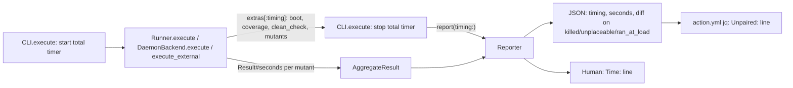

# Report fields for 1.10.0 (diff on more lists, timing, unpaired line in the Action summary) - Plan

Suggested model and effort for the build: Opus 5.5, medium.

## Goal Capsule

- **Issues:** #498 (`diff` on `killed[]`, `unplaceable[]` and `ran_at_load[]` entries, asked by an outside user), #495 (timing in the JSON report and the human summary), #481 (unpaired counts in the GitHub Action step summary).
- **Objective:** a consumer of `--format json` gets the change of every mutant it must act on without patching private reporter methods, can see where a run spends its time, and the step summary reader sees when sources ran no mutants.
- **Means:** additive keys only. The JSON `schema_version` moves once, from `1.10` to `1.11` (KTD1). The Action gets one optional line, and no input or default changes (KTD9).
- **Authority:** this plan, then `AGENTS.md`, then the issue text. Where this plan differs from an issue, this plan wins (see "Corrections to the issues").
- **Stop and ask when:** a change would alter a verdict, a score, a count in `summary`, an exit code or an Action default. Also stop when a test that compares two reports byte for byte turns up (this plan found none).
- **Execution profile:** one pull request, three commits, one for each issue, so one issue can leave the pull request without the others (KTD10). Labels: `enhancement`, `github_actions`, `v1.10.0`, plus `priority: low` and `risk: low`, which #495 and #481 carry. Body: `Closes #498`, `Closes #495`, `Closes #481`.
- **Size:** M. Files: `lib/mutineer/reporter.rb`, `lib/mutineer/result.rb`, `lib/mutineer/runner.rb`, `lib/mutineer/daemon_backend.rb`, `lib/mutineer/daemon_server.rb`, `lib/mutineer/coverage_map.rb`, `lib/mutineer/cli.rb`, `action.yml`, their tests, `test/fixtures/action_harness.sh`, `docs/json-schema.md`, `docs/ci.md`, `STABILITY.md`, `CHANGELOG.md`, `.expectation-fit/decisions/json-schema-and-baseline.md`. No new runtime dependency.
- **Release and semver:** new report keys and one new Action summary line, so minor class. It ships in the v1.10.0 batch. It changes no Action default. No agent tags or publishes a release.

---

## Product Contract

### Summary

`killed[]`, `unplaceable[]` and `ran_at_load[]` entries carry the same `diff` string as `survivors[]` entries, by default. Every CLI report carries a top-level `timing` object (`null` only when a program calls the reporter without timing, R7), and each `survivors[]`, `killed[]` and `no_verdict[]` entry carries `seconds`. The human summary prints one `Time:` line. The Action step summary prints one `Unpaired:` line below the table when `summary.unpaired_sources` is above 0.

### Problem Frame

Since 1.9.0 (#361), `killed[]`, `unplaceable[]` and `ran_at_load[]` let a consumer account for every mutant. Those entries come from `mutant_json` (`lib/mutineer/reporter.rb:851`), the lean identity with no `diff`. Only `survivors[]` gets a diff, from `survivor_json` (`lib/mutineer/reporter.rb:766`). The reporter of #498 matches a declared equivalent mutant by its change, and runs unplaceable and ran-at-load mutants by hand, so they prepend a module to `Mutineer::Reporter` and call private methods and `@agg`. Every release can break that.

No field in the report holds a duration (#495). Users who compared 14 setups had to time each one from the shell, and could not see slow tests or timeouts near the limit.

Since 1.9.0 (#381), the report counts sources with no paired test (`summary.unpaired_sources`, `summary.unpaired_mutants`). The human, HTML and dry-run outputs show them. The Action step summary does not (`action.yml:518-556`), so a pull request can show a high score while many sources ran no mutants. On Fizzy at `f220e4832`, 92 sources and 149 mutants were unpaired (#481).

### Requirements

**#498: the change on every list a consumer acts on**

- R1. Each `killed[]`, `unplaceable[]` and `ran_at_load[]` entry has a `diff` key with the same text `survivors[]` gives for that mutant. The key is in every report, with no flag (KTD2).
- R2. An entry whose result has no subject or mutation (a stub result) has `diff: null`, as its other fields are null today.
- R3. The lean lists that the issue does not name gain no `diff` key: `no_coverage[]`, `uncapturable[]`, `ignored[]`, `no_verdict[]`, `baseline.new_survivors[]` and the dry-run `mutants[]`.

**#495: timing**

- R4. Every completed-run report has a top-level `timing` object with `total_seconds`, `boot_seconds`, `coverage_seconds`, `clean_check_seconds` and `mutants_seconds` (KTD4). Each value is a number of seconds rounded to 3 decimals, or `null` when the run had no such phase (KTD5).
- R5. Each `survivors[]`, `killed[]` and `no_verdict[]` entry has `seconds`: the wall-clock time of that mutant's run step, rounded to 3 decimals, or `null` when Mutineer decided the verdict without a run (KTD6). The docs say what the run step covers in each backend, that values do not compare across backends, and that under `--jobs` above 1 the sum of `seconds` can exceed `timing.mutants_seconds`.
- R6. The human summary prints one `Time:` line with the total and each phase. A phase with `null` prints `n/a`.
- R7. A program that calls `Reporter#report` without timing gets `timing: null` in JSON and no `Time:` line, as `subjects` works today (`lib/mutineer/reporter.rb:95-98`).
- R8. `docs/json-schema.md` says the byte-identical promise covers every key except `timing` and the `seconds` keys (KTD3).
- R9. Timing changes no verdict, score, count or exit code. The `--threshold` and `--baseline` gates do not read it.

**#481: the unpaired line in the Action step summary**

- R10. When `summary.unpaired_sources` is above 0, the step summary has one blank line and one `Unpaired:` line below the table, placed where the `Dropped:` line goes (`action.yml:529-532`).
- R11. A report with no `summary.unpaired_sources` key (a CLI older than 1.9.0), or with the value 0, gets no `Unpaired:` line.
- R12. No Action input, output or default changes.

**Contract and docs**

- R13. `Reporter::SCHEMA_VERSION` is `1.11`. `docs/json-schema.md` (both shape blocks and the version rule example), `STABILITY.md` (the JSON schema row and the 2.0 note) and `CHANGELOG.md` agree. Each new key has its row, written "Additive key (schema `1.11`, #N)".
- R14. `docs/ci.md` names the `Unpaired:` line in its "Step summary" row.

### Acceptance Examples

- AE1. **Covers R1.** Given the calculator fixture with the strong suite, when the run writes `--format json`, then every `killed[]` entry has a `diff` that starts with `--- a/` and equals the diff that same mutant gets as a survivor under the weak suite.
- AE2. **Covers R2.** Given a reporter built from `Result.killed` with no subject, when it renders JSON, then that `killed[]` entry has `diff` `null` and the render does not raise.
- AE3. **Covers R4, R5.** Given an in-process run of the calculator fixture, when it writes JSON, then `timing.total_seconds` is a number at least as large as `timing.mutants_seconds`, and each `killed[]` entry has a numeric `seconds`.
- AE4. **Covers R4.** Given a `--test-command` run, then `timing.boot_seconds` and `timing.coverage_seconds` are `null`, and `timing.clean_check_seconds` is a number.
- AE5. **Covers R7.** Given `Reporter#report` called with no `timing:`, then the JSON has `"timing":null` and the human report has no `Time:` line.
- AE6. **Covers R10, R11.** Given a stub report with `"unpaired_sources":3,"unpaired_mutants":12`, the step summary has the `Unpaired:` line. Given the existing case 1 stub report (schema `1.2`, no such key), it has none.

### Scope Boundaries

Considered and not built:

- **A `--json-diffs` flag.** David chose the default report on 2026-11-21 (KTD2). A size complaint from a user with a large `killed[]` would change this call.
- **`diff` on `no_coverage[]`, `uncapturable[]`, `ignored[]`, `no_verdict[]`, `baseline.new_survivors[]` and dry-run `mutants[]`.** Nobody asked, and each adds size. A request names the list that needs it.
- **A `--timing` flag.** David chose timing in every report on 2026-11-21 (KTD3).
- **`seconds` on `ran_at_load[]` and the other lean lists.** The issue names killed, survivors and no verdict. A ran-at-load survivor that ran has a time internally, but the report does not show it.
- **Timing in the HTML report and the Action step summary.** The issue asks for JSON and the human summary.
- **Per-test timing.** `CoverageMap#timings` already stores capture seconds per test file in the cache. Exposing it is a separate request.
- **`diff` in the Action annotations.** The Action reads `survivors[]` only.

### Corrections to the issues

1. **#498 names three lists, and `survivor_json` cannot serve them as is.** It has no guard for a result without a subject, and `killed[]` keeps that guard today (`lib/mutineer/reporter.rb:330-333`). The plan extracts the diff text into one helper that both use (KTD7).
2. **#495 "clean check" is not one step in every backend.** On a coverage-cache miss, each test file runs alone during capture, and that run is also its clean check (`lib/mutineer/coverage_map.rb:508-520`). Only `verify_cached_clean` and `verify_combined_clean` are a separate step. The plan counts capture time in `coverage_seconds` and those two calls in `clean_check_seconds` (KTD4).
3. **#495 per-mutant time cannot come from one place.** Each backend runs a mutant in a different process: a `WorkerPool` fork and an `Isolation` fork in process, a daemon request over a pipe, a spawned command for `--test-command`. Each backend times its own run step (KTD6).
4. **#481 needs no CLI change.** The keys exist since schema `1.10`. Only the `jq` program changes.

---

## Planning Contract

### Key Technical Decisions

- KTD1. **One schema bump, `1.10` to `1.11`, for #498 and #495 together.** Both add keys, so both are minor per `docs/json-schema.md` "Versioning contract". The #498 commit makes the bump. If #498 leaves the pull request, move the bump hunks into the #495 commit (KTD10). #481 adds no report key.
- KTD2. **`diff` on the three lists by default, with no flag.** (session-settled: user-directed, chosen over a `--json-diffs` flag: the entries then match `survivors[]`, the reporter of #498 accepts both, and a flag adds an option, a config key and docs for one consumer.) Measured on 2026-11-21 with the self-dogfood command from `.github/workflows/ci.yml:248-257` (3 sources, 269 mutants, 233 killed, 0 unplaceable, 0 ran at load): the report is 53,464 bytes, and diffs on `killed[]` add 52,242 bytes (about 224 bytes per killed mutant), so the report becomes about 105,706 bytes. Governs R1, R3.
- KTD3. **Timing in every report, and the byte-identical promise names the exception.** (session-settled: user-directed, chosen over a `--timing` flag: the issue asks for timing in the report, and a flag adds an option for a cost that only byte comparison pays.) The first paragraph of `docs/json-schema.md` says JSON is byte-identical for the same inputs and results. It becomes: byte-identical except `timing` and each `seconds`. Update the "JSON Output Determinism" line in `.expectation-fit/decisions/json-schema-and-baseline.md` the same way, or reviewers will flag the change against it. Governs R8.
- KTD4. **Field names and phase edges.** `timing` is a top-level object, not part of `summary`, so `summary` stays counts and flags (`rake/fizzy_sample.rb` `counts` reads only integer `summary` keys). Keys: `total_seconds`, `boot_seconds`, `coverage_seconds`, `clean_check_seconds`, `mutants_seconds`. The `_seconds` suffix on each key matches `total_seconds` from #495 and says the unit. Phase edges by backend:

  | Phase | In process (`Runner.execute`) | Daemon (`DaemonBackend.execute`) | `--test-command` (`Runner.execute_external`) |
  |---|---|---|---|
  | `boot_seconds` | From the first boot step to after `preload_owners`: the boot file or the sources, then `require:` files (`lib/mutineer/runner.rb:162-190`) | The prepare daemon's `start` and `provision` in `prepare_run`, plus the start of every worker daemon in `run_serial` and `run_parallel` | `null`: each command boots the app itself |
  | `coverage_seconds` | The `CoverageMap` build (`build_via_fork` or `build_or_load`, `lib/mutineer/runner.rb:202-228`) minus `clean_check_seconds` | `client.coverage` in `coverage_map_from_client`, minus the daemon's `clean_check_seconds` | `null`: no coverage capture |
  | `clean_check_seconds` | Time in `verify_cached_clean` and `verify_combined_clean` (`lib/mutineer/coverage_map.rb:488-600`) | The same time, measured in the daemon and sent in the coverage reply | `ExternalBackend.smoke_check!` (its `elapsed` is already measured, `lib/mutineer/runner.rb:329`) |
  | `mutants_seconds` | The `WorkerPool#run` call (`lib/mutineer/runner.rb:251-262`) | The job loop of `run_serial` or the thread section of `run_parallel`, after the worker daemons are up | The `jobs.each` loop (`lib/mutineer/runner.rb:356-368`) |
  | `total_seconds` | `CLI.execute` from its first line to just before `reporter.report` (`lib/mutineer/cli.rb:1011-1053`) | same | same |

  The phases do not add up to the total: pairing counts, job collection, the `--since` scope and the baseline diff are in the total only. `total_seconds` also leaves out Ruby and gem load, option and config parsing, and report rendering and writing, so it is less than a shell `time` of the same command. The docs say both. Use `Process.clock_gettime(Process::CLOCK_MONOTONIC)`, as every timer in `lib/` does.

  `clean_check_seconds` is the time of the separate clean-check calls only. On a coverage-cache miss, each test file already ran alone during capture, and that time is in `coverage_seconds`. So the split between the two fields shifts between a cold and a warm cache, and the docs say so. `verify_combined_clean` returns at once when fewer than 2 tests can run or a clean test already failed (`lib/mutineer/coverage_map.rb:1052-1055`). When no clean-check call runs a test, the value is `null`. Example: a cache miss with one test file.
- KTD5. **`null`, never `0.0`, for a phase that did not run.** This follows the score rule ("Empty denominator gives `nil`, never `0.0`" in `AGENTS.md`). A run that returns early (an empty `--since` scope, no jobs) has `null` for each phase it skipped and a number for `total_seconds`. `mutants_seconds` is `null` whenever the job list is empty, in every backend: the in-process path skips its timer then, instead of timing an empty `WorkerPool#run`. When the daemon coverage build fails and the run falls back to the full test set, `clean_check_seconds` is `null`.
- KTD6. **Per-mutant `seconds` times the test run only, in each backend, and rides on `Result`.** Add a `seconds` member to `Result` (`lib/mutineer/result.rb:68`), default `nil`. `Result` crosses only the `WorkerPool` Marshal pipe, between processes of one version, so no Marshal compatibility is needed (the comment at `lib/mutineer/result.rb:64-67` says so). Set it after the verdict is final, so `Data#with` keeps it:
  - In process: in `Runner.run`, time the `Isolation.run` call, then `.with(seconds:)` on the result of `JobPlan.selection_verdict`.
  - Daemon: in `DaemonBackend.job_result`, time the `client.request` call, then `.with(seconds:)` on the final result.
  - `--test-command`: in `Runner.run_external`, time the `FileSwap.with` block.
  A verdict made before any run (skipped, a coverage-selection `no_coverage` or `uncapturable`, `unplaceable`) keeps `nil`. A `WorkerPool` worker crash keeps `nil`. A timeout gets the time until the kill, which shows a mutant near the limit.

  What the run step covers differs by backend, and the docs row says so. In process: the fork, the load of the mutant and its tests. Daemon: the request round trip, including a daemon respawn (an app boot) after a crash. `--test-command`: the whole command, including its app boot. The key is bare `seconds` because an entry has one duration. The `timing` keys carry a phase name, so they need the `_seconds` suffix to say the unit.
- KTD7. **One diff helper.** Extract the `diff:` string of `survivor_json` into a private method that takes a result and returns the diff text, or `nil` for a result with no subject or mutation. `survivor_json` and the three lists call it. Add `diff` after `id`. `attach_copies` may add `copies` after `diff` or before it: JSON key order is not part of the contract, and a fixed order keeps output stable.
- KTD8. **The reporter takes timing as one keyword.** `Reporter#report` gains `timing: nil`, a hash of the five values. `CLI.execute` builds it from `extras[:timing]` (the four phases from the backend) and its own `total_seconds`. The backends put their phase values in `extras[:timing]`, the hash they already return (`lib/mutineer/runner.rb:79`). `json_report` writes `timing: timing&.transform_values { |v| v&.round(3) }`. The `&.` inside the block keeps a `nil` phase as `null`. `summary` prints the `Time:` line only when `timing` is a hash.
- KTD9. **The Action line follows the `Dropped:` pattern and the human `Unpaired:` line.** In the `jq` program, add after the `Dropped:` block a line shown only when `(.summary.unpaired_sources // 0) > 0`. It uses the facts and order of `Reporter#unpaired_line` (`lib/mutineer/reporter.rb:1223-1236`): `Unpaired: M mutant(s) not run; S source(s) have no paired test`, then `; U source(s) not counted` when `[.unpaired_sources[]? | select(.mutants == null)] | length` is above 0, then `. They are not in the score. To run them, add a test at the conventional path, map one with `tests:` in `.mutineer.yml`, or run those sources in a separate step that sets the `sources` and `test` inputs. See unpaired_sources[] in the JSON report.` The next step follows `UNPAIRED_SHARE_HINT` (`lib/mutineer/reporter.rb:43-44`): setting the `test` input for the whole run would turn off pairing for every source. The scope percentage stays out, because the human share has a `--fail-fast` rule the Action must not copy ("Shell passes values, never parses them"). `// 0` makes an old report print nothing (R11). The values are integers from the report, so they need no `oneline` scrub.
- KTD10. **Three commits, one per issue, in this order: #481, #498, #495.** #481 touches only `action.yml`, the harness, `docs/ci.md` and `CHANGELOG.md`, so it is independent. #498 makes the schema bump (KTD1). #495 builds on that bump. Each commit has its own `CHANGELOG.md` line and its own schema rows, and passes the local gate alone.

### High-Level Technical Design

This is directional. The builder may pass `timing` through another existing carrier if it is simpler.

### Assumptions

- The daemon server and the tool run the same gem code: `DaemonClient` starts `DAEMON_PATH`, which is `daemon_server.rb` next to itself (`lib/mutineer/daemon_client.rb:37`). So a new key in the daemon coverage reply needs no version check. Treat a missing `clean_check_seconds` key as `null` anyway.
- `CLI.execute` is the only caller that should time a run. A library caller of `Runner.execute` gets `extras[:timing]` and may pass it on.
- Wall-clock values do not affect any gate. Verified for `--threshold` (`Reporter#exit_code`) and `--baseline` (`Baseline#diff` reads only `survivors[].id`, `survivors[].file`, `summary.score`, `summary.scoped` and `summary.id_format`).

### Places that compare reports or expect fixed output

Each was checked on 2026-11-21 against `main` at `2e876780`.

| Place | What it compares | Change needed |
|---|---|---|
| `--baseline` (`lib/mutineer/baseline.rb`) | Survivor ids, files, score, `scoped`, `id_format` | None. New keys are ignored. |
| Docs contract (`rake/docs_contract.rb`, `test/docs_contract_test.rb:126-130`) | The `schema_version` in the `docs/json-schema.md` shape block equals `Reporter::SCHEMA_VERSION` | Update both to `1.11` in the same commit. |
| Fizzy sample (`rake/fizzy_sample.rb` `compare`, `rake/fizzy_sample.json`) | Integer `summary` counts and survivor ids | None. `timing` is not in `summary`, and the floats would be skipped anyway. Run `rake fizzy:sample` before the release as usual. |
| Site build (`rake/site_build.rb`, `test/site_test.js`, `test/browser`) | Builds `json-schema.html` and `llms-full.txt` from `docs/json-schema.md` | No code change. Run the website checks, because the built page changes. |
| Action harness (`test/fixtures/action_harness.sh`, `test/action_harness_test.rb`) | Stub reports through the `jq` program | Add the #481 cases (U1). |
| Tests that pin the schema version (`test/json_reporter_test.rb:49`, `:73`, `test/baseline_test.rb:257`, `test/cli_test.rb:860`, `:1118`, `:1963`, `test/equivalent_mutant_test.rb:308`) | The constant | None, they read the constant. Update the "1.10 = ..." comments. |
| `test/json_reporter_test.rb:608` `test_matrix_block_is_byte_stable_across_result_order` | Two renders of the same results | None. Built results carry no `seconds`. |
| `test/daemon_worker_db_test.rb:298`, `test/runner_daemon_parallel_test.rb` jobs 1 vs jobs 2 | Verdict pairs, not bytes | None. |
| `test/cli_test.rb:2865` | The baseline file is not rewritten | None. |

`git grep` found no test that compares two full run reports byte for byte. If the builder finds one, follow "Stop and ask when".

---

## Implementation Units

### U1. #481: the Unpaired line in the Action step summary

- **Goal:** the step summary shows unpaired sources and mutants when there are any.
- **Requirements:** R10, R11, R12, R14.
- **Dependencies:** none.
- **Files:**
  - `action.yml`
  - `test/fixtures/action_harness.sh`
  - `test/action_harness_test.rb`
  - `docs/ci.md`
  - `CHANGELOG.md`
- **Approach:**
  1. Add the block from KTD9 after the `Dropped:` block in the step-summary `jq` program (`action.yml:529-532`).
  2. In `docs/ci.md`, change the "Step summary" row to name the score table and the `Dropped:` and `Unpaired:` lines.
  3. Add an "Added" line under `## [Unreleased]` in `CHANGELOG.md` that names #481.
- **Patterns to follow:** the `Dropped:` block and harness case 1b (`test/fixtures/action_harness.sh:80-88`).
- **Test scenarios** (`test/action_harness_test.rb` runs the harness in the zero-dependency suite):
  - Covers AE6. A new case with a schema `1.10` stub report holding `"unpaired_sources":3,"unpaired_mutants":12` and three `unpaired_sources[]` entries with counts prints `OK` when the summary has `Unpaired: 12 mutant(s) not run; 3 source(s) have no paired test.` and no `not counted` text.
  - A stub with one `unpaired_sources[]` entry whose `mutants` is `null` prints `OK` when the line has `; 1 source(s) not counted`.
  - Covers AE6. The case 1 stub report (no `unpaired_sources` key) prints `OK` when its summary has no `Unpaired:` text.
  - A stub with `"unpaired_sources":0` prints no `Unpaired:` line.
  - Add the new `OK:` strings to the `assert_includes` list in `test/action_harness_test.rb`, as the other cases are.
- **Verification:** the harness test passes, and the existing cases still print no `FAIL:`.

### U2. #498: diff on killed, unplaceable and ran-at-load entries, and the schema bump

- **Goal:** the three lists carry `diff`, and the schema is `1.11`.
- **Requirements:** R1, R2, R3, R13.
- **Dependencies:** none (U1 is independent).
- **Files:**
  - `lib/mutineer/reporter.rb`
  - `test/json_reporter_test.rb`
  - `test/cli_test.rb`
  - `docs/json-schema.md`
  - `STABILITY.md`
  - `CHANGELOG.md`
- **Approach:**
  1. Extract the diff text of `survivor_json` into one private helper (KTD7). Give it a YARD comment.
  2. Build `killed`, `unplaceable` and `ran_at_load` rows from `mutant_json` plus `diff` from the helper. Keep the existing sort keys.
  3. Set `SCHEMA_VERSION` to `"1.11"`.
  4. In `docs/json-schema.md`: change `"1.10"` to `"1.11"` in both shape blocks and in the version rule example. Move `killed[]` off "Same lean shape as `no_coverage[]` (no `diff`)" to its new shape. Split `unplaceable[]` and `ran_at_load[]` out of the shared `no_coverage[]` shape sentence, or add a sentence that they also carry `diff`. Write "Additive key (schema `1.11`, #498)". In the "Dry-run JSON" section, say that the dry-run document reports `1.11` and gains no key.
  5. In `STABILITY.md`, change the JSON schema row to `1.11` with "1.9.0 reports `1.10`; 1.10.0 reports `1.11`", and extend the 2.0 note sentence the same way.
  6. Add an "Added" line under `## [Unreleased]` that names #498 and the size cost from KTD2.
  7. Update the "1.10 = ..." comments in the tests that pin the version.
- **Patterns to follow:** `survivor_json` and `lean_mutant_json` (`lib/mutineer/reporter.rb:766-890`), the `to_s`/`to_i` sort guard on `killed`.
- **Test scenarios:**
  - Covers AE1. In `test/json_reporter_test.rb`, a killed result with a subject and mutation renders a `killed[]` entry whose `diff` equals the `survivors[]` diff of the same mutant rendered as a survivor.
  - Covers AE2. A `Result.killed` with no subject renders `diff: null` and does not raise.
  - An unplaceable result and a ran-at-load result each render `diff` with the same text.
  - `no_coverage[]`, `uncapturable[]`, `ignored[]` and `no_verdict[]` entries have no `diff` key (R3).
  - Covers AE1 end to end. In `test/cli_test.rb`, a calculator run with `--format json` gives a `killed[]` entry whose `diff` `git apply --unidiff-zero --check` accepts, as the existing survivor diff test does (`assert_git_applies`, `test/json_reporter_test.rb:54`).
  - `test/docs_contract_test.rb` passes with `1.11` in both places.
- **Verification:** the zero-dependency suite and `rake yard:strict` pass. The website checks pass.

### U3. #495: run and phase timing, and per-mutant seconds

- **Goal:** each backend measures its phases and each mutant's test run, and the reporter shows them.
- **Requirements:** R4, R5, R6, R7, R8, R9, R13.
- **Dependencies:** U2 (the schema bump, KTD1).
- **Files:**
  - `lib/mutineer/result.rb`
  - `lib/mutineer/runner.rb`
  - `lib/mutineer/coverage_map.rb`
  - `lib/mutineer/daemon_server.rb`
  - `lib/mutineer/daemon_backend.rb`
  - `lib/mutineer/cli.rb`
  - `lib/mutineer/reporter.rb`
  - `test/json_reporter_test.rb`
  - `test/reporter_test.rb`
  - `test/cli_test.rb`
  - `test/coverage_map_test.rb`
  - `test/daemon_backend_contract_test.rb` or the daemon test the builder finds closest
  - `docs/json-schema.md`
  - `CHANGELOG.md`
  - `.expectation-fit/decisions/json-schema-and-baseline.md`
- **Approach:**
  1. Add `seconds` to `Result` with default `nil` and a YARD `@param`. Update the class comment.
  2. In `CoverageMap`, add a `clean_check_seconds` reader that sums the time of `verify_cached_clean` and `verify_combined_clean`, and is `nil` when neither ran. The daemon server adds it to its coverage reply (`lib/mutineer/daemon_server.rb:320-325`).
  3. In each backend, measure the phases of KTD4 and put them in `extras[:timing]`. Set `Result#seconds` as KTD6 says.
  4. In `CLI.execute`, start a monotonic timer at the first line. Before `reporter.report`, build the timing hash and pass `timing:`.
  5. In the reporter: add `timing` to `json_report` as a top-level key after `unmutated_subjects`. Add `seconds` to `survivor_json`, the `killed` rows and `no_verdict_json`. Add the `Time:` line to `summary`, after `Unpaired:`, for example `Time:         12.345s  (boot 1.200s, coverage 3.400s, clean check 0.800s, mutants 6.100s)`.
  6. In `docs/json-schema.md`: amend the byte-identical sentence (KTD3). Add `timing` to the shape block. Add a `### timing (object)` section with a row per key, and say that the phases do not add up to the total. Add the `seconds` row to `survivors[]` and say that `killed[]` and `no_verdict[]` carry it too. Mark each "Additive key (schema `1.11`, #495)".
  7. Update the "JSON Output Determinism" line in `.expectation-fit/decisions/json-schema-and-baseline.md` (KTD3).
  8. Add an "Added" line under `## [Unreleased]` that names #495 and the byte-identical exception.
- **Patterns to follow:** `CoverageMap#timed` (`lib/mutineer/coverage_map.rb:751-763`), the `subjects` nil rule in `Reporter#report`, `no_verdict_json` for the nil-safe row.
- **Test scenarios:**
  - Covers AE5. `Reporter#report` without `timing:` gives `"timing":null` and no `Time:` line.
  - A reporter with `timing: { total_seconds: 1.23456, boot_seconds: nil, ... }` writes `1.235` and `null`, and the human line prints `n/a` for the nil phase.
  - A result with `seconds: 0.5` renders `seconds: 0.5` on `survivors[]`, `killed[]` and `no_verdict[]` entries. A result with no `seconds` renders `null`.
  - `Result#with` keeps `seconds` after `JobPlan.selection_verdict` and `JobPlan.load_verdict`, or the backend sets it after them. A test pins the one the builder picks.
  - A `CoverageMap` cache hit sets `clean_check_seconds` to a number. A cache miss with one test file (the combined check returns at once) sets `nil`.
  - An in-process run where every mutant is ignored gives `mutants_seconds` `null` (KTD5).
  - Covers AE3. An in-process CLI run of the calculator fixture gives numeric `timing.total_seconds`, `boot_seconds`, `coverage_seconds` and `mutants_seconds`, `total_seconds >= mutants_seconds`, and numeric `seconds` on each `killed[]` entry. Assert types and order relations only, never values.
  - Covers AE4. A `--test-command` CLI run gives `null` `boot_seconds` and `coverage_seconds`, and numeric `clean_check_seconds` and `mutants_seconds`.
  - An empty `--since` run gives numeric `total_seconds` and `null` phases.
  - A pre-fork verdict (a `no_coverage` mutant) has `seconds` `nil` in the aggregate.
  - Daemon (`rake test:daemon`): a run gives numeric `boot_seconds`, `coverage_seconds`, `clean_check_seconds` and `mutants_seconds`, and numeric `seconds` on killed entries.
  - The existing determinism and parity tests stay green unchanged (see "Places that compare reports").
- **Verification:** the zero-dependency suite, Minitest 6, `rake test:daemon` and `rake yard:strict` pass. The website checks pass.

---

## Verification Contract

Set `LANG=en_US.UTF-8` and `LC_ALL=en_US.UTF-8` for every command.

| Check | Command | Proves |
|---|---|---|
| Zero-dependency suite | `bundle exec rake test` | R1 to R14 unit and CLI scenarios, the Action harness |
| Load smoke | `ruby -Ilib -e 'require "mutineer"'` | The gem loads |
| Docs coverage | `bundle exec rake yard:strict` | Every new method, member and constant has a comment |
| Minitest 6 | `BUNDLE_GEMFILE=gemfiles/minitest6.gemfile bundle install`, then `BUNDLE_GEMFILE=gemfiles/minitest6.gemfile bundle exec rake test` | The timing code in `Runner.run` works under both Minitest lines |
| Daemon tests | `bundle exec rake test:daemon`, with the fixture bundle installed as in `.github/workflows/ci.yml:96-112` | Daemon phase timing and per-mutant seconds |
| Website checks | The commands in `AGENTS.md` "Website checks" | `docs/json-schema.md` builds into the site, and the browser tests pass |
| Each commit alone | Run the zero-dependency suite on each of the three commits | One issue can leave the pull request (KTD10) |

Not needed: the Prism 2 run, because no parsing or parse-error code changes.

## Definition of Done

- R1 to R14 hold, and each acceptance example has its test.
- All Verification Contract checks pass on the pull request head.
- The pull request has three commits in the KTD10 order, the labels in the Goal Capsule, and `Closes #498`, `Closes #495`, `Closes #481`.
- The pull request body says that David chose both defaults on 2026-11-21 (KTD2, KTD3) and gives the KTD2 size numbers.
- The author self-check skill (`.claude/skills/author-self-check/SKILL.md`) ran before the first push.
- No debug output or abandoned attempt is left in the diff.

---

## Risks and Overlaps

- **The held 2.0 pull requests #244, #314 and #322** change `lib/mutineer/reporter.rb` and `docs/json-schema.md`. Keep the reporter diff small: one helper for the diff (KTD7), one keyword for timing (KTD8), no reordering of existing keys. Expect text conflicts in the schema version lines. Each of those pull requests must take `1.11` as its base version when it rebases.
- **Group D (#480)** adds an errored list to the human and HTML reports in `reporter.rb`, in other functions. The `Time:` line goes after `Unpaired:` in `summary`. If #480 also adds a line there, the later rebase keeps both.
- **Report size.** KTD2 roughly doubles a report whose mutants are mostly killed. A consumer that stores many reports pays that. The CHANGELOG line says so.
- **Committed baselines.** A baseline refreshed with no result change now differs in `timing` and `seconds`, so a refresh commit is never empty. `docs/getting-started.md:141-153` copies a candidate after checks and does not compare bytes, so it still works. The CHANGELOG line says so.
- **Timer cost.** Two monotonic clock reads per mutant. No measurable cost.

## Open Questions

1. **Exact wording of the `Time:` and `Unpaired:` lines.** Default: the forms in U3 step 5 and KTD9. Decider: a maintainer at review.
2. **Should `seconds` appear on `ran_at_load[]` for a survivor that ran?** Default: no, to keep the issue scope. Decider: a maintainer, after a user asks.

## Sources

- Issues #498, #495 and #481 with comments (`gh issue view`, 2026-11-21).
- `AGENTS.md` ("Before every commit", "Website checks", "Score-model discipline", "Labels").
- `docs/json-schema.md`, `.expectation-fit/decisions/json-schema-and-baseline.md`, `.expectation-fit/decisions/github-action-and-ci.md`.
- Size measurement: the self-dogfood command from `.github/workflows/ci.yml:248-257`, run on 2026-11-21 with `--format json --output` and a scratch probe that summed, for each lean list, the bytes a `diff` key adds (`JSON.generate(survivor_json(r)[:diff])` plus the key). The probe was not committed.
- Augment context retrieval (`mcp__auggie__codebase-retrieval` on this worktree) answered three questions: where each run phase starts and ends in the three backends (KTD4 table), how a per-mutant result returns from each backend (KTD6), and which code compares two reports or expects fixed output (the "Places that compare reports" table).
- `expectation-fit:fit-validate-plan` (2026-11-21, four lenses) found no P0 or P1. This text fixes its six gated findings: the nil-safe rounding in KTD8, the `clean_check_seconds` edges in KTD4, the meaning of `seconds` per backend in R5 and KTD6, the `total_seconds` edges in KTD4, the `not counted` part and wording of the Action line in KTD9, and `mutants_seconds` for an empty job list in KTD5.
- `git grep` and direct reads confirmed exact names, line numbers, every `SCHEMA_VERSION` pin, every "byte-identical" claim, and the `Dropped:` harness case.
