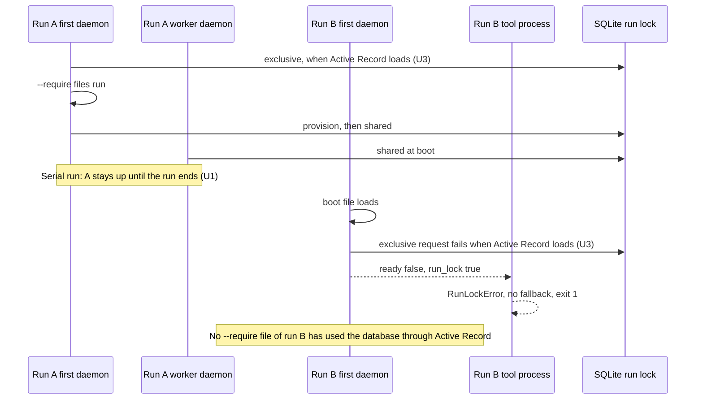

# Run lock gaps after the SQLite run lock - Plan

> **Build status (2026-11-23):** units U1, U2 and U4 are built in the pull request for #416. **U3 (the early SQLite lock) is not built.** It waits for the maintainer's answer to Open Question 1. Limit L2 below therefore stays as one limit, not L2a to L2d. One change from KTD6: a serial run without `--rails` still quits its first daemon once the worker has booted, because such a run takes no database lock.

## Goal Capsule

- **Issue:** #416 (run lock gaps after #404: in-process runs, the boot window, a failed first daemon, the `--jobs 1` respawn window, `file:` URI names).
- **Objective:** two `--rails --daemon` runs on one test database cannot both run mutants in two more cases than today, or three if the maintainer approves U3. The second run stops at once with the text users already know. A normal run on its own behaves as before.
- **Means:** keep the first daemon alive in a serial run (KTD6), give the fallback run a lock of its own (KTD5), and, only with approval, take the SQLite lock when Active Record loads (KTD1).
- **Decision per gap:**

| Gap in #416 | Decision for 1.10.0 | Unit |
|---|---|---|
| 1. In-process `--rails` runs take no lock | Leave open. Document it. | U4 |
| 2. The lock is taken after boot and `--require` files | Leave open by default. U3 fixes the `--require` half for SQLite, but it adds one new stop (limit L2d), so it needs the maintainer's yes (Open Question 1). | U3, gated |
| 3. A first daemon that fails to boot | Fix, all adapters. | U2 |
| 4. The `--jobs 1` respawn window | Fix for serial runs, all adapters. | U1 |
| 5. `file:` URI SQLite names | Already closed by pull request #461 (issue #412, shipped in 1.9.0). No code. | U4 |

- **Authority:** this plan, then `AGENTS.md`, then the issue text.
- **Stop and ask when:** a change would alter a verdict, a score, an exit code or a message of a normal run on its own. Also stop when a lock step would wait instead of failing at once. A fallback run is the stated exception (R3).
- **Execution profile:** one pull request, one commit per gap. Default: three commits in the order U1, U2, U4. With a yes to Open Question 1: four commits in the order U1, U2, U3, U4. Labels: `enhancement`, `priority: low`, `risk: medium`, `v1.10.0`. Body: `Refs #416`, not `Closes #416`, because limits stay open.
- **Model and effort for the build:** one tier below the strongest Claude model in the session list, effort `high`. The plan is complete and every changed path has a local test, but a lock mistake stops daemon runs.
- **Size:** small by default (two `lib/` files, four test files, one docs page, `CHANGELOG.md`). Medium with U3 (four `lib/` files, six test files).
- **Release and semver:** fix class, in the 1.10.0 batch. No GitHub Action default changes. No agent tags or publishes a release.

---

## Product Contract

### Summary

A serial run keeps its first daemon alive until the run ends, so the lock is never free while the worker daemon respawns. A run whose first daemon did not boot takes the lock alone in its one worker daemon. With approval, the first daemon of a SQLite run also takes the exclusive lock at the moment the app loads Active Record, so a second run stops before its `--require` files can write through Active Record. Every stop exits 1 and contains the existing text `another Mutineer run is using <base>`.

### Problem Frame

The run lock came with #404 for SQLite and already existed for PostgreSQL and MySQL. Three cases still let two runs touch one test database.

1. **The serial respawn window.** `DaemonBackend.run_serial` quits the prepare daemon once the worker daemon has booted (`lib/mutineer/daemon_backend.rb`). If that worker crashes, `DaemonClient#restart!` boots a new one. No process holds the lock until the new daemon has booted. A second run can take the exclusive lock in that window, and then both runs share worker databases.
2. **A failed first daemon.** `DaemonBackend.prepare_run` rescues `DaemonBootError`, warns, and returns no prepare daemon. The run then starts one worker daemon with `db_role` `worker`. That daemon takes only the shared lock, and nothing copies the worker database. Two such runs both get the shared lock. On PostgreSQL and MySQL the run also uses an old worker database, or none.
3. **The boot window.** `DaemonServer.boot!` requires the boot file, then every `--require` file, then calls `setup_worker_db` (`lib/mutineer/daemon_server.rb`). The first daemon takes its lock only on the later `provision` command. So a second run loads its `--require` files while the first run holds the lock. Those files often write seed rows (the fixture `test/fixtures/rails_app/test/support/seed_setup.rb` does). SQLite workers of the first run copy the base file on a slot's first use, after each `error` or `timeout`, and on every coverage capture, so they can copy those rows. PostgreSQL and MySQL workers use databases copied once at provisioning, so they are exposed only while that copy runs.

None of these is known to have hurt a real run (#416). Each can bring back the false "the unmutated suite is not green" result from #404.

### Requirements

**No gap in a serial run (gap 4)**

- R1. A serial daemon run whose first daemon booted holds the run lock from provisioning until its last daemon exits, including while its worker daemon respawns.

**The fallback run takes a lock (gap 3)**

- R2. A `--rails` run whose first daemon did not boot takes the exclusive run lock in its one worker daemon. That daemon copies its own worker database before any mutant runs.
- R3. That run exits 1 with a line that contains `another Mutineer run is using <base>` when another run holds the lock. Two such runs cannot both run mutants. This changes a fallback run on purpose: it now locks, and on PostgreSQL and MySQL it now copies.

**Stop the second SQLite run earlier (gap 2, only with U3)**

- R4. On SQLite, when another run holds the lock, a second `--rails --daemon` run stops before any of its `--require` files can use the database through Active Record.
- R5. With U3, every stop for a held lock raises one error class and prints one line: `mutineer: RuntimeError: another Mutineer run is using <base>`. It exits 1 and prints no score. A stop in the U3 early lock prints no coverage fallback warning. A U2 fallback run still prints that warning first, because its first daemon failed before the lock (AE2).
- R6. The early request never loads Active Record itself and never changes which database the app uses. If the database config is not ready at that moment, the daemon prints one line to stderr and the run takes its lock at `provision`, as today.
- R10. When a `--require` file points Active Record at another SQLite file, the run ends with its lock on the file it routes to, as today.

**Keep working runs unchanged**

- R7. A normal run on its own keeps its verdicts, scores, exit codes and messages. It boots no extra daemon and uses no extra CPU.
- R8. Two runs that both start today on different databases still both start. U3 adds one stated exception (limit L2d). A crashed or killed run never blocks the next run.
- R9. Every lock request is non-blocking. A failed request stops the run with a message and a non-zero exit. No lock step is skipped without a line.

**Docs and tracking**

- R11. `docs/rails-setup.md` lists each open limit a user can meet, says what to do, and names #416. `CHANGELOG.md` names #416 for each limit this pull request adds or keeps.
- R12. The pull request records that gap 5 is closed by #461, and #416 holds every open limit by the time the pull request opens.

### Acceptance Examples

- AE1. **Covers R1.** Given a serial run is in its mutant phase, when its worker daemon is killed, then a probe right after the kill finds the lock held, and the run finishes with a respawn line and no lock message.
- AE2. **Covers R2, R3.** Given a holder has the shared lock, when run B uses a boot file that fails only in the coverage daemon, then run B prints the coverage fallback warning, then exits 1 with a line that contains `another Mutineer run is using` and the base name, and prints no score.
- AE3. **Covers R2.** Given no other run, when a run uses that same boot file, then its one worker daemon has the role `solo`, it copies its worker database, and the run finishes with a score and exit 0.
- AE4. **Covers R4, R5 (U3).** Given a holder has the shared lock on the SQLite fixture database, when run B has a `--require` file that inserts a row through Active Record and then writes a marker file:
  - run B exits 1 and prints `mutineer: RuntimeError: another Mutineer run is using` with the absolute base path.
  - the marker file does not exist.
  - the output has no "coverage map unavailable", no "daemon failed to boot", no "mutation score" and no "not green".
- AE5. **Covers R7.** Given no other run, `--jobs 2` verdicts equal `--jobs 1` verdicts (existing `test_strong_suite_jobs2_equals_jobs1_and_scores_100`).

### Scope Boundaries

Considered and not built:

- **A lock for in-process `--rails` runs (gap 1).** See KTD7. A report of real harm from an in-process run beside a daemon run would change this call.
- **The early lock for PostgreSQL and MySQL.** See KTD3. A report of a wrong verdict from that window on those adapters would change this call.
- **A lock before the boot file loads.** The lock name comes from the booted app's database config. A way to read that config without a boot would change this call.
- **Keeping the first daemon alive in parallel runs.** The gap needs every worker daemon down at one moment. It costs one more booted app for the whole run. A report of that case would change this call.
- **Stopping the run when the first daemon does not boot.** That removes a documented fallback (`docs/rails-setup.md`, "The first daemon does not boot"), which is a breaking change.
- **Waiting or retrying for the lock.** The second run stops at once, as today.
- **A new wording for the stop message, or a hint line.** The text is in tests and may be in user scripts. `docs/rails-setup.md` carries the recovery step. A user report that the message did not help would change this call.
- **A new output line for the `solo` role or the kept first daemon.** A normal run must print nothing new (R7). PostgreSQL and MySQL already print `provisioned 1 ... worker database(s)`.
- **A new decision line in `.expectation-fit/decisions/daemon-and-worker-databases.md`.** The tests in U2 and U3 hold the rules. No existing line becomes false.

Out of scope, tracked elsewhere (#335, #332, #337):

- Pull request #335 and issues #332, #337 (a copy for every SQLite database, mixed adapters). They are 2.0 work.

---

## Planning Contract

### Key Technical Decisions

- KTD1. **(U3) Take the SQLite lock in an Active Record load hook.** After the boot file, the daemon registers `ActiveSupport.on_load(:active_record)`. The hook runs at once when `ActiveRecord::Base` is already loaded. Otherwise it runs when the app first loads that class, which is before any query through it. Rails registers its own hook earlier, in `active_record.initialize_database`, and that hook sets the database config, so the config is ready when ours runs. Rejected: call the lock code straight after the boot file. That loads `ActiveRecord::Base` before the `--require` files, and a `--require` file that sets `DATABASE_URL` would then be ignored without a message.
- KTD2. **(U3) The early request is an extra request for the same lock, not a new lock.** It asks for the exclusive `flock` on the same open file that `provision_sqlite` uses. `provision_sqlite` then asks again on that file, which changes nothing, and moves to shared as today. Only a held lock stops the run early. Any other error in the early step prints one stderr line and is left for `provision`, which reports it with today's message (R6).
- KTD3. **SQLite only for the early lock.** A SQLite worker copies the base file many times during a run, so writes by a second run can reach it at any time. PostgreSQL and MySQL workers use databases copied once, so the exposure is the copy itself: PostgreSQL fails that copy with a message, and MySQL can copy the second run's seed rows. The fix there means reuse of a held lock session inside `provision_postgres` and `provision_mysql`, which cannot run on the build machine.
- KTD4. **(U3) One error class and one line for a held lock.** The daemon adds `"run_lock": true` to a failed `ready` reply and to a failed `provision` reply when the error is the held-lock error, wherever it was raised: the hook, a `solo` daemon, a worker daemon, or `provision`. `DaemonClient#spawn_daemon` and `DaemonClient#provision` then raise `Mutineer::RunLockError`, a subclass of `DaemonBootError`, with the daemon's text and no "daemon failed to boot under the app bundle" prefix. `DaemonBackend.prepare_run` re-raises it, as it does for `DaemonBootTimeout`. Without the flag, a lock stop in the first daemon's boot would enter the fallback of gap 3. The CLI already maps `DaemonBootError` to exit 1, so `lib/mutineer/cli.rb` does not change. The daemon decides by the message prefix, as `RailsWorkerDb.provision_wrapped?` already does. The tool decides by the flag.
- KTD5. **The fallback run uses a new role, `solo`.** The one worker daemon runs `provision(1)` at boot: exclusive lock, copy slot 0, then shared lock. Today an unknown role already provisions at boot, but with two slots. Rejected: reuse the `prepare` role and send `provision` from `run_serial`, because a respawn resends only the boot config and would then hold no lock. Rejected: stop the run, because it is a breaking change.
- KTD6. **A serial run keeps the prepare daemon until the run ends.** The change removes the early quit in `run_serial`. It covers all three adapters with no new code path. The cost is one more idle booted app in memory for the mutant phase: three processes (prepare daemon, worker daemon, mutant child) where today there are two. It uses no CPU. Rejected: a lock holder in the tool process, because the tool cannot hold a PostgreSQL or MySQL lock without the app's client.
- KTD7. **Gap 1 stays open.** One `flock` file has two modes. It cannot let two in-process runs share and also keep a daemon run out, so a fix needs a second lock file and a set order of requests, for SQLite only. On PostgreSQL and MySQL an in-process run would need a session on the maintenance database, which in-process runs never needed, and a failure there would break runs that work today. Two in-process runs behave like two `rails test` runs. The harm case (an in-process run beside a daemon run) has no report.
- KTD8. **(U3) A changed SQLite file moves the lock.** If the file at `provision` differs from the file the early request locked, or the config now has no file, `provision_sqlite` closes the first lock file (R10). Today a second path raises `ArgumentError` in `hold_sqlite_lock`. That stays for a direct second call.

### High-Level Technical Design

What each daemon role does at boot after this plan:

| `db_role` | Which daemon | When Active Record loads (SQLite only, U3) | After the `--require` files | On the `provision` command |
|---|---|---|---|---|
| `prepare` | First daemon of a run. With U1 it lives until a serial run ends. | Exclusive lock | Nothing | Copy slots, then hold shared |
| `solo` (new, U2) | The one worker of a fallback run | Exclusive lock | Copy slot 0, then hold shared | Not sent |
| `worker` | Worker daemons and their respawns | Nothing | Shared lock | Not sent |
| not set | A direct client (tests) | Exclusive lock | Copy `slots`, then hold shared | Not sent |

### Assumptions

- PostgreSQL and MySQL paths run only in the CI jobs with `DB=postgres` and `DB=mysql`. This plan changes no adapter method for those two servers.
- A `--require` file can read the daemon's boot config through `Mutineer::DaemonServer.instance_variable_get(:@cfg)`. The tests in U1 and U2 use that to log each daemon's pid and role.
- `Coverage.running?` is true in the coverage daemon before the boot file loads, and false in worker daemons (`DaemonServer.boot!` starts Coverage before the boot file). The fallback tests in U2 use that to fail only the first daemon.
- `ActiveSupport.on_load` runs a late hook at once, runs hooks in the order they were registered, and runs the block with `class_eval` on `ActiveRecord::Base` (read in the fixture bundle: activesupport 7.2 `lazy_load_hooks.rb`, activerecord 7.2 `railtie.rb`). This was read, not seen run. In U3, write the AE4 daemon test first to confirm it.

---

## Implementation Units

### U1. Gap 4: a serial run keeps the prepare daemon until the run ends

- **Goal:** the lock is never free while a serial run's worker daemon respawns.
- **Requirements:** R1, R7.
- **Dependencies:** none.
- **Files:**
  - `lib/mutineer/daemon_backend.rb`
  - `test/daemon_backend_contract_test.rb`
  - `test/daemon_worker_db_test.rb`
  - `CHANGELOG.md`
- **Approach:**
  1. In `DaemonBackend.run_serial`, keep `prepare_client` up for `--rails` runs: keep the quit after the worker boot only for a run without `--rails` (`unless config.rails`), so that run still stops it early. The `ensure` block quits both clients.
  2. Leave `DaemonBackend.run_parallel` as it is (Scope Boundaries).
  3. Update every comment in `lib/mutineer/daemon_backend.rb` that states the old lifetime:
     - the block comment above `prepare_client = nil` in `execute` ("keeps its database lock until the worker daemons have taken theirs").
     - the comment in the `ensure` of `execute` ("run_serial and run_parallel quit this client once workers hold locks").
     - the `@return` text of `prepare_run`.
     - the summary of `run_serial` ("Serial path: one daemon (worker 0)") and its `@param prepare_client` text.
     - "Only the short-lived map-building daemon starts Coverage" in `boot_config`.
  4. Add a "Fixed" entry under "Unreleased" in `CHANGELOG.md` that names #416 and states the cost from KTD6.
- **Patterns to follow:** `test_the_prepare_daemon_stays_up_until_workers_boot` and `test_a_failed_worker_boot_still_quits_the_prepare_daemon` in `test/daemon_backend_contract_test.rb`.
- **Test scenarios:**
  - Contract test (zero-dependency suite; proves the quit order for every adapter, and misses the real lock). Change the serial half of `test_the_prepare_daemon_stays_up_until_workers_boot`: the stub worker records each `request`, and the prepare daemon's quit comes after the last request. The parallel half stays as it is.
  - Contract test: a mutant request that raises still quits the prepare daemon and the worker.
  - Covers AE1. Daemon test (`rake test:daemon`, SQLite, skip when `DB` is set; proves a held lock in the window). A `--require` file appends each daemon's pid and `db_role` to a log file. Start a `--jobs 1` run with the slow-test file from `write_hold_file`. Wait for the first mutant progress line. Kill the `worker` pid with SIGKILL. A probe right after the kill finds the exclusive request busy (`sqlite_lock_exclusive_busy?`). The run then exits 0, its log has `respawning (1/3)`, and it has no "another Mutineer run".
  - PostgreSQL and MySQL have no cheap probe for the window. They rely on the contract test, because the change is in `DaemonBackend` and does not depend on the adapter.
- **Verification:** the daemon test fails on `main` (the probe finds the lock free) and passes with the change.

### U2. Gap 3: the fallback run locks alone and copies its database

- **Goal:** a run whose first daemon did not boot holds a real run lock and uses a fresh worker database.
- **Requirements:** R2, R3, R7.
- **Dependencies:** none.
- **Files:**
  - `lib/mutineer/daemon_backend.rb`
  - `lib/mutineer/daemon_server.rb`
  - `test/daemon_backend_contract_test.rb`
  - `test/daemon_worker_db_test.rb`
  - `test/daemon_postgres_test.rb`
  - `test/daemon_mysql_test.rb`
  - `docs/rails-setup.md`
  - `CHANGELOG.md`
- **Approach:**
  1. In `DaemonBackend.run_serial`, when there is no prepare client and `config.rails` is true, build the worker's boot config with `db_role: "solo"`. In every other case the role stays `worker`.
  2. In `DaemonBackend.boot_config`, add `solo` to the `@param db_role` text and to the inline comment.
  3. In `DaemonServer.setup_worker_db`, add a `"solo"` branch that provisions exactly one slot. Add the role to the method comment and to the protocol comment at the top of the file.
  4. A respawn of a `solo` daemon boots with the same config, so it takes the exclusive lock and copies again. If another run took the lock in that window, the respawn fails and the run ends with exit 1. Record this as an open limit (U4, limit L4).
  5. Without U3 the stop line of a fallback run is `mutineer: daemon failed to boot under the app bundle: RuntimeError: another Mutineer run is using <base>`. That prefix is what a worker daemon's lock stop prints today. U3 removes the prefix (KTD4).
  6. In `docs/rails-setup.md`, put the new sentence in the "Concurrent runs" row, where lock behaviour lives: a run whose first daemon does not boot takes the lock in its one worker, and that worker copies its own worker database. In the row "The first daemon does not boot, with `--rails`", add only a pointer to "Concurrent runs". Keep its sentence about `--boot` alone.
  7. Add a "Fixed" entry under "Unreleased" in `CHANGELOG.md` that names #416. It states that a fallback run on PostgreSQL and MySQL now copies its worker database, and exits 1 when that copy fails.
- **Patterns to follow:** the `else` branch of `setup_worker_db` (a direct client that provisions at boot). `test_a_failed_first_boot_keeps_one_worker_on_rails` for the stub style. `test_worker_db_load_error_log_hides_the_password` in `test/daemon_redaction_test.rb` for a zero-dependency call of `setup_worker_db` with a stubbed `RailsWorkerDb`.
- **Test scenarios:**
  - Contract test (zero-dependency suite). `run_serial` with no prepare client and `rails: true` builds its client with `db_role` `"solo"`. With `rails: false` the role is `"worker"`. With a prepare client the role is `"worker"`. Read the role from the `boot:` argument that `DaemonClient.new` receives.
  - Zero-dependency test in `test/daemon_backend_contract_test.rb`. `setup_worker_db` with `"db_role" => "solo"` and a stubbed `RailsWorkerDb` calls `provision` once with 1. On `main` the unknown role provisions 2, so this test fails there.
  - Covers AE2. Daemon test, in each of the three daemon test files. A holder has the shared lock. Run B uses a temp boot file that raises when `Coverage.running?` is true and otherwise requires the fixture's `config/environment`. Run B exits 1. Its output has "daemon coverage map unavailable" and "another Mutineer run is using" with the base name. It has no mutation score.
  - Covers AE3. Daemon test, in each of the three daemon test files. The same boot file with no holder. The run exits 0, prints the fallback warning and prints a score. Do not assert 100.0: a fallback run has no coverage map and runs every mutant against the full test set, so its score can differ from a normal run. Assert the mechanism instead. On SQLite, a `--require` file logs the daemon's `db_role` as `solo`, and a probe in the mutant phase finds the exclusive request busy. On PostgreSQL and MySQL, the output has the existing line `provisioned 1 postgres worker database(s)` or `provisioned 1 mysql worker database(s)`.
  - A `solo` respawn, in each of the three daemon test files. Kill the `solo` daemon in the mutant phase, as AE1 does for `worker`. The log has `respawning (1/3)` and no "another Mutineer run", and the run exits 0. A `solo` respawn asks for the exclusive lock, so anything its own dead daemon left behind must not hold it. If this fails only on MySQL, the cause is a mutant child that still holds the lock session for up to `OrphanGuard::POLL`. Then report it in the pull request and add it to limit L4. Do not add a retry.
  - The Coverage boot file fails before Active Record loads, so these tests still reach the fallback after U3 lands.
- **Verification:** the AE2 test fails on `main` (run B scores) and passes with the change. `test_a_failed_first_boot_keeps_one_worker_on_rails` stays green.

### U3. Gap 2: take the SQLite lock when Active Record loads (build only with a yes to Open Question 1)

- **Goal:** a second SQLite run stops before its `--require` files write through Active Record.
- **Requirements:** R4, R5, R6, R7, R8, R9, R10.
- **Dependencies:** U2 (the `solo` role must exist, so it also registers the hook). A yes to Open Question 1.
- **Files:**
  - `lib/mutineer/rails_worker_db.rb`
  - `lib/mutineer/daemon_server.rb`
  - `lib/mutineer/daemon_client.rb`
  - `lib/mutineer/daemon_backend.rb`
  - `test/rails_worker_db_test.rb`
  - `test/daemon_backend_contract_test.rb`
  - `test/daemon_client_deadline_test.rb`
  - `test/daemon_worker_db_test.rb`
  - `test/daemon_postgres_test.rb`
  - `test/daemon_mysql_test.rb`
  - `docs/rails-setup.md`
  - `CHANGELOG.md`
- **Execution note:** write the AE4 daemon test first. It confirms the hook order that this unit rests on (Assumptions).
- **Approach:**
  1. In `lib/mutineer/rails_worker_db.rb`, add `RailsWorkerDb.take_early_sqlite_run_lock!`, named like its siblings `provision_sqlite` and `prepare_sqlite_worker!`. It returns when `available?` is false, when the adapter is not SQLite, and when `sqlite_lock_base` finds no file. Otherwise it calls `hold_sqlite_lock` with `shared: false`. Its comment says that PostgreSQL and MySQL take their lock in `provision` and names #416.
  2. In `provision_sqlite`, apply KTD8: when the lock file is open for another path, or the config now has no file, close it and clear `@sqlite_lock_file` first. Update the comments of `provision_sqlite` and `hold_sqlite_lock` ("Never unlocks the file") for this one release path.
  3. Add one predicate beside `provision_wrapped?` that is true only for the held-lock error (the "another Mutineer run" prefix).
  4. Do not change `provision_postgres`, `provision_mysql`, `prepare_worker!` or `forget_lock_connection_after_fork!`.
  5. In `DaemonServer.boot!`, add one step between the boot file and the `--require` loop. It runs only with `cfg["rails"]`, a `db_role` other than `worker`, and `ActiveSupport.on_load` defined. It registers the `:active_record` hook (KTD1). ActiveSupport runs the block with `ActiveRecord::Base` as `self`, so the block must reach the daemon through a local variable or the module name, not an instance variable.
  6. The hook loads `rails_worker_db` and calls `take_early_sqlite_run_lock!`. It re-raises the held-lock error. For any other error it prints one redacted line to the daemon's stderr, `[daemon] early run lock not taken: <Class: message>`, and continues (KTD2, R6, R9).
  7. The hook does nothing once `boot!` has returned. A mutant fork or a coverage fork that loads Active Record for the first time must never ask for the lock: its request would be a second open of the lock file and would fail against its own daemon.
  8. In the `rescue` of `boot!`, and in `provision_slots`, add `"run_lock" => true` to the failed reply when the rescued error is the held-lock error (step 3). This covers the hook, a `solo` daemon, a worker daemon and `provision` (KTD4). Update the protocol comment at the top of the file (the `ready out` and `provision` lines).
  9. In `lib/mutineer/daemon_client.rb`, add `Mutineer::RunLockError < DaemonBootError`. Its comment says how it differs from `Mutineer::ConcurrentRunError`, which is about a source file, not a database. `DaemonClient#spawn_daemon` and `DaemonClient#provision` raise it when the reply has `"run_lock"`, with the reply's `error` text and no prefix.
  10. In `DaemonBackend.prepare_run` and `DaemonBackend.build_coverage_map`, re-raise `RunLockError` beside `DaemonBootTimeout`.
  11. In `docs/rails-setup.md`, extend the "Concurrent runs" row with the order for each adapter. SQLite: the lock is taken when the app loads Active Record, before a `--require` file can use the database through it. If the database config is not ready then, the daemon prints `early run lock not taken` and takes the lock later. PostgreSQL and MySQL: the lock is taken after the `--require` files (#416).
  12. Add a "Fixed" entry under "Unreleased" in `CHANGELOG.md` that names #416, the one stop line (R5) and limit L2d.
  13. Give every new method, constant and class a YARD comment.
- **Technical design:** directional only. The order inside `boot!` becomes: sweep, boot file, register the lock hook, `--require` files, `setup_worker_db`. If no `--require` file loads Active Record, the hook runs inside `setup_worker_db`, still before the copy.
- **Patterns to follow:** `provision_sqlite` and `hold_sqlite_lock` for the lock calls. `test_sqlite_provision_takes_the_lock` and `sqlite_lock_probe` for SQLite stub tests. `test_a_daemon_that_dies_before_the_handshake_is_a_boot_error` for a `spawn_daemon` stub test. `test_coverage_step_stops_on_a_boot_timeout_but_falls_back_otherwise` for the fallback table.
- **Test scenarios:**
  - Zero-dependency suite, `test/rails_worker_db_test.rb` (lock rules; misses the daemon wiring):
    - `take_early_sqlite_run_lock!` on a stubbed SQLite file config holds the exclusive lock. A probe fails both a shared and an exclusive request.
    - `provision(2)` after it in one process does not raise. A probe then gets shared and fails exclusive.
    - `take_early_sqlite_run_lock!` while another process holds shared raises `RuntimeError` with `another Mutineer run is using <base>`, and the new predicate is true for that error and false for a "could not provision" error.
    - A `:memory:` config and a memory URI take no lock and create no file.
    - With the adapter stubbed to `postgresql`, then `mysql2`, then `trilogy`, the method opens no connection and returns.
    - KTD8: lock file A early, then `provision(1)` with the config stubbed to file B. No raise. A probe finds B held shared and A free.
    - KTD8: lock file A early, then `provision(1)` with the config stubbed to `:memory:`. A probe finds A free.
    - `test_sqlite_second_path_names_both_paths` stays green: a direct second `hold_sqlite_lock` still raises.
  - Zero-dependency suite, `test/daemon_backend_contract_test.rb` and `test/daemon_client_deadline_test.rb`:
    - `spawn_daemon` with a stubbed reply `ready false`, `run_lock true` raises `RunLockError`, and its message equals the reply's `error` text.
    - `spawn_daemon` with `ready false` and no `run_lock` still raises a plain `DaemonBootError` with the "failed to boot" prefix.
    - `DaemonClient#provision` with a stubbed reply `ok false`, `run_lock true` raises `RunLockError`. Without the flag it raises a plain `DaemonBootError`, as today.
    - `prepare_run` with a client whose `start` raises `RunLockError` re-raises it. `DaemonClient.new` is called once, and stderr has no "coverage map unavailable".
    - `build_coverage_map` re-raises `RunLockError`. Add it to the table in `test_coverage_step_stops_on_a_boot_timeout_but_falls_back_otherwise`.
    - R6, the hook step with a stand-in `ActiveSupport` whose `on_load` stores the block. The stand-in later runs the block with `class_eval` on a dummy class, as ActiveSupport does, so a hook that reads a daemon instance variable fails here. Define the constant in the test and remove it after, as `test_open_maintenance_connection_forwards_service_to_the_client` does for `PG`. The step itself calls no `RailsWorkerDb` method. Running the stored block then calls `take_early_sqlite_run_lock!` once.
    - The stored block, when the lock call raises the held-lock error, re-raises it. When it raises any other `StandardError`, the block raises nothing and stderr has one `early run lock not taken` line with the redacted cause.
    - The stored block does nothing after `boot!` has returned (step 7).
    - The step registers no hook for `db_role` `worker`, and none without `cfg["rails"]`.
  - Daemon suite, `test/daemon_worker_db_test.rb` (`rake test:daemon`, SQLite, skip when `DB` is set; proves the order in a real daemon):
    - Covers AE4. A holder has the shared lock. Run B has a `--require` file that inserts a row through `ActiveRecord::Base.connection` and then writes a marker file. Run B exits 1 with `mutineer: RuntimeError: another Mutineer run is using <base>`. The marker file does not exist. The output has no "coverage map unavailable", no "daemon failed to boot" and no "not green". `run_cli` needs a `require_paths` argument for this.
    - The other hook timing. Run B uses a temp boot file that requires the fixture's `config/environment` and then names `ActiveRecord::Base`, so the class is loaded before the hook is registered. Its `--require` file writes a marker file and never touches Active Record. Run B stops as in AE4 and the marker file does not exist. Together with AE4 this covers a hook that runs at once and a hook that runs during a `--require` file.
    - A normal run on its own prints no `early run lock not taken` line (R7).
    - A fallback run beside a holder (the AE2 setup) now prints the one stop line with no "daemon failed to boot" prefix. Add that assertion to the AE2 test in each of the three daemon test files, because the flag covers a `solo` daemon on every adapter.
    - The rows written by `--require` files still reach worker databases: `test_each_worker_db_sees_rows_written_while_the_daemon_boots` and `test_worker_dbs_see_rows_written_while_the_daemon_boots` stay green.
    - Every existing lock test in the three daemon test files stays green. They assert the text `another Mutineer run is using`, which every stop still contains.
- **Verification:** the AE4 test fails on `main` (the marker file exists) and passes with the change. `bundle exec rake yard:strict` reports 100%. The `DB=postgres` and `DB=mysql` CI jobs stay green.

### U4. Gaps 1 and 5: document the limits that stay open

- **Goal:** users and the issue state exactly what the lock does not cover.
- **Requirements:** R11, R12.
- **Dependencies:** U1, U2, and U3 when it is built.
- **Files:**
  - `docs/rails-setup.md`
  - `CHANGELOG.md`
- **Approach:**
  1. In `docs/rails-setup.md`, add a short table "Run lock limits" below the "Concurrent runs" row's table. One row per limit a user can meet (L1, L2 or its parts, L3, L4), each with what to do and #416. The action is the same in each row: run one Mutineer run per test database at a time, and when a run stops with the lock message, wait for the other run to finish or stop it.
  2. In the "SQLite lock file" row, keep the sentence that names #416.
  3. In `CHANGELOG.md`, add one line that lists the open limits and names #416 for each.
  4. Put the "Limits left open" list below into the pull request body, and say that #461 closed gap 5.
  5. Limit L5 (a custom SQLite VFS) has no issue today. The comment on #416 from Open Question 6 records it. That comment must exist before the pull request opens ("Track every limitation").
  6. Check each new doc sentence against every mode: SQLite, PostgreSQL, MySQL, `--jobs 1`, `--jobs N`, the fallback run, and `--boot` without `--rails` (which takes no lock at all).
- **Test expectation:** none. Docs only. `docs/rails-setup.md` is part of the site, so run the website checks from `AGENTS.md`.
- **Verification:** `bundle exec rake site:build` and the site tests pass. No doc sentence claims a lock for in-process runs, or an early lock for PostgreSQL or MySQL.

---

## Limits left open (this list stays on #416)

- L1. **In-process `--rails` runs and `--test-command` runs take no database lock** (gap 1). All adapters. An in-process run beside a daemon run can change the rows a SQLite worker copies.
- L2. **The lock is taken after the boot file and the `--require` files** (gap 2). All adapters. A second run can write the base database before it stops. If U3 is built, replace L2 with these four:
  - L2a. **The boot file runs before the lock.** `config/environment` and initializers of a second run can write the base database before that run stops. All adapters.
  - L2b. **On PostgreSQL and MySQL, a second run's `--require` files load before its lock.** Worker databases there are copied once, so the exposure is the first run's copy: PostgreSQL fails it with "Close other sessions", and MySQL can copy the second run's seed rows.
  - L2c. **On SQLite, a `--require` file that writes the database without Active Record** (a raw driver) runs before the lock.
  - L2d. **New with U3: a run whose `--require` file points Active Record away from the SQLite file the app booted with.** That run now stops while another run holds the first file. Before, it locked only the second file. If the new target is another adapter, the run keeps its lock on the first file until it ends.
- L3. **A parallel run whose worker daemons are all down at one moment** holds no lock until one respawns (rest of gap 4).
- L4. **A fallback run (first daemon did not boot) holds no lock while its only daemon respawns.** The respawn asks for the exclusive lock, so it stops with exit 1 if another run took it. This is loud, not silent.
- L5. **A custom SQLite VFS in a `file:` URI is locked by its path.** Pull request #461 found this and filed no issue. The built-in VFS names open that path, so they are covered.
- L6. **Only the primary database is locked.** A mixed-adapter app is #337 (2.0).

Closed: gap 5 (`file:` URI names) by pull request #461, issue #412, in 1.9.0.

---

## Verification Contract

| Check | Command | Proves |
|---|---|---|
| Contract tests | `bundle exec ruby -Ilib -Itest test/daemon_backend_contract_test.rb` | Quit order (U1), `solo` role (U2), `RunLockError` path and hook step (U3) |
| Unit tests for U3 | `bundle exec ruby -Ilib -Itest test/rails_worker_db_test.rb` | Early SQLite lock, the moved lock, no connection on other adapters |
| Zero-dependency suite | `bundle exec rake test` | Nothing else broke |
| Load smoke | `ruby -Ilib -e 'require "mutineer"'` | The gem loads |
| Docs coverage | `bundle exec rake yard:strict` | Every new method, constant and class has a comment |
| Daemon tests, SQLite | `bundle exec rake test:daemon` with the fixture bundle installed | AE1 to AE5 on SQLite |
| Daemon tests, PostgreSQL and MySQL | CI jobs with `DB=postgres` and `DB=mysql` | AE2, AE3 and the `solo` respawn on both servers. Existing lock tests stay green |
| Website checks | The commands in `AGENTS.md`, "Website checks" | `docs/rails-setup.md` still builds |
| Author self-check | `.claude/skills/author-self-check/SKILL.md` before the first push | Doc sentences hold in every mode |

Run the first five checks after every commit. Each commit must be green alone.

## Definition of Done

- R1 to R3, R7 to R9, R11 and R12 hold. R4 to R6 and R10 hold when U3 is built.
- Each acceptance example in scope has its test. The new daemon tests for AE1, AE2 and AE4 fail on `main`.
- All Verification Contract checks are green on the pull request head.
- The pull request has three commits (four with U3), the labels from the Goal Capsule, and `Refs #416`.
- The pull request body holds the "Limits left open" list, and #416 holds it too.
- No spike code, debug output or abandoned attempt is left in the diff.

---

## Risks and Overlaps

- **The kill tests in U1 and U2 depend on timing.** The probe must run before the respawn finishes its boot. The fixture boot takes over a second and the probe takes about 0.1 seconds. Kill the whole process group in `ensure`, as the existing tests do.
- **A serial run holds one more booted app in memory for the mutant phase** (KTD6). A machine that is short of memory could slow down. No boot and no CPU is added.
- **The fallback run on PostgreSQL and MySQL now copies the database.** It needs the same rights and the same idle test database as a normal run. Before, it used an old copy, or it had none and scored every mutant `error`. A fallback run that finished on an old copy before can now exit 1 when the copy fails (Open Question 3).
- **U3: the load hook raises inside the app's first load of `ActiveRecord::Base`.** That happens only when another run holds the lock, and the daemon then exits.
- **U3: limit L2d is a new stop for one rare setup.** It breaks the rule "two runs that are safe today still start" in that one case. That is why U3 waits for Open Question 1.
- **U3: a first daemon now holds the exclusive SQLite lock while its `--require` files run.** Direct clients in tests and `build_coverage_map` (used only by tests) hold it until they provision or quit. They run one at a time, so they stay green. A lock message there means two clients overlap.
- **Pull requests #335 and #245 (2.0, held)** change `provision`, `setup_worker_db` and `after_fork`. Their rebase must keep the `solo` role, and with U3 the load hook and the moved lock in `provision_sqlite`.
- **Pull request #244 (the 2.0 contract)** moves a provisioning failure from exit 1 to exit 3. A lock stop is a provisioning failure and must move with it.

## Open Questions

Only the maintainer can answer these. Each has a default, so the build is not blocked.

1. **Build U3 (the early SQLite lock)?** It closes the `--require` half of gap 2 on SQLite. It also adds limit L2d, the one case where two runs that both start today no longer do. Default: no. Build U1, U2 and U4, and leave gap 2 open on #416. A yes before the build starts adds U3 as the third commit.
2. **Keep the first daemon alive for the whole serial run?** It holds one more booted app in memory during the mutant phase. Default: yes, for serial runs only (KTD6).
3. **Is the new copy in a fallback run on PostgreSQL and MySQL a fix or a breaking change?** Default: a fix, in 1.10.0. Before, such a run gave verdicts on an old copy. The other choice is to move U2 to the 2.0 line.
4. **Leave gap 1 (in-process `--rails` runs) open in 1.10.0?** Default: yes. Document it and keep it on #416 (KTD7).
5. **Leave the early lock for PostgreSQL and MySQL open?** Default: yes. The harm is smaller there, and the change has no local test (KTD3).
6. **Who updates #416?** Default: the pull request uses `Refs #416` and carries the open list. The builder posts that list as one comment on #416, with the `**Claude:**` prefix, before the pull request opens. The maintainer sets the next version label on the issue.
7. **Pull request type label: `enhancement` or `bug`?** Default: `enhancement`, as on the issue. The changelog entries go under "Fixed".
