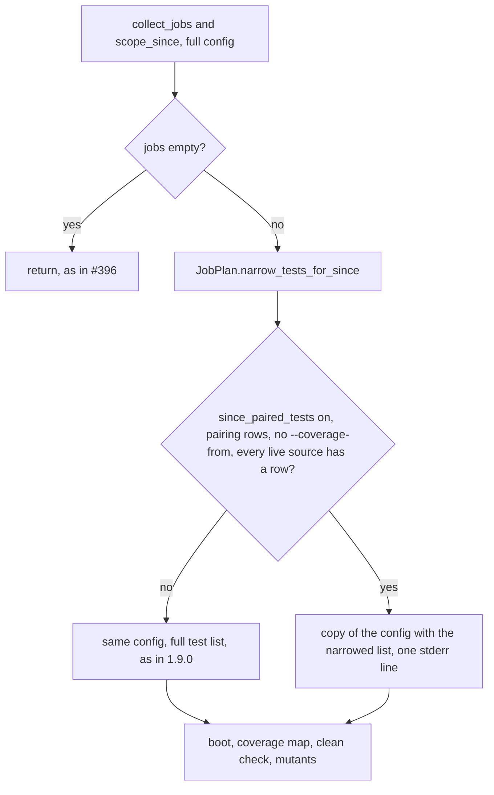
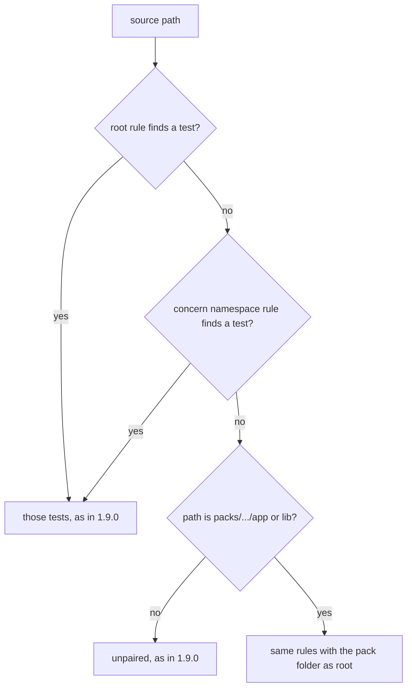

# Group F, which tests coverage capture runs (--since test scope, Packwerk pairing, #421 decision) - Plan

Suggested model and effort for the build: Opus, high. The #496 commit changes which tests a run uses, so a mistake changes verdicts.

## Goal Capsule

- **Issues:** #496 (`--since` still captures coverage for every source passed), #494 (pair sources by convention in the Packwerk layout), #421 (per-test coverage cache invalidation).
- **Objective:** a pull request check that passes whole folders with `--since` can run only the tests of the changed sources, and an app with a `packs/` folder gets its pack sources paired without a `tests:` map.
- **Means:** a new opt-in setting, `since_paired_tests`, narrows the test list of a `--since` run to the tests paired with the sources that have a mutant on a changed line (KTD1 to KTD4). One new pairing rule reads a pack folder as a small project root (KTD9). No #421 code ships (KTD12).
- **Authority:** this plan, then `AGENTS.md`, then the issue text. Where this plan differs from an issue, this plan wins (see "Corrections to the issues").
- **Stop and ask when:** a change would alter a verdict, a score or the test list of a run that does not set `since_paired_tests` and has no `packs/` folder. Also stop when a change would alter a mutant id, an exit code, a JSON key or `action.yml`.
- **Execution profile:** one pull request, two commits. Commit 1 is #496. Commit 2 is #494. #421 gets no commit. Each commit passes the local gate alone, so one issue can leave the pull request (KTD13).
- **Labels and body:** `enhancement`, `v1.10.0`, `priority: medium`, `risk: medium`. Body: `Closes #496`, `Closes #494`, `Refs #421`.
- **Size:** #496 is medium. #494 is small in code and medium with its doc copies. #421 is large and is not built here.
- **Release and semver:** minor class. Commit 1 adds a setting that is off by default, so no existing run changes. Commit 2 changes results only for an app with a `packs/` folder, and the CHANGELOG says so (R13). Review note: this reaches `@v1` Action users with a `packs/` folder with no edit by them. It changes pairing, not an Action input default, and #379 shipped a similar pairing change in a minor release with the same CHANGELOG wording. David decides (pull request "Decisions for David"). No agent tags or publishes a release.

---

## Product Contract

### Summary

Commit 1 adds `since_paired_tests` (`.mutineer.yml` key and `--since-paired-tests` flag), off by default.
With it, an in-process or `--daemon` run under `--since` uses only the test files that pair with a source that has a mutant on a changed line.
Commit 2 pairs `packs/<pack>/app/<path>.rb` with `packs/<pack>/test/<path>_test.rb`, and applies every other pairing rule inside the pack folder too.
The pack rule is tried last, so a source that pairs today keeps the same tests.
#421 stays open. The part that is left needs a spike that does not fit one night.

### Problem Frame

- **#496.** `--since` limits the mutants to changed lines. The test list is still the tests of every source on the command line. The reporter passed every pack folder with `--since HEAD~10`. The run captured 281 test files in 198 s, and the clean check failed on a test that passes alone. With only the 8 changed files as sources, the same diff ran in 105 s and killed 20 of 20 mutants. #396 (pull request #450) fixed only the run where no changed line holds a mutant.
- **#494.** `Pairing.logical_path` strips only a leading `app/` or `lib/`. For `packs/catalog/app/models/item.rb` it looks for `test/packs/catalog/app/models/item_test.rb`, and a Packwerk app has no such file. The reporter's app paired 0 of 3,592 pack mutants without a `tests:` map. A map with one entry for each pack pairs 98.6%, but each source then gets every test of its pack.
- **#421.** Pull request #465 shipped the first half in 1.9.0: a method-body edit recaptures only the tests in that source's map entries. An edit to a file outside the run's sources still recaptures every test, and the Fizzy timing check in the issue was never run.

### Key Decisions

- **`--since` narrowing is opt-in in 1.x.** The GitHub Action adds `--since` itself on a `pull_request` event (`action.yml:185-209`), its `test` input is empty by default, and with `use-bundler: false` it installs the newest gem (`action.yml:142`). A default-on change would reach `@v1` users with no edit by them. `AGENTS.md` says a behavior change to the Action's defaults is a major bump. Governs R1, R3. This is maintainer question Q1.
- **The pack rule covers `packs/` only.** Other pack roots stay with the `tests:` map. Governs R8. This is maintainer question Q2.
- **#421 leaves the 1.10.0 batch.** Governs R14. This is maintainer question Q3.

### Requirements

**`--since` test scope (#496)**

- R1. With `since_paired_tests` on and `--since` set, an in-process run and a `--daemon` run use only the test files paired with a source that has a job (a mutant on a changed line that is not suppressed). "Paired" means the convention tests plus the tests of each matching `tests:` map entry, as `CLI.convention_pairs` computes them.
- R2. With `since_paired_tests` off, which is the default, every run is the same as in 1.9.0.
- R3. With the setting on, the run still keeps the full test list in each of these cases: the user gave `--test`; `--coverage-from` is set; the run is a `--test-command` run; the run is a dry run; the config has no pairing rows (a library caller that built its own `Config`); a source with a job has no pairing row. In the first three cases the CLI prints one "has no effect" line.
- R4. The source list does not change. Every source still loads, and every source stays in the coverage cache key.
- R5. The narrowed list keeps the order of the full list.
- R6. A narrowed run prints one stderr line. It gives the test file counts and the source counts, and it says that a mutant that only another test kills shows as `survived` or `no_coverage`.
- R7. The jobs, the mutant ids, `unscoped_mutants`, the unpaired counts, the report's source list and the empty-scope early return (#396) stay as in 1.9.0, with the setting on or off.

**Packwerk pairing (#494)**

- R8. A source at `packs/<pack path>/app/<rest>.rb` or `packs/<pack path>/lib/<rest>.rb` that the existing rules pair with no test pairs with the tests those same rules find when `packs/<pack path>` is read as the project root.
- R9. A source that pairs with a test today keeps exactly those tests. A source outside `packs/` never changes. An app with no `packs/` folder gets the same result as in 1.9.0.
- R10. Every place that asks which tests pair with a source gives the pack answer: the CLI pairing, the dry run, the mutant test order, the standalone load-only lines, the cache checks, the failed-test blame and the owner digest.
- R11. A pack source with no test stays unpaired and counted in `summary.unpaired_sources` and `summary.unpaired_mutants`.
- R12. Every doc that states the pairing rule states the pack rule with full paths.
- R13. The CHANGELOG entry says that a pack source that was skipped can now run, that this can change a score or a gate, and that a `--baseline` user must refresh the baseline. It uses the wording of the #379 entry.

**#421**

- R14. This pull request holds no #421 commit and changes no cache format. #421 stays open.

### Acceptance Examples

- AE1. Covers R1, R5, R6. **Given** sources `a.rb` and `b.rb`, each with a paired test, and a diff that touches a mutable line of `a.rb` only. **When** `mutineer run lib --since HEAD --since-paired-tests` runs with no `--test`. **Then** coverage captures `a_test.rb` only, `b_test.rb` never runs, the stderr line reads "running 1 of 2 test files" and "the 1 of 2 paired sources", and `a_test.rb` kills the mutant.
- AE2. Covers R2. **Given** AE1 without the flag. **Then** both test files are captured and no narrowing line prints.
- AE3. Covers R3. **Given** AE1 with `--test test`. **Then** both test files are captured, no narrowing line prints, and one line says the setting has no effect when `--test` is given.
- AE4. Covers R1. **Given** AE1 and a `tests:` entry that maps `a.rb` to `test/integration_test.rb`. **Then** the narrowed list is `a_test.rb` and `integration_test.rb`, in the order of the full list.
- AE5. Covers R3. **Given** AE1 with `--coverage-from`. **Then** the run uses the full list, so the capture's test list still matches, and one line says the setting has no effect.
- AE6. Covers R7. **Given** the flag and a diff with no mutant on a changed line. **Then** the run returns before the boot and the coverage map, as in #396, and prints no narrowing line.
- AE7. Covers R8. **Given** `packs/catalog/app/models/item.rb` and `packs/catalog/test/models/item_test.rb`. **Then** `Pairing.infer_tests` returns `["packs/catalog/test/models/item_test.rb"]`.
- AE8. Covers R9. **Given** AE7 plus `test/packs/catalog/app/models/item_test.rb`. **Then** the result is that root file only, as in 1.9.0.
- AE9. Covers R8. The pack rule also pairs: a nested pack (`packs/a/packs/b/app/x.rb`), a grouped pack (`packs/group/a/app/x.rb`), a `lib/` source with `test/lib/`, a `spec/` file, a split test `item_price_test.rb`, a concern through its namespace path, and an `app/public/` source with `test/public/`. A longer source in the pack (`item_price.rb`) keeps its split test.
- AE10. Covers R9. These paths get the same result as in 1.9.0: `packsx/a/app/x.rb`, `app/packs/a/app/x.rb`, `packs/a/x.rb`, `lib/x.rb`, `app/models/x.rb`.
- AE11. Covers R11. **Given** `packs/billing/app/models/invoice.rb` with no test. **Then** the run skips it with the `no test found by convention` line and counts it as unpaired.

### Scope Boundaries

In scope: one new setting and the test list of in-process and `--daemon` runs under `--since`; one new pairing rule; the docs, the decision records and the CHANGELOG for both.

Out of scope:

- Any #421 code, any new key in `coverage.json`, any change to `--coverage-from` checks.
- A new JSON key or a schema version change.
- Narrowing by default. That is a 2.0 change (see "Limits left open").
- `--test-command` narrowing and narrowing of an explicit `--test` list.
- Pack roots other than `packs/`, and a `{path}` placeholder in the `tests:` map.
- Any change to `action.yml`. An Action user turns the setting on in `.mutineer.yml` or with `extra-args`.

### Corrections to the issues

- #496 asks for the narrower run with no setting. This plan makes it a setting that is off by default, because of the Action rule in "Key Decisions".
- #496 says "capture coverage only for sources that still have jobs". This plan narrows the tests and keeps the sources (KTD1). The cost is the test files, and a narrowed source list breaks a standalone run that needs its sources loaded in order.
- #494 offers a `{path}` placeholder as a second option. This plan builds the convention rule only. The `tests:` map stays as it is.
- #421 names `compute_digest` and `dependencies_match?` in `lib/mutineer/coverage_map.rb`. After pull request #511 they are in `lib/mutineer/coverage_map/skeleton_digest.rb` and `lib/mutineer/coverage_map/cache.rb`.

### Outstanding Questions (maintainer only)

None blocks the build. The builder uses the default.

- Q1. Is `--since` narrowing opt-in in 1.10.0, with the default change held for 2.0? **Default: yes, opt-in.** With the setting on, a kill can become a survivor when only a test paired with an unchanged source kills the mutant, and a `--baseline` gate on a pull request can then fail. Default-on would reach Action users on default inputs, which `AGENTS.md` treats as a major bump. If the maintainer wants it on by default in 1.10.0, the change is one default value, a CHANGELOG entry that starts with "Behavior change.", and a written waiver of that `AGENTS.md` rule.
- Q2. Does the pack rule cover only `packs/`? **Default: yes.** `engines/`, `components/` and custom `pack_paths` stay with the `tests:` map and go to the follow-up issue.
- Q3. Does #421 leave the 1.10.0 batch? **Default: yes.** The maintainer removes the `v1.10.0` label from #421 and adds the next version label. No agent creates a label.

### Sources

- Issues #496, #494, #421, #396, #398, #382, #381. Pull requests #450, #465, #462, #511.
- `docs/plans/2026-11-21-1-10-0-batch-grouping.md`, Group F and the scope rule in section 3.
- `docs/plans/2026-11-10-398-feat-coverage-cache-hit-clean-check-plan.md`, units U4 and U5 (the spike and the per-test key).
- `.expectation-fit/ways-of-working.yaml`, `.expectation-fit/decisions/coverage-and-test-selection.md`, `.expectation-fit/decisions/pairing-of-sources-and-tests.md`.
- Code read for this plan, at commit `f6f4efe6`: `lib/mutineer/runner.rb:141-160` (the #396 block), `:198-200` (standalone source requires), `:212-243` (the two `CoverageMap.new` calls); `lib/mutineer/daemon_backend.rb:55-64` and `:537-566`; `lib/mutineer/cli.rb:509-548` (`validate!`), `:682-689` (`warn_unused_settings`), `:773-788` (`convention_pairs`), `:879-899` (`prepare_test_map!`) and `:916-939` (`autopair!`); `lib/mutineer/config.rb:44-78` (`CONFIG_OPTIONS`) and `:106-155`; `lib/mutineer/job_plan.rb:903-906` (`unpaired_path`) and `:924` (`scope_since`); `lib/mutineer/pairing.rb:38-72` (`expand_sources`), `:416-426` (`infer_tests`) and `:482-491` (`logical_path`); `lib/mutineer/coverage_map/failed_test_blame.rb:28-63` and `:128-138`; `lib/mutineer/coverage_map/skeleton_digest.rb:236-252` and `:289-330`; `lib/mutineer/coverage_map/cache.rb:98-141` and `:316-334`; `lib/mutineer/coverage_map/capture_reuse.rb:168-175`; `lib/mutineer/coverage_map/recording.rb:136-153`; `action.yml:20-36`, `:142` and `:171-211`.

---

## Planning Contract

### Key Technical Decisions

- KTD1. **Narrow the tests, keep the sources.** A standalone run requires every source in the parent (`lib/mutineer/runner.rb:198-200`) and in each capture child. `mutineer run lib` works today because `lib/foo.rb` sorts before `lib/foo/bar.rb` and loads it. With only `lib/foo/bar.rb` in the list, a file that names `Foo` at load raises `NameError`. The README already says a source can "be listed after the file that loads them". The 198 s in #496 is test time, so the test list is the part to narrow. Rejected: narrow both, as the workaround does.
- KTD2. **A pure helper and one method that acts.** `JobPlan.since_tests(config, jobs)` only reads and returns a list. `JobPlan.narrow_tests_for_since(config, jobs)` calls it, returns `config` itself when nothing narrows, and otherwise prints the R6 line and returns `config.dup` with the narrowed list. `Runner.execute` and `DaemonBackend.execute` each call the second method once. The caller's `Config` is not changed, so the CLI still reports the full run (R7).
- KTD3. **The pairing rows travel on the config.** `CLI.autopair!` already computes `[source, tests]` rows and drops them. It stores them in a new code-only field, `Config#tests_by_source`, next to `unpaired_sources`. Rejected: compute the pairs again in `JobPlan`. That is a second copy of the rule in `CLI.convention_pairs`, and the two copies would drift.
- KTD4. **One boolean setting, off by default.** Field `since_paired_tests`, `.mutineer.yml` key `since_paired_tests`, flag `--[no-]since-paired-tests`. It follows the `allow_empty` row in `CONFIG_OPTIONS`. Without `--since` it does nothing and prints nothing, so the key can stay in a config file that full runs also read.
- KTD5. **`--coverage-from` turns narrowing off.** A capture is accepted only when its test list equals this run's (`capture_mismatch`, the `inputs` digest). A narrowed list would turn a working reuse into exit 2. The other direction is documented and tracked: a capture that a narrowed run saved does not fit a later `--coverage-from` run.
- KTD6. **A narrowed run has its own cache key.** The test list is in `compute_digest`, so a narrowed run misses a full-run cache and saves its own map over it. This is accepted. On a full-run cache hit, the clean check still runs every test that covers any source, alone and together, so the lost hit costs about one capture pass. A second narrowed run with the same changed sources hits the narrowed cache. The docs give `--cache-dir .mutineer/since` as the way to keep both.
- KTD7. **No new JSON key.** The count is on stderr only. "Count what you exclude" is met for mutants: a mutant that loses its covering tests is `no_coverage`, which has a report count and a place in the unrun share. The narrowed test files are not mutants. The missing mark in the report is a tracked limit.
- KTD8. **One "has no effect" line for the three run kinds that never narrow.** A new `CLI.warn_unused_since_paired_tests` prints it when the setting is true, `--since` is set, and the run has `--test`, `--coverage-from` or `--test-command`. The line names the first of the three that applies, in the form of the `tests:` map line in `prepare_test_map!`: `[mutineer] <origin> has no effect when --test is given`. It does not use `warn_unused_settings`, because that method warns for any explicit value, also `false`, and with no `--since`.
- KTD9. **The pack rule is the existing rules with the pack folder as the root.** `Pairing.infer_tests` tries the root rule, then the concern namespace rule, then the pack rule. The pack rule calls `infer_tests` again with `project_root` set to the pack folder and the source path cut to its `app/...` or `lib/...` part, then puts the pack path back in front of each result. Split tests, the concern fallback, `spec/`, `test/lib/` and the longer-source rule all apply with no second copy. The inner path starts with `app/` or `lib/`, so the call cannot repeat.
- KTD10. **A pack is path text, not a disk probe.** `Pairing.pack_split` matches `\A(packs/.+?)/((?:app|lib)/.+\.rb)\z` and takes the shortest pack path. `pack_split("packs/catalog/app/models/item.rb")` returns `["packs/catalog", "app/models/item.rb"]`. The first element keeps the `packs/` prefix. It reads no `packwerk.yml` and no `packs.yml`. A source outside `packs/` can never match, so an app with no `packs/` folder cannot change (R9).
- KTD11. **The two places that rebuild pairing by hand get an added pack case.** `failed_test_blames?` gains one more "or": a failed test file that `Pairing.infer_tests` returns for a pack source blames that source. Today a failed split test inside a pack blames nothing, because `split_failed_test?` needs the `test/<base>` mirror. `ownership_paths` also lists the longer files in the other roots of the pack. Both are additions. The rules that exist today stay.
- KTD12. **#421 ships nothing in 1.10.0.** See U5 and the Appendix.
- KTD13. **Commit order: #496, then #494.** They share no code file. #496 has the higher priority label, so it goes first and can ship alone.

### High-Level Technical Design

Order of steps in an in-process `--since` run after commit 1:

Pairing order for one source after commit 2:

### How results can change

| Who | What changes | How the user sees it |
|---|---|---|
| Any run that does not set `since_paired_tests` | Nothing from commit 1. This includes a GitHub Action run on a `pull_request` event with default inputs. | Nothing. |
| A `--since` run with `since_paired_tests`, tests paired by Mutineer | A test paired only with an unchanged source no longer runs. A mutant that only such a test killed becomes `survived` or `no_coverage`. A red or flaky test of an unchanged source no longer stops the run. | The stderr line of R6. `no_coverage` counts in the report and in the unrun-share warning. The steps in `docs/ci.md` (U2). |
| A run with the setting and `--test`, `--coverage-from` or `--test-command` | Nothing. | One "has no effect" line. |
| An app with no `packs/` folder | Nothing from commit 2. | Nothing. |
| An app with `packs/`, no map, no `--test` | A pack source with a pack test now runs. `summary.total` rises and `summary.unpaired_sources` falls. A score or a `--threshold` gate can move. `--baseline` reports its survivors as new. | The `no test found by convention` line for that source is gone. The unpaired counts fall. CHANGELOG says to refresh the baseline. |
| An app with `packs/` and a `tests:` map entry for each pack | The same tests run. The pack test of a source now runs first for its mutants. In a standalone run, its load-only lines move to the paired test (#462 rule). | The cache rebuilds once. A suite that depends on test order can give a different verdict. CHANGELOG says so. |
| An app with `packs/` and `--test` | The test order of a mutant run: the pack test first. In a standalone run, the load-only lines of a pack source move to its pack test (#462 rule). | The cache rebuilds once in a standalone run. Nothing else. |

### Constraint checks

- **Seed and file order.** The seed is set once for the run and does not depend on the test list. Minitest class order and RSpec random order inside one file do not depend on the other files. The narrowed list keeps the full list's order (R5), so the combined clean check still runs "in the order given". A mutant run still orders by coverage: paired, then cheapest. A custom RSpec order that reads the whole list can change with fewer files. `docs/cli.md` already says so, and the follow-up issue lists it.
- **Unpaired sources stay counted.** `Config#unpaired_sources` is not touched, and `JobPlan.unpaired_counts` gets the caller's config (R7, R11).
- **Score model.** No new status (KTD7).
- **Zero runtime dependencies, no `eval`.** Stdlib path and array code only.
- **100% YARD.** Every new method and constant gets a doc comment: `JobPlan.since_tests`, `JobPlan.narrow_tests_for_since`, `CLI.warn_unused_since_paired_tests`, the `Config` struct comment for `tests_by_source` and `since_paired_tests`, `Pairing::PACK_SOURCE`, `Pairing.pack_split`, `Pairing.pack_tests`, `FailedTestBlame#pack_failed_test?`.
- **Least astonishment.** `since_tests` only reads and returns. `narrow_tests_for_since` prints the line, in one place, and its doc says so. `tests_by_source` is a Hash and its name says so.
- **Estimate exclusion frequency.** U1 has a measurement step with a time box.

### Risks

| Risk | Effect | Mitigation |
|---|---|---|
| A narrowed run loses a kill | A new survivor on a pull request check, for a user who turned the setting on | Opt-in, the stderr line, the `docs/ci.md` steps, the U1 measurement |
| A source spelling does not match a pairing row | A live source would lose its tests | `since_tests` compares expanded paths as `JobPlan.unpaired_path` does, and returns the full list when any live source has no row (R3) |
| `--coverage-from` meets a narrowed capture | Exit 2 with "its tests ... differ" | KTD5, one doc sentence, one test, the follow-up issue |
| A narrowed run replaces a full-run cache | The next full run captures again | KTD6, the `--cache-dir` example |
| The daemon ships a narrowed list but the full source list | None expected: `boot_config` sends both today | A contract test pins both keys |
| The pack regex takes the wrong pack path | A wrong test pairs | AE9 and AE10 as a table test over many paths, and `test_pack_split` |
| A directory source such as `packs` holds the pack test files | Each test file is listed as an unpaired source | This is the 1.9.0 behavior of `Pairing.expand_sources` for any folder that holds tests. The docs say to pass `packs/*/app`. It is in the follow-up issue. |
| Two packs hold a source with the same basename | A failed capture in one pack can mark the other as `uncapturable` | This is the 1.9.0 basename rule for sources outside `app/` and `lib/`. It is in the follow-up issue. |
| A doc copy stays stale | A review finding | The doc lists in U2 and U4, and the author self-check script |

---

## Implementation Units

### U1. #496 code and tests (commit 1)

- **Goal:** R1 to R7.
- **Dependencies:** none.
- **Files:**
  - `lib/mutineer/config.rb`:
    - One `CONFIG_OPTIONS` row: `field: :since_paired_tests, type: :bool, yaml_key: "since_paired_tests", flag: "--since-paired-tests"`. Add the field to the struct, default `false`.
    - Add `:tests_by_source` to the struct, after `:unpaired_sources`. Default `{}`. It is code only, as `unpaired_sources` is. Extend the struct comment for both fields.
  - `lib/mutineer/cli.rb`:
    - The option parser: `o.on("--[no-]since-paired-tests")`, next to `--[no-]allow-empty`. The usage text: one entry after `--since`.
    - `autopair!`: after `config.sources = paired.map(&:first)`, set `config.tests_by_source = paired.to_h`. Update the method comment.
    - New `warn_unused_since_paired_tests(config)`, called in `validate!` after `autopair!` (KTD8). Use `config.explicit?(:tests)` for the `--test` case, because `autopair!` fills `config.tests` on every run.
  - `lib/mutineer/job_plan.rb`:
    - New `JobPlan.since_tests(config, jobs)`. Return `config.tests` unless all hold: `config.since`, `config.since_paired_tests`, `config.coverage_from.nil?`, `config.tests_by_source` is not empty, `jobs` is not empty. Live sources are the unique `subject.file` of `jobs`. Match each to a `tests_by_source` key by `File.expand_path(path, config.project_root)`, as `unpaired_path` does. If one has no row, return `config.tests`. The result is `config.tests.select` over the union of the live rows, so the order is the full list's order.
    - New `JobPlan.narrow_tests_for_since(config, jobs)` (KTD2). It returns `config` when the list from `since_tests` has the size of `config.tests`.
    - The R6 line: `[mutineer] --since: running 14 of 281 test files, the ones paired with the 8 of 120 paired sources that have a mutant on a changed line. A mutant that only another test kills shows as survived or no_coverage.` For one: "running 1 of 2 test files, the ones paired with the 1 of 2 paired sources that has a mutant on a changed line." The second count of each pair is the size of `config.tests` and of `config.sources` after pairing.
  - `lib/mutineer/runner.rb`, `execute`: inside `if config.since`, after the empty-scope return, add `config = JobPlan.narrow_tests_for_since(config, since_jobs)`. Everything below (the load roots at `:212` and `:232`, both `CoverageMap.new` calls) then reads the narrowed list. Update the block comment.
  - `lib/mutineer/daemon_backend.rb`, `execute`: the same line after `scope_since`, before `abs_tests` is built. `boot_config` then sends the narrowed `tests` and the full `sources`.
  - `Runner.execute_external`: no change (R3).
- **Tests:**
  - `test/since_test_scope_test.rb` (new).
    - A table test of `JobPlan.since_tests` with three sources and four tests, one of them mapped to two sources. Cases: one live source; two live sources (order of the full list); every source live; `subject.file` absolute and relative; setting off; no `since`; empty `tests_by_source`; `coverage_from` set; a live source with no row; empty `jobs`. Compare lists with `==`. This is the "test the rule" check.
    - A table test of the R6 line for one and for many.
    - A real run in a temporary git repository, built like `with_repo` in `test/since_empty_run_test.rb`. This is the minimal repro of #496, kept inline as that file keeps the #396 repro. Two sources, two tests, each test writes a marker file when it loads. One changed line in the first source. Run `Runner.execute` for standalone and boot shapes, with `reload` and `redefine`. Assert: the second test's marker does not exist; the mutant is killed and the map names the first test for its line; the stderr line holds "running 1 of 2 test files". This asserts the mechanism, not only "killed".
    - The same run a second time: the narrowed cache hits, and no capture runs for the first test (KTD6).
    - The same run with the setting off: both markers exist and no line prints (AE2).
  - `test/cli_test.rb`:
    - `test_autopair_records_tests_by_source`, with one convention pair and one `tests:` map entry (AE4).
    - End to end on the `autopair` fixture in a temporary git repository: `--since HEAD --since-paired-tests` prints the line; without the flag it does not; with `--test test` it prints the "has no effect" line and not the narrowing line (AE3); with `--coverage-from` the same (AE5); with `--dry-run` nothing prints and the listing is the 1.9.0 listing.
    - The `.mutineer.yml` key works, and `--no-since-paired-tests` beats it.
    - The "has no effect" line also prints for `--test-command`. It does not print for `since_paired_tests: false` or for a run with no `--since`.
  - `test/daemon_backend_contract_test.rb`: `test_since_paired_tests_narrows_the_tests_sent_to_the_daemon`. Stub `DaemonClient.new`, capture `boot:`, and assert that `boot[:tests]` is the narrowed list and `boot[:sources]` is every source.
  - `test/runner_external_test.rb`: `test_since_paired_tests_keeps_every_test_for_test_command`. It pins R3, so a later change is a decision.
  - `test/config_test.rb`: add `since_paired_tests: [false, true]` to the layer samples at `:734`. `tests_by_source` defaults to `{}` and is not in `KNOWN_KEYS`.
- **Measurement (time box: 30 minutes).** On this repository, take the last three merged pull requests that changed `lib/`. For each, run `mutineer run lib --since <its base>` with and without `--since-paired-tests`, with a separate `--cache-dir` for each run. Record how many mutants move from `killed` to `survived` or `no_coverage`. Put the three numbers in the pull request body and in the CHANGELOG entry. If the time box ends first, write what ran and add "no measured rate of lost kills" to the follow-up issue.
- **Verification:** `bundle exec rake test`, then `bundle exec rake test:daemon`.

### U2. #496 docs, decision record and CHANGELOG (commit 1)

- **Goal:** R6, a path from a new survivor to its cause, and no stale doc copy.
- **Dependencies:** U1.
- **Files and sentences:**
  - `CHANGELOG.md`, `[Unreleased]`, `### Added`: "**`since_paired_tests` runs only the tests of the changed sources under `--since` (#496).**" One sentence per line, as in the #379 entry. Order: how to turn it on; what narrows and for which runs; that it is off by default and no run changes without it; the kill that can be lost and what the user then does; the three run kinds where it has no effect; the cache note with `--cache-dir .mutineer/since`; the measured numbers; both follow-up issue numbers.
  - `docs/cli.md`: one row in the flag table after `--since` (line 13); one row in the config key table after `since` (line 102); in "Extra tests for a source", qualify "An entry adds its tests to the whole run when the run holds one of its sources" for a narrowed run; the cache paragraph (KTD6 and KTD5); the `--coverage-from` bullet.
  - `docs/ci.md`, "Changed code only": the setting, an Action example (`since_paired_tests: true` in `.mutineer.yml`, or `extra-args: "--since-paired-tests"`), the `--cache-dir .mutineer/since` example, and a short part named "A survivor that appears only with `since_paired_tests`". Its steps: find the `--since:` line in the log; run the same command without the setting; if the mutant is killed there, a test paired with another source kills it, so add that test to the `tests:` map for the changed source. It also says that a baseline refresh does not apply, because a `--since` report cannot be a baseline.
  - Before writing the Action example, check in `action.yml:276-320` and with `test/action_harness_test.rb` that the cache step follows a `--cache-dir` in `extra-args`. If it does not, leave the Action cache example out and add the gap to the follow-up issue.
  - `README.md`: the flag table and the config key list. `STABILITY.md`: add the key to the list at lines 46 to 49, and "`since_paired_tests` is new in 1.10.0. An older version warns that the key is unknown and ignores it."
  - `docs/rails.md` and `docs/rails.html` (twin), near lines 36 to 39. `docs/agentic-coding.md` and `docs/agentic-coding.html` (twin), near line 67. One sentence each, or no change if the text does not state which tests run. Say which in the self-check receipt.
  - `.expectation-fit/decisions/coverage-and-test-selection.md`: one new line. "When documenting or reviewing `since_paired_tests`, state that it is off by default, that it applies to in-process and `--daemon` runs under `--since` whose tests Mutineer paired, that `--test`, `--coverage-from`, `--test-command` and a dry run keep the full list, and that the source list is not narrowed (`JobPlan.since_tests`)."
  - Each doc states the mode (in-process and `--daemon`) and the cases that do not narrow. A sentence that holds only in the common case is the most frequent review finding here.
- **Follow-up issues to file before the push.** The builder files them and cites their numbers in the CHANGELOG and `docs/cli.md`. Each body ends with the "Filed by" line the other issues use.
  - "`since_paired_tests`: limits left after #496". Labels: `enhancement`, `priority: low`, `risk: low`. Items: `--test-command` runs do not narrow; an explicit `--test` list does not narrow; a kill by a test paired with another source is not seen; the JSON report does not mark a narrowed run; a narrowed run replaces a full-run cache in the same cache folder; a capture saved by a narrowed run does not fit a later `--coverage-from` run; a custom RSpec order that reads the whole list can change with fewer files.
  - "Make `since_paired_tests` the default". Labels: `enhancement`, `v2.0`, `breaking change`. Body: the Action reason from "Key Decisions" and the measured numbers.
- **Verification:** the website checks in `AGENTS.md`, and `ruby .claude/skills/author-self-check/self_check.rb origin/main` after the commit.

### U3. #494 code, fixture and tests (commit 2)

- **Goal:** R8 to R11.
- **Dependencies:** none. It does not need U1.
- **Files:**
  - `lib/mutineer/pairing.rb`:
    - New constant `PACK_SOURCE` and new `pack_split(source_rel)`, which returns `[pack_path, inner_path]` or `nil` (KTD10).
    - New `pack_tests(source_rel, root, prefer)`: `[]` when `pack_split` is `nil`. Otherwise `infer_tests(inner, project_root: File.join(root, pack), prefer: prefer)` with `File.join(pack, test)` on each result.
    - `infer_tests`: keep the root rule and the namespace rule as they are. When both return nothing, return `pack_tests(...)`. Today the method ends with `return found unless ns` and `namespace_tests(...)`. Change only that tail.
    - Update the module header comment (the `infer_tests` job) and the `infer_tests` comment.
  - `lib/mutineer/coverage_map/failed_test_blame.rb`: `failed_test_blames?` adds `|| pack_failed_test?(source_rel)`. New private `pack_failed_test?`: false unless `Pairing.pack_split(source_rel)`. Otherwise true when a failed test file, made project-relative, is in `Pairing.infer_tests(source_rel, project_root: @project_root, prefer: @framework || "minitest")`.
  - `lib/mutineer/coverage_map/skeleton_digest.rb`, `ownership_paths`: for a pack source, also add `owner_files(File.join(root, pack), base, listings)` for the inner logical base and the inner namespace base, with the pack path put back in front. The source's own folder is already listed today, and `uniq` drops the repeat, so the digest of an existing cache changes only when a longer file sits in another root of the pack.
  - No change in `lib/mutineer/cli.rb`, `lib/mutineer/coverage_map.rb` (`order_tests`), `lib/mutineer/coverage_map/recording.rb` or `lib/mutineer/coverage_map/cache.rb`. They call `Pairing.infer_tests` and get the pack answer (R10). The tests below confirm it.
- **Fixture:** `test/fixtures/packs_layout/` with `packs/catalog/app/models/item.rb`, `packs/catalog/test/models/item_test.rb` (a test that kills every mutant, with `require_relative`, as in `test/fixtures/autopair`) and `packs/billing/app/models/invoice.rb` with no test.
- **Tests:**
  - `test/pairing_test.rb`: one table test over AE7, AE8, AE9 and AE10 with `with_tree`. Each row is a tree, a source and the expected list. Add `test_pack_split` for the regex alone: the KTD10 example pair, the nested, grouped and `app`-named packs, and the non-pack paths.
  - `test/cli_test.rb`, on a copy of the fixture:
    - `mutineer run packs/catalog/app packs/billing/app --format json --matrix`. Assert: `per_source` holds `packs/catalog/app/models/item.rb`; every test that `matrix.mutants[].killed_by` points to in `matrix.tests` is in `packs/catalog/test/models/item_test.rb`; `summary.unpaired_sources` is 1 and names the billing source; stderr has one skip line (AE11).
    - The same sources with `--dry-run`: the unpaired count is the same as in the real run (R10).
    - `mutineer run packs --format json`. First run it and read `summary.unpaired_sources`. `Pairing.expand_sources` takes every `**/*.rb`, so `packs/catalog/test/models/item_test.rb` is a source too. Assert the two unpaired sources (billing and the pack test file) and two skip lines, so this 1.9.0 behavior is pinned and named.
  - `test/per_method_uncapturable_test.rb` or `test/coverage_map_test.rb`, where the blame tests live: a failed pack split test marks its pack source `uncapturable`, and does not mark a source in another directory of the pack.
  - `test/coverage_map_test.rb`: adding `packs/catalog/lib/models/item_price.rb` changes the digest of a run over `packs/catalog/app/models/item.rb`. A run over a non-pack source keeps its digest.
  - `test/coverage_map_test.rb`: `order_tests` puts the pack test first for a pack source. One standalone run with `--test`: the load-only lines of the pack source are on the pack test.
- **Verification:** `bundle exec rake test`.

### U4. #494 docs, decision record and CHANGELOG (commit 2)

- **Goal:** R12, R13.
- **Dependencies:** U3.
- **Files and sentences:**
  - `CHANGELOG.md`, `[Unreleased]`, `### Added`: "**A source in a `packs/` folder pairs with the test in its pack (#494).**" Follow the #379 entry line for line: the example paths, "Existing pairs stay the same", "Before this, the source was skipped and added no score", "That can change a score or a gate", "`--baseline` treats new survivors as new. Refresh the baseline." Then add:
    - An app with no `packs/` folder does not change.
    - An app that already maps each pack with `tests:` runs the same tests. The pack test now runs first for each mutant, and the coverage cache rebuilds once. A suite that depends on test order can give a different verdict.
    - Pass the source folders, such as `packs/*/app`. A folder that holds test files lists each test file as an unpaired source.
    - The limits and the follow-up issue number.
  - `docs/ci.md`: one new row in the pairing table, with full paths: `packs/catalog/app/models/item.rb` pairs with `packs/catalog/test/models/item_test.rb` or `packs/catalog/spec/models/item_spec.rb`, only when the rules above find no test, and with the same split, concern and longer-source rules inside the pack. One sentence below the table: pass `packs/*/app`, not `packs`.
  - `docs/cli.md`: the `--test PATH` row (line 9) and the first lines of "Extra tests for a source".
  - `README.md` lines 45 to 47, `docs/getting-started.md` line 77, `docs/rails-setup.md` lines 34 to 42, and `docs/comparison.md` line 76 if it states the mirror-path rule as the whole rule.
  - `.expectation-fit/decisions/pairing-of-sources-and-tests.md`: one new line. "When documenting or reviewing pack pairing, state that it applies only to a source at `packs/<pack path>/app/` or `packs/<pack path>/lib/`, only when the root and concern rules find no test, and that it applies the same rules with the pack folder as the root (`Pairing.pack_split`, `Pairing.pack_tests`)."
- **Follow-up issue to file before the push:** "Pack pairing: limits left after #494". Labels: `enhancement`, `priority: low`, `risk: low`. Items: pack roots other than `packs/` (`engines/`, `components/`, `pack_paths` in `packs.yml`); a `{path}` placeholder for the `tests:` map (the second option in #494); a test file under a pack's `test/` or `spec/`, reached through a directory source, is listed as an unpaired source; a `test_*.rb` file under a pack's `test/` given as a source is not flagged by `Pairing.test_given_as_source?`; the basename rule in `exact_failed_test?` can blame a same-named source in another pack.
- **Verification:** the website checks in `AGENTS.md`, and the author self-check script after the commit.

### U5. #421: no code in this pull request

- **Goal:** R14.
- **Decision:** no-go for 1.10.0. Reasons:
  - The part that is left is the executed-file key (unit U5 of the #398 plan). That plan allows it only after a spike on the fixture app and a pinned Fizzy clone, with a time box of one day. The spike has not run.
  - #421 itself records that an executed-file key misses class-body edits. A partial map that differs from a full capture gives wrong `no_coverage` and wrong survivors with no error. That is the highest-cost mistake in this area.
  - It changes the `coverage.json` format, the `--coverage-from` checks and the daemon map build. That is a wide review surface next to two other issues in one night.
  - The batch plan already rates "F with #421" as unlikely.
- **What 1.10.0 still gives the #421 use case:** with `since_paired_tests`, a `--since` run captures fewer tests, which is the common edit-loop and pull request case. It does not change the cache key design.
- **Action for the builder:** none in code. Write `Refs #421` in the pull request body with one sentence: "No #421 change. The rest of #421 waits for its spike."
- **Action for the maintainer:** Q3.

---

## Verification Contract

| Command | When | Proves |
|---|---|---|
| `bundle exec rake test` | after each commit | U1 and U3 tests, and no regression |
| `ruby -Ilib -e 'require "mutineer"'` | after each commit | load smoke |
| `bundle exec rake yard:strict` | after each commit | 100% docs, private methods and constants too |
| `bundle exec rake test:daemon` | after commit 1 | the daemon path still works with a narrowed list |
| `bundle exec rake site:build`, `node --test test/site_test.js`, `npm test --prefix test/browser` | after each commit (both change docs) | the site and its twins |
| `ruby .claude/skills/author-self-check/self_check.rb origin/main` | after each commit, before the push | untracked limits, stale doc copies, weakened tests |
| `bundle exec rake fizzy:sample` | by the maintainer before the release, not by this build | Fizzy has no `packs/` folder and the sample does not set `since_paired_tests`, so the counts must not move. A difference is a bug. |

The Minitest 6 and Prism 2 suites are not needed locally. Neither commit changes the Minitest integration or parsing. CI runs both.

---

## Definition of Done

- Commit 1 closes #496: AE1 to AE6 pass, the docs of U2 are changed, both follow-up issues exist and are cited, and the measurement is recorded or its gap is in the issue.
- Commit 2 closes #494: AE7 to AE11 pass, the docs of U4 are changed, the follow-up issue exists and is cited.
- A run that does not set `since_paired_tests` and has no `packs/` folder gives the 1.9.0 result. The existing suite proves it, with no changed expectation in an existing test.
- No file under `lib/mutineer/coverage_map/` changes in commit 1. Only `failed_test_blame.rb` and `skeleton_digest.rb` change in commit 2.
- No new JSON key or schema version. `action.yml` is unchanged.
- Each commit passes the Verification Contract alone.
- The pull request body lists the result changes from "How results can change", the three maintainer questions with the defaults that were built, and `Refs #421`.
- No spike code, no dead code and no abandoned attempt is left in the diff.

---

## Limits left open

| Limit | Tracked by |
|---|---|
| Narrowing is not the default | New issue from U2, "Make `since_paired_tests` the default" (`v2.0`) |
| A `--test-command` run under `--since` still runs every paired test for every mutant | New issue from U2, "`since_paired_tests`: limits left after #496" |
| A `--since` run with an explicit `--test` list still captures every test file | The same new issue. #421 is related: a per-test cache could choose the tests. |
| A narrowed run does not see a kill by a test paired with another source | The same new issue |
| The JSON report does not mark a narrowed run | The same new issue |
| A narrowed run replaces a full-run cache in the same cache folder | The same new issue |
| A capture saved by a narrowed run does not fit a later `--coverage-from` run | The same new issue |
| A custom RSpec order that reads the whole list can change with fewer files | The same new issue |
| Pack roots other than `packs/`, and a `{path}` placeholder in the `tests:` map | New issue from U4, "Pack pairing: limits left after #494" |
| A test file under a pack's `test/` or `spec/`, reached through a directory source, is listed as an unpaired source | The same new issue |
| A `test_*.rb` file under a pack's `test/` given as a source is not flagged | The same new issue |
| The basename rule can blame a same-named source in another pack after a failed capture | The same new issue |
| An edit to a file outside the run's sources recaptures every test, and the Fizzy timing check is not done | #421 |
| With no paired test in a standalone run, every test keeps the load-only lines | #467 |
| Test order under `--test-command` | #368 |

---

## Appendix

### What is left of #421, for its own later plan

1. Run the spike of unit U4 in `docs/plans/2026-11-10-398-feat-coverage-cache-hit-clean-check-plan.md`. It needs the fixture app, a pinned Fizzy clone, Fizzy's Ruby and network access. It merges no code.
2. Pass marks from that plan: equal maps for every edit except the known callback case, at most 25% of tests recaptured for a leaf model, at most 5% more capture time.
3. Only then build the per-test executed-file key, with the tests that plan lists.
4. The Fizzy timing check for the part that shipped in #465 needs no code. A maintainer or an agent with the Fizzy clone can measure it at any time and post the numbers on #421.

### Plan checks that ran

- The plan was written with the `ce-plan` skill. Its document review step (`ce-doc-review`) did not run.
- `fit-validate-plan` ran one round with four lenses on the first draft. That draft made narrowing the default. Lowest scores: representation fidelity 5, user-flow completeness 5, name and behavior fidelity 6. Two lenses raised the same blocking gap: default narrowing reaches GitHub Action pull request runs on default inputs. This version makes the setting opt-in and applies the other gaps (the pure helper, the `pack_split` return value, the `packs` directory source, the dry run, the survivor steps, the untracked limits, the `tests_by_source` name). The lenses did not check this version again.

### Not checked by this plan

- No code ran. The line numbers come from `main` at commit `f6f4efe6`.
- The share of real `--since` runs that lose a kill is not measured yet. U1 measures it on this repository. The only data point today is the reporter's run: 20 of 20 mutants killed with the narrowed list.
- Whether the Action cache step follows a `--cache-dir` in `extra-args` is not confirmed. U2 checks it before the doc example is written.
- Fizzy was not run.
