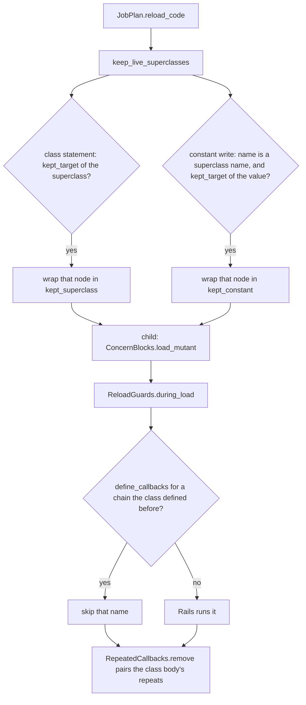

# Reload of class bodies, follow-ups (Group O) - Plan

Suggested model and effort for the build: Opus 5.5, `high`. The plan settles the design, but a wrong reload guard gives false verdicts, so the effort stays high.

## Goal Capsule

- **Issues:** #512 (a local variable set in a superclass expression), #503 (a superclass constant that the same file assigns again), #504 (a class body that calls `define_callbacks`).
- **Objective:** under `--strategy reload` and `--daemon`, a mutant in a file with one of these three shapes gets the verdict that its tests give. Today the first two shapes score every mutant `error`, and the third gives false kills and false survivors with no warning.
- **Means:** the reload text keeps the live class for the two superclass shapes (KTD1, KTD2), and stops keeping it where that gave false verdicts (KTD9). A guard stops a second `define_callbacks` from clearing a chain during the mutant load (KTD6).
- **Authority:** this plan, then `AGENTS.md`, then the issue text. Where this plan differs from an issue, this plan wins (see "Corrections to the issues").
- **Stop and ask when:** a change alters a verdict, a score or an exit code for a file that R11 says must not change. Stop when `test/integration_test.rb` (the exact-survivor oracle) fails. Stop when a unit needs a change in `lib/mutineer/daemon_server.rb` or `lib/mutineer/daemon_client.rb`. Stop when the real ActiveSupport probe in U7 gives counts other than the table in probe P4.
- **Execution profile:** one pull request, three commits, in this order: #512, #503, #504. Each commit holds its code, tests, fixtures, docs and CHANGELOG entry, and passes the local gate alone.
- **Pull request:** title `fix: reload keeps a superclass local, a superclass constant and a defined callback chain (#512, #503, #504)`. Labels `bug`, `priority: low`, `risk: medium`, `v1.10.0`. Body in What, Why, How form with `Closes #512`, `Closes #503`, `Closes #504` (see Q1).
- **Size:** medium. Seven `lib/` files (three with comment-only edits), about 120 new lines of code, the Rails fixture app, six test files, one docs page, `CHANGELOG.md`, one decision file.
- **Release and semver:** three fixes, patch class, in the v1.10.0 batch. No GitHub Action default changes. The builder does not tag, merge or publish.

---

## Build notes (pull request #541)

The build changed two decisions of this plan after review. The code, `CHANGELOG.md` and `docs/json-schema.md` describe the result.

- **KTD4 and U3 step 3 no longer hold as written.** A bare superclass (`< BaseRow` or `< ::BaseRow`) matches a bare write of that name in any scope. A path superclass (`< Billing::BaseRow`) matches only a path write spelled the same, and a path write's parent must be absent (`::BaseRow = ...`), a constant path or `self` (`Project.kept_constant_write?`).
- **KTD2 keeps fewer values.** Reload keeps a constant's value only when it is `Struct.new`, `Data.define` or `Class.new` with literal arguments (`Project.kept_builder?`). A builder method of the file or an argument that reads a constant is left as written, so the file errors visibly (#527). Keeping those values gave silent false survivors. #533 tracks the same cause in a superclass call (`class Q < build_base`).

---

## Product Contract

### Summary

Reload loads the mutant file over classes that exist.
For `class Q < (base = Struct.new(:a))`, the mutant text now wraps only the value that the local gets, so the local is still set and the class reopens.
For `BaseRow = Struct.new(:v)` followed by `class Row < BaseRow`, the mutant text keeps the value that `BaseRow` already has, so `Row` reopens with the same parent.
A method inside a kept value cannot load this way, so it is `unplaceable` under reload, which the report already counts.
A superclass that is a bare variable read is no longer wrapped, because the wrap gave false verdicts there. Such a file errors again, as in 1.9.0.
For a class body that calls `define_callbacks`, a guard skips the second call during the mutant load, so the chain keeps the callbacks of concerns and subclasses.

### Problem Frame

PR #514 fixed #492: a class whose superclass is a call reopens with its live superclass.
It left three shapes, each with an issue.

- **#512.** The #492 wrap is a block. A local that the superclass expression sets would be lost, so PR #514 leaves such a superclass unwrapped. The file then raises `TypeError: superclass mismatch`, and every mutant scores `error` (probe P3).
- **#503.** The reload assigns `BaseRow` to a new class, so `Row`'s superclass no longer matches. Every mutant of the file scores `error` (probe P1).
- **#504.** Rails' `define_callbacks` gives the class and every subclass a new empty chain. The class body adds its own callbacks again. A concern's `included` block and a subclass in another file do not run again, so their callbacks are gone (probe P4). A test that depends on such a callback fails for every mutant (false kills). A mutant in a method that only such a callback calls passes every test (false survivor). Nothing warns.

The daemon forces reload, and the 2.0 plan makes the daemon the default with `--rails`, so these files get no honest verdict there.

### Requirements

**#512: a local set in the superclass expression**

- R1. Under reload, in process and on the daemon, a mutant in a class whose superclass is a plain write of a local gets the verdict its tests give. This covers `class Q < (base = Struct.new(:a))`, the same text with no parentheses, and a chain such as `(a = b = Struct.new(:a))`.
- R2. A later line of the file that reads the local gets the live superclass, the same object as `Q.superclass`.
- R3. A superclass that sets a local in any other way is not wrapped, as today. It still errors, visibly, when its call builds a new class.
- R16. A superclass that is a bare variable read (`base = Struct.new(:a)` on an earlier line, then `class Q < base`) is not wrapped. When the earlier line builds a new class, the file errors, visibly, as in 1.9.0. Since PR #514, which is not released, such a file gets silent false verdicts (probe P10).

**#503: a superclass constant that the same file assigns**

- R4. Under reload, a mutant in the body of a class whose superclass is a constant that the same file assigns from an expression that is not a constant gets the verdict its tests give.
- R5. The constant keeps its value across the reload. An instance, a subclass or a constant in another file still points at the same class.
- R6. A method inside the kept value, such as a method in the block of `BaseRow = Struct.new(:v) do ... end`, is `unplaceable` under reload. It is counted in `summary.unplaceable`, listed in `unplaceable[]`, and has its place in the unrun share. A `:maybe` selection stays `no_coverage`. `--strategy redefine` still places it.
- R7. The marking never misses: every method inside a value that the reload text keeps is `unplaceable` under reload.

**#504: a class body that calls `define_callbacks`**

- R8. During a mutant load, a `define_callbacks` call for a chain that the class itself defined before the load does not clear the chain. This holds for a direct call and for `define_model_callbacks`. Callbacks from an included concern, from a subclass in another file and from other files stay.
- R9. The class body's own callbacks still run once where reload can pair the copies. Where it cannot, the #479 warning names the class, as for any other class.
- R10. A `define_callbacks` call for a name that is new to the class, and every call outside a mutant load, runs as Rails wrote it.

**All three**

- R11. Reload text is byte-identical to today's, with the same verdicts, score and exit code, for a file that has all of these: no class statement whose superclass sets a local or is a bare variable read, no constant assignment whose name is the last name of a class statement's superclass in that file, and no `define_callbacks` call in a class body.
- R12. No new mutant status, JSON key, CLI flag or daemon payload key. The schema stays `1.11`.
- R13. `docs/json-schema.md` names the new `unplaceable` cause. `CHANGELOG.md` has a "Fixed" entry for each issue under "Unreleased", and the two stale "Unreleased" sentences about #503, #512 and #504 are corrected in place. `.expectation-fit/decisions/reload-and-redefine-strategies.md` matches the new behaviour.
- R14. Before the pull request opens, the tracking issues T1 to T4 exist (see "Limits left open"). The CHANGELOG entries and the pull request body name them.
- R15. The CHANGELOG entry for #503 and the pull request body record how often real code has the excluded case (probe P9).

### Acceptance Examples

- AE1. **Covers R1, R2.** Given `test/fixtures/local_superclass.rb` (Appendix) and its test, when the run uses `--strategy reload`, then `errored` is 0, both mutants are `killed`, and the verdicts equal the `--strategy redefine` verdicts. The test asserts `assert_same QUAD_BASE, Quad.superclass`, so a lost or new local would fail it for every mutant.
- AE2. **Covers R3.** Given `class Q < (base ||= Struct.new(:a))`, the reload text equals the input text.
- AE3. **Covers R4.** Given `test/fixtures/const_superclass.rb` and its direct test, when the run uses `--strategy reload`, then `errored` is 0, `Row#three?` is `killed`, `Row#weak?` is `survived`, and `Ledger::Credit#zero?` is `killed`. These equal the redefine verdicts.
- AE4. **Covers R5.** Given the holders file and the subclass test, `Row#three?` is `killed` through `SpecialRow`, and `Ledger::Credit#zero?` is `survived`. The test asserts `assert_kind_of BaseRow, DEFAULT_ROW`, so a new `BaseRow` object would kill every mutant.
- AE5. **Covers R6.** In the AE3 run, `BaseRow#in_block?` is `unplaceable` under reload and `killed` under redefine.
- AE6. **Covers R8.** Given the Rails fixture model `OwnChainNote`, whose class body calls `define_callbacks :save` and whose concern adds `before_save :stamp`, and a test that checks only the callback log, when the daemon runs the mutants of `OwnChainNote#urgent?`, then every mutant is `survived` and `errored` is 0. Before the fix every mutant is `killed`, falsely.
- AE7. **Covers R8, R9, R10.** With real ActiveSupport, the callback counts before and after a reload equal the "With the guard" row of the table in probe P4.
- AE9. **Covers R16.** Given `base = Struct.new(:v)` on one line and `class LocalRow < base` on a later line, the reload text equals the input text, and a reload run scores each mutant `error` with "superclass mismatch".
- AE8. **Covers R11.** `Mutineer::JobPlan.keep_live_superclasses` returns the same String object for a file with only constant superclasses that the file does not assign.

### Corrections to the issues

1. **#512 lists two ideas: leave the file to error, or mark its mutants `unplaceable`.** PR #514 already does the first. This plan makes the common shape work (KTD1).
2. **#503's idea is right, with one limit.** It keeps the constant only when a class statement in the same file names it as a superclass. A file where the subclass is in another file is a different defect (T2).
3. **#504 proposes a warning for a count that shrank.** A warning leaves the false verdicts in the score. A guard on the second `define_callbacks` call removes the cause with less code (KTD6). See Q2.
4. **#504 names only the concern's callbacks.** Rails clears the chain of every subclass too, so a callback that a subclass in another file added is also lost (probe P4, `OwnChild` 3 to 1).

### Limits left open

Each row needs a GitHub issue before the pull request opens (R14). The builder filed them as #527 (T1), #528 (T2), #529 (T3) and #530 (T4). The builder files T1 to T4 with `gh issue create`, starts each body with `**Claude:**`, and uses existing labels only. The Appendix has the text for each.

| ID | Limit that remains | Seen by the user as | Tracked by |
|---|---|---|---|
| T1 (#527) | Rare superclass shapes still raise `superclass mismatch`: a constant set by multiple assignment (`A, B = ...`) or `const_set`, a local set by `\|\|=`, by multiple assignment, inside double parentheses, or deeper in the expression, a local write of a constant that the file assigns (`class Row < (b = BaseRow)`), and a bare variable read whose variable an earlier line sets from a call (R16) | `error`, visible | #527. No version label. |
| T2 (#528) | `Point = Struct.new(:x) do ... end` with no class statement for it in the same file: reload builds a new class, so a subclass or an instance from another file keeps the old one. A mutant in the block then survives falsely when the test goes through the subclass (probe P5). The same issue tracks the wish to place a method that is in a kept value or in a superclass call's block (#492, R6). | False survivor, silent | #528. No version label. |
| T3 (#529) | `Cell \|\|= Struct.new(:x) do ... end`: the block never runs again under reload, so its mutants survive falsely (probe P6). `X = Struct.new(...) do ... end unless defined?(X)` has the same cause (not run). | False survivor, silent | #529, label `v1.10.0` (a small fix, see Q3). |
| T4 (#530) | `reset_callbacks` in a class body clears the chain on reload, so a concern's callback is lost (probe P8). Also: a class body that adds a callback before its own `define_callbacks` call keeps that callback twice after this fix. The #479 warning names that class. | False kill or false survivor, silent for `reset_callbacks` | #530. No version label. |
| - | The six #479 cases where reload keeps both copies of a callback. A class that calls `define_callbacks` can now show them (probe P4, `OwnDoubled` 2 to 3), with the warning. | Warning on stderr | #479 (open, `v2.0`) |
| - | The JSON report does not list the classes of the #479 warning | - | #505 (Group N) |
| - | Building each class once, which removes all of the above | - | #389 (full reload, `v2.0`) |

### Scope Boundaries

- **No fix for T2, T3 or T4 in this pull request**, unless David says yes to Q3.
- **No shrink warning.** KTD6 removes the cause that #504 reports. T4 tracks the one known cause that remains.
- **No per-file switch to `redefine`.** The #492 plan rejected it for the daemon (`docs/plans/2026-11-21-492-479-fix-reload-class-bodies-plan.md`, KTD1).
- **No change to `--test-command` or `--strategy redefine`.** Neither runs a class body a second time.
- **No lexical resolution of the superclass constant.** KTD4 says why a name match is enough.

### Questions for the maintainer

None blocks the build. The builder uses the default.

- Q1. **Close #503 and #512, with one new issue (T1) for the rare shapes that still error?** Default: yes. The other choice is `Refs` on both and no T1.
- Q2. **Fix #504 with the guard (KTD6), not with the warning the issue proposes?** Default: yes. After the upgrade, a file whose class body calls `define_callbacks` can show survivors where it showed false kills, so its score can fall.
- Q3. **Fix T3 (`||=`) in this pull request as a fourth commit?** Default: no, file the issue with the `v1.10.0` label. The fix is small: mark a method inside the value of a `||=` constant assignment `unplaceable` under reload, with the flag that U3 adds. It is not one of the three issues of this group.
- Q4. **T2 has no cheap honest fix.** Keeping every class constant would make each method in a `Data.define ... do` or `Struct.new ... do` block `unplaceable` under reload and the daemon. Default: file T2 with no version label, and leave the choice between that and full reload (#389) to David.
- Q5. **Stop wrapping a superclass that is a bare variable read (R16, KTD9)?** Default: yes. This is not in the three issues. The plan check found it. It gives back the visible `error` of 1.9.0 for `base = Struct.new(:a)` then `class Q < base`, where unreleased `main` gives false survivors and false kills (probe P10). The cost: a file of that shape with no method in the value and no later read of the variable loses the real verdicts that `main` gives it today. The other choice is to keep the wrap and only track the shape in T1.
- Q6. **Build #512 at all?** Default: yes. The shape is in 0 of 1,700 files (probe P9), so "no code" is a fair choice. KTD1 is about 15 lines, and R16 belongs in the same commit.

---

## Planning Contract

### Key Technical Decisions

- KTD1. **For a plain local write, wrap the written value, not the whole superclass.** `class Q < (base = Struct.new(:a))` becomes `class Q < (base = ::Mutineer::ReloadGuards.kept_superclass(::Module.nesting.first, :Q) { Struct.new(:a) })`. The write stays outside the block, so the local is set, and its value is the live superclass. `JobPlan.kept_target(node)` returns the node to wrap: it passes through one pair of parentheses that holds one statement and through each `Prism::LocalVariableWriteNode`, then applies today's rule (not a constant, and `writes_local?` is false). It replaces `JobPlan.call_superclass?`, which has one caller. Probe P3 confirms the result. Rejected: marking the file's mutants `unplaceable`, because it gives no verdict where one is possible. Rejected: no code for #512 (see Q6).
- KTD2. **For #503, keep the constant's value. Do not keep the old parent on the class statement.** `BaseRow = Struct.new(:v)` becomes `BaseRow = ::Mutineer::ReloadGuards.kept_constant(::Module.nesting.first, :BaseRow) { Struct.new(:v) }`. `kept_constant` returns the constant's value when the scope has it and it is a `Class`. Otherwise it yields. Every object keeps pointing at one class, as in #492. Rejected: wrapping `class Row < BaseRow` with `kept_superclass`. `BaseRow` would then be a new class that `Row` does not inherit from, so a mutant in its block would not reach `Row` (a silent false survivor), and `Row.new(1).is_a?(BaseRow)` would be false (false kills). Rejected: rewriting `BaseRow = X` to `BaseRow ||= X`. With a top-level `Entry` already defined, a first load of `module Ledger; Entry ||= Data.define(:cents)` leaves `Ledger` with no `Entry` of its own. Rejected: `remove_const`, for the reasons in the #492 plan.
- KTD3. **Discovery marks by name alone. The rewrite keeps by name and by `kept_target`.** Discovery sets `Subject#in_kept_constant` for a def inside the value of `NAME = ...` or `A::NAME = ...` when a class statement in the file names `NAME` as its superclass. The rewrite keeps the same writes, less those whose value is a constant or sets a local. So discovery marks at least every value the rewrite keeps (R7). A value that discovery marks and the rewrite does not keep costs a counted `unplaceable`, never a silent verdict. Both sides read the names from one function, `Project.superclass_constant_names(program)`. `lib/mutineer/job_plan.rb` already requires `project.rb`, so the require graph gets no cycle. A test checks R7 across every fixture and shape (U3).
- KTD4. **The name match is the last segment of the constant, across the whole file.** `class Row < Billing::BaseRow` matches a write of `BaseRow` in any scope of the file. A wrong match keeps a constant that did not need it and marks the methods in its value `unplaceable`. That is counted. Resolving Ruby's lexical constant lookup from text would be more code and would still be wrong for reopened modules.
- KTD5. **A new `Subject` field, `in_kept_constant`.** `in_superclass_block` means "inside a class statement's superclass expression", and a constant's value is not that. A new keyword field on the Struct is additive. `Subject#unplaceable?("reload")` gets one more `||`.
- KTD6. **For #504, skip the repeated `define_callbacks` during the load.** A new module `ReloadGuards::CallbackRedefinition` is prepended onto `ActiveSupport::Callbacks::ClassMethods`, beside `CallbackReskipping`. While `ReloadGuards.loading?`, it drops each name that the class itself defined before the load and calls `super` with the rest. The test for "defined before the load" is that the class itself owns `_run_<name>_callbacks`, the method that `define_callbacks` writes on the calling class. The answer is read once for each class and name in a load and kept, as `enum_existed?` does, so a name that is new in this load keeps Rails' behaviour for the whole load. The key uses `name.to_sym`, as Rails does. When the method does not exist, the guard calls `super`, so an unknown Rails version behaves as today. The class body outside methods is the original text, so the options are the ones Rails already accepted. (Not so for a method that the class body calls: see the load-time risk below.) The class body's own callbacks then go through `RepeatedCallbacks`, as for a class whose parent defines the chain. Probe P4 confirms the counts. Rejected: a warning for a count that shrank. It needs a second log record and a second stderr text, and it leaves the false verdicts in the score.
- KTD9. **A superclass that is a bare variable read is not wrapped.** `kept_target` returns nil for a `Prism::LocalVariableReadNode`, `InstanceVariableReadNode`, `ClassVariableReadNode` or `GlobalVariableReadNode`. An earlier line set that variable, and that line runs again on reload. So the variable holds a new class while the wrap keeps the old parent. A mutant in the block of `base = Struct.new(:v) do ... end` then never reaches the class (false survivor), and a later read of the variable is not the superclass (false kills). Probe P10 shows both. Without the wrap, a variable that holds the same class on each load still reloads, and one that holds a new class errors, visibly. PR #514 is not released, so no released verdict changes. A method call such as `class Q < base_class` stays wrapped: nothing else holds its result.
- KTD7. **`JobPlan.keep_live_superclasses` keeps its name and gains the constant splice.** Keeping the superclass constant is part of keeping live superclasses. The walk does not enter a kept value, as it does not enter a wrapped superclass today. Nothing in a kept value runs on reload, and two splices in one range would not parse.
- KTD8. **Commit order #512, #503, #504.** #503 uses `kept_target` from #512. #504 touches only `lib/mutineer/reload_guards.rb` and tests, so it can drop out without the others (orchestrator rule 4).

### High-Level Technical Design



Directional sketches. The builder writes the final code and the YARD comments.

```ruby
# lib/mutineer/job_plan.rb
def self.kept_target(node)
  return nil if node.nil? || node.is_a?(Prism::ConstantReadNode) || node.is_a?(Prism::ConstantPathNode)
  return nil if VARIABLE_READS.any? { |type| node.is_a?(type) } # KTD9

  write = plain_local_write(node) # `base = v`, or `(base = v)` with one statement
  return kept_target(write.value) if write

  writes_local?(node) ? nil : node
end

# lib/mutineer/reload_guards.rb
def self.kept_constant(scope, name)
  scope ||= Object
  if scope.const_defined?(name, false)
    value = scope.const_get(name, false)
    return value if value.is_a?(Class)
  end
  yield
end

module CallbackRedefinition
  def define_callbacks(*names)
    return super unless ReloadGuards.loading?

    options = names.last.is_a?(Hash) ? names.pop : {}
    fresh = names.reject { |name| ReloadGuards.chain_existed?(self, name) }
    super(*fresh, options) unless fresh.empty?
  end
end
```

### Assumptions

- A mutation changes text inside a `def` only. It never adds or removes a class statement or a constant assignment, so the original text and the mutant text give the same answer to KTD3.
- The mutant text may call `::Mutineer::ReloadGuards`. Both the in-process child and the daemon have it loaded (`lib/mutineer/daemon_server.rb:8` requires `concern_blocks`, which requires `reload_guards`).
- `lib/mutineer/reload_guards.rb` runs on the app's Ruby in the daemon, which can be older than 3.4. New code there uses no syntax newer than the file already uses. `Module#method_defined?(name, false)` exists from Ruby 2.6.
- `define_callbacks` writes `_run_<name>_callbacks` on the calling class. Read in ActiveSupport 7.2.3.1 (`active_support/callbacks.rb:902-930`). KTD6 falls back to `super` where that does not hold. ActiveSupport 8.1 also writes that method from `set_callbacks` when a class gets its first callback on an empty chain (source read, not run). That does not change the result: the class body is the original text, so a `define_callbacks` call that the mutant load reaches also ran in the first load.

### Probes run for this plan

All ran on 2026-11-22 with Ruby 3.4.9 on arm64-darwin25, at commit `f6f4efe6`. P2, P3 and P4 used prototype code outside the gem. The fixtures are in the Appendix. The scripts are in a machine-local scratch folder, `/private/tmp/claude-501/-Users-davidteren-Projects-DT-mutineer/70450988-d29c-444a-8f4e-53f91d5d39c5/scratchpad/groupO`. That folder is best effort. If it is gone, nothing is blocked: this plan's requirements govern.

- P1. #503 today. `--strategy reload` on `const_superclass.rb`: 4 mutants, 4 `error`, `TypeError: superclass mismatch for class Row`. `--strategy redefine`: 3 killed, 1 survived.
- P2. #503 with the KTD2 prototype. Direct test under reload: `BaseRow#in_block?` unplaceable, `Row#three?` killed, `Row#weak?` survived, `Ledger::Credit#zero?` killed. Redefine gives killed, killed, survived, killed. Subclass and holder test under reload: unplaceable, killed, survived, survived. Redefine gives survived, killed, survived, survived.
- P3. #512. Today under reload: 2 mutants, 2 `error`, `superclass mismatch for class Quad`. Redefine: 2 killed. With the KTD1 prototype under reload: 2 killed, and `assert_same QUAD_BASE, Quad.superclass` passes.
- P4. #504 with real ActiveSupport 7.2.3.1 from the Rails fixture bundle, through `ConcernBlocks.load_mutant`. Callback counts on the chain:

  | Class | Shape | Before | After, today | After, with the guard |
  |---|---|---|---|---|
  | `OwnChain` | calls `define_callbacks :save`, a concern adds `before_save :stamp`, the body adds one block | 2 | 1 | 2 |
  | `OwnChild` | a subclass from another file with its own `before_save :child_cb` | 3 | 1 | 3 |
  | `OwnDoubled` | the concern and the body both add `before_save(&:stamp)` | 2 | 1 | 3, and the #479 log names it |
  | `OwnModel` | `define_model_callbacks :create`, a concern adds `before_create :stamp` | 2 | 1 | 2 |

  Today `OwnChain.new.save` returns `[:own]` after the reload, where it returned `[:stamp, :own]` before.
  Build note: the builder ran P4 again with the guard in the gem, on ActiveSupport 7.2.4 (the fixture bundle), 8.0.5 and 8.1.4.1. Each gave the "With the guard" row, and without the guard each gave the "After, today" row.
- P5. T2. `Point = Struct.new(:x) do def one? ... end end`, with `class SubPoint < Point` in another file and a test through `SubPoint`. Reload: survived. Redefine: killed.
- P6. T3. `Cell ||= Struct.new(:x) do def one? ... end end` with a direct test. Reload: survived. Redefine: killed.
- P7. T1. `Left, Right = Struct.new(:l), Struct.new(:r)` then `class Lefty < Left`, with the KTD2 prototype: still `error`, `superclass mismatch for class Lefty`.
- P8. T4. A class body with `reset_callbacks :save`, then a concern that adds `before_save :stamp`, then one block. `save` returns `[:stamp, :own]` before the reload and `[:own]` after.
- P9. Frequency. The #503 shape and the #512 shape each appear in 0 of 392 Ruby files in Fizzy `app/` and `lib/` (commit `f220e48`), 0 of 90 files in Mutineer `lib/`, and 0 of 1,218 files in seven Rails 7.2.3.1 gems. Fizzy calls `define_callbacks` in 2 files, both inside a concern's `included` block, which a reload does not run again. The Rails gems call `define_callbacks` or `define_model_callbacks` in 16 files. The T3 shape (`||=` of a class builder with a block) and the R16 shape (a superclass that is a local read) are each in 0 files of the three trees. `reset_callbacks` (T4) is in 0 files of Fizzy and Mutineer and in 1 file of the Rails gems.
- P10. R16. `base = Struct.new(:v) do def in_block? ... end end`, then `class LocalRow < base` with `three?`, then `LOCAL_ROW_BASE = base`. Today under reload, with a test through `LocalRow`: `in_block?` survived (false). Redefine: unplaceable. With a test that asserts `assert_same LOCAL_ROW_BASE, LocalRow.superclass`: reload kills both mutants (false). Redefine: `three?` survived.

---

## Implementation Units

Commit 1 is U1 and U2 (#512). Commit 2 is U3 to U5 (#503). Commit 3 is U6 and U7 (#504).

### U1. #512: the repro as a fixture, with failing tests

- **Goal:** the issue's repro fails in the suite before any `lib/` change.
- **Requirements:** R1, R2, R3.
- **Dependencies:** none.
- **Files:**
  - `test/fixtures/local_superclass.rb`, `test/fixtures/local_superclass_test.rb` (new, Appendix)
  - `test/call_superclass_reload_test.rb`
- **Approach:**
  1. Copy the fixtures. Add a run test with the file's `run_strategy` helper (`test/call_superclass_reload_test.rb:21-41`).
  2. Run it and confirm it fails with `superclass mismatch`. Keep the output for the pull request body.
- **Test scenarios:**
  - Covers AE1. Reload on `local_superclass.rb`: no `error`, both mutants `killed`, rows equal the redefine rows.
- **Verification:** the test fails before U2 for the stated reason.

### U2. #512: wrap the written value

- **Goal:** R1 to R3 and R16 hold on both paths.
- **Requirements:** R1, R2, R3, R16, R11, R12, R13.
- **Dependencies:** U1.
- **Files:**
  - `lib/mutineer/job_plan.rb` (`keep_live_superclasses` at lines 436-458, `call_superclass?` at 467-471, the comments at 362-367, 423-432 and 460-464)
  - `lib/mutineer/runner.rb` (the comment at lines 496-499) and `lib/mutineer/daemon_backend.rb` (the comment at 483-484): each says "a call superclass kept (#492)". Keep them true in each commit.
  - `test/fixtures/local_read_superclass.rb`, `test/fixtures/local_read_superclass_test.rb` (new, Appendix)
  - `test/call_superclass_reload_test.rb` (`test_a_superclass_that_sets_a_local_is_not_wrapped`, lines 97-111)
  - `test/daemon_backend_contract_test.rb` (beside the #492 payload test near line 378)
  - `CHANGELOG.md`, `.expectation-fit/decisions/reload-and-redefine-strategies.md`
- **Approach:**
  1. Add `JobPlan.kept_target` and its helper for a plain local write (KTD1). Remove `call_superclass?`. `grep` shows no other caller.
  2. In `keep_live_superclasses`, splice at the location of `kept_target(node.superclass)`. Keep the rule that the walk does not enter the superclass.
  3. Unwrap parentheses only when they hold exactly one statement and that statement is a `Prism::LocalVariableWriteNode`. `class X < (Struct.new(:a))` is wrapped whole, as today: `kept_superclass(...) { (Struct.new(:a)) }`.
  4. Update the existing test: `(base = Struct.new(:a))` is now wrapped at the value. `(base ||= ...)` and `(base, = ...)` stay unwrapped. Rename the test so that its name says what it checks now, and correct its comment (`test/call_superclass_reload_test.rb:94-96`).
  5. Add `VARIABLE_READS` and the KTD9 line to `kept_target`. Add the P10 fixture and a run test. Before the change, the run gives the P10 verdicts. After it, each mutant is `error`.
  6. CHANGELOG: add a "Fixed" entry (Appendix). In the #492 entry (`CHANGELOG.md:114-116`), correct the sentence that says every superclass that is not a constant is covered, and the sentence about #512. Update the decision line "Keep the Live Superclass on Reload".
- **Test scenarios:**
  - `(base = Struct.new(:a))` gives `(base = ::Mutineer::ReloadGuards.kept_superclass(::Module.nesting.first, :Q) { Struct.new(:a) })`.
  - The form with no parentheses and the chain `(a = b = Struct.new(:a))` wrap the innermost value.
  - `(base = Parent)` comes back as the same String object.
  - Covers AE2. `(base ||= Struct.new(:a))`, `(base, = Struct.new(:a))`, `((base = Struct.new(:a)))` and `(tmp = 1; Struct.new(:a))` come back as the same String object.
  - A value that sets an outer local inside a block (`x = 0` then `class R < (b = Struct.new(:a) { x = 1 })`) comes back unchanged.
  - **The rule, not the example:** for a table of at least twelve superclass texts, write `class K < S` plus a later read of each local, and run `load original; load rewritten` in a subprocess. Each text that the rewrite changed loads twice with no error and keeps its line count. Each text that it did not change is byte-identical.
  - Covers AE9. `base = Struct.new(:v)` then `class LocalRow < base` comes back as the same String object. The same holds for `@base`, `@@base` and `$base`. `class Q < base_class` (a method call) is still wrapped.
  - Covers AE9. Reload on `local_read_superclass.rb`: each mutant is `error`, and the detail names "superclass mismatch".
  - The daemon payload `"code"` for `local_superclass.rb` holds `base = ::Mutineer::ReloadGuards.kept_superclass(`.
- **Verification:** the U1 test passes. `test/integration_test.rb` stays green. Commit 1 ends here.

### U3. #503: fixtures, the helper, the mark and the rewrite

- **Goal:** R4 to R7 hold in process.
- **Requirements:** R4, R5, R6, R7, R11, R12.
- **Dependencies:** U2.
- **Files:**
  - `test/fixtures/const_superclass.rb`, `const_superclass_holders.rb`, `const_superclass_test.rb`, `const_superclass_subclass_test.rb` (new, Appendix)
  - `lib/mutineer/reload_guards.rb` (add `kept_constant` after `kept_superclass`, lines 75-97)
  - `lib/mutineer/project.rb` (`discover` at 17-27, `SubjectVisitor#initialize` near 204-234, `visit_constant_write_node` at 371-387, `visit_def_node` at 414-428)
  - `lib/mutineer/subject.rb` (the Struct at 30-32, the class comment, `unplaceable?` at 59-63 and its comment at 48-56)
  - `lib/mutineer/job_plan.rb` (`keep_live_superclasses`, the comment of `superclass_scope` at 495-505)
  - `lib/mutineer/result.rb` (the `unplaceable` comment at lines 24-34)
  - `test/call_superclass_reload_test.rb`, `test/project_test.rb`, `test/reload_guards_test.rb`, `test/daemon_backend_contract_test.rb`
- **Approach:**
  1. Tests and fixtures first. Confirm the run test fails with `superclass mismatch for class Row`.
  2. `ReloadGuards.kept_constant(scope, name)` (KTD2). Match the idiom of `kept_superclass`.
  3. `Project.superclass_constant_names(program)`: a public class method that returns the Set of the last name of each class statement's superclass, when that superclass is a `Prism::ConstantReadNode` or a `Prism::ConstantPathNode`. `discover` passes it to the visitor as a third argument with an empty default, as it passes `plain_path_calls` today.
  4. In `visit_constant_write_node`, for a `Prism::ConstantWriteNode` or a `Prism::ConstantPathWriteNode` whose name is in that Set, set `@in_kept_constant` while the node is visited, and restore it in `ensure`. The method is an alias for six node kinds, so test the node's class. It has an early `return super`, so the flag must cover both paths. `visit_def_node` passes `in_kept_constant: @in_kept_constant`.
  5. `Subject`: add the field, describe it in the class comment, and add `|| in_kept_constant == true` to the reload branch of `unplaceable?`. `Runner.run` (`lib/mutineer/runner.rb:487`) and `DaemonBackend.job_result` (`lib/mutineer/daemon_backend.rb:473`) already turn that into `unplaceable`, or `no_coverage` for a `:maybe` selection.
  6. `keep_live_superclasses`: read the names with `Project.superclass_constant_names`. For a constant write whose name is in the Set and whose `kept_target(value)` is not nil, splice `::Mutineer::ReloadGuards.kept_constant(<scope>, <name>) { ... }` at that target, and do not enter the write (KTD7). The scope is `::Module.nesting.first` for `NAME = ...`, and `superclass_scope(node.target)` for `A::NAME = ...`.
  7. Give each new method and field a YARD comment.
  8. Run one test first and record the result in the pull request body: a method that only computes the kept value (`def self.fields = [:v]` in a module, then `BaseRow = Struct.new(*Mod.fields)`), under reload and under redefine. Both strategies must give the same verdict. See the load-time risk.
- **Patterns to follow:** `ReloadGuards.kept_superclass` (`lib/mutineer/reload_guards.rb:90-97`). The `@in_superclass_block` save and restore (`lib/mutineer/project.rb:264-272`). The identity load test `test_a_namespace_constant_named_module_does_not_shadow_the_scope_lookup` in `test/call_superclass_reload_test.rb`.
- **Test scenarios:**
  - Covers AE3, AE5. Reload on `const_superclass.rb` with the direct test: no `error`. `Row#three?` is killed. `BaseRow#in_block?` is unplaceable under reload and killed under redefine. Every other row equals its redefine row.
  - Covers AE4. With the subclass test: `Row#three?` is killed and `Ledger::Credit#zero?` is survived.
  - `kept_constant` returns the live class. It yields for an undefined name, for a value that is not a `Class`, and for a name that only the top level has when the scope is a namespace. A nil scope means `Object`.
  - The rewrite gives the exact text of KTD2 for `BaseRow = Struct.new(:v)` with `class Row < BaseRow`.
  - `Billing::Base = Class.new` with `class Billing::Row < Billing::Base` uses the scope `Billing`.
  - Covers AE8. A constant write that no class statement names, a write whose value is a constant, and a `||=` write come back as the same String object.
  - `Base = (b = Struct.new(:v))` wraps the inner call, and `b` is still set after the load.
  - A class statement inside a kept value is not wrapped, and the text parses.
  - Each rewritten fixture parses and keeps its line count.
  - Load the rewritten `const_superclass.rb` twice in one process: `BaseRow` is the same object, and `Row.superclass` is `BaseRow`.
  - Discovery: `in_kept_constant` is true for `in_block?` and false for `three?`. It stays false for the `built` method of the existing test (`test/project_test.rb:1581-1589`), where no class statement names `Y`. `unplaceable?("redefine")` does not change.
  - **Covers R7, the rule:** for every fixture file and every shape text of this test file, each def that starts inside a range that `keep_live_superclasses` wrapped has `unplaceable?("reload")` true.
  - The daemon payload `"code"` for `const_superclass.rb` holds `kept_constant(::Module.nesting.first, :BaseRow)`.
- **Verification:** the zero-dependency suite is green. `test/integration_test.rb` and `test/daemon_backend_contract_test.rb` stay green.

### U4. #503: a real daemon run on the Rails fixture

- **Goal:** prove R4 and R1 through a real daemon run.
- **Requirements:** R1, R4, R12.
- **Dependencies:** U3.
- **Files:**
  - `test/fixtures/rails_app/app/models/ledger_row.rb` and `test/fixtures/rails_app/test/models/ledger_row_test.rb` (new, Appendix)
  - `test/rails_dogfood_daemon_test.rb` (beside `test_the_daemon_reloads_a_class_with_a_call_superclass`, lines 208-220)
- **Approach:**
  1. Before adding the model, search `test/` and `bin/dogfood` for code that runs or counts every file under `app/models`. A new model can change those counts.
  2. One model file holds both shapes: `LedgerRowBase = Struct.new(:cents)` with `class LedgerRow < LedgerRowBase`, and a nested class whose superclass sets a local. So this one daemon test also proves #512 on the daemon. Say so in the commit message.
  3. The model test checks both answers of each predicate.
- **Test scenarios** (`bundle exec rake test:daemon`):
  - `config_for(1, model: "ledger_row")`: `errored_count` is 0, `killed_count` is above 0, and the score is 100.0.
- **Verification:** the test fails before U3 and passes after it.

### U5. #503: docs and CHANGELOG

- **Goal:** a user can find the new `unplaceable` cause and what changed.
- **Requirements:** R13, R14, R15.
- **Dependencies:** U3.
- **Files:**
  - `docs/json-schema.md` (the `unplaceable` row at line 71, the prose at lines 137-151)
  - `CHANGELOG.md` (a new "Fixed" entry, and the #492 entry at lines 110-116)
  - `.expectation-fit/decisions/reload-and-redefine-strategies.md`
- **Approach:**
  1. `docs/json-schema.md`: add to the reload causes of `unplaceable`: a method inside the value of a constant assignment, when a class statement in the same file has a superclass whose last name is that constant's name. State that `class Row < Billing::BaseRow` matches `BaseRow = ...` in any scope of the file (KTD4). Give the example and #503. A `unplaceable[]` entry has no reason field, so this list is where a user finds the cause.
  2. CHANGELOG: the "Fixed" entry from the Appendix, with the P9 numbers and T1, T2 and T3. Rewrite the "Still not fixed" sentence of the #492 entry so that it names only what remains.
  3. Decision file: change the `Not when:` of "Keep the Live Superclass on Reload", and add the line "Keep a Superclass Constant on Reload" (Appendix).
  4. Run the website checks from `AGENTS.md`, because the site builds `docs/json-schema.md`.
- **Test expectation:** none for the prose. The website checks cover the built page.
- **Verification:** `bundle exec rake site:build` and the site tests pass. Commit 2 ends here.

### U6. #504: the guard

- **Goal:** R8 to R10 hold.
- **Requirements:** R8, R9, R10, R12.
- **Dependencies:** none. It can start after commit 2.
- **Files:**
  - `lib/mutineer/reload_guards.rb` (the module comment at lines 6-39, a new module after `CallbackReskipping` at 62-73, `during_load` at 114-127, a new `chain_existed?` beside `enum_existed?` at 1020-1023, `install!` at 1054-1061)
  - `test/reload_guards_test.rb`
- **Approach:**
  1. Tests first, with a stand-in class, as the file does for `CallbackReskipping` (`test/reload_guards_test.rb:57`).
  2. Add `ReloadGuards::CallbackRedefinition` (KTD6) and `ReloadGuards.chain_existed?(klass, name)`. Reset its per-load hash in `during_load`, where `@enums_before_load` is reset.
  3. In `install!`, prepend it onto `::ActiveSupport::Callbacks::ClassMethods` with `prepend_once`, after the `callbacks_loaded?` check.
  4. Add `define_callbacks` to the module comment as the third macro that a second run would break.
- **Test scenarios:**
  - Outside a load, the stand-in's `define_callbacks` runs with every name and the options.
  - During a load, a name whose `_run_<name>_callbacks` the class itself owns is dropped, and `super` does not run when no name is left.
  - During a load, a name that is new to the class reaches `super` with the options. With one old and one new name, only the new one reaches `super`.
  - A subclass that inherited the method and never defined the chain itself reaches `super`.
  - A name that is new in this load reaches `super` on a second call in the same load too, because the answer is read once.
  - A class with no `_run_<name>_callbacks` method reaches `super`.
- **Verification:** the zero-dependency suite is green.

### U7. #504: real ActiveSupport, the daemon run, docs

- **Goal:** prove R8 with Rails' own chain, and record the change.
- **Requirements:** R8, R9, R13, R14.
- **Dependencies:** U6.
- **Files:**
  - `test/support/rails_callback_restore_probe.rb`, `test/rails_callback_restore_test.rb`
  - `test/fixtures/rails_app/app/models/own_chain_note.rb`, `test/fixtures/rails_app/app/models/concerns/own_stamps.rb`, `test/fixtures/rails_app/test/models/own_chain_note_test.rb` (new, Appendix)
  - `test/rails_dogfood_daemon_test.rb`
  - `CHANGELOG.md` (a new "Fixed" entry, and the #479 "Added" entry at line 17)
  - `.expectation-fit/decisions/reload-and-redefine-strategies.md`
- **Approach:**
  1. Extend the probe with the four P4 classes. It writes the class text to a temporary file, loads it, defines the subclass, and calls `Mutineer::ConcernBlocks.load_mutant`. It prints the counts and the `save` logs before and after.
  2. Add the fixture model, concern and test. The test asserts the callback log and calls `urgent?` with no assertion, so each mutant must survive (the pattern of `test_the_daemon_runs_each_validator_and_block_callback_once`).
  3. Confirm the daemon test fails before U6: every mutant is killed.
  4. CHANGELOG: the "Fixed" entry from the Appendix, with T4. In the #479 "Added" entry, replace the last sentence, which says that such a class can lose a concern's callback (#504).
  5. Decision file: add "Keep a Defined Callback Chain on Reload" (Appendix).
- **Test scenarios** (`bundle exec rake test:daemon`):
  - Covers AE7. The probe's counts equal the "With the guard" row of P4, and `OwnChain`'s log after the reload is `["stamp", "own"]`. `OwnDoubled` is in the growth log.
  - Covers AE6. `config_for(1, model: "own_chain_note")` with `config.only = "OwnChainNote#urgent?"`: `errored_count` is 0, `survived_count` equals `total`, and `extras[:callback_growth]` is empty. The `only` filter keeps out the mutants of `stamp`, `log` and `save`, which the log assertion kills for a true reason.
- **Verification:** `bundle exec rake test:daemon` is green. Commit 3 ends here.

---

## Verification Contract

| Check | Command | Proves |
|---|---|---|
| The reload tests | `LANG=en_US.UTF-8 LC_ALL=en_US.UTF-8 bundle exec ruby -Ilib -Itest test/call_superclass_reload_test.rb` | AE1 to AE5, AE8, R7 |
| The guard tests | `LANG=en_US.UTF-8 LC_ALL=en_US.UTF-8 bundle exec ruby -Ilib -Itest test/reload_guards_test.rb` | `kept_constant`, the `define_callbacks` guard |
| Zero-dependency suite | `bundle exec rake test` | R11, and nothing else broke |
| Prism 2 suite | `bundle install`, then `BUNDLE_GEMFILE=gemfiles/prism2.gemfile bundle install`, then `MUTINEER_REQUIRE_PRISM_ERRORS=1 BUNDLE_GEMFILE=gemfiles/prism2.gemfile bundle exec rake test` | The new Prism node use (`ConstantWriteNode`, `ConstantPathWriteNode`, `LocalVariableWriteNode`, `ParenthesesNode`) works on Prism 2 |
| Load smoke | `ruby -Ilib -e 'require "mutineer"'` | The gem loads |
| Docs coverage | `bundle exec rake yard:strict` | Each new method, module, field and constant has a comment |
| Daemon tests | `bundle exec rake test:daemon` with the fixture bundle installed | AE6, AE7, U4 |
| Website checks | The commands in `AGENTS.md`, "Website checks" | `docs/json-schema.md` still builds |
| Author self-check | `.claude/skills/author-self-check/SKILL.md` before the first push | Stale doc copies, sentences that hold only in the common case |

On each of the three commits, run the first six rows. Run the daemon tests on commits 2 and 3. Run every row on the pull request head.

## Definition of Done

- R1 to R15 hold, and each acceptance example has its test.
- Each check of the Verification Contract is green on the pull request head.
- The pull request has three commits in the order #512, #503, #504, the labels of the Goal Capsule, and `Closes` or `Refs` as Q1 decides.
- T1 to T4 exist on GitHub. The CHANGELOG and the pull request body name them by number.
- The pull request body states the defaults taken for Q1 to Q6, the P9 numbers, and the effect on a run after the upgrade (see Risks).
- `STATUS.md` is in no commit. `lib/mutineer/version.rb` does not change.
- No prototype code, debug output or abandoned attempt is left in the diff.

---

## Risks and Overlaps

- **Verdicts change for the three shapes, by design.** For #512 and #503, `errored` falls and `killed`, `survived` and `unplaceable` rise, so a score and a `--threshold` result can move either way. For #504, false kills become survivors, so a score can fall. Each CHANGELOG entry says so.
- **A wrong guard is worse than no guard.** If `CallbackRedefinition` skipped a call it should run, a class would keep a stale chain. The test for "defined before the load" is exact for the Rails read in probe P4, and it falls back to `super`. U7 checks it against real ActiveSupport.
- **A class body that adds a callback before its own `define_callbacks`.** With the guard, that callback is added to the kept chain a second time. The count grows, so the #479 warning names the class. No known code does this.
- **A mutated method that only computes the kept value or the `define_callbacks` options.** The kept value does not see the mutant. This is load-time code, which no strategy but `--test-command` runs again. In a coverage-guided run, a survivor whose line ran only at load is `ran_at_load`, and a line that no test runs is `no_coverage`. A run with no coverage map scores it `survived`, as `--strategy redefine` does for the same method. U3 step 8 records the verdicts. Group R (#507, #467) and #389 own load-time code. Changed in the PR review (2026-11-23): a method that calls `define_callbacks` itself is not covered by this risk. The guard drops the options it passes, and coverage can tie its line to a test, so it scored `survived` unapplied. Discovery now marks it `unplaceable` under reload (`Subject#calls_define_callbacks`). A method that only computes the options stays here (#530).
- **The guard is proven on ActiveSupport 7.2.3.1 only.** (Build note: the builder also ran it on 7.2.4, 8.0.5 and 8.1.4.1; see P4.) On a Rails that does not write `_run_<name>_callbacks`, the guard does nothing and #504 stays as today, with no warning. The #504 CHANGELOG entry names the tested version. `bundle exec rake fizzy:sample` (Rails 8) before the release is the second check.
- **A value with a wanted side effect on each load.** The kept constant skips it on the second run. The first run did it. The same holds for #492 today.
- **One more tree walk for each reload mutant** (`Project.superclass_constant_names`). It reuses the parse that `keep_live_superclasses` already makes. If `bundle exec rake fizzy:sample` shows a slower run before the release, fold the name collection into the existing walk.
- **Group N (#526, #505, #518)** edits `docs/json-schema.md`, `CHANGELOG.md` and the code that prints `extras[:callback_growth]`. This plan edits other lines of the two documents and does not touch that code. Expect a text-only rebase.
- **Group Q (#517, #491)** edits `lib/mutineer/daemon_server.rb` and `lib/mutineer/daemon_client.rb`. This plan touches neither.
- **Group R (#507, #467)** can edit `lib/mutineer/job_plan.rb` and `lib/mutineer/runner.rb`. This plan changes only lines 423-505 of `job_plan.rb`. Keep the names `JobPlan.reload_code` and `JobPlan.keep_live_superclasses` stable.

## Sources

- **Issues and pull requests:** #503, #512 (one comment), #504, #492, #479, #505, #389, pull request #514 (merged as `62861080`).
- **The earlier plan:** `docs/plans/2026-11-21-492-479-fix-reload-class-bodies-plan.md` (KTD1, KTD3, probes P2 and P4).
- **Where the reload text is built:** `JobPlan.reload_code` and `JobPlan.keep_live_superclasses` (`lib/mutineer/job_plan.rb:377-505`), called by `Runner.run` (`lib/mutineer/runner.rb:501`) and `DaemonBackend.job_result` (`lib/mutineer/daemon_backend.rb:485`).
- **Where the guards live:** `ReloadGuards.during_load`, `install!`, `enum_existed?` and `CallbackReskipping` in `lib/mutineer/reload_guards.rb`.
- **Where a subject becomes `unplaceable`:** `Subject#unplaceable?` (`lib/mutineer/subject.rb:59-63`).
- **Rails:** `define_callbacks` and `reset_callbacks` in `active_support/callbacks.rb` 7.2.3.1 (lines 902-930 and 812-822). `define_callbacks` sets a new chain on the class and on each descendant.
- **Rules:** `AGENTS.md` ("Score-model discipline", "Shift-left rules"), `.expectation-fit/ways-of-working.yaml`, `.expectation-fit/decisions/reload-and-redefine-strategies.md`, `wip/2026-11-22-v1.10.0-round2/ORCHESTRATOR.md`.
- **Context retrieval:** exact-name `grep` and file reads. The Augment index was not used in the planning session.

## Appendix

### Fixtures for U1 (#512)

`test/fixtures/local_superclass.rb`:

```ruby
class Quad < (base = Struct.new(:a))
  def four? = a == 4
end
QUAD_BASE = base
class Plain < base = Struct.new(:b)
  def five? = b == 5
end
PLAIN_BASE = base
```

`test/fixtures/local_superclass_test.rb` asserts, for each class, the predicate once true and once false, and `assert_same QUAD_BASE, Quad.superclass` (and the same for `Plain`).

### Fixture for R16 (U2)

`test/fixtures/local_read_superclass.rb`:

```ruby
base = Struct.new(:v) do
  def in_block? = v == 1
end
class LocalRow < base
  def three? = v == 3
end
LOCAL_ROW_BASE = base
```

`test/fixtures/local_read_superclass_test.rb` asserts both answers of `in_block?` through `LocalRow`, and calls `three?` with no assertion.

### Fixtures for U3 (#503)

`test/fixtures/const_superclass.rb`:

```ruby
BaseRow = Struct.new(:v) do
  def in_block? = v == 1
end

class Row < BaseRow
  def three? = v == 3

  def weak? = v == 4
end

module Ledger
  Entry = Data.define(:cents)

  class Credit < Entry
    def zero? = cents == 0
  end
end
```

`test/fixtures/const_superclass_holders.rb`:

```ruby
require_relative "const_superclass"
DEFAULT_ROW = Row.new(3)

class SpecialRow < Row
end
```

Pass both files as sources, so the parent loads the holders before it forks.

- Direct test (`const_superclass_test.rb`): both answers of `Row#three?`, a call of `Row#weak?` with no assertion, both answers of `BaseRow#in_block?`, both answers of `Ledger::Credit#zero?`.
- Subclass test (`const_superclass_subclass_test.rb`): both answers of `three?` through `SpecialRow`, then `assert_kind_of BaseRow, DEFAULT_ROW` and `assert_equal DEFAULT_ROW, Row.new(3)`.

### Fixture for U4 (the daemon run)

`test/fixtures/rails_app/app/models/ledger_row.rb`:

```ruby
# frozen_string_literal: true

# #503: the file assigns the constant that the class statement inherits from.
LedgerRowBase = Struct.new(:cents)

class LedgerRow < LedgerRowBase
  def zero? = cents == 0

  # #512: the superclass sets a local that a later line reads.
  class Line < (line_base = Struct.new(:count))
    def single? = count == 1
  end
  LINE_BASE = line_base
end
```

### Fixtures for U7 (#504)

`test/fixtures/rails_app/app/models/concerns/own_stamps.rb`:

```ruby
# frozen_string_literal: true

# #504: adds a callback to a chain that the including class defines itself.
module OwnStamps
  extend ActiveSupport::Concern

  included do
    before_save :stamp
  end
end
```

`test/fixtures/rails_app/app/models/own_chain_note.rb`:

```ruby
# frozen_string_literal: true

# #504: the class body defines its own chain. A reload must not clear it.
class OwnChainNote
  include ActiveSupport::Callbacks
  define_callbacks :save

  def self.before_save(*args, &block) = set_callback(:save, :before, *args, &block)

  include OwnStamps
  before_save { |note| note.log << :own }

  def log = (@log ||= [])

  def stamp = log << :stamp

  def save = run_callbacks(:save) { log }

  def urgent?(level) = level > 2
end
```

The model test asserts `assert_equal %i[stamp own], OwnChainNote.new.save` and calls `OwnChainNote.new.urgent?(3)` with no assertion.

The probe classes for `test/support/rails_callback_restore_probe.rb` are the four of P4: `OwnChain` (as above), `OwnChild < OwnChain` with `before_save :child_cb`, defined after the first load, `OwnDoubled` (a concern and the body both add `before_save(&:stamp)`), and `OwnModel` (`extend ActiveModel::Callbacks`, `define_model_callbacks :create`, a concern that adds `before_create :stamp`, one `before_create` block).

### CHANGELOG entries, as a draft

The builder checks each number against its source before the commit.

- **#512:** Reload scores a class whose superclass sets a local variable, such as `class Q < (base = Struct.new(:a))`. The mutant text keeps the live superclass and still sets the local. Before, every mutant of such a file scored `error` with "superclass mismatch". A superclass that sets a local in another way still errors (T1). A superclass that is a bare variable read (`base = Struct.new(:a)`, then `class Q < base`) errors too, as in 1.9.0, because keeping the old parent there gave false verdicts (T1).
- **#503:** Reload scores a class whose superclass is a constant that the same file assigns, such as `BaseRow = Struct.new(:v)` then `class Row < BaseRow`. The constant keeps its class, so `Row` reopens. A method inside the kept value, such as one in the block of `BaseRow = Struct.new(:v) do ... end`, is `unplaceable` under reload, because that block does not run again. `--strategy redefine` runs it. The shape is in 0 of 392 Ruby files of the Fizzy sample app. After the upgrade, `summary.errored` can fall, and `killed`, `survived` and `unplaceable` can rise, so a score can change. Still open: T1, T2, T3.
- **#504:** Reload keeps the callbacks of a class whose body calls `define_callbacks`. Before, the second call cleared the chain of the class and of each subclass, so a callback from a concern or from a subclass in another file was lost, with no warning. A test that needed it failed for every mutant, and a mutant in a method that only it called survived. Now the second call does nothing during the mutant load. Checked with ActiveSupport 7.2.3.1. After the upgrade, such a file can show survivors where it showed kills. Still open: `reset_callbacks` in a class body (T4), and the #479 cases.

### Decision lines, as a draft

- Change "Keep the Live Superclass on Reload": add that a superclass that is a plain write of a local wraps the written value (#512), and change `Not when:` to "the superclass is a constant, a bare variable read, or sets a local in another way (T1)".
- **Keep a Superclass Constant on Reload.** When a file assigns a constant from an expression that is not a constant, and a class statement in the same file has a superclass whose last name is that constant's name, wrap the value in `ReloadGuards.kept_constant`; a method inside that value is `unplaceable` under reload (`Subject#in_kept_constant`), and discovery marks by name alone, so it marks at least every value that `JobPlan.keep_live_superclasses` keeps. Not when: no class statement in the file names the constant (T2), or the assignment is `||=` (T3). (#503)
- **Keep a Defined Callback Chain on Reload.** During a mutant load, `ReloadGuards::CallbackRedefinition` drops a `define_callbacks` name whose chain the class itself defined before the load, so concern and subclass callbacks stay and the class body's repeats pair through `RepeatedCallbacks`. Not when: the name is new to the class, or the call is outside a load. (#504)

### Tracking issues to file (T1 to T4)

Each body starts with `**Claude:**` and has What, Why and How. Replace T1 to T4 with the issue numbers everywhere before the first push.

| ID | Title | Labels | Body, in short |
|---|---|---|---|
| T1 (#527) | Reload: rare superclass shapes still raise superclass mismatch | `bug`, `priority: low`, `risk: low` | The shapes of the T1 row in "Limits left open". Every mutant of the file scores `error`. Probes P7 and P10. Full reload (#389) builds each class once. |
| T2 (#528) | Reload builds a new class for `X = Struct.new(...) do ... end`, so a subclass in another file keeps the old one | `bug`, `priority: medium`, `risk: medium` | Probe P5: reload `survived`, redefine `killed`. Two ways: keep every class constant and mark the block's methods `unplaceable`, or full reload (#389). Also tracks placing a method that is in a kept value (#503) or in a superclass call's block (#492). |
| T3 (#529) | Reload never runs the block of `X \|\|= Struct.new(...) do ... end` again | `bug`, `priority: medium`, `risk: low`, `v1.10.0` | Probe P6: reload `survived`, redefine `killed`. Also `... unless defined?(X)`. In 0 of 1,700 files (probe P9). Small fix: mark a method inside the value of a `\|\|=` constant assignment `unplaceable` under reload, with `Subject#in_kept_constant`. |
| T4 (#530) | Reload: `reset_callbacks` in a class body drops a concern's callback | `bug`, `priority: low`, `risk: low` | Probe P8: `[:stamp, :own]` before, `[:own]` after. In 0 files of Fizzy (probe P9). Also names the class body that adds a callback before its own `define_callbacks`. A skip guard is wrong here, because a callback that the body adds before the reset would stay. Full reload (#389). |
