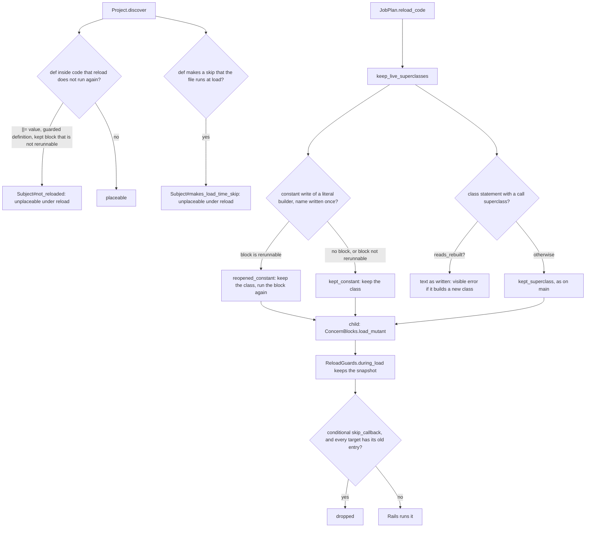

# Group 11-A: reload of class bodies, four follow-ups - Plan

Planned by: Fable 5.2, effort high, 2026-11-24

- **What:** Four fixes to `--strategy reload` and `--daemon`, in one pull request for 1.11.0.
- **Why:** Each one is a silent wrong verdict today: a false survivor, a false kill, or a callback condition that runs twice.
- **How:** Discovery marks code that a second load skips. A guard drops a conditional skip that the first load already applied. The reload text keeps every literal class-builder constant and runs a safe builder block again. It leaves a superclass as written when the superclass can be stale.

Build settings: Opus 5.5, effort `medium` (from the worklist). Use `high` for U3, because U3 changes the reload text of a common shape.

Target release: 1.11.0. Issues: #529, #543, #528, #533. One pull request, one commit per issue.
Planned against `main` at `c5100143` (the 1.10.0 release commit).

---

## Goal Capsule

- **Objective:** Under `--strategy reload` and `--daemon`, a mutant in one of the four shapes gets the verdict its tests give, or a counted `unplaceable`, or a visible `error`. It never scores `survived` or `killed` for a reason the tests did not give.
- **Means:** One new discovery rule (KTD1). One guard rule in `ReloadGuards::CallbackReskipping`, with one discovery mark (KTD3). One wider keep rule, with a block that runs again (KTD4). One narrower wrap rule in `JobPlan.kept_target` (KTD2).
- **Authority:** `AGENTS.md`, then `.expectation-fit/ways-of-working.yaml` and `.expectation-fit/decisions/reload-and-redefine-strategies.md`, then this plan, then the issue texts. Where this plan differs from an issue, this plan wins (see "Corrections to the issues").
- **Execution profile:** One branch `fix/529-reload-class-bodies`, one worktree, one pull request. Four commits in this order: U1 (#529), U2 (#543), U3 (#528), U4 (#533). U0 is not a commit. Each commit holds its code, tests, fixtures, docs and CHANGELOG entry, and passes the local gate alone.
- **Pull request:** title `fix: reload marks skipped definitions, keeps builder constants, leaves a stale superclass as written and drops a repeated conditional skip (#529, #543, #528, #533)`. Labels `bug`, `priority: medium`, `risk: medium`, `v1.11.0`. Body in What, Why, How form, then "Decisions for David" (D1 to D11 below). `Closes #529`, `Closes #543`, `Closes #528`, `Closes #533`.
- **Size:** medium. Four `lib/` files with code changes (`project.rb`, `job_plan.rb`, `reload_guards.rb`, `subject.rb`), one with a comment-only edit (`result.rb`), about 200 new lines of code, 23 new fixture files (6 of them in the Rails fixture app), six test files, one docs page, `CHANGELOG.md`, one decision file.
- **Who ships:** The builder opens the pull request. David merges. No release step.
- **Stop conditions.** Stop the unit and report. Do not work around:
  - `test/integration_test.rb` (the exact-survivor oracle) fails.
  - A unit needs a new mutant status, a JSON key, a CLI flag, a config key, a daemon payload key or a runtime gem.
  - A unit needs a change in `lib/mutineer/daemon_server.rb`, `lib/mutineer/daemon_client.rb` or `lib/mutineer/daemon_backend.rb`.
  - The real ActiveSupport probe in U2 gives counts other than the tables in probe P8.
  - In U3, a mutant in a builder block that the plan says runs again scores `error` or `unplaceable` in a fixture run.
- **If U3 is blocked:** drop U3, and build U4 with the changes that U4 step 8 names. Then also: remove "keeps builder constants" and `#528` from the pull request title, remove `Closes #528`, leave out the U3 docs text and the U3 decision lines, change the #575 issue body to point at #528 as the open cause, and remove the builder-block half of the #576 issue body. Ship U1, U2 and U4.

---

## Product Contract

### Summary

Reload loads the mutant file over classes that exist. Four shapes still give a silent wrong result on `main`.

1. **#529.** A constant set with `||=`, or under `unless defined?(X)`, does not run again. A mutant in its value is never loaded and scores `survived`. Now discovery marks each method there `unplaceable` under reload. The report counts it.
2. **#543.** A class body that skips a callback from a concern or a parent under a condition adds the condition again on each mutant load. `skip_before_action :x, only: :index` is the same call. Now the guard drops that repeated skip.
3. **#528.** `Point = Struct.new(:x) do ... end` builds a new class on each mutant load. A subclass or an instance in another file keeps the old class. Now reload keeps the class of every literal class-builder constant, and runs a safe builder block again on that class. The methods in the block get real verdicts. This also places the methods that #503 made `unplaceable`.
4. **#533.** `class Row < Class.new(base)` keeps the old parent, while the file builds the class in `base` again. Now such a superclass keeps its text, so the file errors visibly when the superclass is a new class.

### Problem Frame

All probes ran on `main` at `c5100143`, Ruby 3.4.9 (see "Probes run for this plan").

- **#529 (probe P1).** `OrCell ||= Struct.new(:x) do def one? ... end end` with a direct test. Reload: `survived`. Redefine: `killed`. The same for `X = ... unless defined?(X)`, for a block `unless defined?(X) ... end`, for a guarded class statement, and for `if !defined?(X)`.
- **#543 (probe P8).** `skip_callback :save, :before, :stamp, if: :quiet?` in a class body, where a concern or a parent added `:stamp`. After one mutant load the callback has the condition two times, and `quiet?` runs two times on each save. A test that counts those calls fails for every mutant of the file (false kills). `skip_before_action :check, only: :index` gives the same result on ActionPack 7.2.4: one condition before, two after. In a controller the second copy only repeats a pure check.
- **#528 (probe P3).** `Point = Struct.new(:x) do def one? ... end end`, and `class SubPoint < Point` in another loaded file. Reload: `survived` through the subclass, and `survived` through an instance that the other file holds. Redefine: `killed`. A test that checks `assert_kind_of Point, ORIGIN` fails for every mutant under reload (false kills).
- **#533 (probe P5).** `Fields = Struct.new(:v) do def total ... end end`, then `class Row < Class.new(Fields)`. Reload: `Fields#total` `survived`. Redefine: `killed`. With `assert_kind_of Fields, Row.new(1)`, reload kills all three mutants of the file, and redefine has all three `survived`. The same false survivor happens for a variable read deeper in the expression (`Class.new(base)`) and for a builder method of the file (`class BuiltPoint < point_base`).

The daemon always uses reload. Reload is also the default strategy for a run without `--rails`.

### Requirements

**#529: a definition that a second load skips**

- R1. Under reload, in process and on the daemon, a mutant in a def inside the value of a constant `||=` write (`X ||= ...` or `A::X ||= ...`) is `unplaceable`. It is counted in `summary.unplaceable`, listed in `unplaceable[]`, and has its place in the unrun share. A `:maybe` selection stays `no_coverage`. `--strategy redefine` still places it.
- R2. The same holds for a def inside the guarded statements of `unless defined?(X)` and of `if !defined?(X)` (also `if not defined?(X)`), as a statement or as a modifier, when those statements write the constant `X` (with any kind of write) or open `class X` or `module X`. The names match by their last segment, so `defined?(A::X)` matches a write of `B::X`. That fails closed: the method is counted `unplaceable`, never `survived`.
- R3. A guard whose statements do not define the tested name, such as `unless defined?(Rails)`, changes nothing. The `else` branch of a guard changes nothing.

**#543: a repeated conditional skip**

- R4. During a mutant load, a `skip_callback` with an `if:` or `unless:` option does nothing for a filter when the class has such a callback, and the class and each descendant that has one still has the callback entry object it had before the load.
- R5. In every other case the skip reaches Rails unchanged: the load added the callback again in the class or in a descendant (a new entry object), the class has no such callback (so Rails still raises for a wrong name), the skip has no condition, the skip has a block, or the call is outside a mutant load.
- R6. With real ActiveSupport, the conditions of each class in probe P8 are the same before and after a mutant load, except the one mixed case, which stays as on `main` (#578).
- R21. Two kinds of def are `unplaceable` under reload, because the guard can drop the skip they feed, so a mutant in them would not reach Rails. (a) A def that calls `skip_callback`, `skip_before_action`, `skip_after_action` or `skip_around_action` (any receiver), or that calls such a def of the same file by name: when the file calls any of those defs outside every def (so the call runs when the file loads), every such def of the file is marked. A file with no such load-time call marks none. (b) A def whose name a load-time skip call has inside its arguments, outside a block or a lambda there, such as `quiet_condition` in `skip_callback :save, :before, :stamp, if: quiet_condition`.

**#528: a literal class-builder constant**

- R7. Reload keeps the class of every constant write whose value is a literal class builder (`Project.kept_builder?`: `Struct.new`, `Data.define` or `Class.new` with literal arguments). It no longer needs a class statement in the same file that inherits from the constant. A subclass, an instance and a constant in another file still point at the same class.
- R22. A constant that the file writes more than once (matched by its last name, with any kind of write) is not kept. Each write keeps its text, as on `main`.
- R8. When the builder has a block that can run again (`Project.rerunnable_block?`, KTD4), the block runs again on the live class. A mutant in a def of that block is placed, and gets the verdict its tests give.
- R9. When the builder has a block that cannot run again safely, the block does not run again, and every def inside it is `unplaceable` under reload (as #503 does on `main`).
- R10. The rule never misses, in both directions. Every def inside a kept value that does not run again is `unplaceable` under reload. Every def in a block that runs again is defined again on the live class.

**#533: a superclass that can be stale**

- R11. A class statement keeps its superclass text as written when the superclass expression, outside any def in it, has one of these:
  - a read of a local variable that is set outside the expression, or any use of an instance, class or global variable (a read, a write, or `||=`);
  - a read of a constant that the file writes with a value that is not a data literal and that reload does not keep (R7);
  - a call of a method that the file defines, with any receiver. The `Struct.new`, `Data.define` or `Class.new` call itself is not counted.
- R12. Such a file errors, visibly, when the expression builds a new class. It reloads with real verdicts when the expression gives the same class each time.
- R13. Every other call superclass is wrapped as on `main`: `Struct.new(:a)`, `DelegateClass(IO)`, `ActiveRecord::Migration[7.2]`, and `Struct.new(*FIELDS)` with `FIELDS = %i[a b].freeze` in the same file.
- R14. The #512 local-write form follows R11 for the value it writes: `class Q < (base = build_base)` keeps its text when the file defines `build_base`.

**All four**

- R15. No new mutant status, JSON key, CLI flag, config key or daemon payload key. The JSON schema version does not change.
- R16. `JobPlan.keep_live_superclasses` returns the same String object for a file with no class statement that has a call superclass and no constant write of a literal class builder.
- R17. `--strategy redefine` and `--test-command` verdicts do not change.
- R18. `docs/json-schema.md` describes the new `unplaceable` causes and the cause that is gone, and says what a user can do. `CHANGELOG.md` has one "Fixed" entry for each issue under "Unreleased". `.expectation-fit/decisions/reload-and-redefine-strategies.md` matches the new behaviour.
- R19. Before the pull request opens, the follow-up issues #573 to #578 exist, each with four labels (see "Limits left open"). The CHANGELOG entries, the docs and the pull request body name them by number.
- R20. Each CHANGELOG entry and the pull request body record how often real code has the case (probe P9), and which counts can change after the upgrade.

### Acceptance Examples

- AE1. **Covers R1, R2.** Given `test/fixtures/or_constant.rb` and its test, when the run uses `--strategy reload`, then `OrCell#one?`, `GuardedCell#two?`, `BlockedCell#three?`, `StatedCell#four?` and `NegatedCell#five?` are each `unplaceable`. Under `--strategy redefine` each is `killed`.
- AE2. **Covers R3.** In the same run, `ShimmedCell#six?` (inside `unless defined?(NeverDefinedGuard)`) is `killed` under both strategies.
- AE3. **Covers R4, R6.** With real ActiveSupport, the probe classes `QuietConcern`, `QuietChild` and `QuietLambda` have one `unless` condition before a mutant load and one after it. On `main` they have two after it. A controller class with `skip_before_action :check, only: :index` has one before and one after.
- AE4. **Covers R5.** In the same probe, `QuietOwn` (the class body adds the callback with `unless: :quiet?` and then skips it with `if: :quiet?`) has two conditions before and two after.
- AE5. **Covers R4.** Given the Rails fixture model `QuietNote` and a test that checks the callback log is `%i[quiet? stamp]`, when the daemon runs the mutants of `QuietNote#urgent?`, then every mutant is `survived` and `errored` is 0. On `main` every mutant is `killed`, falsely.
- AE15. **Covers R5.** In the probe, `GrandNote` (a subclass in the reloaded text that adds `:stamp` again, before a top-level `ChildNote.skip_callback ..., if: :quiet?`) has one condition before and one after. `ChildNote` has one before and two after, as on `main` (#578).
- AE16. **Covers R21.** Given a file whose class body calls `quieten`, with `def self.quieten = skip_callback(:save, :before, :stamp, if: :quiet?)`, discovery marks `quieten` (and a def that calls it, and an uncalled `allow` that makes a skip in the same file) `unplaceable` under reload, and not under redefine. Given a module with `def self.allow(**options) = skip_before_action(:check, **options)` and no load-time call of a skip def in that file, the def is not marked. Given `skip_callback :save, :before, stamp_filter, if: quiet_condition` in a class body, the defs `stamp_filter` and `quiet_condition` of the file are marked, and `quiet?` in `if: -> { quiet? }` is not.
- AE6. **Covers R7, R8.** Given `test/fixtures/builder_constant.rb`, its holders file as a second source, and the subclass test, when the run uses `--strategy reload`, then `BuilderPoint#one?` is `killed`, and the rows equal the redefine rows. On `main` it is `survived` under reload.
- AE7. **Covers R7.** Given the identity test (`assert_kind_of BuilderPoint, BUILDER_ORIGIN`), both mutants are `survived` under reload, as under redefine. On `main` both are `killed`, falsely.
- AE8. **Covers R8.** In the existing run of `test/fixtures/const_superclass.rb`, `BaseRow#in_block?` is now `killed` under reload, and the reload rows equal the redefine rows with no exception.
- AE9. **Covers R9.** Given `test/fixtures/builder_alias_block.rb`, `AliasPoint#weak?` and `AliasPoint#x` are `unplaceable` under reload. Under redefine they have real verdicts.
- AE10. **Covers R7, R8.** Given the Rails fixture model `GridPoint`, its subclass `PinnedGridPoint` in another file, an initializer that loads the subclass at boot, and a test through the subclass, when the daemon runs, then every mutant of `GridPoint#origin?` is `killed` and `errored` is 0. On `main` every one is `survived`, falsely.
- AE17. **Covers R22.** `Cell = Struct.new(:x)\nFirst = Cell\nCell = Struct.new(:y)\n` comes back from `JobPlan.keep_live_superclasses` as the same String object.
- AE18. **Covers R8.** The existing tests of `test/singleton_redefine_test.rb` stay green: a `module self::Calc` and a `class Z` statement inside a builder block still get `killed` under reload.
- AE11. **Covers R11, R12.** Given `test/fixtures/stale_superclass_local.rb` (`class LocalDeep < Class.new(base)`), a reload run scores every mutant `error` with "superclass mismatch". The same holds for `stale_superclass_method.rb` and `stale_superclass_constant.rb`.
- AE12. **Covers R13.** `JobPlan.keep_live_superclasses` still wraps each text of R13.
- AE13. **Covers R7, R8, R11.** Given the first example of issue #533 (`LiteralFields = Struct.new(:v) do ... end`, then `class LiteralRow < Class.new(LiteralFields)`), after U3 the reload rows equal the redefine rows: `LiteralFields#total` `killed`, `LiteralRow#three?` `killed`, `LiteralRow#weak?` `survived`. U4 does not change that, because reload keeps `LiteralFields`.
- AE14. **Covers R16.** `JobPlan.keep_live_superclasses` returns the same String object for `class A < B\nend\nX = 1\nY = build\n`.

### Corrections to the issues

1. **#529 names two shapes. This plan covers both, with one flag.** The issue proposes `Subject#in_kept_constant` for `||=`. The guard shape gets the same flag, because the cause is the same: the first load set the constant, so the code does not run again. The flag gets a name that fits both (D9).
2. **#543 proposes: drop a skip whose condition the callback already carries.** That rule is wrong for a class that adds its own callback with the same condition (probe P8, `QuietOwn`: the rule would leave one condition where the first load left two). This plan compares the callback entry with the entry from before the load (KTD3).
3. **#543 says nothing about a descendant or about a def.** Rails applies a skip to each descendant too, and a class method of the file can make the skip. This plan covers both (R4, R5, R21), and files what remains as #578.
4. **#528 lists two ideas: mark the block's methods `unplaceable`, or wait for full reload (#389).** This plan takes a third: keep the class and run the builder block again on it (KTD4). That gives real verdicts, and it grants the wish in the same issue for the methods in a kept constant's block.
5. **#528's cause is wider than its title.** A constant whose value is not a literal builder (`Config = Class.new(Base) do ... end`, `Helpers = Module.new do ... end`) is still built again. That is #575.
6. **#533's first idea would break a common shape.** "Leave an expression as written when it reads a constant that the same file assigns" also matches `class Tag < Struct.new(*SUBTAGS)` with `SUBTAGS = %i[a b].freeze` (the `i18n` gem has it). This plan does not count a constant whose value is a data literal (KTD2).
7. **After U3, the first example of #533 works.** Reload keeps `Fields`, so `class Row < Class.new(Fields)` has the right parent, and `Fields#total` gets a real verdict (AE13).

### Limits left open

Each row needs a GitHub issue before the pull request opens (R19). The builder files #573 to #578 in U0 with `gh issue create`, starts each body with `**Claude:**`, and uses existing labels only. The Appendix has the text for each.

| ID | Limit that remains | Seen by the user as | Issue to file, with labels |
|---|---|---|---|
| #573 | Other guards that skip a definition on a second load: a top-level `return if defined?(X)` (probe P2: reload `survived`, redefine `killed`), `X = ... if !Object.const_defined?(:X)`, `defined?(X) \|\| (X = ...)`, the `else` branch of `if defined?(X)`, and a guard whose statements define the tested name through `require` or `const_set`. | False survivor, silent | New issue. `bug`, `priority: low`, `risk: low`, `backlog`. |
| #574 | A superclass expression that reaches a rebuilt class through a path the text does not show: a builder method in another file, `const_get`, a registry read (`REGISTRY[:base]`), `send`. | False survivor or false kill, silent | New issue. `bug`, `priority: low`, `risk: medium`, `backlog`. |
| #575 | A class or module constant whose value is not a literal builder is still built again on reload: `Config = Class.new(Base) do ... end`, `Row = Struct.new(*FIELDS)`, `Helpers = Module.new do ... end`, `X = build_x`. So is a literal builder constant that the file writes twice (R22). A subclass, an includer or an instance in another file keeps the old one. | False survivor or false kill, silent | New issue. `bug`, `priority: medium`, `risk: medium`, `backlog`. |
| #576 | Reload does not place a method in a kept block that does not run again: the block of a class statement's superclass call (#492), and a builder block with a statement outside the KTD4 list, such as `alias_method`, `include` or `delegate`. | `unplaceable`, counted | New issue. `enhancement`, `priority: low`, `risk: medium`, `backlog`. |
| #577 | An `alias_method` chain on an inherited method in a class body runs twice under reload, so the method calls itself (`SystemStackError`) and every mutant of the file can be a false kill (probe P7). A module whose `included` hook wraps a method has the same effect. This is on `main` today and is older than this pull request. | False kill, silent | New issue. `bug`, `priority: low`, `risk: medium`, `backlog`. |
| #578 | #543, two cases that stay as on `main`. (a) A descendant in the reloaded file adds the callback again before the skip: Rails runs the skip, so the classes that kept their entry get the condition a second time (probe P8, `ChildNote`). (b) R21 does not mark a def that makes the skip through `send`, `public_send`, `__send__` or `method`, or that only a caller in another file calls at load time. | (a) a condition runs twice. (b) false survivor, silent | New issue. `bug`, `priority: low`, `risk: low`, `backlog`. |
| - | The shapes that U4 leaves as written error for every mutant of the file. | `error`, visible | #527 (open, `backlog`). The builder adds one comment to #527 (Appendix). |
| - | Building each class once, which removes all of the above. | - | #389 (full reload, `v2.0`) |

### Scope Boundaries

- **No fix for #573 to #578 in this pull request.**
- **No rewrite of `||=`.** U1 marks the methods. It does not make them run (D3).
- **No reload of a superclass call's block.** A def there stays `unplaceable` (#576).
- **No wider `kept_builder?`.** A builder with an argument that is not a literal is not kept (#575).
- **No runtime check for a stale class.** The rules are text rules, as in #492, #503 and #512.
- **No change to `--strategy redefine`, to `--test-command`, or to the daemon protocol.**
- **No change to an unconditional `skip_callback`.**
- **No change to the reporter's text.** The stderr hint for the unrun share says "`--test-command` runs them". That stays true. The docs and the CHANGELOG say that `--strategy redefine` also runs the methods of this plan.
- **No exemption for a local variable that holds only literals** (`fields = %i[x]`, then `class Row < Struct.new(*fields)`). R11 leaves it as written. Probe P9 found 0 such superclasses.

### Decisions for David

None blocks the build. The run takes the recommended option. Each one goes in the pull request body.

- D1. **#528: keep every literal class-builder constant and run its block again on the live class.** Why: it gives real verdicts and the same class object for other files, and probe P3 shows the same rows as redefine. Other option: keep the constant and mark the block's methods `unplaceable` (the issue's first idea). That is less code in `job_plan.rb`, but 1,834 defs in 518 such blocks of the gem corpus, and all 5 such blocks of Mutineer's own `lib/`, would lose their verdicts under reload. Third option: no change in 1.x, wait for #389.
- D2. **#528: a builder block runs again only when each statement is on a short safe list (KTD4). Any other block is kept and its methods are `unplaceable`.** Why: a statement that reads the earlier state of the class, such as an `alias_method` chain, an `include` whose hook wraps a method, or `ORIG = instance_method(:x)`, breaks on a second run on the same class. That would be a new silent false kill from this pull request (probe P7). Other option: run every block again, which places all methods and accepts that risk. In the gem corpus the list covers 432 of 518 blocks (83%) and 1,391 of 1,834 defs. `include` and `extend` are not on the list: Ruby calls the `included` hook again for a module that is already included. That costs 2 blocks of the corpus.
- D3. **#529: mark the methods `unplaceable`. Do not make the `||=` value run.** Why: the shape is in 0 of 47,030 gem files and 0 of 482 app and lib files, so the small fix is enough. Other option: rewrite `X ||= builder do ... end` so that the block runs again on the live class, which needs a text change of the operator and a rule for a non-class value.
- D4. **#529: cover `unless defined?(X)` and `if !defined?(X)` now, and file the other guard forms as #573.** Why: the issue names the guard, and the rule fires only when the guarded statements define the tested name. Other option: `||=` only (a one-line change), and all guards in #573. Facts for the choice: 0 of 772 real guards in the gem corpus define the tested name beside a def, and the guard rule is about 40 lines with its visitor method.
- D5. **#543: compare the callback entry with the entry from before the load, for the class and each descendant.** Why: it is exact for every all-old case of probe P8, and it changes nothing where a class got a new entry. Other option: the issue's rule (drop a skip whose condition the callback already carries), which is wrong for `QuietOwn`.
- D6. **#533: leave the superclass as written, so the whole file errors.** Why: a stale parent gives false survivors and false kills, and only an unwrapped superclass removes both. The rule hits 0 of 2,064 wrapped superclass statements in the gem corpus. Other option: keep the wrap and mark the methods of the rebuilt class `unplaceable`, which does not stop the false kills and cannot find the methods that a builder method builds.
- D7. **Close all four issues, and file #573 to #578 for what remains.** Why: each titled defect is fixed, and each remaining case is a different shape with its own issue. This departs from builder rule 7 of `RULES.md` ("`Refs #N` for a partly fixed one") for #528 and #533. Other option: `Refs #528` and `Refs #533`, and keep the rest of the cause on those issues with no #574 and #575.
- D8. **Commit order #529, #543, #528, #533.** Why: the two small fixes land first, and #533 reads the keep rule that #528 sets. Other option: #533 before #528, which needs a first form of the #533 rule that #528 then changes.
- D9. **Rename `Subject#in_kept_constant` to `Subject#not_reloaded`.** Why: after this plan the flag is true for a def under a guard, where no constant value is kept, and false for a def in a kept constant whose block runs again. The new name avoids the word "skipped", which is a mutant status. The field is read only in `lib/mutineer/project.rb`, `lib/mutineer/subject.rb` and their tests. Other option: keep the name from 1.10.0 and explain it in the comment.
- D10. **#543: mark a def that makes a skip, or that gives a load-time skip its filter or condition, `unplaceable` under reload, only when its file runs such a skip at load time (R21).** Why: the guard can drop that call, so a mutant in the def would score `survived` unapplied, which would be a new silent result from this pull request. Other option: mark every def that calls a skip macro, as #504 does for `define_callbacks`. That also marks the Rails 8 helper `allow_unauthenticated_access` in each app's `Authentication` concern, which no load of its own file calls (Fizzy has 4 such defs).
- D11. **#528: do not keep a literal builder constant that the file writes more than once (R22).** Why: a kept first write would get the value of the last write, which changes what a line between the two sees. Other option: keep it, and accept that for a shape Ruby already warns about. The gem corpus has 5 such writes, in one file.

What changes for a user after the upgrade, under reload and `--daemon` only:

- `survived` can fall and `killed` can rise, where a mutant in a builder block now reaches a subclass or an instance from another file.
- `killed` can fall and `survived` can rise, where a new class object, or a condition that ran twice, made a test fail for every mutant.
- `unplaceable` can fall (the #503 methods are placed) and can rise (a `||=` value, a guarded definition, a builder block with a statement outside the safe list, a def that makes a skip).
- `errored` can rise for a file with an R11 superclass. The gem corpus has none. An errored mutant is in `no_verdict`.

So a score, a `--threshold` result and a `--baseline` new-survivor list can change. Each CHANGELOG entry says so.

---

## Planning Contract

### Key Technical Decisions

- KTD1. **#529 uses one flag, renamed `Subject#not_reloaded` (D9).** It means: a second load does not run the code that defines this method. `Subject#unplaceable?("reload")` already reads the flag. `SubjectVisitor#visit_constant_write_node` sets it for a `Prism::ConstantOrWriteNode` and a `Prism::ConstantPathOrWriteNode` (the method is an alias for six node kinds, so test the node's class). A new `SubjectVisitor#visit_unless_node`, with `alias visit_if_node visit_unless_node`, sets it only while it visits `node.statements`, and only when `Project.guarded_definition?(node)` is true. The visitor walks `node.compact_child_nodes`, so the code names no Prism field that differs between Prism 1 and Prism 2 (`subsequent`, `else_clause`). `guarded_definition?` looks for a `ClassNode`, a `ModuleNode`, a constant write of any kind (`Project::CONSTANT_WRITES`), or a multiple-assignment target, whose last name is the tested name.
- KTD2. **#533 leaves the superclass as written (R11).** `JobPlan.kept_target(node, rebuilt)` returns nil when `JobPlan.reads_rebuilt?(node, rebuilt)` is true. `rebuilt` comes from `Project.rebuilt_names(program)`: a Set of the file's def names, and a Set of the names of the constants the file writes with a value that is neither `Project.data_literal?` nor a `Project.kept_constant_write?`. A multiple assignment target (`A, B = ...`) always counts. The walk does not enter a def (its body runs later). It counts block levels as `JobPlan.writes_local?` does, so a read of a block's own parameter does not count. Every instance, class and global variable node counts, a write too, because `$base ||= Object` reads the variable with no read node. A call counts by name with any receiver, which fails closed. The builder call itself (`Project.builder_call?`) does not count, so `class Point < Struct.new(:x)` beside `def self.new` is still wrapped. Probe P9 found 0 hits in 2,064 wrapped superclass statements.
- KTD3. **#543 compares entry identity with the snapshot, and marks a def that makes the skip.**
  - `ReloadGuards.during_load` already takes `before = RepeatedCallbacks.snapshot` (each class's chain objects before the load). It now also keeps it in `@callbacks_before_load`.
  - In `CallbackReskipping#skip_callback`, when the options have `:if` or `:unless` and no block is given, `ReloadGuards.fresh_conditional_skips(klass, name, args)` removes a filter when `ReloadGuards.skipped_before_load?` is true for the class, and is not false for any of `klass.descendants`. It is true when the target's callback of that kind and filter is the same object (`equal?`) as an entry of its chain from before the load, false when the callback is another object, and nil when the target has no such callback. With no filter left, the method returns without `super`. A filter with no callback in the class goes to Rails, so a wrong name still raises.
  - Why this is exact: the class body outside methods is the original text, so each skip of the load also ran in the first load. An entry that is still the old object was not added again by this load, so the first load's skip, and everything after it, already made that entry what it is. When every target is in that state, running the skip again can only change it. When one target has a new entry, Rails must run the skip for it, and Rails runs it for every target, so the plan changes nothing there (#578).
  - A class that is not in the snapshot did not exist before the load, so Rails runs.
  - A def can make the skip (`def self.quieten = skip_callback(...)`, then `quieten` in the class body). The guard would drop the call, with the condition that a mutant changed. So discovery marks such a def `Subject#makes_load_time_skip`, a new Struct field, with the fixpoint that `Project.mark_callback_definers!` already has for `define_callbacks`. The mark applies to every such def of the file, and only when `Project.load_time_call?` finds a call of one of them outside every def of the file (D10). `Project.load_time_skip_arguments` also gives the names of the calls inside the arguments of a load-time skip call (a block or a lambda there is not entered, because it runs later), and each def of the file with one of those names gets the mark.
- KTD4. **#528 keeps every literal builder constant, and runs a safe block again.**
  - `Project.kept_constant_write?(node, repeated)`: a `ConstantWriteNode`, or a `ConstantPathWriteNode` whose parent is a constant path or `self`, with a `Project.kept_builder?` value, whose last name is not in `repeated`. `repeated` is `Project.repeated_constant_names(program)`: the last names of the constants the file writes more than once.
  - `Project.rerunnable_block?(block)` is true when the block has no parameter of any kind (`block.parameters.nil?`, so no `|k|`, `_1` or `it`: a parameter is the class, and `k.instance_method(:x)` reads its earlier state) and `Project.rerunnable_body?(block.body)` is true. A body is rerunnable when it is nil, or a `Prism::StatementsNode` whose statements are each one of:
    - a `def`;
    - a call with no receiver and no block, named in `Project::RERUN_SAFE_CALLS` (`attr_reader`, `attr_writer`, `attr_accessor`, `private`, `public`, `protected`, `private_class_method`, `public_class_method`), whose arguments are each a def or a `Project.literal_argument?`;
    - a constant write (`ConstantWriteNode`, `ConstantPathWriteNode`) whose value is a `Project.kept_builder?`, or is `Project.class_state_free?`: it has no call without a receiver and no `self`, outside a def;
    - a `class`, `module` or `class << self` statement whose own body is rerunnable by the same test.
  - None of these reads the earlier state of the class, so a second run on the same class gives the same class. Anything else makes the answer false: `alias_method`, `alias`, `undef`, `remove_method`, `define_method`, `delegate`, `include`, `extend`, an `each` loop, `ORIG = instance_method(:x)`, `ZERO = new(0)`, a `begin` body.
  - `Project.reopened_write?(node, repeated)`: `kept_constant_write?` with a block that is `rerunnable_block?`. Discovery and the reload text both ask here.
  - The reload text for a reopened write changes only the text before the block. `Point = Struct.new(:x) do ... end` becomes `Point = ::Mutineer::ReloadGuards.reopened_constant(::Module.nesting.first, :Point, -> { Struct.new(:x) }) do ... end`. The block stays where it is, so line numbers do not move.
  - `ReloadGuards.reopened_constant(scope, name, builder, &body)` gets the class from `kept_constant(scope, name, &builder)`, runs `klass.class_exec(&body)`, and returns the class. `Struct.new`, `Data.define` and `Class.new` each run their block with `module_eval` or `module_exec` on the new class, after the class exists, so "build, then `class_exec`" is the same as the original call when the constant is not set yet.
  - A kept write that is not reopened keeps the `kept_constant` wrap of `main`, and discovery marks its defs `not_reloaded`.
  - The walk in `JobPlan.keep_live_superclasses` goes on inside a reopened block, because that block runs again. A class statement or a builder constant in it gets its own wrap.
  - Rejected: `remove_const` before the load, and a per-file switch to redefine (both rejected in the #492 plan).
- KTD5. **`Project.superclass_constant_names` goes, and `Project.repeated_constant_names` takes its place in the same plumbing.** `Project.discover` passes the new Set to `SubjectVisitor.new` (the `kept_names` argument, renamed `repeated`), and `JobPlan.keep_live_superclasses` computes it once for each call.
- KTD6. **The splice list in `keep_live_superclasses` holds `[start_offset, length, head, tail]`.** A whole-node wrap is `[start, length, "GUARD(scope, :Name) { ", " }"]`, which gives the same text as `main`. A reopen is `[value start, block start - value start, "::Mutineer::ReloadGuards.reopened_constant(scope, :Name, -> { ", "}) "]`. The text of the range goes between head and tail unchanged, with its trailing space, so a `\` line continuation before `do` still parses.
- KTD7. **Commit order U1, U2, U3, U4 (D8).** U1 and U2 share no code with the others, except that U2 and U3 both read `Project::CONSTANT_WRITES`, which U1 adds. U4's `Project.rebuilt_names` calls `Project.kept_constant_write?` in the form U3 gives it.

### High-Level Technical Design



Directional sketches. A tested prototype of all four units is in `plans/11-A-reload-class-bodies-prototype.patch` in the run folder (a diff of `lib/` against `c5100143`). It has no YARD comments, no tests and no docs, it keeps the old name `in_kept_constant`, and it mixes the four units. Read it for the shape of the code. Do not apply it blindly: the builder writes each unit with its tests.

```ruby
# lib/mutineer/project.rb (U1)
CONSTANT_WRITES = [Prism::ConstantWriteNode, Prism::ConstantOrWriteNode, Prism::ConstantAndWriteNode,
                   Prism::ConstantOperatorWriteNode, Prism::ConstantPathWriteNode, Prism::ConstantPathOrWriteNode,
                   Prism::ConstantPathAndWriteNode, Prism::ConstantPathOperatorWriteNode].freeze

def self.guarded_definition?(node)
  predicate = node.predicate
  predicate = predicate.body.body.first while sole_statement_parentheses?(predicate)
  if node.is_a?(Prism::IfNode)
    return false unless predicate.is_a?(Prism::CallNode) && predicate.name == :! && predicate.receiver

    predicate = predicate.receiver
    predicate = predicate.body.body.first while sole_statement_parentheses?(predicate)
  end
  return false unless predicate.is_a?(Prism::DefinedNode) && node.statements

  guarded = predicate.value
  return false unless guarded.is_a?(Prism::ConstantReadNode) || guarded.is_a?(Prism::ConstantPathNode)

  nodes = [node.statements]
  while (inner = nodes.pop)
    nodes.concat(inner.compact_child_nodes)
    name = if inner.is_a?(Prism::ClassNode) || inner.is_a?(Prism::ModuleNode) then inner.constant_path.name
           elsif inner.is_a?(Prism::ConstantTargetNode) || inner.is_a?(Prism::ConstantPathTargetNode) then inner.name
           elsif CONSTANT_WRITES.any? { |type| inner.is_a?(type) }
             inner.respond_to?(:target) ? inner.target.name : inner.name
           end
    return true if name == guarded.name
  end
  false
end

# SubjectVisitor (U1)
def visit_unless_node(node)
  return super unless Project.guarded_definition?(node)

  saved = @not_reloaded
  begin
    node.compact_child_nodes.each do |child|
      @not_reloaded = saved || child.equal?(node.statements)
      visit(child)
    end
  ensure
    @not_reloaded = saved
  end
end
alias visit_if_node visit_unless_node

# lib/mutineer/reload_guards.rb (U2)
def skip_callback(name, *filter_list, &block)
  return super unless ReloadGuards.loading?

  options = filter_list.last.is_a?(Hash) ? filter_list.pop : {}
  if block.nil? && (options.key?(:if) || options.key?(:unless))
    filter_list = ReloadGuards.fresh_conditional_skips(self, name, filter_list)
    return if filter_list.nil?
  end
  options = { raise: false }.merge(options) if ReloadGuards.repeated_skip?(self, name, *filter_list)
  super(name, *filter_list, options, &block)
end

def self.fresh_conditional_skips(klass, name, args)
  return args unless @callbacks_before_load && @callbacks_before_load[klass]

  kinded = CALLBACK_KINDS.include?(args.first)
  kind = kinded ? args.first : :before
  filters = kinded ? args.drop(1) : args
  targets = [klass] + (klass.respond_to?(:descendants) ? klass.descendants : [])
  fresh = filters.reject do |filter|
    skipped_before_load?(klass, name.to_sym, kind, filter) == true &&
      targets.none? { |target| skipped_before_load?(target, name.to_sym, kind, filter) == false }
  end
  return args if fresh.size == filters.size
  return nil if fresh.empty?

  kinded ? [kind, *fresh] : fresh
end

# true: the entry from before the load. false: another entry. nil: no such callback.
def self.skipped_before_load?(target, name, kind, filter)
  chain = target.respond_to?(:__callbacks) ? target.__callbacks[name] : nil
  entry = chain&.to_a&.find { |callback| callback.kind == kind && callback.filter == filter }
  return nil unless entry

  old = @callbacks_before_load[target] && @callbacks_before_load[target][name]
  !old.nil? && old.any? { |callback| callback.equal?(entry) }
end

# lib/mutineer/project.rb (U2): in mark_callback_definers!, after the define_callbacks marks.
# calls_callback_definer? gets a third argument, the names to look for.
skippers = fixpoint_of_defs_that_call(CALLBACK_SKIPPERS) # the same loop as for CALLBACK_DEFINERS
helpers = skippers.map(&:name)
suppliers = load_time_skip_arguments(program, CALLBACK_SKIPPERS + helpers)
loaded = load_time_call?(program, helpers)
subjects.each do |subject|
  subject.makes_load_time_skip = true if (loaded && skippers.include?(subject.def_node)) || suppliers.include?(subject.name)
end

def self.load_time_skip_arguments(node, names, found = Set.new)
  return found if node.is_a?(Prism::DefNode)

  if node.is_a?(Prism::CallNode) && names.include?(node.name) && node.arguments
    stack = [node.arguments]
    while (inner = stack.pop)
      next if inner.is_a?(Prism::BlockNode) || inner.is_a?(Prism::LambdaNode)

      found << inner.name if inner.is_a?(Prism::CallNode)
      stack.concat(inner.compact_child_nodes)
    end
  end
  node.compact_child_nodes.each { |child| load_time_skip_arguments(child, names, found) }
  found
end

def self.load_time_call?(node, names)
  return false if node.is_a?(Prism::DefNode)
  return true if node.is_a?(Prism::CallNode) && names.include?(node.name)

  node.compact_child_nodes.any? { |child| load_time_call?(child, names) }
end

# lib/mutineer/project.rb (U3)
def self.rerunnable_block?(block)
  block.parameters.nil? && rerunnable_body?(block.body)
end

def self.rerunnable_body?(body)
  return true if body.nil?
  return false unless body.is_a?(Prism::StatementsNode)

  body.body.all? do |statement|
    case statement
    when Prism::DefNode then true
    when Prism::ClassNode, Prism::ModuleNode, Prism::SingletonClassNode then rerunnable_body?(statement.body)
    when Prism::ConstantWriteNode, Prism::ConstantPathWriteNode
      kept_builder?(statement.value) || class_state_free?(statement.value)
    when Prism::CallNode
      statement.receiver.nil? && statement.block.nil? && RERUN_SAFE_CALLS.include?(statement.name) &&
        (statement.arguments&.arguments || []).all? { |argument| argument.is_a?(Prism::DefNode) || literal_argument?(argument) }
    else false
    end
  end
end

def self.class_state_free?(node)
  return true if node.is_a?(Prism::DefNode)
  return false if node.is_a?(Prism::SelfNode) || (node.is_a?(Prism::CallNode) && node.receiver.nil?)

  node.compact_child_nodes.all? { |child| class_state_free?(child) }
end

# lib/mutineer/reload_guards.rb (U3)
def self.reopened_constant(scope, name, builder, &body)
  klass = kept_constant(scope, name, &builder)
  klass.class_exec(&body)
  klass
end

# lib/mutineer/job_plan.rb (U4)
OUTER_VARIABLES = [Prism::InstanceVariableReadNode, Prism::ClassVariableReadNode, Prism::GlobalVariableReadNode,
                   # ... and the Write, OrWrite, AndWrite and OperatorWrite node of each of the three kinds
                  ].freeze

def self.reads_rebuilt?(node, rebuilt, level = 0)
  return false if node.is_a?(Prism::DefNode)
  return node.depth >= level if node.is_a?(Prism::LocalVariableReadNode)
  return true if OUTER_VARIABLES.any? { |type| node.is_a?(type) }

  defs, constants = rebuilt
  return true if (node.is_a?(Prism::ConstantReadNode) || node.is_a?(Prism::ConstantPathNode)) && constants.include?(node.name)
  return true if node.is_a?(Prism::CallNode) && defs.include?(node.name) && !Project.builder_call?(node)

  inner = node.is_a?(Prism::BlockNode) || node.is_a?(Prism::LambdaNode) ? level + 1 : level
  node.compact_child_nodes.any? { |child| reads_rebuilt?(child, rebuilt, inner) }
end
```

`JobPlan::LEFT_AS_WRITTEN` on `main` lists the three variable read nodes. In U4, build `LEFT_AS_WRITTEN` from the constant nodes, the local read node and the three read nodes of `OUTER_VARIABLES`, so the two lists cannot differ.

### Assumptions

- A mutation changes text inside a `def` only. It never adds or removes a class statement, a constant write or a guard. So the original text and the mutant text give the same answer to every rule here.
- The mutant text may call `::Mutineer::ReloadGuards`. The in-process child and the daemon child both have it loaded.
- `lib/mutineer/reload_guards.rb` runs on the app's Ruby in the daemon, which can be older than 3.4. New code there uses no syntax newer than the file already uses. `class_exec` and `-> { }` exist in every supported Ruby.
- Rails builds a new callback object for each `set_callback`, and a conditional `skip_callback` replaces the entry with a new object (`merge_conditional_options`), in the class and in each descendant. Read in ActiveSupport 7.2.4. Probe P8 confirms the result on 7.2.4, 8.0.5 and 8.1.4.1.
- Ruby calls a module's `included` hook on every `include`, also when the class already includes the module. That is why `include` is not on the KTD4 list. The simplicity and predictability reviewers of this plan each ran that in plain Ruby.
- The fixture app boots with `config.eager_load` false, so a model in another file is loaded before a mutant load only when something names it at boot. AE10 uses an initializer for that, as `config/initializers/price_list.rb` does.

### Probes run for this plan

All ran on 2026-11-24 with Ruby 3.4.9 on arm64-darwin25, at `main` `c5100143`. "Prototype" means the patch named above, applied to a scratch worktree. The scripts are in a machine-local scratch folder, `/private/tmp/claude-501/-Users-davidteren-Projects-claude-worktrees-mutineer-dt-run-orchestrator-mutineer-v1-aadccd/2be993cc-11ce-4d11-b15a-f1768b29c55e/scratchpad/11A`. That folder is best effort. If it is gone, nothing is blocked: the fixtures in the Appendix give the same runs.

- P1. #529 on `main`, the AE1 fixture shapes with a direct test. Reload: all five `survived`. Redefine: all five `killed`. With the prototype, reload: all five `unplaceable`.
- P2. #573. `return if defined?(TopReturn)` at the top of a file, then `class TopReturn` with one method and a direct test. Reload on `main`: `survived`. Redefine: `killed`. The prototype does not change this.
- P3. #528 on `main`. `Point = Struct.new(:x) do def one? ... end end`, a second source with `class SubPoint < Point` and `ORIGIN = Point.new(1)`. Test through `SubPoint`: reload `survived`, redefine `killed`. Test through `ORIGIN`: reload `survived`, redefine `killed`. `Point2#weak?` with `assert_kind_of Point2, ORIGIN2`: reload `killed`, redefine `survived`. With the prototype, reload gives `killed`, `killed` and `survived`, the redefine rows.
  The second file must be a source (or be loaded at boot). In a run without `--boot`, the parent loads only the sources, and a file that only the test requires loads after the mutant.
- P4. #528, the cost of keeping. With an earlier prototype (the same keep and reopen rule for this file), the self-dogfood slice of CI (`lib/mutineer/config.rb`, `mutant_id.rb`, `baseline.rb`, whose `Config = Struct.new(...) do` block has two constant writes) at `--jobs 1`: 235 killed, 39 survived, 5 no coverage, 0 unplaceable, 0 errored, 1 timeout. Two runs of `main` gave 235 and 39, then 236 and 38, with the same other counts. Three mutants differ between the two `main` runs, so that slice is not stable from run to run on `main`. The prototype run is inside that noise. With the final rule, all 5 builder blocks of Mutineer's `lib/` are still rerunnable.
- P5. #533 on `main`. `Fields = Struct.new(:v) do def total ... end end`, `class Row < Class.new(Fields)`: reload `Fields#total` `survived`, redefine `killed`. With `assert_kind_of Fields, Row.new(1)`: reload kills all three mutants, redefine has all three `survived`. `base = Struct.new(:v) do def total ... end end`, `class LocalDeep < Class.new(base)`: reload `#total` `survived`. `def self.point_base` that returns a `Struct.new ... do` with `big?`, `class BuiltPoint < point_base` and `class WrittenPoint < (wbase = point_base)`: reload `#big?` `survived`.
- P6. #533 with the prototype. The `Fields` example: reload rows equal the redefine rows in both tests. `LocalDeep` and `BuiltPoint`: every mutant `error`, "superclass mismatch". `$base = Struct.new(:x)`, then `class Row < Class.new($base ||= Object)`: the text comes back as written.
- P7. D2 and #577. `class AliasChild < AliasBase` with `alias_method :raw_x, :x` and `def x = raw_x + 1`: a second load of the file makes `AliasChild.new.x` raise `SystemStackError`. On `main`, reload kills `AliasChild#weak?` (redefine: `survived`). `AliasPoint = Struct.new(:x) do` with the same chain: on `main` reload gives real verdicts, because it builds a new class. With a prototype that ran every block again, `AliasPoint#weak?` was `killed`, falsely. With the KTD4 list, `AliasPoint#x` and `AliasPoint#weak?` are `unplaceable`. The reviewers of this plan ran two more cases in plain Ruby, each with `SystemStackError` on a second `class_exec`: `ORIG_X = instance_method(:x)` then `def x = ORIG_X.bind_call(self) + 1`, and `include Wrapping` where `Wrapping.included` renames and wraps a method. The KTD4 list refuses both (a table of 32 block texts gave the expected answer for each). A block with a parameter (`|k|`, `_1` or `it`) is refused too: `ORIG = k.instance_method(:a)` would read the class through it.
- P8. #543 with real ActiveSupport, through `ConcernBlocks.load_mutant`. The number of `unless` conditions on the `:stamp` callback. First table: two mutant loads in one process.

  | Class | Shape | Before | After, `main` | After, prototype |
  |---|---|---|---|---|
  | `QuietConcern` | a concern adds `:stamp`, the body skips it with `if: :quiet?` | 1, `save` logs `quiet? stamp` | 3, `quiet? quiet? quiet? stamp` | 1, `quiet? stamp` |
  | `QuietChild` | the parent adds `:stamp`, the body skips it with `if: :quiet?` | 1 | 3 | 1 |
  | `QuietLambda` | the same with `if: -> { quiet? }` | 1 | 3 | 1 |
  | `QuietOwn` | the body adds `:stamp` with `unless: :quiet?`, then skips it with `if: :quiet?` | 2 | 2 | 2 |

  The same numbers on ActiveSupport 7.2.4 (the fixture bundle), 8.0.5 and 8.1.4.1. One mutant load gives 2 where two loads give 3. Second table: one mutant load, ActiveSupport and ActionPack 7.2.4.

  | Class | Shape | Before | After, `main` | After, prototype |
  |---|---|---|---|---|
  | `ChildNote` | empty subclass of the parent; a top-level `ChildNote.skip_callback ..., if: :quiet?` follows `GrandNote` | 1 | 2 | 2 (#578) |
  | `GrandNote` | subclass of `ChildNote` whose body adds `:stamp` again | 1 | 1 | 1 |
  | `DefSkip` | `def self.quieten = skip_callback(..., if: :quiet?)`, then `quieten` in the body | 1 | 2 | 1, and discovery marks `quieten` |
  | `ProbeChild` | an `AbstractController` class with `skip_before_action :check, only: :index` | 1 | 2 | 1 |

  A conditional skip of a name with no callback (`:nope_not_defined`) raises `ArgumentError` during a load with the prototype, as on `main`. In a discovery probe, R21 marked `stamp_filter` and `quiet_condition` of AE16, and did not mark `quiet?`, `plain`, or a skip def in a file with no load-time skip call.

- P9. Frequency. Corpus A: 47,030 Ruby files of the 744 gems installed for Ruby 3.4.9 on the planning machine, without `test/`, `spec/` and `vendor/` folders. Several versions of one gem count as separate files. Corpus B: 392 files of Fizzy `app/` and `lib/` at commit `f220e48`, and 90 files of Mutineer `lib/`.
  - #529: A has 10 constant `||=` writes, 0 with a def in the value. A has 772 `unless defined?` or `if !defined?` guards, 18 with a def in the guarded statements, 0 of them define the tested name. B has 0 of each shape with a def.
  - #543: A has 26 calls of `skip_callback` or a `skip_*_action`, 2 with a literal `if:`, `unless:`, `only:` or `except:`. 14 are inside a def, none of those with a literal condition. Fizzy has 8 such calls: 1 with `only:`, 4 inside a def of a concern that no load of that file calls. So R21 marks 0 defs in B.
  - #528: A has 1,256 constant writes of a literal builder, 26 of them kept on `main` (#503), 5 of them with a name the file writes twice (one file). 518 have a block, with 1,834 defs. 432 blocks (83%) are rerunnable, with 1,391 defs. 86 blocks are not, with 443 defs. B has 12 literal builder constants (1 in Fizzy), 5 with a block, all 5 rerunnable.
  - #575: A has 472 constant writes of `Struct.new`, `Data.define` or `Class.new` with an argument that is not a literal, 9 with a def in the block, and 2 `Module.new` constants with a def.
  - #533: A has 2,064 class statements whose superclass `main` wraps. R11 leaves 0 of them as written. Without the data-literal exemption it would leave 2 (`i18n`, `Struct.new(*RFC4646_SUBTAGS)`, in two versions).
  - #573: 55 of 47,218 gem files (all folders) and 0 of 482 files of B have a `return` outside a def or a block.
- P10. The prototype against the suites. See "Build note" at the end of this file.
- P12. The two daemon examples (AE5, AE10), each as one `Runner.execute` run with `daemon: true` on the Rails fixture app, on `main` and with the prototype. The rows are in the Appendix beside the fixtures.
- P11. Every fixture of the Appendix, on `main` and with the prototype, under both strategies. The rows are in the Appendix beside each fixture. Each "before" row is the defect, and each "after" row is the acceptance example.

---

## Implementation Units

Commit 1 is U1 (#529). Commit 2 is U2 (#543). Commit 3 is U3 (#528). Commit 4 is U4 (#533). U0 is not a commit.

### U0. File the follow-up issues (#573 to #578)

- **Goal:** R19 holds before any doc or CHANGELOG text names an issue number.
- **Requirements:** R19.
- **Dependencies:** none.
- **Files:** none committed here. The plan copy `docs/plans/2026-11-24-529-543-528-533-fix-reload-class-bodies-plan.md` is written here and committed with U1.
- **Approach:**
  1. Run `gh label list` and confirm `bug`, `enhancement`, `backlog`, and the priority and risk labels exist. Create no label.
  2. File #573 to #578 with `gh issue create`, with the titles, bodies and labels in the Appendix. Each body starts with `**Claude:**`.
  3. Do not post the #527 comment yet. U4 posts it, because its last sentence is true only when U3 ships.
  4. Copy this plan to `docs/plans/` under the name above, and replace "#573" to "#578" with the issue numbers in the copy. Use the numbers in every CHANGELOG entry, docs sentence and decision line that the Appendix drafts.
- **Test expectation:** none.
- **Verification:** `gh issue view` shows four labels on each new issue.

### U1. #529: mark a definition that a second load skips

- **Goal:** R1 to R3 hold in process and on the daemon.
- **Requirements:** R1, R2, R3, R15, R17, R18, R20.
- **Dependencies:** U0.
- **Files:**
  - `lib/mutineer/subject.rb`: rename the Struct field `in_kept_constant` to `not_reloaded` (D9); the class comment; `Subject#unplaceable?` and its comment.
  - `lib/mutineer/project.rb`: the rename (`@in_kept_constant`, the `Subject.new` call in `visit_def_node`); new `Project::CONSTANT_WRITES` and `Project.guarded_definition?`; `SubjectVisitor#visit_constant_write_node`; new `SubjectVisitor#visit_unless_node` with `alias visit_if_node visit_unless_node`.
  - `lib/mutineer/result.rb`: the comment that lists the `unplaceable` causes (it names #492 and #503).
  - `lib/mutineer/job_plan.rb`: one comment in `kept_constant_splice` ("A `||=` write keeps its text (#529)").
  - `test/fixtures/or_constant.rb`, `test/fixtures/or_constant_test.rb` (new, Appendix).
  - `test/project_test.rb`, `test/call_superclass_reload_test.rb`, `test/daemon_backend_contract_test.rb`.
  - `docs/json-schema.md`, `CHANGELOG.md`, `.expectation-fit/decisions/reload-and-redefine-strategies.md`, the plan copy in `docs/plans/`.
- **Approach:**
  1. Tests first. Add the fixture and the run test, and confirm it fails with `survived` under reload.
  2. Rename the field. `grep -rn "in_kept_constant" lib test` must then show nothing. The tests of `test/project_test.rb` that read `in_kept_constant` read `not_reloaded`.
  3. Add `Project::CONSTANT_WRITES` and `Project.guarded_definition?(node)` beside `Project.kept_constant_write?` (KTD1 and the sketch). Both are public, with a comment, as their neighbours are.
  4. In `visit_constant_write_node`, after the flag is saved, set it to true when the node is a `Prism::ConstantOrWriteNode` or a `Prism::ConstantPathOrWriteNode`. Keep the line that sets it for `Project.kept_constant_write?`. The existing `ensure` restores it.
  5. Add `visit_unless_node` and its alias (sketch). No `visit_if_node` or `visit_unless_node` exists in `SubjectVisitor` today.
  6. Update the comments named under Files. In `docs/json-schema.md`, change the `unplaceable` row of the `summary` table, the paragraph that starts "Two constant shapes can still give a false survivor", and the sentence that starts "`unplaceable` under reload means". Add the cause table of the Appendix ("Docs text, as a draft") with the U1 rows.
  7. Add the CHANGELOG entry under `## [Unreleased]`, in a `### Fixed` section, and the decision line (Appendix).
- **Patterns to follow:** the `@in_superclass_block` save and restore in `SubjectVisitor#visit_class_node`. `test_a_def_in_a_kept_superclass_constant_is_unplaceable_under_reload_only` in `test/project_test.rb`. `test_an_included_block_def_is_unplaceable_without_a_request` in `test/daemon_backend_contract_test.rb`.
- **Test scenarios:**
  - Covers AE1, AE2. `test/call_superclass_reload_test.rb`: `run_strategy("reload", sources: %w[or_constant.rb], test: "or_constant_test.rb")` gives `["unplaceable"]` for the five subjects of AE1 and `["killed"]` for `ShimmedCell#six?`. The redefine run gives `["killed"]` for all six.
  - `test/project_test.rb`, the rule across shapes. For each text, assert `not_reloaded`, `unplaceable?("reload")` and not `unplaceable?("redefine")`: `X ||= Struct.new(:a) do def m1; end end`; `A::X ||= Class.new do def m2; end end`; `X ||= lambda { def m3; end }`; `X = Struct.new(:a) do def m4; end end unless defined?(X)`; `unless defined?(X)\n  class X\n    def m5; end\n  end\nend`; `if !defined?(X)\n  module X\n    def m6; end\n  end\nend`; `if not defined?(::X)\n  ::X = Class.new do def m7; end end\nend`; `unless (defined?(X))\n  X = 1\n  def m8; end\nend`; `unless defined?(X)\n  X ||= 1\n  class Worker\n    def m9; end\n  end\nend`; `unless defined?(B)\n  A, B = 1, 2\n  def m10; end\nend`; `unless defined?(A::X)\n  B::X = 1\n  def m11; end\nend` (the last-name match of R2).
  - The same test, the cases that must stay unmarked: `unless defined?(Rails)\n  class Shim\n    def n1; end\n  end\nend`; `unless defined?(X)\n  1\nelse\n  X2 = 1\n  def n2; end\nend`; `if defined?(X)\n  def n3; end\nend`; `X &&= Struct.new(:a) do def n4; end end`; `unless ready?\n  X = 1\n  def n5; end\nend`; `unless defined?(@x)\n  def n6; end\nend`.
  - `test/daemon_backend_contract_test.rb`: discover `OrCell#one?` from the fixture, send it through `DaemonBackend.send(:run_serial, ...)` with a client whose `request` raises, and assert the status is `unplaceable`.
  - A JSON report of the AE1 reload run has `summary.unplaceable` 5 and five `unplaceable[]` entries (assert it once, as `test_the_daemon_marks_a_helper_that_defines_a_chain_unplaceable` does).
- **Verification:** the run test fails before step 3 and passes after step 5. The local gate is green. Commit 1 ends here.

### U2. #543: drop a repeated conditional skip

- **Goal:** R4, R5, R6 and R21 hold.
- **Requirements:** R4, R5, R6, R21, R15, R18, R20.
- **Dependencies:** U0. It reads no code of U1.
- **Files:**
  - `lib/mutineer/reload_guards.rb`: `CallbackReskipping#skip_callback` and its module comment; new `ReloadGuards.fresh_conditional_skips` and `ReloadGuards.skipped_before_load?`; `ReloadGuards.during_load`; the file's top comment (the `skip_callback` bullet).
  - `lib/mutineer/project.rb`: new `Project::CALLBACK_SKIPPERS`, `Project.load_time_call?` and `Project.load_time_skip_arguments`; `Project.mark_callback_definers!`; `Project.calls_callback_definer?` (a third argument, the names); the `Subject.new` call in `visit_def_node`.
  - `lib/mutineer/subject.rb`: new Struct field `makes_load_time_skip`, its class comment, and `Subject#unplaceable?`.
  - `test/reload_guards_test.rb`, `test/project_test.rb`.
  - `test/support/rails_callback_restore_probe.rb`, `test/rails_callback_restore_test.rb`.
  - `test/fixtures/rails_app/app/models/quiet_note.rb`, `test/fixtures/rails_app/test/models/quiet_note_test.rb` (new, Appendix).
  - `test/rails_dogfood_daemon_test.rb`.
  - `docs/json-schema.md` (the cause table and the `unplaceable` row), `CHANGELOG.md`, `.expectation-fit/decisions/reload-and-redefine-strategies.md`.
- **Approach:**
  1. Tests first: the real ActiveSupport probe and the daemon test. Confirm both fail on `main` with the numbers of probe P8 and AE5.
  2. In `during_load`, set `@callbacks_before_load = before` beside `@enums_before_load = {}`. Set it to nil in the `ensure`.
  3. Add `ReloadGuards.fresh_conditional_skips` and `ReloadGuards.skipped_before_load?` beside `repeated_skip?` (KTD3 and the sketch). They read `CALLBACK_KINDS`, as `repeated_skip?` does.
  4. Change `CallbackReskipping#skip_callback` (sketch). The `repeated_skip?` line stays, and now gets the filters that are left.
  5. Discovery (R21): add the field to `Subject`, set it to false in `visit_def_node`, and extend `mark_callback_definers!` (sketch). The loop for `CALLBACK_SKIPPERS` is the loop the method has for `CALLBACK_DEFINERS`: take it out into one private helper that both use. `Subject#unplaceable?("reload")` also returns true for `makes_load_time_skip`.
  6. Update the module comment: a conditional skip is a repeat, and is dropped, when the class and each descendant still has the entry from before the load.
  7. Add the CHANGELOG entry and the decision lines (Appendix). In `docs/json-schema.md`, add the R21 row to the cause table and to the `unplaceable` row.
- **Patterns to follow:** `ReloadGuards.chain_existed?` and `enum_existed?` (state for one load, set in `during_load`). `Project.mark_callback_definers!` and `test_a_def_that_defines_a_callback_chain_is_unplaceable_under_reload_only`. The `own_chains` method of `test/support/rails_callback_restore_probe.rb`. `test_the_daemon_keeps_a_chain_the_class_body_defines` in `test/rails_dogfood_daemon_test.rb`.
- **Test scenarios:**
  - `test/reload_guards_test.rb`, with the stand-in `Chain` and callback objects the file already has: give a class a chain with entry `e`, and set `@callbacks_before_load` with `instance_variable_set` to a snapshot that holds `e` (reset it in `ensure`). Assert for `ReloadGuards.fresh_conditional_skips`: `[:before, :check]` gives nil; `[:check]` (no kind) gives nil; `[:before, :check, :other]` with `:other` a new entry gives `[:before, :other]`; `[:before]` and `[]` (no filter) give the same Array object; a class that is not in the snapshot gives the same Array object; a filter with no entry in the class's chain stays in the list, so Rails gets it (R5); an entry of another kind (`:after`) does not count; a class with a `descendants` method whose one descendant has a new entry gives the same Array object (R5).
  - The same file: `test_skipping_a_parent_callback_again_does_not_raise_only_during_a_load` already sends `if: :x` during a load with no ActiveSupport. It must stay green: with an empty snapshot the method changes nothing.
  - A skip of a name with no callback still raises during a load: with real ActiveSupport, `skip_callback(:save, :before, :not_defined, if: :quiet?)` inside `ReloadGuards.during_load` raises `ArgumentError` (probe P8).
  - Covers AE3, AE4, AE15. `test/support/rails_callback_restore_probe.rb`: add a `conditional_skips` method that defines the concern and the parents outside the reloaded text, loads the text of the P8 classes, runs one `ConcernBlocks.load_mutant`, and returns for each class the number of `unless` conditions and the `save` log, before and after. `test/rails_callback_restore_test.rb` asserts, for one load: 1 and 1 for `QuietConcern`, `QuietChild`, `QuietLambda` and `ProbeChild`; 2 and 2 for `QuietOwn`; 1 and 1 for `GrandNote`; 1 and 2 for `ChildNote` (with a comment that names #578); and `%w[quiet? stamp]` for the three `Quiet` logs.
  - Covers AE16. `test/project_test.rb`: the two texts of AE16, and these rows: a def that calls `skip_before_action` and is called in the class body is marked; a def that calls a marked def by name is marked; a def of the same file that makes no skip is not marked; with no load-time call in the file, no def is marked; a call of the def inside another def only is not a load-time call; a file that calls `quieten` in the class body and has an uncalled `allow` that makes a skip marks both; the two argument defs of AE16 are marked, and `quiet?` inside a lambda condition is not.
  - Covers AE5. `test/rails_dogfood_daemon_test.rb`: `config_for(1, model: "quiet_note")` with `config.only = "QuietNote#urgent?"`. Assert `errored_count` 0, `total` above 0, and `total == survived_count`.
- **Verification:** `bundle exec rake test` and `bundle exec rake test:daemon` are green. Commit 2 ends here.

### U3. #528: keep every literal builder constant, and run a safe block again

- **Goal:** R7 to R10 and R22 hold in process and on the daemon.
- **Requirements:** R7, R8, R9, R10, R22, R15, R16, R17, R18, R20.
- **Dependencies:** U1 (the flag and `Project::CONSTANT_WRITES`).
- **Files:**
  - `lib/mutineer/project.rb`: `Project.kept_constant_write?` (the second argument is now `repeated`); new `Project.repeated_constant_names`, `Project::RERUN_SAFE_CALLS`, `Project.rerunnable_block?`, `Project.rerunnable_body?`, `Project.class_state_free?`, `Project.reopened_write?`; delete `Project.superclass_constant_names`; `Project.discover` (the `SubjectVisitor.new` call); `SubjectVisitor#initialize` (the third argument is the repeated names); `SubjectVisitor#visit_constant_write_node`; the comments of `kept_constant_write?`, `kept_builder?` and `sole_statement_parentheses?` that name the deleted method.
  - `lib/mutineer/job_plan.rb`: `JobPlan.keep_live_superclasses` (the splice form of KTD6, the walk, the comment); `JobPlan.kept_constant_splice`; new `JobPlan.wrap_splice`; the comment of `reload_code`.
  - `lib/mutineer/reload_guards.rb`: new `ReloadGuards.reopened_constant`; the comment of `kept_constant`.
  - `lib/mutineer/subject.rb`, `lib/mutineer/result.rb`: the `not_reloaded` comments.
  - `test/fixtures/builder_constant.rb`, `builder_constant_holders.rb`, `builder_constant_subclass_test.rb`, `builder_constant_identity_test.rb`, `builder_alias_block.rb`, `builder_alias_block_test.rb` (new, Appendix).
  - `test/fixtures/rails_app/app/models/grid_point.rb`, `app/models/pinned_grid_point.rb`, `config/initializers/grid_point.rb`, `test/models/grid_point_test.rb` (new, Appendix).
  - `test/call_superclass_reload_test.rb`, `test/project_test.rb`, `test/daemon_backend_contract_test.rb`, `test/rails_dogfood_daemon_test.rb`, `test/support/rails_callback_restore_probe.rb`, `test/rails_callback_restore_test.rb`.
  - `docs/json-schema.md`, `CHANGELOG.md`, `.expectation-fit/decisions/reload-and-redefine-strategies.md`.
- **Approach:**
  1. Tests first: the AE6, AE7 and AE10 runs. Confirm the false verdicts of probe P3 on the commit before this unit.
  2. Add `Project.repeated_constant_names(program)`: count each constant write (`CONSTANT_WRITES`) and each multiple-assignment target by its last name, and return the names with a count above 1, as a Set.
  3. `Project.kept_constant_write?(node, repeated)`: keep the scope rule for a path write (`constant_scope?(node.target.parent)`) and the `kept_builder?` rule. Replace the superclass name match with "the last name is not in `repeated`".
  4. Add `RERUN_SAFE_CALLS`, `rerunnable_block?`, `rerunnable_body?`, `class_state_free?` and `reopened_write?` (KTD4 and the sketch). Each gets a YARD comment or a `#` comment (`yard:strict`).
  5. `visit_constant_write_node`: the flag is set for an or-write (U1), or when `Project.kept_constant_write?(node, @repeated) && !Project.reopened_write?(node, @repeated)`.
  6. Delete `Project.superclass_constant_names` (KTD5). `grep -rn "superclass_constant_names\|kept_names" lib test` must then show nothing.
  7. `JobPlan.keep_live_superclasses`: compute `repeated` once. Build splices as `[start, length, head, tail]` (KTD6). For a kept constant write: when `Project.reopened_write?`, the reopen splice, and add `node.value.block` to the walk queue; otherwise the whole-value `kept_constant` wrap, and do not enter the value. The class-statement branch is unchanged, except that it builds its splice with `wrap_splice`.
  8. Add `ReloadGuards.reopened_constant` after `kept_constant` (sketch).
  9. Update the tests that change (list below), then the docs. In `docs/json-schema.md`: rewrite the paragraph that starts "Reload also cannot place a method inside the value of a constant assignment" and its three bullets; the `unplaceable` row; the last sentence of the "Two constant shapes" paragraph; and the sentence that starts "`unplaceable` under reload means", where "the kept value of a superclass constant (#503, see above)" becomes "a kept builder block that does not run again (#528, #492)". Fill the U3 rows of the cause table. Then `grep -n "superclass constant" docs/json-schema.md` and fix each remaining sentence that is no longer true.
  10. Add the CHANGELOG entry and the decision lines (Appendix). Remove the three decision lines that are no longer true ("Keep a Superclass Constant on Reload", "Match a Kept Constant by Spelling", "Mark Every Def in a Kept Value") and rewrite "Keep Only a Literal Class Builder" (Appendix).
- **Existing tests that change.** The first prototype failed these six for the stated reason (Build note). The others in the list were found by reading:
  - `test/call_superclass_reload_test.rb`:
    - `test_reload_scores_a_class_whose_superclass_constant_the_file_assigns` (failed): `BaseRow#in_block?` is `["killed"]` under reload, and `rows["redefine"] == rows["reload"]` with no `except` (AE8).
    - `test_a_kept_superclass_constant_keeps_subclasses_and_instances`: compare the rows with no `except`.
    - `test_the_rewrite_keeps_a_superclass_constant_the_file_assigns` (failed): the last text (a builder with a `do` block of one def) now gives `Base = ::Mutineer::ReloadGuards.reopened_constant(::Module.nesting.first, :Base, -> { Struct.new(:v, "w", 1, keyword_init: true) }) do`. Add texts for a brace block, a path write (`Billing::Base = Class.new do ... end` gives `reopened_constant(Billing, :Base, -> { Class.new })`), a builder call that spans two lines, and `X = Struct.new(:x) \` with `do` on the next line (the result parses and keeps its line count).
    - `test_the_rewrite_leaves_other_constant_writes_alone` (failed): four texts of the list are now kept, so move them to the test above with their new text: `Other = Struct.new(:v)` beside `class Row < BaseRow`; `Base = Struct.new(:v)` beside `class User < ActiveRecord::Base`; `Other::Base = Struct.new(:v)` beside `class User < ActiveRecord::Base`; `Other::Base = Struct.new(:v)` beside `class User < Base`. In the text `Fields = Struct.new(:v)\nBaseRow = Class.new(Fields)\nclass Row < BaseRow\nend`, `Fields` is now kept and `BaseRow = Class.new(Fields)` keeps its text: assert both. The other texts stay as written. Add the AE17 text.
    - `test_a_class_inside_a_kept_constant_is_not_wrapped`: `Base = Class.new do\n  class Inner < Struct.new(:b); end\nend` is now rerunnable (a class statement with an empty body), so the result has one `reopened_constant` and one `kept_superclass`, and it parses. Add a block that is not rerunnable (`alias_method :b, :a` and the same class statement): one guard call, `kept_constant`.
    - `test_every_def_in_a_kept_value_is_unplaceable_under_reload` (failed): the texts `k5`, `k6` and `k7` get one `alias_method :b, :a` line each, so their blocks stay kept. The rule and the final `assert_empty` stay.
    - `test_the_constant_fixture_rewrite_parses_keeps_lines_and_loads_twice`: still green. Add: `BaseRow.instance_method(:in_block?).source_location.first` is the rewritten file's path after the second load.
  - `test/project_test.rb`:
    - `test_a_def_in_a_superclass_block_is_unplaceable_under_reload_only_there`: the last `refute` stays true, for a new reason. Change its message to "the block runs again".
    - `test_a_def_in_a_kept_superclass_constant_is_unplaceable_under_reload_only` (failed): rewrite it as the R9 test. `in_block?`, `path_block` and `other` are placeable now. Add one `alias_method` line to a block and assert its def is `not_reloaded`. In the second source, `Other::Base = Struct.new(:v) do def path_write; end end` is now kept and reopened (assert not `not_reloaded`), and `build_base do` is not a literal builder.
    - Delete `test_superclass_constant_names_reads_each_constant_superclass`. Add a test of `Project.repeated_constant_names`.
  - `test/daemon_backend_contract_test.rb`: `test_the_payload_keeps_a_superclass_constant_the_file_assigns` (failed) asserts `"BaseRow = ::Mutineer::ReloadGuards.reopened_constant(::Module.nesting.first, :BaseRow, -> { Struct.new(:v) }) do"`.
  - `test/singleton_redefine_test.rb` (AE18): no change. `test_self_path_module_in_a_block_is_unplaceable_under_redefine_and_killed_under_reload` and `test_class_opened_in_class_self_is_unplaceable_under_redefine_and_killed_under_reload` failed with a first prototype whose list had no `class` and `module` statements. They pass with the KTD4 list. Run this file after step 4.
- **New test scenarios:**
  - Covers AE6, AE7. `test/call_superclass_reload_test.rb`: runs of `builder_constant.rb` with `builder_constant_holders.rb` as the second source, for both tests and both strategies. Assert the rows of the Appendix table, and `rows["redefine"] == rows["reload"]`.
  - Covers AE9. A run of `builder_alias_block.rb`: `["unplaceable"]` for both subjects under reload.
  - Covers R10, "test the rule". A table of block texts with the expected answer of `Project.rerunnable_block?`. True: an empty block; `def a; end`; `private` then a def; `private def a = 1`; one row for each of `attr_reader :b`, `attr_writer :b`, `attr_accessor :b`, `public`, `protected`, `private_class_method :new`, `public_class_method :new`; `ZERO = 1`; `KEYS = OPTIONS.filter_map(&:key).freeze`; `Inner = Struct.new(:b) do\n alias_method :c, :b\nend`; `class Z\n def z; end\nend`; `module self::Calc\n def self.p = 1\nend`; `class << self\n def s; end\nend`. False: `include Comparable`; `extend Forwardable`; `alias_method :b, :a`; `alias b a`; `undef a`; `remove_method :a`; `define_method(:a) { }`; `delegate :a, to: :b`; `[1].each { }`; `attr_reader(*names)`; `helper`; `self.x = 1`; `ORIG = instance_method(:a)`; `ZERO = new(0)`; `ME = self`; `class Z\n alias_method :b, :a\nend`; `class << self\n alias_method :b, :a\nend`; a block whose body has `rescue`; and a block with a parameter, in each form: `do |k|\n ORIG = k.instance_method(:a)\n def a = 1\nend`, the same with `_1`, and the same with `it`.
  - Covers R10, the load-twice rule. For each true text of that table, joined to `K = Struct.new(:a) do ... end`, and for `builder_constant.rb` and `const_superclass.rb`: write the text and its rewrite to two files, `load` the first, keep the class, `load` the second (with `mutineer/reload_guards` required). Assert the constant is the same object, and each def of the block has its `source_location` in the second file. Use the subprocess pattern of `test_every_local_write_shape_loads_twice_or_stays_as_written`.
  - Covers R7. `test_kept_constant_returns_the_live_class_or_runs_the_block` stays. Add `test_reopened_constant_runs_the_block_on_the_live_class_or_on_a_new_one`: with a live class in the scope, the result is that class and the block's def is on it; with no constant, the result is the builder's class with the def.
  - Covers AE14, AE17, R16, R22.
  - "Cover the siblings", callbacks in a builder block. A block that calls `define_callbacks` or `set_callback` is not rerunnable, so reload keeps the class and never runs the block again. In `test/support/rails_callback_restore_probe.rb`, add `BuiltNote = Class.new do ... end` whose block includes `ActiveSupport::Callbacks`, calls `define_callbacks :save` and adds one block callback. Assert in `test/rails_callback_restore_test.rb` that `BuiltNote.__callbacks[:save].to_a.size` is 1 before a mutant load and 1 after it.
  - Covers AE10. `test/rails_dogfood_daemon_test.rb`: `config_for(1, model: "grid_point")`. Assert `errored_count` 0, `killed_count` above 0 and `mutation_score` 100.0.
- **Verification:** the AE6, AE7 and AE10 tests fail before step 3 and pass after step 8. `test/integration_test.rb` and `test/singleton_redefine_test.rb` are green. Then run the self-dogfood command of `.github/workflows/ci.yml` (job `self-dogfood`) with `--jobs 1`: it exits 0, with 0 `errored` and 0 `unplaceable` (probe P4). `bundle exec rake test:daemon` is green. Commit 3 ends here.

### U4. #533: leave a superclass that can be stale as written

- **Goal:** R11 to R14 hold.
- **Requirements:** R11, R12, R13, R14, R15, R16, R18, R20.
- **Dependencies:** U3. If U3 was dropped, see the last step.
- **Files:**
  - `lib/mutineer/project.rb`: new `Project.builder_call?` (taken out of `kept_builder?`), `Project.data_literal?`, `Project.rebuilt_names`.
  - `lib/mutineer/job_plan.rb`: `JobPlan.keep_live_superclasses` (compute `rebuilt` once, pass it), `JobPlan.kept_target` (new second argument, and its comment, which says "A read deeper in the expression is still wrapped (#533)"), new `JobPlan.reads_rebuilt?` and `JobPlan::OUTER_VARIABLES`, `JobPlan::LEFT_AS_WRITTEN` (built from the same read nodes).
  - `test/fixtures/stale_superclass_local.rb`, `stale_superclass_method.rb`, `stale_superclass_constant.rb`, `stale_superclass_literal.rb`, with five `_test.rb` files (new, Appendix).
  - `test/call_superclass_reload_test.rb`, `test/project_test.rb`.
  - `docs/json-schema.md`, `CHANGELOG.md`, `.expectation-fit/decisions/reload-and-redefine-strategies.md`.
- **Approach:**
  1. Tests first: the AE11 runs and the text rule. Confirm on the commit before this unit that the three AE11 fixtures give `survived` for the method of the rebuilt class.
  2. `Project.builder_call?(node)`: the receiver and name test that `kept_builder?` has today. `kept_builder?` calls it.
  3. `Project.data_literal?(node)`: `literal_argument?(node)`; an `ArrayNode` whose elements are data literals; a `HashNode` whose pairs are `AssocNode`s of data literals; a `.freeze` call with no arguments on a data literal.
  4. `Project.rebuilt_names(program)` (KTD2). It computes `repeated_constant_names(program)` once and passes it to `kept_constant_write?`. Use `Set`, as the file does.
  5. `JobPlan.kept_target(node, rebuilt)`: after the `outer_block_parameter?` line, `return nil if reads_rebuilt?(node, rebuilt)`. Pass `rebuilt` to the recursive call. Make the argument required, and update the callers and tests. `keep_live_superclasses` computes `rebuilt` once for each call.
  6. Docs: in `docs/json-schema.md`, replace the sentence that ends "(#533)" in the #492 paragraph. The new text gives the three reads of R11, says the file then keeps its text and every mutant of it scores `error` when the expression builds a new class (#527), says what to do (run that file with `--strategy redefine`, or assign the class to a constant with a literal builder), and names #574. Add the CHANGELOG entry and change the decision line "Keep the Live Superclass on Reload" (Appendix).
  7. Post the #527 comment (Appendix).
  8. **Only if U3 was dropped:** `Project.rebuilt_names(program)` calls `kept_constant_write?(node, superclass_constant_names(program))`, and AE13 does not hold. The literal `LiteralFields` example then errors visibly: assert `error` for `stale_superclass_literal.rb`, and say so in the CHANGELOG entry and the pull request body. The advice "assign the class to a constant with a literal builder" is then true only when a class statement of the file inherits from that constant (#503): say that in the docs paragraph, the CHANGELOG entry and the #527 comment.
- **Test scenarios:**
  - Covers R11, "test the rule". A table in `test/call_superclass_reload_test.rb`. Each row is a file text and a flag. For "as written", `keep_live_superclasses` returns the same String object. For "wrapped", the result includes `kept_superclass`.
    - As written: `base = Struct.new(:v)\nclass Q < Class.new(base)\nend`; `class Q < base.itself` after the same first line; `class Q < Class.new(@base)`; `class Q < Class.new($base)`; `class Q < Class.new($base ||= Object)`; `class Q < Class.new(@base = make)`; `class Q < Class.new { base }` after the first line (a block reads the outer local); `fields = %i[x]\nclass Q < Struct.new(*fields)\nend` (a local with a literal, see Scope Boundaries); `def self.build_base = Struct.new(:a)\nclass Q < build_base\nend`; `class Q < (b = build_base)` after the same def; `class Q < Factory.build_base` after the same def (any receiver); `class Q < Class.new(build_base)`; `Fields = Struct.new(*NAMES)\nclass Q < Class.new(Fields)\nend`; `Fields = build_fields\nclass Q < DelegateClass(Fields)\nend`; `A, Fields = 1, Struct.new(:v)\nclass Q < Class.new(Fields)\nend`; `Fields ||= Struct.new(:v)\nclass Q < Class.new(Fields)\nend`; `Billing::Fields = make\nclass Q < Class.new(Billing::Fields)\nend`.
    - Wrapped: `class Q < Struct.new(:a)`; `class Q < DelegateClass(IO)`; `FIELDS = %i[a b].freeze\nclass Q < Struct.new(*FIELDS)\nend`; `OPTS = { keyword_init: true }\nclass Q < Struct.new(:a, **OPTS)\nend`; `class Q < Struct.new(:a) { |k| k }` (a block parameter); `class Q < Struct.new(:a) do\n  def x = @a\nend` (an instance variable inside a def); `class Q < Struct.new(:a)\n  def self.new(*) = super\nend` (the builder call beside a def named `new`); `Fields = Struct.new(:v)\nclass Q < Class.new(Fields)\nend` (a kept constant, after U3); `class Fields; end\nclass Q < Class.new(Fields)\nend` (a class statement reopens the same class).
  - Covers AE11. Three `run_report("reload", ...)` runs. Each has only `error` rows, and each detail includes "superclass mismatch". The pattern is `test_reload_errors_on_a_superclass_that_reads_a_variable`.
  - Covers AE13. `stale_superclass_literal.rb` with its two tests: the reload rows equal the redefine rows.
  - `Project.data_literal?` and `Project.rebuilt_names`, a table in `test/project_test.rb`: literals, arrays, hashes and frozen forms are data; a call, a constant, a variable and an interpolated string are not. `rebuilt_names` of a text with a def, a literal constant, a kept builder constant, a call constant, a multiple assignment and a path write gives the expected two Sets.
  - The existing `SUPERCLASS_SHAPES` test and `test_a_superclass_that_reads_a_variable_is_not_wrapped` stay green.
- **Verification:** the AE11 tests show `survived` before step 5 and `error` after it. `test/integration_test.rb` is green. `bundle exec rake test:daemon` is green (`InclusionValue` and `LedgerRow` still reload). Commit 4 ends here.

---

## Verification Contract

Run before each commit, on that commit:

```sh
bundle exec rake test
ruby -Ilib -e 'require "mutineer"'
bundle exec rake yard:strict
bundle exec rake test:daemon
```

Run once on the last commit:

```sh
bundle install
BUNDLE_GEMFILE=gemfiles/prism2.gemfile bundle install
MUTINEER_REQUIRE_PRISM_ERRORS=1 BUNDLE_GEMFILE=gemfiles/prism2.gemfile bundle exec rake test
bundle exec rake docs:check
bundle exec rake site:build
node --test test/site_test.js
npm ci --prefix test/browser
npx --prefix test/browser playwright install chromium
npm test --prefix test/browser
grep -nE '\bF[1-6]\b' CHANGELOG.md docs/json-schema.md .expectation-fit/decisions/reload-and-redefine-strategies.md
```

- The last command must print nothing: every placeholder is an issue number by then.
- The Prism 2 run is needed, because U1, U3 and U4 read node kinds that discovery did not read before (`DefinedNode`, `UnlessNode`, `IfNode`, the constant write and target nodes, the variable write nodes).
- The website checks are needed, because `docs/json-schema.md` is built into the site.
- The Minitest 6 run is not needed. Nothing here touches the Minitest integration.
- `bundle exec rake fizzy:sample` is a release step for David's clean `main`. The builder does not run it. Fizzy has one literal builder constant with no block, no def that R21 marks, and no file of the sample list with a shape of this plan (probe P9).

## Definition of Done

- The four commits exist in the order U1, U2, U3, U4, each green on the local gate.
- AE1 to AE18 are each asserted by a test. Each test of a defect failed before its unit.
- #573 to #578 exist with four labels each, and #527 has the comment.
- `docs/json-schema.md`, `CHANGELOG.md` and the decision file say what the code does, and name #573 to #578 by number.
- The pull request body has What, Why, How, "Decisions for David" (D1 to D11, with the other option and what changes), the P9 numbers, the list of counts that can change after the upgrade, and the four `Closes` lines.
- The plan copy is in `docs/plans/`, with the issue numbers of #573 to #578 filled in.
- `reports/11-A.md` in the run folder has the details, and `runs.jsonl` has the builder's line.

## Risks and Overlaps

- **U3 changes the reload text of a common shape.** 1,256 constant writes in 47,030 gem files are literal builders (probe P9), and reload is the default strategy without `--rails`. Before U3 such a class was built again on each mutant load. After U3 it is kept. A statement that only works on a new class would break. The KTD4 list is the guard: a block with any statement outside the list does not run again. The load-twice rule test checks every listed statement kind on a real second load.
- **A kept class keeps state that a new class would not have.** A class-level instance variable (`@cache ||= {}`) or a registration made by another file stays across the mutant load. The same holds for every class statement under reload today.
- **A builder block that is not rerunnable loses its verdicts under reload.** 443 defs in 86 blocks of the gem corpus become `unplaceable`, where `main` gives them a verdict that is right unless another file holds the class. The unrun-share warning shows it only above 10%, so the docs carry the rule. #576 tracks it. This is the price of D2.
- **U4 turns silent verdicts into `error` for the whole file.** The gem corpus has no file with an R11 shape, so the risk is low. A file where the expression returns the same class each time is not affected. An errored mutant is in `no_verdict`, so it can fail a `--threshold` gate that passed with false survivors.
- **U4's call rule matches by name with any receiver, and its local rule counts a local that holds only literals.** `class Q < Other.build` beside an unrelated `def build` in the same file keeps its text. If `Other.build` makes a new class each time, that file errors where `main` reloads it. Probe P9: 0 hits for each. The #527 comment and the docs say so.
- **U2 depends on entry identity in ActiveSupport.** A Rails version that copied the entries of a chain on each change would make every entry "new", and the guard would then do nothing (the behaviour of `main`). It cannot drop a skip wrongly in that case. Probe P8 covers 7.2, 8.0 and 8.1.
- **R21 marks by name.** A def with the same name as a skip helper, called at load time in the same file, is not marked unless it makes a skip itself. A skip helper that the file calls at load time loses its verdicts under reload. Probe P9: 0 such defs in Fizzy and Mutineer.
- **Two tree walks for each reload mutant** (`Project.rebuilt_names`, `Project.repeated_constant_names`), where `main` has one (`superclass_constant_names`). Both reuse the parse that `keep_live_superclasses` already makes.
- **The self-dogfood slice is not stable from run to run on `main`** (probe P4: three of 280 mutants differ between two `--jobs 1` runs). It is not caused by this plan. It can hide or fake a small change in that CI job. Tell David in the report.
- **Group 11-C edits `lib/mutineer/job_plan.rb`** (`JobPlan.suppress_map`, #538). This plan edits `keep_live_superclasses`, `kept_constant_splice`, `kept_target` and adds methods near them. The two areas are apart, so a merge conflict is unlikely. Every group edits `CHANGELOG.md` under "Unreleased": add the `### Fixed` entries, and merge by hand if the section moved.
- **This plan does not edit `lib/mutineer/daemon_backend.rb` or `lib/mutineer/runner.rb`.** Their comments ("a live superclass kept (#492, #512, #503)") stay true. So 11-A shares no file with 11-B, and the pair can build at the same time.
- **The 2.0 run** (20-G, #389 full reload) starts from `main` after this pull request merges. It reads `ReloadGuards` and `JobPlan.reload_code`.

## Sources

- **Issues:** #529, #543, #528, #533 (two comments), #527, #530, #389, #492, #503, #512, #504, #479.
- **The earlier plans:** `docs/plans/2026-11-22-512-503-504-fix-reload-followups-plan.md` (KTD2, KTD9, probes P5, P6 and P10), `docs/plans/2026-11-21-492-479-fix-reload-class-bodies-plan.md` (KTD1).
- **Where the reload text is built:** `JobPlan.reload_code`, `JobPlan.keep_live_superclasses`, `JobPlan.kept_constant_splice`, `JobPlan.kept_target`, `JobPlan.writes_local?` in `lib/mutineer/job_plan.rb`. Callers: `Runner.run` (`lib/mutineer/runner.rb`) and `DaemonBackend.job_result` (`lib/mutineer/daemon_backend.rb`).
- **Where discovery marks a subject:** `Project.discover`, `Project.kept_constant_write?`, `Project.kept_builder?`, `Project.mark_callback_definers!`, `SubjectVisitor#visit_constant_write_node`, `SubjectVisitor#visit_def_node` in `lib/mutineer/project.rb`. `Subject#unplaceable?` in `lib/mutineer/subject.rb`.
- **Where the guards live:** `ReloadGuards.during_load`, `kept_superclass`, `kept_constant`, `repeated_skip?`, `CallbackReskipping`, `RepeatedCallbacks.snapshot` in `lib/mutineer/reload_guards.rb`. `ConcernBlocks.load_mutant` in `lib/mutineer/concern_blocks.rb`.
- **Rails:** `skip_callback`, `__update_callbacks`, `merge_conditional_options` and `CallbackChain#append` in `active_support/callbacks.rb` 7.2.4.
- **Rules:** `AGENTS.md` ("Fix it in the pull request, or file an issue?", "Shift-left rules", "Score-model discipline"), `.expectation-fit/ways-of-working.yaml`, `.expectation-fit/decisions/reload-and-redefine-strategies.md`, `scoring-and-verdicts.md`, `docs-and-changelog.md`, `json-schema-and-baseline.md`.
- **Context retrieval:** Augment (`codebase-retrieval`) for the first map of the reload code, then exact-name `grep` and file reads.

## Appendix

### Fixtures for U1 (#529)

`test/fixtures/or_constant.rb`:

```ruby
# frozen_string_literal: true

# #529: a second load skips each of these definitions, because the first load
# set the constant. Reload cannot place a method inside them.
OrCell ||= Struct.new(:x) do
  def one? = x == 1
end

GuardedCell = Struct.new(:x) do
  def two? = x == 2
end unless defined?(GuardedCell)

unless defined?(BlockedCell)
  BlockedCell = Struct.new(:x) do
    def three? = x == 3
  end
end

unless defined?(StatedCell)
  class StatedCell
    def four?(x) = x == 4
  end
end

if !defined?(NegatedCell)
  class NegatedCell
    def five?(x) = x == 5
  end
end

# The body does not define the tested name, so it runs again on each load.
unless defined?(NeverDefinedGuard)
  class ShimmedCell
    def six?(x) = x == 6
  end
end
```

`test/fixtures/or_constant_test.rb`:

```ruby
# frozen_string_literal: true

require "minitest/autorun"
require_relative "or_constant"

class OrConstantTest < Minitest::Test
  def test_each_predicate
    assert OrCell.new(1).one?
    refute OrCell.new(2).one?
    assert GuardedCell.new(2).two?
    refute GuardedCell.new(1).two?
    assert BlockedCell.new(3).three?
    refute BlockedCell.new(2).three?
    assert StatedCell.new.four?(4)
    refute StatedCell.new.four?(3)
    assert NegatedCell.new.five?(5)
    refute NegatedCell.new.five?(4)
    assert ShimmedCell.new.six?(6)
    refute ShimmedCell.new.six?(5)
  end
end
```

Expected rows (probe P11). Reload on `main`: the first five `survived`, `ShimmedCell#six?` `killed`. Reload after U1: the first five `unplaceable`, `ShimmedCell#six?` `killed`. Redefine: all six `killed`.

### Fixtures for U2 (#543)

`test/fixtures/rails_app/app/models/quiet_note.rb`:

```ruby
# frozen_string_literal: true

# #543: the class body skips its concern's callback under a condition. A
# reload must not add the condition a second time, or `quiet?` runs twice.
class QuietNote < NoteBase
  include OwnStamps
  skip_callback :save, :before, :stamp, if: :quiet?

  def quiet? = (log << :quiet?) && false

  def stamp = log << :stamp

  def urgent?(level) = level > 2
end
```

`test/fixtures/rails_app/test/models/quiet_note_test.rb`:

```ruby
# frozen_string_literal: true

require "test_helper"

class QuietNoteTest < ActiveSupport::TestCase
  def test_save_asks_quiet_once
    assert_equal %i[quiet? stamp], QuietNote.new.save
  end

  # Runs `urgent?` with no assertion, so each of its mutants must survive.
  def test_urgent_runs
    QuietNote.new.urgent?(3)
  end
end
```

Expected rows, from daemon runs of these two files with `only: "QuietNote#urgent?"` (probe P12): on `main` the one `urgent?` mutant is `killed`, with the prototype it is `survived`, and `errored` is 0 in both.

The classes for `conditional_skips` in `test/support/rails_callback_restore_probe.rb`. `QuietStamping`, `QuietBase` and `ProbeBase` are defined outside the reloaded text, as in an app:

```ruby
module QuietStamping
  extend ActiveSupport::Concern
  included { set_callback :save, :before, :stamp }
end

class QuietBase
  include ActiveSupport::Callbacks
  define_callbacks :save
  set_callback :save, :before, :stamp
  def calls = (@calls ||= [])
  def quiet? = (calls << :quiet?) && false
  def stamp = calls << :stamp
  def save = run_callbacks(:save) { calls }
end

class ProbeBase < AbstractController::Base
  include AbstractController::Callbacks
  before_action :check
  def check = nil
end

# The reloaded text:
class QuietConcern
  include ActiveSupport::Callbacks
  define_callbacks :save
  include QuietStamping
  skip_callback :save, :before, :stamp, if: :quiet?
  def calls = (@calls ||= [])
  def quiet? = (calls << :quiet?) && false
  def stamp = calls << :stamp
  def save = run_callbacks(:save) { calls }
end

class QuietChild < QuietBase
  skip_callback :save, :before, :stamp, if: :quiet?
end

class QuietLambda < QuietBase
  skip_callback :save, :before, :stamp, if: -> { quiet? }
end

class QuietOwn < QuietBase
  set_callback :save, :before, :stamp, unless: :quiet?
  skip_callback :save, :before, :stamp, if: :quiet?
end

class ChildNote < QuietBase; end

class GrandNote < ChildNote
  set_callback :save, :before, :stamp
end
ChildNote.skip_callback :save, :before, :stamp, if: :quiet?

class ProbeChild < ProbeBase
  skip_before_action :check, only: :index
  def index = nil
end
```

Count the conditions with `callback.instance_variable_get(:@unless).size`, as the probe file's `conditions` method does. `ProbeChild` reads `__callbacks[:process_action]`. The probe file must `require "abstract_controller"`.

### Fixtures for U3 (#528)

`test/fixtures/builder_constant.rb`:

```ruby
# frozen_string_literal: true

# #528: a class constant from a builder block, with no class statement for it
# in this file. Another file holds a subclass and an instance of it.
BuilderPoint = Struct.new(:x) do
  def one? = x == 1

  def weak? = x == 9
end
```

`test/fixtures/builder_constant_holders.rb`:

```ruby
# frozen_string_literal: true

require_relative "builder_constant"

# Another file keeps a subclass and an instance of the class the mutant reloads.
class BuilderSubPoint < BuilderPoint
end

BUILDER_ORIGIN = BuilderPoint.new(1)
```

`test/fixtures/builder_constant_subclass_test.rb`:

```ruby
# frozen_string_literal: true

require "minitest/autorun"
require_relative "builder_constant_holders"

# Reaches `one?` only through the subclass and the instance of another file.
class BuilderConstantSubclassTest < Minitest::Test
  def test_one_through_the_subclass
    assert BuilderSubPoint.new(1).one?
    refute BuilderSubPoint.new(2).one?
  end

  def test_one_through_the_held_instance
    assert BUILDER_ORIGIN.one?
  end
end
```

`test/fixtures/builder_constant_identity_test.rb`:

```ruby
# frozen_string_literal: true

require "minitest/autorun"
require_relative "builder_constant_holders"

# A new BuilderPoint object would fail the last line for every mutant.
class BuilderConstantIdentityTest < Minitest::Test
  def test_weak_runs_and_the_instance_keeps_its_class
    BuilderPoint.new(9).weak?
    assert_kind_of BuilderPoint, BUILDER_ORIGIN
  end
end
```

Expected rows, from runs of these files (probe P11):

| Test | Strategy | `main` | After U3 |
|---|---|---|---|
| subclass test | reload | `one?` `survived`, `weak?` `survived` | `one?` `killed`, `weak?` `survived` |
| subclass test | redefine | `one?` `killed`, `weak?` `survived` | the same |
| identity test | reload | `one?` `killed`, `weak?` `killed` | `one?` `survived`, `weak?` `survived` |
| identity test | redefine | `one?` `survived`, `weak?` `survived` | the same |

`test/fixtures/builder_alias_block.rb`:

```ruby
# frozen_string_literal: true

# #528: this block renames the accessor and wraps it. A second run on the
# same class would make `x` call itself, so reload keeps the class and does
# not run the block again.
AliasPoint = Struct.new(:x) do
  alias_method :raw_x, :x

  def x = raw_x.to_i + 1

  def weak?(value) = value == 4
end
```

Expected rows (probe P11). Reload on `main`: `AliasPoint#x` `killed`, `AliasPoint#weak?` `survived`. Reload after U3: both `unplaceable`. Redefine: `killed` and `survived`.

`test/fixtures/builder_alias_block_test.rb`:

```ruby
# frozen_string_literal: true

require "minitest/autorun"
require_relative "builder_alias_block"

class BuilderAliasBlockTest < Minitest::Test
  def test_x_and_weak
    AliasPoint.new(1).weak?(4)
    assert_equal 2, AliasPoint.new(1).x
  end
end
```

`test/fixtures/rails_app/app/models/grid_point.rb`:

```ruby
# frozen_string_literal: true

# #528: a class constant from `Struct.new ... do`, with no class statement for
# it in this file. PinnedGridPoint, in another file, inherits from it.
GridPoint = Struct.new(:x) do
  def origin? = x == 0
end
```

`test/fixtures/rails_app/app/models/pinned_grid_point.rb`:

```ruby
# frozen_string_literal: true

# #528: a subclass in another file. An initializer loads it at boot, so it
# exists before any mutant of grid_point.rb loads.
class PinnedGridPoint < GridPoint
end
```

`test/fixtures/rails_app/config/initializers/grid_point.rb`:

```ruby
# frozen_string_literal: true

# #528: like an app that names a class at boot. PinnedGridPoint then holds
# GridPoint's class before any mutant is applied.
Rails.application.config.to_prepare { PinnedGridPoint }
```

`test/fixtures/rails_app/test/models/grid_point_test.rb`:

```ruby
# frozen_string_literal: true

require "test_helper"

class GridPointTest < ActiveSupport::TestCase
  # Reaches `origin?` only through the subclass that another file defines.
  def test_origin_through_the_subclass
    assert PinnedGridPoint.new(0).origin?
    refute PinnedGridPoint.new(1).origin?
  end
end
```

Expected rows, from daemon runs of these four files (probe P12): on `main` the one `origin?` mutant is `survived`, with the prototype it is `killed`, and `errored` is 0 in both. The four files were present while `bundle exec rake test:daemon` ran green (Build note), so the initializer does not break another fixture test.

### Fixtures for U4 (#533)

`test/fixtures/stale_superclass_local.rb`:

```ruby
# frozen_string_literal: true

# #533: the superclass call reads a local that an earlier line sets again on
# each load. Reload leaves it as written, so the file errors visibly.
base = Struct.new(:v) do
  def total = v + 1
end

class LocalDeep < Class.new(base)
  def three? = v == 3
end
```

`test/fixtures/stale_superclass_method.rb`:

```ruby
# frozen_string_literal: true

# #533: the superclass is a builder method of this file, which builds a new
# class on each call.
def self.point_base
  Struct.new(:x) do
    def big? = x > 1
  end
end

class BuiltPoint < point_base
  def small? = x < 1
end
```

`test/fixtures/stale_superclass_constant.rb`:

```ruby
# frozen_string_literal: true

# #533: the superclass call reads a constant that this file builds again, and
# that reload does not keep (its builder has an argument that is not a literal).
FIELD_NAMES = %i[v].freeze

Fields533 = Struct.new(*FIELD_NAMES) do
  def total = v + 1
end

class ConstDeep < Class.new(Fields533)
  def three? = v == 3
end
```

Expected rows (probe P11). Reload on `main`: the method of the rebuilt class (`#total`, `#big?`, `Fields533#total`) is `survived`, and the method of the class statement is `killed`. Reload after U4: every mutant `error`, "superclass mismatch". Redefine: `#total` and `#big?` are `unplaceable` (their class has no name), `Fields533#total` is `killed`.

Each `_test.rb` requires its file and calls each method once with an assertion, for example:

```ruby
# frozen_string_literal: true

require "minitest/autorun"
require_relative "stale_superclass_local"

class StaleSuperclassLocalTest < Minitest::Test
  def test_total_and_three
    assert_equal 2, LocalDeep.new(1).total
    assert LocalDeep.new(3).three?
    refute LocalDeep.new(2).three?
  end
end
```

`test/fixtures/stale_superclass_literal.rb` (AE13):

```ruby
# frozen_string_literal: true

# #533, its first example: reload keeps `LiteralFields` (#528), so `LiteralRow`
# has the right parent and `total` gets a real verdict.
LiteralFields = Struct.new(:v) do
  def total = v + 1
end

class LiteralRow < Class.new(LiteralFields)
  def three? = v == 3

  def weak? = v == 4
end
```

Its two tests: `stale_superclass_literal_test.rb` asserts `assert_equal 2, LiteralRow.new(1).total` and both answers of `three?`. `stale_superclass_literal_identity_test.rb` runs `LiteralRow.new(4).weak?` and asserts `assert_kind_of LiteralFields, LiteralRow.new(1)`.

Expected rows (probe P11). First test, reload on `main`: `LiteralFields#total` `survived`, `LiteralRow#three?` `killed`, `LiteralRow#weak?` `survived`. After U3, and under redefine: `killed`, `killed`, `survived`. Second test, reload on `main`: all three `killed`. After U3, and under redefine: all three `survived`.

### Docs text, as a draft

For `docs/json-schema.md`, in the `unplaceable[]` section. Keep the `unplaceable` cell of the `summary` table to one sentence for the reload causes, with a link to this table. Each unit adds its rows. Replace #573 to #578 with the issue numbers.

| Under `--strategy reload` and `--daemon`, a method is `unplaceable` when it is | Why reload cannot place it | What runs it |
|---|---|---|
| in the block of a class statement's superclass call, such as `class X < Struct.new(:a) do ... end` (#492) | Reload keeps the live superclass, so that block does not run again (#576). | `--strategy redefine`, `--test-command` |
| in the value of a constant set with `\|\|=`, or in code under `unless defined?(X)` or `if !defined?(X)` that defines `X` (#529) | The first load set the constant, so a second load skips the code. Other guards are not marked (#573). | `--strategy redefine`, `--test-command` |
| in the block of `X = Struct.new(...) do`, `Data.define(...) do` or `Class.new do` with literal arguments, when the block has a statement that reload does not run twice (#528) | Reload keeps the class. It runs the block again only when the block has no parameter and each statement is a method definition, a constant assignment that reads nothing of the class, `attr_reader`, `attr_writer`, `attr_accessor`, a visibility call, or a `class`, `module` or `class << self` statement with such a body. One other statement, such as `alias_method`, `include` or `delegate`, keeps the whole block from running again (#576). | `--strategy redefine`, `--test-command`. Or move that statement out of the block, into a `class X` statement after it. |
| a method that calls `skip_callback` or a `skip_*_action`, or that gives such a call its filter or condition, in a file that runs such a skip while it loads (#543) | The reload drops a conditional skip that the first load already applied, so the mutated call would not reach Rails (#578). | `--strategy redefine`, `--test-command` |
| a method that calls `define_callbacks` (#504) | as today | as today |

For the #492 paragraph (U4): "A superclass call keeps its text when it reads a local variable set outside it, uses an instance, class or global variable, reads a constant that the same file builds again with a value reload does not keep, or calls a method that the same file defines (with any receiver). When that call builds a new class, every mutant of the file scores `error` with `superclass mismatch` (#527). Run that file with `--strategy redefine`, or assign the class to a constant with a literal builder (`Fields = Struct.new(:v)`), which reload keeps. A superclass that reaches a rebuilt class through another file or a registry is still wrapped (#574)."

### CHANGELOG entries, as a draft

Under `## [Unreleased]`, `### Fixed`. One headline for each, then short lines, as the 1.10.0 entries have. Replace #573 to #578 with the issue numbers.

- **Reload no longer scores a method `survived` when a second load skips its definition (#529).**
  A constant set with `||=` (`Cell ||= Struct.new(:x) do ... end`), or defined under `unless defined?(Cell)` or `if !defined?(Cell)`, does not run again when `--strategy reload` or `--daemon` loads the mutant file.
  A mutant in a method there was never loaded and scored `survived`.
  Such a method is now `unplaceable` under reload, counted in `summary.unplaceable`. `--strategy redefine` and `--test-command` run it.
  The guard rule applies only when the guarded code writes the tested constant or opens that class or module. Names match by their last part.
  After the upgrade, `survived` can fall and `unplaceable` can rise for such a file, so a score and a `--threshold` result can change.
  The shapes are in 0 of 47,030 Ruby files of 744 gems and in 0 of 482 files of the Fizzy sample app and Mutineer's `lib/`.
  Still open: other guards, such as `return if defined?(Cell)` at the top of a file (#573).
- **Reload no longer adds the condition of a conditional `skip_callback` a second time (#543).**
  A class body that skips a callback from a concern or a parent with `if:` or `unless:`, such as `skip_callback :save, :before, :stamp, if: :quiet?` or `skip_before_action :check, only: :index`, ran that skip again on each mutant load.
  The callback then carried the condition twice, so the condition ran twice, and a test that counts its calls failed for every mutant of the file.
  The reload now drops a conditional skip when the class and its subclasses still have the callback they had before the load. Checked with ActiveSupport 7.2, 8.0 and 8.1.
  When a file runs such a skip through its own method while it loads, each method of that file that makes a skip, or that gives the skip its filter or condition, is now `unplaceable` under reload, because the dropped call would not carry its mutant. `--strategy redefine` runs it.
  After the upgrade, `killed` can fall and `survived` can rise for such a file, so a score, a `--threshold` result and a `--baseline` new-survivor list can change.
  The gem corpus has 26 skip calls in 47,030 files, 2 with a literal condition. Fizzy has 8, 1 with `only:`. No method of Fizzy or Mutineer gets the new mark.
  Still open: a subclass in the same file that adds the callback again before the skip, and a skip made through `send` (#578).
- **Reload keeps the class of every constant that a literal class builder sets, such as `Point = Struct.new(:x) do ... end` (#528).**
  `--strategy reload` and `--daemon` built a new class on each mutant load. A subclass or an instance in another file kept the old class, so a mutant in the block survived falsely, and a test that compared classes failed for every mutant.
  Now the reload keeps the class that the constant already has, for `Struct.new`, `Data.define` and `Class.new` with literal arguments.
  A block with no parameter, made of method definitions, constant assignments that read nothing of the class, `attr_reader`, `attr_writer`, `attr_accessor`, visibility calls and nested `class` or `module` statements, runs again on that class, so its methods get real verdicts. This includes the methods that 1.10.0 marked `unplaceable` for a superclass constant (#503).
  A block with any other statement, such as `alias_method`, `include` or `delegate`, does not run again, and its methods are `unplaceable` under reload (#576). `--strategy redefine` runs them. To get verdicts under reload, move that statement into a `class Point` statement after the assignment.
  A constant that the file assigns twice is not kept.
  After the upgrade, `survived`, `killed` and `unplaceable` can each rise or fall for such a file, so a score, a `--threshold` result and a `--baseline` new-survivor list can change.
  1,256 such constants are in 47,030 Ruby files of 744 gems. 432 of their 518 blocks run again.
  Still open: a builder with an argument that is not a literal, such as `Class.new(Base)`, and `Module.new` (#575).
- **Reload leaves a superclass as written when it can name a stale class (#533).**
  A superclass call that reads a variable, a constant that the same file builds again, or a method that the same file defines, such as `class Row < Class.new(base)` or `class Point < point_base`, kept the old parent while the file built a new class. A mutant in that class survived falsely.
  Such a superclass now keeps its text. When the call builds a new class, every mutant of the file scores `error` with "superclass mismatch" (#527). An errored mutant is in `no_verdict`, so a `--threshold` gate that passed on false survivors can now fail.
  What to do: run that file with `--strategy redefine`, or assign the class to a constant with a literal builder (`Fields = Struct.new(:v)`), which reload keeps (#528).
  A constant that holds only literals, such as `FIELDS = %i[a b].freeze`, does not count. A local variable does count, also when it holds only literals. A method call counts by name, with any receiver.
  The rule matches 0 of 2,064 call superclasses in 47,030 Ruby files of 744 gems.
  Still open: a superclass that reaches a rebuilt class through another file or a registry (#574).

### Decision lines, as a draft

For `.expectation-fit/decisions/reload-and-redefine-strategies.md`.

- U1, new: **Mark a Def That a Second Load Skips.** A def inside the value of a constant `||=` write, or inside the guarded statements of `unless defined?(X)` or `if !defined?(X)` that write or open `X` (`Project.guarded_definition?`, matched by the last name), is `Subject#not_reloaded`: `unplaceable` under reload, counted in `summary.unplaceable`. Not when: the guarded statements do not define the tested name, or the def is in the `else` branch; other guards are #573. (#529)
- U2, new: **Drop a Repeated Conditional Skip by Identity.** During a mutant load, `ReloadGuards.fresh_conditional_skips` drops a `skip_callback` filter with `if:` or `unless:` only when the class has that callback, and the class and each descendant that has one still has the callback object of `RepeatedCallbacks.snapshot` from before the load (`ReloadGuards.skipped_before_load?`). A filter with no callback in the class goes to Rails, so a wrong name still raises. Not when: never decide by the conditions the callback carries, because a class that adds its own callback with the same condition would lose one; a target with a new entry lets Rails run the skip for all (#578); an unconditional skip and a skip with a block are unchanged. (#543)
- U2, new: **Mark a Def That Makes a Skip the File Runs.** Discovery marks a def that calls `skip_callback` or a `skip_*_action` (`Project::CALLBACK_SKIPPERS`, any receiver), or that calls such a def of the file by name, `Subject#makes_load_time_skip` (`unplaceable` under reload): every such def of the file, and only when the file calls one of them outside every def (`Project.load_time_call?`). A def whose name a load-time skip call has in its arguments is marked too (`Project.load_time_skip_arguments`). Not when: no load of the file calls the def, as for a concern's `allow_unauthenticated_access`; `send` and a caller in another file are #578. (#543)
- U3, replaces "Keep a Superclass Constant on Reload" and "Match a Kept Constant by Spelling": **Keep Every Literal Class Builder Constant.** The reload text keeps the class of each constant write that `Project.kept_constant_write?` accepts: a bare write, or a path write whose parent is absent, a constant path or `self`, with a `Project.kept_builder?` value. No class statement has to name it. Discovery and the reload text both ask `Project.kept_constant_write?` and `Project.reopened_write?`. Not when: the file writes that name more than once (`Project.repeated_constant_names`). (#528, #503)
- U3, replaces "Mark Every Def in a Kept Value": **Run a Builder Block Again Only When It Is Safe.** A kept builder's block runs again on the live class (`ReloadGuards.reopened_constant`) only when `Project.rerunnable_block?` is true: the block has no parameter, and each statement is a def, a `Project::RERUN_SAFE_CALLS` call with no receiver, no block and def or literal arguments, a constant write whose value is a literal builder or reads nothing of the class, or a `class`, `module` or `class << self` statement with such a body. Any other block is kept and not run, and each def in it is `Subject#not_reloaded`. Not when: never add a statement that reads the earlier state of the class (`alias_method`, `remove_method`, `include`, `extend`, a method wrapper); #576 tracks the methods that stay `unplaceable`. (#528)
- U3, rewritten: **Keep Only a Literal Class Builder.** Keep a constant's value only when it is `Struct.new`, `Data.define` or `Class.new` with literal arguments (`Project.kept_builder?`). Any other value keeps its text and is built again on each load: that errors visibly only when a class statement of the file inherits from it (#527), and is silent otherwise (#575). Not when: never widen this to a builder method of the file or an argument that reads a constant (#575). (#503, #528)
- U4, changed: **Keep the Live Superclass on Reload.** Add to its `Not when:`: the expression reads a local from outside it, uses an instance, class or global variable, reads a constant the file writes with a value that is not a data literal and that reload does not keep, or calls a method the file defines (`JobPlan.reads_rebuilt?`); such a superclass keeps its text (#533, #574).

### Follow-up issues to file (#573 to #578)

Each body starts with `**Claude:**` and has What, Why and How sections. Use `gh issue create --title ... --label ... --body-file ...`. "The plan" in a body is `docs/plans/2026-11-24-529-543-528-533-fix-reload-class-bodies-plan.md`: write that path in the issue.

- **#573.** Title: `Reload: other guards that skip a definition on a second load give a false survivor`. Labels: `bug`, `priority: low`, `risk: low`, `backlog`.
  What: under `--strategy reload` and `--daemon`, a definition behind one of these guards does not run again, so a mutant in it scores `survived`: `return if defined?(X)` at the top of a file, `X = ... if !Object.const_defined?(:X)`, `defined?(X) || (X = ...)`, the `else` branch of `if defined?(X)`, `unless defined?(X)` whose statements define `X` through `require` or `const_set`, and a `||=` of something that is not a constant (`@x ||= Struct.new(:a) do ... end` in a class body, `H[:k] ||= ...`). Probe P2 of the plan: reload `survived`, redefine `killed`.
  Why: #529 marks `||=` and `unless defined?(X)` with a write or a class statement of `X` only. How often: 55 of 47,218 gem files and 0 of 482 app files have a `return` outside a def or a block. 18 gem guards hold a def and do not define the tested name in their text. The other forms were not counted.
  How (ideas): extend `Project.guarded_definition?`; or mark every def after a top-level `return if defined?(X)` whose file defines `X`; or full reload (#389).
- **#574.** Title: `Reload: a kept superclass can be stale when it reaches a rebuilt class through another file or a registry`. Labels: `bug`, `priority: low`, `risk: medium`, `backlog`.
  What: #533 leaves a superclass as written when its text reads a variable, a constant the file builds again, or a method of the file. A superclass that reaches such a class through a builder method in another file, `const_get`, a registry read (`REGISTRY[:base]`) or `send` is still wrapped, so it keeps the old parent. A mutant in the rebuilt class can survive falsely, and a class comparison can kill falsely.
  Why: the rule reads the text of one file. How often: not counted; the three shapes that #533 covers are in 0 of 2,064 wrapped superclasses of 47,030 gem files.
  How (ideas): full reload (#389).
- **#575.** Title: `Reload builds a new class for a constant whose value is not a literal builder`. Labels: `bug`, `priority: medium`, `risk: medium`, `backlog`.
  What: `Config = Class.new(Base) do ... end`, `Row = Struct.new(*FIELDS)`, `Helpers = Module.new do ... end` and `X = build_x` are built again on each mutant load. So is a literal builder constant that the file assigns twice. A subclass, an includer or an instance in another file keeps the old one. A mutant in the block can survive falsely, and a class comparison (`rescue MyError` beside a subclass from another file) can fail for every mutant.
  Why: #528 keeps only `Struct.new`, `Data.define` and `Class.new` with literal arguments. How often: 472 such constant writes in 47,030 gem files, 9 with a def in the block, and 2 `Module.new` constants with a def. `MyError = Class.new(StandardError)` is the common form.
  How (ideas): keep a builder whose arguments pass `JobPlan.reads_rebuilt?` (the #533 check), which covers `Class.new(StandardError)`; a `kept_constant` form for `Module.new`; or full reload (#389).
- **#576.** Title: `Reload: place the methods of a builder block that is kept but does not run again`. Labels: `enhancement`, `priority: low`, `risk: medium`, `backlog`.
  What: two kinds of method are `unplaceable` under reload, counted in the report: a method in the block of a class statement's superclass call (`class X < Struct.new(:a) do ... end`, #492), and a method in a builder block with a statement outside the safe list of #528, such as `alias_method`, `include` or `delegate`.
  Why: running such a block again can wrap a method twice. How often: 86 of 518 literal builder blocks in 47,030 gem files, with 443 defs. The superclass-block form was not counted.
  How (ideas): run a superclass call's block again with the #528 guard; allow an `alias_method` whose old name the block does not define after it; load only the mutated def into the kept class, as redefine does.
- **#577.** Title: `Reload runs an alias_method chain in a class body twice, so the method calls itself`. Labels: `bug`, `priority: low`, `risk: medium`, `backlog`.
  What: `class Child < Base` with `alias_method :raw_x, :x` and then `def x = raw_x + 1`, where `x` comes from the parent. A mutant load runs the body again. `raw_x` then names the first `x` of the class, which calls `raw_x`, so `x` raises `SystemStackError`. Every mutant of the file whose tests call `x` is killed, falsely. Probe P7 of the plan: reload `killed`, redefine `survived`. A module whose `included` hook renames and wraps a method does the same, because Ruby calls the hook on every `include`.
  Why: reload runs a class body a second time on the same class. This is older than #528. How often: not counted for class bodies.
  How (ideas): detect the chain in discovery and mark the file's mutants `unplaceable`, or warn; or full reload (#389).
- **#578.** Title: `Reload: a conditional skip_callback still repeats, or is dropped unseen, in two cases`. Labels: `bug`, `priority: low`, `risk: low`, `backlog`.
  What: (a) `class Child < Base; end`, `class Grand < Child; set_callback :save, :before, :stamp; end`, then `Child.skip_callback :save, :before, :stamp, if: :quiet?`, all in one file. On a mutant load `Grand` adds the callback again, so Rails must run the skip, and `Child` gets the condition a second time. Probe P8 of the plan: 1 condition before, 2 after. (b) #543 marks a def that makes a skip `unplaceable` under reload when its file calls it at load time. It does not mark a def that makes the skip through `send`, `public_send`, `__send__` or `method`, or one that only a caller in another file calls at load time. A mutant there can score `survived` unapplied.
  Why: Rails applies a skip to the class and every descendant in one call, and #543 drops the call only when all of them kept their entry. The mark reads the text of one file by name. How often: not counted; the gem corpus has 26 skip calls in 47,030 files, 2 with a literal condition.
  How (ideas): put the old entry back in the classes that kept it, after Rails ran the skip; or full reload (#389).

Comment for #527:

```text
**Claude:** #533 adds shapes to this list. A class statement now keeps its superclass text when the expression reads a local variable set outside it (`class Q < Class.new(base)`, also when the local holds only literals, as in `fields = %i[x]` then `class Q < Struct.new(*fields)`), uses an instance, class or global variable, reads a constant that the same file builds again with a value reload does not keep (`class Q < Class.new(Fields)` with `Fields = Struct.new(*NAMES)`), or calls a method that the same file defines, with any receiver (`class Q < build_base`; also `class Q < Other.build` beside an unrelated `def build`). Such a file errors with "superclass mismatch" when the expression builds a new class. Before, it kept a stale parent and gave false survivors. To get verdicts, run the file with `--strategy redefine`, or assign the class to a constant with a literal builder.
```

## Build note (the prototype against the suites, probe P10)

All runs on 2026-11-24, Ruby 3.4.9, the prototype patch on `c5100143`.

- `bundle exec rake test`, second form of the prototype: 2,496 runs, 7 failures, 1 error. Each one is a test that U3 lists under "Existing tests that change": the six marked "(failed)", `test_a_class_inside_a_kept_constant_is_not_wrapped`, and the error of the deleted `test_superclass_constant_names_reads_each_constant_superclass`. No other test failed.
- The first form of the prototype also failed two tests of `test/singleton_redefine_test.rb`, because its list had no `class` and `module` statements. That led to the nested-statement rule of KTD4. They pass since then.
- Final form of the prototype (after the last review fixes), the nine test files it can reach (`project_test`, `call_superclass_reload_test`, `daemon_backend_contract_test`, `reload_guards_test`, `singleton_redefine_test`, `subject_test`, `integration_test`, `concern_blocks_test`, `load_time_test`): the same 7 failures and 1 error, and nothing else. `test/integration_test.rb` (the exact-survivor oracle): 28 runs, 0 failures. The full zero-dependency suite was not run again on the final form.
- `bundle exec rake test:daemon`, final form: 85 runs, 0 failures, 0 errors, 25 skips (the PostgreSQL and MySQL tests need a server).
- Prism 2 (`BUNDLE_GEMFILE=gemfiles/prism2.gemfile`), `test/project_test.rb` and `test/call_superclass_reload_test.rb`, second form: the same 6 failures and 1 error as under Prism 1. The full Prism 2 suite was not run.
- `bundle exec rake yard:strict` was not run: the prototype has no comments.
- Not in the prototype: the rename to `not_reloaded` and `makes_load_time_skip` (the patch keeps `in_kept_constant` and `calls_skip_callback`), every test, every doc.
- After the build, a review found that the advice "move that statement into a `class Point` statement after the assignment" in the drafts above makes the probe P7 false kill: that statement also runs again on a kept class. The build does not keep a constant that the file changes in such a way (`Project.unkept_constant_names`), and the shipped docs drop that advice. A change in another file is #585.

## Review record

**Plan validation (`/fit-validate-plan`, expectation-fit 0.9.0).** Round 1 ran four lenses on the first draft: 1 P1, 13 P2, 13 P3. Verdict: revise first. Round 2 ran the predictability lens on the revised plan: 0 P0, 0 P1, 3 P2, each fixed after it with a probe. The other three lenses were not run again. The report is at `scratchpad/11A/fit-reports/20261124-224300-validate-plan-11-a-reload-class-bodies-plan.md` in the scratch folder named under "Probes".

| Finding | Lens | What the plan does now |
|---|---|---|
| P1: a def that makes the conditional skip is dropped unseen | predictability | R21, D10, AE16: discovery marks it |
| P2: a def that gives the skip its filter or condition (round 2) | predictability | R21 (b), `Project.load_time_skip_arguments` |
| P2: a wrong skip name was hidden (round 2) | predictability | R5: no callback in the class sends the skip to Rails |
| P2: `include`, `extend`, `ORIG = instance_method(:x)` read the earlier class state | predictability, simplicity | KTD4: off the list; `Project.class_state_free?` |
| P2: a block parameter reads the class (round 2) | predictability | KTD4: a block with a parameter does not run again |
| P2: the flag name `in_kept_constant` | predictability, convention | D9: renamed `not_reloaded` |
| P2: R21 text against its sketch (round 2) | predictability | R21 reworded; the field is `makes_load_time_skip` |
| P2: build note and prototype patch missing | predictability, convention, simplicity | both exist now |
| P2: CHANGELOG drafts without the score sentence, the recovery step, short lines | predictability, experience | drafts rewritten |
| P2: decision line "Keep Only a Literal Class Builder" left false | convention | rewritten in the Appendix |
| P2: the docs sentence "`unplaceable` under reload means" | convention | U3 step 9 |
| P2: no "Planned by" line | convention | added |
| P2: docs cause table, and what a user can do | experience | "Docs text, as a draft" |
| P2: the unrun-share hint names only `--test-command` | experience | declined: the hint stays true; see Scope Boundaries |
| P3: frequency for #543; a test row for each safe call; D4 facts; fallback without U3; U0 files; placeholder check; issue bodies name the plan path; `LEFT_AS_WRITTEN` built from the same nodes; `skip_before_action` probed | all four | each one is in the plan |
| P3: the over-match of R2 and of the R11 call rule | convention, second opinion | kept, and stated in R2, Risks, the docs draft and the #527 comment |

**Second opinion.** Codex CLI 0.171.0 with the model `gpt-6.2-sol` (the first model in Codex's own priority list), read-only, on the first draft and a checkout of `origin/main`. Ten findings:

| # | Finding | Result |
|---|---|---|
| 1 | Ruby calls `included` again, so `include` on the list can falsely kill | taken: KTD4, D2 |
| 2 | Rails applies a skip to descendants, so a dropped skip can leave a grandchild wrong | taken: R4, R5, AE15, #578 (a) |
| 3 | A constant written twice gets the last value at its first write | taken: R22, D11 |
| 4 | `$base \|\|= Object` has no read node | taken: R11, KTD2 |
| 5 | A guard body with `X \|\|= 1` was not matched | taken: KTD1, the U1 test rows |
| 6 | The guard matches by last name only | kept by design: it fails closed to a counted `unplaceable` (R2) |
| 7 | `fields = %i[x]` then `Struct.new(*fields)` now errors | kept by design: 0 hits in the corpus; stated in Scope Boundaries, the CHANGELOG draft and the #527 comment |
| 8 | `rstrip` broke a `\` continuation before `do` | taken: KTD6 |
| 9 | More existing tests change than the draft listed | taken: the U3 list |
| 10 | No frequency for conditional skips | taken: P9 |

## Verdict

`go`. Each of the four defects is reproduced on `main`, each fix is prototyped with its fixture rows and with the daemon suite green, and every case a fix cannot place ends as a counted `unplaceable` or a visible `error`, with #573 to #578 for what remains.
